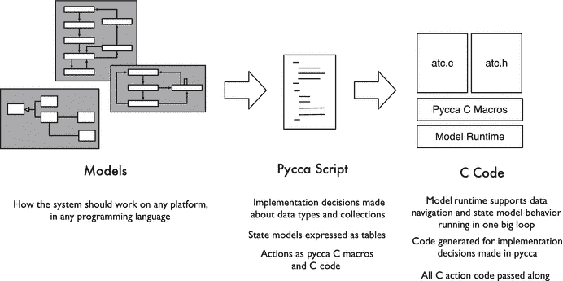
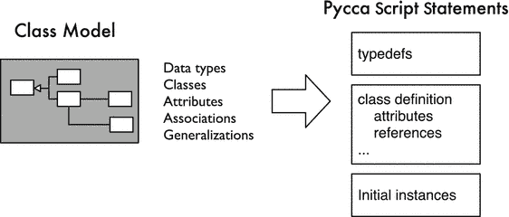
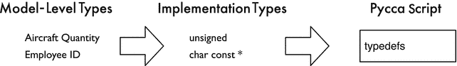
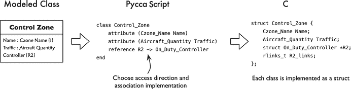
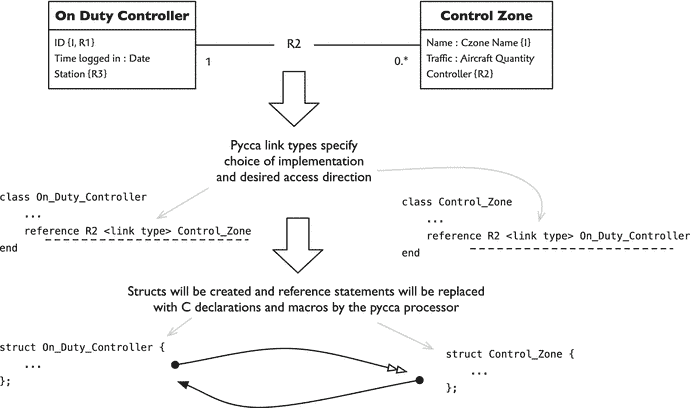
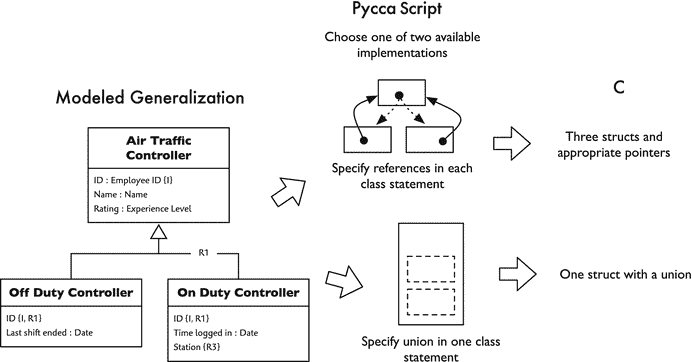
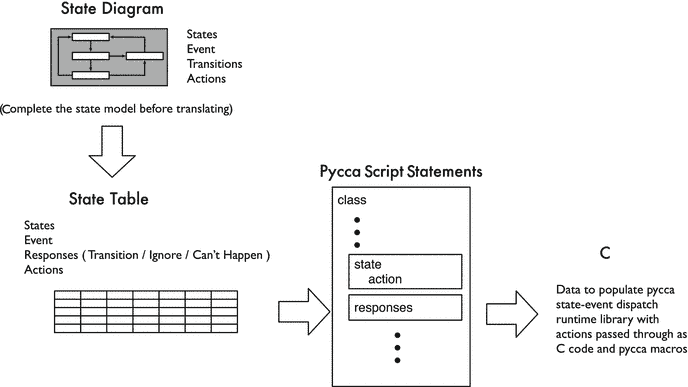

# 3. 做出转换决策

在上一章中，你了解了模糊的陈述如何被转化为具体且无歧义的问题逻辑规约，并实现为一组可执行模型。这些模型包含面向问题的概念，你可以与客户和用户讨论这些概念，以便就相关的问题逻辑做出明智的决策。尽管完成的模型精确地定义了实现应该做什么，但它们并未说明具体如何做。

现在，我们必须决定如何将各种模型元素转换为代码：

*   如何表示程序中的类和实例？
*   标识符属性将如何在内存中实现？
*   实例将如何被访问？
*   关系将如何被导航？
*   事件将如何被发送和调度？

诸如此类。我们必须确保每个模型元素都被转换为代码，以实现所有必需的功能。最重要的是，我们必须得到一个功能正常且高效的实现。在创建模型时，我们专注于分析需求，并使用可执行的建模结构捕获问题的逻辑。在转换模型时，我们必须分析模型本身，以便就实现模型逻辑的适当代码结构做出决策。

本章作为介绍和概述，阐述了转换 ATC 模型时必须做出的关键决策。在后续章节中，我们将亲自动手，开始构建一个 `pycca` 模型脚本来明确指定这些决策。不过，目前我们只是清点一下需要完成的工作。

这里讨论的决策类型既特定于我们的目标平台，也特定于 `pycca` 完成模型转换的方式。这并不意味着转换过程是我们平台和方法独有的。不同的平台必然需要不同的实现策略，因此，从模型元素到实现的映射也各不相同。尽管如此，我们仍将继续聚焦于 `pycca` 和我们特定的目标平台，以说明我们的示例如何变成一个可运行的程序。

## 审视目标平台

目标平台为实际实现设定了边界。例如，我们针对小型嵌入式微型计算机的目标，导致我们将所有应用程序数据保存在可直接寻址的内存中。因为我们打算使用 C 作为实现语言，并且 C 可以暴露变量地址，所以我们决定使用实例的内存地址作为基于实现的标识符。在可能的情况下，我们用这个实现定义的标识符替换模型中的每个标识符。例如，`Duty Station.Number` 被替换为其实例的内存地址。使用基于指针的标识符后，我们就可以使用指针值来导航关系，从而带来许多实现效率。我们的平台使用 C 作为实现语言，但相同的原则可以应用于任何其他静态类型语言，例如 Java。在这种情况下，就需要一个带有兼容运行时库的 Java 特定转换器（比如说，`pyjca`）。但那是另一本书的事了（如果你能弄明白 `pajama` 这个缩写，那就算你厉害）。

图 3-1 展示了我们使用 `pycca` 从模型到代码的整体流程。该模型按两步进行转换。



**图 3-1.** `pycca` 转换概览

第一步是将所有三个层面的模型元素编码到一个单独文件中，作为一系列 `pycca` 语言语句。我们称之为模型脚本。该脚本捕获了模型的结构方面以及它们所执行的处理。此脚本在包含模型元素的同时，也融入了大量的设计决策。稍后，你还需要在脚本中包含 C 代码。（`pycca` 是“传递你的 C 代码”的缩写，而这正是你将传递的 C 代码。）可用的 `pycca` 语句集合定义了一种针对 xUML 模型实现的领域特定语言。我们将随着示例的展开引入该语言，并引导你了解关键概念。如果你想阅读关于 `pycca` 的所有细节，可以随时查阅在线资料。附录 C 中总结了该领域特定语言。

当你的模型脚本完成后，将其输入到 `pycca` 程序中，该程序会将所有 `pycca` 语句以及为活动包含的 C 代码，转换为一对经过特殊组织的源文件和头文件。活动中的 C 代码包含预处理器宏调用，以对接运行时代码。至此，C 预处理器、编译器和链接器将完成所有工作：`pycca` C 宏被展开，并且 `pycca` 提供的运行时库被链接，最终生成一个可运行的程序。

在建模时，我们按照数据、行为和处理这三个层面依次考虑。在进行转换时，我们遵循相同的顺序。实现模型数据层面的转换决策会影响其他层面，因此首先确定应用程序的数据结构至关重要。在以下各节中，我们将展示为转换模型的每个层面所必须做出的实现决策类型。


## 使用类模型

我们首先编写类模型的完整结构。这包括类、属性、数据类型以及所有关系。我们还会通过指定初始实例填充来充实该结构。图 3-2 展示了从类模型派生出的 `pycca` 脚本元素。



图 3-2. 将类模型定义为脚本

类由属性构成，每个属性都受数据类型的约束。因此，数据类型是基本构建模块，必须先定义它们，才能继续处理类模型的其余部分。

### 数据类型

图 3-3 展示了模型数据类型到实现类型的转换。



图 3-3. 数据类型决策

模型数据类型定义了可以分配给类属性的一组值。`Aircraft Quantity` 是一个模型级别的概念，代表实际的飞机数量。这意味着它是一个正整数，因为讨论负数量的飞机是没有意义的。实现数据类型定义了一组编程语言变量允许的值。对应于 `Aircraft Quantity` 的 C 语言数据类型可能是 `unsigned`。请确保选择的实现数据类型支持建模数据类型所需的所有操作。

C 语言的 `typedef` 语句将每个模型数据类型与其关联的实现数据类型绑定。这些 `typedef` 语句可以包含在生成的代码文件顶部。

### 类和属性

每个建模的类都用 `pycca` 的 `class` 语句指定。正如模型数据类型不同于实现数据类型，模型中的类也不同于其对应的实现类。因为 `pycca` 会将每个 `class` 语句转换为 C 语言的 `struct`，所以生成的代码中根本不存在类。

图 3-4 展示了从建模类到 C 结构体的转换。



图 3-4. 将模型类转换为 C 结构体

`class` 语句包含一系列 `attribute` 和 `reference` 语句。每个属性的描述性、标识性和引用性角色需要不同的实现。

描述性属性，例如 `Control Zone.Traffic`，具有现实世界意义。其实现数据类型定义了与此现实世界意义一致的一组值。标识性属性，例如以描述性方式使用的 `Control Zone.Name`，处理方式相同。

相比之下，没有现实世界意义的标识符属性，例如 `Duty Station.Number`，则会被直接删除。`Pycca` 会为每个类实例创建一个由实现定义的标识符。如果模型标识符不用于任何描述性目的，我们可以用生成的标识符来替换它。这种技术在实现语言中非常常用，以至于我们往往忽略了正在用一个标识符替换另一个标识符这一事实。

### 关联

引用性属性，例如 `Control Zone.Controller`，是在关联的上下文中处理的。关联和引用性属性的规范需要更多考量，因为在“此类与彼类相关”的模型级别抽象与实现中的集合与指针遍历机制之间存在显著差距。模型有意将许多选择权留给实现者。例如，我们可以选择对特定关联使用链表或数组遍历机制，或者使用自平衡树。为了做出决定，我们需要检查每个关联的运行时特性，然后将该决定编码到 `pycca` 语句中，并让 `pycca` 处理器生成相关的 C 代码。

当一个实例必须引用单个相关对象时，最简单的方法是将引用性属性映射为指针。因为引用性属性引用的是关联类的标识性属性，并且我们使用实例的地址作为实现定义的标识符，所以在引用性属性的位置上存储一个指针值，就实现了模型级别的关联。

这种方法在跟随指针时效果很好，但在反向操作时会很麻烦，因为这意味着我们必须搜索一个类的所有对象来寻找匹配的指针值。考虑到指针占用的内存代价，在两个类中都存储指针可以使两个方向的访问都变得高效。另一方面，如果不存在从“一侧”到“另一侧”的访问，单侧引用方法就足够且高效了。

因此，我们通过检查每一侧的需求，并将每个模型关联视为两个独立的访问方向，来着手实现关联。图 3-5 展示了关联 `R2` 是如何分解为从 `On Duty Controller` 指向 `Control Zone` 的一个方向，以及从 `Control Zone` 指向 `On Duty Controller` 的相反方向的。



图 3-5. 分解模型关联

然后，我们根据访问方向、多重性和可变性，为关联的每个方向决定实现方案：

- **访问**：关联是否仅从一侧被访问？还是两侧都被访问？只有被访问的一侧才需要存储引用。该访问的频率如何？
- **多重性**：每侧有多少实例参与关联？多重性为一时，实现为单个指针值。如果多重性大于一，则必须存储多个指针值，而 `pycca` 为我们提供了几种常见的存储安排。
- **可变性**：参与关联的实例是静态的，还是会随时间变化？如果参与关联的实例发生变化，我们将指针值存储在更新高效的数据结构中。

当转换模型时，我们为关联的每一侧决定一个实现方案。因此，对于上述示例，我们可能会选择将对 `Control Zone` 到 `On Duty Controller` 的关联实现为指针，而 `On Duty Controller` 到 `Control Zone` 的方向则更倾向于使用链表。然后，我们通过使用适当的 `reference` 语句类型，将这些决策编码为文本。还有更多的选择，但关键点在于，在编码模型时，您必须决定一个实现方案，并且该决策应基于模型的执行特性。


### 泛化

在我们的泛化解释中，每个子类的实例恰好引用一个超类实例，而每个超类实例恰好引用所有子类中的一个子类实例。这意味着，当我们从超类实例遍历到一个特定子类的关系时，我们要么找到一个相关的实例，要么因为该超类实例实际上并不与那个特定子类的实例相关而一无所获。为了实现从超类到子类的遍历，`pycca` 在超类类定义中使用了一个 `subtype` 语句。结果是，`pycca` 向生成的 C 结构体添加了一个额外的成员，该成员编码了相关的子类。这使我们能够从超类导航到子类，并知道是否找到了一个相关的实例。

子类对象的存储可以通过两种方式之一实现。图 3-6 展示了这两种替代方案。



**图 3-6.** 泛化实现替代方案

一种方法是将每个子类/超类关系视为双向关联。在这种表述中，每个`On`和`Off Duty Controller`实例都需要一个指向其对应`Air Traffic Controller`实例的`reference`。在`Air Traffic Controller`中的`subclass`语句将被声明为一个`reference`子类，并且一个指向该子类的指针将作为另一个`ATC`结构体成员生成。

另一种方法是存储相关的子类作为一个 C `union` 的成员。在这种表述中，ATC 超类中的 `subclass` 语句将被声明为 `union` 类型。`Pycca` 生成超类的结构体，使其包含一个 C `union` 成员，该成员包含了泛化的子类结构体。这样，子类实例的空间就被包含在超类实例的空间中。这种技术在 C 语言中非常常见，用于实现一种继承形式，尽管这里我们的意图并非继承。子类实例不再需要指向超类的`reference`，并且遍历泛化是通过指针算术而不是指针间接引用完成的。

这两种方法各有利弊。对于简单情况，`union` 表述在空间上更高效。

## 初始实例填充

数据翻译的最后一部分是指定初始实例填充。这些是在系统启动时应该就位的类实例。这类似于为状态模型指定起始状态。随着系统随时间演变，属性值会从已知的起始值发生变化。

我们的策略是直接将初始实例数据作为变量初始化器放入内存中，这样就不需要在初始化时编写代码来创建实例。通常会有少量初始化代码将数据初始化器复制到它们正确的内存位置。这是 C 语言的一种保证，该代码通常作为编译器库提供，并在调用 `main` 之前运行。这消除了将内存浪费在只执行一次的代码上。并且我们也避免了编写繁琐的代码序列来设置结构体成员的值。同样重要的是，初始实例填充使我们在运行时之前就能洞察如何生成更高效的代码。

领域的初始填充在第二章 [#A421575_1_En_2_Chapter.html] 中以表格形式指定。我们可以为每个类对表格进行编码，并将该类的实例存储为一个初始化的 C 数组。描述性属性被分配给数组元素初始化器中的相应结构体成员，如下所示：

```
table Control_Zone
(Czone_Name Name)        (Aircraft_quantity Traffic)        R2
@sfo    {"SFO37B"                {27}                               -> atc53
@oak    {"OAK21C"                {18}                               -> atc67
@sjc    {"SJC18C"}               {9}                                -> atc51
end
```

因为我们为每个类实例生成了一个实现定义的标识符（即内存中对象的地址），所以我们需要一种方式来引用这些实例，以指定关联和泛化的指针值。我们不能使用实际的地址，因为它们在链接时才知道。所以 `pycca` 允许你用 `@` 符号在左侧关联一个可选名称，并在指定 `reference` 值时使用该名称。`Pycca` 会跟踪命名实例在分配的存储数组中的位置，并发出正确的地址表达式作为初始化器。为实例命名是可选的，但如果你不命名，以后就无法引用它。

`Pycca` 还允许你指定一个类的填充是 `static` 还是 `dynamic`，这表示实例是在运行时创建还是删除。对于 `static` 填充，只分配足以容纳初始实例填充的空间。对于 `dynamic` 填充，总分配空间既包含初始实例填充，也包含为其声明的额外 `slots` 数量。所有类在编译时都有一个固定大小的存储池分配给它。运行时库管理每个池以进行动态分配，但类实例的数量永远不会超过存储池大小所允许的数量。这意味着类实例永远不会在系统堆上分配，并且运行时库不会调用 `malloc`。这符合嵌入式微控制器的常见设计约定。

填充也可以被标记为 `constant`。对于嵌入式系统，内存通常被划分为只读和读/写类型。通常只读内存比读/写内存多得多。`constant` 填充被放置在只读内存中，这意味着其属性无法更新，并且不能有关联的状态模型。仅包含规范数据的模型类通常可以标记为 `constant`，从而节省 RAM 内存。


## 描述状态模型

在上一章中，我们用图形方式描绘了状态模型，因为图表更易于可视化，并有助于设计出完善的解决方案。但就测试、实现和错误分析而言，这种表示方式并不完整，因为状态图侧重于预期的正常行为。该图并未展示如何处理已发生但未触发转换的事件。实现后，状态机往往会出现一个恼人的趋势，即执行那些意料之外的转换。意外事件是否需要错误处理？或者该事件已被预见，但不需要进行状态转换？

当事件被分派时，有三种可能的响应：

- 转换到新状态。
- 忽略该事件。
- 在给定状态下，该事件在逻辑上不可能发生。

第一种响应，即状态转换，代表了常见且预期的行为。

有时，对待事件的最佳方式，就像对待孩子一样，是忽略它们。事件可能来得太晚或太早。考虑一下，在电梯门已经打开后按下“开门”按钮的响应。被忽略的事件属于正常行为范畴，并不构成任何形式的错误。它只是不值得进行状态转换，并用 `IG`（忽略）响应来表示。

第三种响应则完全不同。它表示在给定当前状态下，该事件在逻辑上不可能发生，并用 `CH`（不可能发生）响应来表示。如果它确实发生了，则被视为严重错误。当运行时代码遇到 `CH` 转换时，会导致系统错误。重要的是，不要将 `CH` 转换理解为“不应发生”或“不常发生”的情况。`CH` 转换意味着在任何情况下，它在逻辑上都不可能发生，而一旦发生，我们就不知道如何继续处理了。无论某个事件在某个状态下发生的概率有多小，只要该概率不为零，它就不是 `CH` 转换。

图 3-7 展示了从状态图到其翻译后代码的演进过程。状态表为每个状态下的每个事件指定了一个明确的响应（前面提到的三种之一）。在前两种情况下，转换和忽略表示该响应可以被且应该被建模。但对于 `CH` 响应，建模者表示该模型并非为处理这种情况而设计。



**图 3-7.** 翻译状态模型

现在，我们通过使用 pycca `machine` 语句来指定每个 `state` 模型的状态。每个状态及其活动代码通过 `state` 语句来指定。状态表的每个单元格通过 `transition` 语句来指定。`transition` 语句记录了某个事件从对象的当前状态引发 `transition` 所进入的新状态。

```
class Air_Traffic_Controller
#
## attribute and reference statements
#
machine
#
## state and transition statements
#
end
end
```

### 状态

每个状态都有一个与之关联的活动，我们将其捕获为一个函数。由于活动是在进入状态时执行的，所有指向该状态的入站转换都必须携带相同的事件数据，这些数据作为参数传入。

每个状态及其相关联的活动（在进入状态时执行）通过 `state` 语句来表示：

```
state Verifying_Adequate_Break(Station_number Station_id)
{
// C code intermixed with C macros that perform common
// model-level operations such as signal generation and
// relationship navigation.
}
```

我们将在第 4 章中介绍活动规范，但您在这里可以看到，状态中的活动被包含在 `state` 语句内。

### 事件、转换和响应

状态转换通过状态模型来指定对事件的响应：

```
transition OFF_DUTY - Ready_for_duty -> Verifying_Adequate_Break
```

该语句表示，当处于 `OFF_Duty` 状态时，`Ready_for_duty` 事件会导致转换到 `Verifying_Adequate_Break` 状态。对于事件，没有 pycca 语句。它们的名称取自 `transition` 语句。

### 执行状态机

当我们翻译类模型时，数据操作的某些方面（例如对属性的访问）会由相应的 C 语言结构直接支持。另一方面，状态机并非 C 语言的原生结构。为了执行它们，我们必须提供额外的代码（也用 C 语言编写），以实现状态机的行为，例如在调用转换时分派信号和调用状态活动。

`transition` 语句静态地对状态模型进行编码，我们需要运行时代码来使用生成的数据结构以引发转换。当分派一个信号时，运行时代码使用已发出信号的事件和当前状态来确定新状态。然后，通过调用一个单一函数，它执行新状态的逻辑。在第 5 章中，我们将精确展示运行时代码如何发出信号和分派事件。

## 翻译处理过程

最后一步是将模型的动作语言所表达的处理过程翻译成 C 语言。翻译不会以任何方式增加处理逻辑。我们只关心生成与动作语言语句所指定的处理逻辑在逻辑上等价的 C 代码。所有处理过程都由动作语言表达。当翻译成 C 语言后，状态的动作会被 pycca 打包成一个函数，该函数在进入状态时被调用。

### 从模型编码

策略是取每一行动作语言，并编写相应的 C 代码。当我们分析这些动作时，会发现这些元素只属于少数几个类别。这些通常包括模型执行函数、数据访问操作、以及标准的数学表达式和流程控制语句。

动作语言语句可能会调用模型执行架构的某个方面。这些包括信号生成和关系遍历。这类元素可以通过替换为 pycca 提供的众多 C 宏之一来翻译。这些宏隐藏了有关数据结构以及信号可能如何实现的决策。

数据访问通过正常的 C 机制来实现，即通过指针访问结构体成员。为了实现这一点，每个状态动作都有一个指向实例内存的 `self` 变量。动作代码可以使用诸如 `link` 和 `unlink` 之类的宏来跨关联查找和操作数据，这些宏隐藏了关联的实现。

状态动作代码还必须与运行时事件分派器接口以生成事件。我们提供了一组辅助的 C 预处理器宏，以便我们可以使用与状态模型中相同的事件名称。Pycca 会生成预处理器符号定义，将状态和事件名称编码为数字。该编码的命名约定被一组预处理器宏隐藏，因此您可以使用状态模型定义中的名称，即使我们最终必须生成 C 编译器能够识别的内容。

所有其他动作，例如计算和流程控制，都直接以 C 语句的形式编写，并直接传递到输出代码文件中。

### 翻译模型

这里有一套工作方法，任务执行的顺序已经被确定下来以获得最佳结果。在下一章中，我们将展示如何使用本章描述的决策过程来翻译 ATC 模型。我们将重复这里采取的步骤，并替换为 ATC 模型的具体细节。


### 总结

我们已经研究了在`pycca`模型脚本中必须指定的关键翻译决策，以便生成适当的 C 代码，并在某些情况下将其传递下去。

类模型被拆分为数据类型、类、属性和关系定义。我们将类定义转换为最终成为 C 结构体声明的`pycca`类定义。初始实例填充以表格形式指定，再被转换为一组数组初始化器。

以表格形式表示的状态模型，被指定为一系列状态和事件/响应语句。状态模型定义了数据结构值（包括状态表），供运行时事件调度机制使用。每个状态活动都会被转换为一个函数。

编码后的源代码与 C 输出之间的对应关系是直接且可预测的。`Pycca`生成了所需的各种任意编码，例如将事件名称编码为整数；它计算关系引用的指针值，并以适合 C 编译器的方式对生成的代码进行排序。最终结果是一对普通的 C 代码和头文件，可集成到系统构建中。

