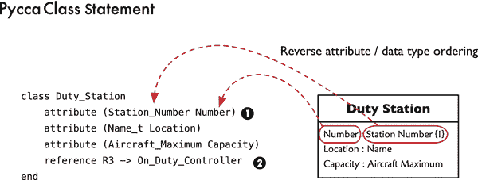
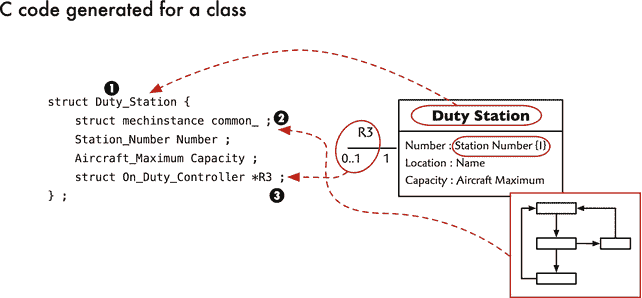
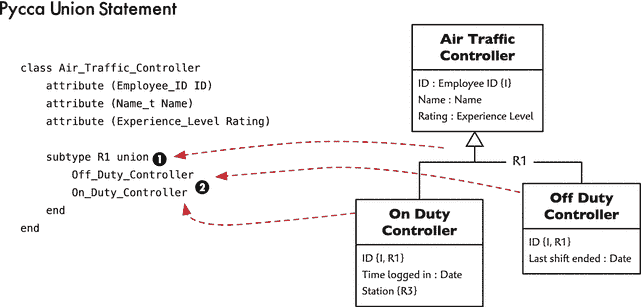
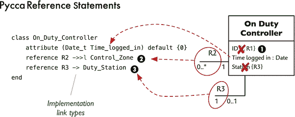

# 4. 翻译空中交通管制模型

在上一章中，我们简要介绍了翻译`xUML`模型过程中做出的关键决策。现在，我们要为第 2 章中介绍的 ATC 示例着手制定这些决策。我们准备了一个`pycca`模型脚本，并检查生成的 C 代码。本章的主题侧重于实现，我们假设你熟悉 C 语言。由于篇幅所限，我们无法在此展示所有代码，但如果你有兴趣查看整个 ATC 项目（包括所有代码），欢迎从[`www.modelstocode.com`](http://www.modelstocode.com)下载。

我们按照类、状态和动作的顺序来翻译`xUML`的三个层面。翻译类模型指定了代码操作所依据的实体。翻译状态模型确定了代码的执行顺序和同步机制，并建立了执行大多数动作所需的结构。翻译动作则实现了算法处理。通过翻译所有三个模型层面，我们就能得到一个完整的可运行程序。

## Pycca 语法概述

`Pycca`读取一个或多个模型源文件，并生成一对 C 头文件和源文件。直接写在模型文件中的 C 代码将被重新排列，并与`pycca`生成的额外 C 代码混合在一起。`Pycca`具有以下语法约定：

- 注释：注释以井号字符（`#`）开头，并持续到行尾。
- 符号名称：符号名称遵循 C 标识符的语法。名称必须以字母开头，后跟任意数量的字母、十进制数字或下划线（`_`）字符。模型可能在类名或属性名中使用空格，这些空格在翻译过程中必须被消除或替换，因为名称将直接用作 C 标识符。
- C 代码：任何用花括号（`{}`）括起来的内容都会直接传递给 C 编译器。
- 变量声明：任何用圆括号（`()`）括起来的内容都被视为 C 变量声明的逗号分隔列表（可能为空）。

## Pycca 文件的结构

`pycca`文件中最大的组织单元是一个域。ATC 示例围绕单个应用程序域展开，尽管你可能已经注意到一些与外部域协调的动作。在第 6 章中，我们将探讨一个多域示例，但对于这个`pycca`文件，我们将只保留一个域。

域定义是累积性的。如果在后续输入中遇到相同的域名，则后面定义中的任何内容都将被合并到现有域中。域的定义如下：

```
domain atctrl
### 模型语句（数据类型、类等）
end
domain atctrl
### 额外的 atctrl 模型语句
### 例如，初始实例填充。
### 域语句也可以放在单独的文件中。
end
```

在翻译空中交通控制器模型的过程中，我们将根据需要介绍构成域内容的模型语句。作为参考，所有可能的模型语句都可以在线材料中找到。你无需担心域部分中模型语句的顺序。`Pycca`在尝试生成任何输出之前，会解析其所有输入。它会调整生成输出的顺序以满足 C 编译器的需求。

`Pycca`假定存在实现数据管理和状态模型所需事件处理的运行时函数。我们将在第 5 章中讨论运行时库。目前，只需知道一小段代码通过生成信号并调度相应事件来管理执行，从而触发转换并调用状态活动，这就足够了。你可以使用`pycca`提供的预处理宏，作为一种便捷的方式，为这些活动与运行时代码进行交互。

## 翻译类模型

我们首先翻译模型中与数据处理相关的部分。我们指定数据类型，然后是类定义，最后是初始实例填充。


### 数据类型

以下是领域的数据类型实现。数据类型分为接口类别和实现类别。接口类别指那些为了交互目的必须在领域外部可见的类型，它们被放入可供其他代码包含的头文件中。实现类别则包含领域内所有其他数据类型。通常，大多数数据类型都属于实现类别。如果有助于理解，你可以将这两种类别分别视为领域的公共和私有部分。

*   ❶ 在此 `pycca` 源码中，我们展示了外层的 `domain` / `end` 语句。在本章后续部分，我们假设所有领域组件定义都包含在外层的 `domain` 语句中，因此不再赘述这些容器语句。
*   ❷ 本节定义了作为领域外部接口所需的部分声明。这里我们包含了描述与其他领域交换参数的 `typedef` 语句。对于 `atctrl` 领域，存在用于报告错误和警告情况（通常发送给用户界面领域）的外部调用，这些调用中包含员工标识符的值。因此，我们必须让该值的数据类型对接口可见。接口序言代码被放置在生成的 C 头文件的顶部。任何额外需要的包含文件或其他声明都可以作为 `interface prolog` 的一部分包含进来。
*   ❸ 我们谨慎地将不可变值声明为 `const`。对于嵌入式系统，我们可以引导链接器将常量放置在非易失性存储器（例如闪存）中，这种存储器的容量通常远大于 RAM。在 C 语言中，字符串字面量是常量，我们当然不希望有一段代码更改员工姓名中的某个字符。
*   ❹ 本节定义了领域内部使用的声明，因此对外部不可见。`implementation prolog` 文本被放置在生成的 C 头文件的顶部。此部分也可用于包含可能作为领域处理过程一部分使用的外部库的声明（例如，标准 C 库、数学库或来自遗留系统的核心算法）。
*   ❺ 我们将这些类型命名为 `Name_T` 和 `Date_T`，与模型名称不同，这是因为 `pycca` 存在一个限制，即不允许属性和类型拥有相同的名称。

```
domain atctrl                                      ❶
# ....
#  其他 领域 组件
# ....
interface prolog {                             ❷
typedef char const *Employee_ID ;          ❸
typedef char const *Station_Number ;
typedef char const *Czone_Name ;
}
implementation prolog {                        ❹
typedef char const *Name_T  ;              ❺
typedef time_t Date_T ;
typedef unsigned Aircraft_Quantity ;
typedef unsigned Aircraft_Maximum ;
typedef unsigned Duration ;
typedef char const *Experience_Level ;
#include  
#include 
#include 
#include "atctrl.h"
}
# ....
#  其他 领域 组件
# ....
end
```

### 类定义

`Pycca` 会将模型文件中的每个类定义转换为一个 C 结构体定义。在接下来的章节中，我们将展示第 2 章空中交通管制员模型中部分模型类的 `pycca` 类定义。请在阅读时参考第 2 章中的模型类。

#### 值班工作站

我们从一个简单的类 —— 值班工作站开始。图 4-1 展示了类模型图形与 `pycca` 源码之间的对应关系。在 `pycca` 源码中，我们严格遵循模型中使用的属性和关系名称。随意更改名称并打乱模型与代码之间的对应关系毫无益处！

*   ❶ 我们保留了 `Number` 标识属性，因为它的值会在一个活动中用到。
*   ❷ `Duty_Station` 参与了一个简单关系 `R3`。从 `Duty_Station` 到 `On_Duty_Controller` 遍历的 `R3` 关系的重数最多引用 `On_Duty_Controller` 的一个实例（UML 表示法中的 `0..1`）。使用 `->` 的 `reference` 语句指明了这种重数。重数表达式中的零表示条件性，意味着在任意给定时刻可能没有关联的实例。这个思想通过让 `R3` 成员取 `NULL` 值来实现。



**图 4-1.** 指定值班工作站类

模型中将属性显示为名称后跟数据类型，而在模型源文件中，我们遵循 C 语法，即数据类型在前，属性名在后。任何括号内的内容都必须遵循 C 变量声明语法，因为它将直接传递给 C 编译器。

`Pycca` 会将每个类语句转换为一个 C 结构体定义。图 4-2 展示了值班工作站类的模型图形与 `pycca` 生成的 C 结构体之间的对应关系。

*   ❶ 注意，类名直接用作结构体名称，因此你必须选择有效的 C 标识符作为类名。
*   ❷ `Pycca` 插入此成员供运行时在管理类的数据和状态处理时使用。不需要这些运行时功能的类将不会获得此结构体成员。该结构体成员的用法将在第 5 章中详细描述。
*   ❸ 单数形式的 `reference` 语句被转换为指向结构体的指针。



**图 4-2.** 为值班工作站类生成的 C 代码

该结构体定义与 `pycca` 语句存在直接的对应关系。类的属性成为结构体成员。简单关系则实现为指向相关结构体类型对象的指针。


#### 空中交通管制员

对于`Air Traffic Controller`类，我们遵循与`Duty Station`类相同的属性原则。该类的额外考量在于`R1`泛化。图 4-3 展示了将模型图形编码为 pycca 语句的过程。

* ❶ 此语句将`R1`声明为一个泛化，其子类将作为联合体成员保存在`Air_Traffic_Controller`结构中。我们选择`union`实现，因为它最适合简单场景。
* ❷ 尚未定义子类也没关系，Pycca 对定义的顺序没有强制要求。



图 4-3. 使用联合体指定超类

与`Duty Station`类类似，pycca 为`Air Traffic Controller`类生成了一个 C 结构定义：

* ❶ 此声明中新增的结构体成员是`R1__code`和`R1`。`R1__code`成员保存一个小整数，用于编码当前与超类实例关联的`union`元素，pycca 会为这些编码值提供预处理器定义。`R1`结构体成员是一个联合体，包含了参与`R1`泛化的所有子类。

```
struct Air_Traffic_Controller {
struct mechinstance common_ ;
Employee_ID ID ;
Name_T Name ;
Experience_level Rating ;
SubtypeCode R1__code ; ❶
union {
struct Off_Duty_Controller R1_Off_Duty_Controller ;
struct On_Duty_Controller R1_On_Duty_Controller ;
} R1 ;
} ;
```

从模型执行的角度来看，当从`Air Traffic Controller`类导航至其某个子类时，我们必须能够判断跨`R1`的遍历是否返回空结果。因此，如果我们有一个`Air Traffic Controller`的实例，并跨`R1`导航至`Off Duty Controller`类，那么该`Air Traffic Controller`实例可能当前并未与某个`Off Duty Controller`类实例关联（即，它当前关联的是某个`On Duty Controller`实例）。导航操作将返回空集，我们必须能够判断这一点。

从实现的角度来看，我们需要知道如何解释`R1`结构体成员。通过测试`R1__code`的值，我们可以确定联合体中当前正在使用的是哪个元素。通过将子类放在`R1`联合体成员中，就无需为`R1`泛化分配额外的存储空间。我们可以通过适当的指针算术来遍历`R1`。Pycca 提供了宏来完成繁重的工作，并有助于防止常见错误。不必担心 pycca 在此上下文中使用了关键字`subtype`。

#### 值班管制员

数据转换的最后一个示例是`On Duty Controller`类。该类的一个关键决策是如何存储`R2`关联的信息。通过考虑领域动作，我们发现`R2`将一个`On Duty Controller`实例与多个`Control Zone`实例关联起来，并且该关联本质上是动态的。动作会将`On Duty Controller`实例与任意数量的`Control Zone`实例进行链接和取消链接。我们需要一个关系存储的数据结构，以支持`R2`的多重性和动态性。Pycca 提供了一种合适的链表机制。这对于`R2`是有效的，但通常（尤其是在嵌入式系统中），关联在应用程序运行期间是静态的。因此，pycca 还提供了一种适用于静态关联的引用值存储方式。图 4-4 展示了`On Duty Controller`类的指定方式。

* ❶ 由于我们选择将子类作为联合体组合到超类中，因此弃用了`ID`属性。实现`R1`关系并不需要它，并且如果需要，它的值可以从超类获取。`Time_logged_in`的默认值为零，因为我们使用的是 POSIX 时间表示，零用于指示未知的登录时间。
* ❷ `->>l`（小写字母`l`）表示法告诉 pycca 使用链表来存储`Control Zone`方向的`R2`关联的实例引用。这是第 3 章中提到的用于存储实例引用以实现关联的链接类型之一。
* ❸ `->`表示法告诉 pycca，`R3`的存储将是指向`Duty_Station`类的单个实例引用。



图 4-4. 指定`On Duty Controller`类

Pycca 生成以下代码：

* ❶ Pycca 将提供必要的数据结构和代码来处理链表。
* ❷ 关系`R3`的存储仅仅是一个指向`struct Duty_Station`的指针。由于从`On Duty Controller`到`Duty Station`的`R3`关系多重性为一，因此`R3`成员的值在任何时候都不应为`NULL`。`R2`成员是链表的头，我们可以将一组`Control_Zone`链接到该链表上。

```
struct On_Duty_Controller {
Date_T Time_logged_in ;
rlink_t R2  ;                 ❶
struct Duty_Station *R3 ;     ❷
} ;
```

其他建模的类遵循类似的模式，因此我们不再在此复述。该模型的完整 pycca 源代码（以[文学编程](http://www.literateprogramming.com/)的形式）可在本书的[网站](http://www.modelstocode.com/)上找到。


## 初始实例填充

类模型完全转换后，还需要完成一件事才能使用：初始实例填充。这是一组在系统初始化时存在的实例。`Pycca` 可以将初始填充作为已初始化的变量存入内存，因此初始化期间无需编写创建实例的代码。这在实例填充通常是静态的嵌入式系统中尤为重要。对于动态填充，实例可以在运行时之前和期间创建。

在第 2 章中，以表格形式展示了空中交通管制领域的示例实例。`Pycca` 支持一种用于指定初始实例填充的表格语法。（此外还有一种更便于指定单个实例的语法。）以下 `pycca` 代码为我们示例指定了初始实例填充：

* ❶ 对于关系存储，我们处理的是指针。通过为实例命名（使用 `@<name>` 语法），可以在关系初始化器中引用这些实例。`Pycca` 会跟踪命名实例在已分配的存储数组中的位置，并生成正确的地址表达式。在为泛化关系指定子类实例时，还需要使用所示的点号表示法给出子类名称。
* ❷ 对于单数关系路径，`->` 表示法指示要关联的实例名称。
* ❸ `Pycca` 将某个类的所有实例存储在一个 C 数组中。描述性属性（例如 `Location`）被赋值给数组元素初始化器中相应的结构体成员。这些值用花括号（`{}`）指定，因为 `pycca` 会将花括号内的内容直接传递给 C 编译器。这意味着我们可以使用任何有效的 C 常量表达式作为属性初始化器。

```
table Air_Traffic_Controller
(Employee_ID ID) (Name_T Name) (Experience_Level Rating) R1
@atc53  {"53"} ❶        {"Toshiko"}   {"A"}    -> On_Duty_Controller.atc53 ❶
@atc67  {"67"}           {"Gwen"}      {"B"}    -> On_Duty_Controller.atc67
@atc51  {"51"}           {"Ianto"}     {"C"}    -> On_Duty_Controller.atc51
end
table On_Duty_Controller
R2               R3
@atc53      ->> sfo end      -> s2 ❷
@atc67      ->> oak end      -> s1
@atc51      ->> sjc end      -> s3
end
table Control_Zone
(Czone_Name Name)    (Aircraft_Quantity  Traffic)      R2
@sfo    {"SFO37B"}           {27}                              ->  atc53
@oak    {"OAK21C"}           {18}                              ->  atc67
@sjc    {"SJC18C"}           {9}                               ->  atc51
end
table Duty_Station
(Station_Number  Number)  (Name_T  Location)  (Aircraft_Maximum  Capacity)
@s1  {"S1"} ❸                 {"Front"}           {20}
@s2  {"S2"}                    {"Center"}          {30}
@s3  {"S3"}                    {"Front"}           {45}
end
```

`Pycca` 将初始实例填充转换为带有初始化器值的结构体数组。每个类都有一个单独的数组作为其内存池。以下是为初始实例生成的 C 变量和初始化器：

* ❶ 回想一下，`Air_Traffic_Controller` 类是一个包含 `R1` 子类的联合体，因此没有为子类分配单独的存储空间。子类属性的值直接包含在超类的初始化器中。
* ❷ `common_` 成员保存了一个分配编号、当前状态以及指向类不变数据的指针。这是运行时代码管理实例所需的数据。在第 5 章中，我们将从运行时代码的角度讨论实例，并详细介绍该结构体成员的实际用途。
* ❸ `Control_Zone` 类没有状态模型，而且其所有实例都属于初始实例填充。因此，其类结构体中没有 `common_` 成员，因为运行时无需以任何方式管理这些实例。

```
/*
初始实例存储，"Air_Traffic_Controller"
*/
static  struct  Air_Traffic_Controller  Air_Traffic_Controller_storage[3]  =   {   ❶
{❷.common_ = {1, 0, &Air_Traffic_Controller_class}, "53", "Toshiko", "A", .R1   code = ,
1, .R1 = {.R1_On_Duty_Controller = {0, .R2 = {.next = &Control_Zone_storage[0].
R2__links, .prev  =  &Control_Zone_storage[0].R2__links}, .R3  = &Duty_Station_storage
[1]}}},
{.common_ = {2, 0, &Air_Traffic_Controller_class}, "67", "Gwen", "B", .R1__code = 1, .
R1 = {.R1_On_Duty_Controller = {0, .R2 = {.next = &Control_Zone_storage[1].R2__links
, .prev = &Control_Zone_storage[1].R2__links}, .R3 = &Duty_Station_storage[0]}}},
{.common_ = {3, 0, &Air_Traffic_Controller_class}, "51", "Ianto", "C", .R1__code = 1, .
R1 = {.R1_On_Duty_Controller = {0, .R2 = {.next = &Control_Zone_storage[2].R2__links
, .prev = &Control_Zone_storage[2].R2__links}, .R3 = &Duty_Station_storage[2]}}}
} ;
/*
*初始实例存储，"Control_Zone"
*/
static struct Control_Zone Control_Zone_storage[3] = { ❸
{"SFO37B", 27, .R2 = &Air_Traffic_Controller_storage[0].R1.R1_On_Duty_Controller, .
R2__links = {.next = &Air_Traffic_Controller_storage[0].R1.R1_On_Duty_Controller.R2,
.prev = &Air_Traffic_Controller_storage[0].R1.R1_On_Duty_Controller.R2, }},
{"OAK21C", 18, .R2 = &Air_Traffic_Controller_storage[1].R1.R1_On_Duty_Controller, .
R2__links = {.next = &Air_Traffic_Controller_storage[1].R1.R1_On_Duty_Controller.R2,
.prev = &Air_Traffic_Controller_storage[1].R1.R1_On_Duty_Controller.R2, }},
{"SJC18C", 9, .R2 = &Air_Traffic_Controller_storage[2].R1.R1_On_Duty_Controller, .
R2__links = {.next = &Air_Traffic_Controller_storage[2].R1.R1_On_Duty_Controller.R2,
.prev = &Air_Traffic_Controller_storage[1].R1.R1_On_Duty_Controller.R2, }}
} ;
/*
*  初始实例存储，"Duty_Station"
*/
static struct Duty_Station Duty_Station_storage[3] = {
{.common_ = {1, 0, &Duty_Station_class}, "S1", "Front", 20, .R3 = NULL},
{.common_ = {2, 0, &Duty_Station_class}, "S2", "Center", 30, .R3 = NULL},
{.common_ = {3, 0, &Duty_Station_class}, "S3", "Front", 45, .R3 = NULL}
} ;
```

回想一下，`R2` 被实现为一个以 `Air_Traffic_Controller` 实例为起点的链表。`Pycca` 会正确初始化 `Air_Traffic_Controller` 和 `Control_Zone` 存储数组中的链接指针。初始化器中的指针值是指向存储数组元素及其结构体成员的常量表达式。`Pycca` 将实例分配到存储数组，因此可以指定这些地址计算。请注意，这些表达式在链接器放置了存储数组的基地址后，会在链接时绑定到一个内存地址。

## 翻译状态模型

翻译的第二个方面是指定状态模型。所有包含状态模型的类都会在 `pycca` 中有一个对应的机器定义。状态模型同时指定了转换以及在进入某个状态时执行的 C 代码。某个状态的 C 代码被直接放置在类的状态模型定义中。我们暂时省略 C 代码，以便更好地展示状态模型的转换部分。在下一节“翻译动作”中，我们将引入 C 代码。我们在状态定义中将动作语言作为 C 注释包含在内。在将其翻译为 C 代码时，将动作语言放在附近尤为方便。


### 岗位状态模型

我们建议您阅读时对照第 2 章的图 2-6 中的岗位状态模型，以便直观地理解模型元素与 `pycca` 语句之间的对应关系。

该状态模型通过一个 `machine` 语句进行编码：

- ❶ 类的状态模型完全在 `machine` 语句内定义。
- ❷ 此处我们定义一个状态。该语句指定了状态名称以及通过传入转换传递的任何参数。根据摩尔状态模型形式化规范，一个状态的所有传入转换必须提供相同的参数集。事实上，岗位状态模型在其任何转换上都没有定义参数。
- ❸ `transition` 语句定义了状态模型转换（即，当此类的实例接收到事件时会发生什么）。转换由起始状态、接收的事件以及作为转换目标的新状态共同定义。事件无需单独定义，事件名称是从 `transition` 语句中收集而来的。
- ❹ 状态活动最终将是 C 代码，不是自动生成的，而是直接手写在模型源文件中。不必惊慌；`pycca` 提供了一组 C 宏，您可以用它们替代大部分模型动作。我们将在后面详细讨论这些内容。目前，我们只是将建模的动作语言作为注释复制进来。即使之后用 C 代码替换了它们，最好也保留原始动作语言作为注释。

```
class Duty_Station
# ... 岗位定义的其他部分，属性等
Machine                                                           ❶
state AVAILABLE()                                             ❷
{
// empty
}
transition AVAILABLE - In_use -> IN_USE                       ❸
state IN_USE()
{
//+ Max shift exceeded  ->  me  after Shift               ❹
//+     Specification().Max shift // 选择单例
}
transition IN_USE - Max_shift_exceeded -> MAX_SHIFT_EXCEEDED
transition IN_USE - User_leaving -> Canceling_Shift_Timeout
state MAX_SHIFT_EXCEEDED()
{
//+ UI.Break required( Station: Number )
}
transition MAX_SHIFT_EXCEEDED - User_leaving -> AVAILABLE
state Canceling_Shift_Timeout()
{
//+ cancel Max shift exceeded -> me
//+ Available -> me
}
transition Canceling_Shift_Timeout - Available -> AVAILABLE
end
```

`pycca` 源代码是状态模型图形的直接转写。指定状态的语法类似于带有参数（来自触发事件，本例中无参数）和要执行的代码（活动）的函数定义。

`state` 和 `transition` 语句没有特定的顺序要求。此处我们将传出转换紧跟在它们所属的状态下方。另一种便捷的组织方式是将所有转换语句放在一起，以强调其与状态模型转换矩阵的对应关系。

一组数据结构为给定类编码了所有状态行为。运行时代码使用这些数据结构将事件分派到状态机。`pycca` 的一个重要功能是生成运行时事件分派代码所使用的数据结构。`pycca` 将状态模型规约转换为一组已初始化的变量，这些变量的值描述了如何分派事件以及在转换发生时执行什么处理。分派代码使用状态模型的表格化编码。对于类的所有实例，事件分派的行为都是相同的。确定转换和执行状态活动的算法对于所有类也是相同的。

以下清单显示了由 `pycca` 为岗位状态模型生成的数据结构。这些数据是分派块、转换表和动作表的已初始化变量。在第 5 章中，我们将展示这些数据的结构以及运行时代码如何利用它们来实现状态转换。如果以下内容目前看起来不太容易理解，不必过于担心。当您阅读完第 5 章，对运行时环境中状态转换的管理和事件分派有了更好的理解后，一切应该会显得更加合理。

- ❶ 在下一节中，您将了解活动函数是如何定义的。此处，状态模型的所有活动函数都被收集到一个数组中，以便在进入给定状态时可以定位到相应的函数。
- ❷ `CH` 表示不可能发生。任何导致 `CH` 转换的事件都会引发系统错误。
- ❸ 对象分派块是运行时代码用于实现事件传递的信息集合。这将在第 5 章中进一步解释。

```
static  PtrActionFunction  const  Duty_Station_acttbl[]  =  {
Duty_Station_AVAILABLE,                                        ❶
Duty_Station_IN_USE,
Duty_Station_MAX_SHIFT_EXCEEDED,
Duty_Station_Canceling_Shift_Timeout,
} ;
static StateCode  const  Duty_Station_transtbl[]  =  {
MECH_STATECODE_CH, // AVAILABLE - Available -> CH              ❷
1, // AVAILABLE - In_use -> IN_USE
MECH_STATECODE_CH, // AVAILABLE - Max_shift_exceeded -> CH
MECH_STATECODE_CH, // AVAILABLE - User_leaving -> CH
MECH_STATECODE_CH, // IN_USE - Available -> CH
MECH_STATECODE_CH, // IN_USE - In_use -> CH
2, // IN_USE - Max_shift_exceeded -> MAX_SHIFT_EXCEEDED
3, // IN_USE - User_leaving -> Canceling_Shift_Timeout
MECH_STATECODE_CH, // MAX_SHIFT_EXCEEDED - Available -> CH
MECH_STATECODE_CH, // MAX_SHIFT_EXCEEDED - In_use -> CH
MECH_STATECODE_CH, // MAX_SHIFT_EXCEEDED - Max_shift_exceeded -> CH
0, // MAX_SHIFT_EXCEEDED - User_leaving -> AVAILABLE
0, // Canceling_Shift_Timeout - Available -> AVAILABLE
MECH_STATECODE_CH, // Canceling_Shift_Timeout - In_use -> CH
MECH_STATECODE_CH, // Canceling_Shift_Timeout - Max_shift_exceeded -> CH
MECH_STATECODE_CH, // Canceling_Shift_Timeout - User_leaving -> CH
} ;
static struct objectdispatchblock const Duty_Station_odb =  {      ❸
.stateCount = 4,
.eventCount  =  4,
.transitionTable    =    Duty_Station_transtbl,
.actionTable   =   Duty_Station_acttbl,
.finalStates  =  NULL
} ;
```


### 空中交通管制员状态模型

`Air_Traffic_Controller` 类的状态模型稍长，但遵循与之前展示的 `Duty_Station` 类相同的模式：

```
class  Air_Traffic_Controller
# ... Air_Traffic_Controller 定义、属性等其他部分
machine
state OFF_DUTY ()
{
// 空
}
transition OFF_DUTY - Ready_for_duty -> Verifying_Adequate_Break
state Verifying_Adequate_Break(Station_Number Station)
{
//+ the shift spec .= Shift Specification() // 选择单例
//+ if ( _now - self.Last shift ended  me
//+ else
//+     Cannot  go  on  duty  ->  me
}
transition Verifying_Adequate_Break - Log_in -> Logging_In
transition Verifying_Adequate_Break - Cannot_go_on_duty -> OFF_DUTY
state Logging_In(Station_Number Station)
{
//+ 迁移至 On Duty Controller
//+ my station = Duty Station( ID: in.Station )
//+ link /R3/my station
//+ Time logged in = now()
//+ Logged in -> me
//+ In use -> my station
}
transition Logging_In - Logged_in -> ON_DUTY
state ON_DUTY()
{
// 空
}
transition ON_DUTY - Ready_for_a_break -> Verifying_Full_Handoff
transition ON_DUTY - Handoff -> Handing_off_Control_Zone
state  Handing_off_Control_Zone(
Czone_Name zone,
Employee_ID  controller)
{
//+ hoff zone .= /R2/Control Zone( Name: in.Zone )
//+ if in.Controller == ID
//+     UI.Cannot handoff to self( Controller: in.Controller )
//+ else {
//+     new controller .= On Duty Controller( ID: in.Controller )
//+     swap hoff zone/R2/On Duty Controller with new controller
//+         !new missing: UI.Unknown controller( Controller: in.Controller)
//+         !old missing: UI.Zone not handled by( Controller: ID)
//+ } // 交换控制器并检查错误
//+ Handoff complete -> me
}
transition Handing_off_Control_Zone - Handoff_complete -> ON_DUTY
state Logging_Out()
{
//+ User leaving -> /R3/Duty Station
//+ 迁移至 Off Duty Controller
//+ Last shift ended = _now.HMS
//+ Off duty -> me
}
transition Logging_Out - Off_duty -> OFF_DUTY
state Verifying_Full_Handoff()
{
//+ if /R1/On Duty Controller/R2/Control Zone{
//+     Must handoff zones -> me
//+     UI.Control Zones Active( ATC: ID )
//+ } else
//+     Log out -> me
}
transition Verifying_Full_Handoff - Log_out -> Logging_Out
transition Verifying_Full_Handoff - Must_hand_off_zones -> ON_DUTY
end
end
```

我们不展示生成的输出，因为它遵循您已见过的相同模式。

## 翻译动作

本节中，我们将翻译与状态活动中的动作相关的处理过程。Pycca 将每个状态活动转换为一个 C 函数，并安排该函数被包含在生成的用于运行时调度机制的数据结构中。

状态活动几乎总是导致更新实例属性和/或发出事件信号。数据访问通过普通的 C 机制实现，即通过指针访问结构体成员。Pycca 会为您提供的状态活动 C 代码增加必要的声明，这些声明用于访问一个 `self` (me) 变量和一个用于访问事件参数的 `rcvd_evt` 变量。

### 空中交通管制员状态活动

我们从 Air Traffic Controller 类开始，仅展示选定的状态活动。日志记录中的状态活动如下列代码所示。我们将该状态的动作语言以注释形式包含在内，并在其间穿插了实现相应动作的 C 代码：

- ❶ Pycca 提供了一个宏，用于执行基于联合类型的子类迁移。这隐藏了内部实例结构体成员。
- ❷ `ClassRefVar` 宏声明了一个局部变量，该变量是对某个实例的引用。在此例中，`my_station` 是一个引用 `Duty_Station` 实例的变量。
- ❸ 查找 `Duty_Station` 是通过对 `Duty_Station` 的存储数组进行线性搜索来完成的。Pycca 提供了一个便捷的宏来执行此迭代。如果 `Duty_Station` 的实例数量很大，您可以选择其他搜索技术。请注意，`Station` 事件参数是通过 pycca 自动生成的隐式 `rcvd_evt` 变量获取的。
- ❹ 因为 `R3` 关联存在于 On Duty Controller 和 Duty Station 之间，我们必须首先遍历 `R1`。`R1` 实现为联合类型，该宏执行所需的指针运算。
- ❺ 参与 `R3` 关联的每个类都保存着对应实例的引用，因此建立链接涉及设置这两个指针的值。
- ❻ 处理时间是与平台相关的，pycca 不提供任何时间函数。这里我们假设使用的是 POSIX 环境。
- ❼ 这里，生成了一个指向 `self` 的信号。请注意，`Logged_in` 与状态模型定义中使用的名称相同。
- ❽ 信号生成的一般形式指定了信号、目标实例的类、目标实例本身以及信号的来源实例。

```
class  Air_Traffic_Controller
# ... Air_Traffic_Controller 定义、属性等其他部分
machine
# ... 状态模型定义的其他部分
state Logging_In(Station_Number Station)
{
//+ 迁移至 On Duty Controller
PYCCA_migrateSubtype(self,  Air_Traffic_Controller,  R1,
On_Duty_Controller) ;                                                  ❶
//+ my_station  =  Duty  Station(  ID:  in.Station  )
ClassRefVar(Duty_Station, my_station) ;                                       ❷
PYCCA_selectOneStaticInstWhere(my_station,  Duty_Station,                    strcmp(my_station->Number, rcvd_evt->Station) == 0) ;                 ❸
assert(my_station != EndStorage(Duty_Station)) ;
//+ & /R3/my  station
ClassRefVar(On_Duty_Controller, ondc) =
PYCCA_unionSubtype(self, R1, On_Duty_Controller) ;                    ❹
ondc->R3 = my_station ;                                                       ❺
my_station->R3 = ondc ;
//+ Time logged in = now()
ondc->Time_logged_in = time(NULL) ;                                           ❻
//+ Logged in -> me
PYCCA_generateToSelf(Logged_in) ;                                             ❼
//+ In use -> my station
PYCCA_generate(In_use, Duty_Station, my_station, self) ;                      ❽
}
# ... 状态模型定义的其他部分
end
end
```

Pycca 将状态动作转换为一个 C 函数，如下所示：

- ❶ 预处理器 `#define` 语句用于跟踪当前状态。其他预处理器宏会用到当前状态。
- ❷ Pycca 安排了 `self` 和 `rcvd_evt` 的声明。


```c
static void Air_Traffic_Controller_Logging_In(void *const s_, void *const p_)
{
#define THISSTATE__ Logging_In
struct Air_Traffic_Controller *const self =  (struct Air_Traffic_Controller *)s_ ;
struct Air_Traffic_Controller_Logging_In_rcvd_evt {
Station_Number Station ;
} const *const rcvd_evt = (struct Air_Traffic_Controller_Logging_In_rcvd_evt const *)p_ ;
//+ migrate to On Duty Controller on R1
PYCCA_migrateSubtype(self, Air_Traffic_Controller, R1, On_Duty_Controller) ;
//+ my_station = Duty Station( ID: in.Station )
ClassRefVar(Duty_Station, my_station) ;
PYCCA_selectOneStaticInstWhere(my_station,  Duty_Station,
strcmp(my_station->Number, rcvd_evt->Station) == 0) ;
assert(my_station != EndStorage(Duty_Station)) ;
//+ & self.R3.my_station    // link station
ClassRefVar(On_Duty_Controller, ondc) = PYCCA_unionSubtype(self, R1, On_Duty_Controller) ;
ondc->R3 = my_station ;
my_station->R3 = ondc ;
//+ Time logged in = _now.HMS
ondc->Time_logged_in = time(NULL) ;
//+ Logged in -> me
PYCCA_generateToSelf(Logged_in)  ;
//+ In use -> my station
PYCCA_generate(In_use, Duty_Station, my_station, self) ;
#undef THISSTATE__
}
```

除了 `self` 和 `rcvd_evt` 的声明外，PYCCA 只是将状态动作转换为一个文件静态作用域的函数，并传递了状态模型定义中指定的 C 代码。函数名称前附加了类名，以使其在文件中唯一。

我们再展示一个翻译状态活动的示例。以下是 `Air_Traffic_Controller` 类 `Logging_Out` 状态的 PYCCA 源代码：

- ❶ 该步从 `Air_Traffic_Controller` 遍历 `R1` 到 `On_Duty_Controller`。断言检查 ATC 的实例是否确实与 `On_Duty_Controller` 的一个实例相关联。如果不是，则说明出现了严重错误。
- ❷ 从 `On_Duty_Controller` 的一个实例遍历 `R3` 到 `Duty_Station` 的一个实例，仅仅是获取一个指针的问题。从 `On_Duty_Controller` 到 `Duty_Station` 的关系是无条件的；因此，必须在 `Duty_Station.R3` 中存储一个有效的指针值。断言用于检查数据完整性。
- ❸ 因为每个类都包含对另一个类的引用，维护关系存储意味着要更新两个指针。
- ❹ 因为我们已经迁移了子类，所以必须获取对新子类的引用。

```
class  Air_Traffic_Controller
# ... Air_Traffic_Controller 定义的其他部分，属性等
machine
# ... 状态模型定义的其他部分
state Logging_Out()
{
//+ User  leaving  ->  /R3/Duty  Station
assert(self->SubCodeMember(R1 ==
SubCodeValue(Air_Traffic_Controller,  R1,On_Duty_Controller)) ;
ClassRefVar(On_Duty_Controller, ondc) =
PYCCA_unionSubtype(self, R1, On_Duty_Controller) ;            ❶
ClassRefVar(Duty_Station, ds) = ondc->R3 ;                            ❷
assert(ds != NULL) ;
PYCCA_generate(User_leaving, Duty_Station, ds, self) ;
//+ migrate to Off Duty Controller
ondc->R3 = NULL ;                                                     ❸
ds->R3 = NULL ;
PYCCA_migrateSubtype(self,  Air_Traffic_Controller,  R1,
Off_Duty_Controller) ;
assert(self->SubCodeMember(R1)  ==
SubCodeValue(Air_Traffic_Controller,  R1,
Off_Duty_Controller)) ;
//+ Last shift ended = _now.HMS ClassRefVar(Off_Duty_Controller, offdc) =
PYCCA_unionSubtype(self, R1, Off_Duty_Controller) ;            ❹
offdc->Last_shift_ended = time(NULL) ;
//+ Off duty -> me
PYCCA_generateToSelf(Off_duty) ;
}
# ... 状态模型定义的其他部分
end
end
```

生成的 C 代码如下：

- ❶ 此动作没有定义 `rcvd_evt`，因为没有事件参数。

```c
static void Air_Traffic_Controller_Logging_Out(void *const s_, void *const p_)
{
#define THISSTATE__ Logging_Out
struct Air_Traffic_Controller *const self =  (struct Air_Traffic_Controller *)s_ ;    ❶
//+ User leaving -> /R3/Duty Station
assert(self->SubCodeMember(R1) == SubCodeValue(Air_Traffic_Controller,  R1,
On_Duty_Controller)) ;
ClassRefVar(On_Duty_Controller, ondc) =
PYCCA_unionSubtype(self, R1, On_Duty_Controller) ;
ClassRefVar(Duty_Station, ds) = ondc->R3 ;
assert(ds != NULL) ;
PYCCA_generate(User_leaving, Duty_Station, ds, self) ;
//+ migrate self to Off Duty Controller on R1
ondc->R3 = NULL ;
ds->R3 = NULL ;
PYCCA_migrateSubtype(self,  Air_Traffic_Controller,  R1,
Off_Duty_Controller) ;
//+ Last_shift_ended = _now.HMS
ClassRefVar(Off_Duty_Controller, offdc) =
PYCCA_unionSubtype(self, R1, Off_Duty_Controller) ;
offdc->Last_shift_ended = time(NULL) ;
//+ Off duty -> me
PYCCA_generateToSelf(Off_duty) ;
#undef THISSTATE__
}
```

C 输出符合预期。动作被转换为一个函数，C 代码被原样传递。

### 总结

第 2 章的空管模型在此处通过应用第 3 章讨论的原则进行了翻译。该模型使用 PYCCA 语句编写在一个文本文件中，其中混编了状态活动的 C 代码，并遵循 C 语言的命名规则。然后将此文件通过 PYCCA 处理器处理，该处理器从 PYCCA 语句生成额外的 C 代码，同时以编译器可接受的形式和顺序传递混编的 C 代码。为完成翻译，生成的 C 头文件和源文件对随后由 C 编译器处理。将该领域的对象文件与运行时库链接，即可生成一个完整的可执行程序。

模型的所有三个方面均在 PYCCA 脚本语言中指定，以创建一个完整的模型源文件。首先，指定了类模型。这包括一组数据类型定义，分为外部交互所需的部分和域私有部分。接着是一组 `class` 语句。每个 `class` 语句定义了建模的类名、其属性、其关系以及一个可选的状态模型。此时，基于静态与动态实例数量以及关系导航所需的路径，做出了一些设计决策。在此过程中，类模型中的一些标识符属性和引用属性不再需要，因此被删除。尽管如此，它们的基本逻辑意图仍然存在。例如，一个引用属性可能已被一个指针所替代。

对于每个包含状态模型的类，一个 `machine` 语句被嵌入到 `class` 语句中，以指定状态、转换、事件和活动。每个活动最初被填入一个注释，其中包含从对应状态复制过来的动作语言。

然后，通过在每个状态中插入 C 代码来完成模型的最后一个方面——动作。在许多情况下，C 代码由 PYCCA 提供的 C 预处理器宏组成，这些宏实现了通用模型动作，例如信号生成、实例选择和关系导航。此外，用户编写的 C 代码用于控制流、表达式计算以及其他算法处理。


