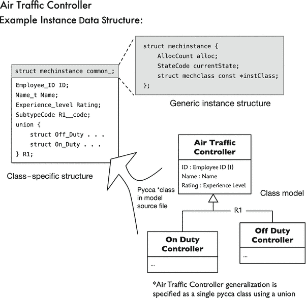
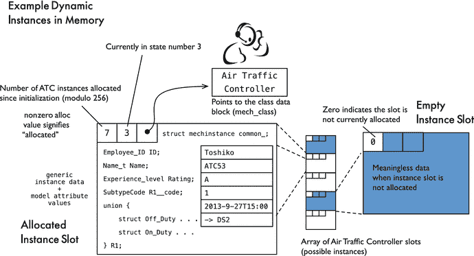
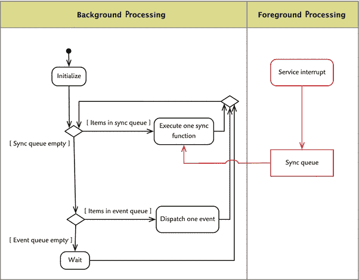
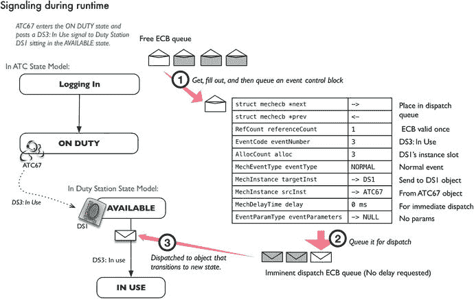
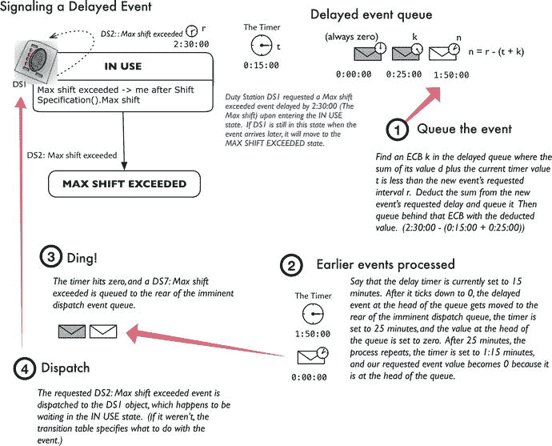
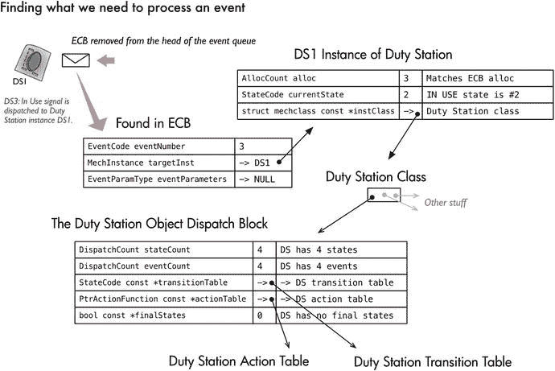
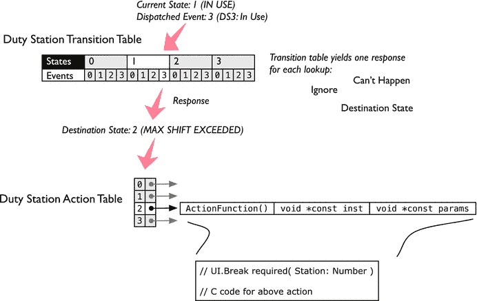
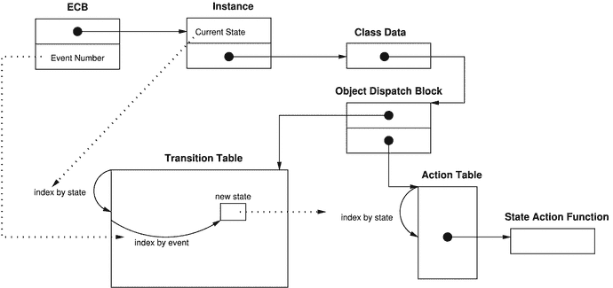

# 5. 模型执行域

至此，我们对翻译运行时组件的操作一直略过不谈。我们描述了它的一些功能，但并未说明它是如何实现这些功能的。现在不再如此！本章中，我们将解释用于管理模型执行的代码如何工作，以及它在生成运行程序中所扮演的重要角色。

我们的重点仍然是让空中交通管制模型运行起来，因此本章将讨论我们目标平台的模型执行。拥有了控制模型数据和执行顺序的手段后，我们便能够运行从翻译中派生的代码。我们不会在本章解释所有运行时操作，只讲解运行示例所需的那些部分。在第九章中，我们将补充其余细节。

这里的重要见解是，所有关于执行如何排序和管理的决策都被整合到了一个地方。事实上，模型执行的数据、规则和策略形成了一个独立的主题领域，完全独立于任何特定的应用程序或服务。这个主题领域实际上和其他任何领域一样，都是一个领域。我们称之为“模型执行域”，简称为 `MX` 域。这个领域历史上曾被称作软件架构，但我们将避免不加限定地使用该术语，因为更广泛的计算机界也用它来模糊地描述软件系统设计元素的整体构成。

我们首先概述模型执行域在通过翻译构建运行程序中所起的作用。我们想告诉您它如何融入翻译的更大体系中。但很快，我们将深入探讨示例目标平台的具体细节。在第十章中，我们将讨论其他可能的平台以及进入模型执行域的一些通用考量。

## 模型执行域的角色

模型执行域（`MX` 域）构成了模型执行的逻辑平台。正如处理器指令集是编程语言编译器的目标一样，`MX` 域的构建模块是模型翻译的目标。每个建模系统都需要一个 `MX` 域，因为它提供了运行模型执行规则的机制。

处理器指令集由诸如 `ADD` 和 `MOV` 之类的操作组成。`MX` 域的构建模块涉及模型执行元素的实现，例如事件控制块、转换表和动作表，这些都在本章中介绍。模型翻译的过程将类、关系和状态等模型元素映射到 `MX` 构建模块上。

一些 `MX` 功能由实现语言直接提供。例如，调用函数以及直接或间接访问数据是 `C` 语言程序中的常见操作。当活动被翻译时，这些 `C` 语言特性被直接使用。其他模型执行规则则不由实现语言直接支持。例如，没有 `C` 语言语句能够发送事件并将该事件分派给一个实例。为了弥补这一差距，`MX` 域提供了用于事件发送和分派的 `C` 函数。翻译过程将发送事件的状态动作映射为对这些 `MX` 提供的 `C` 函数的调用，以实现 xUML 事件发送行为。

尽管 `MX` 域的主题领域不同于它所运行的建模应用和服务领域，但它受到这些领域所施加的计算需求的强烈影响。模型执行的规则是明确定义的（例如，在之前引用的《可执行 UML：模型驱动架构的基础》一书中），但实现它们的计算策略和技术可能差异巨大。规模、速度和并行性都是建模领域可能对其实现提出的性能要求。内存的可用性及其使用方式也是重要的考量因素。没有一个通用的 `MX` 域能够以最优方式满足所有应用需求。这并不奇怪，因为没有通用的处理器或通用的编程语言能够覆盖所有计算场景。关于将何种计算技术应用于特定问题的决策涉及许多工程权衡，这些权衡常常是相互矛盾的。为了在成本、能力和效率之间取得最佳平衡，`MX` 域需要提供与建模领域需求最匹配的计算技术。

同样，也没有必要为每个软件项目都构建一个独立的 `MX` 域！一个设计良好、可配置的 `MX` 域可以适应一大类应用和平台的需求。这应该不足为奇，因为我们都已经习惯于使用针对有限范围应用和平台进行优化的组件，例如用户界面工具包、数学库或数据库引擎。没有人会认真建议每开发一个软件项目就必须重新设计这样一个组件。同理，我们可以仔细定制设计到 `MX` 域中的灵活性，使其能在一类平台上高效运行，并支持广泛的应用。在第十章中，我们将展示如何为不同的平台构建一个 `MX` 域。

在本章中，我们讨论一个名为“单线程模型执行”（简称为 `ST/MX`）的特定 `MX` 域实现。它旨在针对我们正在考虑的那种基于微控制器的裸机嵌入式系统。


## ST/MX 概述

要翻译模型，我们必须指定环境的总体特征以及最终程序运行的计算机技术类型。如先前所述，我们选择基于微控制器的嵌入式系统作为目标。这一决定对何为可接受的解决方案施加了约束，并限制了可在目标上部署的应用类型。`ST/MX` 的设计旨在处理基于微控制器的系统最重要的几项约束：

*   **有限的内存**：微控制器的内存很小，通常分为 RAM 和只读（例如，闪存）类型。存在单一物理内存空间，且没有基于硬件的内存地址转换。
*   **有限的执行周期**：微控制器速度有限，且常常部署在电池供电的应用中，在这些应用中，处理器执行是功耗较高的活动之一。
*   **中断**：所有现代计算机都有中断，允许外部外设指示重要事件。`ST/MX` 必须以一致的方式支持模型操作和中断服务执行。
*   **及时响应**：嵌入式系统通常对其外部环境的刺激做出反应，并产生回馈到该环境的响应。通常，产生响应存在时间约束。`ST/MX` 致力于最小化执行延迟以满足实时约束。

为了让您很好地了解 `ST/MX` 的工作方式，本章将讨论范围限定在模型行为排序的管理方式上。我们将重点关注信号的发出方式以及状态机事件如何分派到适当的实例。然后，我们将演示这与我们示例 ATC 模型执行的关系。

`ST/MX` 的特殊之处在于，模型元素的实际行为完全由提供的数据值驱动。如空中交通管制员示例所示，`pycca` 的一个主要作用是生成数据值以驱动 `ST/MX`。`ST/MX` 本身对空中交通管制员或任何其他模型元素的特定行为一无所知。这不足为奇。真正的计算机对其计算内容的意义一无所知，并且严格按照提供给它们的程序运行。

`ST/MX` 作为普通的 C 库实现。与任何其他库一样，它有一个由函数、参数和数据结构组成的接口。然而，与典型的 C 库不同，其大部分公共接口由预处理器宏组成。这些宏隐藏了底层的低级函数，并简化了动作语言的翻译过程。因此，我们将以通用术语讨论其处理过程和算法。我们不提供完整的调用接口，因为当使用 `pycca` 翻译时，底层的 `ST/MX` 函数接口仅在 `pycca` 提供的宏中被引用。对于希望查看代码细节和设计原理的读者，可以在本书网站上找到对 `ST/MX` 域的完整描述，包括实现它的 C 代码。

### 类实例的 ST/MX 视图

`ST/MX` 不关心单个实例的含义。它只需要能够灵活地访问它们，以执行诸如创建、删除、定位转换表、分派事件等活动。这些活动都不需要了解特定的属性值。因此，实例被视为相对不透明的用户数据块。`ST/MX` 感兴趣的是关于实例的通用数据，例如其类（以查找转换表）、其在内存中的位置、当前状态以及其他管理信息。

类实例以 C 结构体数组的形式存储。为了管理实例，`ST/MX` 使用以下结构体将关于实例的通用数据作为类结构体声明的第一个成员：

```c
typedef struct mechinstance {
AllocCount alloc ;
StateCode currentState ;
struct mechclass const *instClass ;
} *MechInstance ;
```

此源代码片段中定义的 `MechInstance` 指针类型稍后将会用到。这里，我们关注的是将 `mechinstance` 结构体作为生成的 `pycca` 类示例的第一个成员。图 5-1 显示了空中交通管制员的类特定结构体。请记住，空中交通管制员类将建模的父类和子类合并到一个联合体中。



图 5-1. 实例数据结构

将 `mechinstance` 结构体作为每个类结构体声明的第一个成员，使得指向任意类的任意实例的指针可以被视为指向通用实例的指针。这种技术在使用 C 进行更面向对象的编程风格时很常见，尽管它看起来可能类型不安全。我们之前在 `pycca` 生成的代码中见过这种结构。实例结构定义了适用于所有实例的通用元素，并将类实例链接回描述其行为的数据。

`alloc` 成员的非零值决定了特定实例当前是否正在使用。每次分配实例存储时都会更改 `alloc` 成员的值，以便我们能够确定在“创建-销毁-创建”序列后它是否正在被重用。`currentState` 成员保存一个小的整数值，表示实例当前所处的状态。`instClass` 成员是一个指向适用于该类所有实例的数据的指针。

图 5-2 显示了一个具有一些示例数据值的空中交通管制员的样子。



图 5-2. 内存中的动态实例

`ST/MX` 提供了所有必要的函数来管理动态实例的创建和删除。我们将推迟解释实例内存的管理方式。目前，您只需要知道 `ST/MX` 将实例视为一个 `struct mechinstance`，并忽略类特定属性。类特定的代码会忽略 `struct mechinstance` 结构。当然，这是 C 语言，语言本身不会对结构体成员的访问施加任何限制。


## 管理执行

`ST/MX` 专为基于裸机微控制器的系统设计。其执行能力与硬件直接提供的功能相匹配，即：

- 单个处理核心提供单一线程执行。
- 中断可以抢占单个线程的执行，并将执行流引导至服务于该中断的代码。中断服务完成后，被抢占的线程将恢复运行。

在第 2 章中，我们讨论了“运行至完成”的概念。模型执行规则要求每个活动完成后，其他活动才能运行。`ST/MX` 通过延迟事件的投递，直到没有状态活动在执行，来处理“运行至完成”机制。其实现机制简单：将信号事件加入队列，然后从队列中分派它们。

`ST/MX` 提供了 C 语言的 `main` 函数，用于组织执行流程，如图 5-3 所示。



**图 5-3. 主循环活动图**

初始化之后，执行进入一个无限循环，处理同步队列和事件队列。同步队列是一个由中断服务程序提交的函数执行请求队列。事件队列是一个由领域活动信号发出的事件队列。本章剩下的大部分内容将专门讨论事件队列的运作方式。流程图显示，同步函数一次执行一个，直到同步队列为空。当没有更多同步函数时，从事件队列中取出一个事件并进行分派。中断是使能的，并且在同步函数或状态活动执行期间可以被服务。如果没有要执行的同步函数或要分派的事件，则执行进入等待状态。执行会一直等待，直到产生一个中断，中断处理完成后，等待状态结束，控制流返回到主循环的顶部。这种可由中断抢占的单线程执行提供了经典的前台与后台处理概念。

`ST/MX` 不支持实时操作系统（RTOS）中的处理器上下文或任务概念。没有信号量、消息队列或对多个执行线程的控制。同步函数和状态活动总是在下一个计算被考虑之前执行完成。除了与访问同步队列相关的少量临界区外，中断始终处于激活状态。

你可能会认为 `ST/MX` 的执行方案不太适合长时间的计算任务。如果是这样，你的想法是正确的。当一个状态活动长时间陷入计算密集型任务时，系统的其余部分将无法响应，因为所有任务都必须等待对系统中单个处理器的访问，并且除了中断服务外，没有对状态活动的抢占。中断服务只能在没有状态活动运行时（以及根据需要对中断硬件进行服务时）将待执行的代码请求排入队列，并且明确不允许访问事件队列。

如果执行管理的这一特性无法满足建模领域的计算需求，那么 `ST/MX` 可能就不是该应用的合适计算技术，你需要一个以不同方式共享处理器或在多核处理器上运行的 MX 领域。话虽如此，许多部署在裸机微控制器上的应用本质上都是反应式的：它们通过中断检测来自环境的刺激，并生成即时响应，通常是控制现实世界的某些方面。对于这类应用，像 `ST/MX` 这样的单线程执行领域工作得非常好。它们能高效利用计算机资源，因为其能力与微控制器硬件直接提供的功能紧密对齐。

### 事件控制块

当活动信号发出事件时，这些事件由一个事件控制块（ECB）表示。你可以将其视为一个必须为每个生成的信号填写的表单。以下是 ECB 的数据结构：

- `next` 和 `prev` 成员是指向双向链表节点的指针。一个 ECB 会排入由 `ST/MX` 管理的三个列表之一。
- `referenceCount` ECB 采用引用计数，该计数保存在 `referenceCount` 成员中。对 ECB 进行引用计数是 `ST/MX` 的一个高级特性，用于某些周期性信号场景。我们的示例中不使用引用计数。
- `eventNumber` 是一个编码事件编号的小整数。事件编号是从零开始的连续整数。
- `alloc` 是一个小整数，用于确保事件不会被分派给一个不再存在的实例。本章稍后会讨论这一点。
- `eventType` 编码了事件的类型。目前，假设这是一个试图触发状态转换的事件。其他事件类型，即创建（creation）和多态（polymorphic），将在第 9 章讨论。
- `instOrClass`，对于转换事件，持有一个 `targetInst`，指向将要接收该事件的实例。
- `srcInst` 是一个指向信号发出该事件的实例的指针。
- `delay` 用于延迟信号（正如我们本章后面所讨论的）。
- `eventParameters` 包含事件指定的任何参数的值。

```
typedef struct mechecb {
struct mechecb *next ;
struct mechecb *prev ;
RefCount referenceCount ;
EventCode eventNumber ;
AllocCount alloc ;
MechEventType eventType ;
union  {
MechInstance targetInst ;
MechClass targetClass ;
} instOrClass ;
MechInstance srcInst ;
MechDelayTimedelay;
EventParamType eventParameters ;
} *MechEcb ;
```

一个 ECB 会被排入由 `ST/MX` 管理的三个列表之一：

- **空闲队列**：是一个空闲 ECB 的列表，可用于信号事件。不使用的 ECB 作为有限资源在此排队等待。
- **即时事件队列**：是一个已填写完毕、等待即时分派的 ECB 列表。
- **延迟事件队列**：是一个已填写完毕、将在未来指定时间投递的 ECB 列表。这些代表延迟信号。

### 信号事件

信号事件的动作被转换为以下过程：

1.  获取一个空闲的 ECB。
2.  用所需信息填写 ECB。
3.  将 ECB 排入适当的事件队列（即时或延迟）。

这些步骤在图 5-4 中进行了演示。



**图 5-4. 信号事件**

`eventNumber` 成员保存一个从零开始的连续整数，用于编码事件。事件编码基于每个 pycca 类，因此每个 pycca 类都有自己的一组事件，并且每组事件都从零开始连续编码。这种编码选择意味着事件编号可用作数组的索引，并且 pycca 生成编号以确保正确的索引。

`srcInst` 是一个指向信号发出该事件的实例的指针。如果事件在实例上下文之外被信号发出（例如，由领域函数或基于类的操作），则 `srcInst` 设置为 `NULL`。

事件的任何参数都放在 ECB 末尾的参数块中。参数按值传递。通常，只有少量数据作为事件参数传递。传递数据的引用会带来管理分配给参数值的内存的额外负担。`ST/MX` 不提供任何设施来管理通过引用传递的事件参数数据。


#### 捕获飞行中事件错误

ECB 的 `alloc` 成员值得特别说明。ST/MX 必须能够检测到事件被分派给一个已不存在的实例的情况。例如，一个事件可能已向某个实例发出信号，但该实例在事件送达前被销毁。更糟的是，一个新实例有可能在事件送达前，被创建在已销毁实例的同一内存位置！这被称为“飞行中事件错误”，是 ST/MX 诊断的少数运行时错误之一。它被视为一种分析错误，因为建模者有责任确保正确的同步，使得在针对某实例的任何事件仍在飞行中时，该实例不会被删除。

由于将事件送达给不存在的实例或错误实例的后果非常严重，ST/MX 采取了措施来防止这种情况。为了诊断该错误，当事件发出信号时，其 `alloc` 成员值会被设置为与目标实例的 `alloc` 成员相同的值。当事件送达时，这两个值必须仍然一致。因为每次分配实例时，它都会为 `alloc` 成员获得一个新值，而空闲实例的 `alloc` 成员值为 0，所以可以检测到实例在拥有飞行中事件时被销毁的情况。出于分派事件的目的，`alloc` 成员补充了仅由其内存地址提供的目标实例标识。

在填充 ECB 成员的值后，ECB 会被排入分派队列。状态机规则要求，实例发向自身的事件，优先于从其他实例发出信号的事件进行分派。因此，自指事件被放置在事件队列的前端，而非自指事件则排入队列尾部。

#### 延迟信号

ST/MX 支持延迟信号的概念。延迟信号是一种请求，要求事件不早于所请求的延迟时间被分派。延迟时间以毫秒为单位指定，延迟时间可以为零（这将导致事件被立即投递到即将发生的事件队列）。延迟事件在等待送达期间，会被投递到一个独立的延迟事件队列中。在可执行 UML 中，对于任何一对发送/接收实例（它们可以相同——即延迟事件可以是自指的），给定事件编号的未决延迟事件只能有一个。这将相同的未决延迟事件数量限制为一个。ST/MX 将任何投递重复延迟事件的尝试，解释为取消第一个延迟事件并以新时间投递新延迟事件的请求。这是实践中最为便捷的解释方式。

ECB 的 `delay` 成员用于实现延迟分派。当被插入到延迟事件队列时，`delay` 成员存储的是事件之间的时间差，而不是实际请求的时间延迟。在插入过程中，ECB 的 `delay` 成员被设置为该插入事件所需的总时间，超出队列中先前事件累计时间的额外部分。这导致延迟事件队列按时间差的递增顺序排列。

延迟事件分派使用单个定时器，该定时器在延迟事件队列头部的任何 ECB 所指示的时间到期。当这个时间到期时，该 ECB 会被转移到即将发生事件队列的尾部，然后定时器会根据当前延迟事件队列头部 ECB 所指示的时间进行重置。即使是自指的延迟事件，也会被放置在即将发生事件队列的尾部。这种 ST/MX 机制体现了这样一种思想：延迟事件仅仅是请求一个普通事件在稍后时间送达，即使该请求来自将接收该事件的同一个实例。

图 5-5 展示了一个示例。



图 5-5. 处理一个延迟事件

在上述示例中，当前定时器设置为 15 分钟。延迟事件队列中每个 ECB 的时间差值都是相对于下一个最早送达时间的，因此队列头部的值始终为零。当定时器倒计时归零时，延迟事件队列头部的 ECB 会被转移到即将发生事件队列的尾部，此时它代表一个等待被分派的普通事件。

然后，定时器会加载下一个条目（本例中为 25 分钟）的延迟值，并重新开始倒计时。因此，观察该图，您可以看到第二个 ECB 将在 15 分钟 + 25 分钟 = 40 分钟后送达。第三个 ECB 在 40 分钟 + 1 小时 50 分钟 = 2 小时 30 分钟后分派，这与该 ECB 请求的送达延迟完全吻合。

边界条件以及启动和停止定时资源的必要性，使得实现逻辑比此描述更为复杂。队列的排序意味着，插入到延迟事件队列需要搜索以找到合适的位置，同时要考虑队列中已存在条目相关的累计时间。这种设计在插入时进行计算，以换取延迟时间到期时更简单的操作。请注意，没有周期性的唤醒来扫描延迟队列。在电池供电环境中，唤醒以确定没有要执行的操作是不可取的。

为了实现延迟信号，ST/MX 必须能够访问一个定时资源。这必然是特定于系统的，通常意味着微控制器的某个定时器外设专门用于运行延迟事件队列。必须小心谨慎，以确保即使微控制器在等待时处于停机或低功耗模式，定时器也能继续运行。因此，ST/MX 将底层定时器操作委托给一组可根据微控制器定时器外设的具体情况进行适配的函数。

延迟信号可以被取消。ST/MX 保证取消一个延迟信号后，该信号将不会被送达。这意味着取消延迟信号会将其从延迟事件队列中移除，或者如果它已经到期，则从即将发生事件队列中移除。取消一个尚未发出信号或已经送达的延迟事件并不是错误（也就是说，在取消操作期间未能找到请求的延迟事件并非错误）。

最后，ST/MX 支持查询延迟事件的剩余时间。此持续时间可用于调整延迟时间。


#### 事件分发

既然你已经了解了即时事件或延迟事件在触发时是如何排队的，接下来我们可以探讨这些事件随后是如何被分发的。图 5-3 展示了在主循环中事件分发的发生时机。图 5-6 则说明了我们需要导航哪些数据结构，才能获取支持事件分发所需的一切要素。



图 5-6. 定位转换表和动作表

事件分发从移除紧迫事件队列（之后我们简称为事件队列）头部的 ECB 开始。我们通过 ECB 的 `targetInst` 成员，找到将要接收该事件的实例。每个实例在其结构体中都有一个 `currentState` 成员，以及一个指向其类数据（`instClass`）的指针。类结构体包含了适用于该类所有实例的数据。对于事件分发而言，我们关注的是对象分发块（ODB）。ODB 是 `pycca` 为某个类生成的数据的一部分。你在第 4 章中，当我们展示 `pycca` 翻译状态模型的输出时，已经见过这些数据了。从 ODB 中，我们可以获取转换表（一个状态与事件的矩阵）和动作表（一个由状态编号索引的函数指针数组）。在确定了转换的目标状态后，就会从动作表中获取一个指向待执行代码的指针。一个对象分发块的 C 语言定义如下：

```
typedef struct objectdispatchblock {
DispatchCount stateCount ;
DispatchCount eventCount ;
StateCode const *transitionTable ;
PtrActionFunction const *actionTable ;
bool const *finalStates ;
} const *ObjectDispatchBlock ;
```

`transitionTable` 是一个 `stateCount` 乘 `eventCount` 的矩阵，存储在一个由 `StateCode` 类型值组成的一维数组中。通过使用实例的 `currentState` 值和来自被分发事件的 ECB 中的 `eventNumber`，对 `transitionTable` 进行索引，可以得到新的状态值。

然后，这个新状态被用作 `actionTable` 数组的索引，以找到一个指向动作函数（更符合 UML 的术语是活动函数，因为它会导致状态活动的所有动作，但为了最大程度减少混淆，我们沿用代码中使用的术语）的指针。`actionTable` 成员是一个指针，指向一个包含 `stateCount` 个指向动作函数的指针的数组，这些动作函数的签名如下：

```
typedef void ActionFunction(void *const inst, void *const params) ;
typedef ActionFunction *PtrActionFunction ;
```

图 5-7 说明了这个索引过程。



图 5-7. 处理分发的某个事件

执行动作函数时，会传入 `targetInst` 的值和一个指向 ECB 成员 `eventParameters` 的指针。动作函数的参数类型被声明为 `void` 指针，这样动作表的数据类型就可以对所有类保持一致。`Pycca` 会在状态活动的开头添加代码，将这些指针值重新转换为实例及其参数的正确类型。

从动作函数返回后，需要查阅 `finalStates` 数组。`finalStates` 成员是一个指向大小为 `stateCount` 的数组的指针，如果该指针不为 `NULL`，则它包含一个布尔指示，表明实例的新状态是否为终态。如果实例进入终态，那么在调用动作函数后，该实例会被自动删除。

还存在另外两种转换可能性：新状态可以是“忽略”或“不可能发生”。当新状态是“忽略”时，不会发生任何转换，事件被简单地丢弃。“不可能发生”的转换则是一个错误。这种转换在逻辑上被认为是不可能的，如果它在运行时发生，则会导致一种可以被认为是紧急情况的状态。

图 5-8 概述了处理事件所需的所有关键数据片段是如何关联的，以及如何利用当前状态和事件来找到转换并执行其活动。



图 5-8. 事件分发过程中使用的数据

为了将这些图联系起来，并且本着消除神秘空白的精神，我们给出了 ST/MX 中用于分发事件的 C 语言代码。在这一阶段，ECB 已从事件队列中被移除。以下代码计算新状态、调用转换对应的状态活动，并处理所有分发规则：

* ❶ 这里，我们通过索引转换矩阵，根据当前状态和事件计算出新状态。转换矩阵以一个由状态码组成的一维数组形式存储。这样做是必要的，这样无论为类状态模型定义了多少个状态和事件，所有类都可以拥有相同数据类型的转换矩阵。因为转换矩阵是以一维数组形式存储的，我们必须进行索引计算，将转换矩阵分割成一个按状态和事件访问的二维矩阵（也就是说，我们必须根据状态模型中的事件数量来缩放“行”访问）。`Pycca` 确保转换矩阵的单元格按此方式排序。
* ❷ 调用与新状态关联的状态活动函数。我们允许空状态活动拥有一个 `NULL` 函数指针，以避免调用/返回的开销。

```
static void
dispatchNormalEvent( MechEcb ecb)
{
MechInstance target = ecb->instOrClass.targetInst ;
ObjectDispatchBlock db = target->instClass->odb ;
// 检查当前状态或事件编号是否损坏。
assert(db->stateCount > target->currentState) ;
assert(db->eventCount > ecb->eventNumber)
// 检查 "事件正在处理中" 错误。当一个实例在事件队列中仍有未处理的事件时被删除，
// 会发生此错误。对于本架构，此类情况被视为运行时检测到的分析错误。
if (target->alloc != ecb->alloc) {
mechFatalError(mechEventInFlight, ecb->srcInst, target, ecb->eventNumber) ;
}
// 从转换表中获取新状态。
StateCode  newState  =  *(db->transitionTable +                            ❶
target->currentState * db->eventCount + ecb->eventNumber) ;
#        ifdef MECH_SM_TRACE
// 追踪转换过程。
traceNormalEvent(ecb->eventNumber, ecb->srcInst,
ecb->instOrClass.targetInst, target->currentState, newState) ;
#        endif
// 检查是否为不可能发生的转换。
if (newState == MECH_STATECODE_CH) {
mechFatalError(mechCantHappen, target, target->currentState, ecb->eventNumber) ;
} else if (newState != MECH_STATECODE_IG) {
// 检查转换矩阵是否损坏。
assert(newState stateCount) ;
// 在执行状态动作之前，更新当前状态以反映转换结果。
target->currentState = newState ;
// 如果存在状态动作，则调用它。
PtrActionFunction action = db->actionTable[newState] ;
if (action) {
action(target, &ecb->eventParameters) ;                           ❷
}
// 检查是否进入了终态。如果是，则删除该实例。
if (db->finalStates && db->finalStates[newState]) {
mechInstDestroy(target) ;
}
}
// 将 ECB 返回到池中。
mechEventDelete(ecb) ;
}
```

这段简短的代码完成了 ST/MX 中绝大部分的执行序列化工作，并且除了主循环代码之外，它是 ST/MX 中执行频率最高的代码。


### 追踪执行

状态模型图在展示实例生命周期可能的发展路径以及该过程中发生的处理方面表现出色。当领域运行时，实例会根据发送给该特定实例状态机的一系列信号进行转换。因此，查看实例所做转换的时间顺序是很有洞见的。

`ST/MX` 可以为你追踪事件分发。由于追踪会影响程序的执行速度和代码大小，它可以在测试阶段有条件地编译进来，并在交付的版本中移除。以下是针对我们曾在第 2 章讨论的空中交通管制模型的执行场景的事件分发文本日志。该日志是在翻译后领域的实际运行期间生成的：

```
2016/06/09 11:17:12.112: (nil) - Ready_for_duty -> Air_Traffic_Controller.atc53:  ←,
OFF_DUTY -> Verifying_Adequate_Break
2016/06/09 11:17:12.113: Air_Traffic_Controller.atc53 - Log_in ->   ←,
Air_Traffic_Controller.atc53: Verifying_Adequate_Break -> Logging_In
2016/06/09 11:17:12.113: Air_Traffic_Controller.atc53 - Logged_in -> ←,
Air_Traffic_Controller.atc53: Logging_In -> ON_DUTY
2016/06/09 11:17:12.113: Air_Traffic_Controller.atc53 - In_use -> Duty_Station.s3: ←,
AVAILABLE -> IN_USE
```

在此日志中，共分发了四个事件。每个分发都有时间戳。追踪内容包括发出事件的实例、事件名称以及接收事件的实例。如果事件是在实例上下文外部发出的，则事件源记为 (`nil`)。在此场景中，是通过从领域外部（而非任何实例内部）发送 `Ready_for_duty` 信号来启动的。否则，实例通过其类名以及作为初始实例种群一部分赋予该实例的名称来标识。追踪的最后两个字段显示了从收到事件时的当前状态到转换后新状态的过渡。

日志中的转换展示了与第 2 章描述的相同序列。`Ready_for_duty` 事件导致了离线管制员 `atc53` 的一系列转换：实例从 `OFF_DUTY` 状态，经 `Verifying_Adequate_Break`、`Logging_in`，最终到达 `ON_DUTY` 状态。最后一条日志条目显示了 `Duty_Station` 转换到 `IN_USE` 状态。

追踪执行有助于理解领域如何运行，并支持记录测试结果。由于状态模型是一个有向图，因此有可能计算出一组事件序列，确保每个状态活动至少被执行一次（这与状态模型图的生成树有关）。确定这样一组事件序列可以在不了解活动计算内容的情况下完成。状态模型中存在的结构有助于确定满足项目质量目标所需的最小测试用例集。转换追踪可以为测试用例的实际执行提供客观证据。

##### 在 POSIX 环境中运行

`ST/MX` 执行域可在三个平台上运行（并可适配到其他微控制器平台）：

*   ARM Cortex-M3
*   TI MSP-430
*   POSIX（可移植操作系统接口）

针对基于微控制器的系统并提供 POSIX 版本的运行时代码，这看起来可能有些不同寻常。虽然你可以使用 `pycca` 构建 POSIX 应用程序，但 `ST/MX` 的 POSIX 版本的主要目的是支持跨平台开发。在为微控制器进行开发时，这种开发方式至关重要。在此，模型在桌面计算机上的模拟模型执行环境中进行翻译和运行。在模型得到充分验证后，可以将它们编译、集成，并在目标平台上进行进一步测试。

微控制器不具备支持编译器和其他构建环境元素的能力。因此，开发人员面临的情况是在桌面系统上构建，然后将代码下载到嵌入式平台。微控制器通常确实有调试设施，并且大多数微控制器开发环境都支持某种形式的源代码级调试。

然而，通常很少有文件 I/O 或任何大容量的持久存储。通常，你只能满足于简单的 `printf()` 风格调试。存在一个两难问题：应该投入多少精力来改进目标环境，以及这些精力是否更好地用于在模拟中运行代码。当应用程序控制着物理实体，并且遇到断点就突然停止是不切实际或不安全的时候，这个问题尤其突出。例如，一个移动的机械臂涉及必须考虑动量的实际物理过程。仅仅在断点处停止处理器可能会造成物理损伤。在这种情况下，通过检查执行追踪数据进行调试通常是唯一实用的解决方案。

对于已正确桥接到任何系统特定功能（例如，硬件外设）的领域，针对 POSIX 版本的运行时进行编译和链接将生成一个可执行文件，该文件可以在大多数类 Unix（例如 Linux）、macOS 或 Windows（在 Cygwin 系统下）中运行。由于这些开发系统拥有大量的存储和 I/O 能力，因此可以构建测试夹具或测试平台，在目标环境之外对领域代码进行测试。例如，可以要求编译器跟踪代码覆盖率，并测量单元测试的覆盖率。当有地方存储状态机追踪信息时，处理它们也会容易得多。追踪状态模型的转换是衡量程序状态空间被测试覆盖程度的一种便捷方法。可以通过检查模型的状态图来获得驱动状态模型转换的测试集。在 POSIX 环境中运行的能力也为使用可用的持续集成和回归测试工具提供了可能性。为了在模拟下运行，需要模拟或仿真应用程序中那些系统特定的部分。这可能是一项艰巨的任务，尤其是当与真实世界的交互是应用程序执行的主要驱动力时。项目团队必须评估成本与收益。

当然，并非所有测试都能在模拟环境中运行。在模拟中运行对于测试、记录程序逻辑以及使用特定测试集驱动其执行路径非常方便。仍然需要在目标微控制器上进行集成并执行额外的测试。在模拟中运行将初始测试分为逻辑测试和目标集成测试，并将逻辑测试置于一个更容易获取和记录结果的环境中。


## 错误处理

我们还粗略地介绍了处理错误的方式。`ST/MX` 域负责设定系统中处理错误的策略。`ST/MX` 通过将其检测到的所有错误都指定为致命错误，从而最大限度地减少了重复性的错误处理。因此，`ST/MX` 检测到的所有错误都会触发异常终止条件，从而阻止进一步执行。没有提供任何接口来向模型指示 `ST/MX` 操作的成功或失败。这对建模人员来说是有益的，因为模型可以发送事件或创建实例，而无需检查错误返回值或处理潜在的异常。模型只是简单地假设执行管理是完美的。任何出现的问题都由 `ST/MX` 负责处理。

`ST/MX` 域会诊断两种类型的错误：

- 源自 `ST/MX` 内部执行的错误
- 在运行时发现的、表明模型分析存在错误的错误

`ST/MX` 使用多种内部数据结构——例如，事件控制块——每种都有固定的数量。类似于类实例，内部数据结构也在编译时确定大小的数组中分配。这遵循了 `ST/MX` 不执行动态内存分配的设计目标。耗尽内部资源会导致致命错误。当类实例存储数组中没有空闲槽位时，请求分配一个类实例同样会导致致命错误。

在运行时发现的分析错误要么是状态机转换错误，要么是事件传输中的错误。这些错误也是致命错误。

`ST/MX` 提供了一种方法来提供您自己的致命系统错误处理程序。这对于日志记录目的以及其他类型的外部通知非常有用。默认情况下，`ST/MX` 在发生致命错误时会执行标准 C 库函数 `abort()`。在嵌入式系统中，这通常会导致系统复位，微控制器重新开始执行。尽管这种方法看起来可能很严厉，但对于大多数嵌入式系统来说，几乎没有其他实用的补救措施。即使一个状态活动在试图发送事件时知道没有可用的 ECB，它又能有什么实际的恢复措施呢？仅仅忽略信号无法发送或状态转换在逻辑上不可能这一事实，然后乐观地继续运行并指望情况好转，是不现实的。这意味着必须仔细地确定所需数据结构资源的大小。在运行时检测到的分析错误只能通过全面的测试用例来清除。记录致命错误的原因有助于诊断问题，但当系统部署在实际环境中，并且 `ST/MX` 确定发生了严重错误时，除了重启并重试之外，几乎没有什么可以做的了。

严重的软件错误可能还需要在系统整体的上下文中进行处理。安全关键系统，例如医疗设备，通常有专用的硬件，可以接管软件功能的至少一部分。大多数嵌入式系统都有一个或多个看门狗定时器，必须定期复位，以此作为软件正常运行的检查。未能及时复位看门狗可能会通过硬件或其他后备策略触发处理器复位。有些系统甚至有专用的硬件来捕获“运行-复位-运行-复位”序列，这些序列发生得过于频繁，表明软件中存在无限复位循环的情况。`ST/MX` 只提供了在软件执行达到无法继续的状态时知晓该状态的方法。在更大的系统上下文中如何处理这种状态，必须基于全面的风险分析来决定。

### 总结

在本章中，我们描述了 `ST/MX` 域（即 `pycca` 翻译的运行时组件）的内部工作机制。它是生成可运行程序所需的翻译的最后一个方面。

`ST/MX` 管理系统所有的类数据和执行顺序。`ST/MX` 完全是数据驱动的，本章的重点在于描述 `pycca` 生成的数据结构如何被 `ST/MX` 中的算法所使用。`ST/MX` 对实例数据有一个统一的视图，允许它对任何类的实例执行操作。

执行的管理主要通过将事件排队等待调度来实现。排队设计支持模型执行规则所需的“运行至完成”语义。队列中的事件由事件控制块表示。事件调度也可能被延迟，以支持模型活动在未来的某个时间启动执行的需求。

实例状态机的转换是使用转换表来计算的。转换表按当前状态编号和事件编号进行索引，索引单元格包含要转换到的新状态。状态的活动是一个函数，指向该函数的指针被放置在动作表中，动作表是一个按状态编号索引的数组。

文中还给出了事件调度的 C 代码，精确地展示了状态转换是如何计算的。`ST/MX` 支持生成事件调度的时间顺序跟踪日志。我们运行了第 `2` 章中的执行场景，并通过实际执行，从生成的跟踪日志中验证了我们从状态模型图中推导出的转换。

`ST/MX` 实现了系统的错误处理策略，并且由 `ST/MX` 检测到的所有错误都是不可恢复的，被视为致命的系统错误。


