# 6. 一个扩展示例

我们曾以一个简单的 ATC 应用作为 **Hello World** 的扩展示例，来演示 pycca 转换的基本步骤。这个初始应用只涉及了某个孤立主题（空中交通管制）的一小部分（工作负荷与排班）。它由一个集成式的类、状态和动作面（facets）集合定义，并封装在一个可执行的模型包中。在本章中，我们将开始一个新的案例分析，它需要协调多个这样的可执行包，在可执行 UML 中，这些包被称为领域。

为 ATC 应用生成的代码是可运行的，但功能有限。这是因为该应用本身只是任何实际部署软件系统的一部分。例如，你可能想知道雷达、用户显示、告警处理、日志记录以及其他关键功能是如何集成到 ATC 系统中的。

当然，你可以简单地将应用模型扩展，以纳入所有必需的功能，但在实践中，这是一个糟糕的主意。模型将变得过于复杂，不仅体现在元素数量上，更体现在状态组合的爆炸和尴尬的类关系上。其结果将是模型中抽象概念的不一致，整个分析工作将陷入停滞。这正是在最初以这种方式建模系统时被称为“分析瘫痪”的症状。

更好的做法是将系统组织为一组相对独立的领域。一个领域代表一组专注于特定主题的独特抽象概念。例如，ATC 模型构成了关于空中交通管制员职责主题的一个应用层抽象。雷达跟踪将是一个完全不同的主题，用户界面和告警处理也是如此。你可以想象每个模型集中完全不同的类词汇表，以及每个模型集内部完全不同的关系和策略。每个领域的内部工作机制对相邻领域来说是不透明的，只有基本服务通过多种运行时和预运行时绑定暴露出来。

一个领域是一个完全可执行的包，可以独立运行和测试。它可以采用可执行 UML、其他建模语言（如 Simulink）来建模，或者干脆手动编码。Pycca 可以将可执行 UML 与用 C 语言手工编码的领域编织在一起。但如果你确实使用其他建模语言，并能够以 C 代码输出结果，你也可以使用 pycca 来集成这些代码。

基于领域来组织系统带来的诸多好处（例如降低复杂性、平台独立性、隔离变更、大规模复用等）超出了本书的讨论范围。然而，有一个与模型转换相关的好处值得在此强调：领域提供了一种系统化的方法，来弥合从应用层抽象到完整实现之间的鸿沟。这是通过委托过程实现的。一个领域无法完成的事情，它便委托给另一个领域。一个领域缺乏专业知识的地方，另一个领域必须提供。这种依赖链一直持续，直到我们到达无需再委托的地步。换句话说，我们就得到了一个完整的可运行系统。

例如，ATC 领域中的模型知道管制员何时工作过久而没有休息。但它们不知道如何在现实世界中显现这个警告。这可能是用户界面领域的工作，它能够使事件在现实世界中变得可见、可闻或以其他方式可感知。用户界面领域不应内置任何特定于应用的知识；否则，它对其他应用就没什么用处了。假设用户界面领域以一组现有库的形式实现，那么就没有必要进一步对 ATC 进行建模。只需要用 ATC 模型提供的信息来配置这些用户界面库，然后以某种方式将 ATC 事件连接到适当的用户界面库调用。正如你将看到的，`pycca` 提供了这种“某种方式”。另一方面，一个了解所有关于轨迹、信号、回波轮廓等知识的雷达领域，可能需要被建模，以便为 ATC 领域提供关于空中交通的信息。

最终，ATC 领域以及任何其他被建模的领域，其模型都由模型执行（`MX`）领域运行，模型的执行已被委托给该领域。总而言之，当一个领域委托功能时，另一个领域必须提供所需的服务。这种情况会持续发生，直到我们遇到坚实的地面，例如 `MX` 领域或其他现有领域。不存在任何未指定的层级来施展魔法。所有软件都被认为存在于一个领域中，或者是领域之间的桥接代码。

从模型转换的角度来看，我们需要一种方式来指定如何将模型组织成领域，以及领域（无论是否被建模）之间如何相互作用，以定义完整的软件系统。几乎所有从模型构建的系统都包含由模型生成的代码与手动编写的代码（无论是现有的还是新编写的）的组合。为了弄清这一切是如何运作的，我们需要检查并为一个多领域示例生成代码，这正是我们下一个案例分析的目的。


## 自动润滑系统

自动润滑系统（`ALS`）是一项用于控制机械设备（如车辆发动机、齿轮传动系统或重型起重机械）润滑的服务。尽管自动润滑的应用场景差异很大，但其基本理念是在用户设备内部及周围安装一系列润滑脂注射器，并根据可编程的周期性计划进行控制。

若非存在可能导致严重故障的潜在风险与高概率，这本应是一个简单的系统。但`ALS`必须仔细监控整个系统的压力，以确保设备不受损坏并且润滑充分。系统必须对设备中发生的事件做出响应，并可能永久或暂时停止润滑。例如，怠速发动机所需的润滑可能与高转速（`rpm`）运转的发动机不同。

操作员必须收到有关常规维护（如补充润滑剂）以及轻微和严重故障的通知。并且当某台设备处于维护状态时，操作员必须有一种方法来锁定不必要的注射。需要谨慎地隔离设备单元，以便在不停用所有润滑的情况下锁定单个设备。此外，还必须支持各种诊断模式，以便操作员可以试验不同的润滑参数。为了支持各种用户设备和应用，关键运行参数必须是可配置的。

作为一个用户应用的示例，图 6-1 展示了风力涡轮机的润滑配置方式。

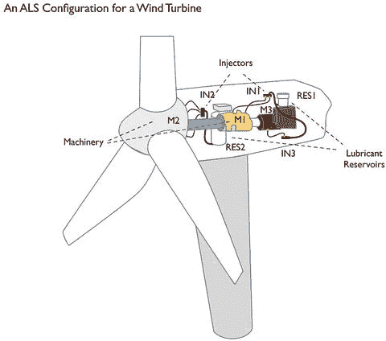

图 6-1. 注射器布局图

该风力涡轮机有五个润滑点，由三个注射器提供润滑。注射器 1（`IN1`）专用于指定为一台机械设备（`M1`）的齿轮箱，而注射器 2（`IN2`）润滑指定为`M2`的主轴。第三个注射器（`IN3`）润滑发电机（`M3`）上的一个点。注意，注射器 1 和 3 不仅共享同一个润滑脂储存器，它们的设计完全相同。另一方面，注射器 2 是另一种型号的注射器，设计用于在更高压力下为主轴输送特殊润滑剂。

每个注射器由一个专用的润滑循环驱动。所有注射器都装配了传感器以检测压力。通过启用和禁用每个注射器的电磁阀来启动和停止润滑。每个注射器由一个润滑剂储存器供料。注射器 1 和 2 向多个点位输送润滑剂。通往这些点位的输送管线无法单独控制，因此每次注射对每条管线的影响相同。还需注意，每个注射器专用于一台机械设备。这使得可以启用某一台机械的安全锁定，以停止其润滑，而不一定影响相邻机械的润滑。

### ALS 领域

在进入模型之前，我们先看看支持`ALS`所需的各种领域，如图 6-2 所示。

* ❶ 顶层是润滑领域。它关注于我们系统的主要目的，即管理注射器以安排周期性润滑。该领域被建模。
* ❷ 润滑领域需要最新的压力值和宣布关键压力阈值的事件。它还需要一种方法，将诸如“打开注射器”这样的建模事件转换为合适的信号或命令发送给注射器电磁阀。信号 I/O（`SIO`）通过虚线依赖箭头指示的方式提供此服务。`SIO`领域在第 7 章中介绍。
* ❸ 润滑领域发出报警条件信号，但需要一种方法来管理系统性地设置和清除报警，以及管理操作员警告、错误和日志项等报警类别。报警领域负责此项工作。
* ❹ 润滑领域需要知道何时激活和停用润滑计划。它还需要一种方法向人类操作员发出计划完成及其他事件的信号。它为此使用用户界面领域。
* ❺ 报警领域需要向人类操作员显示报警，并允许清除报警。它也使用用户界面领域。
* ❻ 所有被建模的领域都被翻译并在模型执行领域上运行，并需要其服务来实现模型级动作。
* ❼ 模型执行领域是用 `C` 语言编写的。是的，`C` 语言本身也是一个领域。乍一看可能有些奇怪，但 `C` 语言本身就是一门独立主题。当然，它并非用可执行 UML 建模，但 `C` 语言在某种程度上被建模为一种语法。对 `C` 领域的整个接口是在运行时之前通过编写程序定义的。你越思考这个问题，就越会意识到编程语言作为一门主题并没有什么特别之处。

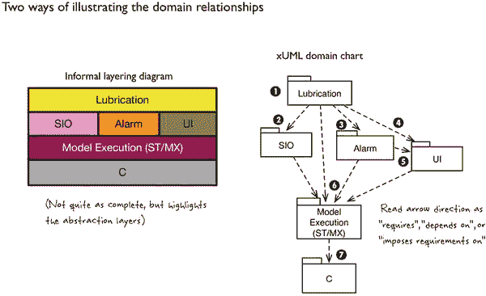

图 6-2. ALS 领域依赖关系

如您所见，这种领域安排创建了一条从润滑领域应用级抽象，经过通用工具服务、模型执行，最终到代码的完整路径。每个领域，无论是否被建模，都代表一个独立的主题。请注意，领域产生了一种很大程度上与平台无关的划分。底层硬件、设备和用户界面技术可以变化，但主题组织保持不变。这与许多传统的高层软件架构图形成对比，这些图几乎总是特定于平台的。

无论您是以分层方式还是以领域间的依赖关系来看待领域交互，重要的是要认识到这两种视图都不代表系统的功能划分（也称为功能分解）。主题划分基于内聚的类和关系，而不考虑特定功能。每个类模型定义了一个词汇表和规则集，这些规则集定义了某个领域的主题。根据共同的数据和规则来划分系统，与根据共同的功能来划分系统有着显著不同。领域划分基于主题，而对某个领域主题的分析旨在找到一组一致的抽象，这些抽象指向该领域在整体系统中扮演的角色。系统的功能在模型执行时体现，系统的任何给定功能特性通常需要多个领域各自扮演其角色。对于`ALS`，注入润滑剂既需要润滑领域来确定合适的时间，也需要`SIO`领域来驱动硬件。这两个领域都使用模型执行领域进行交互，并最终用 `C` 语言编码。

在第 8 章中，我们将展示如何指定并使用 `pycca` 实现领域依赖关系。在本章的剩余部分，我们将研究润滑领域中的模型。在考察状态模型和活动时，我们将展示通向 `SIO`、报警和用户界面领域的桥梁。

### 润滑领域

我们从考察润滑领域开始。这是解决系统主要业务目的的应用层。所有其他领域的出现都是为了直接或间接地提供服务，以支持润滑领域的需求。由于我们的目标是协调和管理润滑剂注射，因此我们期望应用层能够了解注射设备和润滑调度相关的主题。


## 润滑类模型

为了更清晰地展示，我们将润滑类图拆分为两个相邻的部分：设备和计划。这种拆分纯粹是为了展示方便，对模型本身没有任何影响。

图 6-3 展示了类模型中的设备部分，该部分着重于物理组件。

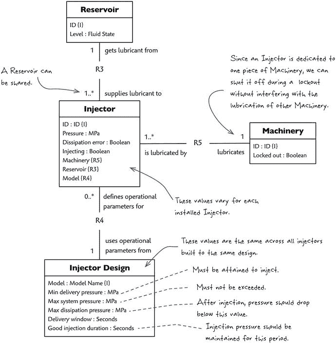

图 6-3. 润滑设备类

`润滑剂` 被输送到某种类型的设备中。这可以是任何设备，从机器人到喷气发动机，再到重型起重工程车辆。从 ALS 的角度来看，被润滑设备的功能并不相关，因此它被表示为通用的“机械”。`润滑计划` 和 `注射规格` 属性的具体取值，部分由被润滑 `机械` 的具体需求和功能决定。但此模型并不关心 `机械` 的具体细节，而是由人工来定义属性的可接受值以满足这些需求。这些属性值出现在该领域的初始实例群体中。

### 喷射器设计

为了适应多种喷射器设计，该模型将特定于单个喷射器的特性与不同设计之间变化的特性分离开来。这是通过通用规范类建模模式中的 `R4` 实现的。该模式背后的详细推理在建模书籍中有介绍——例如，*可执行 UML：如何构建类模型*，作者 Leon Starr (Prentice Hall, 2001) – 请参阅参考文献中关于未来更新的说明。

示例中的喷射器 `IN1` 和 `IN3` 都按照相同的设计规范制造，因此它们共享同一个 `喷射器设计` 实例。`IN2` 是一种不同型号的喷射器，具有一组不同的设计参数，因此它需要一个单独的 `喷射器设计` 实例。

### 单次注射

我们已经有了足够的模型来考虑单次注射的行为。为了减轻电源以及本地计算机和网络资源的负载，喷射器在收到指令之前保持静默。它甚至不监测内部压力，因为当喷射器不活动时，不太可能积聚危险压力。图 6-4 显示了一个典型的注射序列。

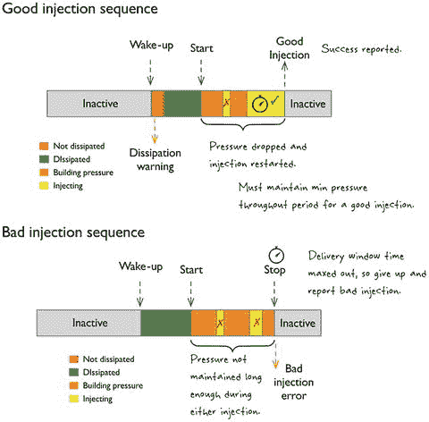

图 6-4. 示例：良好与不良的注射序列

`唤醒` 命令使喷射器开始监测压力，以便进行错误报告。理想情况下，上次注射积聚的压力此时已经消散，但情况并非总是如此。如果检测到任何高压，我们希望报告一条警告。无论压力波动多大，最多只能发出一个警告。

此监测间隔在 `开始` 命令到达时结束。现在是时候注入润滑剂了。为此，必须达到并维持 `喷射器设计.最小输送压力`，持续时间为 `喷射器设计.良好注射持续时间`。如果成功，则报告一次良好注射，喷射器再次进入非活动状态。否则，每次压力降得太低时，都需要等待压力重新积聚并重试。如果收到 `停止` 命令，则说明时间已经过去太久。会记录一次不良注射，然后喷射器进入非活动状态。

### 控制润滑周期

现在我们已经有了设备模型，接下来需要考虑控制喷射器的循环计划。在最简单的情况下，一个注射周期会重复进行，并在注射之间指定一个延迟时间。还必须指定一段时间，让喷射器开始监测压力。我们还可以指定该周期是运行预设次数，还是连续运行直到手动停止。在停止润滑之前可以容忍的最大低润滑周期数也是润滑程序的一部分。图 6-5 展示了典型的循环控制会话。

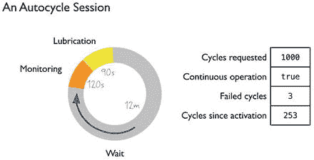

图 6-5. 润滑的循环计划

有了这些概念，我们可以继续讨论润滑领域类模型的另一半，它涵盖了注射的循环调度和控制。图 6-6 引入了两个新类来满足调度需求。

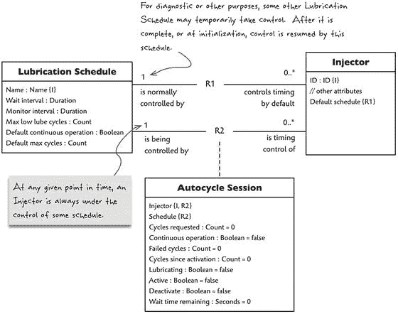

图 6-6. 润滑周期类

### 润滑计划

这是一个循环润滑的程序，可用于任何型号的喷射器，尽管通常其取值会针对特定的喷射器型号和用途进行设置。每个计划都有一个名称，最重要的是，定义了主要间隔（决定注射之间的等待时间，即 `等待间隔`）和预备间隔（决定唤醒和开始之间的延迟，即 `监测间隔`）。如果操作应在没有特定总数的情况下持续进行，则 `默认连续运行` 设为 `true`。可以指定一个默认的最大周期数（`默认最大周期`），但如果默认是连续运行，则该属性不起作用。这两个默认值都可以在 `自动周期会话` 中被覆盖。

### 自动周期会话

`R1` 为每个 `喷射器` 指定一个默认的 `润滑计划`。当查询此关联时，会选择出一个实例，用于建立 `R2` 关系。在 `R2` 关系中，一次只能有一个 `润滑计划` 控制一个 `喷射器`，尽管同一个 `润滑计划` 可以同时被多个喷射器使用。在选定一个 `润滑计划` 并通过 `R2` 关联后，就会创建一个 `自动周期会话` 实例。`自动周期会话` 跟踪特定 `喷射器` 的时间安排以及失败的周期计数。

设置 `R1` 的原因是，有时需要在少数几个周期内选择非默认的 `润滑计划`，这通常用于诊断目的。在这种情况下，之前的 `自动周期会话` 会被删除，并创建一个与这个非默认 `润滑计划` 相关联的新会话（一个 `喷射器` 一次只能由一个 `自动周期会话` 控制）。一旦临时会话完成（通常是通过运行完请求的周期数），控制权会自动恢复为 `R1` 上找到的默认 `润滑计划`。

### 示例群体

图 6-1 所描述的场景由图 6-7 所示的群体表示。

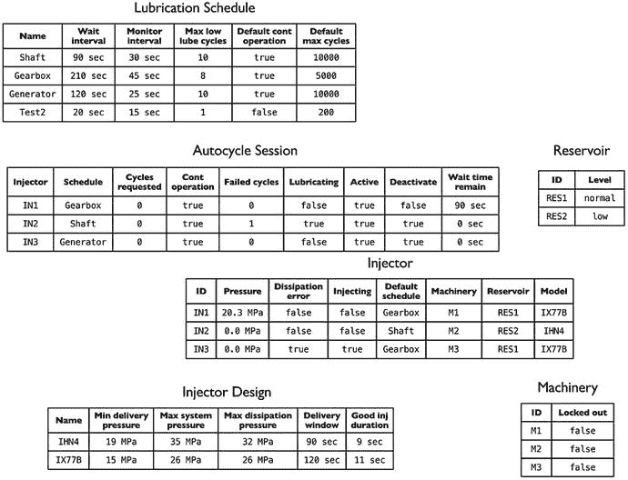

图 6-7. 场景的初始实例群体

### 状态模型

`自动周期会话`、`喷射器` 和 `储液器` 每个类都有一个状态模型。让我们先来讲解 `喷射器` 状态模型。同样，为了使讨论更简单，我们对模型进行了拆分。


### 喷射器状态模型

图 6-8 展示了`Injector`状态模型的上半部分。

- ❶ 当`Injector`接收到来自`Autocycle Session`（自动循环会话）发送的`Wakeup`（唤醒）事件时，它处于`SLEEPING`（休眠）状态。系统会指示`SIO`域开始为此`Injector`监控传感器数值。
- ❷ 在`MONITORING`（监控）状态中，`Injector`不执行任何操作，因为所有传感器检测工作都由`SIO`完成。但在此状态下，当`SIO`域检测到压力上升超过`Injector Design.Max dissipation pressure`（喷射器设计.最大耗散压力）时，我们会响应其提供的`Above dissipation pressure`（高于耗散压力）事件。
- ❸ `Dissipation error`（耗散错误）每个周期不应触发超过一次。为避免引发多次`Dissipation error`警报，本状态会检查并设置`Injector.Dissipation error`布尔属性值。
- ❹ 当从`Autocycle Session`收到`Start`（启动）事件时，在继续执行喷射操作前，必须验证目标`Machinery`（机械装置）未被锁定。
- ❺ 无论是`Lockout`（锁定）事件还是`Stop`（停止）事件，都会使`Injector`回到休眠状态。

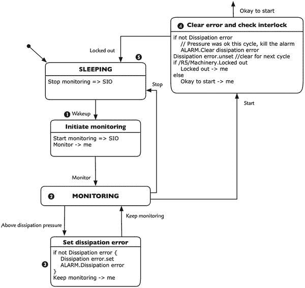

图 6-8. 喷射器状态模型节选：从休眠到激活

图 6-9 展示了`Injector`状态模型的下半部分。

- ❶ 通过向`SIO`域发送`Inject`（喷射）信号来激活`Injector`电磁阀。此后，`Injector`会一直等待，直到达到`Injector Design.Min delivery pressure`（喷射器设计.最小输送压力）。
- ❷ 此事件可由`BUILDING PRESSURE`（建压）状态中的检查结果触发，或在检测到条件满足时由`SIO`提供。
- ❸ 当压力足够高时，润滑过程正在进行。为了获得良好的喷射效果，此压力必须维持`Injector Design.Good injection duration`（喷射器设计.良好喷射持续时间）。如果一切顺利，当`Injector`处于此状态时，将发送此延迟事件。
- ❹ 否则，`SIO`会发送`Below inject pressure`（低于喷射压力）事件，这将导致进入`Not enough pressure`（压力不足）状态，在该状态下，延迟事件被取消，并通知`Reservoir`（储液器）。此后，`Injector`将在下一个状态中继续等待压力建立。
- ❺ 如果未能及时实现足够长时间的连续喷射，`Autocycle Session`将触发`Stop`事件，该事件会将`Injector`转移到`Quit low pressure injection`（退出低压喷射）状态，期间可能经过`Cancel injection`（取消喷射）状态，该状态会取消`Good injection`（良好喷射）延迟事件。
- ❻ 但如果一切顺利，就会发生`Good injection`延迟事件，电磁阀通过`SIO`断电，`Injector`回到休眠状态。

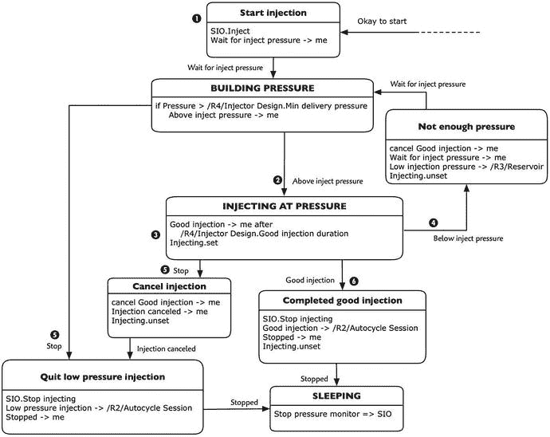

图 6-9. 喷射器状态模型节选：从激活到休眠

### 自动循环会话状态模型

`Autocycle Session`状态模型篇幅较大，不便在此完整展示，因此我们将通过一个摘要进行概述，且不显示动作语言。图 6-10 突出显示了生命周期的主要部分。所有灰色区域均与挂起/恢复以及停用行为相关。

- ❶ 我们从处于`WAIT INTERVAL`（等待间隔）状态的活跃`Autocycle Session`开始。在此，我们等待周期之间的延迟时间结束。根据类模型中的`R2`关系，任何时候每个`Injector`都对应一个此类会话实例。
- ❷ 在此状态下，会话有可能被挂起。如果发生这种情况，我们将进入`WAIT SUSPENDED`（等待挂起）状态，直到被恢复或停用。我们必须取消待处理的`Get ready to lubricate`（准备润滑）延迟事件，但在此之前需保存剩余时间。恢复后，我们将根据挂起时的剩余时间重新调度`Get ready to lubricate`事件。
- ❸ 调度的事件发生，我们前进到`MONITOR INTERVAL`（监控间隔）状态。在此状态下，我们向`Injector`发送`Wakeup`事件，使其开始监控压力。现在，我们根据`Lubrication Schedule`（润滑计划）中定义的间隔调度延迟的`Lubricate`（润滑）事件，并进行等待。如果在此状态下发生挂起，其逻辑与前一状态类似，不同的是中间等待的时间将不会被保存。
- ❹ `Lubricate`事件发生，我们前进到`LUBE INTERVAL`（润滑间隔）状态。我们向`Injector`发送`Start`事件，然后等待两个事件之一发生。要么我们的`Injector`成功并向我们发送`Good injection`事件，要么超时时间到，我们调度的`Lube interval ended`（润滑间隔结束）事件发生。润滑间隔由`Injector Design.Delivery window`（喷射器设计.喷射窗口）的值决定。在第一种情况下，我们可以取消待处理的`Lube interval ended`事件。
- ❺ 在超时情况下，我们前进到`LOW PRESSURE LUBRICATION`（低压润滑）状态，在此状态下我们通知`Injector`停止，并增加`Failed cycles`（失败周期）计数。`Injector`将响应`Good injection`事件或`Low pressure injection`（低压喷射）事件。如果`Lube Interval`超时的时刻恰好与`Injector`成功的时刻大致相同，则可能发生第一种情况。无论如何，关键在于我们必须在此等待，确认`Injector`已停止后再继续，以免与`Injector`的状态失去同步。
- ❻ 无论哪种情况，我们都前进到`Count cycle`（计数周期）状态，在此对周期进行计数，并检查是否发生了太多失败（低润滑）周期。如果是，我们向`Reservoir`发送`Too many low lube cycles`（低润滑周期过多）事件，以便其更新状态。如果我们以连续模式（不间断重复周期）运行，则进入下一个周期。否则，我们检查是否所有请求的周期都已完成。如果未完成，我们也进入下一个周期。否则，所有请求的周期完成后，我们进入`NOT ACTIVE`（未激活）状态。
- ❼ 现在假设用户决定在此`Injector`上运行一个不同的`Lubrication Schedule`。我们需要会话处于`NOT ACTIVE`状态才能处理此请求。（在所有其他状态下，该请求将被忽略。）我们将接收到一个包含新`Lubrication Schedule`名称的`Change Schedule`（更改计划）事件。这会使我们进入一个删除状态，在当前实例消失之前触发出`New session creation`（创建新会话）事件。进入`NOT ACTIVE`状态时，始终会首先将当前控制的`Lubrication Schedule`与`R1`关系上的默认计划进行比较。如果它们不匹配，则意味着一直在运行一个临时计划。这将导致创建一个新会话，以回到指定的默认`Lubrication Schedule`。
- ❽ 创建一个新的`Autocycle Session`实例，其中输入的`Schedule`和`Injector`实例被链接在一起，并置于`NOT ACTIVE`状态。
- ❾ 用户发出`Activate`（激活）事件，同时附带所需的模式（连续与否）和所需的周期计数（如果未请求连续模式，则该计数应大于零）。在继续之前，我们将验证是否未被`Machinery`锁定。如果未被锁定，我们将设置相应的属性并跳转到`WAIT INTERVAL`状态。请注意，任何其他状态下发生的锁定都将由`Machinery`检测到，并向我们发出`Deactivate`（停用）事件信号。

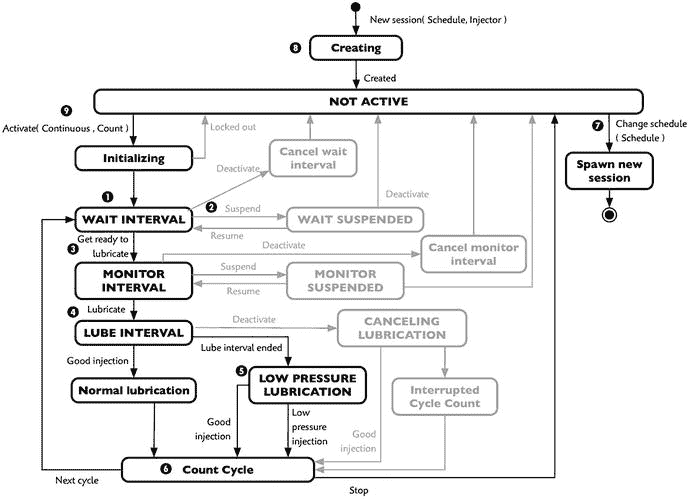

图 6-10. 自动循环会话状态模型概览

### 储液器状态模型

`Reservoir`跟踪其液位状态，以便向维护人员提供有用的警报。在一个普通的流体循环中，我们从正常液位开始，然后在`Injector`事件的驱动下，依次经历`LOW`（低液位）、`VERY LOW`（极低液位）和`EMPTY`（空液位）状态。图 6-11 展示了`Reservoir`类的完整状态模型。

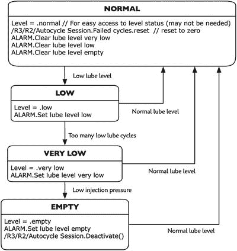

图 6-11. 储液器状态模型图


### 类的协作

类的协作图提供了领域内状态模型之间异步（信号/事件）和同步（方法调用）交互的清晰概览。类的协作并不被视为领域模型的一个独立方面，因为它可以从三个方面内容中推导出来。但对于设计一个领域内清晰的控制模式非常有用（关于控制协作的复杂示例，请参见*可执行 UML：模型驱动架构基础* 第 245 页的图 14.8）。图 6-12 展示了润滑领域中的类是如何交互的。

- ❶ 这些是在`Autocycle Session`状态模型中发出、并在`Injector`状态模型中检测到的事件。
- ❷ 这是在`Autocycle Session`类上定义的一个方法。具体方法活动见图 6-13。

    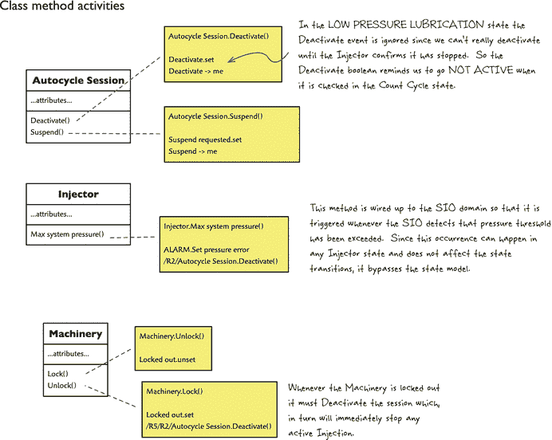

    图 6-13. 类方法活动
- ❸ 这些是由`Injector`动作发出的信号，被转换为对应的`SIO`元素。协作图不对超出基础服务范围的外部领域内部元素或接口做任何假设。我们从这个图只能得知，这些事件必须映射到`SIO`领域中的某个元素。
- ❹ 这些事件发生在`Injector`状态模型中，且必须由`SIO`触发。`SIO`内部实现这一点的具体机制在润滑领域中是未知的。
- ❺ 从一个实例到其自身的事件不会显示在协作图上。但在此例中，事件是从`Autocycle Session`的一个实例发送到该类另一个新创建的实例。
- ❻ `SIO`领域中处理后的信号值会跨越领域边界映射到`Pressure`属性。该属性在润滑领域内是只读的。

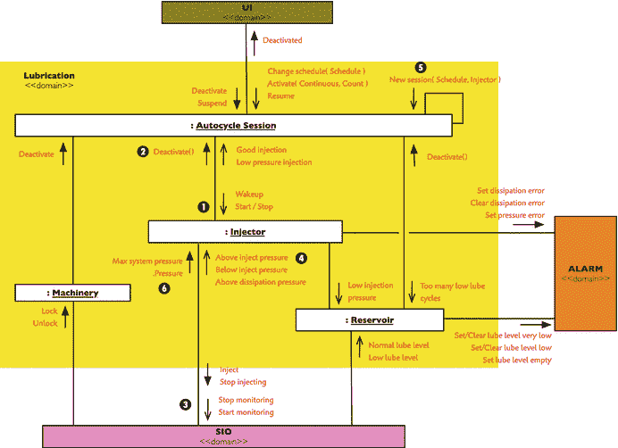

图 6-12. 润滑领域内的类协作

### 类方法与其他活动

领域中的活动并不仅限于状态内部的活动。类方法是定义在类上的基于实例的活动。领域操作是作为领域接口一部分定义的活动。例如，一个外部域可以不与任何状态机交互，而通过调用另一个领域的操作来调用其类方法。

图 6-13 展示了在润滑领域的每个类上定义的方法。

### 状态表

在准备好进行`pycca`转换之前，必须完成每个状态模型的表格。这些表格在建模过程中填写，并且在我们开始指定转换之前必须完整。某些绘图工具会自动为您完成这项工作。

由于`Autocycle Session`和`Injector`的状态表相当庞大，本章中我们仅检查选定的摘录。如果您想进一步研究，可以从本书网站下载带有完整注释的电子表格。

图 6-14 是`Injector`状态表的第一个摘录。

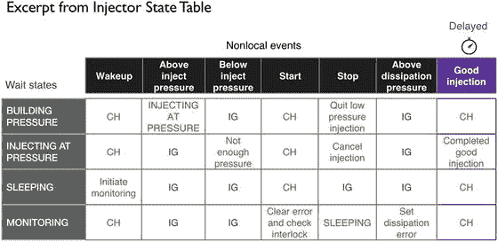

图 6-14. Injector 等待状态

您可能已经注意到，图中某些状态名称全部大写，而其他则是大小写混合。这是一种非正式的区分等待状态和瞬态状态的风格。等待状态是指其活动不会向自身发送事件以强制转换到另一个状态的状态。相反，已完成活动的实例要么处理一个挂起的非本地事件（不是来自该实例或延迟的事件），要么只是等待这种事件发生。通俗地说，您可以将等待状态理解为实例正在等待物理世界、其他领域或其他实例中的某个过程完成，或等待一个延迟事件发生。

这意味着对于等待状态，所有本地事件（非延迟的、自对自事件）都应标记为 **不可能发生** (`CH`)。这是因为本地事件是在另一个状态中生成并由该同一状态处理的，因此在这里不会发生。这样我们可以排除所有本地事件，获得一个更小的状态表，并专注于非本地事件。

请注意包含了一个延迟的`Good injection`事件。如果我们能够证明该事件在进入`INJECTING AT PRESSURE`之外的任何状态之前会过期或被取消，那么我们可以将其在所有其他状态中标记为**不可能发生**。状态表的格式强制要求考虑这种可能性，这在其他情况下很容易被忽视！

图 6-15 展示了`Injector`的第二个状态表摘录。

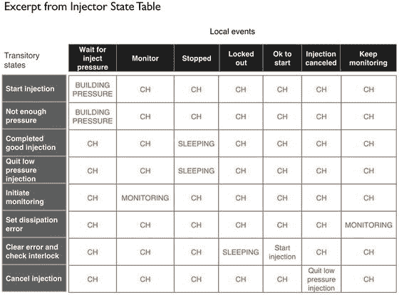

图 6-15. Injector 瞬态状态

上表中的所有状态都是瞬态的，这意味着每个状态都会因一个本地（非延迟的、自对自）事件而退出。瞬态状态使得在通往等待状态的一条转换路径上执行活动成为可能，从而允许在通往同一状态的其他路径上执行不同或可能没有活动的可能性。瞬态状态常用于执行 if-then 逻辑，以引导至不同的出口转换。

请注意，每个瞬态状态仅响应它发送给自身的某个事件，原因如下：

- 该事件总是由状态活动发出。
- 实例发送给自身的事件会在任何其他事件之前被调度。

这意味着所有其他事件都可以标记为`CH`，如上表摘录所示。由于在第一个摘录中显示的所有非本地事件都会被标记为`CH`，因此查看该部分表格并不能获得太多洞见。

图 6-16 展示了`Autocycle Session`类的等待状态摘录。

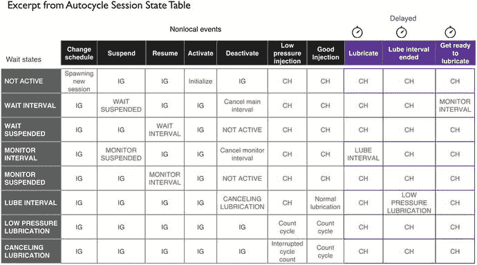

图 6-16. Autocycle Session 等待状态

三个延迟事件在最右侧列中突出显示。已注意确保每个延迟事件都被妥善管理，使其不会在无用的任何状态中出现。

最后，图 6-17 展示了`Autocycle Session`类的瞬态状态。

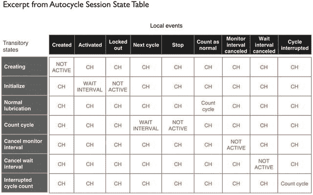

图 6-17. Autocycle Session 瞬态状态

`Reservoir`状态表很小，可以在图 6-18 中完整展示。

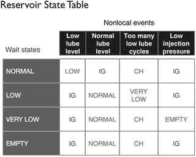

图 6-18. Reservoir 状态表

### 翻译润滑领域

我们采用与翻译 ATC 领域相同的方式来翻译润滑领域——即将三个方面转录到`pycca` DSL 中。我们应用与 ATC 领域相同的决策过程来确定属性以及`pycca`类之间的引用如何工作。状态模型被转录为`transition`和`state`语句，每个状态的动作语言则借助`pycca`宏处理模型级请求，翻译成 C 语言。

为了避免重复已经出现过的序列，我们将重点放在尚未介绍的`pycca`结构上。一如既往，完整模型及其翻译可作为本书在线资料的一部分获得。在本节中，我们首先翻译带有关联类的关联，然后翻译创建事件以及润滑领域中出现的其他操作。


### 翻译关联类

在第 3 章中，我们讨论了通过基于关联的每个遍历方向分解链接存储来实现关联的方法。图 3-5 中的简单关联示例对此进行了说明。

参考图 6-6，`R2` 由 `Autocycle_Session` 类形式化。该类不仅具有形式化`R2`的引用属性，还拥有描述性属性和一个状态模型。图 6-19 显示了如何将`R2`分解为两侧，并以`Autocycle_Session`类作为中介。

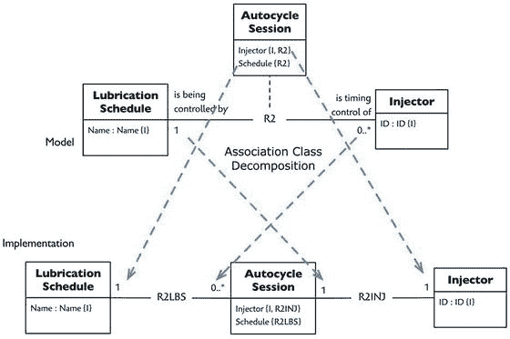

**图 6-19.** 使用关联类进行分解

`R2`关联具有几个有趣的特性：

- 每个 `Autocycle_Session` 实例对应于 `R2` 关联本身的一个实例。
- `Autocycle_Session` 有两个单一的、无条件的引用，一个指向 `Injector`，另一个指向 `Lubrication_Schedule`。
- 在分解中，两侧的条件性和多重性是倒置的。因此，`Lubrication_Schedule` 与 `Autocycle_Session` 的关系为 `0..*`，而 `Injector` 与 `Autocycle_Session` 的关系为 `1`。这是从 `Autocycle_Session` 到 `R2` 每个参与者的单一、无条件引用的结果。

在翻译 `Lubrication` 领域时，我们使用 `R2` 的分解形式来确定如何设置引用。对于 `Autocycle_Session` 类，其呈现如下：

```
class Autocycle_Session
reference R2_INJ -> Injector
reference R2_LBS -> Lubrication_Schedule
# 自动循环会话的其他属性和状态模型
End
```

导航 `R2` 关联也是一个两步操作。因此，要从 `Injector` 实例导航到 `Lubrication_Schedule` 实例，需要执行以下操作：

```
// 假设 inj 持有对注入器实例的引用。
ClassRefVar(Lubrication_Schedule, sched) = inj->R2->R2_LBS ;
```

#### 导航关联关系

在上一节中，我们展示了一个导航关联关系的简单示例。在该示例中，从参与类到关联类的多重性是单一的。在本节中，我们将展示一个多对多的关联关系，它使用链表来实现与关联类的链接。回顾一下，在 `pycca` 中，我们将关联关系视为由两条独立的路径组成。因此，关联关系导航的翻译需要两部分。考虑如图 6-20 所示的关联。

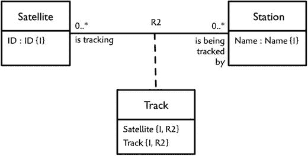

**图 6-20.** 导航关联关系

关联关系的分解导致关联类中对每个参与者具有单一引用：

```
class Track
reference R2_Satellite -> Satellite
reference R2_Station -> Station
end
```

参与者拥有它们自己指向关联类的链接。在这里，我们预计关联是动态的，因此选择了链表：

```
class Satellite
attribute (char const *ID)
reference R2_Satellite ->>l Track
end
class Station
attribute (char const *Name)
reference R2_Station ->>l Track
end
```

注意，我们为每个参与者的 `reference` 名称附加了类名。我们需要不同的引用名称，因为 `pycca` 会直接在生成的结构中使用这些名称，我们不希望产生命名冲突。我们选择附加类名，这是一种方便的约定，使我们能够轻松追踪引用的来源或终点。

`Pycca` 将为参与者生成以下结构：

```
struct Satellite {
struct mechinstance common_ ; // 必须放在第一位！
char const *ID ;
rlink_t R2_Satellite ;
}
struct Station {
struct mechinstance common_ ; // 必须放在第一位！
char const *Name ;
rlink_t R2_Station ;
}
```

上述 `rlink_t R2_XX` 成员充当链表的端点，具有以下结构：

```
typedef struct rlink {
struct rlink *next ;
struct rlink *prev ;
} rlink_t ;
```

由 `Satellite` 和 `Station` 类定义的链表引用，会将链表指针插入到 `Track` 结构中：

- ❶ `Track` 实例从 `Satellite` 侧链接在一起，此列表包含与某个 `Satellite` 实例相关的那些 `Track` 实例。
- ❷ 对于 `Station` 实例也是如此。注意，这两个链表加上指向另一个参与者的单一引用，提供了关联所需的多对多表示。

```
struct Track {
struct mechinstance common_ ; // 必须放在第一位！
struct Satellite *R2_Satellite ;
struct Station *R2_Station ;
rlink_t R2_Satellite__links ;   // ❶
rlink_t R2_Station__links ;     // ❷
} ;
```

要从 `Satellite` 导航关联到 `Station`，我们必须先导航到 `Track` 实例，然后从那里跟随单一引用到达 `Station` 实例。因为 `R2` 关联是多对多的，所以一个给定的 `Station` 实例可能关联多个 `Track` 实例，因此当从 `Satellite` 实例导航到相关的 `Track` 实例时，我们需要一个迭代循环。

对于给定的 `Satellite` 实例，要打印所有 `Station` 的名称，我们将使用以下代码：

- ❶ 使用链表时，我们需要一个链表指针变量来保存我们在迭代中的位置。
- ❷ `Pycca` 提供了一个宏来设置迭代循环。
- ❸ 来自 `Satellite` 实例的链表中的指针指向 `Track` 实例的 `R2_Satellite__links` 成员，而不是 `Track` 实例的开头。我们真正需要的是指向实例元素开头的指针，因为这才是实例引用的本质。`Pycca` 提供了一个宏来执行地址算术，使我们能够从 `R2_Satellite__links` 成员回到 `Track` 实例引用。当一个对象可以链接到多个链表时，这是一种常见的习惯用法。
- ❹ 最后，我们可以沿着 `Station` 方向的单一链接进行导航。

```
// ... 假设 self 是对 Satellite 实例的引用 ...
rlink_t *tracklink ;                                                                  // ❶
PYCCA_forAllLinkedInst(self, R2_Satellite, tracklink) {                               // ❷
ClassRefVar(Track, tracki) = PYCCA_linkToInstRef(tracklink,Track, R2_Satellite) ; // ❸
ClassRefVar(Station, stationi) = tracki->R2_Station ;                             // ❹
printf("Satellite, %s, is being tracked by, %s\n",
self->ID, stationi->Name) ;
}
```


### 创建事件

创建类实例的两种技术是同步创建和异步创建。在同步创建中，一个活动直接向 MX 运行时请求创建一个实例，并且该请求会立即得到满足。支持此功能的 pycca 宏是`PYCCA_createInstance()`。以这种方式创建的类实例会被置于其默认初始状态（如果它们有状态模型），但该状态的活动不会被执行。例如，构成初始实例群体的所有实例都被视为以这种方式创建（创建初始实例群体没有运行时开销，因为 pycca 会在编译时将初始值安排到内存中）。

对于异步情况，实例创建是通过信号触发一个特殊的创建事件来启动的。发出此事件信号的活动会继续执行直至完成（遵循我们通常的执行规则）。在未来的某个时刻，当该事件被分发时，一个新的类实例会被创建，并且该事件会被新创建的实例接收。从新创建实例的角度来看，这只是一个普通事件。因此，新创建的实例会进行一次状态转换，并且与新状态关联的活动会被执行（再次遵循我们通常的状态机执行规则）。

从建模的角度来看，这两种实例创建技术各有其用途。在润滑领域，异步创建用于切换润滑会话。如果回顾图 6-10，在该图的顶部，`New session`事件导致从一个实心圆转换到`Creating`状态。实心圆代表一个初始伪状态，而`New session`事件是一个创建事件。MX 运行时会确保当`New session`事件被分发时，会创建一个`Autocycle Session`的实例，将其置于初始伪状态，并执行到`Creating`状态的转换，从而使该活动被执行。

Pycca 直接支持指定创建事件。下面我们展示所需的 pycca 语句。为了专注于创建事件，我们省略了周围领域定义的大部分内容以及`Autocycle Session`类定义的细节：

* ❶ 像往常一样，我们明确指定`CH`的默认转换和忽略的转换。
* ❷ 仅仅因为一个状态模型有创建事件，并不意味着它不能同步创建。当`Autocycle Session`的实例被同步创建时，我们必须指定默认的初始状态。
* ❸ `.`（句点）字符指定了初始伪状态。这里我们声明`New_session`事件从初始伪状态转换到`Creating`状态，这使其成为一个创建事件。

```
# ... Lube 领域的其他部分
class Autocycle_Session
# ... 属性定义、引用定义等
machine
default transition CH                            # ❶
initial state Creating                           # ❷
transition . - New_session -> Creating           # ❸
# ... 状态模型定义的其余部分
end
end
# ... Lube 领域的其他部分
```

一个状态模型可以有多个创建事件，尽管这种情况并不常见。也可以将`New_session`作为普通的转换事件来发送信号，尽管这在`Autocycle Session`状态模型中不会发生。同样，也可以将一个普通的转换事件作为创建事件来发送信号。这会导致一次`CH`转换，并且 pycca 运行时会响应一个致命错误。

发送创建事件信号对应一个略有不同的代码序列。在`Autocycle Session`状态模型中，是`Spawn new session`状态发送了`New session`事件的信号：

```
New session(  in.Schedule,
Injector: /R2/Injector.ID ) -> Autocycle Session
// 此事件将创建，并发送至
// 一个新的 Autocycle Session 实例，以替换
// 这个正在被删除的实例。
```

动作语言使用语法暗示`New session`事件是直接发送给`Autocycle Session`类的。这是区分创建事件的一种便捷方式，因为信号通常指向类实例。此动作语言的翻译如下：

* ❶ 这会分配一个 ECB 并将该事件标记为创建事件。
* ❷ 因为事件带有参数，我们需要填充这些值。当没有参数时，我们使用 pycca 宏 `PYCCA_generateCreation()` 来处理整个操作。
* ❸ 投递事件完成事件信号发送过程。
* ❹ 我们需要清理来自`Injector`实例的一个引用，因为这个`Autocycle_Session`实例即将被删除。下一节将讨论这种自动实例删除。

```
# ... Lube 领域的其他部分
class Autocycle_Session
# ... Autocycle Session 属性定义、引用定义等
machine
# ... Autocycle Session 状态模型定义的其他部分
state Spawn_new_session(
char const *schedule)
{
MechEcb new_session =
PYCCA_newCreationEventForThisClass(New_session, self) ;            // ❶
PYCCA_eventParam(new_session, Autocycle_Session, New_session, schedule) =
rcvd_evt->schedule ;                                               // ❷
PYCCA_eventParam(new_session, Autocycle_Session, New_session, injector) =
PYCCA_idOfRef(Injector, self->R2_INJ) ;
PYCCA_postEvent(new_session) ;                                             // ❸
self->R2_INJ->R2 = NULL ;                                                  // ❹
}
# ... 状态模型定义的其余部分
end
end
# ... Lube 领域的其他部分
```


### 异步实例删除

正如创建类实例有两种方式，删除它们也有两种方式。活动可以通过使用 `PYCCA_destroyInstance()` 宏来同步删除一个实例。当底层运行时函数返回时，该实例便不复存在。

再次参考图 6-10，我们注意到从 `Spawn new session` 到一个*小圆圈*有一个转换，并且该转换没有事件标签。这个小圆圈代表一个最终伪状态。转换到最终伪状态将 `Spawn new session` 指定为一个最终状态。当一个实例进入最终状态时，它会在其活动运行后被删除。MX 运行时会自动处理实例的删除。Pycca 支持声明*任何状态*为最终状态。对于 `Autocycle Session` 类，其示例如下：

```
# ... Lube 域的其他部分
class Autocycle_Session
# ... 属性定义、引用定义等
machine
# ... 状态机模型定义的其他部分
final state Spawn_new_session
# ... 状态机模型定义的其余部分
end
end
# ... Lube 域的其他部分
```

由于实例在最终状态活动运行时被删除，因此不允许从最终状态出发的转换，如果定义此类转换，pycca 将会标记为错误。

最后，我们可以回到 `Spawn_new_session` 活动中的最后一行代码：

```
self->R2_INJ->R2 = NULL ;
```

有必要将 `Injector` 实例对 `Autocycle_Session` 的引用设置为 `NULL`，因为 `Spawn_new_session` 是一个最终状态，并且即将被删除。我们不希望 `Injector` 实例引用一个即将消失的对象。我们无需处理由 `Autocycle_Session` 实例发出的引用，因为它将被删除，因此无法再引用任何内容。

当创建事件被分发并且一个新的 `Autocycle_Session` 实例被创建时，`Creating` 状态的活动将正确设置新的引用。在 `Spawn_new_session` 活动结束与 `New_session` 创建事件被分发之间的时间窗口内，由 `R2` 关联所隐含的引用的条件性被违反了。也就是说，存在一个时间点，`Injector` 实例不受任何润滑计划控制。这并不违反我们的执行规则，因为我们已发出信号，该事件在被分发时，会将所有引用带回一致状态。你可以将此序列视为数据模型上更大事务的一部分，并且所有完整性规则检查都会延迟到事务完成时进行，该事务在创建事件被分发时完成。ST/MX 运行时代码实际上不执行任何这些完整性检查，但其他功能更强的模型执行域可能会执行。例如，使用关系数据库管理系统来管理域数据的模型执行域可以轻松提供基于事务的完整性检查。

### 操作

域中的大部分算法处理发生在状态活动中。但是，还有其他方法可以将处理分解为可调用的单元。例如，在多个状态活动中执行的通用代码应该被分解到一个单独的位置。在本节中，我们将展示如何将代码分组到不同类型的操作中。

### 类方法

一个域可以定义类方法来封装对特定类实例执行的处理。对于 Lubrication 域，图 6-13 中展示了几种类方法。

Pycca 支持将类方法定义为类的规范的一部分。这里我们展示了 `Injector` 类中 `Max system pressure` 方法的翻译：

```
Injector.Max system pressure()
ALARM. Set pressure error()
/R2/Autocycle Session.Deactivate()
```

响应润滑剂压力超过其最大值需要触发告警，并调用相关 `Autocycle Session` 实例上的方法。这两个操作需要一起执行，因此属于同一个方法的一部分。

用 pycca 的术语来说，类方法被称为 `instance operation`，其定义如下所示：

*   ❶ `ExternalOp()` 宏隐藏了 pycca 用于解析外部操作名称的命名约定。
*   ❷ 跟随关联引用以获取必须停用的 `Autocycle_Session` 实例。
*   ❸ 因为这是 C 语言，我们必须显式地将引用传递给实例。更面向对象的语言可能会为我们自动完成此操作。`InstOp()` 宏隐藏了 pycca 用于实例操作的命名约定。Pycca 使用许多命名约定来确保生成的 C 文件中函数名称的唯一性。

```
# ... Lube 域的其他部分
class Injector
# ... Injector 属性定义、引用定义等
instance operation Max_system_pressure() {
ExternalOp(ALARM_Set_pressure_error)(PYCCA_idOfSelf) ;  // ❶
ClassRefVar(Autocycle_Session, acs) = self->R2 ;        // ❷
InstOp(Autocycle_Session, Deactivate)(acs) ;            // ❸
}
# ... Injector 定义的其余部分
end
# ... Lube 域的其他部分
```

#### 域操作

Lubrication 域依赖于 Signal I/O 域来检测喷油器上的压力何时超过其最大值。当这种情况发生时，需要为过压的 `Injector` 实例调用 `Max system pressure` 方法。为此，我们需要一个可以在 Lubrication 域上调用的函数，该函数将找到正确的 `Injector` 实例并调用 `Max system pressure` 方法。

用 pycca 的术语来说，构成域服务接口一部分的操作称为 `domain operation`。域操作提供了可在运行时在域上调用的可见服务。一个域从由初始实例种群和活动类实例的初始状态定义的已知状态开始。域随时间如何演变取决于初始配置以及对域操作提供的服务接口的调用。你可以将域操作视为构成域的 API，但与传统编程接口不同，域可以附带一个重要的初始配置，并且不一定在运行时完全配置。

以下显示了 SIO 可以用来声明 `Injector` 上的最大压力已被超过的域操作定义：

*   ❶ 喷油器在域接口上由一个小的整数标识。这里我们使用一个 pycca 宏来确保我们不会收到一个越界的标识符。
*   ❷ 将标识符转换为指向请求的 `Injector` 的实际指针引用。
*   ❸ 我们必须确保该实例不是一个空的存储槽。

```
# ... Lube 域的其他部分
domain operation
Injector_max_pressure(
InstId_t injId)
{
PYCCA_checkId(Injector, injId) ;                              // ❶
ClassRefVar(Injector, inj) = PYCCA_refOfId(Injector, injId) ; // ❷
if (IsInstInUse(inj)) {                                       // ❸
InstOp(Injector, Max_system_pressure)(inj) ;
}
}
# ... Lube 域的其他部分
```


### 外部操作

由于领域操作为领域提供了服务接口，`外部操作`声明了领域对另一个服务的依赖。活动中出现的每个外部操作都有其调用接口的相应定义。以下是两个外部操作定义的示例：

```
# ... Lube 领域的其他部分
external operation
SIO_Inject(InstId_t injectorId)
{
}
external operation
SIO_Stop_injecting(InstId_t injectorId)
{
}
# ... Lube 领域的其他部分
```

润滑领域将在适当时机调用这些操作来启动和停止润滑油喷射。在实际世界中，如何启动和停止喷射已被委托给另一个领域，而润滑领域假定这些操作会发生。

请注意，定义中不包含任何代码。Pycca 不会为外部操作本身生成代码；这些代码通常由桥接代码提供。但是，pycca 会接受代码作为外部操作定义的一部分，并且 pycca 的某些配套工具可以使用包含的代码为外部操作创建存根。

当我们在第 8 章 时，我们会有更多关于领域操作和外部操作的讨论。在那里，我们将使用领域操作和外部操作来桥接润滑领域和信号 I/O 领域。

### 基于类的操作

Pycca 支持另一种处理分组方式，即 `类操作`。类操作与实例操作类似，区别在于没有将实例引用传递给函数。它在概念上类似于传统面向对象编程语言中的基于类的操作。

类操作不属于领域模型（更关键的是，它们有意在 xUML 中不被支持）。它们纯粹是一种实现产物。在领域模型中，类上的所有操作都由动作语言的构造提供。例如，创建和销毁类的实例由动作语言提供。在动作语言中，也可以基于表达式的值查找类的子集。所有对类的操作都由动作语言构造以通用方式提供。

然而，在翻译这些动作语言构造时，我们必须设计一种实现来实现动作语言的意图。为了说明这一点，我们将考虑 Autocycle Session 的 Creating 状态。回想一下，在图 6-10 中，Creating 状态是在接收到 New session creation 事件时进入的状态。其活动如下所示：

```
// 将 Schedule 和 Injector 关联起来以创建此实例
Lubrication Schedule( Name: in.Schedule ) &R2 Injector( ID: in.Injector )
Created -> me
```

活动的第一行表示要查找名称作为参数传递的 Lubrication Schedule 实例，并通过 R2 将其与 ID 也作为参数给定的 Injector 实例关联起来。为此，我们需要搜索 Lubrication Schedule 的实例以找到目标实例。

在考虑如何翻译这一点时，可以采用两种大致不同的方法：

* 我们可以编写一个通用的运行时表达式求值器，它可以在任意类的实例上操作，并求值包含绑定到类属性的变量项的表达式。
* 我们可以编写一段特定于类型的代码，用于在特定类的实例上求值特定表达式。

对于我们所考虑的目标系统类型，并且因为我们使用静态类型语言编码，我们总是选择第二种方法。编写一个通用的运行时表达式求值器是一项庞大而复杂的任务，并且所需的代码量必须在整个应用程序中分摊才值得。与必须支持对数据集进行未知的临时查询的数据库管理系统不同，领域的查询由模型中的活动固定，并在翻译时已知。

通常，需要求值的不同表达式数量很少，为每个表达式编写特定类型的代码通常比通用解决方案产生的代码更少。一些面向对象的实现语言支持类型安全的泛型编程（例如，使用模板的 C++），在这些语言中，简单的搜索可能只需要“一行代码”。对于 C 语言，我们必须撸起袖子，自己编写每个表达式求值的代码，或者像我们在 pycca 中看到的那样，执行一些预处理器宏的复杂操作。

在 pycca 中，对类实例进行搜索最容易通过 `类操作` 来实现。对于 Lubrication Schedule 类，搜索匹配的 schedule 如下所示：

* ❶ 返回类型在冒号（`:`）字符后指明。在这个例子中，我们返回一个指向 `Lubrication_Schedule` 实例的指针。
* ❷ 我们需要一个变量作为搜索的迭代器并保存结果。
* ❸ 这个操作很常见，pycca 提供了一个宏，该宏展开后对类实例执行线性搜索。该宏的第二个参数是一个布尔表达式，如果实例匹配则求值为 `true`。
* ❹ 由于 `Name` 属性是一个标识符，我们知道最多只能有一个 Lubrication Schedule 实例与输入的 name 值匹配。如果迭代器到达了类实例存储的末尾，我们使用 `NULL` 表示未找到匹配项。

```
# ... Lube 领域的其他部分
class Lubrication_Schedule
# ... Lubrication Schedule 属性定义、引用定义等
class operation findByName(char const *name) : (struct Lubrication_Schedule *) {  // ❶
ThisClassRefVar(ls) ;                                                         // ❷
PYCCA_selectOneStaticInstOfThisClassWhere(ls, strcmp(ls->Name, name) == 0)    // ❸
return ls == ThisClassEndStorage ? NULL : ls ;                                // ❹
}
# ... Lubrication Schedule 定义的剩余部分
end
# ... Lube 领域的其他部分
```

以下是调用 `findByName()` 操作的 Creating 状态活动的翻译：

* ❶ 同样，pycca 提供了一个宏来隐藏使用的命名约定。
* ❷ 我们断言一定找到了一个 `Lubrication_Schedule` 实例。

```
# ... Lube 领域的其他部分
class Autocycle_Session
# ... 属性定义、引用定义等
machine
# ... 状态模型定义的其他部分
state Creating(
char const *schedule,
unsigned injector)
{
ClassRefVar(Lubrication_Schedule, ls) =
ClassOp(Lubrication_Schedule, findByName)(rcvd_evt->schedule) ;       // ❶
assert(ls != NULL) ;                                                      // ❷
ClassRefVar(Injector, inj) = PYCCA_refOfId(Injector, rcvd_evt->injector) ;
self->R2_LBS = ls ;
self->R2_INJ = inj ;
inj->R2 = self ;
PYCCA_generateToSelf(Created) ;
}
# ... 状态模型定义的剩余部分
end
end
# ... Lube 领域的其他部分
```

由 `findByName()` 类操作实现的匹配 schedule 的搜索是一个简单的线性搜索，遍历 Lubrication Schedule 实例的数组。这就是 `PYCCA_selectOneStaticInstOfThisClassWhere()` 宏提供的功能。对于少量实例，这可能是最佳方法。但是，如果 Lubrication Schedule 的实例数量非常大，比如 1000 个，会发生什么？如果实例数量很大，并且调用搜索的频率很高，那么线性搜索技术可能会成为性能瓶颈。


我们必须申明一个坚定的信念：性能优化应始终基于性能测量，而非空想（即猜测）。话虽如此，我们可以将 `findByName()` 操作编码为在面对较大实例数量时展现更优性能特性的搜索算法。例如，我们可以利用 `pycca` 将初始实例按其定义顺序放入存储数组的特性。如果我们按照 `Name` 属性的字母顺序定义 `Lubrication_Schedule` 的实例，就可以使用标准 C 库函数 `bsearch()` 通过二分查找来找到匹配的实例。由于搜索是查找标识符的相等性，另一种替代方案是维护一个并行的哈希映射数据结构，并使用哈希函数计算出一个索引，指向一个指针数组，这些指针指向 `Name` 属性哈希值对应的类实例。如果 `Lubrication_Schedule` 的实例数量是静态的（正如我们在此处翻译的那样），则有可能为计划名称计算出一个完美哈希函数。搜索是计算机科学中一个研究深入的领域，我们希望根据特定场景的计算需求选择适当的算法；这种选择对实现质量有重大影响。

重要的是要认识到，无论搜索如何执行，活动的模型逻辑都得以保留，并且模型被非破坏性地转换为实现。动作语言规定必须找到该实例。如何实现这一点完全是实现的职责范围，选择一种搜索技术而非另一种，对模型指定的逻辑完全没有影响。

### 总结

本文介绍了一个包含多个域（domains）的自动润滑系统（Automatic Lubrication System, ALS）。域是一个可执行的内容包，具有相同抽象级别的一组语义。按域组织与建模实践是正交的。域可以是建模的，也可以是手工编码的。域通过委托原则进行组织。在某个域中被排除考虑的任何内容都可以委托给另一个域。最终，软件系统所必需的所有概念都必须存在于某个域中。为了使得实现成为可能，域委托链必须最终在一个或多个已实现的现有域中终结。

ALS 由润滑（Lubrication）、信号输入输出（Signal I/O, SIO）、用户界面（User Interface, UI）和告警（Alarms）域组成。这些域运行在用 C 语言实现的模型执行域之上。本章描述了最顶层的域，即润滑域。

润滑域根据一个可编程的循环调度管理一组喷油器。系统压力和安全锁定作为润滑过程的一部分被监控。润滑域内的状态模型与外部域之间的交互通过类协作图进行协调。

各种状态动作依赖于 SIO 域和告警域提供的服务。此外，UI 通过与 `Autocycle_Session` 类进行交互。

文中展示了 `pycca` 中尚未使用的构造的翻译示例。这包括信号创建事件以及将代码分解为实例操作、域操作、外部操作和类操作。

