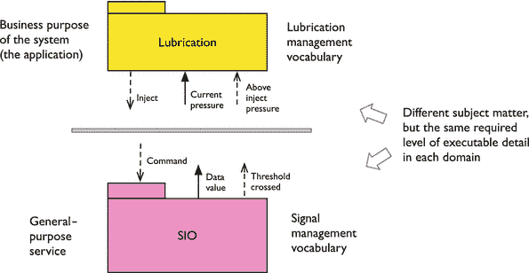
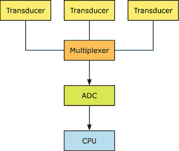
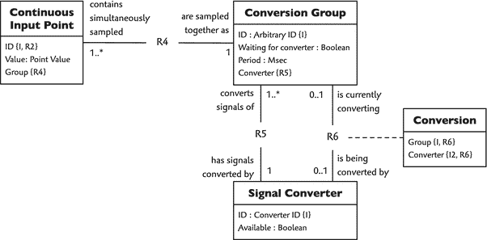
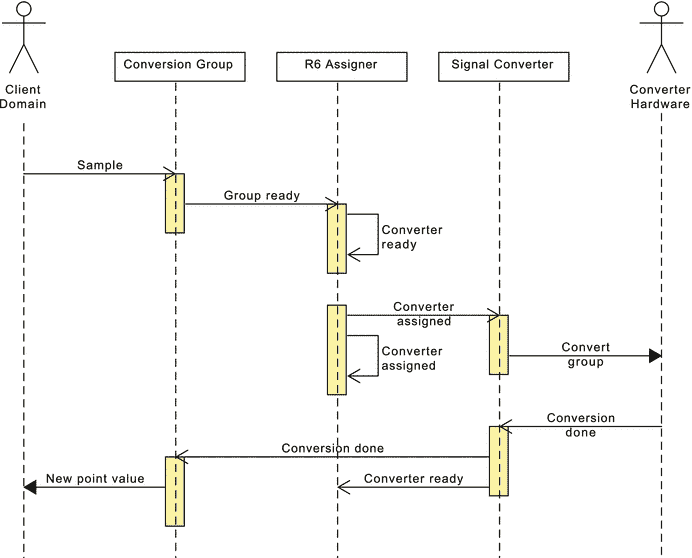
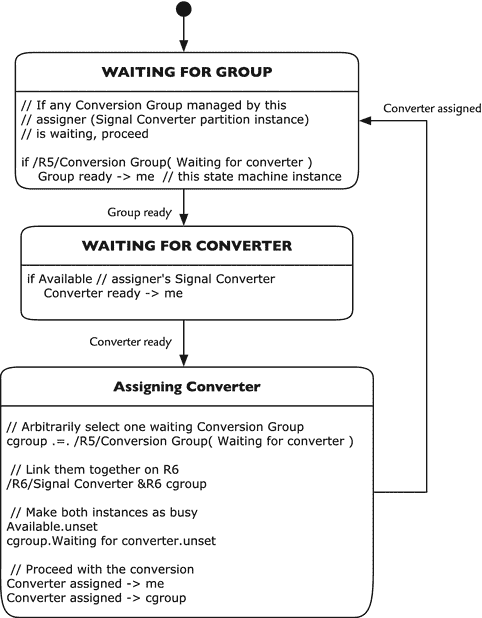
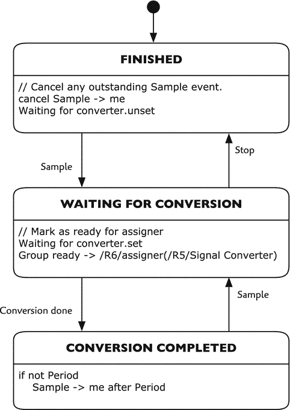
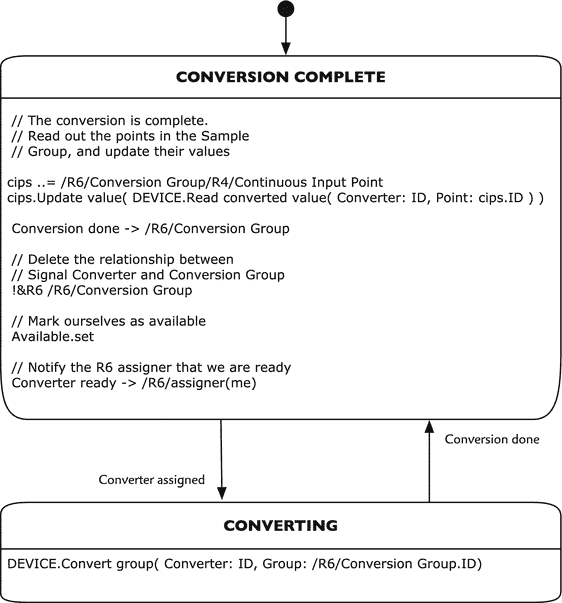
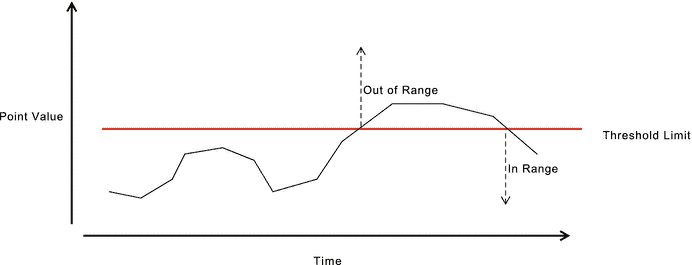
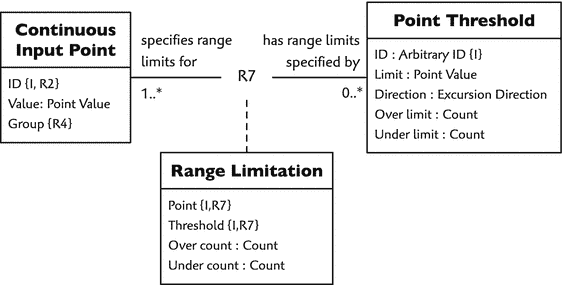
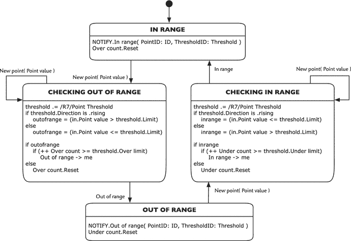

# 7. 传感器与执行器服务域

在上一章中，我们介绍了自动润滑系统（ALS）的一部分，即润滑域。润滑域将控制和获取润滑机械必要数据的任务委托给一个信号输入输出（SIO）域。在本章中，我们描述 SIO 域，并展示如何实现对外部世界的感知与控制。

从整个 ALS 的角度来看，我们在外部世界中产生了副作用。实际上，对于许多系统而言，正是这些副作用赋予了系统其实用性和目的性。工程师们已经设计出多种方法，让计算机系统能够感知和控制计算机系统外部发生的事件。尽管技术种类繁多，但存在适用于处理传感器和执行器的模式、规则和策略。感知与控制信号构成了我们为此域建模的主题。

由于 SIO 必须直接处理物理世界的各个方面，因此这个域似乎需要指定平台特定的细节。我们的模型包含了对系统硬件向我们呈现的真实世界电子设备的抽象，但仍然不包含系统所运行的软件平台的任何人工产物。例如，我们承认外部世界中的传感器会产生电信号，这些信号被转换为数字量，并且该技术构成了将物理量连接到系统的基础。我们的 SIO 模型包含了这一现实世界的抽象。但这些抽象模型人工产物不包含任何对系统最终运行的计算平台具体信息的引用。当然，这些具体信息由翻译提供。

SIO 域在 ALS 中的作用是向润滑域提供其完成机械正确润滑所需的服务。捕捉润滑机械需求的抽象，与感知和控制外部环境的抽象截然不同。我们称这两个域之间存在关注点分离，如图 7-1 所示。润滑域关注的是安排计算顺序以润滑机械，而不关心如何获取执行这些计算所需的数据。SIO 域关注的是在系统边界上调节和传输控制信号与数据，而不关心数据和控制的含义。正如我们在下一章中所示，`pycca` 提供了整合这两个世界的机制。



图 7-1. 关注点分离

我们有时会将像 SIO 这样的服务域描述为处于较低层级。我们不在传统意义上使用这个术语——即较高/较低表示相对详细程度。我们所说的较低层级，是指一个域的主题较少关注应用的业务目的，而是更侧重于整体解决方案的其他使能方面。事实上，一个建模完成的域不可能有更多或更少的细节。每个建模域都由相同的模型元素构成：类、状态、动作等。为了执行，所有元素都必须指定相同程度的细节。细节层级是恒定的，只有域之间的主题有所变化。

关注点分离是我们用来分而治之并解决当前更大问题的一种工具。通过只关注更大问题的某些方面，我们发现更容易构建解决方案。这种分离还有一个额外的好处：允许我们同时构建这两个域，并有可能在其他需要控制外部世界的应用中重用 SIO 域。

当然，创建分离意味着必须在某个时候将其弥合。再次强调，我们必须指出，忽略问题的某个方面并不会使其神秘消失。我们只是注意到，经验表明“在框内思考”然后“连接各个框”能够产生更易于理解和更灵活的解决方案。在下一章中，我们将展示如何通过称为桥接（bridging）的过程，将润滑域和 SIO 域重新连接在一起。

## 领域概述

本章中我们不会描述 `SIO` 领域的所有方面。完整的领域描述及其译文作为本书在线资料的一部分提供。此处我们重点关注翻译，因此挑选了领域中需要使用你尚未见过的 `pycca` 特性的几个区域。

`SIO` 领域呈现的主要抽象概念是`I/O 点`。`I/O 点`是数据值在系统与外部世界之间传递方式的一种理想化视图。`SIO` 的客户端通过读取点来获取传感器的值，通过写入点来对外部世界实施控制。`I/O 点`被赋予简单的小整数标识符，例如 `2` 或 `27`，客户端使用这些标识符来读取或更新点的值。

`SIO` 的客户端始终处理工程单位。工程单位是我们熟悉的常用单位，例如米、秒或千帕。就项目所采用的工程单位达成一致至关重要，也有一些众所周知的因单位不一致而导致问题的例子（[火星气候探测器](https://en.wikipedia.org/wiki/Mars_Climate_Orbiter)就是一个相对近期的例子）。与系统接口的电气硬件始终使用自己的一套单位，我们称之为设备单位。设备单位是针对每个设备进行特殊编码，以利于电子硬件。例如，模数转换器 (ADC) 报告的是测量电压相对于参考电压的比例。如何将测量电压解释为物理量，是电子设计中的一个元素，它必须规定从 ADC 电压到有意义的物理量的校准或缩放比例。提供`I/O` 值的理想化视图的一项基本功能，就是在工程单位和设备单位之间进行转换（反之亦然）。

`SIO` 会以设备单位计算出用于控制硬件接口的正确值，但将硬件的实际更新和访问委托给外部实体。这也许看起来很奇怪，但将物理硬件控制的访问委托给设备访问实体，意味着访问硬件控制的多种不同方式不会与 `SIO` 纠缠在一起。例如，某些硬件控制被映射到内存中，某些被映射到外部总线上。根据操作环境的不同，可能需要特殊权限。尽管 `SIO` 会以正确的设备单位计算出正确的比特位，但它确实需要依赖其他东西来将这些比特位传输到硬件控制寄存器。

对于我们在此目标定型的系统类型，设备访问代码通常作为微控制器芯片制造商提供的软件库的一部分提供。这些库通常被称为硬件抽象层，通常为常见的外围设备操作提供函数。例如，片上系统 (SOC) 微控制器可能提供用于运行板载 ADC 的函数。此类库很有用，因为它们通常编码了设备操作的细节，而这些细节仅凭芯片设计手册可能难以确定。必须在 `SIO` 和设备访问代码之间提供一个桥梁。这种桥梁遵循我们在下一章中描述的相同桥接模式。对于硬件访问，我们是桥接到手动编写的代码（由芯片制造商或项目编写），它是我们用来构建系统其余部分的坚实基石。

## 转换电信号

大多数与外界交互的系统都需要测量物理量。即使是传统的台式计算机，通常也会测量处理器的温度以控制风扇速度，确保 CPU 不会过热。

测量物理量的一种常见方法是使用传感器。传感器是一种产生电信号（通常是电压）的设备，该信号通常通过线性缩放与物理属性相关联。通常使用 ADC 来连接传感器信号。

数字化信号是一种普遍存在的操作，并且在计算领域是一门独特的专业。在此我们采取一种更简单的视角。图 7-2 以框图形式展示了我们假定的硬件配置。



图 7-2.

ADC 硬件框图

`ADC` 通常带有一个充当开关的多路复用器。这使得许多信号可以物理连接到 `ADC`，并通过多路复用器选择其中一个。同样常见的是，需要同时采样多个信号。如果这些信号代表以相同速率采样的同一物理量的不同实例，或者在时间上存在其他相关性（例如用于计算第三个值的两个量），则会出现这种情况。`ADC` 无法同时转换多个信号，但它可以转换一个信号并切换多路复用器来转换另一个信号，其速度足够快，从而可以有效地在多个信号之间分时使用。大多数 `ADC` 外设都支持将一系列输入转换为一种独特的操作模式，无需额外的 CPU 干预。

### 建模信号转换

图 7-3 展示了类图中处理信号转换的部分。



图 7-3. 处理信号转换的类

基本规则如下：

- 必须同时采样的输入点被分组在一起（R4）。对于与其他点没有关联的点，则使用单一组。

- 分组的输入点全部连接到同一个`信号转换器`（R5）。

- 在任何时间点，最多有一组信号正在转换，并且存在`信号转换器`空闲的时候（R6）。

每个`转换组`都有自己的采样周期。周期是两次采样之间间隔的时间。这意味着在某个时间点，两个转换组可能同时需要访问同一个`信号转换器`，或者在某个转换组决定采样其输入时，该`信号转换器`可能正在使用中。

从建模的角度来看，我们必须谨慎处理 R6 关联的管理方式。有必要将创建和删除 R6 关联实例的相关处理过程序列化。这通过一个分配器来实现。分配器是附加到关联上的一个状态模型，用于管理关联实例之间的竞争。状态活动不是同步地创建或删除关联实例，而是向分配器发送事件，声明它们的意图。分配器的状态活动作为一个单一的控制点，协调关联实例的生命周期，以确保正确访问`信号转换器`。由于我们这里的重点是翻译，因此不讨论竞争性关联的一般背景以及用于确保操作正确排序的协议。有关如何识别和建模竞争性关联以及构建分配器状态模型的更多信息，请参阅 *可执行 UML：模型驱动架构的基础*。

图 7-4 是针对一种可能的事件序列（即需要对一组点进行采样）的序列图。这是假设相应的`信号转换器`未被使用的情况下，首次请求对转换组进行采样时将会发生的序列。



图 7-4. 分配`信号转换器`的事件序列

# R6 分配器的状态模型

R6 分配器的状态模型以及`转换组`和`信号转换器`的状态模型协同工作，以确保在`转换组`的竞争实例之间，对`信号转换器`的访问被正确地序列化。客户端可以请求`转换组`开始采样，后者进而向 R6 分配器发出信号，表示它已准备就绪。由于这是第一次，分配器检测到`信号转换器`可用，并向自身发出`转换器就绪`信号。该转换导致`信号转换器`收到`分配转换器`事件，从而促使`信号转换器`向硬件请求进行转换。与此同时，R6 分配器向自身发出信号，表示一个转换器已被分配，并转换到一个状态，在该状态下，当前转换完成之前，不允许进行其他转换。

当硬件完成转换时，它会向`信号转换器`发出`转换完成`信号，`信号转换器`读取转换后的值并进行处理。`转换组`收到信号，被告知采样已完成，同时分配器收到`转换器就绪`事件，通知它可以分配另一个`转换组`。

图 7-5 展示了 R6 分配器的状态模型。



图 7-5. R6 分配器状态模型

特别注意，对于此状态模型，如果在转换器仍在转换先前分配组的信号时，另一个`转换组`发出了`组就绪`信号，状态机将保持在`等待转换器`状态，直到`信号转换器`发出`转换器就绪`信号，指示它已准备好执行下一次转换。这确保了不会有两个转换组同时尝试使用信号转换器。相反，如果转换在另一个组需要采样之前完成，则在`等待组`状态下会忽略`转换器就绪`事件，我们会保持在该状态，直到某个`转换组`请求信号转换器。该状态模型定义了`转换组`类和`信号转换器`类之间的一个排序协议，以确保对`信号转换器`的访问被正确地序列化。

以下是 R6 分配器的转换矩阵。

| `组就绪` | `转换器就绪` | `分配转换器` |
|---|---|---|---|
| `等待组` | `等待转换器` | `忽略` | `错误` |
| `等待转换器` | `忽略` | `分配转换器` | `错误` |
| `分配转换器` | `错误` | `错误` | `等待组` |

注意被忽略的事件。在等待`转换组`时忽略`转换器就绪`事件，以及在等待`信号转换器`时忽略`组就绪`事件，这是 R6 分配器在竞争性的`转换组`之间序列化对`信号转换器`访问的核心方面。

图 7-6 展示了`转换组`如何通知分配器它需要`信号转换器`。



图 7-6. `转换组`状态模型

`转换组`向分配器发出信号，表明它需要执行一次转换，然后等待被告知转换已经完成。`采样`和`停止`事件用于启动和停止对该组点的周期性转换。

最后，图 7-7 展示了`信号转换器`如何运作。



图 7-7. `信号转换器`状态模型

在被 R6 分配器分配给一个`转换组`后，`信号转换器`请求设备执行转换，然后等待转换完成。接着，需要检索转换后的值并更新输入点的值。注意，`转换完成`状态活动会删除 R6 关联的实例，因为它知道转换过程何时结束，并且因为`信号转换器`实例和 R6 关联实例之间是一一对应的关系。

由于输入点通过电子设计物理连接到特定的`信号转换器`（如 R5 所述），每个`信号转换器`类实例都必须有一个 R6 分配器的实例。不允许让任意一个`信号转换器`对任意一个`转换组`进行采样。这种安排被称为多分配器，因为存在分配器状态机的多个实例。对于更简单的情况，即任意资源可以分配给该资源的任意用户，则只需要一个分配器实例。对于多分配器，总有一个类在资源用户之间对分配器实例进行分区。形式上，多分配器可以通过与分区类相同的标识属性来识别。在这种情况下，`信号转换器`类是对分配器实例进行分区的类，并且 R6 分配器状态机的实例数量等于`信号转换器`类的实例数量。

## 实现分配器

我们使用一个 `pycca` 类来实现 R6 分配器。虽然从模型的角度来看，分配器并不是一个类，但 `pycca` 类具备我们所需的所有实现特征——即属性、状态模型以及拥有多个实例的能力。这也表明，`pycca` 类是一种实现结构，与模型类并不相同。我们使用 `pycca` 类来实现模型类，同时也用它来实现分配器。

该 `pycca` 实现遵循我们已见过的常规模式；然而，其中的标注指出了实现分配器时的特定用法：

* ❶ 由于这是一个按“`信号转换器`”分区的多分配器，我们需要一个指向“`信号转换器`”实例的引用，该分配器实例正是代表此实例进行操作。对标识类的引用，其净效果是使分配器拥有与“`信号转换器`”相同的标识属性。

* ❷ 遍历通过 `R5` 关联的“`转换组`”实例，寻找一个等待采样的实例。此处，`cgset` 是一个迭代器，被依次赋值为通过 `R5` 关联的实例的指针。

* ❸ 无需搜索该实例正在分配的是哪个“`信号转换器`”。`R6` 分配器实例与“`信号转换器`”实例之间存在一一对应关系。

* ❹ 再次，我们找到一个等待转换的组。我们选择找到的第一个组，并将“`信号转换器`”分配给它。

```
class R6_Assigner
reference idclass -> Signal_Converter                         # ❶
machine
default transition CH
initial state WAITING_FOR_GROUP
transition WAITING_FOR_GROUP - Group_ready -> WAITING_FOR_CONVERTER
transition WAITING_FOR_GROUP - Converter_ready -> IG
transition WAITING_FOR_CONVERTER - Group_ready -> IG
transition WAITING_FOR_CONVERTER - Converter_ready -> Assigning_Converter
transition Assigning_Converter - Group_ready -> IG
transition Assigning_Converter - Converter_ready -> IG
transition Assigning_Converter - Converter_assigned -> WAITING_FOR_GROUP
state WAITING_FOR_GROUP () {
ClassRefVar(Signal_Converter, sc) = self->idclass ;
ClassRefConstSetVar(Conversion_Group, cgset) ;
PYCCA_forAllRelated(cgset, sc, R5) {                // ❷
ClassRefVar(Conversion_Group, cg) = *cgset ;
if (cg->Waiting_for_converter) {
PYCCA_generateToSelf(Group_ready) ;
return ;
}
}
}
state WAITING_FOR_CONVERTER () {
ClassRefVar(Signal_Converter, sc) = self->idclass ; // ❸
if (sc->Converter_available) {
PYCCA_generateToSelf(Converter_ready) ;
}
}
state Assigning_Converter () {
ClassRefVar(Signal_Converter, sc) = self->idclass ;
assert(sc->Converter_available) ;
ClassRefConstSetVar(Conversion_Group, cgset) ;
PYCCA_forAllRelated(cgset, sc, R5) {
ClassRefVar(Conversion_Group, cg) = *cgset ;
if (cg->Waiting_for_converter) {                // ❹
sc->R6 = cg ;
sc->Converter_available = false ;
cg->Waiting_for_converter = false ;
PYCCA_generateToSelf(Converter_assigned) ;
PYCCA_generate(Converter_assigned, Signal_Converter, sc, self) ;
return ;
}
}
}
end
end
```

对于如何在多个等待的“转换组”之间进行决策，并未实现具体的策略。如果需求（进而模型）指定了解决这种竞争的具体策略，那么将在此处实现。一种可能的策略可能是“先到先服务”，但这段代码并非如此。此代码仅依据“转换组”与“信号转换器”关联的顺序来分配。这对应于一个需求：分配任意一个等待的“转换组”，并且由于需求允许分配任何“转换组”，我们选择了最方便且高效的实现方式。通常，关于如何在存在竞争的情况下选择资源分配方式的需求可能很复杂。此处，我们为了示例的简洁性而采用了简单的方法。

### 跟踪执行

正如我们在第5章中讨论的，在 `ST/MX` 域上执行的已转换模型可以生成执行跟踪。以下是涉及 `R6` 分配器的事件转换跟踪。在此场景中，两个“转换组”实例都连接到同一个“信号转换器”。事件序列被构造为确保存在对“信号转换器”访问的竞争。该跟踪展示了 `R6` 分配器如何正确地序列化“转换组”请求。

* ❶ 跟踪的前五行显示了为“转换组” `cg1` 启动采样转换的事件分派序列。这些事件对应于图7-4上半部分所示的事件。
* ❷ “转换组” `cg2` 被请求采样，此时硬件尚未完成对“转换组” `cg1` 的转换。发送给 `R6` 分配器的“组就绪”事件（第7行）使其转换到“等待转换器”状态，并在此状态下检查“信号转换器”，以确定其此时不可用。这导致分配器保持在“等待转换器”状态。
* ❸ 硬件已完成其工作，这启动了一个事件分派序列，最终以“信号转换器”向 `R6` 分配器发出“转换器就绪”信号而结束。由于有一个“转换组”已准备好进行转换，因此它被分配了该“信号转换器”，并启动下一次采样。
* ❹ 第二次转换完成。当“信号转换器”向分配器发出“转换器就绪”信号时，该事件被忽略（第15行），因为此时没有已准备好的“转换组”。

```
1   (nil) - Sample -> Conversion_Group.cg1: FINISHED -> WAITING_FOR_CONVERSION          ❶
2   Conversion_Group.cg1 - Group_ready -> R6_Assigner.r6asgn1: WAITING_FOR_GROUP ->
WAITING_FOR_CONVERTER
3   R6_Assigner.r6asgn1 - Converter_ready -> R6_Assigner.r6asgn1: WAITING_FOR_CONVERTER ->
Assigning_Converter
4   R6_Assigner.r6asgn1 - Converter_assigned -> R6_Assigner.r6asgn1: Assigning_Converter ->
WAITING_FOR_GROUP
5   R6_Assigner.r6asgn1 - Converter_assigned -> Signal_Converter.cvt1: CONVERSION_COMPLETE ->
CONVERTING
6   (nil) - Sample -> Conversion_Group.cg2: FINISHED -> WAITING_FOR_CONVERSION                ❷
7   Conversion_Group.cg2 - GroupReady -> R6_Assigner.r6asgn1: WAITING_FOR_GROUP ->
WAITING_FOR_CONVERTER
8   (nil) - Conversion_done -> Signal_Converter.cvt1: CONVERTING -> CONVERSION_COMPLETE       ❸
9   Signal_Converter.cvt1 - Conversion_done -> Conversion_Group.cg1: WAITING_FOR_CONVERSION ->
CONVERSION_COMPLETED
10   Signal_Converter.cvt1 - Converter_ready -> R6_Assigner.r6asgn1: WAITING_FOR_CONVERTER ->
Assigning_Converter
11   R6_Assigner.r6asgn1 - Converter_assigned -> R6_Assigner.r6asgn1: Assigning_Converter ->
WAITING_FOR_GROUP
12   R6_Assigner.r6asgn1 - Converter_assigned -> Signal_Converter.cvt1: CONVERSION_COMPLETE ->
CONVERTING
13   (nil) - Conversion_done -> Signal_Converter.cvt1: CONVERTING -> CONVERSION_COMPLETE       ❹
14   Signal_Converter.cvt1 - Conversion_done -> Conversion_Group.cg2: WAITING_FOR_CONVERSION ->
CONVERSION_COMPLETED
15   Signal_Converter.cvt1 - Converter_ready -> R6_Assigner.r6asgn1: WAITING_FOR_GROUP -> IG
```

### 局限性

我们此处展示的采样值方式仅适用于相对较低的频率，大约在几百赫兹的量级。采样点的时序由软件控制，这必然会在时序精度中引入抖动。由于我们使用延迟信号，且延迟时间分辨率为1毫秒，因此可采样的最高频率为1,000赫兹。

在更广泛的数据采集领域，这属于低数据速率，因此不应不加区分地应用我们这个简单的示例。当然，有可能做得更好，但这意味着要将更多工作转移到硬件中。我们对底层硬件的看法将与之前展示的不同。每种硬件配置都需要一定的软件控制，而这些控制可以使用此处展示的技术进行建模和实现。所不同的是软件模型所控制的底层硬件现实。而 `SIO` 域呈现的服务接口则保持不变。

## 数值阈值

通常，我们关心的不是某个点的数值本身，而是该数值与某个阈值的比较结果。在润滑领域中，我们看到该域需要监测润滑压力，以确保其在有效的压力范围内。为了支持这种委派的能力， `SIO` 域实现了数值阈值概念，并提供了一种将数值与定义的限制进行比较的方法。

图7-8展示了一个数值阈值的示例。随着点值随时间被采样，该值可能会上升到指定的阈值限制以上。发生这种情况时，该值被视为超出范围。它将保持超出范围，直到它下降到阈值限制以下，此时它被视为处于范围内。



图7-8. 数值上的阈值限制

此图展示了“超出范围”状态的上升沿检测。如果反转数值比较，就得到了互补形式的下降沿检测，即当点值下降到阈值限制以下时，检测到该点被视为超出范围。通过定义两个阈值限制，一个用于上升沿比较，一个用于下降沿比较，就可以监测一个数值，以确定它是否处于上限和下限之间。

在判断数值是否超过阈值时，我们希望防止在阈值限制附近发生振荡，从而反复触发“超出范围”状态并紧接着进入“范围内”状态。我们使用一个简单的计数滤波器来为检测提供滞回特性。如果我们延迟对数值超出范围或处于范围内的判定，直到我们观察到连续多次超过或低于阈值限制的偏离，就可以防止数值的微小波动导致虚假的“超出范围”检测。如果我们希望在数值每次超过其阈值时都能看到，可以将限制次数设置为1。当然，还有许多其他可能的方法来为阈值判定增加滞回特性，但简单的计数方案既有效，在转换为代码时计算效率也高。

图7-9是一个捕获了这些想法的类图。



图7-9. 范围限制的类图

每个输入点都可以指定多个`点阈值`。在我们的示例中，我们使用三个`点阈值`来监测喷射器的润滑压力，以了解润滑压力是否足够、是否存在过大的泄压压力，或是否超过了最大允许压力。一个`范围限制`是将一个`点阈值`应用于一个`连续输入点`的值的实例。我们可以定义一个`点阈值`并将其应用于多个输入点，但对于每个这样的应用，我们需要一个单独的`范围限制`实例。检测阈值偏离所需的计算在`范围限制`类的状态模型中指定。



图7-10. 范围限制状态模型

我们在此不展示该状态模型的完整pycca实现，因为它遵循您已见过的相同模式。但是，我们确实展示了`正在检查超出范围`状态的状态定义：

- ❶ Pycca定义了一个名为 `rcvd_evt` 的指针来访问事件参数。变量名和参数访问技术是一个不幸的选择，将在未来的版本中改进。

```
state CHECKING_OUT_OF_RANGE(
sio_Point_Value pointValue) {
ClassRefVar(Point_Threshold, pt) = self->R7_PT ;
bool outRange = pt->Direction == Rising ?
rcvd_evt->pointValue > pt->Limit :
rcvd_evt->pointValue Limit ;        // ❶
if (outRange) {
if (++self->Over_count >= pt->Over_limit) {
PYCCA_generateToSelf(Out_of_range) ;
}
} else {
self->Over_count = 0 ;
}
}
```

## 初始实例填充

在本节中，我们展示信号 I/O 域初始实例填充的一部分。此填充对应于第 6 章中填充的润滑域的需求。我们不展示填充中的全部数值集合，仅展示与转换信号和检测数值阈值限制相关的部分。完整的填充内容可在在线资料中找到。

为支持润滑域填充的需求，需要十一个 I/O 点：三个用于机械锁定装置，两个用于储液罐液位，三个用于喷射器压力，三个用于喷射器电磁阀。我们在此重点关注与喷射器压力关联的三个 I/O 点，因为它们必须被采样并与阈值限制进行比较。

喷射器压力由一个`连续输入点`表示，其值代表每个喷射器处的润滑压力。每个喷射器都有一个压力传感器，用于采样并转换为`连续输入点`的值。

| ID | 数值 | 分组 |
| --- | --- | --- |
| `inj1_pres` | 0 | `inj1_cg` |
| `inj2_pres` | 0 | `inj2_cg` |
| `inj3_pres` | 0 | `inj3_cg` |

用于喷射器压力的 I/O 点被组织成三个`转换分组`，每个分组仅包含一个点。

| ID | 等待转换器 | 周期 | 转换器 |
| --- | --- | --- | --- |
| `inj1_cg` | false | 500 | `cvt1` |
| `inj2_cg` | false | 500 | `cvt1` |
| `inj3_cg` | false | 500 | `cvt1` |

我们假设只有一个`信号转换器`连接到系统，并且所有喷射器压力传感器都连接到它。

| ID | 转换器可用 |
| --- | --- |
| `cvt1` | true |

润滑域假定信号 I/O 将对喷射器压力值执行阈值比较。必须确定三个阈值：高于泄压压力、高于注射压力、以及高于最大压力。从润滑域的填充内容中，我们知道存在两种喷射器模型。我们的压力阈值是基于不同的喷射器设计选择的。

| ID | 限制值 | 方向 | 超出限制次数 | 低于限制次数 |
| --- | --- | --- | --- | --- |
| `ix77b_above_disp` | 26 | 上升 | 2 | 2 |
| `ix77b_above_inj` | 15 | 上升 | 2 | 2 |
| `ix77b_max_pres` | 26 | 上升 | 1 | 2 |
| `ihn4_above_disp` | 32 | 上升 | 2 | 2 |
| `ihn4_above_ing` | 19 | 上升 | 2 | 2 |
| `ihn4_max_pres` | 35 | 上升 | 1 | 2 |

考虑到三个喷射器以及每个喷射器设计类型对应三个阈值，我们需要九个`范围限制`实例来检测润滑域要求的所有阈值偏离。

| 点 | 阈值 | 超出计数 | 低于计数 |
| --- | --- | --- | --- |
| `inj1_pres` | `ix77b_above_disp` | 0 | 0 |
| `inj1_pres` | `ix77b_above_inj` | 0 | 0 |
| `inj1_pres` | `ix77b_max_pres` | 0 | 0 |
| `inj2_pres` | `ihn4_above_disp` | 0 | 0 |
| `inj2_pres` | `ihn4_above_inj` | 0 | 0 |
| `inj2_pres` | `ihn4_max_pres` | 0 | 0 |
| `inj3_pres` | `ix77b_above_disp` | 0 | 0 |
| `inj3_pres` | `ix77b_above_inj` | 0 | 0 |
| `inj3_pres` | `ix77b_max_pres` | 0 | 0 |

## 总结

在本章中，我们针对 SIO 领域展示了一个模型和转换方法。该领域通过传感数值和控制执行器来处理与外部世界的交互。我们重点关注了润滑领域委托给 SIO 领域的两个具体能力：

*   对传感器数值进行采样
*   将采样数值与阈值进行比较

对于数值采样，我们的模型包含一个分配器状态模型，用于管理电子设计中物理布局固有的竞争问题。

对于数值阈值，我们了解了一个附加到关联类上的状态模型如何提供对同一输入点应用多个阈值限制的追踪手段。

在这两种情况下，我们都看到了应用于从外部世界收集和评估数据的规则与策略。从 SIO 领域的角度来看，数据的数值和含义并不重要。从润滑领域的角度来看，它需要当前最新的数据值，而电子设计如何影响数据获取的规则并不重要。这种关注点分离使我们能够专注于为两个领域开发一套一致的抽象，并有可能在其他具有类似与外部世界交互需求的应用程序中重用 SIO 领域。