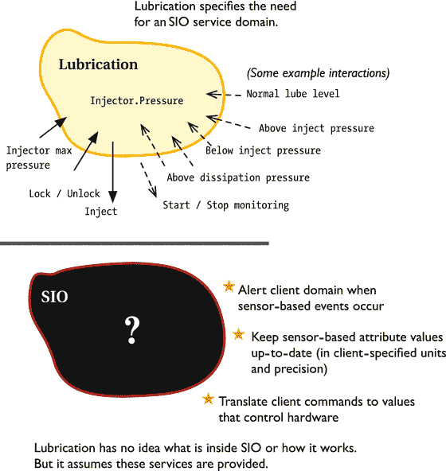
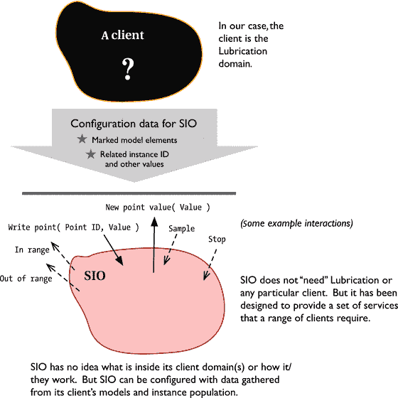
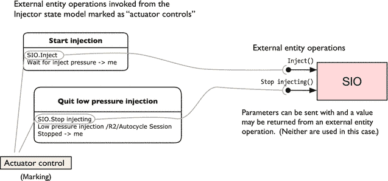
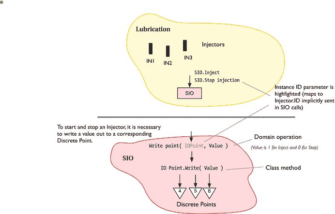
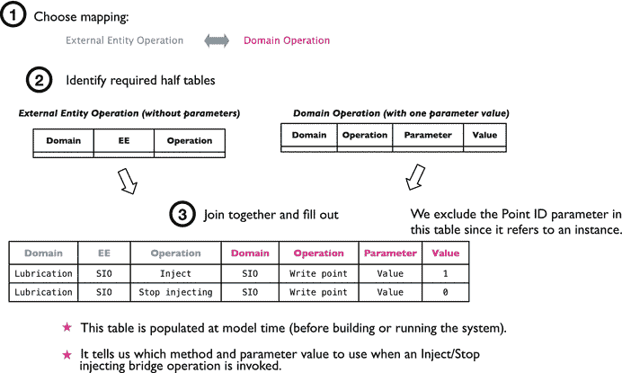

# 8. 集成应用领域与服务领域

在本章中，我们将讨论如何管理领域之间的交互。因为我们在从一个领域的语义到另一个领域的语义之间架设桥梁，所以我们称此主题为桥接。从建模者的角度来看，桥接两个领域可以相对简单。这假设两个领域之间没有语义内容缺失。例如，如果至少没有一个中间级的绘制引擎，将视频游戏应用直接桥接到渲染硬件将会很困难。通过为 ALS 示例仔细构建领域图，我们避免了这类麻烦。

然而，有效实现桥接本身会带来一系列问题。`Pycca`为桥接提供了支持，但仍然必须编写一定量的代码。幸运的是，这可以通过`pycca`提供的帮助系统地完成，从而简化过程。

在深入实现细节之前，与往常一样，我们需要对必须完成的任务有一个清晰而详细的构想。本章的第一部分将介绍有用的构建块，用于可视化和指定定义桥接所需的数据。我们将此应用于润滑领域和 SIO 领域之间的几个关键交互。然后，在本章的第二部分，我们将展示如何通过使用`pycca`生成的常量，结合手写的 C 语言代码来指定这些数据。最后，我们将展示一些关于`pycca`如何支持从领域外部执行模型级操作的细节。

## 领域优势总结

当我们深入探讨桥接的所有细节时，您可能会疑惑为什么我们要付出这么多努力来保持我们领域的语义完整性。那么，让我们首先评估一下领域为何重要。领域工程的一个关键目标是促进领域的重用。如果一个领域被重新设计，但提供了相同的指定服务，那么它对其交互的任何领域的模型的影响应该最小，最好是零影响。

例如，如果我们（或其他人）设计了一种完全不同的方式来管理 SIO，那么它应该对润滑领域没有影响。只要在适当的物理条件下传递了“高于喷射压力”事件，润滑领域的需求就得到了满足。润滑领域的逻辑不知道也不关心该事件是如何传递的。

除了可重用性之外，还有更多好处。通过保持模型分离，可以在没有大量协调开销的情况下并行开发它们。构建一个领域所需的专业知识与构建另一个领域所需的专业知识是不同的。这意味着您可以雇佣完全不同的专家来开发每个领域的模型。复杂度降低了，因为每个领域模型的构建无需担心另一个领域如何工作的细节。这一结果源于应用我们之前在第 7 章第一部分讨论的关注点分离原则。

### 每个领域都是一个黑盒

为了保持这些优势，两个桥接领域中的模型将彼此视为黑盒。SIO 不对润滑领域建模任何内容，润滑领域也不对 SIO 建模任何内容。润滑领域不知道 SIO 领域中是否有（以及哪些）事件在内部触发。它对 SIO 的内部状态或动作一无所知。您可以随意重命名和重组一个领域中的模型内容，而不会破坏另一个领域中的任何内容。但这种不透明性原则仅适用于模型结构，不一定适用于它们包含的数据！例如，`SIO 点阈值`类的一个实例可以将其`限制`属性设置为润滑领域中相应`喷射器设计`实例的`最大输送压力`。或者，SIO 的`连续输入点`类的一些实例可能对应于润滑领域中`喷射器`的特定实例。根据用法，这些数据可以在建模时、编译时、初始化时或正常运行时动态地粘合在一起。

图 8-1 描绘了这一黑盒原则。

图 8-1. 润滑领域将 SIO 视为黑盒

我们可以看到，润滑领域假设存在一个 SIO 领域，它能够触发基于传感器的事件、方法调用和属性值。它还假设 SIO 能够管理针对物理世界的控制。但润滑领域不知道这些是如何完成的，也不知道 SIO 中涉及哪些结构（建模的或未建模的）。

润滑领域有一个名为`SIO`的外部实体，作为这些假设的代理。保持代理外部实体的名称与实际领域名称相同是一种方便的记忆方式，但重要的是要记住，`SIO`外部实体与 SIO 领域不是一回事。`SIO`外部实体是润滑领域对如何将功能委托给其范围之外的其他地方来完成的看法。润滑领域使用该外部实体作为代理，以便它能够以一种与其领域结构和活动相一致的方式来表达其对执行器和传感器服务的需求。如果`SIO`外部实体实际上与 SIO 领域相同，我们将期望能够将在润滑领域中产生的外部实体操作直接连接到针对 SIO 的领域操作，并且将没有需要桥接的语义鸿沟。这绝对不是我们希望的情况。如果领域之间没有语义鸿沟，SIO 领域就必须知道润滑领域工作的细节。我们就会因分离领域关注点而牺牲了降低复杂性的好处，并放弃了在其他应用中重用 SIO 领域的任何机会。

图 8-2 显示了从 SIO 角度回看的情况。我们得到了类似的画面。

图 8-2. SIO 将其客户端视为黑盒

SIO 不知道“注入”是什么意思。但它知道如何通过“写入点”领域操作将数值写入到硬件寄存器。类似地，其他 SIO 服务是用与 SIO 对其主题领域的看法相一致的词汇来定义的。SIO 在其所做的事情上并非完全没有约束。所提供的服务旨在满足像润滑这样的客户端领域与物理世界交互的需求，而润滑领域也确实公开了它所需的具体服务。

尽管每个领域对其他领域都采取黑盒视图，但当我们将润滑领域和 SIO 领域桥接在一起时，我们必须为某些 SIO 类提供数据值，以解释润滑领域所需的特定行为。这些 SIO 类通过拥有控制处理详细信息的属性来进行参数化。例如，SIO 领域具有一些属性，这些属性指定值范围限制，作为向客户端提供警报服务的一部分。我们使用从润滑领域的模型和实例种群收集的数据，或任何其他由 SIO 服务的客户端领域，为这些类型的属性提供值。

还要注意，虽然润滑领域需要 SIO 才能运行，但 SIO 并不真正需要从润滑领域获取任何东西来履行其职责。这就是客户端/服务领域桥接的本质。客户端向服务提出要求，服务被填充并桥接以满足这些要求。这解释了领域图上依赖箭头的方向；这些箭头有时被误解为指示领域之间的某种控制流或数据流。相反，它们旨在表示领域之间的需求流或依赖关系。领域之间的实际控制流或数据流是后来作为桥接工作的一部分确定的。

## 标记与映射

现在让我们看一下，为了将一个领域与另一个领域跨桥连接，需要哪些数据。我们需要一种方法来定义，一个领域中的某些数据和活动如何映射到另一个领域中的对应数据。这是通过两种方法完成的：**标记**和**映射**。

**标记**是识别和分类客户端领域中可用于配置服务领域属性的模型元素的过程。例如，我们标记润滑领域中其值由传感器驱动的属性。**映射**是定义客户端领域中的标记元素与服务领域中的支持模型元素之间对应关系的过程。例如，润滑领域中的`Pressure`属性将对应于 SIO 连续输入点的采样和缩放值。然后必须有一种方法将每个`Injector`实例映射到 SIO 中对应的`Continuous Input Point`实例。

关键的是，我们以完整但不指定任何特定实现的方式来做到这一点。这样，在实施时，我们拥有使系统工作所需的所有标记和映射数据。鉴于我们特定的平台技术，我们也有自由高效地实现桥接。

查看图 8-3，这是润滑领域中`Injector`状态模型的一个片段。

**图 8-3.** 外部实体操作

在右侧，我们看到外部实体充当 SIO 领域的代理。我们标记了两个特殊的`Injector`状态动作，它们通过某种执行器触发物理环境中的控制。因此，我们声明它们为执行器控制。它们恰好也是外部实体操作。它们调用在表示 SIO 领域的外部实体上定义的操作。外部实体操作可以带参数调用并返回一个值。此示例中的两个操作都没有指定任何参数，也不期望任何返回值。我们的动作语言假定调用实例的 ID 通过任何外部实体操作隐式可用，因此无需显式提供`Injector`的`ID`。

图 8-4 显示了 SIO 领域必须如何响应 SIO 外部实体上的操作。

**图 8-4.** 一个领域操作

SIO 领域提供了`Write point`领域操作。此操作接受一个`I/O Point`参数，它是目标`I/O Point`标识符的值，以及一个要写入的`Value`。如果写入 1，则启动注入；如果写入 0，则停止注入。请注意，`Injector`和`I/O Point`参数已被高亮显示，以指示每个参数都携带一个对应于实例的 ID 值。如您将看到的，它们的处理方式与`Value`参数略有不同。

因此，我们的任务是将润滑领域中标记的外部实体操作映射到 SIO 领域中的领域操作。为了实现这一点，我们将使用称为半表的东西。将两个半表放在一起形成一个桥接表。图 8-5 展示了一个如何工作的示例。

**图 8-5.** 注入操作半表

