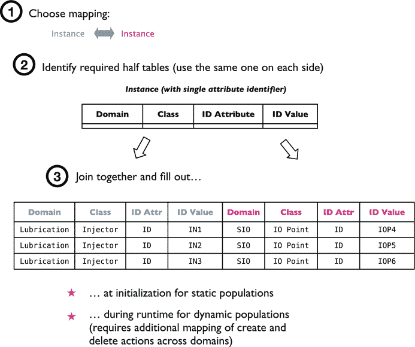
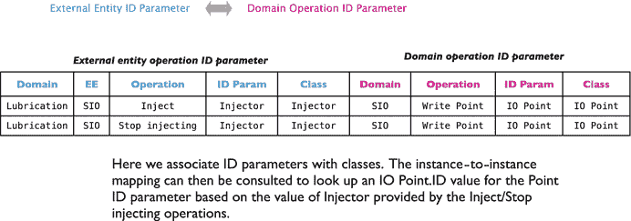
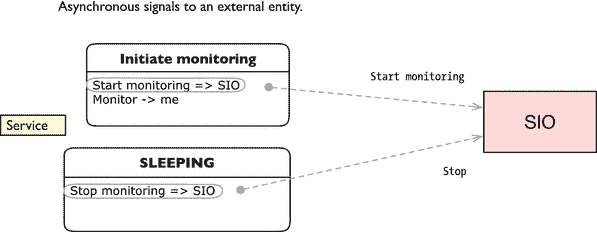
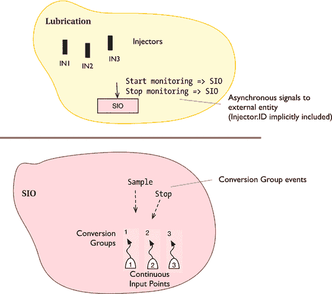
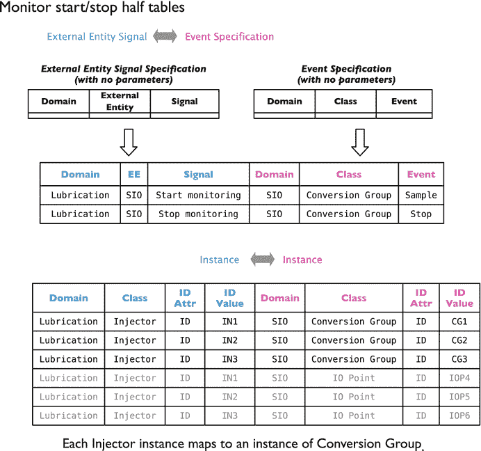
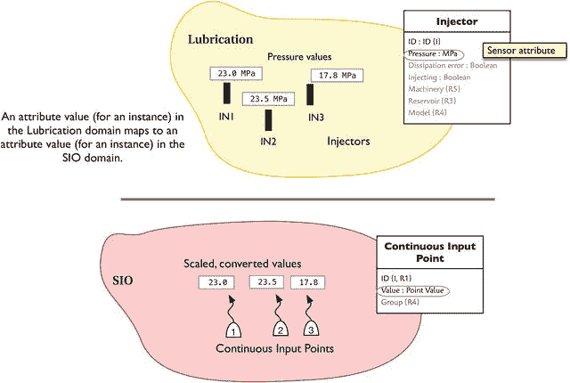
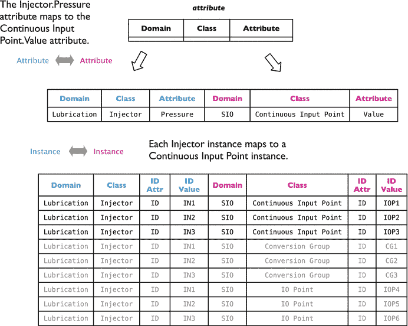
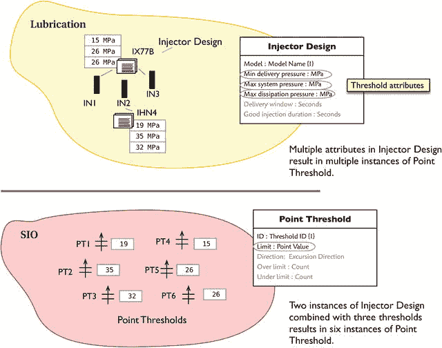
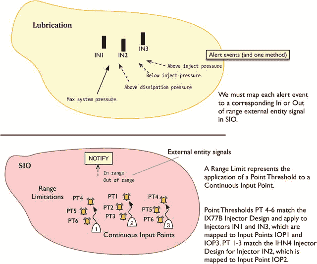

# 排版后的内容

第一步是将润滑领域中外部实体的操作映射到 SIO 领域中的一个领域操作。目前，我们暂不考虑如何识别所涉及的实例，因为现在只关心领域模型之间是如何连接的。然后，我们为每一侧构建半表。将两个半表连接起来，就产生了一个桥接表。有了桥接表，我们就可以填充两侧对应于这两个领域的值。结果精确地展示了如何通过向一个 I/O 点写入特定值，来体现润滑领域中的 `Inject` 和 `Stop Injecting` 操作的语义。

但工作尚未完成。上表展示了语义鸿沟是如何被桥接的，但操作是在实例上发生的。我们知道，当润滑领域调用 `Inject` 或 `Stop injecting` 操作时，`Write point` 操作会被调用。但该方法必须在某个 `I/O Point` 实例上被调用。

为了确定操作所涉及的实例，需要进行进一步的映射，这次是在 `Injector` 的实例和 `I/O Point` 的实例之间进行。我们再次使用半表，如图 8-6 所示。

**图 8-6.** 注入实例半表

我们正在建立 `Injector` 的一个实例与 `I/O Point` 的一个实例之间的对应关系。`Injector` 类有一个名为 `ID` 的唯一标识属性，`I/O Point` 类也是如此。因此，这两张半表恰巧具有相同的列标题。为了获得桥接表，我们连接这两张实例半表。

`Injector` 和 `I/O Point` 的实例群体在运行时是静态的。在系统运行期间，我们不会创建或删除 `Injector` 实例，也不会创建或删除 `I/O Point` 实例。因此，我们可以在准备构建系统时填充该表。如果其中任何一方的群体是动态的，或者两方都是动态的，我们就需要将每个领域中的创建和删除动作相互映射，以便能够在运行时维护实例映射表中的值。

关于该桥接，还有一个最终细节必须明确。`Inject` 和 `Stop injecting` 外部实体操作有一个名为 `Injector` 的形式参数，其值决定了要启动或停止的是哪个 `Injector` 类实例。同样地，SIO 中的 `Write point` 操作有一个名为 `I/O Point` 的形式参数，其值决定了写入操作关系到哪个 `I/O Point` 类实例（除了指定要写入值的参数之外）。我们必须说明这些形式参数的参数值从哪里获取。我们想说，润滑操作中的 `Injector` 参数代表 `Injector` 类的一个实例，并且这个实例映射到 `I/O Point` 参数，该参数代表 `I/O Point` 类的一个对应实例。同样地，我们通过使用半表来指定一个桥接表，将外部实体操作中的一个 `ID` 参数映射到领域操作中的一个 `ID` 参数。图 8-7 展示了由此产生的桥接表。

**图 8-7.** 映射 ID 参数

这三个桥接表精确地定义了润滑领域和 SIO 领域之间用于启动和停止注入的语义鸿沟是如何被弥合的。通过追溯这些桥接表，我们可以看清桥接映射的完整逻辑。

*   当在润滑领域中调用 `Inject` 外部实体操作时，注入操作桥接表（图 8-5）指出，我们必须通过让桥接代码调用 SIO 领域中的 `Write point` 领域操作来实现润滑领域的意图，并且在该操作中传递 `1` 作为 `Value` 参数对应于启动注入。
*   `ID` 参数桥接表（图 8-7）指出，作为 `Inject` 调用中的参数给定的 `Injector` 参数值，是一个 `Injector` 类实例的标识符，并且 `Write point` 操作需要一个对应的 `I/O Point` 类实例的标识符。
*   实例桥接表（图 8-6）提供了从 `Inject` 操作 ID 参数获取的 `Injector` 标识符值与提供给 `Write point` ID 参数的 `I/O Point` 标识符值之间的对应关系。

通过这种方式，桥接不仅可以确定 SIO 中的哪个领域操作满足润滑领域的需求，还可以精确地确定在桥接代码中调用 `Write point` 操作时必须向其传递哪些值。

您可能会注意到，半表的列始终引用通用模型元素（操作、实例等）。跨领域映射涉及到一个总体概念，即在一个领域的某类模型元素与另一个领域的另一类（或同一类）元素之间建立对应关系。

在我们构建好表格之后，就可以很好地推进 `pycca` 实现了。没有这些表格，事情可能会变得相当混乱。但在着手实现桥接之前，我们将展示其他桥接表，以演示可能出现的各种映射，特别是当涉及诸如事件信号这样的异步操作时。

## 开始和停止监控压力

图 8-8 展示了两个异步信号，`Start` 和 `Stop monitoring`，它们指向 SIO 外部实体。它们是异步的，因为润滑想要向 SIO 发送信号并期望在未来得到反馈，但在此期间需要继续处理自己的事务。

**图 8-8.** 发送给外部实体的信号

除了将它们归类为我们需要的服务之外，很难将它们归类为其他东西，因此我们将它们标记为 `Service`。这些信号对应于 SIO 中的 `Sample` 和 `Stop` 事件，如图 8-9 所示。

**图 8-9.** SIO 中的事件

在这种情况下，我们可以将 `Injector.ID` 隐含在已发送的信号中。因此，这两个信号都不携带显式的 `ID` 参数。即使没有显式发送，也始终假定信号的来源对模型执行架构是已知的。

现在让我们构建这些表格。图 8-10 展示了结果。

**图 8-10.** 监控启动停止桥接表

首先，我们将外部实体信号规范映射到事件规范。这里我们使用术语“规范”是为了明确我们讨论的不是运行时在空中飞来飞去特定信号，而是信号/事件结构的签名或规范。

在第二个表中，我们将 `Injector` 的实例映射到 `Conversion Group` 的 SIO 实例。但在我们为注入控制映射实例时，已经见过这个表。该表的标题是相同的，因此我们只需为从 `Injectors` 到 `Conversion Groups` 的实例映射添加行即可。现在，我们已经指定了所有必要的信息，以确定应该在 SIO 领域触发哪个事件，以及应该将该事件发送到哪个实例。

### 更新压力

桥接并不局限于操作。如果我们观察 `Injector` 类，会发现它有一个特殊属性 `Pressure`。其特殊性在于，Lubrication 领域假定可以读取该属性，从而获得实际物理 `Injector` 的当前润滑剂压力。这意味着 SIO 被赋予了保持压力值更新的责任。在图 8-11 中，我们将其标记为传感器属性。在像 Lubrication 这样的领域中，许多类似的属性常常分散在各处。SIO 的传感器概念是通过连续输入点实现的。对于 Lubrication 中的每个压力值，SIO 中都有一个对应的 `Continuous Input Point` 实例。在原始设备值被转换并缩放为有意义的压力值后，当 `Injector` 读取其压力时，必须通过某种方式使其可用。我们将在本章稍后讨论具体方式，但目前只需知道属性值是被映射在一起的即可。

图 8-11. 标记传感器属性

图 8-12 展示了桥接表的规范。

图 8-12. 属性映射桥接表

在实例到实例的映射表中，我们将 `Injector` 的实例映射到对应的 `Continuous Input Point` 实例。该表也使用您之前见过的相同表头。我们只需扩展该表，添加与喷油器润滑剂压力相关的 `Continuous Input Points` 的新实例映射。请注意，单个 `Injector` 所需的服务需要多个 SIO 模型元素来捕获。这种情况并不罕见。

`Injector.Pressure` 属性与 `Continuous Input Point.Value` 之间的关联很直接。如果我们有其他基于传感器的属性，例如 `Temperature` 或 `Vibration`，我们将在表中添加行，在左半部分填写适当的类和属性名称，在右半部分填写相应的 `Continuous Input Point` ID 值。

我们现在知道了哪些数据跨桥接映射，但尚未就用于传输数据的机制做出任何实现决策。这些值是否映射到相同的内存位置？值是在域之间推送还是拉取？这可以在实现桥接时确定。从模型角度来看，要求是当读取 `Injector.Pressure` 值时，它必须是最新的，并反映真实世界中喷油器上观察到的实际润滑剂压力。从桥接角度来看，我们必须确保 `Injector.Pressure` 值与其对应的 `Continuous Input Point.Value` 属性值相同。从实现角度来看，有多种方法可以实现这一目标，每种方法都有不同的性能权衡。

### 喷油器压力警报

最后一个例子稍微复杂一些，但我们将使用相同的过程。我们标记 Lubrication 域的元素，然后找出如何将它们映射到 SIO 的相应元素上。

在监控喷油器压力期间，Lubrication 域期望 SIO 在出现以下四种情况之一时通知 `Injector`：

1.  压力高于喷射润滑剂所需的最小值。
2.  压力低于喷射润滑剂所需的最小值。
3.  压力高于泄压时允许的最小值（即当未喷射润滑剂时）。
4.  压力高于允许的最大值。

`Injectors` 由其关联的 `Injector Designs` 来表征。`Injector Design` 的三个属性可以标记为阈值属性。这些标记表明了 Lubrication 域的意图，即这些属性被用作喷油器压力所需压力警报的一部分。我们的任务是将此标记实现为 SIO 的元素。`Max delivery pressure`、`Max system pressure` 和 `Max dissipation pressure` 必须对应 `Point Threshold` 的实例，这些实例的 `Limit` 值等于 `Injector Design` 的属性值。图 8-13 展示了这种对应关系。

图 8-13. 标记阈值属性

再次查看 `Injector` 模型，我们看到三个事件和一个类方法与前述条件相对应，并且这些必须在适当的时间由 SIO 触发。我们可以将这些视为标记为警报事件和警报方法。

SIO 域提供了将 `Continuous Input Points` 的值与 `Point Threshold` 提供的限制进行比较的能力，并确定一个点值相对于 `Point Threshold` 是处于范围内还是范围外。此比较操作由 `Range Limitation` 类的生命周期捕获。由 `Range Limitation` 类中介的 `Continuous Input Points` 和 `Point Thresholds` 之间的关联，允许将一个点与多个阈值进行比较，也允许将一个阈值应用于多个点。因此，要配置 SIO 域以监控压力警报，意味着我们必须仔细填充 `Point Threshold` 和 `Range Limitation` 实例，以匹配 `Injectors` 的期望。在更新 `Injector.Pressure` 值时，我们已经看到在 SIO 中填充了三个对应于喷油器压力的 `Continuous Input Points`。这些点的值与限制进行比较，以决定是否存在压力警报。图 8-14 展示了 Lubrication 警报事件与 SIO 范围限制之间的对应关系。

图 8-14. 标记警报事件

知道了哪些 `Continuous Input Points` 涉及喷油器压力，并且知道了我们需要应用哪些 `Point Thresholds` 来满足压力警报，我们就可以填充 `Range Limitation` 的实例。考虑一个单一的 `Injector`，`IN2`，它恰好是一个型号为 `IHN4` 的喷油器。其相关的 `Injector Design` 指定了以下值：

*   最小输送压力 ⇒ 19 MPa
*   最大系统压力 ⇒ 35 MPa
*   最大泄压压力 ⇒ 32 MPa

这意味着有三个对应的 `Point Threshold` 实例，分别命名为 `PT1`、`PT2` 和 `PT3`。从更新 `Injector.Pressure` 属性的桥接中我们已经知道，`IN2` 映射到 `Continuous Input Point` `IOP2`。必须在 SIO 中创建三个 `Range Limitation` 实例来监控 `IOP2`，每个实例对应一个 `Point Threshold`，这些阈值反映了 `Injector Design` 中标记的阈值属性。它们在 SIO 中被标识为 `PT1-IOP2`、`PT2-IOP2` 和 `PT3-IOP2`。对于三个 `Continuous Input Points` 和对应于每个 `Injector Design` 的三个不同的 `Point Thresholds`，我们总共有九个 `Range Limitation` 实例。

