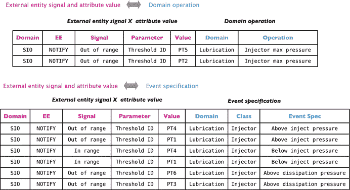
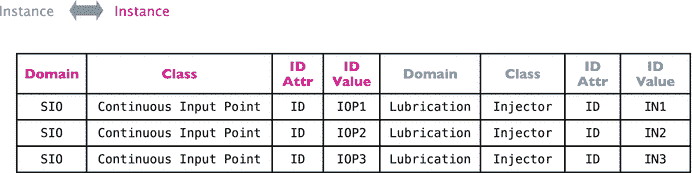
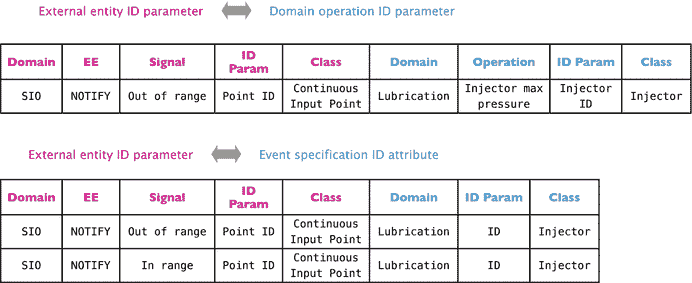

对于每个新获取的点值，每个关联的 `Range Limitation` 实例都会将该值与其对应的阈值进行比较。当阈值被超过时，会向 `SIO` 中的 `NOTIFY` 外部实体发送一个 `In range`（范围内）或 `Out of range`（范围外）信号。任务是确保此信号能触发 `Lubrication` 中相应的事件或方法，并将其导向正确的 `Injector` 实例。由于 `Lubrication` 领域期望警报以领域操作或发送给 `Injector` 实例的事件形式传递，我们需要两张桥接表来完成映射，如图 8-15 所示。一张映射到 `Injector max pressure` 领域操作，另一张映射到我们的警报事件。



图 8-15. 映射范围限制

我们在这些表中做了一些不同的事情。由于我们处理的是源自 `SIO` 的外部实体信号，这次我们是从 `SIO` 映射到 `Lubrication`。表的列顺序无关紧要，但从信号方向解释到其目标会稍微容易一些。同样在这种情况下，半表是 `SIO` 模型元素的两个部分组合而成：一个外部实体信号和一个参数值。这是因为任何 `Continuous Input Point` 都可能为其定义多个阈值，我们需要一个参数来区分正在发出信号的阈值。六个阈值中的每一个都可以作为 `In range` 或 `Out of range` 发出信号。还要注意，两个表中可能的十二个条目中，只有八个填充了值。这是因为 `Lubrication` 领域对最大喷射器压力限制进入 `In range` 状态或耗散压力限制进入 `In range` 状态的情况不感兴趣。这些情况没有对应的警报事件或警报方法。因此，当生成这些外部实体信号时，它们在桥接表中找不到，也就不会采取任何桥接动作。

回到我们的示例，考虑当 `Continuous Input Point`（连续输入点）`IOP2` 的值超过 `Point Threshold`（点阈值）`PT2` 的限制时。这将由 `Range Limitation` 的 `PT2-IOP2` 实例检测到。如果 `Out of range` 信号被发送到 `NOTIFY` 外部实体，并且 `Threshold ID` 被指定为 `PT2`，那么我们的表显示桥接将调用 `Injector max pressure` 领域操作。或者，如果 `Threshold ID` 值为 `PT1`，查询第一张表将找不到匹配项；但查询第二张表，我们发现必须将 `Above inject pressure` 事件发送给一个 `Injector`。

与之前一样，我们必须构建将 `SIO` 中的 `Continuous Input Point` 实例与 `Lubrication` 中的 `Injector` 实例关联起来的半表。这里的 `Continuous Input Point` 标识符与用于更新 `Injector.Pressure` 值的标识符相同。阈值限制就是与该值进行比较的。图 8-16 显示了填充后的桥接表。



图 8-16. 映射输入点

最后，我们必须指定 ID 参数来自何处。当我们调用 `Injector max pressure` 领域操作时，外部实体 ID 参数是一个 `Continuous Input Point` ID，而领域操作 ID 参数是一个 `Injector` ID。类似地，如果我们从桥接发出警报事件，信号发送到的实例是一个 `Injector`。图 8-17 显示了标识符映射。



图 8-17. 映射标识符参数

这最后一个构建桥接表的示例确实比其他示例更复杂。它需要在 `SIO` 中填充几个不同的类，以便对其进行适当配置以满足 `Lubrication` 领域的需求。一旦完成，就可以按照我们展示的技术构建桥接表。这很好地提醒我们，桥接是一项抽象工作，需要在多个领域之间建立对应关系；我们需要勤勉地应用标记和映射技术，以避免纠缠不清。

## 在 Pycca 中实现桥接

在上一节中，我们展示了如何将一个领域的假设和依赖关系桥接到另一个领域提供的服务上。在本节中，我们将注意力转向创建实现领域间桥接所需的代码。

在我们的示例中，`Lubrication` 领域使用 `SIO` 外部实体作为代理，来表达它如何委派操作。它在处理过程中恰当时机对 `SIO` 外部实体调用操作，以执行这些动作。我们将外部实体操作区分为同步和异步。这种区别对 `Lubrication` 领域很重要，因为它表达了该领域对服务完成的期望。当调用 `Inject` 或 `Stop injecting` 操作时，`Lubrication` 领域假设，无论过程如何，当操作完成时，喷射器电磁阀已接通或断开润滑剂的施加。这与 `Lubrication` 领域调用 `Start monitoring` 和 `Stop monitoring` 操作时的假设形成对比。在后一种情况下，`Lubrication` 领域假设它可以继续自己的处理，并且事件稍后会到达以指示监测喷射器压力的结果。

对于 pycca 生成的领域，每个外部实体操作，无论其本质是同步还是异步，都会被转换为一个普通 C 函数的外部声明。当操作被调用时，它像任何其他普通 C 函数一样执行，可能接受参数并返回一个值。模型中同步与异步的概念在转换为普通函数时会丢失，但仍然存在于桥接的交互中。

要桥接 pycca 领域，需要为外部实体函数提供定义。Pycca 为外部实体函数使用了一种命名约定：

*   `<domain name>` 是定义该外部实体的领域名称。
*   `<external operation name>` 是在 pycca 源代码中通过 `external operation` 声明为该外部实体操作指定的名称。

```
eop__<domain name>_<external operation name>
```

桥接实现由一个函数构成，该函数按照上述方式命名，对应领域定义的每个外部实体操作。然后，当领域代码文件与桥接代码文件一起编译和链接时，所有外部符号引用都被解析，我们便获得了一个可运行的程序。

### Pycca 用于实现桥接代码的工具

在本节中，我们将讨论 pycca 在构建桥接方面提供的帮助。

pycca 生成的领域的桥接代码是手动编写的。我们并不期望桥接代码能够像我们希望重用领域那样被重用。桥接特定于特定领域的使用方式，并为给定的应用上下文填充了特定的实例。正如您之前所见，桥接表的填充依赖于 `Lubrication` 和 `SIO` 两者中类实例的初始填充。对于我们的示例，`SIO` 属性的数据值是专门选择的，以匹配 `Lubrication` 中相应的属性值。在不同的应用程序中重用 `SIO` 领域需要不同的实例填充和不同的桥接表。由于我们期望桥接代码的重用性很低，手动编写此类代码是将领域粘合在一起最直接的方式。尽管 pycca 不支持生成桥接代码本身，但它确实提供了其他必要的支持。

### 领域门户

正如我们之前在桥接表中所见，这些表将外部实体操作映射到服务领域的模型元素上，在服务领域中可能存在多种我们希望执行的操作。有时操作很简单，只需调用服务领域上的一个领域操作；其他时候，我们可能需要向某个类实例发送事件信号，或更新服务领域中的属性值。

当 `pycca` 生成一个领域时，该领域外部可见的唯一符号就是领域操作名称。对于每条 `domain operation` 语句，`pycca` 会生成一个具有外部作用域的普通 C 函数，其函数名遵循 `<领域名称>_<领域操作名称>` 的格式。生成代码文件中的所有其他 C 标识符都具有文件静态作用域，因此它们的符号在该领域对应的代码文件外部是不可见的。领域被很好地封装起来，当将多个领域链接到同一个应用程序时，符号名称冲突的概率很小。通常，一个领域的外部实体函数会放在独立的 C 源文件中，但也可以采用其他组织方式。对于像我们这样简单的场景，可以将两个领域的外部实体函数放在同一个源文件中。

为了帮助创建外部实体函数，`pycca` 提供了一种方法，可以从领域外部完成更简单、常见的模型级操作。根据请求，`pycca` 会在领域中创建一个门户。该门户由一个已初始化的变量以及一组 C 函数组成，这些函数对门户变量中的数据值进行操作，以执行常见的模型级操作。门户变量的名称遵循 `<领域名称>_portal` 的约定，该名称同样具有外部作用域。门户代码中的 C 函数支持以下操作：

*   创建和销毁类实例
*   读取和更新实例属性值
*   发送事件信号
*   发送和取消延迟事件

访问属性和发送事件信号的能力，消除了创建仅执行简单、常见模型级操作的领域操作的必要性。任何可以通过门户函数完成的桥接操作，都不需要领域提供领域操作。当所需的模型级操作更复杂时（例如遍历关系或基于属性值搜索实例），领域才必须提供领域操作。

`pycca`的方法是一种折中方案，介于允许从外部对领域进行任意处理，和将桥接操作所需的每个模型级操作都作为领域操作来实现之间。门户打破了领域的封装性，但只是以有限的方式。在实践中，这种折中方案对许多场景都效果良好，并且通过最小化在特定应用上下文中使用领域时可能需要创建的显式领域操作数量，实现了增强领域复用性的目标。

### 识别领域元素

当请求`pycca`为某个领域生成门户时，它还会在该领域生成的头文件中包含一组 C 预处理器的`define`语句，这些语句构成了对领域中模型级元素的数值编码。这些定义包括以下内容：
- 用于唯一标识领域中每个类的一个数字
- 领域中的类总数
- 用于唯一标识某个类中每个属性的一个数字
- 某个类的属性总数
- 用于唯一标识某个类中每个实例的一个数字
- 某个类的实例总数
- 某个类状态模型事件的数值编码

这种编码为一系列普通整数赋予了符号名称。这些值作为参数传递给门户函数，以指定目标类或属性，并识别属于初始实例群体的任何实例。例如，要向某个实例发送事件，您必须向门户函数提供类编号、实例编号和事件编号。这是通过使用`pycca`在领域生成的头文件中提供的`define`语句来完成的。我们将展示如何在实现桥接映射时使用这些符号，以及门户本身是如何运作的。

## 润滑领域外部实体函数

润滑领域定义了四个外部实体函数。其中两个函数控制润滑剂注入，另外两个函数监测喷射器的润滑剂压力。

### 实现注入控制函数

下面展示用于启动和停止润滑油注入的外部实体函数的实现。图 8-6 展示了在润滑领域`注入器`实例与 SIO 领域 I/O 点实例之间建立映射的桥接表。我们可以通过直接按图示编码表来设计外部实体函数。然而，仔细观察会发现，仅有两列内容会发生变化：润滑领域的 ID 值和 SIO 领域的 ID 值。实例桥接表将润滑领域`注入器`的 ID 属性值映射为 SIO I/O 点的 ID 属性值。这提示我们可以通过优化来得到一个更小的表。我们只需为桥接表中变化的部分实现映射即可。我们还进一步观察到，润滑领域中的每个`注入器`实例都会出现在桥接表中。这意味着我们可以利用`pycca`提供的实例数值编码，通过简单的数组索引操作来实现桥接表的搜索。`pycca`对实例标识符的编码采用从零开始的连续整数，旨在用作数组索引。用于将`注入器`实例映射到控制注入器电磁阀的 I/O 点表可以简化为以下形式：

```c
static sio_Point_ID const injToPointMap[LUBE_INJECTOR_INST_COUNT] = {
[LUBE_INJECTOR_IN1_INST_ID] = SIO_IO_POINT_IOP1_INST_ID,     // ❶
[LUBE_INJECTOR_IN2_INST_ID] = SIO_IO_POINT_IOP2_INST_ID,
[LUBE_INJECTOR_IN3_INST_ID] = SIO_IO_POINT_IOP3_INST_ID,
} ;
```

- ❶ 注意该数组定义中使用了 C99 的指定初始化器。这允许我们使用注入器实例编号的符号名称，而无需关心其具体数值，并且编译器会在内存中正确排布数组元素的顺序。这种方法不仅使映射关系更清晰，还能避免许多潜在错误，尤其是索引符号的值是自动生成的。

因此，图 8-6 中的桥接表被实现为一个已初始化的 C 数组，该数组由`pycca`生成的`注入器`实例标识符进行索引，其元素值则是与控制注入器电磁阀的离散点相对应的 SIO I/O 点实例编号。请注意，`pycca`生成的符号名称包含了足够的额外信息，以确保这些符号不会与其他领域的符号产生冲突。另外请注意，我们为初始实例选择的名称反映了它们在应用程序和本文中的用途。在组合桥接映射数据时，精心选择名称有助于避免混淆。

图 8-5 展示了将润滑领域的“注入”和“停止注入”外部实体操作映射到 SIO 领域的“写入点”领域操作的桥接表。同样，如果我们仔细审视该表，会发现唯一变化的两列是润滑领域的“操作”和 SIO 领域的“数值”。这提示了另一种优化方式。我们将桥接映射实现为一个 C 函数，该函数执行实例映射，并根据我们是启动还是停止注入来参数化 I/O 点的数值：

```c
static void
controlInjector(
InstId_t injectorId,
bool starting)
{
assert(injectorId < LUBE_INJECTOR_INST_COUNT) ;
sio_Write_point(injToPointMap[injectorId], starting ? 1 : 0) ;
}
```

该函数使用`injToPointMap`数组，将`注入器`实例映射到 I/O 点实例，并调用 SIO 领域操作来向该点写入数值。如果我们想启动注入，`starting`参数为`true`，否则为`false`。根据离散点启动和停止润滑油注入所需的数值，启动和停止分别映射为 1 和 0。

外部实体函数只需以适当的`starting`参数值调用公共的`controlInjector`函数即可：

```c
void
eop_lube_SIO_Inject(
InstId_t injectorId)
{
controlInjector(injectorId, true) ;
}
void
eop_lube_SIO_Stop_injecting(
InstId_t injectorId)
{
controlInjector(injectorId, false) ;
}
```

一旦提炼其本质，实现启动和停止注入的桥接代码量非常小。不过，我们希望强调的是，达到这种精简实现，其路径始于使用本章第一部分讨论的思路来设计桥接。更大、更复杂的桥接将需要更大、更复杂的外部实体函数实现，但这些函数可以通过我们展示的设计过程推导出来。

### 实现喷射器压力监测功能

润滑领域另外两个外部实体功能涉及监测喷射压力。当润滑领域确定需要监测喷射润滑油压力时，它会调用`Start monitoring`（开始监测）；当喷射器的生命周期节点不再需要监测时，它会调用`Stop monitoring`（停止监测）。该桥接的设计如图 8-10 所示。在此场景中，润滑领域将异步信号操作映射为向 SIO 领域中的某个实例发送事件。实例映射关系是将润滑领域的`Injector`（喷射器）实例映射到 SIO 领域的`Conversion Group`（转换组）实例。

使用与先前外部实体函数相同的推理方法，我们可以构建一个初始化的 C 数组变量来执行实例映射：

```c
static sio_Point_ID const presToConvGrpMap[LUBE_INJECTOR_INST_COUNT] = {
[LUBE_INJECTOR_IN1_INST_ID] = SIO_CONVERSION_GROUP_INJ1_CG_INST_ID,
[LUBE_INJECTOR_IN2_INST_ID] = SIO_CONVERSION_GROUP_INJ2_CG_INST_ID,
[LUBE_INJECTOR_IN3_INST_ID] = SIO_CONVERSION_GROUP_INJ3_CG_INST_ID,
} ;
```

同样，由于映射桥接表实现中的喷射器实例集合是该领域的完整实例集，我们可以通过数组索引来搜索对应的转换组。

检查图 8-10 中所示将外部实体信号映射到事件的桥接表，我们发现其布局与启动和停止喷射的桥接表类似。在此场景中，桥接表的变化部分来自润滑领域的 Signal（信号）列和 SIO 领域的 Event（事件）列。我们利用这一布局，构造了一个函数，其中 SIO 事件（由`pycca`编码为数字）作为参数传入：

```c
static void
signalConversionGroup(
InstId_t injectorId,
EventCode event)
{
assert(injectorId < LUBE_INJECTOR_INST_COUNT) ;
int pcode = pycca_generate_event(&sio_portal,
SIO_CONVERSION_GROUP_CLASS_ID,
presToConvGrpMap[injectorId],
NormalEvent,
event,
NULL) ;
assert(pcode == 0) ;
(void)pcode ;                             // ❶
}
```

- ❶ 当断言被移除时，此举可消除关于`pcode`未使用的编译器警告。

`signalConversionGroup`函数使用`pycca`门户函数`pycca_generate_event`从 SIO 领域外部向`Conversion Group`实例发送事件。`pycca_generate_event`的参数如下：
- `sio_portal`，告知函数涉及哪个领域。
- `SIO_CONVERSION_GROUP_CLASS_ID`，指定接收事件实例的类。此符号由`pycca`生成。

- 从先前显示的实例映射数组中获取的`Conversion Group`实例编号。该数组中的初始化值是由`pycca`生成的符号。

- 待发送事件的类型。

- 待发送事件的编号，作为参数传入。

- 指向事件参数的指针。本例中无参数。

使用上述函数，我们可以为启动和停止压力监测编写润滑领域的外部实体函数。

```c
void
eop_lube_SIO_Start_monitoring(
InstId_t injectorId)
{
signalConversionGroup(injectorId, SIO_CONVERSION_GROUP_SAMPLE_EVENT_ID) ;
}
void
eop_lube_SIO_Stop_monitoring(
InstId_t injectorId)
{
signalConversionGroup(injectorId, SIO_CONVERSION_GROUP_STOP_EVENT_ID) ;
}
```

## SIO 领域外部实体函数

本节我们将展示 SIO 领域的外部实体函数。此处仅展示其中四个函数。未涵盖的其余函数将在本书的在线资料中展示，其实施模式与您已见过的模式类似。

### 更新喷射器压力属性

在润滑领域调用`Start monitoring`之后，其期望是`Injector`实例的`Pressure`（压力）属性值始终包含最新的测量值。您已经了解了喷射器压力监测是如何映射为 SIO 领域中`Conversion Group`实例的事件的。每次对连续输入点进行采样时，采样值会被缩放为工程单位，并调用`NOTIFY`外部实体的`New point value`（新点值）操作。从润滑领域的角度来看，桥接的异步特性现在表现为由 SIO 领域调用的一个外部实体操作。

`New point value`的外部实体函数负责在润滑领域中更新与连续输入点对应的`Injector`实例的`Pressure`属性值。图 8-12 展示了桥接表。从桥接的角度来看，图 8-12 扩展了桥接其他部分所使用的桥接表。然而，从我们实现的角度来看，我们无法重用为启动和停止喷射而创建的实例映射。这是因为我们简化了实例映射桥接表，排除了在用于控制喷射时不会变化的那些部分。这种“优化”使我们能够使用数组索引作为映射搜索机制，但同时也阻止我们将该映射数组用于任何其他外部实体函数。这是我们在简化实例映射搜索时接受的一种权衡，但为此我们需要为此外部实体函数构建不同的实例映射实现。

与之前的映射不同，此处我们是从 SIO 领域的`I/O Point`映射到润滑领域的`Injector`。SIO 领域中的`I/O Point`数量可能远多于润滑领域中的`Injector`数量，因此我们之前使用简单数组索引的策略效果不佳。对于此映射，我们选择构建并搜索一个表格，该表格将对应于喷射器压力值的`I/O Point`标识符显式映射到润滑领域中`Injector`实例的 ID。

为实现此映射，我们需要一个数据结构来保存必要的数据：

```c
typedef struct {
InstId_t fromInst ;
InstId_t toInst ;
} BridgeIDMap ;
```

给定一个此类结构的数组，我们编写一个简单的线性搜索来查找对应的 ID 值：

- ❶ 我们使用`NULL`来表示映射失败。

```c
static BridgeIDMap const *
mapIOPoint(
BridgeIDMap const *mapping,
int numMappings,
InstId_t from)
{
for ( ; numMappings > 0 ; numMappings--, mapping++) {
if (mapping->fromInst == from) {
return mapping ;
}
}
return NULL ;    // ❶
}
```

我们选择了一种简单的搜索实现。我们的实例数量较少，因此映射表也较小。对于更大的实例数量，则需要更复杂的搜索技术，例如哈希表。

将对应于喷射器压力值的`I/O Point`实例映射到润滑领域喷射器实例的映射关系，存储在一个初始化的数组变量中：

```c
static BridgeIDMap const presToInjMap[LUBE_INJECTOR_INST_COUNT] = {
{
.fromInst = SIO_IO_POINT_IOP1_INST_ID,
.toInst = LUBE_INJECTOR_IN1_INST_ID,
},
{
.fromInst = SIO_IO_POINT_IOP2_INST_ID,
.toInst = LUBE_INJECTOR_IN2_INST_ID,
},
{
.fromInst = SIO_IO_POINT_IOP3_INST_ID,
.toInst = LUBE_INJECTOR_IN3_INST_ID,
},
} ;
```

因为我们需要在数组中搜索`I/O Point`的标识符，所以数组元素的顺序是任意的。

SIO 外部实体函数的代码使用一个门户函数来更新润滑领域中的喷射器压力属性。

* ❶ `COUNTOF`宏计算其参数数组中的元素数量。

* ❷ 我们在开发中使用`assert`来捕获错误的映射。应该不会出现这种情况。然而，当断言在发布版本中被移除时，我们决定通过避免解引用`NULL`指针来保护自己。仅仅因为我们期望映射中没有失败，并不意味着现实中不会发生。

* ❸ 这个门户函数更新一个属性的值。在本例中，该属性是 Lube 域中`Injector`实例的`Pressure`属性。注意，使用了 pycca 生成的符号作为门户函数的参数值。

```c
void
eop_sio_NOTIFY_New_point_value(
sio_Point_ID point,
sio_Point_Value value)
{
int pcode = pycca_set_attribute(
&lube_portal,
mapIOPoint(presToInjMap,
COUNTOF(presToInjMap),
point)->toInst,
LUBE_INJECTOR_PRESSURE_ATTR_ID,
&value,
sizeof(value)) ;
assert(pcode == 0) ;
(void)pcode ;
}
```

你可以将此桥接实现视为一种推送策略，用于将喷射器压力值传输到 Lubrication 域。每个`Injector`实例的`Pressure`属性以与其对应的`Conversion Group`相同的采样频率更新。因此，Lubrication 域的活动在需要时总能获取到最新的压力值。你可以将此技术与拉取技术进行对比，在拉取技术中，`Injector`的压力值将在需要时从 Signal IO 域读取。

### 压力警报信令

润滑压力监控桥接的第二部分是，当润滑压力超出指定的范围边界时，向 Lubrication 域中的`Injector`发出警报。当 SIO 获取到`Continuous Input Point`的新采样值时，它会检查该点是否关联了一个或多个`Range Limitation`。`Range Limitation`实例会将点值与其`Point Threshold`限制进行比较，并根据比较结果调用`Out of range`或`In range`的外部实体操作。

图 8-15 展示了桥接表。需要提供两个外部实体函数。外部实体信号的桥接映射有三种结果：

*   在`Injector`上调用一个类方法。

*   向`Injector`发送一个事件。

*   Lubrication 不需要阈值通知，因此不执行任何操作。

三种结果的选择增加了外部实体函数实现的复杂性，但遵循我们之前的模式，我们提炼出一小段代码来执行信令操作。我们使用一个 pycca 门户函数，并将喷射器实例和事件编号作为参数：

```c
static void
signalInjector(
InstId_t injectorId,
EventCode event)
{
assert(injectorId < LUBE_INJECTOR_INST_COUNT) ;
int pcode = pycca_generate_event(&lube_portal,
LUBE_INJECTOR_CLASS_ID,
injectorId,
NormalEvent,
event,
NULL) ;
assert(pcode == 0) ;
(void)pcode ;
}
```

当压力阈值超出范围时，通知`Injector`的外部实体函数会测试阈值 ID 以确定通知方式：

# 外部实体函数的实现

与前面的外部实体函数类似，`In range`外部实体函数也会测试阈值 ID。由于`Injector`没有`Below dissipation pressure`事件和`Below max pressure`方法，因此某些`Range Limitation`阈值值在桥接中没有映射。`In range`通知唯一有意义的阈值是润滑喷射压力：

* ❶ 请注意，当最小喷射压力阈值恢复到`In range`时，我们会发出`Below inject pressure`信号。

```c
void
eop_sio_NOTIFY_Out_of_range(
sio_Point_ID point,
sio_Threshold_ID threshold)
{
assert(point toInst,
LUBE_INJECTOR_ABOVE_INJECT_PRESSURE_EVENT_ID) ;
break ;
case SIO_POINT_THRESHOLD_IX77B_ABOVE_DISP_INST_ID:// fall through
case SIO_POINT_THRESHOLD_IHN4_ABOVE_DISP_INST_ID:
signalInjector(pointMap->toInst,
LUBE_INJECTOR_ABOVE_DISSIPATION_PRESSURE_EVENT_ID) ;
break ;
case SIO_POINT_THRESHOLD_IX77B_MAX_PRES_INST_ID:// fall through
case SIO_POINT_THRESHOLD_IHN4_MAX_PRES_INST_ID:
lube_Injector_max_pressure(pointMap->toInst)   ;
break ;
/*
* N.B. no default case.
* Unexpected Range Limitation instances are silently ignored.
*/
}
}
```

```c
void
eop_sio_NOTIFY_In_range(
sio_Point_ID point,
sio_Threshold_ID  threshold)
{
assert(point toInst,
LUBE_INJECTOR_BELOW_INJECT_PRESSURE_EVENT_ID) ; // ❶
break ;
/*
* N.B. no default case.
* Unexpected Range Limitation instances are silently ignored.
*/
}
}
```

这两个外部实体函数本可以用不同的方式实现。给出的实现对于少量的`Point Threshold`实例是方便的，并且清晰地表明哪个阈值会导致哪个动作——是发送事件还是调用域操作。但假设有 100 个`Point Threshold`实例。`switch`语句的实现将无法很好地扩展，我们可能会选择将`Point Threshold`映射编码为数据，并编写代码来搜索数据以找到要执行的正确操作。我们再次强调，桥接的逻辑及其在域之间的语义映射，与桥接代码本身的实现是分开的。

# Portal 的工作原理

我们已经展示了如何通过为每个域的实体外部函数提供代码，来连接润滑域和 SIO 域。这些实体外部函数的代码在域之间映射类实例，并调用域操作或 `pycca` portal 函数来满足桥接的期望。接下来需要展示的是 `pycca` portal 函数本身是如何工作的。

Portal 函数由 `pycca` 生成的 portal 变量中包含的值驱动。该 portal 变量的类型如下：

```c
struct pycca_domain_portal {
    struct pycca_class_portal const *classes ;
    ClassId_t numClasses ;
} ;
```

Portal 变量包含一个指向类描述信息数组的指针，以及一个表示类描述数组中元素数量的计数。对于润滑域，`pycca` 生成的 portal 变量如下：

```c
struct pycca_domain_portal const lube_portal = {
    .classes  =  lube_class_portal,
    .numClasses  =  6
} ;
```

正如我们之前所述，`pycca` 还会生成一系列预处理器定义，这些定义将一组用于类实例的标识符编码为连续的、从零开始的整数。这些标识符可以直接用作类实例存储数组的数组索引。`pycca` 还生成了作为域中类和属性标识符的定义。所有这些预处理器符号都遵循命名约定，以确保符号值的唯一性。你在前面的代码中已经看到了符号名称的示例。以下数据类型也放在域的生成头文件中：

```c
typedef unsigned short ClassId_t ;
typedef unsigned short InstId_t ;
typedef unsigned short AttrId_t ;
typedef unsigned short AttrOffset_t ;
typedef unsigned short AttrSize_t ;
```

Portal 的类信息具有以下结构：

```c
struct pycca_class_portal {
    void *storage ;
    struct pycca_attr_portal const *attrs ;
    struct mechclass const *mechClass ;
    AttrId_t numAttrs ;
    InstId_t numInsts ;
    size_t instSize ;
    size_t instOffset ;
    bool isConst ;
    bool hasCommon ;
    StateCode initialState ;
} ;
```

Portal 类描述的成员如下：

| 成员 | 描述 |
|------|------|
| `storage` | 指向类实例存储数组的指针。 |
| `attrs` | 指向属性描述符数组的指针。 |
| `mechClass` | 指向类描述符的指针。 |
| `numAttrs` | 类的属性数量，即 `attrs` 成员指向的元素数量。 |
| `numInsts` | 类的最大实例数量。 |
| `instSize` | 类的一个实例占用的字节数。 |
| `instOffset` | 从实例存储起始位置到实例数据开始位置的字节偏移量。此成员仅对基于联合的父类非零。因为对于基于联合的泛化，子类直接存储在父类内部，所以该值给出了子类存储的偏移量。 |
| `isConst` | 一个布尔值，指示实例存储是否已放置在只读内存中。 |
| `hasCommon` | 一个布尔值，指示类结构定义是否包含 `common_member`。对于具有静态实例数量且无状态模型的类，`pycca` 不会为类结构定义 `common_member`，从而节省了原本会被 `NULL` 指针填充的内存。 |
| `initialState` | 实例初始状态的状态编号。对于没有状态模型的类，该值被忽略。 |

我们展示部分类描述信息，此处以 `Injector` 类为例：

```c
static struct pycca_class_portal const lube_class_portal[] = {
// .... 省略类描述信息
{
    .storage = Injector_storage,
    .attrs = Injector_attr_portal,
    .mechClass = &Injector_class,
    .numAttrs = 3,
    .numInsts = 3,
    .instSize = sizeof(struct Injector),
    .instOffset = 0,
    .isConst = 0,
    .hasCommon = 1,
    .initialState = Injector_INITIAL_STATE
},
// .... 省略类描述信息
} ;
```

类的每个属性由以下数据结构描述：

```c
struct pycca_attr_portal {
    AttrOffset_t offset ;
    AttrSize_t size ;
} ;
```

Portal 函数主要利用 `pycca` 生成的符号作为索引，来访问 `pycca` 在请求 portal 时生成的数组。这些数组中的数据元素包含指向域内部数据的指针值，这些指针值可以作为参数传递给运行时代码。这种安排提供了一层间接性，以防止暴露域的内部实现，并对可在域外部执行的操作进行一定控制。由于这是 C 语言，编译器并不能严格强制执行此类保护，了解 portal 数据结构意味着它可能被滥用。我们假定使用者具有一定程度的善意和专业性。

我们展示一个 portal 函数的例子：`pycca_update_attr`。所有 portal 函数都返回一个 `int` 值。返回值小于零表示错误，返回值大于或等于零表示成功。`pycca_update_attr` 函数更新给定类的给定实例中的属性值。此处，成功的返回值表示复制到属性中的字节数。

*   ❶ 索引到类描述符。
*   ❷ 计算指向类实例的指针。
*   ❸ 索引到属性描述符。
*   ❹ 检查实例存储槽是否正在使用。
*   ❺ 检查是否试图写入常量内存。
*   ❻ 仅复制属性存储大小和更新值存储大小中较小的那个。请注意，这仅对以小端序存储多字节数量的处理器有效。

```c
int
pycca_update_attr(
    struct pycca_domain_portal const *portal,
    ClassId_t class,
    InstId_t inst,
    AttrId_t attr,
    void const *src,
    AttrSize_t size)
{
    int result ;
    if (class numClasses) {
        struct pycca_class_portal const *classes = portal->classes + class ;     // ❶
        if (inst numInsts) {
            MechInstance instRef = (MechInstance)((char *)classes->storage +                      classes->instSize * inst + classes->instOffset) ;          // ❷
            if (attr numAttrs) {
                struct pycca_attr_portal const *attrs = classes->attrs + attr ;  // ❸
                if (classes->hasCommon == false || instRef->alloc != 0) {        // ❹
                    if (!classes->isConst) {                                     // ❺
                        void *dst = (void *)((char *)instRef + attrs->offset) ;
                        result = size size ? size : attrs->size ;       // ❻
                        memcpy(dst, src, result) ;
                    } else {
                        result = PYCCA_PORTAL_NO_UPDATE ;
                    }
                } else {
                    result = PYCCA_PORTAL_UNALLOC ;
                }
            } else {
                result = PYCCA_PORTAL_NO_ATTR ;
            }
        } else {
            result = PYCCA_PORTAL_NO_INST ;
        }
    } else {
        result = PYCCA_PORTAL_NO_CLASS ;
    }
    return result ;
}
```

大部分代码用于验证输入参数，以便在失败时返回特定的错误码。成功执行的代码路径使用 `class`、`inst` 和 `attr` 参数作为索引，访问包含在 `portal` 变量中的描述数据。最后，将该值复制到适当的内存位置。

其他 portal 函数遵循类似的模式。参数值经过验证，并用作描述数据的索引。描述数据用于计算指向类实例的指针。给定实例指针后，可以对其调用通常的运行时函数。

## 总结

在本章中，我们展示了如何以润滑领域和 SIO 领域为例，在两个领域之间架设语义桥梁。桥梁通过标记和映射来定义。标记指定客户端领域中与服务领域具有对应关系的领域元素。标记还用于识别和填充服务领域中的类实例。服务领域的实例填充配置用于满足其客户端的需求。映射通过将数据记录到桥接表中，明确了领域元素之间的对应关系。桥接表由半表组成。每个领域为其半表提供列，以描述参与桥接的该领域元素。通过连接半表，我们生成一个桥接表，然后为该表中具有对应关系的实例和参数填充行。

桥接代码通过为每个外部实体函数手动编写代码来实现。`Pycca`提供了一个通向领域的入口，该入口在外部实体函数中用于执行常见的、基础性的模型级操作，例如发出事件信号。`Pycca`还提供了模型级元素（如类、属性和实例）的符号编码。这些符号在编写外部实体函数代码时非常有用，并作为参数传递给入口函数。最后，我们展示了入口及其函数的工作原理。入口由一个已初始化的变量和一组 C 函数组成。我们展示了入口变量的结构，以及润滑领域的一些初始化器。最后，我们展示了用于更新属性值的入口函数的 C 代码。