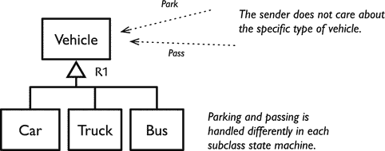
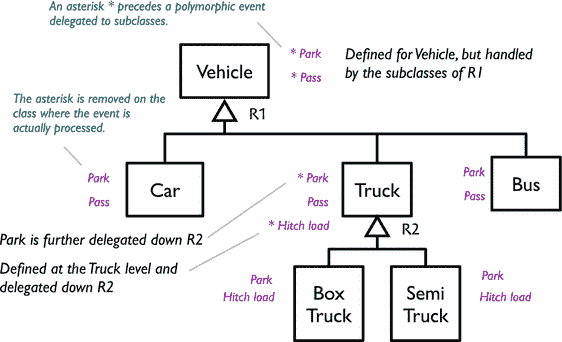
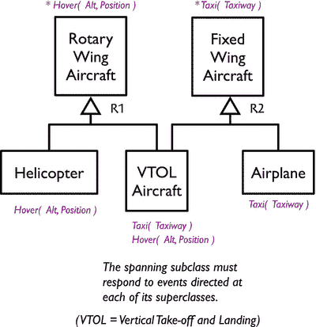
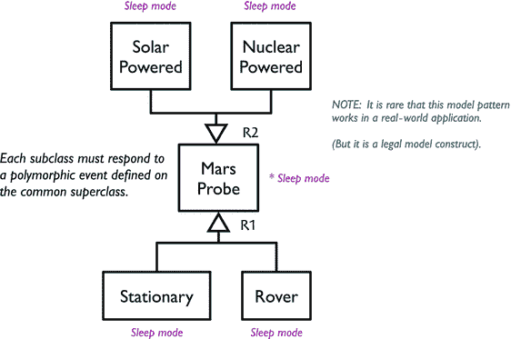
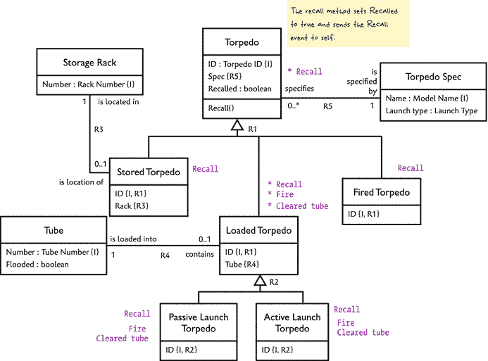

# 9. 事件多态

在编程中，多态是指函数接口保持不变，但该函数的具体实现选择在运行时完成。现代编程语言中定义了多种类型的多态。此处我们指的是简单的动态多态。在模型层面，多态体现在向泛化关系的子类发送事件信号时。

## 泛化与集合划分

多态事件仅适用于泛化关系的上下文中，其中每个子类都有一个状态模型，并且某些事件在这些状态模型之间是共享的。我们必须重申，xUML 对泛化关系的解释比传统 UML 中表达的多种形式更具限制性。在 xUML 中，只允许那些标记为*完全*且*不相交*的泛化。*完全*标签意味着超类中的每个实例在子类中都有一个对应的实例。*不相交*标签意味着该对应实例恰好处于一个子类中。因此，在飞行器要么是旋翼机要么是固定翼飞机（直升机或飞机）的泛化关系中，一个给定的飞行器必须属于其中之一，不能同时属于两者，也不能不属于任何一方。换句话说，xUML 泛化表示的是集合划分，而不是类型继承。不相交集合划分的特性与我们的讨论相关。由于已知所有 xUML 泛化都带有相同的集合划分约束，我们通常会省略这些标签以减少图表混乱。

## 路由多态事件

考虑图 9-1 所示的泛化关系。

**图 9-1.** 一个简单的泛化关系

我们假设交通工具的三个子类各自都有一个状态模型，并且每个状态模型都响应一组共通的事件。假设共通的事件是“停车”和“超车”（超越另一辆车）。如果泛化关系之外的某个类的状态活动想要向轿车、卡车或公共汽车发送一个“停车”事件信号，该活动就需要定位到轿车、卡车或公共汽车的一个特定实例。通常，它会通过一个关系导航到交通工具的一个实例，然后继续跨越 R1，以找出当前与该交通工具实例相关的具体是哪个子类实例。找到相关的子类实例后，我们就可以像处理任何事件一样，向该类实例发送信号。

从概念上讲，确定哪个子类与超类的特定实例相关并不困难。你只需从超类遍历关系到其每个子类。当导航到一个交通工具实例不相关的子类时，会得到一个空的实例引用。泛化关系的特性保证了在子类中恰好能找到一个相关的实例。

这个解决方案有两个显著的问题。从超类导航到子类，会在子类信号发送者的状态活动中散布大量通用且几乎相同的动作语言。此外，动作语言很脆弱，因为从泛化关系中添加或移除一个子类，需要重写每次向其中一个子类发送事件信号时所用的超类到子类查询。

由于模型枚举了泛化关系的子类以及任何状态模型都响应的事件，我们更希望将事件发送给超类实例，然后让模型执行领域将事件路由到相应的子类实例。为了实现这一点，我们指定那些发送给超类但在泛化关系的某个子类中处理的多态事件。

多态事件给发送信号的状态活动一种错觉，仿佛信号是发送给了超类。然而，模型执行领域在运行时执行所需的工作：找到当前相关的子类实例，将多态事件映射到该相关子类实例的事件集上，并发送事件信号。由于多态事件的分发过程中没有任何事情是状态活动的动作语言所不能处理的，因此严格来说，多态事件可以被视为一种优化，尽管它是一种方便且重要的优化。你也可以将事件多态视为将一项任务委托给了 MX 领域——即当这些事件在所有子类中具有相同含义时，由 MX 领域负责在泛化关系中分发事件。

### 各类泛化形式的路由

刚才用 `Vehicle` 场景说明的基本泛化形式最为常见，但并非全部。泛化关系可以组合成更复杂的形式。

**重复特化**的特点是在一个泛化中充当子类的类，在另一个不同的泛化中充当超类。图 9-2 展示了这种泛化类型的示例。多态事件可以在两个超类上定义。定义在顶层超类上的事件被委派给第一层子类。同时作为下一层泛化超类的子类，可以进一步将这些相同的事件委派给它的子类。它还可以定义新的多态事件，这些事件被委派给第二层子类，并且在第二层超类之上不可见。

*图 9-2. 一个重复泛化示例*

**多重泛化**的特点是同一个类作为子类参与多个独立的泛化。图 9-3 展示了这种情况。我们对泛化的解释不允许一个子类参与多个最终具有共同超类祖先的泛化。这种安排违反了泛化关系的互斥集合解释。跨越不同泛化的子类必须响应针对其每个超类的任何多态事件。

*图 9-3. 一个多重泛化示例*

**复合泛化**是一种模式，其中单个类在多个泛化关系中扮演超类的角色。图 9-4 展示了这种情况。发送给超类的事件必须被分派到该类充当超类的所有泛化中。

*图 9-4. 一个复合泛化示例*

需要注意的是，许多涉及多重泛化的组合形式在建模现实世界问题时可能用途存疑。特别是，复合泛化施加了一套严格的约束，现实世界的问题通常无法满足。但我们这里关注的是转换，我们必须准备好能够针对任何给定的泛化组合，正确地执行多态事件分派。

多态事件的其他含义会影响它们的转换方式：

-   在超类上定义的多态事件不影响该特定超类的行为。一个超类可以有一个响应普通（非多态）事件的状态模型。
-   在泛化层次结构中处于中间位置并被重复特化的类，可以有也可以没有状态模型。如果没有状态模型，任何多态事件都会被传递给子泛化。如果有状态模型，则部分、全部或没有多态事件可能被该状态模型消耗。未被中间状态模型消耗的任何多态事件都会传递给子泛化。被消耗的多态事件则对子泛化不可用。
-   叶子子类（不再进行进一步特化的子类）必须处理委托给它或在其上定义的任何事件。如果有任何多态事件沿着泛化关系被委派下来，叶子子类就必须有一个状态模型。最终，所有多态事件都必须映射为非多态事件，并在状态模型中得到处理。换句话说，当一个多态事件被委派给叶子子类后，它就不再有任何特殊之处。

### 鱼雷发射示例

为了说明多态事件如何在模型中产生，并展示它们是如何被转换的，我们给出一个小示例。该示例摘自一个潜艇模拟程序，侧重于鱼雷的行为。与我们所有的示例一样，这并不意味着真实潜艇鱼雷的操控方式就是如此。所示模型纯粹用于教学目的。

我们考虑的问题是鱼雷如何存储、准备以及最终发射。鱼雷最初存放在存储架上。通过将鱼雷从存储架上取出并装入鱼雷发射管，鱼雷即可准备就绪，准备发射。

两种鱼雷设计决定了鱼雷的发射方式。一种鱼雷配有马达，旨在将鱼雷从打开发射管中推出。另一种鱼雷则使用空气系统发射，该系统将鱼雷和水一起推出发射管。

还有一个额外的复杂情况。在极少数情况下，需要召回鱼雷，从而不尝试部署或引爆它。召回鱼雷的原因可能是后期发现的设计缺陷，或者由于某种原因需要重新配置鱼雷。如果鱼雷位于其存储架上，则可以轻松召回进行维护或处置。如果在召回时它已装入发射管，则必须阻止其发射并将其从发射管中取出。如果鱼雷已经发射，则必须能够在鱼雷在空中爆炸之前将其解除武装。

一如既往，我们使用类模型来捕获相关的抽象概念，如图 9-5 所示。在深入探讨各个状态模型的细节之前，先了解类的高层行为意图会很有帮助，因此我们提供了类图的概述。

*图 9-5. 鱼雷类模型*

`R1` 泛化捕获了 `Torpedo` 的三种状态，分别是 `Stored`（存储）、`Loaded`（已装填）或 `Fired`（已发射）的 `Torpedo`。`Torpedo` 和 `Torpedo Spec` 之间的 `R5` 关联提供了 `Launch` 类型属性，告诉我们 `Torpedo` 将如何发射。该属性可以取值 `Active` 或 `Passive`。

初始时，`Torpedo` 被创建为 `Stored Torpedo` 并分配给一个 `Storage Rack`。`Load` 事件将使 `Stored Torpedo` 迁移成为 `Loaded Torpedo` 的一个实例。系统会查询 `Torpedo Spec.Launch` 类型属性，以确定必须实例化 `Passive` 还是 `Active` 的 `Launch Torpedo` 子类。`Storage Rack` 关联被丢弃，并建立 `R4` 关联以记录 `Torpedo` 被装入的 `Tube`。

当 `Loaded Torpedo` 收到 `Fire` 事件时，它将离开其 `Tube` 并迁移到 `Fired Torpedo` 的一个实例。`R4` 关联被丢弃，因为 `Torpedo` 不再位于 `Tube` 中。

请注意，多态事件已在类图上进行了标注。这纯粹是为了说明，不被视为类图的一部分。在顶部，`Recall` 事件显示在 `Torpedo` 旁边。星号（`*`）是一种非正式的方式，表明该事件是多态的，可以发送给 `Torpedo` 的实例，但在其某个子类中处理。

如您所见，`Recall` 事件在每一个 `Torpedo` 子类旁边都有标注。在可执行 UML 中，每个子类都必须定义一种方法来处理给定泛化关系中其超类的多态事件。换句话说，如果 `Torpedo` 的一个实例收到 `Recall` 事件，无论该 `Torpedo` 实例在特定时刻由哪个子类表征，都必须定义对该事件的响应。

