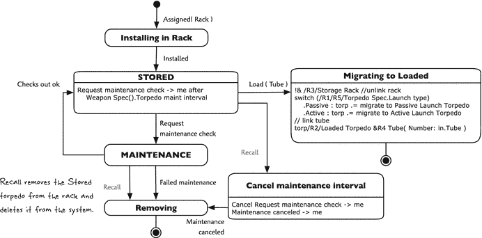
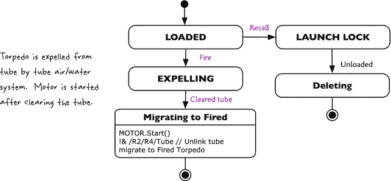
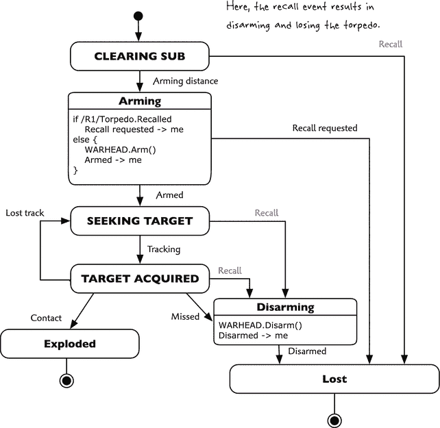
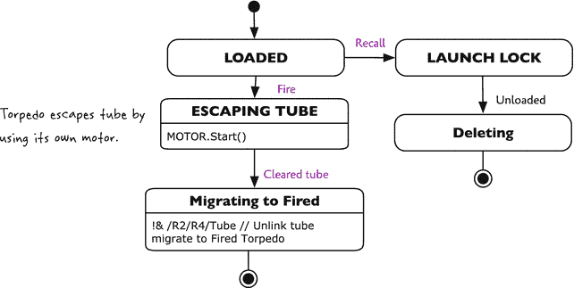
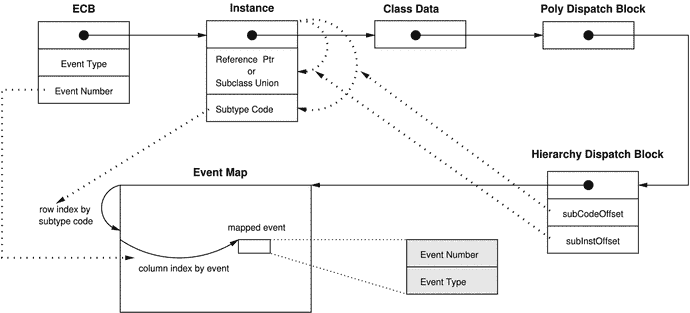
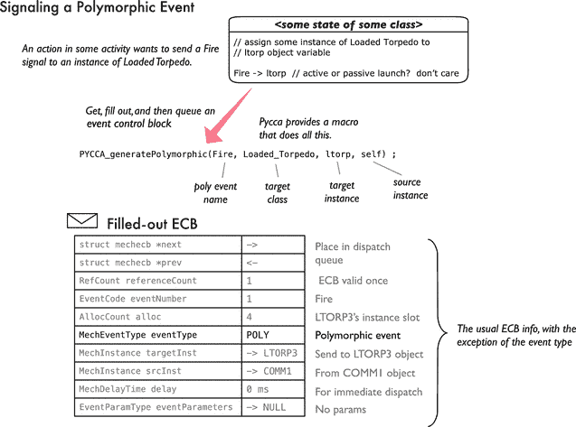
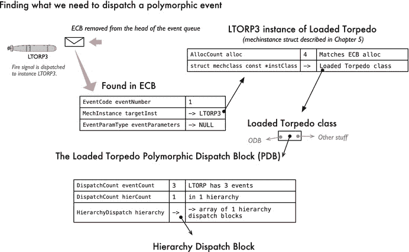
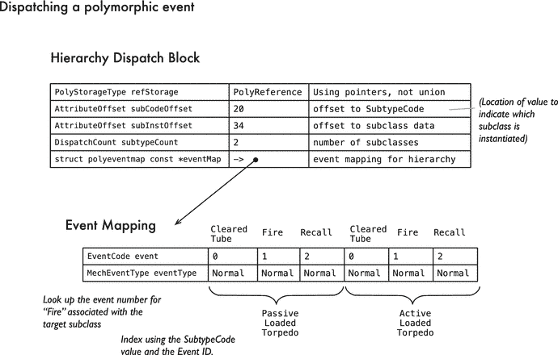

# 鱼雷状态模型与多态事件

`*`仍保留在`Loaded Torpedo`类的`Recall`事件上，表明我们打算在 R2 中进一步将该事件委托给所有子类。在`Passive Launch Torpedo`和`Active Launch Torpedo`子类旁边的`Recall`事件上则没有`*`。这些子类是泛化关系中的叶子节点，因此必须拥有响应此事件的状态模型。

类似地，针对`Loaded Torpedo`的`Fire`和`Cleared tube`事件也是多态的，并委托给 R2 上的子类。这些事件代表了在 R2 泛化关系上引入的新多态事件，对 R1 的其他子类没有影响。例如，无论`Loaded Torpedo`的实例是`Passive`还是`Active`，它都必须为`Fire`和`Cleared tube`事件定义响应。考虑到为 R1 和 R2 定义的多态事件，`Passive Launch Torpedo`和`Active Launch Torpedo`必须响应`Recall`、`Fire`和`Cleared tube`。

现在让我们看看事件多态性在状态模型中是如何呈现的。我们决定为每个叶子子类构建一个独立的状态图。我们从`Stored Torpedo`状态模型开始，如图 9-6 所示。



图 9-6. `Stored Torpedo`状态模型

此状态模型描述了`Stored Torpedo`的生命周期，从它通过分配到`Storage Rack`被初始创建开始，到它被召回或装载到鱼雷管为止。

当接收到`Load( Tube )`事件时，在`Migrating to Loaded`状态中会发生重新分类，成为`Loaded Tube`的新实例。在此，与`Storage Rack`的关联被解除，创建适当的`Passive Torpedo`或`Active Torpedo`实例，同时创建一个`Loaded Torpedo`实例，并通过 R2 将它们链接在一起。最后，事件参数`in.Tube`中指定的`Tube`被选中，并链接到`Loaded Torpedo`实例。之后，最终状态符号表示`Stored Torpedo`实例被删除。

多态事件`Recall`作为一个普通事件出现，它在`STORED`和`MAINTENANCE`状态中触发转换。在其他状态中，该事件被安全忽略，因为这些状态都是瞬态的（由自定向事件退出）。

我们选择不为`Loaded Torpedo`定义状态模型，而是为其每个子类定义状态模型。让我们从`Passive Launch Torpedo`开始，如图 9-7 所示。



图 9-7. `Passive Launch Torpedo`状态模型

当`Stored Torpedo`实例结束时，会在`LOADED`状态中创建一个新创建的`Passive Launch Torpedo`实例。与`Tube`实例的链接已经建立，鱼雷等待发射。`Fire`事件被指定为多态的，因此它可以被发送到任何`Loaded Torpedo`实例，而无需关心它是`Passive`还是`Active`。

当`Fire`事件被发送到一个专门化为`Passive Launch Torpedo`实例的`Loaded Torpedo`实例时，该事件被传递到`Passive Launch Torpedo`状态模型中的子类实例。这将导致转换到`EXPELLING`状态，鱼雷被推出其管。

当接收到`Cleared tube`事件（也是多态的）时，我们知道鱼雷已在潜艇外部。它转换到`Migrating to Fired`状态，在该状态中它与`Tube`解除关联，并成为`Fired Torpedo`的一个实例。

如果在`LOADED`状态中发生`Recall`事件，则会为鱼雷放置一个软件锁，使其忽略任何后续的`Fire`事件。否则，该事件在`EXPELLING`状态中被忽略，因为此时鱼雷已半出管，实在难以召回！不用担心，图 9-8 展示了在`Fired Torpedo`状态模型中可采取的操作。



图 9-8. `Fired Torpedo`状态模型

所以现在我们有一枚鱼雷已经离开潜艇，前往某个目标。此时，`Recall`事件将阻止鱼雷被武装。在与潜艇保持安全距离后，将检测到`Arming distance`事件。

然而，存在一个危险：在`Passive Launch Torpedo`或`Active Launch Torpedo`的`EXPELLING`或`ESCAPING TUBE`状态中，`Recall`事件可能被忽略。一旦被忽略，事件就永远丢失了。这就是为什么在`Torpedo`类上定义了一个名为`Recall()`的类方法。要召回一枚鱼雷，需调用此方法。它做两件事。首先，它将`Torpedo.Recalled`属性设置为`true`。其次，它会触发指向自身的`Recall`多态事件，该事件随后被适当委托。这意味着即使事件可能被丢弃，活动的召回状态也会记录在属性值中，该值可以在后续状态中被检查并清除。

在`Arming`状态中，在武装鱼雷之前会查询`Torpedo.Recalled`的值，以防`Recall`事件在更早的状态中发生，而当时未能采取有效行动。

`Active Launch Torpedo`子类的状态模型与`Passive Launch Torpedo`的相似，但`ESCAPING TUBE`状态除外。如图 9-9 所示。



图 9-9. `Active Torpedo`状态模型

这里需要注意的重要一点是，多态事件`Recall`、`Fire`和`Cleared tube`都在子类的状态模型中处理。我们重申，多态事件在被最终消费时并没有什么特别之处。我们只将以下任务委托给模型执行域：从超类实例导航到子类实例的泛化关系，以及将事件映射到接收实例的事件集。事件被接收后，其行为与任何其他事件相同（它会导致转换、被忽略或产生错误情况）。将运行时调度委托给模型执行域，允许我们向超类实例发送多态事件，而无需知道哪个相应的子类已被实例化。正如这个例子所示，多态事件与迁移子类相结合，可以仅通过单个类的状态模型来指定复杂的多模态行为。

## 使用 Pycca 翻译多态事件

在本节中，我们将展示如何使用 `pycca` 翻译鱼雷发射模型。与以往一样，我们仅展示那些涉及你尚未见过的构造的翻译部分，并建议你参考在线资料中提供的完整示例。

首先，我们必须指定哪些事件是多态的。有两个类定义并委托了多态事件：`Torpedo` 和 `Loaded Torpedo`：

* ❶ `polymorphic event` 语句引入了可能发送给 `Torpedo` 类的多态事件名称。请注意，我们在前面的代码中使用了星号（`*`）作为类图上的非正式标注，以说明多态事件如何跨泛化进行映射。`Pycca` 并不使用这种标注。消费状态模型中的事件只需要与声明为多态的事件名称相同即可。

* ❷ 在这里，我们声明 `R1` 使用指针引用（`reference`）来实现泛化。这个选择是任意的，我们在此使用 `reference` 实现来演示其用法。如果我们像其他模型那样使用 `union` 风格来实现，多态事件的工作原理也是一样的。

* ❸ 实例操作展示了如何发送多态事件（不带事件参数）。请注意，你必须使用特定的宏 `PYCCA_generatePolymorphic()` 来发送多态事件。

* ❹ 由于鱼雷的数量是可变的，我们将种群声明为 `dynamic`（动态），并为 20 个实例分配足够的空间。请记住，所有存储都在编译时分配，这里我们表示系统中最多有 20 枚鱼雷。另外请注意，由于我们在此案例中使用了 `reference` 实现，存储空间会为每个 `Torpedo` 子类进行分配。在泛化的 `reference` 实现中，子类实例与超类实例是分开存储的。

# 鱼雷系统的状态建模

我们展示一个由 `pycca` 工具定义的、关于鱼雷状态建模的示例。

## 类 `Torpedo` 定义

```
class Torpedo
attribute (Torpedo_ID ID)
attribute (bool Recalled) default {false}
reference R5 -> Torpedo_Spec
polymorphic event                                                # ❶
Recall
end
subtype R1 reference                                             # ❷
Stored_Torpedo
Loaded_Torpedo
Fired_Torpedo
end
instance operation
Recall()
{
self->Recalled = true ;
PYCCA_generatePolymorphic(Recall, Torpedo, self, self) ;    // ❸
}
population dynamic                                               # ❹
slots 20
end
```

定义多态事件的第二个类是 `Loaded_Torpedo` 类：

- ❶ 作为使用 `reference` 实现的泛化中的子类，我们需要一个指向其相关超类实例的引用，因为我们需要沿着 `R1` 从子类导航到超类。这个反向引用仅在必须从子类导航到超类时才需要。在本例中，我们需要执行此导航。如果 `Loaded_Torpedo` 的活动从不沿 `R1` 导航到 `Torpedo`，则可以省略此引用。
- ❷ 引入了两个新的多态事件。它们跨 `Loaded_Torpedo` 参与的所有泛化（在本例中仅是 `R2`）都是多态的。这意味着 `Fire` 和 `Cleared_tube` 必须由 `Passive_Launch_Torpedo` 和 `Active_Launch_Torpedo` 的状态模型处理。
- ❸ `Loaded_Torpedo` 的实例也是动态的。我们只为八个 `Loaded_Torpedo` 实例分配了空间。假设我们的潜艇有八个鱼雷发射管，四个在前，四个在后，那么潜艇上任何时候最多只能装填八枚鱼雷。由于在任何给定时间点，有些鱼雷被储存，有些已被发射，因此这里分配的存储空间不必与 `Torpedo` 类实例的相同。

## 类 `Loaded_Torpedo` 定义

```
class Loaded_Torpedo
reference R1 -> Torpedo     # ❶
reference R4 -> Tube
polymorphic event           # ❷
Fire
Cleared_tube
end
subtype R2 reference
Passive_Launch_Torpedo
Active_Launch_Torpedo
end
population dynamic          # ❸
slots 8
end
```

我们展示了在 `pycca` 中实现的 `Stored_Torpedo` 状态模型。我们省略了状态活动的 C 代码，以便专注于状态模型本身的结构：

- ❶ `Stored_Torpedo` 实例是通过 `Assigned` 事件异步创建的（通过一个创建事件）。句点字符表示从初始伪状态开始的转换。
- ❷, ❸ `Recall` 事件与其他事件一样出现。`Pycca` 会识别出 `Stored_Torpedo` 是 `Torpedo` 沿 `R1` 的子类，并且 `Recall` 被定义为沿 `R1` 的多态事件。因此，当 `Recall` 作为多态事件发送给 `Torpedo` 时，它会被当作一个普通事件分发给 `Stored_Torpedo`。多态事件分发的具体机制将在另一节中讨论。
- ❹, ❺ `Removing` 和 `Migrating_to_Loaded` 这两个状态在状态模型中均被显示为终态。当 `Stored_Torpedo` 被召回时，它从系统中移除，不再存在。当 `Stored_Torpedo` 被装填时，我们会创建一个新的 `Loaded_Torpedo` 实例，因此必须删除 `Stored_Torpedo` 的实例以维护 `R1` 泛化约束。

## 类 `Stored_Torpedo` 定义

```
class Stored_Torpedo
reference R1 -> Torpedo
reference R3 -> Storage_Rack
machine
state Installing_in_Rack(uint8_t rack) {
// 状态活动的 C 代码。
}
transition . - Assigned -> Installing_in_Rack               # ❶
transition Installing_in_Rack - Installed -> STORED
state STORED() {
// 状态活动的 C 代码。
}
transition STORED - Load -> Migrating_to_Loaded
transition STORED - Recall -> Cancel_maintenance_interval   # ❷
transition STORED - Request_maintenance_check -> MAINTENANCE
state MAINTENANCE() {
// 状态活动的 C 代码。
}
transition MAINTENANCE - Checks_out_ok -> STORED
transition MAINTENANCE - Failed_maintenance -> Removing
transition MAINTENANCE - Recall -> Removing                 # ❸
state Removing() {
// 状态活动的 C 代码。
}
final state Removing                                        # ❹
state Migrating_to_Loaded(Tube_number Number) {
// 状态活动的 C 代码。
}
final state Migrating_to_Loaded                             # ❺
state Cancel_maintenance_interval() {
// 状态活动的 C 代码。
}
transition Cancel_maintenance_interval - Maintenance_canceled -> Removing
end
population dynamic
slots 20
end
```

最后，我们展示 `Stored_Torpedo` 的 `Migrating_to_Loaded` 状态的状态活动。此示例展示了如何在 `pycca` 中实现从 `Stored_Torpedo` 到 `Loaded_Torpedo` 的子类迁移。让我们先回顾一下该状态活动的动作语言：

```
!& /R3/Storage Rack // 解除机架链接
switch (/R1/R5/Torpedo Spec.Launch type)
.Passive : torp .= migrate to Passive_Launch_Torpedo
.Active : torp .= migrate to Active_Launch_Torpedo
// 链接发射管
torp/R2/Loaded_Torpedo &R4 Tube( Number: in.Tube )
```

由于我们选择使用 `reference` 泛化来实现 `R1` 和 `R2`，我们需要显式地管理实例的创建和删除。迁移意味着新子类的实例被创建并与超类建立关联，而旧子类的实例被删除。如果我们选择使用 `union` 机制来实现泛化，这个处理过程将会不同。因为通过 `union` 实现，子类存储包含在超类存储中，迁移仅在原地修改内容，无需创建和删除实例。这两种泛化实现机制各有其用途和权衡。

- ❶ 通过 `R1` 关联超类和子类是一个两步操作。首先，我们将 `Torpedo` 超类中的指针更新到新创建的子类实例，包括超类所指向的子类类型（`Loaded_Torpedo`）。其次，我们必须建立从子类到 `Torpedo` 超类的引用。
- ❷ `Torpedo_Spec` 的 `Launch_type` 属性决定了我们必须为 `R2` 创建哪个子类。
- ❸ 同样的过程用于通过 `R2` 关联超类和子类实例。

```
state Migrating_to_Loaded(Tube_number Number) {
// 因为这是一个最终状态，Stored Torpedo 实例在本活动结束时会被自动删除，
// 并且由于 Storage Rack 中没有指向 Stored Torpedo 的引用，
// 我们无需处理 R3 关联。
// 获取超类实例的引用。
ClassRefVar(Torpedo, torp) = self->R1 ;
// 创建一个 Loaded Torpedo 实例
ClassRefVar(Loaded_Torpedo, ltorp) = PYCCA_newInstance(Loaded_Torpedo) ;
// 通过 R1 将 Loaded Torpedo 关联到 Torpedo。
PYCCA_relateSubtypeByRef(torp, Torpedo, R1, ltorp, Loaded_Torpedo) ;   // ❶
ltorp->R1 = torp ;
// 将 Loaded Torpedo 关联到 Tube。
ltorp->R4 = PYCCA_refOfId(Tube, rcvd_evt->Number) ;
// 现在处理 R2
switch (torp->R5->Launch_type) {                                       // ❷
case Active: {
// 对于主动发射鱼雷，创建一个新实例。
ClassRefVar(Active_Launch_Torpedo, altorp) =
PYCCA_newInstance(Active_Launch_Torpedo) ;
// 通过 R2 关联 Active Launch Torpedo。
PYCCA_relateSubtypeByRef(ltorp, Loaded_Torpedo, R2, altorp,
Active_Launch_Torpedo) ;                               // ❸
altorp->R2 = ltorp ;
}
break ;
case Passive: {
// 对于被动发射鱼雷，创建一个新实例。
ClassRefVar(Passive_Launch_Torpedo, pltorp) =
PYCCA_newInstance(Passive_Launch_Torpedo) ;
// 通过 R2 关联 Passive Launch Torpedo。
PYCCA_relateSubtypeByRef(ltorp, Loaded_Torpedo, R2, pltorp,
Passive_Launch_Torpedo) ;
pltorp->R2 = ltorp ;
}
break ;
}
}
```

## 多态事件如何发出信号

在第 5 章中，我们展示了普通事件是如何发出信号并分发的。发出信号需要获取一个事件控制块（`ECB`），用适当的数据填充它，并将 `ECB` 发布到事件队列中。发出多态事件信号需要相同的基本操作集。

`Pycca` 提供了一个宏来与运行时代码交互。例如，将 `Fire` 事件发送给 `Loaded Torpedo` 可能出现在一个状态活动中，如下所示：

```
PYCCA_generatePolymorphic(Fire, Loaded_Torpedo, ltorp, self) ;
```

这会将 `Fire` 多态事件信号发送给 `Loaded Torpedo` 类的 `ltorp` 实例。

如果多态事件带有参数，你需要获取 `ECB`，填充参数，然后以与普通事件相同的方式发布事件。唯一的区别是，存在一个宏可以获取已被标记为多态的 `ECB`。对于某个假设的、带有名为 `When` 参数的事件 `Reload`，发出信号可能如下所示：

```
MechEcb polyecb = PYCCA_newPolymorphicEvent(Reload, Torpedo, torp, self) ;
PYCCA_eventParam(polyecb, Torpedo, When) = 20 ;
PYCCA_postEvent(polyecb) ;
```

`Pycca` 将多态事件编号编码为从零开始的连续整数。这种数字编码与普通事件使用的编码不同。一些类会同时拥有一组普通事件和一组多态事件。为了区分不同的事件集，定义了一个枚举，并且每个 `ECB` 都携带该枚举的一个值，以指示分发每个不同事件类型所需执行的操作：

```
typedef enum {
NormalEvent,
PolymorphicEvent,
CreationEvent
} MechEventType ;
```

## 多态事件如何分发

在第 5 章中，你看到了一个普通的、非多态的事件是如何发出信号并随后被分发的。为了发出信号，需要填写一个 `ECB` 并将其加入队列。普通事件的分发使用 `ECB` 和接收实例类的对象分发块来计算到新状态的转换，并调用相关的活动。类似地，分发多态事件需要来自 `ECB` 的数据与来自多态分发块（`PDB`）的数据相结合。

此外，多态事件的分发涉及从超类实例导航泛化关系以找到相关的子类实例。回顾一下，`pycca` 使用两种策略来存储泛化关系信息：

- 存储为引用的泛化在超类实例结构中包含一个指向子类的指针。由于每个子类都有不同的数据类型，超类指针的类型被定义为 `MechInstance`（作为一个指向通用实例的指针）。

- 存储为联合体的泛化在超类实例结构中包含该泛化所有子类数据结构的联合体。

这种差异影响了计算相关子类实例引用的方式。使用一个枚举来区分这两种情况：

```
typedef enum {
PolyReference,
PolyUnion
} PolyStorageType ;
```

无论泛化以何种方式存储，`pycca` 都会在超类结构中定义一个成员，该成员编码了超类实例当前关联的子类的类型。`Pycca` 将此编码生成为从零开始的连续整数，我们将其用作数组索引。

从事件队列中移除事件后，`ECB` 的 `eventType` 成员决定了待分发的事件是否为多态。如果是，我们可以通过 `ECB` 的 `targetInst` 成员找到多态分发块，该成员指向接收多态事件的实例。与所有具有动态行为的实例一样，其 `instClass` 成员保存了一个指向其类信息的指针值。对于定义了多态事件的类，其类信息包含一个非 `NULL` 的 `pdb` 成员值，该成员指向一个多态分发块：

| 成员 | 描述 |
|------|------|
| `eventCount` | 为该类定义或委托给该类并在子类中处理的多态事件数量。 |
| `hierCount` | 该类参与的泛化层次结构数量。该值通常为 1，但复合泛化中的超类将具有大于 1 的 `hierCount`。 |
| `hierarchy` | 指向层次结构分发块数组的指针。该数组有 `hierCount` 个元素。 |

```
typedef struct polydispatchblock {
DispatchCount eventCount ;
DispatchCount hierCount ;
HierarchyDispatch hierarchy ;
} const *PolyDispatchBlock ;
```

如果超类参与了一个复合泛化，则 `hierarchy` 数组中会有多个元素。多态事件会沿着超类参与的每个泛化关系向下分发，因此分发代码会遍历 `hierarchy` 数组。通常，只有一个泛化关系。

分发一个多态事件需要两个操作。首先，我们必须从超类导航到子类的泛化关系。其次，我们需要将多态事件映射到子类的事件集上。层次结构分发块提供了这两个操作所需的信息：

| 成员 | 描述 |
|------|------|
| `refStorage` | 记录泛化关系是以引用形式还是联合形式存储。 |
| `subCodeOffset` | 保存从实例结构体起始位置到存储当前相关子类类型编码处的字节偏移量。（该编码是第 5 章所述的 `SubtypeCode` 类型的结构体元素。） |
| `subInstOffset` | 保存从实例结构体起始位置到指向子类实例的指针位置，或到子类结构体联合体位置的字节偏移量。 |
| `subtypeCount` | 保存该泛化关系存在的不同子类数量。此值用于运行时检查。 |
| `eventMap` | 指向层次结构的多态事件映射的指针。该映射按行索引（子类型码）和列索引（多态事件编号）排列。映射数组中的每个条目均为以下类型。 |

```
typedef struct hierarchydispatch {
    PolyStorageType refStorage ;
    AttributeOffset subCodeOffset ;
    AttributeOffset subInstOffset ;
    DispatchCount subtypeCount ;
    struct polyeventmap const *eventMap ;
} const *HierarchyDispatch ;
```

`typedef struct polyeventmap {`
`    EventCode event ;`
`    MechEventType eventType ;`
`} const *PolyEventMap ;`

要计算对子类实例的引用，需要将`subInstOffset`成员的值加到超类实例指针的起始地址上。根据`refStorage`成员的值，得到的地址要么是指向子类实例的指针（联合存储），要么是指向一个成员的指针，而该成员本身又是指向该实例的指针（引用存储）。

子类的类型通过使用`subCodeOffset`计算超类中存储编码后子类类型的位置来确定。利用子类码值和多态事件编号，我们可以索引到`eventMap`中。为了使所有类的事件映射数据类型保持一致，我们将其存储为一维数组，然后通过将子类型码作为行号、多态事件编号作为列号来计算索引。这与我们之前从转换表调度普通事件时采用的策略相同。

事件映射由`event`和`eventType`组成。由于多态事件可以在重复的特化层次结构中向下传递多个层级，多态事件可能映射到另一个多态事件，因此我们需要知道事件类型。给定事件类型、事件编号和子类实例指针，我们可以递归地调度事件。图 9-10 显示了调度多态事件所涉及的数据。



图 9-10. 调度多态事件所使用的数据

图 9-11 说明了一个场景：向已装填鱼雷实例发出多态 `Fire` 事件。



图 9-11. 发出 `Fire` 多态事件

一个 `ECB` 已被填写完毕并加入队列。唯一能将其与任何普通事件 `ECB` 区分开来的元素是`eventType`字段被填写为`PolyEvent`。一旦出队准备调度，就必须找到多态调度块。图 9-12 说明了如何定位 `PDB`。



图 9-12. 定位 `PDB`

最后，图 9-13 展示了如何索引多态事件映射以确定要发送哪个普通事件。



图 9-13. 索引事件映射

回到我们的鱼雷发射示例，以下是 `pycca` 生成的、用于支持 `Torpedo` 和 `Loaded Torpedo` 类多态事件调度的代码：
*   ❶ 这是一个多态事件映射到另一个多态事件的案例。在本例中，是来自 `R1` 的 `Recall` 事件沿着 `R2` 泛化关系向下传播。它映射到 `Loaded Torpedo` 上的一个多态事件，并且映射到 `Stored` 和 `Fired Torpedo` 两个子类上的一个普通事件。
*   ❷ 事件映射（`Torpedo_R1_pem`）中的元素数量始终等于 `PDB`（`Torpedo_pdb`）中的`subtypeCount`值乘以`eventCount`值。
*   ❸ 此处 `PDB` 作为类信息的一部分出现。注意，`Torpedo` 和 `Loaded Torpedo` 都不响应普通事件，因此 `pycca` 将它们的`odb`成员设置为`NULL`。

```c
/*
* 类 "Torpedo" 的 PDB
*/
static struct polyeventmap const Torpedo_R1_pem[] = {
    {.event = 6, .eventType = NormalEvent},
    {.event = 2, .eventType = PolymorphicEvent},             // ❶
    {.event = 6, .eventType = NormalEvent}
} ;
static struct hierarchydispatch const Torpedo_hdb[] = {
    {.refStorage = PolyReference,
     .subCodeOffset = offsetof(struct Torpedo, R1__code),
     .subInstOffset = offsetof(struct Torpedo, R1),
     .subtypeCount = 3,                                       // ❷
     .eventMap = Torpedo_R1_pem}
} ;
static struct polydispatchblock const Torpedo_pdb = {
    .eventCount = 1,
    .hierCount = 1,
    .hierarchy = Torpedo_hdb
} ;
/*
* 类 "Loaded_Torpedo" 的 PDB
*/
static struct polyeventmap const Loaded_Torpedo_R2_pem[] = {
    {.event = 0, .eventType = NormalEvent},
    {.event = 1, .eventType = NormalEvent},
    {.event = 2, .eventType = NormalEvent},
    {.event = 0, .eventType = NormalEvent},
    {.event = 1, .eventType = NormalEvent},
    {.event = 2, .eventType = NormalEvent}
} ;
static struct hierarchydispatch const Loaded_Torpedo_hdb[] = {
    {.refStorage = PolyReference,
     .subCodeOffset = offsetof(struct Loaded_Torpedo, R2__code),
     .subInstOffset = offsetof(struct Loaded_Torpedo, R2),
     .subtypeCount = 2,
     .eventMap = Loaded_Torpedo_R2_pem}
} ;
static struct polydispatchblock const Loaded_Torpedo_pdb = {
    .eventCount = 3,
    .hierCount = 1,
    .hierarchy = Loaded_Torpedo_hdb
} ;
/*
* 类 "Torpedo" 的类结构
*/
static struct mechclass const Torpedo_class = {
    .iab = &Torpedo_iab,
    .odb = NULL,
    .pdb = &Torpedo_pdb                                     // ❸
} ;
/*
* 类 "Loaded_Torpedo" 的类结构
*/
static struct mechclass const Loaded_Torpedo_class = {
    .iab = &Loaded_Torpedo_iab,
    .odb = NULL,
    .pdb = &Loaded_Torpedo_pdb
} ;
```

为了贯彻我们揭示翻译后应用程序运行所有细节的主题，我们展示了执行多态事件调度的代码。此时，`ECB` 已从事件队列中移除，并且已确定必须调度一个多态事件：
*   ❶ 这段地址算术计算了实例结构体中用于存储当前相关子类编码值的成员的位置，并获取该位置的值。例如，如果我们正在向一个 `Torpedo` 实例调度多态事件，此表达式将计算`R1__code`成员的地址，并从该位置获取值。
*   ❷ 此表达式索引到多态事件映射中。由于映射存储为一维数组，我们必须自行进行行/列索引。`eventCount` 告诉我们一行中元素的数量。`Pycca` 确保多态事件映射中的元素以正确的顺序存储，因此此索引表达式能获取到正确的事件映射。

```c
static void
dispatchPolyEvent(
MechEcb ecb)
{
PolyDispatchBlock pdb = ecb->instOrClass.targetInst->instClass->pdb ;
assert(pdb != NULL) ;
assert(ecb->eventNumber eventCount) ;
assert(pdb->hierCount > 0) ;
/*
* 每个从超类型出发的泛化层次结构，都会沿该层次向下生成一个事件，传递至其中一个子类型。
*/
HierarchyDispatch hd = pdb->hierarchy ;
for (unsigned hnum = 0 ; hnum hierCount ; ++hnum) {
/*
* 最常见的情况是沿单一层次结构进行分发。无论如何，我们可以在最后一次分发的事件上就地修改输入的 ECB。
*/
MechEcb newEcb ;
if (hnum == pdb->hierCount - 1) {
newEcb = ecb ;
} else {
newEcb = mechEventAlloc() ;
/*
* 设置源为原始发送者。
*/
newEcb->srcInst = ecb->srcInst ;
/*
* 复制事件参数。
*/
newEcb->eventParameters = ecb->eventParameters ;
}
SubtypeCode type = *(SubtypeCode *)
((char *)ecb->instOrClass.targetInst + hd->subCodeOffset) ; // ❶
assert(type subtypeCount) ;
PolyEventMap pem = hd->eventMap +
(type * pdb->eventCount + ecb->eventNumber) ;               // ❷
#           ifdef MECH_SM_TRACE
/*
* 跟踪状态转换。
*/
tracePolyEvent(ecb->eventNumber, ecb->srcInst,
ecb->instOrClass.targetInst, type, hnum,
pem->event, pem->eventType) ;
#           endif /* MECH_SM_TRACE */
newEcb->eventNumber = pem->event ;
newEcb->eventType = pem->eventType ;
void *subTypeRef = (char *)ecb->instOrClass.targetInst + hd->subInstOffset ;
newEcb->instOrClass.targetInst = hd->refStorage == PolyReference ?
/*
* 当泛化通过指针实现时，我们需要额外一级间接寻址来获取子类型的地址。
*/
*(MechInstance *)subTypeRef :
/*
* 当泛化通过联合体实现时，我们只需指向子类型的地址，因为它包含在超类型中。
*/
(MechInstance)subTypeRef ;
if (newEcb->eventType == NormalEvent) {
newEcb->alloc = newEcb->instOrClass.targetInst->alloc ;
assert(newEcb->alloc != 0) ;
}
mechDispatch(newEcb) ;
++hd ;
}
}
```

再提炼其本质，用于分发多态事件的代码实际上是相当简短的。其大部分“智能”都来源于由`pycca`提供的数据结构的值。

### 总结

本章展示了如何在模型层面规定并实现多态。可以在泛化关系中的超类上定义多态事件。在运行时，发送给超类实例的多态事件会沿泛化层次被分发到子类的状态机中。我们展示了如何向`pycca`规定多态事件，`pycca`生成了哪些数据来支持多态事件分发，以及`ST/MX`域具体如何执行这种事件分发。

所有`xUML`泛化都代表集合划分，而非继承。对于每个超类，恰好存在一个子类实例，并且该实例恰好属于一个子类。

泛化可以相互连接，形成以下几种形式：

* **重复特化**：一个泛化的子类同时是另一个泛化的超类。

* **多重泛化**：单个子类参与多个泛化，每个泛化都有一个超类与之对应。

* **复合泛化**：单个类在多个泛化中扮演超类的角色。

重要的是，多态事件在每种形式中都能得到合理分发。

超类可以委托事件，使得事件由每个子类处理，而不是由超类上的状态模型处理。子类随后可以处理事件，或者，如果它本身也是另一个泛化的超类，则可以进一步委托事件。每个被委托的事件必须在当前层级或更深的特化层级上由子类处理。接收到的事件总是在某个类中处理。

每个多态事件都在超类上定义，并在`pycca`模型脚本中指定。委托给子类的事件可以被该子类使用，就像使用模型脚本中该子类状态机部分的任何其他事件一样。

`pycca`提供了不同的宏来支持带参数和不带参数的多态事件信号的发送。

多态事件的分发处理方式不同，具体取决于泛化是使用联合体模式还是引用代码模式实现的。用于普通事件的事件控制块也用于分发多态事件。关键区别在于，需要引用一个额外的多态分发块来导航泛化的分发层次结构，并识别要处理的相应子类事件。