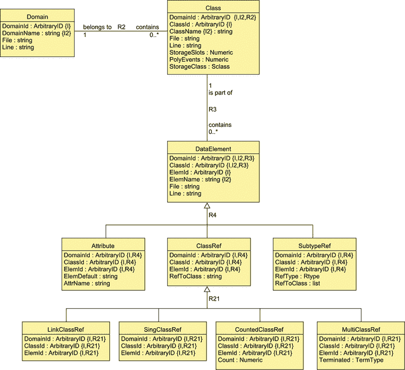
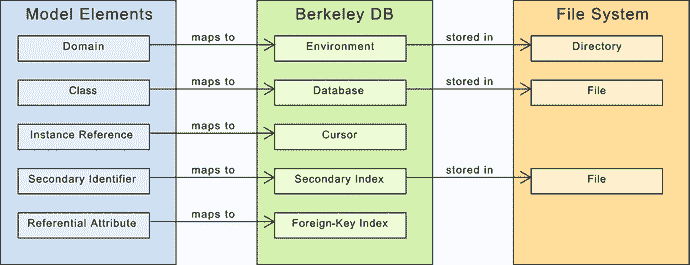
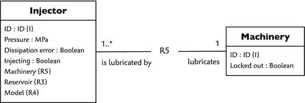
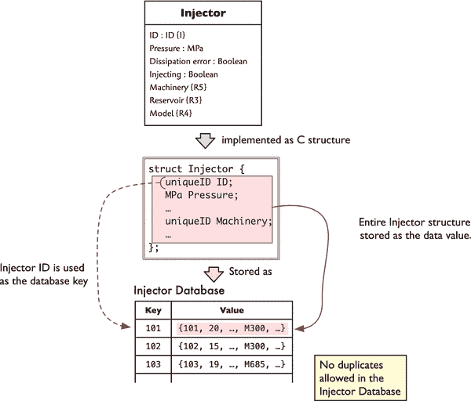
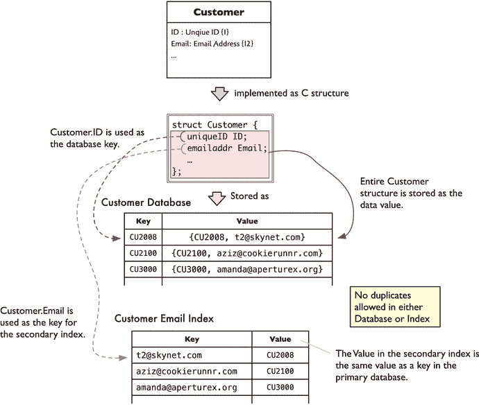
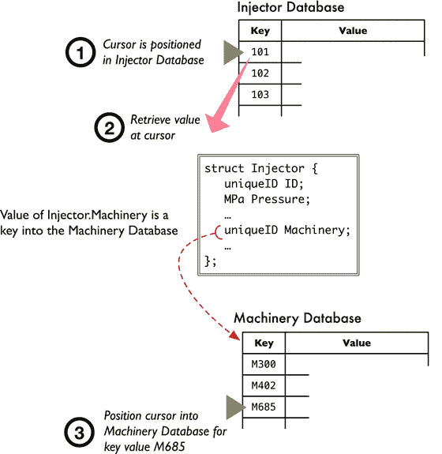
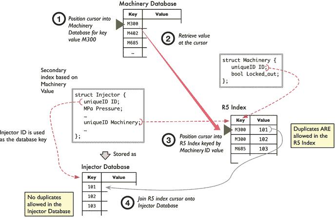

# 10. Pycca 及其他平台

在本章中，我们讨论 `pycca` 程序本身的设计与实现。`Pycca` 被设计为一个语言处理器，它读取 DSL 语句来填充平台模型，并通过使用一个模板系统来查询已填充的平台模型以生成代码。它使用 Tcl 语言实现。

我们还将在一个代表性的微控制器平台上展示 ALS 系统的一些尺寸和执行速度测量结果，以表明产生的内存使用和执行速度适合我们的目标平台。

作为本章的结尾，我们将简要概述一个目标平台，该平台使用 Berkeley DB（一种键/值数据存储引擎）来存储领域数据，而不是将所有数据保存在内存中。

## Pycca 程序的设计

在我们的翻译方法中，还有一个领域尚未讨论。我们已经展示了 `pycca` 的输入和输出，但尚未将 `pycca` 本身作为程序来讨论。限于篇幅，无法完整描述 `pycca` 的实现。`pycca` 的源代码和文档可以从本书网站免费获取。在本节中，我们将讨论 `pycca` 程序本身设计与实现的几个方面。

`Pycca` 包含三个主要设计元素：

* **平台模型**
* **领域特定语言处理**
* **模板驱动的代码生成**


### 平台模型

`pycca` 操作背后存在一个模型，这应该不足为奇。在接下来的讨论中，我们对两个抽象层级的事物使用相同的名称。让我们定义一些术语以保持清晰。当我们谈到**可执行模型**时，指的是要被转换的逻辑模型。当我们谈到**平台模型**时，指的是我们要转换到的实现技术平台模型。

`pycca` 的平台模型是针对目标实现技术特化的。这并非建模本身的通用模型（即元模型）。`pycca` 平台模型不设定如何创建可执行模型的规则。相反，它规定了我们的 C 语言实现将如何形成的规则。平台模型反映了我们为 `pycca` 生成的具体实现所做的技术选择。如果针对不同的平台，或者对我们平台上的实现细节做出不同的选择，都会在平台模型的差异中得到体现。

图 10-1 展示了 `pycca` 平台模型的一个片段。



**图 10-1.** `pycca` 平台模型片段

注意其中有名为 `Domain` 和 `Class` 的类。这些类对可执行模型中的 `Domain` 或 `Class` 的实现对应物进行建模。

平台模型规定，`Classes` 包含 `Data Elements`，并且一个类可以完全不包含 `Data Elements`（R3）。`Data Elements` 恰好属于一个类，因此 `Classes` 之间不共享 `Data Elements`。所有 `Data Elements` 都是三种类型之一（R4）：`Attributes`、`ClassRefs` 或 `SubtypeRefs`。此外，类引用是四种类型之一（R21）。

对于我们的目标，我们决定所有类实例都将保存在内存中，并存储在 C 结构体数组中。类结构的成员要么是属性、对类的（某种形式的）引用，要么是对泛化关系中子类的引用。平台模型中的类用于对由 `pycca` 生成的实现结构成员进行建模。对于 `pycca`，平台模型中的 `Class` 类与为实现而生成的 C 结构体有直接对应关系。

例如，考虑来自我们的空中交通管制模型的 `Duty_Station` 类定义：

```
class Duty_Station
attribute (Station_Number Number)
attribute (Name_t Location)
attribute (Aircraft_Maximum Capacity)
reference R3 -> On_Duty_Controller
end
```

`R3` 引用是对 `On_Duty_Controller` 类实例的单一引用。将创建一个 `SingClassRef` 实例（及其所有相关的超类实例），以对应 `Duty_Station` 类定义中的 `reference` 语句。当 `pycca` 生成代码时，它会以两种方式使用此信息。当声明 `Duty_Station` 结构体时，它包含一个成员 `struct On_Duty_Control *R3`。这在以下 `pycca` 生成的结构体定义中显示：

```
/*
* Duty_Station 结构体定义
*/
struct Duty_Station {
struct mechinstance common_ ; // 必须放在第一位！
Station_Number Number ;
Name_T Location ;
Aircraft_Maximum Capacity ;
struct On_Duty_Controller *R3 ;
} ;
```

在创建初始实例群体的初始化器时，`R3` 成员被设置为 `On_Duty_Controller` 数组成员的地址或 `NULL`，具体取决于所请求的群体。这在我们的示例的初始实例群体中显示：

```
/*
* "Duty_Station" 的初始实例存储
*/
static struct Duty_Station Duty_Station_storage[3] = {
{.common_ = {1, 0, &Duty_Station_class}, "S1", "Front", 20, .R3 = NULL},
{.common_ = {2, 0, &Duty_Station_class}, "S2", "Center", 30, .R3 = NULL},
{.common_ = {3, 0, &Duty_Station_class}, "S3", "Front", 45, .R3 = NULL}
} ;
```

请注意，平台模型中的许多类都有 `File` 和 `Line` 属性。这些属性记录了定义实体的输入文件名以及文件内的行号。此信息有助于生成错误消息，以及在生成的代码文件中插入 `#line` 指令。

`pycca` 平台模型有 35 个类。它们涵盖了 DSL 语言语句中指定的信息类型，例如类、属性、状态转换和初始实例。`pycca` 平台模型构成了程序其余部分组织方式以及代码生成所需处理方式的基础。

### 领域特定语言处理

为计算机语言生成解析器是一个已被充分理解的问题。`Pycca` 遵循定义语法并使用解析器生成器创建 `pycca` DSL 解释器的常见模式。当输入被扫描和识别时，代码在语法元素归约时被执行。当 DSL 语句被识别时执行的代码会创建平台模型类的实例。语言语句中的数据对应于平台模型类实例中的属性。你可以将 `pycca` DSL 视为平台模型群体的一种文本形式且更方便的表示。直接填充平台模型也可以达到同样的效果，但使用 DSL 提供了以更人性化的方式组织平台模型群体的机会。

与其他计算机语言一样，可以编写语法正确但毫无意义的 `pycca` DSL 语句。因此，`pycca` 在解析输入文件并填充平台模型后，会执行一组语义检查。某些语义由平台模型上的约束强制执行，例如平台模型关系所隐含的那些约束。其他语义则需要执行代码。

例如，如果状态模型中的某个状态被标记为最终状态，则不允许从该状态出发的出站转换。因为转换到最终状态的实例在其状态活动执行完毕后会被删除，所以它不可能响应其他事件。`Pycca` 也不允许孤立状态（既没有出站也没有入站转换的状态）。这样的语义检查共有 20 个。

### 模板驱动的代码生成

`pycca` 的代码生成器是使用模板扩展设计的。这是一种从生成会计报告到生成网页的通用惯用做法。`Pycca` 使用它的方式与任何模板系统非常相似。文本从模板传递到输出。命令嵌入在模板中，当模板扩展器识别出命令时，它会执行该命令，并将从嵌入命令返回的结果放入输出中。`pycca` 使用的模板包含嵌入命令，这些命令查询平台模型以找到代码生成过程中该点所需的信息，然后将这些信息格式化为有效的 C 语言语句。从概念上讲，`pycca` 所做的事情与银行程序查询数据库并打印账户对账单所做的事情几乎没有区别。`pycca` 的目标是为 C 编译器生成输出，而不是为银行客户生成输出。

使用模板使我们能够对生成的输出进行排序，以适应 C 编译器的要求。生成的头文件和代码文件有各自的模板。这些模板经过设计和排序，使得嵌入的扩展命令将其输出放置在输出中的适当位置。C 语言需要大量的类型注解，并坚持符号名称在其定义之前（或有时同时）被声明。声明和定义是 C 语言中的关键概念，并且通常声明必须先于定义。例如，状态活动函数的前向声明被放置在使用这些函数名称的数据结构定义之前。然后，这些内容又被放置在状态活动函数代码的定义之前。


### Pycca 实现

Pycca 使用 Tcl 语言实现。Tcl 是一种通常用作脚本语言的动态语言。选择脚本语言来实现 pycca 可能看起来不寻常，但 Tcl 具有许多理想的特性：

- Tcl 是一种成熟、稳定的语言，已经积极开发了 20 多年。
- Tcl 是平台无关的，可在 Linux（及其他 UNIX 衍生系统）、macOS 和 Windows 上运行。
- Tcl 程序可以作为单文件可执行文件分发，无需外部依赖或复杂的安装要求。
- Tcl 是可扩展的，并支持一个庞大的标准过程库。

在实践中，用于实现 pycca 这类程序的语言选择，应基于可用性和便利性。它应该是一种实现者熟悉的语言，并且能够便利地支持上一节中设计思想的实现。这里我们讨论如何使用 Tcl 来实现 pycca 的设计。

Pycca 的平台模型是一个规范化的关系模式，我们所有的示例模型都是如此。Pycca 使用 TclRAL（关系代数库）包来实现平台模型上的操作。TclRAL 包实现了关系代数，其中操作符是 Tcl 命令，而值和变量直接集成到 Tcl 语言中。你可以将平台模型的 TclRAL 实现视为一个内存数据库，它使用普通的 Tcl 语言命令来查询和操作平台模型数据。它的设计明确旨在支持我们建模方法的完整性约束。TclRAL 完全集成到 Tcl 值系统中。在 TclRAL 中不存在“阻抗不匹配”的问题，因为你不必使用不同的语言来查询和操作数据，然后再将查询结果传回实现语言以进行进一步处理。将这种方法与 SQL 进行对比，后者要求你处理实现语言和查询语言之间不可避免的边界。

秉承著名的 `lex` 和 `yacc` 程序的传统，Tcl 拥有 `fickle` 和 `taccle` 来执行生成词法分析器和语法分析器的相同功能。在这种情况下，生成的分析器和语法分析器以 Tcl 代码的形式交付，而不是 C 代码。

标准的 Tcl 库包含执行模板扩展的过程，这些过程用于生成头文件和代码文件。模板包含直接传递给输出的普通文本以及嵌入其中的 Tcl 命令。嵌入的命令被执行，其输出被写入生成的文件中。嵌入的命令被实现为对平台模型的 TclRAL 查询，并将结果适当地格式化为 C 语言语句。

Pycca 程序由大约 5,000 行 Tcl 代码、语法规范和词法分析器规范组成，不包括注释或空行。我们不喜欢使用代码行数作为软件度量标准，这里仅提供对 pycca 程序大小的粗略、相对指示。因此，pycca 并不是一个大型程序，但这很大程度上归功于使用了 Tcl，以及 Tcl 作为一种语言，能够用更少的代码行进行表达。如果它用 C 编写，pycca 的规模可能会大几倍。

### Pycca 性能

不仅需要将模型翻译成可运行的代码，而且最终实现的质量也必须满足项目的需求。如果不能满足性能要求，那么生成有洞察力的模型并将其忠实地翻译成代码就意义不大。

我们的目标平台是基于微控制器的系统。这类系统的主要挑战在于可用的计算资源有限。内存和处理器速度通常都非常小。在本节中，我们将展示 ALS 系统翻译的一些性能数据。

#### 目标硬件平台

许多市售平台都能满足我们的需求。我们选择了 Silicon Labs 的 Giant Gecko。此微控制器有一个名为 `EFM32GG-STK3700` 的入门套件。

该入门套件上的微控制器是 `EFM32GG990F1024`。该计算机是一款基于 ARM Cortex-M3 的 SoC，具有 1 MiByte 闪存和 128 KiByte RAM。该 SoC 支持超低功耗睡眠模式，从闪存执行代码时功耗约为 219 μA/MHz。尽管能够以 48 MHz 的时钟频率运行，但在这些测量中，微控制器的时钟频率设置为 7 MHz。这些规格将 Giant Gecko 置于我们目标微控制器类别中性能较强的一端。

#### 目标软件平台

本示例的代码是使用 Silicon Labs Simplicity Studio 开发环境构建的。我们包含了供应商提供的硬件访问库中的代码，以及构建完整应用程序所需的启动代码和其他小段代码。

该应用程序是使用 GNU 编译器套件构建的：

```
arm-none-eabi-gcc (GNU Tools for ARM Embedded Processors) 5.4.1 20160919 (release)
[ARM/embedded-5- branch revision 240496]
```

应用程序编译时定义了预处理符号 `NDEBUG`、`MECH_NINCL_STDIO` 和 `RELEASE`，以移除所有断言和对 C 标准 I/O 函数（例如 `printf`）的使用。优化配置为使用 `-Os` 设置以实现最小体积。目标文件中未使用的数据和函数在最终可执行文件中被丢弃。这种构建设置的组合产生了体积最小的可执行文件。为调试和检测而构建时，可执行文件的体积通常是发布版本的两倍。


### ALS 代码大小

以下测量结果针对第 6 章至第 8 章中所示的 ALS 应用示例。该示例包含两个域以及它们之间的桥接代码。润滑（Lubrication）域包含了指向 UI 和警报（Alarms）域的外部实体引用，这些引用已被存根化。同样，SIO 域包含了用于访问设备硬件的外部实体引用，这些引用也已被存根化。

表 10-1 显示了集成润滑/SIO 应用的总内存使用量（以字节为单位）。

**表 10-1. ALS 应用代码大小（字节）**

| 文件 | 代码与常量 | 已初始化数据 | 未初始化数据 | 总计 |
| --- | --- | --- | --- | --- |
| `lube_sio.axf` | 12,064 | 1,784 | 756 | 14,606 |

应用的总内存使用量轻松适配我们的目标硬件，并且也同样适配此类中的许多其他目标硬件平台。

我们可以通过检查各个域和桥接代码的大小来细分内存使用情况，如表 10-2 所示。

**表 10-2. ALS 域代码大小（字节）**

| 文件 | 代码与常量 | 已初始化数据 | 未初始化数据 | 总计 |
| --- | --- | --- | --- | --- |
| `lube.o` | 2,663 | 476 | 0 | 3,139 |
| `sio.o` | 2,070 | 776 | 0 | 2,846 |
| `lube_sio_bridge.o` | 471 | 0 | 0 | 471 |
| 总计 | 5,204 | 1,252 | 0 | 6,456 |

在总内存使用量中，不到一半用于域和桥接代码。我们应当注意，此应用的初始实例数量非常小，这反映在已初始化数据的大小上。增加初始实例的数量只会增加已初始化数据的使用量。无论初始实例数量大小如何，代码与常量的内存使用量都将保持不变，因为该内存使用量已经包含了域的所有代码和 pycca 生成的信息。还要注意，已初始化数据还会在 RAM 中分配相同大小的空间，而这并未显示在这些总计中。在复位时，已初始化数据会由编译器提供的启动代码从闪存复制到 RAM。由于闪存技术不允许像 RAM 那样直接更新，因此 RAM 副本允许在程序运行期间更新类实例的值。这种为已初始化数据分配双倍空间（闪存中的一份和 RAM 中相同大小的另一份）的需要，是微控制器 SOC 设计中闪存和 RAM 分开这一典型特征的直接结果。

有必要考察一下 ST/MX 域对总体内存使用量的贡献。这一点很重要，因为运行 pycca 生成的应用程序必须要有模型执行（Model Execution）域，它代表了一种必须分摊到整个应用中的固定成本。参见表 10-3。

**表 10-3. 模型执行域代码大小（字节）**

| 文件 | 代码与常量 | 已初始化数据 | 未初始化数据 | 总计 |
| --- | --- | --- | --- | --- |
| `mechs.o` | 2,032 | 12 | 720 | 2,764 |
| `pycca_portal.o` | 990 | 0 | 0 | 990 |
| `platform.o` | 471 | 1 | 0 | 472 |
| 总计 | 3,521 | 13 | 720 | 4,226 |

`mechs.o` 文件包含了 MX 域中所有与目标无关的代码。这包括事件队列和事件信号/分发代码等。`pycca_portal.o` 文件由桥接中使用的门户函数组成。最后，`platform.o` 文件包含了 MX 域所需的平台特定代码。这包括控制用于延迟事件的定时资源、处理低功耗模式睡眠和唤醒的代码，以及与同步队列接口的代码。未初始化数据被分配给事件队列、事件控制块以及 ST/MX 实现的其他内部资源。这些资源可以根据需要进行扩展或收缩，此总计代表了默认配置（10 个事件控制块，16 字节参数数据空间，以及 10 个同步队列槽位）。

与许多针对微控制器的 RTOS 实现相比，ST/MX 域的内存使用情况堪称优异。然而，这种比较并不直接。RTOS 将包含 ST/MX 所不具备的多任务处理、任务间同步和互斥功能。ST/MX 是单线程的，严格采用事件驱动且运行至完成的执行方式，不需要任务调度服务，也不支持运行它们所需的同步操作和互斥机制。相反，ST/MX 可以向状态机发送事件信号并分发事件，这是 RTOS 所不具备的功能。

剩余内存使用量的大约 25% 来自启动代码、标准 C 库、编译器库、硬件访问库、外部实体存根，以及使应用程序能够运行所需的其他“胶水”代码。虽然这占总内存使用量的很大一部分，但它代表了应用程序的固定成本。

### 执行速度

我们仅提供一个执行速度测量结果，如表 10-4 所示。发送事件信号和分发事件是 ST/MX 域中的一个常见操作。这里我们测量了发送信号并分发一个自指向事件所需的 CPU 周期数。这包括分配 ECB、填充 ECB、将其添加到事件队列、返回主循环以判断是否有其他事件需要分发、从事件队列中移除 ECB、计算状态转换以及进入状态活动所需的时间。方便的是，ARM Cortex-M3 内置了一个用于此目的的周期计数器。

**表 10-4. 事件信号发送与分发时序**

| 周期数 | 7 MHz 下的时间 | 7 MHz 下的操作数/秒 |
| --- | --- | --- |
| 4,696 | 67 μs | 1,491 |

完成信号发送/分发操作需要 4696 个周期。在 7 MHz 时钟频率下，这意味着大约需要 67 微秒，或者换句话说，每秒大约可以执行 1491 次此类操作。与运行在 2–3 GHz 频率且拥有大型指令和数据缓存的现代桌面及服务器级计算机的能力相比，这些数字显得有些相形见绌。我们必须注意，不要在如此悬殊的计算技术之间进行外推比较。

### 性能讨论

在此领域进行性能比较是困难的。我们没有用于测试 MX 域实现的基准测试。直接比较几乎不可能，因为为应用程序在建模和非建模实现中提供相同的功能成本过高。

本文提供的测量结果证明，pycca 翻译后的域的性能确实能够匹配许多基于微控制器的系统所提供的计算能力。我们很好地控制在内存目标范围内，并且事件信号发送的实现具有合理的周期计数。在众多系统上的经验表明，根据目标平台仔细调整翻译方案和模型执行域，可以使翻译后的模型满足项目的性能目标。


### 提供特定于实现的代码

在建模应用逻辑时，问题规模是我们不考虑的实现方面之一。一个类只有几个实例还是数百万个实例，并不会改变应用逻辑的基本原理。如果需要根据某个属性的值来查找类实例，无论实例数量是几个还是很多，都不会影响我们必须找到所需实例这一事实。

但在考虑实现此类查找时，规模就变得至关重要。当某个类的实例数量增长到足够大，并且我们需要查找特定实例的频率增加时，`pycca` 宏提供的简单顺序查找可能会成为性能瓶颈。

回顾第 4 章中的 `Air_Traffic_Controller` 类：

```
class Air_Traffic_Controller
attribute (Employee_ID ID)
attribute (Name_T Name)
attribute (Experience_Level Rating)
# ...
# 空中交通管制员类的其他部分
end
```

我们可以使用 `pycca` 宏来查找与给定 ID 匹配的 `Air_Traffic_Controller` 实例：

```
ClassRefVar(Air_Traffic_Controller, atc) ;
PYCCA_selectOneInstWhere(atc, Air_Traffic_Controller, strcmp(atc->ID, "ATC-137") == 0) ;
if (atc >= EndStorage(Air_Traffic_Controller)) {
// 未找到
} else {
// 已找到
}
```

这段代码会对 `Air_Traffic_Controller` 的所有实例执行简单的顺序遍历，并比较 `ID` 属性的值以寻找匹配项。这种方法很简单，已经提供，并且对于少量实例来说运行良好。随着 `Air_Traffic_Controller` 实例数量的增加，我们将需要更优的解决方案。

例如，我们可以使用二分查找来减少比较次数。二分查找要求被查找的项按特定顺序排列。然而，Pycca 在内存中按定义顺序组织初始实例群体。要将顺序查找转换为二分查找，我们需要按 `ID` 属性的升序排列 `Air_Traffic_Controller` 的初始实例。假设我们的初始实例群体如下：

```
table
Air_Traffic_Controller (Employee_ID ID) (Name_T Name) (Experience_Level Rating) R1
@atc51  {"ATC-51"} {"Ianto"}    {"C"}       -> On_Duty_Controller.atc51
@atc53  {"ATC-53"} {"Toshiko"}  {"A"}       -> On_Duty_Controller.atc53
@atc67  {"ATC-67"} {"Gwen"}     {"B"}       -> On_Duty_Controller.atc67
@atc77  {"ATC-77"} {"John"}     {"B"}       -> Off_Duty_Controller.atc77
@atc87  {"ATC-87"} {"Fred"}     {"B"}       -> Off_Duty_Controller.atc87
# ...
# 按 ID 属性升序排列的其他许多管制员
# ...
end
```

通过定义一个 `class operation`，我们可以添加自己的代码来应用二分查找，以找到匹配的 `Air_Traffic_Controller`。标准库的 `bsearch()` 函数需要以下参数：

*   指向搜索键的指针
*   指向待搜索项数组起始位置的指针
*   数组中的项数
*   每个数组项的大小
*   一个返回整数的比较两个项的函数

我们将 `class operation` 定义为 `Air_Traffic_Controller` 类的一部分：

*   ❶ `BeginStorage` 宏解析为给定类的存储数组的地址。
*   ❷ Pycca 会发出一个宏定义，用于表示类的实例数量。
*   ❸ 我们必须为 `bsearch` 提供一个比较函数。
*   ❹ 将比较函数放在 `implementation prolog` 中，确保其定义出现在 `class operation` 中使用它之前。

```
class Air_Traffic_Controller
# ... 空中交通管制员类的其他部分
class operation findByEmployeeID(char const *eid) :
(struct Air_Traffic_Controller *) {
struct Air_Traffic_Controller key = {
.ID = eid
} ;
return (struct Air_Traffic_Controller *)bsearch(&key,
BeginStorage(Air_Traffic_Controller),       // ❶
ATCTRL_AIR_TRAFFIC_CONTROLLER_INST_COUNT,   // ❷
sizeof(struct Air_Traffic_Controller),
atc_compare_ids) ;                          // ❸
}
end
implementation prolog {                                     // ❹
#include 
#include 
static int
atc_compare_ids(void const *m1, void const *m2)
{
struct Air_Traffic_Controller const *atc1 = m1 ;
struct Air_Traffic_Controller const *atc2 = m2 ;
return strcmp(atc1->ID, atc2->ID) ;
}
}
```

现在，我们可以通过以下代码定位到 `Air_Traffic_Controller` 实例 `ATC-137` 的引用：

```
ClassRefVar(Air_Traffic_Controller, atc) ;
atc = ClassOp(Air_Traffic_Controller, findByEmployeeID)("ATC-137") ;
if (atc == NULL) {
// 未找到
} else {
// 已找到
}
```

当然，还有其他实现此查找的方式。例如，我们可以仅对静态实例群体使用 `bsearch`。对于动态变化的 `Air_Traffic_Controller` 实例群体，我们可能会选择维护一个哈希表。这样，创建或删除 `Air_Traffic_Controller` 实例的活动代码也会同时从哈希表中添加或移除实例引用，哈希表将以 `ID` 属性值作为键。你可以将实例创建和哈希表添加操作整合到一个 `class operation` 中，实例删除和哈希表移除操作也类似处理。

我们在此要强调的是，实现可以针对问题规模进行定制。最重要的是，具体的实现机制不会影响模型逻辑。如果模型逻辑要求找到特定的 `Air_Traffic_Controller`，那么翻译过程必须为查找选择合适的实现方式，而这一选择至少部分基于需要查找的实例数量。查找是计算机科学中一个研究深入的问题，我们可以借鉴其成果。


### 考虑其他平台

在本书中，我们始终专注于一个特定的目标平台。这种对单一平台的关注有助于在不展示如何使用其他实现机制达到相同效果的情况下，演示翻译中的概念。在本节中，我们将拓宽讨论范围，考虑另一个翻译目标。篇幅所限，无法对可能用于满足系统需求的诸多实现技术可能性进行详细讨论。为了限定讨论范围，我们仅更改数据管理方式的平台要求。我们保持编程语言为`C`，执行方式为单线程。许多针对微控制器目标平台的概念可以沿用，因此我们重点探讨数据管理可能如何变化。

数据如何保存和管理是决定`MX`领域特性的关键因素之一。在微控制器目标平台中，我们决定所有领域数据都保存在主存储器中，由处理器直接寻址。在此，我们更改这一要求，并坚持使我们的替代`MX`领域将数据保存在辅助存储器中。许多类别的应用要么数据量过大无法全部存放在主存储器中，要么有其他需求需要将领域数据持久化到非易失性辅助存储器中。

在本节中，我们将概述一个将领域数据保存在辅助存储器中的`MX`领域可能是什么样的。我们不会在此讨论中展示一个完整的`MX`领域。相反，我们将通过一系列示例，展示如何使用持久化数据存储机制来实现模型级数据概念。同样，我们必须明确目标平台所支持的特性：

*   实现语言为`C`。
*   领域数据使用`Berkeley DB`进行管理。
*   执行方式为单线程。
*   目标硬件平台为台式机或服务器级别的处理器。
*   我们假设一个`POSIX`操作系统环境，拥有`GiB`级的主存储器，以及至少为主存储器大小 10 倍的辅助磁盘存储空间。

我们一直在讨论的微控制器目标平台与这个新平台之间的主要区别在于，使用`Berkeley DB`来管理领域数据，以及假设运行在功能更强大的计算机上，并配备完整的操作系统。我们特意保持了实现语言和单线程执行方式与微控制器目标平台相同，以避免引入其他因素。

`Berkeley DB`是一个通用的嵌入式数据库引擎。`Berkeley DB`的核心概念是持久化键/值数据存储，其中键和值是任意的字节数组数据。该库成熟、支持良好，并提供了远超本示例用途的功能。有关`Berkeley DB`的完整信息，请访问[`http://www.oracle.com/technetwork/database/database-technologies/berkeleydb/overview/index.html`](http://www.oracle.com/technetwork/database/database-technologies/berkeleydb/overview/index.html)。

### 将领域数据映射到 Berkeley DB

我们的首要任务是将模型执行数据概念映射到`Berkeley DB`的实现机制。图 10-2 展示了模型数据管理概念如何映射到`Berkeley DB`的功能，以及`Berkeley DB`如何使用文件系统进行持久化存储。



**图 10-2.** 将领域数据映射到`Berkeley DB`

在此示例中，我们使用第 6 章中`Lubrication`领域的一部分。我们将讨论每个概念，并展示一小段代码序列，以演示`Berkeley DB`函数在`MX`领域中可能如何出现，以及如何用`C`代码实现模型数据管理到`Berkeley DB`的映射。我们不期望您成为`Berkeley DB`专家并识别每个库调用。相反，您可以大致了解数据管理是如何编码的，而数据库库调用的文档对于那些希望深入研究的人来说是现成的。您还可以很好地感受到在`ST/MX`中将所有内容保存在内存中的数据管理，与使用键/值对存储机制相比，有多么不同。

此示例仅涉及`Lubrication`领域中的两个类：`Injector`和`Machinery`。为了唤起您的记忆，图 10-3 是`Lubrication`领域类图的一个片段。



**图 10-3.** `Lubrication`领域类图片段

按照图 10-2 中的映射，我们首先将领域的数据封装在一个`Berkeley DB`环境中。这种结构适合我们管理单个领域数据的需求。一个环境为数据库和事务能力提供了分组，必要的文件存储在文件系统的单个目录中：

*   ❶ 库中的大多数实体在任何其他操作执行之前首先被创建。
*   ❷ 为简洁起见，我们假设存在某个错误处理函数。
*   ❸ 要使用环境，我们必须打开它。

```c
int dbres = 0 ;
dbres = db_env_create(&lube_env, 0) ;                          // ❶
if (dbres != 0) {
handle_error(dbres, "Error creating environment handle") ; // ❷
}
dbres = lube_env->open(lube_env, "./lube_domain",              // ❸
DB_CREATE | DB_INIT_MPOOL, 0) ;
if (dbres != 0) {
handle_error(dbres, "Environment open failed") ;
}
```

此代码在必要时创建环境（可能已存在），所有文件将放置在`lube_domain`目录中。

一个领域类作为一个数据库存储。在`Berkeley DB`中，一个数据库大致相当于一个表，它匹配由一组实例（构成表中的行）组成的类数据视图。在环境打开之后，我们可以创建并打开对应于这些类的数据库。我们仅展示`Injector`类的代码，但一个领域的所有类都会有自己的数据库来存储实例：

*   ❶ 该数据库在`Lubrication`领域的环境上下文中创建。
*   ❷ 该数据库存储在一个名为`injector.db`的文件中。

```c
DB *injdb ;
dbres = db_create(&injdb, lube_env, 0) ;                          // ❶
if (dbres != 0) {
handle_error(dbres, "Failed to create injector database") ;
}
dbres = injdb->open(injdb, NULL,  "injector.db", NULL, DB_BTREE,  // ❷
DB_CREATE, 0) ;
if (dbres != 0) {
handle_error(dbres, "Injector database open failed") ;
}
```

`Berkeley DB`提供了几种数据存储细节的选择。这里我们选择了`Btree`作为底层存储组织。这是`Berkeley DB`中的常见用法。根据应用对存储和存储访问的具体需求，其他选择可能更合适。


我们将一个类的实例表示为 Berkeley DB 游标。游标指定了数据库中的一个位置，可用于访问实例属性值，并可在实例间进行迭代。我们将在后续示例中讨论游标。现在，只需知道（再次粗略地说）它们可以被视为对一个或多个实例的引用。

与微控制器平台的 ST/MX 域类似，我们将每个类描述转换为 C 结构体。类的 C 结构体提供了一种便捷的方式，用于在 Berkeley DB 之间传递值，同时仍能直接访问属性。Berkeley DB 将键和数据值视为字节数组，而 C 结构体类型的变量可作为与数据库传输数据时的临时存储区。当数据库值暂时保存在内存中时，C 结构体变量还提供了对各个成员的便捷访问。对于本例中的两个类，C 结构体如下所示：

```
typedef uint32_t uniqueID ;
typedef char InjModelName[16] ;
typedef char Name[32] ;
struct Injector {
uniqueID ID ;                 // {I}
unsigned Pressure ;
bool Disspation_error ;
bool Injecting ;
Name Default_schedule ;       // {R1}
uniqueID Machinery ;          // {R5}
uniqueID Reservoir ;              // {R3}
InjModelName Model ;              // {R4}
} ;
struct Machinery {
uniqueID ID ;
bool Locked_out ;
} ;
```

之前，我们从 C 结构体中省略了标识属性。由于 ST/MX 使用自己的实例标识符（即实例在内存中的指针地址），因此如果标识属性未在其他地方使用，我们会将其丢弃。使用 Berkeley DB 时，我们需要一个键来唯一标识一个实例，因此我们保留了模型中的标识符，并将其用作数据库存储的键。如图 10-4 所示。



Figure 10-4.

将类存储映射到 Berkeley DB

一个类也可能有多个标识符。可以考虑同时使用系统提供的标识符和客户的电子邮件地址作为标识符。我们将每个额外的标识符映射到一个 Berkeley DB 二级索引。二级索引与主数据库关联。如图 10-5 所示。



Figure 10-5.

使用二级索引作为替代标识符

二级索引的存储方式与其他数据库相同。索引记录的键部分是替代标识符的值。索引记录的值部分是主标识符的值。Berkeley DB 会这样安排：每当一条记录被插入客户数据库时，一条对应的记录就会被插入客户电子邮件索引。通过电子邮件地址查找客户，涉及从客户电子邮件索引中获取与电子邮件地址匹配的记录，然后使用该记录的值部分作为键来查找客户数据库中的记录。

如何存储信息以支持关系导航是域数据管理的另一个重要方面。回到润滑域类图片段，考虑从`Injector`实例导航关联`R5`到`Machinery`实例。关联的多重性表明，我们期望恰好获得一个`Machinery`实例。图 10-6 显示了如何将`Injector`实例的属性用作`Machinery`数据库的键。



Figure 10-6.

导航到一个机械实例

在此方向上导航`R5`的代码可能如下所示：

*   ❶ `Injector`实例的属性值被检索到`struct Injector`类型的局部变量中。
*   ❷ 创建一个指向`Machinery`数据库的游标。
*   ❸ 定位游标的键是`Injector.Machinery`属性的值。

```
struct Injector injinst ;
DBT key ;
DBT value ;
memset(&key, 0, sizeof(key)) ;
memset(&value, 0, sizeof(value)) ;
value.data =  &injinst ;                                        // ❶
value.ulen = sizeof(injinst) ;
value.flags = DB_DBT_USERMEM ;
// Assume "injcursor" is positioned in the Injector database.
dbres = injcursor->get(injcursor, &key, &value, DB_CURRENT) ;
if (dbres != 0) {
handle_error(dbres, "Failed to dereference injector cursor") ;
}
DBC *machcursor = NULL ;                                        // ❷
dbres = machdb->cursor(machdb, NULL, &machcursor, 0) ;
if (dbres != 0) {
handle_error(dbres, "Failed to create machinery cursor") ;
}
memset(&key, 0, sizeof(key)) ;                                  // ❸
key.data = &injinst.Machinery ;
key.size = sizeof(injinst.Machinery) ;
memset(&value, 0, sizeof(value)) ;
// Position the Machinery cursor to the record matching the
// value of the Machinery attribute of the Injector instance.
dbres = machcursor->get(machcursor, &key, &value, DB_SET) ;
if (dbres != 0) {
handle_error(dbres, "Failed to set machinery cursor") ;
}
```

我们假设有一个指向`Injector`数据库的游标，它定位了跨`R5`导航的起始实例。使用该游标，我们获取数据库记录的值。在我们的例子中，该值是`Injector`结构体的所有数据。该结构体中包含`Machinery`成员。`Machinery`成员的值被用作`Machinery`数据库的键。因此，在此示例中，如果当我们检索`Injector`结构体值时，发现`Machinery`成员包含值`M685`，我们就能将游标定位到`Machinery`数据库中键为`M685`的记录。一旦游标定位到相关的`Machinery`实例，我们就可以根据需要读取或更新记录的值部分。

要从`Machinery`实例开始导航`R5`，我们必须确定如何处理与给定`Machinery`实例相关的多个`Injector`实例。`R5`关联在`Injector`端是“1..*”，因此`Injector`数据库中可能有多条记录具有相同的`Machinery`属性值。最直接的方法是扫描整个`Injector`数据库，读取每条记录，并查找那些`Injector.Machinery`值与起始实例的`Machinery.ID`值匹配的记录。

幸运的是，我们可以做得更好。Berkeley DB 支持两种概念，可用于导航关系，从而得到多个实例。其思想是为形式化关系的引用属性创建一个二级索引，然后在该二级索引上进行联接。二级索引配置为允许重复键，联接操作将创建一个可以访问多个匹配实例的游标。如图 10-7 所示。



Figure 10-7.

从 Machinery 导航 R5 到 Injector

这里，`R5`索引使用`Injector.Machinery`作为键。因此，我们必须在索引中允许重复键。`R5`索引记录的值部分保存的是`Injector ID`的值。在示例中，`R5`索引显示`Machinery`实例`M300`由`Injector 101`和`Injector 102`润滑。

首先，我们必须创建`R5`索引：

*   ❶ 我们必须允许重复。`R5`在`Injector`端的多重性为`1..*`，这意味着通常多个`Injector`实例将共享相同的`Machinery`值。


