# 10. Pycca 及其他平台

在本章中，我们讨论 `pycca` 程序本身的设计与实现。`Pycca` 被设计为一个语言处理器，它读取 DSL 语句来填充平台模型，并通过使用一个模板系统来查询已填充的平台模型以生成代码。它使用 Tcl 语言实现。

我们还将在一个代表性的微控制器平台上展示 ALS 系统的一些尺寸和执行速度测量结果，以表明产生的内存使用和执行速度适合我们的目标平台。

作为本章的结尾，我们将简要概述一个目标平台，该平台使用 Berkeley DB（一种键/值数据存储引擎）来存储领域数据，而不是将所有数据保存在内存中。

## Pycca 程序的设计

在我们的翻译方法中，还有一个领域尚未讨论。我们已经展示了 `pycca` 的输入和输出，但尚未将 `pycca` 本身作为程序来讨论。限于篇幅，无法完整描述 `pycca` 的实现。`pycca` 的源代码和文档可以从本书网站免费获取。在本节中，我们将讨论 `pycca` 程序本身设计与实现的几个方面。

`Pycca` 包含三个主要设计元素：

* 平台模型

* 领域特定语言处理

* 模板驱动的代码生成

### 平台模型

`pycca` 操作背后存在一个模型，这应该不足为奇。在接下来的讨论中，我们对两个抽象层级的事物使用相同的名称。让我们定义一些术语以保持清晰。当我们谈到**可执行模型**时，指的是要被转换的逻辑模型。当我们谈到**平台模型**时，指的是我们要转换到的实现技术平台模型。

`pycca` 的平台模型是针对目标实现技术特化的。这并非建模本身的通用模型（即元模型）。`pycca` 平台模型不设定如何创建可执行模型的规则。相反，它规定了我们的 C 语言实现将如何形成的规则。平台模型反映了我们为 `pycca` 生成的具体实现所做的技术选择。如果针对不同的平台，或者对我们平台上的实现细节做出不同的选择，都会在平台模型的差异中得到体现。

图 10-1 展示了 `pycca` 平台模型的一个片段。

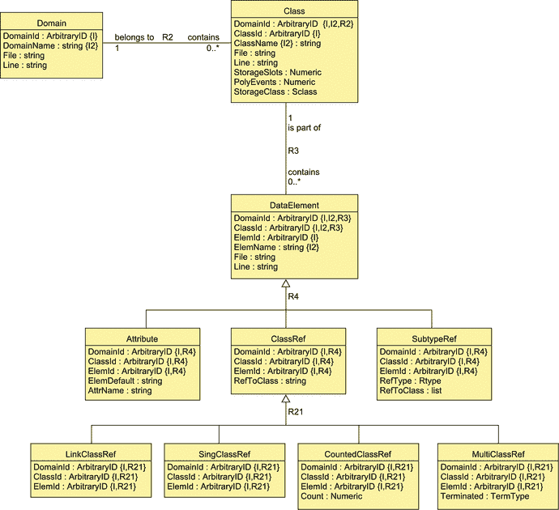

**图 10-1.** `pycca` 平台模型片段

注意其中有名为 `Domain` 和 `Class` 的类。这些类对可执行模型中的 `Domain` 或 `Class` 的实现对应物进行建模。

平台模型规定，`Classes` 包含 `Data Elements`，并且一个类可以完全不包含 `Data Elements`（`R3`）。`Data Elements` 恰好属于一个类，因此 `Classes` 之间不共享 `Data Elements`。所有 `Data Elements` 都是三种类型之一（`R4`）：`Attributes`、`ClassRefs` 或 `SubtypeRefs`。此外，类引用是四种类型之一（`R21`）。

对于我们的目标，我们决定所有类实例都将保存在内存中，并存储在 C 结构体数组中。类结构的成员要么是属性、对类的（某种形式的）引用，要么是对泛化关系中子类的引用。平台模型中的类用于对由 `pycca` 生成的实现结构成员进行建模。对于 `pycca`，平台模型中的 `Class` 类与为实现而生成的 C 结构体有直接对应关系。

例如，考虑来自我们的空中交通管制模型的 `Duty_Station` 类定义：

```
class Duty_Station
attribute (Station_Number Number)
attribute (Name_t Location)
attribute (Aircraft_Maximum Capacity)
reference R3 -> On_Duty_Controller
end
```

`R3` 引用是对 `On_Duty_Controller` 类实例的单一引用。将创建一个 `SingClassRef` 实例（及其所有相关的超类实例），以对应 `Duty_Station` 类定义中的 `reference` 语句。当 `pycca` 生成代码时，它会以两种方式使用此信息。当声明 `Duty_Station` 结构体时，它包含一个成员 `struct On_Duty_Control *R3`。这在以下 `pycca` 生成的结构体定义中显示：

```
/*
* Duty_Station 结构体定义
*/
struct Duty_Station {
struct mechinstance common_ ; // 必须放在第一位！
Station_Number Number ;
Name_T Location ;
Aircraft_Maximum Capacity ;
struct On_Duty_Controller *R3 ;
} ;
```

在创建初始实例群体的初始化器时，`R3` 成员被设置为 `On_Duty_Controller` 数组成员的地址或 `NULL`，具体取决于所请求的群体。这在我们的示例的初始实例群体中显示：

```
/*
* "Duty_Station" 的初始实例存储
*/
static struct Duty_Station Duty_Station_storage[3] = {
{.common_ = {1, 0, &Duty_Station_class}, "S1", "Front", 20, .R3 = NULL},
{.common_ = {2, 0, &Duty_Station_class}, "S2", "Center", 30, .R3 = NULL},
{.common_ = {3, 0, &Duty_Station_class}, "S3", "Front", 45, .R3 = NULL}
} ;
```

请注意，平台模型中的许多类都有 `File` 和 `Line` 属性。这些属性记录了定义实体的输入文件名以及文件内的行号。此信息有助于生成错误消息，以及在生成的代码文件中插入 `#line` 指令。

`pycca` 平台模型有 35 个类。它们涵盖了 DSL 语言语句中指定的信息类型，例如类、属性、状态转换和初始实例。`pycca` 平台模型构成了程序其余部分组织方式以及代码生成所需处理方式的基础。

### 领域特定语言处理

为计算机语言生成解析器是一个已被充分理解的问题。`Pycca` 遵循定义语法并使用解析器生成器创建 `pycca` DSL 解释器的常见模式。当输入被扫描和识别时，代码在语法元素归约时被执行。当 DSL 语句被识别时执行的代码会创建平台模型类的实例。语言语句中的数据对应于平台模型类实例中的属性。你可以将 `pycca` DSL 视为平台模型群体的一种文本形式且更方便的表示。直接填充平台模型也可以达到同样的效果，但使用 DSL 提供了以更人性化的方式组织平台模型群体的机会。

与其他计算机语言一样，可以编写语法正确但毫无意义的 `pycca` DSL 语句。因此，`pycca` 在解析输入文件并填充平台模型后，会执行一组语义检查。某些语义由平台模型上的约束强制执行，例如平台模型关系所隐含的那些约束。其他语义则需要执行代码。

例如，如果状态模型中的某个状态被标记为最终状态，则不允许从该状态出发的出站转换。因为转换到最终状态的实例在其状态活动执行完毕后会被删除，所以它不可能响应其他事件。`Pycca` 也不允许孤立状态（既没有出站也没有入站转换的状态）。这样的语义检查共有 20 个。

### 模板驱动的代码生成

`pycca` 的代码生成器是使用模板扩展设计的。这是一种从生成会计报告到生成网页的通用惯用做法。`Pycca` 使用它的方式与任何模板系统非常相似。文本从模板传递到输出。命令嵌入在模板中，当模板扩展器识别出命令时，它会执行该命令，并将从嵌入命令返回的结果放入输出中。`pycca` 使用的模板包含嵌入命令，这些命令查询平台模型以找到代码生成过程中该点所需的信息，然后将这些信息格式化为有效的 C 语言语句。从概念上讲，`pycca` 所做的事情与银行程序查询数据库并打印账户对账单所做的事情几乎没有区别。`pycca` 的目标是为 C 编译器生成输出，而不是为银行客户生成输出。

使用模板使我们能够对生成的输出进行排序，以适应 C 编译器的要求。生成的头文件和代码文件有各自的模板。这些模板经过设计和排序，使得嵌入的扩展命令将其输出放置在输出中的适当位置。C 语言需要大量的类型注解，并坚持符号名称在其定义之前（或有时同时）被声明。声明和定义是 C 语言中的关键概念，并且通常声明必须先于定义。例如，状态活动函数的前向声明被放置在使用这些函数名称的数据结构定义之前。然后，这些内容又被放置在状态活动函数代码的定义之前。

### Pycca 实现

Pycca 使用 `Tcl` 语言实现。`Tcl` 是一种通常用作脚本语言的动态语言。选择脚本语言来实现 `pycca` 可能看起来不寻常，但 `Tcl` 具有许多理想的特性：

- `Tcl` 是一种成熟、稳定的语言，已经积极开发了 20 多年。

- `Tcl` 是平台无关的，可在 Linux（及其他 UNIX 衍生系统）、macOS 和 Windows 上运行。

- `Tcl` 程序可以作为单文件可执行文件分发，无需外部依赖或复杂的安装要求。

- `Tcl` 是可扩展的，并支持一个庞大的标准过程库。

在实践中，用于实现 `pycca` 这类程序的语言选择，应基于可用性和便利性。它应该是一种实现者熟悉的语言，并且能够便利地支持上一节中设计思想的实现。这里我们讨论如何使用 Tcl 来实现 `pycca` 的设计。

Pycca 的平台模型是一个规范化的关系模式，我们所有的示例模型都是如此。`pycca` 使用 TclRAL（关系代数库）包来实现平台模型上的操作。TclRAL 包实现了关系代数，其中操作符是 Tcl 命令，而值和变量直接集成到 Tcl 语言中。你可以将平台模型的 TclRAL 实现视为一个内存数据库，它使用普通的 Tcl 语言命令来查询和操作平台模型数据。它的设计明确旨在支持我们建模方法的完整性约束。TclRAL 完全集成到 Tcl 值系统中。在 TclRAL 中不存在“阻抗不匹配”的问题，因为你不必使用不同的语言来查询和操作数据，然后再将查询结果传回实现语言以进行进一步处理。将这种方法与 SQL 进行对比，后者要求你处理实现语言和查询语言之间不可避免的边界。

秉承著名的 `lex` 和 `yacc` 程序的传统，Tcl 拥有 `fickle` 和 `taccle` 来执行生成词法分析器和语法分析器的相同功能。在这种情况下，生成的分析器和语法分析器以 Tcl 代码的形式交付，而不是 C 代码。

标准的 Tcl 库包含执行模板扩展的过程，这些过程用于生成头文件和代码文件。模板包含直接传递给输出的普通文本以及嵌入其中的 Tcl 命令。嵌入的命令被执行，其输出被写入生成的文件中。嵌入的命令被实现为对平台模型的 TclRAL 查询，并将结果适当地格式化为 C 语言语句。

`pycca` 程序由大约 5,000 行 Tcl 代码、语法规范和词法分析器规范组成，不包括注释或空行。我们不喜欢使用代码行数作为软件度量标准，这里仅提供对 `pycca` 程序大小的粗略、相对指示。因此，`pycca` 并不是一个大型程序，但这很大程度上归功于使用了 Tcl，以及 Tcl 作为一种语言，能够用更少的代码行进行表达。如果它用 C 编写，`pycca` 的规模可能会大几倍。

## Pycca 性能

不仅需要将模型翻译成可运行的代码，而且最终实现的质量也必须满足项目的需求。如果不能满足性能要求，那么生成有洞察力的模型并将其忠实地翻译成代码就意义不大。

我们的目标平台是基于微控制器的系统。这类系统的主要挑战在于可用的计算资源有限。内存和处理器速度通常都非常小。在本节中，我们将展示 ALS 系统翻译的一些性能数据。

### 目标硬件平台

许多市售平台都能满足我们的需求。我们选择了 Silicon Labs 的 Giant Gecko。此微控制器有一个名为 `EFM32GG-STK3700` 的入门套件。

该入门套件上的微控制器是 `EFM32GG990F1024`。该计算机是一款基于 ARM Cortex-M3 的 SoC，具有 1 MiByte 闪存和 128 KiByte RAM。该 SoC 支持超低功耗睡眠模式，从闪存执行代码时功耗约为 219 μA/MHz。尽管能够以 48 MHz 的时钟频率运行，但在这些测量中，微控制器的时钟频率设置为 7 MHz。这些规格将 Giant Gecko 置于我们目标微控制器类别中性能较强的一端。

### 目标软件平台

本示例的代码是使用 Silicon Labs Simplicity Studio 开发环境构建的。我们包含了供应商提供的硬件访问库中的代码，以及构建完整应用程序所需的启动代码和其他小段代码。

该应用程序是使用 GNU 编译器套件构建的：

```
arm-none-eabi-gcc (GNU Tools for ARM Embedded Processors) 5.4.1 20160919 (release)
[ARM/embedded-5- branch revision 240496]
```

应用程序编译时定义了预处理符号 `NDEBUG`、`MECH_NINCL_STDIO` 和 `RELEASE`，以移除所有断言和对 C 标准 I/O 函数（例如 `printf`）的使用。优化配置为使用 `-Os` 设置以实现最小体积。目标文件中未使用的数据和函数在最终可执行文件中被丢弃。这种构建设置的组合产生了体积最小的可执行文件。为调试和检测而构建时，可执行文件的体积通常是发布版本的两倍。

### ALS 代码大小

以下测量结果针对第 6 章至第 8 章中所示的 ALS 应用示例。该示例包含两个域以及它们之间的桥接代码。润滑（Lubrication）域包含了指向 UI 和警报（Alarms）域的外部实体引用，这些引用已被存根化。同样，SIO 域包含了用于访问设备硬件的外部实体引用，这些引用也已被存根化。

表 10-1 显示了集成润滑/SIO 应用的总内存使用量（以字节为单位）。

**表 10-1. ALS 应用代码大小（字节）**

| 文件 | 代码与常量 | 已初始化数据 | 未初始化数据 | 总计 |
| --- | --- | --- | --- | --- |
| `lube_sio.axf` | 12,064 | 1,784 | 756 | 14,606 |

应用的总内存使用量轻松适配我们的目标硬件，并且也同样适配此类中的许多其他目标硬件平台。

我们可以通过检查各个域和桥接代码的大小来细分内存使用情况，如表 10-2 所示。

**表 10-2. ALS 域代码大小（字节）**

| 文件 | 代码与常量 | 已初始化数据 | 未初始化数据 | 总计 |
| --- | --- | --- | --- | --- |
| `lube.o` | 2,663 | 476 | 0 | 3,139 |
| `sio.o` | 2,070 | 776 | 0 | 2,846 |
| `lube_sio_bridge.o` | 471 | 0 | 0 | 471 |
| 总计 | 5,204 | 1,252 | 0 | 6,456 |

在总内存使用量中，不到一半用于域和桥接代码。我们应当注意，此应用的初始实例数量非常小，这反映在已初始化数据的大小上。增加初始实例的数量只会增加已初始化数据的使用量。无论初始实例数量大小如何，代码与常量的内存使用量都将保持不变，因为该内存使用量已经包含了域的所有代码和 `pycca` 生成的信息。还要注意，已初始化数据还会在 RAM 中分配相同大小的空间，而这并未显示在这些总计中。在复位时，已初始化数据会由编译器提供的启动代码从闪存复制到 RAM。由于闪存技术不允许像 RAM 那样直接更新，因此 RAM 副本允许在程序运行期间更新类实例的值。这种为已初始化数据分配双倍空间（闪存中的一份和 RAM 中相同大小的另一份）的需要，是微控制器 SOC 设计中闪存和 RAM 分开这一典型特征的直接结果。

有必要考察一下 ST/MX 域对总体内存使用量的贡献。这一点很重要，因为运行 `pycca` 生成的应用程序必须要有模型执行（Model Execution）域，它代表了一种必须分摊到整个应用中的固定成本。参见表 10-3。

**表 10-3. 模型执行域代码大小（字节）**

| 文件 | 代码与常量 | 已初始化数据 | 未初始化数据 | 总计 |
| --- | --- | --- | --- | --- |
| `mechs.o` | 2,032 | 12 | 720 | 2,764 |
| `pycca_portal.o` | 990 | 0 | 0 | 990 |
| `platform.o` | 471 | 1 | 0 | 472 |
| 总计 | 3,521 | 13 | 720 | 4,226 |

`mechs.o` 文件包含了 MX 域中所有与目标无关的代码。这包括事件队列和事件信号/分发代码等。`pycca_portal.o` 文件由桥接中使用的门户函数组成。最后，`platform.o` 文件包含了 MX 域所需的平台特定代码。这包括控制用于延迟事件的定时资源、处理低功耗模式睡眠和唤醒的代码，以及与同步队列接口的代码。未初始化数据被分配给事件队列、事件控制块以及 ST/MX 实现的其他内部资源。这些资源可以根据需要进行扩展或收缩，此总计代表了默认配置（10 个事件控制块，16 字节参数数据空间，以及 10 个同步队列槽位）。

与许多针对微控制器的 RTOS 实现相比，ST/MX 域的内存使用情况堪称优异。然而，这种比较并不直接。RTOS 将包含 ST/MX 所不具备的多任务处理、任务间同步和互斥功能。ST/MX 是单线程的，严格采用事件驱动且运行至完成的执行方式，不需要任务调度服务，也不支持运行它们所需的同步操作和互斥机制。相反，ST/MX 可以向状态机发送事件信号并分发事件，这是 RTOS 所不具备的功能。

剩余内存使用量的大约 25% 来自启动代码、标准 C 库、编译器库、硬件访问库、外部实体存根，以及使应用程序能够运行所需的其他“胶水”代码。虽然这占总内存使用量的很大一部分，但它代表了应用程序的固定成本。

### 执行速度

我们仅提供一个执行速度测量结果，如表 10-4 所示。发送事件信号和分发事件是 `ST/MX` 域中的一个常见操作。这里我们测量了发送信号并分发一个自指向事件所需的 CPU 周期数。这包括分配 `ECB`、填充 `ECB`、将其添加到事件队列、返回主循环以判断是否有其他事件需要分发、从事件队列中移除 `ECB`、计算状态转换以及进入状态活动所需的时间。方便的是，`ARM Cortex-M3` 内置了一个用于此目的的周期计数器。

**表 10-4. 事件信号发送与分发时序**

| 周期数 | 7 MHz 下的时间 | 7 MHz 下的操作数/秒 |
| :--- | :--- | :--- |
| 4,696 | 67 μs | 1,491 |

完成信号发送/分发操作需要 `4696` 个周期。在 `7 MHz` 时钟频率下，这意味着大约需要 `67` 微秒，或者换句话说，每秒大约可以执行 `1491` 次此类操作。与运行在 `2–3 GHz` 频率且拥有大型指令和数据缓存的现代桌面及服务器级计算机的能力相比，这些数字显得有些相形见绌。我们必须注意，不要在如此悬殊的计算技术之间进行外推比较。

### 性能讨论

在此领域进行性能比较是困难的。我们没有用于测试 `MX` 域实现的基准测试。直接比较几乎不可能，因为为应用程序在建模和非建模实现中提供相同的功能成本过高。

本文提供的测量结果证明，`pycca` 翻译后的域的性能确实能够匹配许多基于微控制器的系统所提供的计算能力。我们很好地控制在内存目标范围内，并且事件信号发送的实现具有合理的周期计数。在众多系统上的经验表明，根据目标平台仔细调整翻译方案和模型执行域，可以使翻译后的模型满足项目的性能目标。

### 提供特定于实现的代码

在建模应用逻辑时，问题规模是我们不考虑的实现方面之一。一个类只有几个实例还是数百万个实例，并不会改变应用逻辑的基本原理。如果需要根据某个属性的值来查找类实例，无论实例数量是几个还是很多，都不会影响我们必须找到所需实例这一事实。

但在考虑实现此类查找时，规模就变得至关重要。当某个类的实例数量增长到足够大，并且我们需要查找特定实例的频率增加时，`pycca` 宏提供的简单顺序查找可能会成为性能瓶颈。

回顾第 4 章中的 `Air_Traffic_Controller` 类：

```
class Air_Traffic_Controller
attribute (Employee_ID ID)
attribute (Name_T Name)
attribute (Experience_Level Rating)
# ...
# 空中交通管制员类的其他部分
end
```

我们可以使用 `pycca` 宏来查找与给定 `ID` 匹配的 `Air_Traffic_Controller` 实例：

```
ClassRefVar(Air_Traffic_Controller, atc) ;
PYCCA_selectOneInstWhere(atc, Air_Traffic_Controller, strcmp(atc->ID, "ATC-137") == 0) ;
if (atc >= EndStorage(Air_Traffic_Controller)) {
// 未找到
} else {
// 已找到
}
```

这段代码会对 `Air_Traffic_Controller` 的所有实例执行简单的顺序遍历，并比较 `ID` 属性的值以寻找匹配项。这种方法很简单，已经提供，并且对于少量实例来说运行良好。随着 `Air_Traffic_Controller` 实例数量的增加，我们将需要更优的解决方案。

例如，我们可以使用二分查找来减少比较次数。二分查找要求被查找的项按特定顺序排列。然而，`Pycca` 在内存中按定义顺序组织初始实例群体。要将顺序查找转换为二分查找，我们需要按 `ID` 属性的升序排列 `Air_Traffic_Controller` 的初始实例。假设我们的初始实例群体如下：

```
table
Air_Traffic_Controller (Employee_ID ID) (Name_T Name) (Experience_Level Rating) R1
@atc51  {"ATC-51"} {"Ianto"}    {"C"}       -> On_Duty_Controller.atc51
@atc53  {"ATC-53"} {"Toshiko"}  {"A"}       -> On_Duty_Controller.atc53
@atc67  {"ATC-67"} {"Gwen"}     {"B"}       -> On_Duty_Controller.atc67
@atc77  {"ATC-77"} {"John"}     {"B"}       -> Off_Duty_Controller.atc77
@atc87  {"ATC-87"} {"Fred"}     {"B"}       -> Off_Duty_Controller.atc87
# ...
# 按 ID 属性升序排列的其他许多管制员
# ...
end
```

通过定义一个 `class operation`，我们可以添加自己的代码来应用二分查找，以找到匹配的 `Air_Traffic_Controller`。标准库的 `bsearch()` 函数需要以下参数：

*   指向搜索键的指针
*   指向待搜索项数组起始位置的指针
*   数组中的项数
*   每个数组项的大小
*   一个返回整数的比较两个项的函数

我们将 `class operation` 定义为 `Air_Traffic_Controller` 类的一部分：

*   ❶ `BeginStorage` 宏解析为给定类的存储数组的地址。
*   ❷ `Pycca` 会发出一个宏定义，用于表示类的实例数量。
*   ❸ 我们必须为 `bsearch` 提供一个比较函数。
*   ❹ 将比较函数放在 `implementation prolog` 中，确保其定义出现在 `class operation` 中使用它之前。

```
class Air_Traffic_Controller
# ... 空中交通管制员类的其他部分
class operation findByEmployeeID(char const *eid) :
(struct Air_Traffic_Controller *) {
struct Air_Traffic_Controller key = {
.ID = eid
} ;
return (struct Air_Traffic_Controller *)bsearch(&key,
BeginStorage(Air_Traffic_Controller),       // ❶
ATCTRL_AIR_TRAFFIC_CONTROLLER_INST_COUNT,   // ❷
sizeof(struct Air_Traffic_Controller),
atc_compare_ids) ;                          // ❸
}
end
implementation prolog {                                     // ❹
#include 
#include 
static int
atc_compare_ids(void const *m1, void const *m2)
{
struct Air_Traffic_Controller const *atc1 = m1 ;
struct Air_Traffic_Controller const *atc2 = m2 ;
return strcmp(atc1->ID, atc2->ID) ;
}
}
```

现在，我们可以通过以下代码定位到 `Air_Traffic_Controller` 实例 `ATC-137` 的引用：

```
ClassRefVar(Air_Traffic_Controller, atc) ;
atc = ClassOp(Air_Traffic_Controller, findByEmployeeID)("ATC-137") ;
if (atc == NULL) {
// 未找到
} else {
// 已找到
}
```

当然，还有其他实现此查找的方式。例如，我们可以仅对静态实例群体使用 `bsearch`。对于动态变化的 `Air_Traffic_Controller` 实例群体，我们可能会选择维护一个哈希表。这样，创建或删除 `Air_Traffic_Controller` 实例的活动代码也会同时从哈希表中添加或移除实例引用，哈希表将以 `ID` 属性值作为键。你可以将实例创建和哈希表添加操作整合到一个 `class operation` 中，实例删除和哈希表移除操作也类似处理。

我们在此要强调的是，实现可以针对问题规模进行定制。最重要的是，具体的实现机制不会影响模型逻辑。如果模型逻辑要求找到特定的 `Air_Traffic_Controller`，那么翻译过程必须为查找选择合适的实现方式，而这一选择至少部分基于需要查找的实例数量。查找是计算机科学中一个研究深入的问题，我们可以借鉴其成果。

### 考虑其他平台

在本书中，我们始终专注于一个特定的目标平台。这种对单一平台的关注有助于在不展示如何使用其他实现机制达到相同效果的情况下，演示翻译中的概念。在本节中，我们将拓宽讨论范围，考虑另一个翻译目标。篇幅所限，无法对可能用于满足系统需求的诸多实现技术可能性进行详细讨论。为了限定讨论范围，我们仅更改数据管理方式的平台要求。我们保持编程语言为`C`，执行方式为单线程。许多针对微控制器目标平台的概念可以沿用，因此我们重点探讨数据管理可能如何变化。

数据如何保存和管理是决定`MX`领域特性的关键因素之一。在微控制器目标平台中，我们决定所有领域数据都保存在主存储器中，由处理器直接寻址。在此，我们更改这一要求，并坚持使我们的替代`MX`领域将数据保存在辅助存储器中。许多类别的应用要么数据量过大无法全部存放在主存储器中，要么有其他需求需要将领域数据持久化到非易失性辅助存储器中。

在本节中，我们将概述一个将领域数据保存在辅助存储器中的`MX`领域可能是什么样的。我们不会在此讨论中展示一个完整的`MX`领域。相反，我们将通过一系列示例，展示如何使用持久化数据存储机制来实现模型级数据概念。同样，我们必须明确目标平台所支持的特性：
*   实现语言为`C`。
*   领域数据使用`Berkeley DB`进行管理。
*   执行方式为单线程。
*   目标硬件平台为台式机或服务器级别的处理器。
*   我们假设一个`POSIX`操作系统环境，拥有`GiB`级的主存储器，以及至少为主存储器大小 10 倍的辅助磁盘存储空间。

我们一直在讨论的微控制器目标平台与这个新平台之间的主要区别在于，使用`Berkeley DB`来管理领域数据，以及假设运行在功能更强大的计算机上，并配备完整的操作系统。我们特意保持了实现语言和单线程执行方式与微控制器目标平台相同，以避免引入其他因素。

`Berkeley DB`是一个通用的嵌入式数据库引擎。`Berkeley DB`的核心概念是持久化键/值数据存储，其中键和值是任意的字节数组数据。该库成熟、支持良好，并提供了远超本示例用途的功能。有关`Berkeley DB`的完整信息，请访问[`http://www.oracle.com/technetwork/database/database-technologies/berkeleydb/overview/index.html`](http://www.oracle.com/technetwork/database/database-technologies/berkeleydb/overview/index.html)。

### 将领域数据映射到 Berkeley DB

我们的首要任务是将模型执行数据概念映射到`Berkeley DB`的实现机制。图 10-2 展示了模型数据管理概念如何映射到`Berkeley DB`的功能，以及`Berkeley DB`如何使用文件系统进行持久化存储。

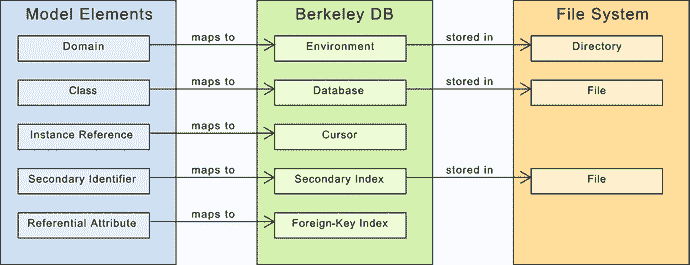
`图 10-2.` 将领域数据映射到`Berkeley DB`

在此示例中，我们使用第 6 章中`Lubrication`领域的一部分。我们将讨论每个概念，并展示一小段代码序列，以演示`Berkeley DB`函数在`MX`领域中可能如何出现，以及如何用`C`代码实现模型数据管理到`Berkeley DB`的映射。我们不期望您成为`Berkeley DB`专家并识别每个库调用。相反，您可以大致了解数据管理是如何编码的，而数据库库调用的文档对于那些希望深入研究的人来说是现成的。您还可以很好地感受到在`ST/MX`中将所有内容保存在内存中的数据管理，与使用键/值对存储机制相比，有多么不同。

此示例仅涉及`Lubrication`领域中的两个类：`Injector`和`Machinery`。为了唤起您的记忆，图 10-3 是`Lubrication`领域类图的一个片段。

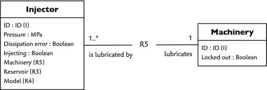
`图 10-3.` `Lubrication`领域类图片段

按照图 10-2 中的映射，我们首先将领域的数据封装在一个`Berkeley DB`环境中。这种结构适合我们管理单个领域数据的需求。一个环境为数据库和事务能力提供了分组，必要的文件存储在文件系统的单个目录中：
*   ❶ 库中的大多数实体在任何其他操作执行之前首先被创建。
*   ❷ 为简洁起见，我们假设存在某个错误处理函数。
*   ❸ 要使用环境，我们必须打开它。

```c
int dbres = 0 ;
dbres = db_env_create(&lube_env, 0) ;                          // ❶
if (dbres != 0) {
handle_error(dbres, "Error creating environment handle") ; // ❷
}
dbres = lube_env->open(lube_env, "./lube_domain",              // ❸
DB_CREATE | DB_INIT_MPOOL, 0) ;
if (dbres != 0) {
handle_error(dbres, "Environment open failed") ;
}
```

此代码在必要时创建环境（可能已存在），所有文件将放置在`lube_domain`目录中。

一个领域类作为一个数据库存储。在`Berkeley DB`中，一个数据库大致相当于一个表，它匹配由一组实例（构成表中的行）组成的类数据视图。在环境打开之后，我们可以创建并打开对应于这些类的数据库。我们仅展示`Injector`类的代码，但一个领域的所有类都会有自己的数据库来存储实例：
*   ❶ 该数据库在`Lubrication`领域的环境上下文中创建。
*   ❷ 该数据库存储在一个名为`injector.db`的文件中。

```c
DB *injdb ;
dbres = db_create(&injdb, lube_env, 0) ;                          // ❶
if (dbres != 0) {
handle_error(dbres, "Failed to create injector database") ;
}
dbres = injdb->open(injdb, NULL,  "injector.db", NULL, DB_BTREE,  // ❷
DB_CREATE, 0) ;
if (dbres != 0) {
handle_error(dbres, "Injector database open failed") ;
}
```

`Berkeley DB`提供了几种数据存储细节的选择。这里我们选择了`Btree`作为底层存储组织。这是`Berkeley DB`中的常见用法。根据应用对存储和存储访问的具体需求，其他选择可能更合适。

我们将一个类的实例表示为 Berkeley DB 游标。游标指定了数据库中的一个位置，可用于访问实例属性值，并可在实例间进行迭代。我们将在后续示例中讨论游标。现在，只需知道（再次粗略地说）它们可以被视为对一个或多个实例的引用。

与微控制器平台的 ST/MX 域类似，我们将每个类描述转换为 C 结构体。类的 C 结构体提供了一种便捷的方式，用于在 Berkeley DB 之间传递值，同时仍能直接访问属性。Berkeley DB 将键和数据值视为字节数组，而 C 结构体类型的变量可作为与数据库传输数据时的临时存储区。当数据库值暂时保存在内存中时，C 结构体变量还提供了对各个成员的便捷访问。对于本例中的两个类，C 结构体如下所示：

```c
typedef uint32_t uniqueID ;
typedef char InjModelName[16] ;
typedef char Name[32] ;
struct Injector {
uniqueID ID ;                 // {I}
unsigned Pressure ;
bool Disspation_error ;
bool Injecting ;
Name Default_schedule ;       // {R1}
uniqueID Machinery ;          // {R5}
uniqueID Reservoir ;              // {R3}
InjModelName Model ;              // {R4}
} ;
struct Machinery {
uniqueID ID ;
bool Locked_out ;
} ;
```

之前，我们从 C 结构体中省略了标识属性。由于 ST/MX 使用自己的实例标识符（即实例在内存中的指针地址），因此如果标识属性未在其他地方使用，我们会将其丢弃。使用 Berkeley DB 时，我们需要一个键来唯一标识一个实例，因此我们保留了模型中的标识符，并将其用作数据库存储的键。如图 10-4 所示。

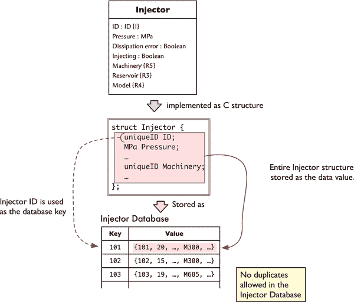

**图 10-4. 将类存储映射到 Berkeley DB**

一个类也可能有多个标识符。可以考虑同时使用系统提供的标识符和客户的电子邮件地址作为标识符。我们将每个额外的标识符映射到一个 Berkeley DB 二级索引。二级索引与主数据库关联。如图 10-5 所示。

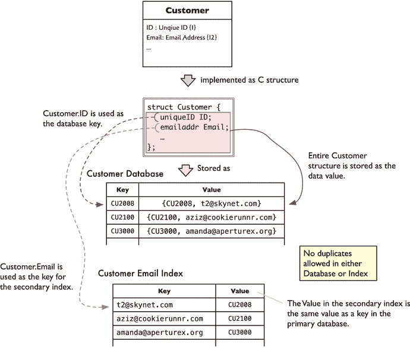

**图 10-5. 使用二级索引作为替代标识符**

二级索引的存储方式与其他数据库相同。索引记录的键部分是替代标识符的值。索引记录的值部分是主标识符的值。`Berkeley DB` 会这样安排：每当一条记录被插入客户数据库时，一条对应的记录就会被插入客户电子邮件索引。通过电子邮件地址查找客户，涉及从客户电子邮件索引中获取与电子邮件地址匹配的记录，然后使用该记录的值部分作为键来查找客户数据库中的记录。

### 导航关系

如何存储信息以支持关系导航是域数据管理的另一个重要方面。回到润滑域类图片段，考虑从 `Injector` 实例导航关联 `R5` 到 `Machinery` 实例。关联的多重性表明，我们期望恰好获得一个 `Machinery` 实例。图 10-6 显示了如何将 `Injector` 实例的属性用作 `Machinery` 数据库的键。

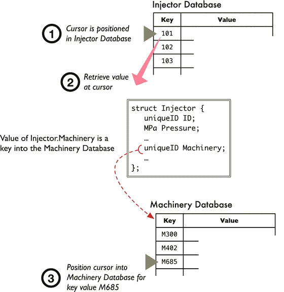

**图 10-6. 导航到一个机械实例**

在此方向上导航 `R5` 的代码可能如下所示：

*   ❶ `Injector` 实例的属性值被检索到 `struct Injector` 类型的局部变量中。
*   ❷ 创建一个指向 `Machinery` 数据库的游标。
*   ❸ 定位游标的键是 `Injector.Machinery` 属性的值。

```c
struct Injector injinst ;
DBT key ;
DBT value ;
memset(&key, 0, sizeof(key)) ;
memset(&value, 0, sizeof(value)) ;
value.data =  &injinst ;                                        // ❶
value.ulen = sizeof(injinst) ;
value.flags = DB_DBT_USERMEM ;
// Assume "injcursor" is positioned in the Injector database.
dbres = injcursor->get(injcursor, &key, &value, DB_CURRENT) ;
if (dbres != 0) {
handle_error(dbres, "Failed to dereference injector cursor") ;
}
DBC *machcursor = NULL ;                                        // ❷
dbres = machdb->cursor(machdb, NULL, &machcursor, 0) ;
if (dbres != 0) {
handle_error(dbres, "Failed to create machinery cursor") ;
}
memset(&key, 0, sizeof(key)) ;                                  // ❸
key.data = &injinst.Machinery ;
key.size = sizeof(injinst.Machinery) ;
memset(&value, 0, sizeof(value)) ;
// Position the Machinery cursor to the record matching the
// value of the Machinery attribute of the Injector instance.
dbres = machcursor->get(machcursor, &key, &value, DB_SET) ;
if (dbres != 0) {
handle_error(dbres, "Failed to set machinery cursor") ;
}
```

我们假设有一个指向 `Injector` 数据库的游标，它定位了跨 `R5` 导航的起始实例。使用该游标，我们获取数据库记录的值。在我们的例子中，该值是 `Injector` 结构体的所有数据。该结构体中包含 `Machinery` 成员。`Machinery` 成员的值被用作 `Machinery` 数据库的键。因此，在此示例中，如果当我们检索 `Injector` 结构体值时，发现 `Machinery` 成员包含值 `M685`，我们就能将游标定位到 `Machinery` 数据库中键为 `M685` 的记录。一旦游标定位到相关的 `Machinery` 实例，我们就可以根据需要读取或更新记录的值部分。

### 导航一对多关系

要从 `Machinery` 实例开始导航 `R5`，我们必须确定如何处理与给定 `Machinery` 实例相关的多个 `Injector` 实例。`R5` 关联在 `Injector` 端是“1..*”，因此 `Injector` 数据库中可能有多条记录具有相同的 `Machinery` 属性值。最直接的方法是扫描整个 `Injector` 数据库，读取每条记录，并查找那些 `Injector.Machinery` 值与起始实例的 `Machinery.ID` 值匹配的记录。

幸运的是，我们可以做得更好。`Berkeley DB` 支持两种概念，可用于导航关系，从而得到多个实例。其思想是为形式化关系的引用属性创建一个二级索引，然后在该二级索引上进行联接。二级索引配置为允许重复键，联接操作将创建一个可以访问多个匹配实例的游标。如图 10-7 所示。

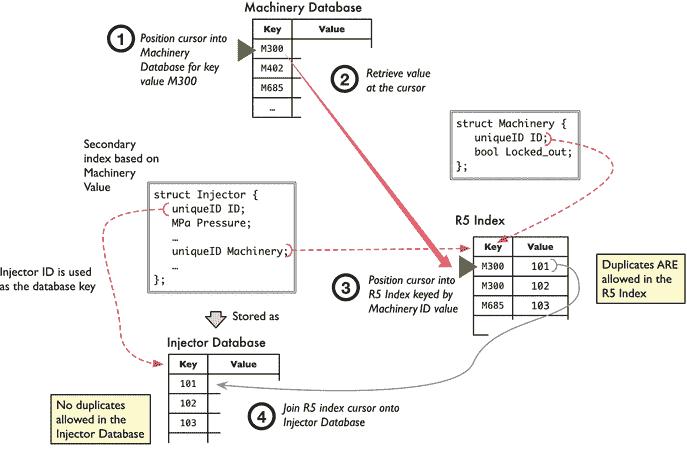

**图 10-7. 从 Machinery 导航 R5 到 Injector**

这里，`R5` 索引使用 `Injector.Machinery` 作为键。因此，我们必须在索引中允许重复键。`R5` 索引记录的值部分保存的是 `Injector ID` 的值。在示例中，`R5` 索引显示 `Machinery` 实例 `M300` 由 `Injector 101` 和 `Injector 102` 润滑。

### 创建支持导航的索引

首先，我们必须创建 `R5` 索引：

*   ❶ 我们必须允许重复。`R5` 在 `Injector` 端的多重性为 `1..*`，这意味着通常多个 `Injector` 实例将共享相同的 `Machinery` 值。

## 鱼雷状态模型与多态事件

`*`仍保留在`Loaded Torpedo`类的`Recall`事件上，表明我们打算在 R2 中进一步将该事件委托给所有子类。在`Passive Launch Torpedo`和`Active Launch Torpedo`子类旁边的`Recall`事件上则没有`*`。这些子类是泛化关系中的叶子节点，因此必须拥有响应此事件的状态模型。

类似地，针对`Loaded Torpedo`的`Fire`和`Cleared tube`事件也是多态的，并委托给 R2 上的子类。这些事件代表了在 R2 泛化关系上引入的新多态事件，对 R1 的其他子类没有影响。例如，无论`Loaded Torpedo`的实例是`Passive`还是`Active`，它都必须为`Fire`和`Cleared tube`事件定义响应。考虑到为 R1 和 R2 定义的多态事件，`Passive Launch Torpedo`和`Active Launch Torpedo`必须响应`Recall`、`Fire`和`Cleared tube`。

现在让我们看看事件多态性在状态模型中是如何呈现的。我们决定为每个叶子子类构建一个独立的状态图。我们从`Stored Torpedo`状态模型开始，如图 9-6 所示。

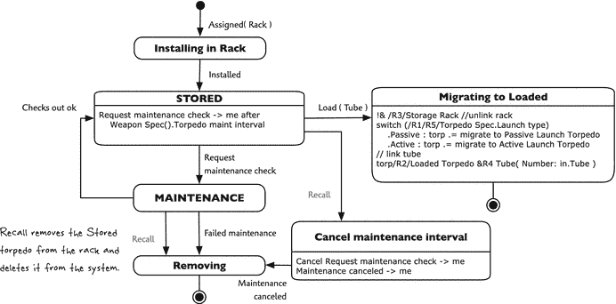

图 9-6. `Stored Torpedo`状态模型

此状态模型描述了`Stored Torpedo`的生命周期，从它通过分配到`Storage Rack`被初始创建开始，到它被召回或装载到鱼雷管为止。

当接收到`Load( Tube )`事件时，在`Migrating to Loaded`状态中会发生重新分类，成为`Loaded Tube`的新实例。在此，与`Storage Rack`的关联被解除，创建适当的`Passive Torpedo`或`Active Torpedo`实例，同时创建一个`Loaded Torpedo`实例，并通过 R2 将它们链接在一起。最后，事件参数`in.Tube`中指定的`Tube`被选中，并链接到`Loaded Torpedo`实例。之后，最终状态符号表示`Stored Torpedo`实例被删除。

多态事件`Recall`作为一个普通事件出现，它在`STORED`和`MAINTENANCE`状态中触发转换。在其他状态中，该事件被安全忽略，因为这些状态都是瞬态的（由自定向事件退出）。

我们选择不为`Loaded Torpedo`定义状态模型，而是为其每个子类定义状态模型。让我们从`Passive Launch Torpedo`开始，如图 9-7 所示。

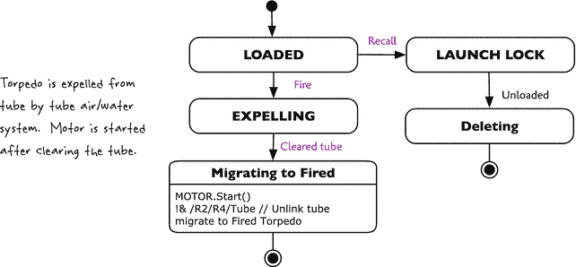

图 9-7. `Passive Launch Torpedo`状态模型

当`Stored Torpedo`实例结束时，会在`LOADED`状态中创建一个新创建的`Passive Launch Torpedo`实例。与`Tube`实例的链接已经建立，鱼雷等待发射。`Fire`事件被指定为多态的，因此它可以被发送到任何`Loaded Torpedo`实例，而无需关心它是`Passive`还是`Active`。

当`Fire`事件被发送到一个专门化为`Passive Launch Torpedo`实例的`Loaded Torpedo`实例时，该事件被传递到`Passive Launch Torpedo`状态模型中的子类实例。这将导致转换到`EXPELLING`状态，鱼雷被推出其管。

当接收到`Cleared tube`事件（也是多态的）时，我们知道鱼雷已在潜艇外部。它转换到`Migrating to Fired`状态，在该状态中它与`Tube`解除关联，并成为`Fired Torpedo`的一个实例。

如果在`LOADED`状态中发生`Recall`事件，则会为鱼雷放置一个软件锁，使其忽略任何后续的`Fire`事件。否则，该事件在`EXPELLING`状态中被忽略，因为此时鱼雷已半出管，实在难以召回！不用担心，图 9-8 展示了在`Fired Torpedo`状态模型中可采取的操作。

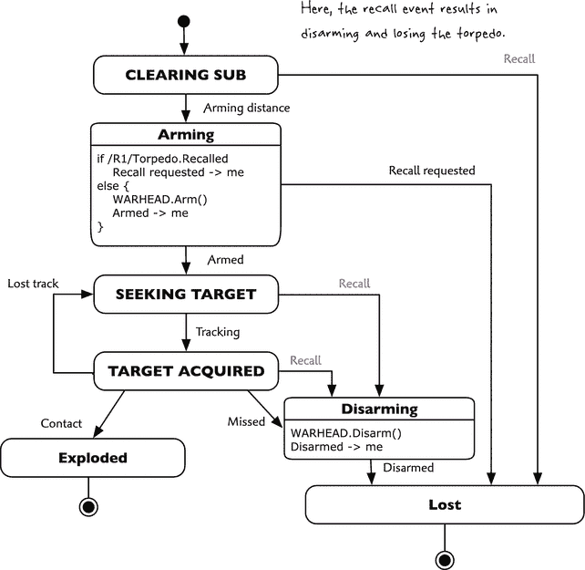

图 9-8. `Fired Torpedo`状态模型

所以现在我们有一枚鱼雷已经离开潜艇，前往某个目标。此时，`Recall`事件将阻止鱼雷被武装。在与潜艇保持安全距离后，将检测到`Arming distance`事件。

然而，存在一个危险：在`Passive Launch Torpedo`或`Active Launch Torpedo`的`EXPELLING`或`ESCAPING TUBE`状态中，`Recall`事件可能被忽略。一旦被忽略，事件就永远丢失了。这就是为什么在`Torpedo`类上定义了一个名为`Recall()`的类方法。要召回一枚鱼雷，需调用此方法。它做两件事。首先，它将`Torpedo.Recalled`属性设置为`true`。其次，它会触发指向自身的`Recall`多态事件，该事件随后被适当委托。这意味着即使事件可能被丢弃，活动的召回状态也会记录在属性值中，该值可以在后续状态中被检查并清除。

在`Arming`状态中，在武装鱼雷之前会查询`Torpedo.Recalled`的值，以防`Recall`事件在更早的状态中发生，而当时未能采取有效行动。

`Active Launch Torpedo`子类的状态模型与`Passive Launch Torpedo`的相似，但`ESCAPING TUBE`状态除外。如图 9-9 所示。

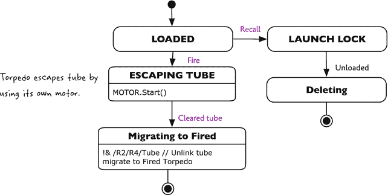

图 9-9. `Active Torpedo`状态模型

这里需要注意的重要一点是，多态事件`Recall`、`Fire`和`Cleared tube`都在子类的状态模型中处理。我们重申，多态事件在被最终消费时并没有什么特别之处。我们只将以下任务委托给模型执行域：从超类实例导航到子类实例的泛化关系，以及将事件映射到接收实例的事件集。事件被接收后，其行为与任何其他事件相同（它会导致转换、被忽略或产生错误情况）。将运行时调度委托给模型执行域，允许我们向超类实例发送多态事件，而无需知道哪个相应的子类已被实例化。正如这个例子所示，多态事件与迁移子类相结合，可以仅通过单个类的状态模型来指定复杂的多模态行为。

## 使用 Pycca 翻译多态事件

在本节中，我们将展示如何使用 `pycca` 翻译鱼雷发射模型。与以往一样，我们仅展示那些涉及你尚未见过的构造的翻译部分，并建议你参考在线资料中提供的完整示例。

首先，我们必须指定哪些事件是多态的。有两个类定义并委托了多态事件：`Torpedo` 和 `Loaded Torpedo`：

* ❶ `polymorphic event` 语句引入了可能发送给 `Torpedo` 类的多态事件名称。请注意，我们在前面的代码中使用了星号（`*`）作为类图上的非正式标注，以说明多态事件如何跨泛化进行映射。`Pycca` 并不使用这种标注。消费状态模型中的事件只需要与声明为多态的事件名称相同即可。

* ❷ 在这里，我们声明 `R1` 使用指针引用（`reference`）来实现泛化。这个选择是任意的，我们在此使用 `reference` 实现来演示其用法。如果我们像其他模型那样使用 `union` 风格来实现，多态事件的工作原理也是一样的。

* ❸ 实例操作展示了如何发送多态事件（不带事件参数）。请注意，你必须使用特定的宏 `PYCCA_generatePolymorphic()` 来发送多态事件。

* ❹ 由于鱼雷的数量是可变的，我们将种群声明为 `dynamic`（动态），并为 20 个实例分配足够的空间。请记住，所有存储都在编译时分配，这里我们表示系统中最多有 20 枚鱼雷。另外请注意，由于我们在此案例中使用了 `reference` 实现，存储空间会为每个 `Torpedo` 子类进行分配。在泛化的 `reference` 实现中，子类实例与超类实例是分开存储的。

# 鱼雷系统的状态建模

我们展示一个由 `pycca` 工具定义的、关于鱼雷状态建模的示例。

## 类 `Torpedo` 定义

```
class Torpedo
attribute (Torpedo_ID ID)
attribute (bool Recalled) default {false}
reference R5 -> Torpedo_Spec
polymorphic event                                                # ❶
Recall
end
subtype R1 reference                                             # ❷
Stored_Torpedo
Loaded_Torpedo
Fired_Torpedo
end
instance operation
Recall()
{
self->Recalled = true ;
PYCCA_generatePolymorphic(Recall, Torpedo, self, self) ;    // ❸
}
population dynamic                                               # ❹
slots 20
end
```

定义多态事件的第二个类是 `Loaded_Torpedo` 类：

- ❶ 作为使用 `reference` 实现的泛化中的子类，我们需要一个指向其相关超类实例的引用，因为我们需要沿着 `R1` 从子类导航到超类。这个反向引用仅在必须从子类导航到超类时才需要。在本例中，我们需要执行此导航。如果 `Loaded_Torpedo` 的活动从不沿 `R1` 导航到 `Torpedo`，则可以省略此引用。
- ❷ 引入了两个新的多态事件。它们跨 `Loaded_Torpedo` 参与的所有泛化（在本例中仅是 `R2`）都是多态的。这意味着 `Fire` 和 `Cleared_tube` 必须由 `Passive_Launch_Torpedo` 和 `Active_Launch_Torpedo` 的状态模型处理。
- ❸ `Loaded_Torpedo` 的实例也是动态的。我们只为八个 `Loaded_Torpedo` 实例分配了空间。假设我们的潜艇有八个鱼雷发射管，四个在前，四个在后，那么潜艇上任何时候最多只能装填八枚鱼雷。由于在任何给定时间点，有些鱼雷被储存，有些已被发射，因此这里分配的存储空间不必与 `Torpedo` 类实例的相同。

## 类 `Loaded_Torpedo` 定义

```
class Loaded_Torpedo
reference R1 -> Torpedo     # ❶
reference R4 -> Tube
polymorphic event           # ❷
Fire
Cleared_tube
end
subtype R2 reference
Passive_Launch_Torpedo
Active_Launch_Torpedo
end
population dynamic          # ❸
slots 8
end
```

我们展示了在 `pycca` 中实现的 `Stored_Torpedo` 状态模型。我们省略了状态活动的 C 代码，以便专注于状态模型本身的结构：

- ❶ `Stored_Torpedo` 实例是通过 `Assigned` 事件异步创建的（通过一个创建事件）。句点字符表示从初始伪状态开始的转换。
- ❷, ❸ `Recall` 事件与其他事件一样出现。`Pycca` 会识别出 `Stored_Torpedo` 是 `Torpedo` 沿 `R1` 的子类，并且 `Recall` 被定义为沿 `R1` 的多态事件。因此，当 `Recall` 作为多态事件发送给 `Torpedo` 时，它会被当作一个普通事件分发给 `Stored_Torpedo`。多态事件分发的具体机制将在另一节中讨论。
- ❹, ❺ `Removing` 和 `Migrating_to_Loaded` 这两个状态在状态模型中均被显示为终态。当 `Stored_Torpedo` 被召回时，它从系统中移除，不再存在。当 `Stored_Torpedo` 被装填时，我们会创建一个新的 `Loaded_Torpedo` 实例，因此必须删除 `Stored_Torpedo` 的实例以维护 `R1` 泛化约束。

## 类 `Stored_Torpedo` 定义

```
class Stored_Torpedo
reference R1 -> Torpedo
reference R3 -> Storage_Rack
machine
state Installing_in_Rack(uint8_t rack) {
// 状态活动的 C 代码。
}
transition . - Assigned -> Installing_in_Rack               # ❶
transition Installing_in_Rack - Installed -> STORED
state STORED() {
// 状态活动的 C 代码。
}
transition STORED - Load -> Migrating_to_Loaded
transition STORED - Recall -> Cancel_maintenance_interval   # ❷
transition STORED - Request_maintenance_check -> MAINTENANCE
state MAINTENANCE() {
// 状态活动的 C 代码。
}
transition MAINTENANCE - Checks_out_ok -> STORED
transition MAINTENANCE - Failed_maintenance -> Removing
transition MAINTENANCE - Recall -> Removing                 # ❸
state Removing() {
// 状态活动的 C 代码。
}
final state Removing                                        # ❹
state Migrating_to_Loaded(Tube_number Number) {
// 状态活动的 C 代码。
}
final state Migrating_to_Loaded                             # ❺
state Cancel_maintenance_interval() {
// 状态活动的 C 代码。
}
transition Cancel_maintenance_interval - Maintenance_canceled -> Removing
end
population dynamic
slots 20
end
```

最后，我们展示 `Stored_Torpedo` 的 `Migrating_to_Loaded` 状态的状态活动。此示例展示了如何在 `pycca` 中实现从 `Stored_Torpedo` 到 `Loaded_Torpedo` 的子类迁移。让我们先回顾一下该状态活动的动作语言：

```
!& /R3/Storage Rack // 解除机架链接
switch (/R1/R5/Torpedo Spec.Launch type)
.Passive : torp .= migrate to Passive_Launch_Torpedo
.Active : torp .= migrate to Active_Launch_Torpedo
// 链接发射管
torp/R2/Loaded_Torpedo &R4 Tube( Number: in.Tube )
```

由于我们选择使用 `reference` 泛化来实现 `R1` 和 `R2`，我们需要显式地管理实例的创建和删除。迁移意味着新子类的实例被创建并与超类建立关联，而旧子类的实例被删除。如果我们选择使用 `union` 机制来实现泛化，这个处理过程将会不同。因为通过 `union` 实现，子类存储包含在超类存储中，迁移仅在原地修改内容，无需创建和删除实例。这两种泛化实现机制各有其用途和权衡。

- ❶ 通过 `R1` 关联超类和子类是一个两步操作。首先，我们将 `Torpedo` 超类中的指针更新到新创建的子类实例，包括超类所指向的子类类型（`Loaded_Torpedo`）。其次，我们必须建立从子类到 `Torpedo` 超类的引用。
- ❷ `Torpedo_Spec` 的 `Launch_type` 属性决定了我们必须为 `R2` 创建哪个子类。
- ❸ 同样的过程用于通过 `R2` 关联超类和子类实例。

```
state Migrating_to_Loaded(Tube_number Number) {
// 因为这是一个最终状态，Stored Torpedo 实例在本活动结束时会被自动删除，
// 并且由于 Storage Rack 中没有指向 Stored Torpedo 的引用，
// 我们无需处理 R3 关联。
// 获取超类实例的引用。
ClassRefVar(Torpedo, torp) = self->R1 ;
// 创建一个 Loaded Torpedo 实例
ClassRefVar(Loaded_Torpedo, ltorp) = PYCCA_newInstance(Loaded_Torpedo) ;
// 通过 R1 将 Loaded Torpedo 关联到 Torpedo。
PYCCA_relateSubtypeByRef(torp, Torpedo, R1, ltorp, Loaded_Torpedo) ;   // ❶
ltorp->R1 = torp ;
// 将 Loaded Torpedo 关联到 Tube。
ltorp->R4 = PYCCA_refOfId(Tube, rcvd_evt->Number) ;
// 现在处理 R2
switch (torp->R5->Launch_type) {                                       // ❷
case Active: {
// 对于主动发射鱼雷，创建一个新实例。
ClassRefVar(Active_Launch_Torpedo, altorp) =
PYCCA_newInstance(Active_Launch_Torpedo) ;
// 通过 R2 关联 Active Launch Torpedo。
PYCCA_relateSubtypeByRef(ltorp, Loaded_Torpedo, R2, altorp,
Active_Launch_Torpedo) ;                               // ❸
altorp->R2 = ltorp ;
}
break ;
case Passive: {
// 对于被动发射鱼雷，创建一个新实例。
ClassRefVar(Passive_Launch_Torpedo, pltorp) =
PYCCA_newInstance(Passive_Launch_Torpedo) ;
// 通过 R2 关联 Passive Launch Torpedo。
PYCCA_relateSubtypeByRef(ltorp, Loaded_Torpedo, R2, pltorp,
Passive_Launch_Torpedo) ;
pltorp->R2 = ltorp ;
}
break ;
}
}
```

## 多态事件如何发出信号

在第 5 章中，我们展示了普通事件是如何发出信号并分发的。发出信号需要获取一个事件控制块（`ECB`），用适当的数据填充它，并将 `ECB` 发布到事件队列中。发出多态事件信号需要相同的基本操作集。

`Pycca` 提供了一个宏来与运行时代码交互。例如，将 `Fire` 事件发送给 `Loaded Torpedo` 可能出现在一个状态活动中，如下所示：

```
PYCCA_generatePolymorphic(Fire, Loaded_Torpedo, ltorp, self) ;
```

这会将 `Fire` 多态事件信号发送给 `Loaded Torpedo` 类的 `ltorp` 实例。

如果多态事件带有参数，你需要获取 `ECB`，填充参数，然后以与普通事件相同的方式发布事件。唯一的区别是，存在一个宏可以获取已被标记为多态的 `ECB`。对于某个假设的、带有名为 `When` 参数的事件 `Reload`，发出信号可能如下所示：

```
MechEcb polyecb = PYCCA_newPolymorphicEvent(Reload, Torpedo, torp, self) ;
PYCCA_eventParam(polyecb, Torpedo, When) = 20 ;
PYCCA_postEvent(polyecb) ;
```

`Pycca` 将多态事件编号编码为从零开始的连续整数。这种数字编码与普通事件使用的编码不同。一些类会同时拥有一组普通事件和一组多态事件。为了区分不同的事件集，定义了一个枚举，并且每个 `ECB` 都携带该枚举的一个值，以指示分发每个不同事件类型所需执行的操作：

```
typedef enum {
NormalEvent,
PolymorphicEvent,
CreationEvent
} MechEventType ;
```

## 多态事件如何分发

在第 5 章中，你看到了一个普通的、非多态的事件是如何发出信号并随后被分发的。为了发出信号，需要填写一个 `ECB` 并将其加入队列。普通事件的分发使用 `ECB` 和接收实例类的对象分发块来计算到新状态的转换，并调用相关的活动。类似地，分发多态事件需要来自 `ECB` 的数据与来自多态分发块（`PDB`）的数据相结合。

此外，多态事件的分发涉及从超类实例导航泛化关系以找到相关的子类实例。回顾一下，`pycca` 使用两种策略来存储泛化关系信息：

- 存储为引用的泛化在超类实例结构中包含一个指向子类的指针。由于每个子类都有不同的数据类型，超类指针的类型被定义为 `MechInstance`（作为一个指向通用实例的指针）。

- 存储为联合体的泛化在超类实例结构中包含该泛化所有子类数据结构的联合体。

这种差异影响了计算相关子类实例引用的方式。使用一个枚举来区分这两种情况：

```
typedef enum {
PolyReference,
PolyUnion
} PolyStorageType ;
```

无论泛化以何种方式存储，`pycca` 都会在超类结构中定义一个成员，该成员编码了超类实例当前关联的子类的类型。`Pycca` 将此编码生成为从零开始的连续整数，我们将其用作数组索引。

从事件队列中移除事件后，`ECB` 的 `eventType` 成员决定了待分发的事件是否为多态。如果是，我们可以通过 `ECB` 的 `targetInst` 成员找到多态分发块，该成员指向接收多态事件的实例。与所有具有动态行为的实例一样，其 `instClass` 成员保存了一个指向其类信息的指针值。对于定义了多态事件的类，其类信息包含一个非 `NULL` 的 `pdb` 成员值，该成员指向一个多态分发块：

| 成员 | 描述 |
|------|------|
| `eventCount` | 为该类定义或委托给该类并在子类中处理的多态事件数量。 |
| `hierCount` | 该类参与的泛化层次结构数量。该值通常为 1，但复合泛化中的超类将具有大于 1 的 `hierCount`。 |
| `hierarchy` | 指向层次结构分发块数组的指针。该数组有 `hierCount` 个元素。 |

```
typedef struct polydispatchblock {
DispatchCount eventCount ;
DispatchCount hierCount ;
HierarchyDispatch hierarchy ;
} const *PolyDispatchBlock ;
```

如果超类参与了一个复合泛化，则 `hierarchy` 数组中会有多个元素。多态事件会沿着超类参与的每个泛化关系向下分发，因此分发代码会遍历 `hierarchy` 数组。通常，只有一个泛化关系。

分发一个多态事件需要两个操作。首先，我们必须从超类导航到子类的泛化关系。其次，我们需要将多态事件映射到子类的事件集上。层次结构分发块提供了这两个操作所需的信息：

| 成员 | 描述 |
|------|------|
| `refStorage` | 记录泛化关系是以引用形式还是联合形式存储。 |
| `subCodeOffset` | 保存从实例结构体起始位置到存储当前相关子类类型编码处的字节偏移量。（该编码是第 5 章所述的 `SubtypeCode` 类型的结构体元素。） |
| `subInstOffset` | 保存从实例结构体起始位置到指向子类实例的指针位置，或到子类结构体联合体位置的字节偏移量。 |
| `subtypeCount` | 保存该泛化关系存在的不同子类数量。此值用于运行时检查。 |
| `eventMap` | 指向层次结构的多态事件映射的指针。该映射按行索引（子类型码）和列索引（多态事件编号）排列。映射数组中的每个条目均为以下类型。 |

```
typedef struct hierarchydispatch {
    PolyStorageType refStorage ;
    AttributeOffset subCodeOffset ;
    AttributeOffset subInstOffset ;
    DispatchCount subtypeCount ;
    struct polyeventmap const *eventMap ;
} const *HierarchyDispatch ;
```

`typedef struct polyeventmap {`
`    EventCode event ;`
`    MechEventType eventType ;`
`} const *PolyEventMap ;`

要计算对子类实例的引用，需要将`subInstOffset`成员的值加到超类实例指针的起始地址上。根据`refStorage`成员的值，得到的地址要么是指向子类实例的指针（联合存储），要么是指向一个成员的指针，而该成员本身又是指向该实例的指针（引用存储）。

子类的类型通过使用`subCodeOffset`计算超类中存储编码后子类类型的位置来确定。利用子类码值和多态事件编号，我们可以索引到`eventMap`中。为了使所有类的事件映射数据类型保持一致，我们将其存储为一维数组，然后通过将子类型码作为行号、多态事件编号作为列号来计算索引。这与我们之前从转换表调度普通事件时采用的策略相同。

事件映射由`event`和`eventType`组成。由于多态事件可以在重复的特化层次结构中向下传递多个层级，多态事件可能映射到另一个多态事件，因此我们需要知道事件类型。给定事件类型、事件编号和子类实例指针，我们可以递归地调度事件。图 9-10 显示了调度多态事件所涉及的数据。

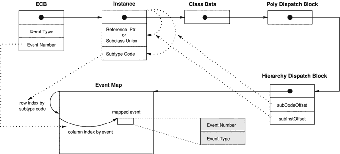

图 9-10. 调度多态事件所使用的数据

图 9-11 说明了一个场景：向已装填鱼雷实例发出多态 `Fire` 事件。

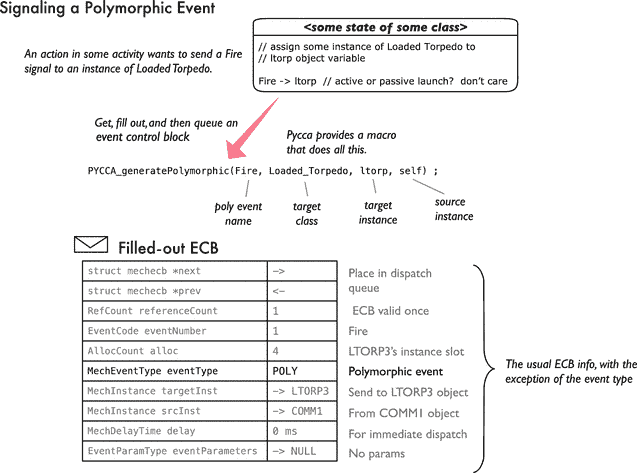

图 9-11. 发出 `Fire` 多态事件

一个 `ECB` 已被填写完毕并加入队列。唯一能将其与任何普通事件 `ECB` 区分开来的元素是`eventType`字段被填写为`PolyEvent`。一旦出队准备调度，就必须找到多态调度块。图 9-12 说明了如何定位 `PDB`。

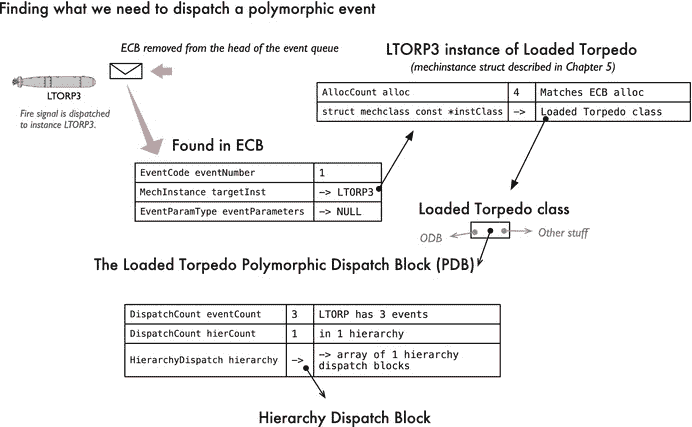

图 9-12. 定位 `PDB`

最后，图 9-13 展示了如何索引多态事件映射以确定要发送哪个普通事件。

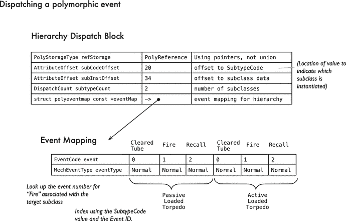

图 9-13. 索引事件映射

回到我们的鱼雷发射示例，以下是 `pycca` 生成的、用于支持 `Torpedo` 和 `Loaded Torpedo` 类多态事件调度的代码：
*   ❶ 这是一个多态事件映射到另一个多态事件的案例。在本例中，是来自 `R1` 的 `Recall` 事件沿着 `R2` 泛化关系向下传播。它映射到 `Loaded Torpedo` 上的一个多态事件，并且映射到 `Stored` 和 `Fired Torpedo` 两个子类上的一个普通事件。
*   ❷ 事件映射（`Torpedo_R1_pem`）中的元素数量始终等于 `PDB`（`Torpedo_pdb`）中的`subtypeCount`值乘以`eventCount`值。
*   ❸ 此处 `PDB` 作为类信息的一部分出现。注意，`Torpedo` 和 `Loaded Torpedo` 都不响应普通事件，因此 `pycca` 将它们的`odb`成员设置为`NULL`。

```c
/*
* 类 "Torpedo" 的 PDB
*/
static struct polyeventmap const Torpedo_R1_pem[] = {
    {.event = 6, .eventType = NormalEvent},
    {.event = 2, .eventType = PolymorphicEvent},             // ❶
    {.event = 6, .eventType = NormalEvent}
} ;
static struct hierarchydispatch const Torpedo_hdb[] = {
    {.refStorage = PolyReference,
     .subCodeOffset = offsetof(struct Torpedo, R1__code),
     .subInstOffset = offsetof(struct Torpedo, R1),
     .subtypeCount = 3,                                       // ❷
     .eventMap = Torpedo_R1_pem}
} ;
static struct polydispatchblock const Torpedo_pdb = {
    .eventCount = 1,
    .hierCount = 1,
    .hierarchy = Torpedo_hdb
} ;
/*
* 类 "Loaded_Torpedo" 的 PDB
*/
static struct polyeventmap const Loaded_Torpedo_R2_pem[] = {
    {.event = 0, .eventType = NormalEvent},
    {.event = 1, .eventType = NormalEvent},
    {.event = 2, .eventType = NormalEvent},
    {.event = 0, .eventType = NormalEvent},
    {.event = 1, .eventType = NormalEvent},
    {.event = 2, .eventType = NormalEvent}
} ;
static struct hierarchydispatch const Loaded_Torpedo_hdb[] = {
    {.refStorage = PolyReference,
     .subCodeOffset = offsetof(struct Loaded_Torpedo, R2__code),
     .subInstOffset = offsetof(struct Loaded_Torpedo, R2),
     .subtypeCount = 2,
     .eventMap = Loaded_Torpedo_R2_pem}
} ;
static struct polydispatchblock const Loaded_Torpedo_pdb = {
    .eventCount = 3,
    .hierCount = 1,
    .hierarchy = Loaded_Torpedo_hdb
} ;
/*
* 类 "Torpedo" 的类结构
*/
static struct mechclass const Torpedo_class = {
    .iab = &Torpedo_iab,
    .odb = NULL,
    .pdb = &Torpedo_pdb                                     // ❸
} ;
/*
* 类 "Loaded_Torpedo" 的类结构
*/
static struct mechclass const Loaded_Torpedo_class = {
    .iab = &Loaded_Torpedo_iab,
    .odb = NULL,
    .pdb = &Loaded_Torpedo_pdb
} ;
```

为了贯彻我们揭示翻译后应用程序运行所有细节的主题，我们展示了执行多态事件调度的代码。此时，`ECB` 已从事件队列中移除，并且已确定必须调度一个多态事件：
*   ❶ 这段地址算术计算了实例结构体中用于存储当前相关子类编码值的成员的位置，并获取该位置的值。例如，如果我们正在向一个 `Torpedo` 实例调度多态事件，此表达式将计算`R1__code`成员的地址，并从该位置获取值。
*   ❷ 此表达式索引到多态事件映射中。由于映射存储为一维数组，我们必须自行进行行/列索引。`eventCount` 告诉我们一行中元素的数量。`Pycca` 确保多态事件映射中的元素以正确的顺序存储，因此此索引表达式能获取到正确的事件映射。

```c
static void
dispatchPolyEvent(
MechEcb ecb)
{
PolyDispatchBlock pdb = ecb->instOrClass.targetInst->instClass->pdb ;
assert(pdb != NULL) ;
assert(ecb->eventNumber eventCount) ;
assert(pdb->hierCount > 0) ;
/*
* 每个从超类型出发的泛化层次结构，都会沿该层次向下生成一个事件，传递至其中一个子类型。
*/
HierarchyDispatch hd = pdb->hierarchy ;
for (unsigned hnum = 0 ; hnum hierCount ; ++hnum) {
/*
* 最常见的情况是沿单一层次结构进行分发。无论如何，我们可以在最后一次分发的事件上就地修改输入的 ECB。
*/
MechEcb newEcb ;
if (hnum == pdb->hierCount - 1) {
newEcb = ecb ;
} else {
newEcb = mechEventAlloc() ;
/*
* 设置源为原始发送者。
*/
newEcb->srcInst = ecb->srcInst ;
/*
* 复制事件参数。
*/
newEcb->eventParameters = ecb->eventParameters ;
}
SubtypeCode type = *(SubtypeCode *)
((char *)ecb->instOrClass.targetInst + hd->subCodeOffset) ; // ❶
assert(type subtypeCount) ;
PolyEventMap pem = hd->eventMap +
(type * pdb->eventCount + ecb->eventNumber) ;               // ❷
#           ifdef MECH_SM_TRACE
/*
* 跟踪状态转换。
*/
tracePolyEvent(ecb->eventNumber, ecb->srcInst,
ecb->instOrClass.targetInst, type, hnum,
pem->event, pem->eventType) ;
#           endif /* MECH_SM_TRACE */
newEcb->eventNumber = pem->event ;
newEcb->eventType = pem->eventType ;
void *subTypeRef = (char *)ecb->instOrClass.targetInst + hd->subInstOffset ;
newEcb->instOrClass.targetInst = hd->refStorage == PolyReference ?
/*
* 当泛化通过指针实现时，我们需要额外一级间接寻址来获取子类型的地址。
*/
*(MechInstance *)subTypeRef :
/*
* 当泛化通过联合体实现时，我们只需指向子类型的地址，因为它包含在超类型中。
*/
(MechInstance)subTypeRef ;
if (newEcb->eventType == NormalEvent) {
newEcb->alloc = newEcb->instOrClass.targetInst->alloc ;
assert(newEcb->alloc != 0) ;
}
mechDispatch(newEcb) ;
++hd ;
}
}
```

再提炼其本质，用于分发多态事件的代码实际上是相当简短的。其大部分“智能”都来源于由`pycca`提供的数据结构的值。

### 总结

本章展示了如何在模型层面规定并实现多态。可以在泛化关系中的超类上定义多态事件。在运行时，发送给超类实例的多态事件会沿泛化层次被分发到子类的状态机中。我们展示了如何向`pycca`规定多态事件，`pycca`生成了哪些数据来支持多态事件分发，以及`ST/MX`域具体如何执行这种事件分发。

所有`xUML`泛化都代表集合划分，而非继承。对于每个超类，恰好存在一个子类实例，并且该实例恰好属于一个子类。

泛化可以相互连接，形成以下几种形式：

* **重复特化**：一个泛化的子类同时是另一个泛化的超类。

* **多重泛化**：单个子类参与多个泛化，每个泛化都有一个超类与之对应。

* **复合泛化**：单个类在多个泛化中扮演超类的角色。

重要的是，多态事件在每种形式中都能得到合理分发。

超类可以委托事件，使得事件由每个子类处理，而不是由超类上的状态模型处理。子类随后可以处理事件，或者，如果它本身也是另一个泛化的超类，则可以进一步委托事件。每个被委托的事件必须在当前层级或更深的特化层级上由子类处理。接收到的事件总是在某个类中处理。

每个多态事件都在超类上定义，并在`pycca`模型脚本中指定。委托给子类的事件可以被该子类使用，就像使用模型脚本中该子类状态机部分的任何其他事件一样。

`pycca`提供了不同的宏来支持带参数和不带参数的多态事件信号的发送。

多态事件的分发处理方式不同，具体取决于泛化是使用联合体模式还是引用代码模式实现的。用于普通事件的事件控制块也用于分发多态事件。关键区别在于，需要引用一个额外的多态分发块来导航泛化的分发层次结构，并识别要处理的相应子类事件。


```
dbres = db_create(&R5db, lube_env, 0) ;
if (dbres != 0) {
handle_error(dbres, "Failed to create R5 index") ;
}
dbres = R5db->set_flags(R5db, DB_DUP | DB_DUPSORT) ;                // ❶
if (dbres != 0) {
handle_error(dbres, "Failed flag setting on R5 index") ;
}
dbres = R5db->open(R5db, NULL, "R5.db", NULL, DB_BTREE, DB_CREATE, 0) ;
if (dbres != 0) {
handle_error(dbres, "Failed to open R5 index") ;
}
```

现在，我们可以将 R5 索引作为辅助索引关联到注入器数据库：
- ❶ `getMachineryID` 函数构建辅助索引的键。

```
dbres = injdb->associate(injdb, NULL, R5db, getMachineryID, 0) ;      // ❶
if (dbres != 0) {
handle_error(dbres, "Failed to associate R5 index to injector") ;
}
```

当 R5 索引记录被添加时，我们必须为记录提供一个键。记录的值部分已经确定：它是关联的主数据库的键部分。R5 索引的键正是关联的`Injector`实例的`Machinery`属性的值：
- ❶ 这里我们将 R5 索引的键值设置为与`Injector`的`Machinery`属性值相同。

```
static int
getMachineryID( DB *R5db,
DBT const *pkey,
DBT const *pdata,
DBT *skey)
{
memset(skey, 0, sizeof(*skey)) ;
skey->data = &((struct Injector *)pdata->data)->Machinery ;        // ❶
skey->size = sizeof(IDvalue) ;
return 0 ;
}
```

要从`Machinery`导航到`Injector`，我们首先在 `Machinery` 数据库上创建一个游标。通过获取游标处的值，我们可以使用`Machinery.ID`作为键来定位 R5 索引中的游标。在我们的示例中，对于`Machinery``M300`，R5 索引中有两条记录可供游标访问。然后将 R5 索引游标连接到 `Injector` 数据库。连接操作会在 `Injector` 数据库中建立一个游标，用于访问 R5 索引中所有记录的`Injector.ID`值，这些记录的键与 R5 索引游标引用的值相同。在我们的示例中，连接产生了一个游标，可用于访问键为 101 和 102 的`Injector`记录。
- ❶ 假设`machcursor`已被设置为引用一个`Machinery`实例。此函数获取当前的`Machinery`实例值。换句话说，我们对游标进行解引用。
- ❷ 在`R5`辅助索引上创建一个游标。
- ❸ 将游标设置在`R5`索引中与`Machinery`实例 ID 匹配的条目开头。
- ❹ 在`R5`游标实例之间进行连接。这将创建一个新游标来访问相关的`Injector`实例。
- ❺ 在第 6 步的迭代中，`Injector`属性被放置到一个局部变量中，以便方便地访问这些属性。
- ❻ 遍历连接游标以访问`Injector`的相关实例。当所有连接记录都被提取后，`get`函数返回非零值。

```
// 设置数据区域以获取 Machinery 实例属性的值。
DBT key ;
memset(&key, 0, sizeof(key)) ;
struct Machinery machinst ;
DBT value ;
memset(&value, 0, sizeof(value)) ;
value.data = &machinst ;
value.size = sizeof(machinst) ;
dbres = machcursor->get(machcursor, &key, &value, DB_CURRENT) ;  // ❶
if (dbres != 0) {
handle_error(dbres, "Failed to set injector cursor") ;
}
DBC *R5cursor = NULL ;
dbres = R5db->cursor(R5db, NULL, &R5cursor, 0) ;                 // ❷
if (dbres != 0) {
handle_error(dbres, "Failed to create R5 cursor") ;
}
memset(&key, 0, sizeof(key)) ;
key.data = &machinst.ID ;
key.size = sizeof(machinst.ID) ;
memset(&value, 0, sizeof(value)) ;
dbres = R5cursor->get(R5cursor, &key, &value, DB_SET) ;           // ❸
if (dbres != 0) {
handle_error(dbres, "Failed to set machinery cursor") ;
}
DBC *joincursors[2] = {
R5cursor,
NULL
} ;
DBC *navcursor = NULL ;
dbres = injdb->join(injdb, joincursors, &navcursor, 0) ;           // ❹
if (dbres != 0) {
handle_error(dbres, "Failed to join across R5") ;
}
memset(&key, 0, sizeof(key)) ;
struct Injector injinst ;                                          // ❺
memset(&value, 0, sizeof(value)) ;
value.data = &injinst ;
value.ulen = sizeof(injinst) ;
value.flags = DB_DBT_USERMEM ;
while ((dbres = navcursor->get(navcursor, &key, &value, 0)) == 0) { // ❻
printf("Injector ID = %u\nMachinery = %u\n", injinst.ID, injinst.Machinery) ;
}
```

## 确保引用完整性

确保引用完整性是我们考虑的最后一个概念。在我们微控制器目标的 ST/MX 中，没有提供在运行时检查实例之间引用完整性的机制。MX 领域假设模型已经正确处理了这一点，并且转换过程不提供额外的保证。这是这类目标常见的权衡。强制实施引用完整性所需的代码和数据量相当大，而部署在此类目标上的应用程序的动态活动量却很小，因此通常的权衡是通过细致的模型审查、模拟和测试来验证引用完整性，而非在运行时验证。

然而，在这个特定的 MX 领域中，我们可以做得更好。Berkeley DB 支持外键索引的概念。在这种安排下，引用属性可以作为辅助索引中的键，然后用于限制记录的添加，除非该记录的键存在于关联的数据库中。这使得我们能够在领域执行时强制实施一种有限形式的引用完整性检查。

回到我们的`Injector`/`Machinery`示例，我们希望确保添加到 `Injector` 数据库的任何记录，其`Injector.Machinery`的值都与 `Machinery` 数据库中`Machinery.ID`的值匹配。我们已经构建了 R5 索引，因此可以将其用作外键索引，发挥另一重作用。如图 10-8 所示。

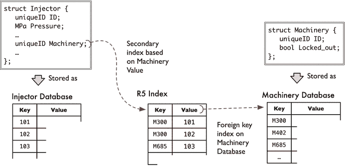

图 10-8. 用于引用完整性的外键索引

每次向 `Injector` 数据库添加一条记录时，Berkeley DB 都会向 R5 索引添加一条记录，就像添加任何辅助索引一样。由于 R5 索引也作为外键索引与 `Machinery` 数据库关联，因此只有当其键值与 `Machinery` 数据库中的某个现有键值匹配时，才会添加该记录。如果在向 R5 索引添加记录时没有匹配项，则插入失败，并且该记录也不会被添加到 `Injector` 数据库。此行为确保了所有 `Injector` 记录引用的 `Machinery` 记录都是存在的。对于删除的记录，也会采取相应的操作。

现在，我们可以将 R5 索引作为外键索引关联到 `Machinery` 数据库：

```markdown
dbres = machdb->associate_foreign(machdb, R5db, NULL, DB_FOREIGN_ABORT) ;
if (dbres != 0) {
handle_error(dbres, "Failed to associate R5 index as foreign key") ;
}
```

在本节中，我们仅对如何在`MX`领域中将`Berkeley DB`用作数据管理组件进行了最简要的概述。显然，要基于这些想法完全开发出一个`MX`领域，还有许多工作要做。所示的代码示例是特定于`Injector`/`Machinery`示例的。在实际的`MX`领域中，代码操作将被泛化以处理领域中的所有类。为了了解泛化数据管理所需的数据，我们将考虑一个处理此处所述想法的平台模型片段。

### 平台模型差异

我们通过`Berkeley DB`管理类数据的方式与将所有数据保存在主内存中的方式大相径庭。对于`ST/MX`，我们舍弃标识符，转而使用指针来存储关系导航所需的信息。`ST/MX`的平台模型反映了这些选择，其类直接与指向类实例的引用相关联。这在第 9 章的平台模型片段中已有展示。

在`Berkeley DB`的示例中，我们决定使用标识符和引用属性来创建键/值数据库、二级索引和外键索引。这种用法恰好映射到了`Berkeley DB`提供的功能上。我们不认为这是巧合。标识符和引用属性的概念是数据关系模型的基础，该模型已有大量研究和数学基础，并在许多场景中被证明是卓有成效的。`Berkeley DB`只是另一个例证。这个例子之所以更有趣，是因为它应用于键/值存储机制的情境中。这两种情况的平台模型差异显著。图 10-9 展示了一个可与使用`Berkeley DB`管理数据的`MX`领域结合使用的平台模型片段。

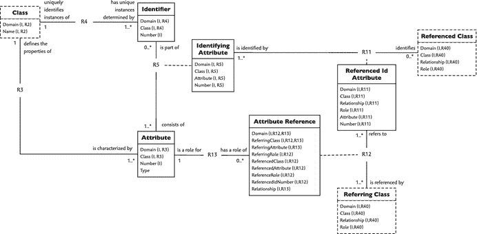

图 10-9.

类标识符和引用的平台模型

我们再次重申，尽管类名如此，但此模型中的类对应的是特定于平台的实体。因此，此模型中的`Class`类是模型级`Class`的特定于平台的对应物。

`R4`关联要求每个`Class`至少有一个`Identifier`。标识符由一个或多个`Attributes`（`R5`）组成。一个`Attribute`可以是多个`Identifier`（甚至不隶属任何`Identifier`）的一部分。这并非不寻常的情况，尽管在此示例中并未出现。以`Injector`/`Machinery`示例为例，表 10-5、10-6 和 10-7 展示了这些平台模型类的填充，分别建立了类、标识符和属性。请注意，我们仅展示了示例片段的填充。对于整个领域，其他类还会有许多其他表行。

表 10-7.

属性填充

| 领域 | 类 | 名称 | 类型 |
| --- | --- | --- | --- |
| Lubrication | Injector | ID | ID |
| Lubrication | Injector | Pressure | MPa |
| Lubrication | Injector | Dissipation_error | bool |
| Lubrication | Injector | Injecting | bool |
| Lubrication | Injector | Default_schedule | ID |
| Lubrication | Injector | Machinery | ID |
| Lubrication | Injector | Reservoir | ID |
| Lubrication | Injector | Model | Name |
| Lubrication | Machinery | ID | ID |
| Lubrication | Machinery | Locked_out | Boolean |

表 10-6.

标识符填充

| 领域 | 名称 | 编号 |
| --- | --- | --- |
| Lubrication | Injector | 1 |
| Lubrication | Machinery | 1 |

表 10-5.

类填充

| 领域 | 名称 |
| --- | --- |
| Lubrication | Injector |
| Lubrication | Machinery |

`Attribute`表的填充为每个类定义 C 结构提供了足够的信息。因此，对于每个`Class`，我们可以定义一个结构，其中成员的命名与`Attribute`类的`Name`属性值相同，而成员对应的数据类型由`Type`属性值给出。

`Identifier`中使用的每个`Attribute`都会产生一个`R5`实例，进而产生一个`Identifying Attribute`实例，如表 10-8 所示。

表 10-8.

标识属性填充

| 领域 | 名称 | 属性 | 编号 |
| --- | --- | --- | --- |
| Lubrication | Injector | ID | 1 |
| Lubrication | Machinery | ID | 1 |

我们可以使用`Identifying Attribute`数据来确定用作`Berkeley DB`数据库键部分、用于存储类实例的属性集合。在此示例中，只有一个单一属性，但该技术可以扩展以处理标识符中的多个属性。这些信息也将用于创建其他标识符所需的任何二级索引。在示例中，每个类只有一个标识符，它被用作存储类实例的数据库的键。其他标识符则会表现为编号（`Number`）属性值，而不是 1。

在示例模型片段中，`Injector`类与`Machinery`类相关联。在此关联中，`Injector`类充当`引用类 (Referring Class)`的角色，而`Machinery`类充当`被引用类 (Referenced Class)`的角色。我们可以区分这些角色，因为正是`Injector`类包含引用`Machinery`类中标识符的引用属性。我们的平台模型将如表 10-9 和表 10-10 所示进行填充。

表 10-10.

被引用类填充

| 领域 | 类 | 关系 | 角色 |
| --- | --- | --- | --- |
| Lubrication | Machinery | R5 | Referenced |

表 10-9.

引用类填充

| 领域 | 类 | 关系 | 角色 |
| --- | --- | --- | --- |
| Lubrication | Injector | R5 | Referring |

当一个`标识属性 (Identifying Attribute)`作为关系中充当`被引用类 (Referenced Class)`角色的类的标识符时，它可能会被引用。每次发生这种情况，都会创建一个`被引用 ID 属性 (Referenced ID Attribute)`实例，如`R11`所示。这个类代表一个被引用的标识符（而不仅仅是作为其类的标识符）。如果你有一个被引用的标识符，那么也存在一个执行引用的引用属性，如`R12`所示。相应的`属性引用 (Attribute Reference)`实例代表引用属性，其值与它所引用的标识属性相同。

对于我们的示例，`属性引用 (Attribute Reference)`和`被引用 ID 属性 (Referenced ID Attribute)`的填充如表 10-11 和表 10-12 所示。

表 10-12.

被引用 ID 属性填充

| 领域 | 类 | 关系 | 角色 | 属性 | 编号 |
| --- | --- | --- | --- | --- | --- |
| Lubrication | Machinery | R5 | Referenced | ID | 1 |

表 10-11.

属性引用填充

| 领域 | 引用类 | 引用属性 | 引用角色 | 被引用类 |
| --- | --- | --- | --- | --- |
| Lubrication | Injector | Machinery | Referring | Machinery |
| 被引用属性 | 被引用角色 | 被引用 ID 编号 | 关系 |   |
| ID | Referenced | 1 | R5 |   |
```

这些表格为我们提供了创建 Berkeley DB 二级索引和外键索引所需的信息。利用`属性引用 (Attribute Reference)`信息，我们必须为每个`关系 (Relationship)`创建一个二级索引。主数据库将是与`引用类 (Referring Class)`属性值（此处为`Injector`）对应的数据库。二级索引的键将是`引用属性 (Referring Attribute)`属性值（此处为`Machinery`）。使用我们的示例值，我们将通过使用`Injector`的`Machinery`属性作为二级索引的键，在`Injector`数据库上创建一个二级索引。这就是我们之前展示的代码序列。这里也有足够的信息来生成为二级数据库提供键的回调函数的代码。在前面的示例中，回调函数被命名为`getMachineryID`。仔细检查这个函数可以发现，类的名称、引用属性的名称以及引用属性的类型都可以参数化以便于代码生成。

利用`Referenced ID Attribute`信息，我们会将为每个关系创建的二级索引关联为数据库的外键索引，该数据库对应`Class`属性（在此例中为`Machinery`）的值。同样，以示例值为例，为`R5`关系创建的二级索引将关联为`Machinery`类的外键索引，因为该类正是被二级索引的键所引用的类。

## 替代 MX 设计讨论

我们简要且不完整地展示了 MX 域如何利用键/值存储来管理域数据，并为支持其他平台提供基础。以此示例为基础，我们可以列举构建翻译技术方法的总体要点：

1.  为待部署的应用类别选择合适的实现技术。实现技术的选择很少是在真空中做出的。大多数项目团队都曾开发过与当前项目类似的系统。即便没有书面记录，他们对于应用所需的规模和合适的计算技术也有清晰的认识。在微控制器上部署在线网店很可能会失败，而在笔记本电脑上部署心脏起搏器同样可能失败。实现选择往往在项目初期（甚至基本需求尚未充分理解时）就已做出。我们怀疑，这种早期且非需求驱动的选择，会混淆那些真正推动项目进展的决策活动。

2.  规划模型层操作如何在 MX 域中实现。某些模型层操作可能直接在实现语言中得到支持。其他操作则需要设计实现语言中的机制或整合预构建组件。模型执行规则在所有情况下都是相同的，不同的是实现方式，以及由此为翻译到 MX 域上的域提供的计算能力。

3.  开发一个平台模型，捕获平台的基本特征，并向 MX 域提供所需数据。平台模型必须能够支持临时查询，因此采用某种基于关系型数据库的实现最为简便。

4.  设计并编写 DSL 来填充平台模型。创建基于语言的解决方案有多种方法。经典的 LALR(1)解析器生成器以`yacc`为代表。还有其他许多解析器生成器，例如[antlr](http://www.antlr.org/)。此外，还有基于解析表达式文法（PEG）的解析器构建技术。DSL 的实现语言应以便利性为准，不必与 MX 域的目标语言相同。

5.  编写代码生成器，生成支持模型执行规则并驱动 MX 域动作的代码和数据。正如我们在第 9 章中提到的，代码生成可以通过模板扩展实现，大多数现代语言都拥有支持基于模板生成输出的库。模板扩展会查询已填充的平台模型以查找所需信息。代码生成器可以成为翻译的独立部分，或者像`pycca`那样，在平台模型填充后立即被调用。

6.  编写 MX 域自身的运行时代码。这些代码将使用代码生成器生成的数据来管理模型数据和执行序列。

我们并不声称这是一个简单的过程，但它可以由个人或小型团队作为独立项目来完成。此外，一个健壮的 MX 域以及将模型翻译到其上的能力，代表了一种具有潜在重用价值的宝贵资源。因此，编写能够生成代码的代码是一项高度杠杆化（尽管有些抽象）的工作。同样可通过本书网站获取的`Rosea`，是此类翻译程序的另一个示例，其目标语言为 Tcl。

请记住，无论采用何种手段和机制来实现，xUML 模型执行规则都是相同的。但只要你能够保证这些规则正确运行，你始终可以自由选择不同的方式来实现它们。目标是生成一个 MX 域及其基于平台模型的代码生成器，使其能够满足你期望部署的应用类别的规模和性能要求，并具备部署系统所需的实现特性。

我们的方法强调首先确定实现中所需的（通常是非功能性的）特性。然后，可以构建一个支持模型执行规则的平台。最后，我们可以将模型的逻辑翻译到该平台上，确保系统既具备执行模型逻辑的手段，又能在现场部署时拥有可接受的性能特性。理想情况下，我们更希望整个工作流程是集成的、自动化的、模块化的且易于使用的。目前我们尚未看到这样的方案，也无法寄望于未来。我们必须基于现有条件开发当前所需的软件系统，并在遇到工程权衡时加以应对。对日益复杂的软件系统的需求将持续加速增长，而实现技术（包括硬件和软件）的种类也将以惊人的速度持续扩展。我们的方法正是在严格保持逻辑与技术分离的同时，利用这些惊人的技术进步，并专注于生产高质量、可工作的软件的一次尝试。

### 总结

我们讨论了`pycca`程序本身的设计与实现。`pycca`被设计成一个语言处理器，它读取 DSL 语句以填充平台模型，并使用查询已填充平台模型的模板系统生成代码。它采用 Tcl 语言实现。

我们给出了 ALS 系统在代表性微控制器平台上的部分规模和执行速度测量结果，以表明最终的内存使用和执行速度适用于我们的目标平台。

最后，我们快速概述了一个基于 Berkeley DB 的目标平台。类实例的持有与访问以及关系导航等模型执行域机制，都被映射到了 Berkeley DB 的功能上。我们展示了如何利用 Berkeley DB 的功能支持有限形式的引用完整性检查。我们还展示了一个平台模型的片段，说明了支持 Berkeley DB 方法代码生成所需的信息。这演示了不同的平台实现方法将如何体现在不同的平台模型中。