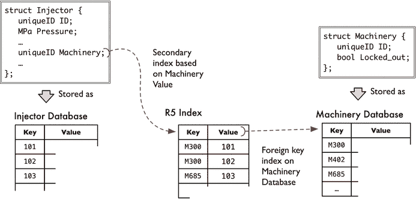
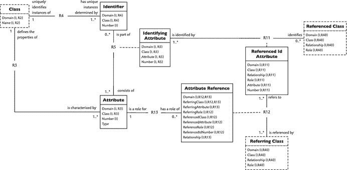

# 排版后的文档

```
dbres = db_create(&R5db, lube_env, 0) ;
if (dbres != 0) {
handle_error(dbres, "Failed to create R5 index") ;
}
dbres = R5db->set_flags(R5db, DB_DUP | DB_DUPSORT) ;                // ❶
if (dbres != 0) {
handle_error(dbres, "Failed flag setting on R5 index") ;
}
dbres = R5db->open(R5db, NULL, "R5.db", NULL, DB_BTREE, DB_CREATE, 0) ;
if (dbres != 0) {
handle_error(dbres, "Failed to open R5 index") ;
}
```

现在，我们可以将 R5 索引作为辅助索引关联到注入器数据库：
- ❶ `getMachineryID` 函数构建辅助索引的键。

```
dbres = injdb->associate(injdb, NULL, R5db, getMachineryID, 0) ;      // ❶
if (dbres != 0) {
handle_error(dbres, "Failed to associate R5 index to injector") ;
}
```

当 R5 索引记录被添加时，我们必须为记录提供一个键。记录的值部分已经确定：它是关联的主数据库的键部分。R5 索引的键正是关联的`Injector`实例的`Machinery`属性的值：
- ❶ 这里我们将 R5 索引的键值设置为与`Injector`的`Machinery`属性值相同。

```
static int
getMachineryID( DB *R5db,
DBT const *pkey,
DBT const *pdata,
DBT *skey)
{
memset(skey, 0, sizeof(*skey)) ;
skey->data = &((struct Injector *)pdata->data)->Machinery ;        // ❶
skey->size = sizeof(IDvalue) ;
return 0 ;
}
```

要从`Machinery`导航到`Injector`，我们首先在 `Machinery` 数据库上创建一个游标。通过获取游标处的值，我们可以使用`Machinery.ID`作为键来定位 R5 索引中的游标。在我们的示例中，对于`Machinery``M300`，R5 索引中有两条记录可供游标访问。然后将 R5 索引游标连接到 `Injector` 数据库。连接操作会在 `Injector` 数据库中建立一个游标，用于访问 R5 索引中所有记录的`Injector.ID`值，这些记录的键与 R5 索引游标引用的值相同。在我们的示例中，连接产生了一个游标，可用于访问键为 101 和 102 的`Injector`记录。
- ❶ 假设`machcursor`已被设置为引用一个`Machinery`实例。此函数获取当前的`Machinery`实例值。换句话说，我们对游标进行解引用。
- ❷ 在`R5`辅助索引上创建一个游标。
- ❸ 将游标设置在`R5`索引中与`Machinery`实例 ID 匹配的条目开头。
- ❹ 在`R5`游标实例之间进行连接。这将创建一个新游标来访问相关的`Injector`实例。
- ❺ 在第 6 步的迭代中，`Injector`属性被放置到一个局部变量中，以便方便地访问这些属性。
- ❻ 遍历连接游标以访问`Injector`的相关实例。当所有连接记录都被提取后，`get`函数返回非零值。

```
// 设置数据区域以获取 Machinery 实例属性的值。
DBT key ;
memset(&key, 0, sizeof(key)) ;
struct Machinery machinst ;
DBT value ;
memset(&value, 0, sizeof(value)) ;
value.data = &machinst ;
value.size = sizeof(machinst) ;
dbres = machcursor->get(machcursor, &key, &value, DB_CURRENT) ;  // ❶
if (dbres != 0) {
handle_error(dbres, "Failed to set injector cursor") ;
}
DBC *R5cursor = NULL ;
dbres = R5db->cursor(R5db, NULL, &R5cursor, 0) ;                 // ❷
if (dbres != 0) {
handle_error(dbres, "Failed to create R5 cursor") ;
}
memset(&key, 0, sizeof(key)) ;
key.data = &machinst.ID ;
key.size = sizeof(machinst.ID) ;
memset(&value, 0, sizeof(value)) ;
dbres = R5cursor->get(R5cursor, &key, &value, DB_SET) ;           // ❸
if (dbres != 0) {
handle_error(dbres, "Failed to set machinery cursor") ;
}
DBC *joincursors[2] = {
R5cursor,
NULL
} ;
DBC *navcursor = NULL ;
dbres = injdb->join(injdb, joincursors, &navcursor, 0) ;           // ❹
if (dbres != 0) {
handle_error(dbres, "Failed to join across R5") ;
}
memset(&key, 0, sizeof(key)) ;
struct Injector injinst ;                                          // ❺
memset(&value, 0, sizeof(value)) ;
value.data = &injinst ;
value.ulen = sizeof(injinst) ;
value.flags = DB_DBT_USERMEM ;
while ((dbres = navcursor->get(navcursor, &key, &value, 0)) == 0) { // ❻
printf("Injector ID = %u\nMachinery = %u\n", injinst.ID, injinst.Machinery) ;
}
```

## 确保引用完整性

确保引用完整性是我们考虑的最后一个概念。在我们微控制器目标的 ST/MX 中，没有提供在运行时检查实例之间引用完整性的机制。MX 领域假设模型已经正确处理了这一点，并且转换过程不提供额外的保证。这是这类目标常见的权衡。强制实施引用完整性所需的代码和数据量相当大，而部署在此类目标上的应用程序的动态活动量却很小，因此通常的权衡是通过细致的模型审查、模拟和测试来验证引用完整性，而非在运行时验证。

然而，在这个特定的 MX 领域中，我们可以做得更好。Berkeley DB 支持外键索引的概念。在这种安排下，引用属性可以作为辅助索引中的键，然后用于限制记录的添加，除非该记录的键存在于关联的数据库中。这使得我们能够在领域执行时强制实施一种有限形式的引用完整性检查。

回到我们的`Injector`/`Machinery`示例，我们希望确保添加到 `Injector` 数据库的任何记录，其`Injector.Machinery`的值都与 `Machinery` 数据库中`Machinery.ID`的值匹配。我们已经构建了 R5 索引，因此可以将其用作外键索引，发挥另一重作用。如图 10-8 所示。



图 10-8. 用于引用完整性的外键索引

每次向 `Injector` 数据库添加一条记录时，Berkeley DB 都会向 R5 索引添加一条记录，就像添加任何辅助索引一样。由于 R5 索引也作为外键索引与 `Machinery` 数据库关联，因此只有当其键值与 `Machinery` 数据库中的某个现有键值匹配时，才会添加该记录。如果在向 R5 索引添加记录时没有匹配项，则插入失败，并且该记录也不会被添加到 `Injector` 数据库。此行为确保了所有 `Injector` 记录引用的 `Machinery` 记录都是存在的。对于删除的记录，也会采取相应的操作。

现在，我们可以将 R5 索引作为外键索引关联到 `Machinery` 数据库：

```markdown
dbres = machdb->associate_foreign(machdb, R5db, NULL, DB_FOREIGN_ABORT) ;
if (dbres != 0) {
handle_error(dbres, "Failed to associate R5 index as foreign key") ;
}
```

在本节中，我们仅对如何在`MX`领域中将`Berkeley DB`用作数据管理组件进行了最简要的概述。显然，要基于这些想法完全开发出一个`MX`领域，还有许多工作要做。所示的代码示例是特定于`Injector`/`Machinery`示例的。在实际的`MX`领域中，代码操作将被泛化以处理领域中的所有类。为了了解泛化数据管理所需的数据，我们将考虑一个处理此处所述想法的平台模型片段。

### 平台模型差异

我们通过`Berkeley DB`管理类数据的方式与将所有数据保存在主内存中的方式大相径庭。对于`ST/MX`，我们舍弃标识符，转而使用指针来存储关系导航所需的信息。`ST/MX`的平台模型反映了这些选择，其类直接与指向类实例的引用相关联。这在第 9 章的平台模型片段中已有展示。

在`Berkeley DB`的示例中，我们决定使用标识符和引用属性来创建键/值数据库、二级索引和外键索引。这种用法恰好映射到了`Berkeley DB`提供的功能上。我们不认为这是巧合。标识符和引用属性的概念是数据关系模型的基础，该模型已有大量研究和数学基础，并在许多场景中被证明是卓有成效的。`Berkeley DB`只是另一个例证。这个例子之所以更有趣，是因为它应用于键/值存储机制的情境中。这两种情况的平台模型差异显著。图 10-9 展示了一个可与使用`Berkeley DB`管理数据的`MX`领域结合使用的平台模型片段。



图 10-9.

类标识符和引用的平台模型

我们再次重申，尽管类名如此，但此模型中的类对应的是特定于平台的实体。因此，此模型中的`Class`类是模型级`Class`的特定于平台的对应物。

`R4`关联要求每个`Class`至少有一个`Identifier`。标识符由一个或多个`Attributes`（`R5`）组成。一个`Attribute`可以是多个`Identifier`（甚至不隶属任何`Identifier`）的一部分。这并非不寻常的情况，尽管在此示例中并未出现。以`Injector`/`Machinery`示例为例，表 10-5、10-6 和 10-7 展示了这些平台模型类的填充，分别建立了类、标识符和属性。请注意，我们仅展示了示例片段的填充。对于整个领域，其他类还会有许多其他表行。

表 10-7.

属性填充

| 领域 | 类 | 名称 | 类型 |
| --- | --- | --- | --- |
| Lubrication | Injector | ID | ID |
| Lubrication | Injector | Pressure | MPa |
| Lubrication | Injector | Dissipation_error | bool |
| Lubrication | Injector | Injecting | bool |
| Lubrication | Injector | Default_schedule | ID |
| Lubrication | Injector | Machinery | ID |
| Lubrication | Injector | Reservoir | ID |
| Lubrication | Injector | Model | Name |
| Lubrication | Machinery | ID | ID |
| Lubrication | Machinery | Locked_out | Boolean |

表 10-6.

标识符填充

| 领域 | 名称 | 编号 |
| --- | --- | --- |
| Lubrication | Injector | 1 |
| Lubrication | Machinery | 1 |

表 10-5.

类填充

| 领域 | 名称 |
| --- | --- |
| Lubrication | Injector |
| Lubrication | Machinery |

`Attribute`表的填充为每个类定义 C 结构提供了足够的信息。因此，对于每个`Class`，我们可以定义一个结构，其中成员的命名与`Attribute`类的`Name`属性值相同，而成员对应的数据类型由`Type`属性值给出。

`Identifier`中使用的每个`Attribute`都会产生一个`R5`实例，进而产生一个`Identifying Attribute`实例，如表 10-8 所示。

表 10-8.

标识属性填充

| 领域 | 名称 | 属性 | 编号 |
| --- | --- | --- | --- |
| Lubrication | Injector | ID | 1 |
| Lubrication | Machinery | ID | 1 |

我们可以使用`Identifying Attribute`数据来确定用作`Berkeley DB`数据库键部分、用于存储类实例的属性集合。在此示例中，只有一个单一属性，但该技术可以扩展以处理标识符中的多个属性。这些信息也将用于创建其他标识符所需的任何二级索引。在示例中，每个类只有一个标识符，它被用作存储类实例的数据库的键。其他标识符则会表现为编号（`Number`）属性值，而不是 1。

在示例模型片段中，`Injector`类与`Machinery`类相关联。在此关联中，`Injector`类充当`引用类 (Referring Class)`的角色，而`Machinery`类充当`被引用类 (Referenced Class)`的角色。我们可以区分这些角色，因为正是`Injector`类包含引用`Machinery`类中标识符的引用属性。我们的平台模型将如表 10-9 和表 10-10 所示进行填充。

表 10-10.

被引用类填充

| 领域 | 类 | 关系 | 角色 |
| --- | --- | --- | --- |
| Lubrication | Machinery | R5 | Referenced |

表 10-9.

引用类填充

| 领域 | 类 | 关系 | 角色 |
| --- | --- | --- | --- |
| Lubrication | Injector | R5 | Referring |

当一个`标识属性 (Identifying Attribute)`作为关系中充当`被引用类 (Referenced Class)`角色的类的标识符时，它可能会被引用。每次发生这种情况，都会创建一个`被引用 ID 属性 (Referenced ID Attribute)`实例，如`R11`所示。这个类代表一个被引用的标识符（而不仅仅是作为其类的标识符）。如果你有一个被引用的标识符，那么也存在一个执行引用的引用属性，如`R12`所示。相应的`属性引用 (Attribute Reference)`实例代表引用属性，其值与它所引用的标识属性相同。

对于我们的示例，`属性引用 (Attribute Reference)`和`被引用 ID 属性 (Referenced ID Attribute)`的填充如表 10-11 和表 10-12 所示。

表 10-12.

被引用 ID 属性填充

| 领域 | 类 | 关系 | 角色 | 属性 | 编号 |
| --- | --- | --- | --- | --- | --- |
| Lubrication | Machinery | R5 | Referenced | ID | 1 |

表 10-11.

属性引用填充

| 领域 | 引用类 | 引用属性 | 引用角色 | 被引用类 |
| --- | --- | --- | --- | --- |
| Lubrication | Injector | Machinery | Referring | Machinery |
| 被引用属性 | 被引用角色 | 被引用 ID 编号 | 关系 |   |
| ID | Referenced | 1 | R5 |   |
```

这些表格为我们提供了创建 Berkeley DB 二级索引和外键索引所需的信息。利用`属性引用 (Attribute Reference)`信息，我们必须为每个`关系 (Relationship)`创建一个二级索引。主数据库将是与`引用类 (Referring Class)`属性值（此处为`Injector`）对应的数据库。二级索引的键将是`引用属性 (Referring Attribute)`属性值（此处为`Machinery`）。使用我们的示例值，我们将通过使用`Injector`的`Machinery`属性作为二级索引的键，在`Injector`数据库上创建一个二级索引。这就是我们之前展示的代码序列。这里也有足够的信息来生成为二级数据库提供键的回调函数的代码。在前面的示例中，回调函数被命名为`getMachineryID`。仔细检查这个函数可以发现，类的名称、引用属性的名称以及引用属性的类型都可以参数化以便于代码生成。

利用`Referenced ID Attribute`信息，我们会将为每个关系创建的二级索引关联为数据库的外键索引，该数据库对应`Class`属性（在此例中为`Machinery`）的值。同样，以示例值为例，为`R5`关系创建的二级索引将关联为`Machinery`类的外键索引，因为该类正是被二级索引的键所引用的类。

## 替代 MX 设计讨论

我们简要且不完整地展示了 MX 域如何利用键/值存储来管理域数据，并为支持其他平台提供基础。以此示例为基础，我们可以列举构建翻译技术方法的总体要点：

1.  为待部署的应用类别选择合适的实现技术。实现技术的选择很少是在真空中做出的。大多数项目团队都曾开发过与当前项目类似的系统。即便没有书面记录，他们对于应用所需的规模和合适的计算技术也有清晰的认识。在微控制器上部署在线网店很可能会失败，而在笔记本电脑上部署心脏起搏器同样可能失败。实现选择往往在项目初期（甚至基本需求尚未充分理解时）就已做出。我们怀疑，这种早期且非需求驱动的选择，会混淆那些真正推动项目进展的决策活动。

2.  规划模型层操作如何在 MX 域中实现。某些模型层操作可能直接在实现语言中得到支持。其他操作则需要设计实现语言中的机制或整合预构建组件。模型执行规则在所有情况下都是相同的，不同的是实现方式，以及由此为翻译到 MX 域上的域提供的计算能力。

3.  开发一个平台模型，捕获平台的基本特征，并向 MX 域提供所需数据。平台模型必须能够支持临时查询，因此采用某种基于关系型数据库的实现最为简便。

4.  设计并编写 DSL 来填充平台模型。创建基于语言的解决方案有多种方法。经典的 LALR(1)解析器生成器以`yacc`为代表。还有其他许多解析器生成器，例如[antlr](http://www.antlr.org/)。此外，还有基于解析表达式文法（PEG）的解析器构建技术。DSL 的实现语言应以便利性为准，不必与 MX 域的目标语言相同。

5.  编写代码生成器，生成支持模型执行规则并驱动 MX 域动作的代码和数据。正如我们在第 9 章中提到的，代码生成可以通过模板扩展实现，大多数现代语言都拥有支持基于模板生成输出的库。模板扩展会查询已填充的平台模型以查找所需信息。代码生成器可以成为翻译的独立部分，或者像`pycca`那样，在平台模型填充后立即被调用。

6.  编写 MX 域自身的运行时代码。这些代码将使用代码生成器生成的数据来管理模型数据和执行序列。

我们并不声称这是一个简单的过程，但它可以由个人或小型团队作为独立项目来完成。此外，一个健壮的 MX 域以及将模型翻译到其上的能力，代表了一种具有潜在重用价值的宝贵资源。因此，编写能够生成代码的代码是一项高度杠杆化（尽管有些抽象）的工作。同样可通过本书网站获取的`Rosea`，是此类翻译程序的另一个示例，其目标语言为 Tcl。

请记住，无论采用何种手段和机制来实现，xUML 模型执行规则都是相同的。但只要你能够保证这些规则正确运行，你始终可以自由选择不同的方式来实现它们。目标是生成一个 MX 域及其基于平台模型的代码生成器，使其能够满足你期望部署的应用类别的规模和性能要求，并具备部署系统所需的实现特性。

我们的方法强调首先确定实现中所需的（通常是非功能性的）特性。然后，可以构建一个支持模型执行规则的平台。最后，我们可以将模型的逻辑翻译到该平台上，确保系统既具备执行模型逻辑的手段，又能在现场部署时拥有可接受的性能特性。理想情况下，我们更希望整个工作流程是集成的、自动化的、模块化的且易于使用的。目前我们尚未看到这样的方案，也无法寄望于未来。我们必须基于现有条件开发当前所需的软件系统，并在遇到工程权衡时加以应对。对日益复杂的软件系统的需求将持续加速增长，而实现技术（包括硬件和软件）的种类也将以惊人的速度持续扩展。我们的方法正是在严格保持逻辑与技术分离的同时，利用这些惊人的技术进步，并专注于生产高质量、可工作的软件的一次尝试。

### 总结

我们讨论了`pycca`程序本身的设计与实现。`pycca`被设计成一个语言处理器，它读取 DSL 语句以填充平台模型，并使用查询已填充平台模型的模板系统生成代码。它采用 Tcl 语言实现。

我们给出了 ALS 系统在代表性微控制器平台上的部分规模和执行速度测量结果，以表明最终的内存使用和执行速度适用于我们的目标平台。

最后，我们快速概述了一个基于 Berkeley DB 的目标平台。类实例的持有与访问以及关系导航等模型执行域机制，都被映射到了 Berkeley DB 的功能上。我们展示了如何利用 Berkeley DB 的功能支持有限形式的引用完整性检查。我们还展示了一个平台模型的片段，说明了支持 Berkeley DB 方法代码生成所需的信息。这演示了不同的平台实现方法将如何体现在不同的平台模型中。