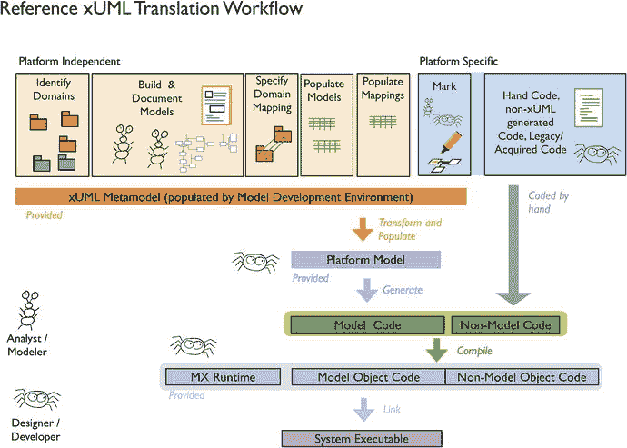
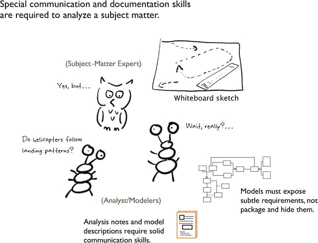
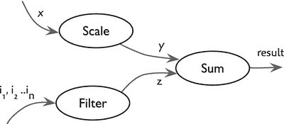
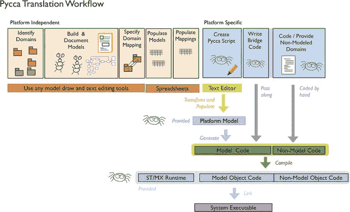

# 11. 翻译领域面面观

在本书中，我们通过一系列示例展示了如何将可执行模型无损地翻译为可运行程序。我们的翻译技术是从模型获取代码的一种方法。我们既不宣称它是翻译模型的唯一途径，也不宣称它是最佳翻译方式。我们所呈现的技术，与所有软件工程流程一样，既有优势也有缺陷。但我们通过翻译可执行模型，成功生成了满足目标平台约束的可运行代码，这实现了我们的目标。我们认为这很重要，因为引用《敏捷宣言》¹中的一段话：

> 我们逐渐体会到：个体和互动高于流程和工具，可工作的软件高于详尽的文档。

根据我们的经验，那些号称全面的工具并不全面，也无法替代个人的工程技能。而且，无论可执行模型多么深刻地捕捉了领域逻辑，建模都是软件开发中必要但不充分的步骤。我们确实重视工具、开发流程和文档完善的模型，但本着《敏捷宣言》的价值观，我们首要追求的是由技能娴熟的个体开发出的高质量、可工作的软件。

在本章中，我们将从更广阔的视角审视模型翻译，并探讨在一般情况下如何实现这一过程。我们首先介绍一个参考翻译工作流。借助这个参考工作流，我们讨论翻译路径中遇到的一些困难。然后展示 `pycca` 与参考工作流的对比。最后，讨论我们的翻译方法如何应用于其他目标平台。

## xUML 翻译的参考工作流

图 11-1 概览了将 xUML 模型翻译为代码所需的任务和工件。该图旨在说明任何 xUML 翻译系统中都必须以某种形式存在的所有关键要素。我们所描述的 `pycca` 方法是朝这个理想化工作流迈出的一步。在本章后面，我们将展示 `pycca` 方法如何融入这个更广阔的背景。



图 11-1. 参考翻译工作流

图表顶部被划分为平台无关区域和平台特定区域。在平台无关区域内从左到右，我们有一系列建模任务，对于系统的给定迭代，这些任务按指示顺序完成。我们并非暗示只有一次迭代。我们倡导用敏捷方法进行系统开发，但也仔细区分技术流程和项目管理流程。每次通过平台无关区域的迭代都会交付一个内部一致、完全可执行的建模版本系统。每次迭代的频率和内容、项目团队成员如何分配到任务、以及如何使用每次迭代的结果来征求反馈和附加需求，这些都是项目管理流程的一部分。这些是任何实际项目的重要方面，但每个项目都必须自行规划。这里的讨论严格侧重于工作流的技术层面。

跳到平台特定区域的最右侧，是需要手动编写、从第三方获取、先前已存在或从非 xUML 模型生成的代码。在需求已知的范围内，非 xUML 代码可以与 xUML 建模轨道并行开发。

当领域模型的一个一致片段完成后，必须执行剩余的 `Mark` 任务。在此，出于代码生成期间性能原因的考虑，那些值得特别关注的建模组件会被标注。例如，你可以指明哪些类具有大型或小型实例群，以便生成合适的代码——假设目标平台模型提供了区分这些情况的功能。

以上涵盖了图表的顶部。现在让我们向下移动。随着模型的创建和编辑，它们被存储在模型仓库中。这个仓库是 xUML 元模型的一种实现。因此，领域模型和所有已填充的实例本身构成了元模型的实例群。

模型标记也可以存储在仓库中。这不会损害模型的平台无关性，因为标记作为与模型交叉引用的注释被存储。因此，模型仓库将允许多组标记（可能针对不同平台）与同一领域模型关联。

平台模型定义了 xUML 模型元素被打包和重组以在目标平台上高效执行的方式。它由一个程序填充，该程序将 xUML 模型元素转换为平台模型的相应元素。平台模型、其填充/转换程序以及编译后的 MX 运行时构成了针对特定平台类别的核心"模型到代码"解决方案。

现在，平台模型已经根据从模型仓库中提取的标记化 xUML 模型完成了填充。从这里，可以生成目标编程语言的代码。然后，这段代码与 non-xUML 代码一起编译，生成一组目标文件。这些目标文件与 MX 运行时链接在一起，生成一个完整的系统可执行文件。

你可能还记得，MX 运行时是知道如何分发事件、进行状态转换、导航关系以及执行 xUML 模型的那段代码。

总结一下，要启用代码生成，必须提供以下组件：
* 一个平台模型
* 一个从 xUML 模型填充平台模型的程序
* 一个根据平台模型实例群以目标编程语言生成代码的程序
* 一个模型执行运行时模块

## 关键挑战

参考工作流描绘了一幅理想化的图景，展示了构建模型并从中生成代码所需的主要元素。它仅仅部分反映了当今基于模型的系统实际构建方式。不幸的是，许多组织被基于模型的软件工程（MBSE）的理想所裹挟，投入昂贵且可能具有约束性的模型开发工作流。由于缺乏先前经验，项目团队会直接购买模型绘制工具并开始画图，因为模型图是工作流的关键产物。然而，建模的核心在于用逻辑解决问题，而图仅仅是捕捉问题解决方案的一种形式，它能直接为生成软件解决方案做出贡献。在项目后期，理论与实践往往会在令人失望的昂贵代价中相撞。结果便是，通过采用第 1 章讨论的某种方法（即渐进式或突变式）来填补图与代码之间的鸿沟，而这两种方法都无法从建模中获得太多益处。

经验不足的项目团队应寻求培训支持，以带领团队掌握这种本质上不同的软件构建方式。然而，很难说服那些已使用传统技术成功构建软件的项目团队，让他们相信建模与转换需要他们可能尚未掌握的技能和思维过程，并且在建模工具中操作图并不能赋予他们这些技能。在本节中，我们将为您指出一些此类棘手的现实问题。在审视转换工作流的每个阶段时，我们会指出我们在多年基于模型的开发中遇到的常见困难与挑战。

我们并非暗示，仅仅因为实践中存在困难，建模与转换就是一种不成熟或不可行的开发方法。许多项目团队通过使用建模与转换，成功构建了高质量系统。我们完全可以轻易列举出传统软件开发技术中更长的一系列问题。我们故意没有这样做，因为互联网站点上记录的关于真实程序中的可怕问题比我们能在此详述的更为全面，而且指出其他方法中的问题并不能解决我们当前面临的关切。软件开发方法与其他复杂的人类活动一样，也会受到短暂技术潮流的影响。我们不会沉迷于那种试图让您相信一切一帆风顺的盲目乐观主义。我们并不认为存在能杀死软件狼人的银弹。（参见小弗雷德里克·P·布鲁克斯的论文《没有银弹——软件工程中的本质与意外》及《银弹再探》。）建模与转换代表了在与这一猛兽搏斗过程中取得的切实、实际的进步。但预警即是武装，我们希望我们对当前建模与转换实践中的担忧与挫败感，能帮助一些项目团队免于陷入自身的失望。

### 识别领域

开发软件系统的第一步是识别所有必需的领域。出于转换的目的，我们关注哪些领域被建模，哪些领域以代码形式提供。以代码形式提供的领域可以是手工编写的、从第三方获取的、作为遗留代码或现有库存在的，或是用非 xUML 语言从模型生成的。最终，会生成一个称为领域图的图表，它列出了所有领域及其依赖关系。

这一步的关键挑战在于正确划分领域。这不是一个可以靠工具解决的问题。你需要经验、技能以及思考问题的正确方法。

在划分大型系统时，很容易依赖熟悉平台技术（如库、任务和硬件边界）这根“拐杖”。这些边界实在太具体了！但经验丰富的开发者知道技术总是在变化，具体性与脆弱性往往相伴而生。“别担心，硬件设计已经冻结了……”没错。更重要的是，基于特定平台的分割会产生特定平台的模型，这违背了建模的许多初衷。

即使成功忽略了平台边界，将系统按功能类别而非主题类别划分也是很常见的。这种错误使得开发稳固的类模型变得困难，而类模型正是每个领域的基础。至于那些与管理或政治相关的非工程性边界，我们甚至不必提及。

以下是一些可能有帮助的指导原则。对于任何候选的领域图，请考虑这两个问题：

1. 如果平台技术发生变化，领域图会在任何方面改变吗？它不应该改变。例如，如果你有两个 CPU 而不是一个，会怎样？如果你使用了任务和线程，会怎样？如果你在分布式平台上运行系统，会怎样？

2. 是否存在任何类必须同时存在于一个或多个领域中？不应该存在。一个主题由一组类及其关系构成的词汇来定义。这种基于类而非基于功能的划分要求每个类只存在于一个领域中。在 ALS 中，喷射器压力“存在于”SIO 和 Lubrication 两个领域中；然而，它在每个领域中的含义完全不同。在 SIO 中，压力并没有什么特殊之处；它只是来自输入点、需要缩放和转换的数据。但在 Lubrication 领域，压力就是真正的压力，而采集和转换的技术在这里并不重要。同样，`Injector` 类只存在于 `Lubrication` 领域。例如，如果我们把 `Lubrication` 领域划分为正常喷射功能和诊断喷射功能，那么每个功能都需要共享 `Injector` 类。

回顾第 6 章中的 ALS 领域图。它完全是平台无关的。你可以像我们用 `pycca` 所做的那样，将所有领域放在一个任务中，或者将它们分散到多个处理器或线程中。软件部署到的硬件对领域图本身没有影响。请注意，领域是由它们所*知道*的内容来定义的，而不是由它们所*做*的事情来定义的。`Lubrication` 领域了解润滑设备以及润滑的工作原理。它对报警的系统处理一无所知，对信号处理一无所知，对用户界面技术也一无所知。`Lubrication` 领域中的所有功能都源于它对设备必须如何被润滑的了解。`SIO` 领域了解信号和执行器，但不对信号中的数据或对外部世界的控制赋予任何特定含义。

最终，测试领域图的最佳方法是，在每个建模领域内部构建一定比例的类模型，作为验证练习。在此过程中，通常需要重新思考划分方式，并最终重构领域图。例如，如果您在第一轮中没有将信号 I/O 识别为一个领域，您可能会发现润滑的状态模型变得过于复杂，需要不断轮询新数据。每个具有传感器驱动属性的物理设备都需要复制相同的轮询或事件响应模式。当您在某个领域内的多个状态机中看到相同的千篇一律的模式时，这通常是一个信号，表明缺少某个服务领域，或者需要进行某种领域重构。

通常情况下，编码领域或非 `xUML` 领域作为领域来说并不完整，需要某种包装器，该包装器可能被建模也可能不被建模。因此，在这些领域中可能需要进行额外的建模，并且这些领域必须与提供的代码进行接口。

## 构建并记录模型

对于在 `xUML` 中建模的每个领域，一位或多位分析师会与领域专家合作，对该领域相关的任何主题进行建模。图 11-2 阐释了这一概念。



图 11-2. 合适的人才是成功建模的关键。

此阶段面临的挑战之多，足以写成一整本书——《可执行 UML：如何构建类模型》，作者 Leon Starr (Prentice-Hall, 2001)——但以下是其中最重要的几点：

* 让合适的人才协同工作。
* 高效地输入和编辑模型。
* 有效地记录分析与模型。

### 使用合适的建模人才

构建模型需要三种不同的人才：分析能力、建模能力和领域专业知识。这三种能力很少能集中在同一个人身上并达到足够高的水平，因此通常需要组建团队来协作完成。大多数项目犯的第一个错误就是随便抓来一群程序员，只是因为这些人碰巧有空，就把他们分配到建模工作中。这是一个错误，因为大多数程序员缺乏构建模型所需的适当技能、知识或意愿。

分析能力是指能够就某个主题提出问题，并能够书写、绘制或以其他方式描述该主题。这需要良好的沟通技巧。分析师总是试图分解问题，并找出那些几乎从不发生，但一旦发生就必须正确处理的有趣案例。分析师必须具备扎实的沟通和演示技巧，以获取专家的反馈。最重要的是，分析师必须摒弃对某个主题的成见，并习惯性地暴露自己对某个话题的无知，以便从领域专家那里获取精妙的细节。这些并不是程序员通常培养的技能。程序员喜欢带着现成的模式和库来到工作现场，随时准备编写代码。

建模能力是指能够将分析结果以客观、可验证的方式形式化。这需要具备将平台无关的构建块（如类、关系、状态等）组合在一起的技能。这听起来有点像编程，但有一个关键区别。程序员总是在想方设法巧妙地封装事物，使其高效运行；而建模者通常是在拆解思想，以揭示关键且细微的差异。建模者关注效率，其含义是：一个思想应尽可能简单、尽可能清晰地表达，同时又能处理分析过程中发现的所有细微情况。程序员常常为程序中元素越少越好而感到自豪，一路上都在进行封装和隐藏；而分析师则为拆解和暴露复杂性而感到自豪。那个揭示了被忽视情况的额外类、属性或关系，是分析师的骄傲之源。

最后，领域专家不需要了解任何建模知识。他们只需要精通自己的领域，并且有意愿和时间向分析师/建模者解释清楚。当然，如果他们能读懂模型以确认自己的理解是否正确，那也不无裨益。

在实际项目中，这三种技能会以重叠组合的方式分布在不同的个体身上。关键是让这三种技能集都足够充分地汇聚在一起，以确保模型构建正确。将一位优秀分析师与一位优秀建模者配对，并让他们能够接触到至少一位领域专家，通常会取得最佳效果。

### 高效地输入和编辑模型

在模型开发过程中，理想的做法是将它们输入到图形编辑器中。编辑器将非图形化的模型信息存储在存储库中。为了使模型信息能够以有用的方式提供给下游工具（例如代码生成工具），存储库的设计应基于 `xUML` 元模型。

那么，画框框和箭头能有多难呢？根据目前市面上的模型编辑工具来看，结果出人意料地困难且痛苦。要想理解我们的意思，不妨将输入和编辑图形模型的任务与你最喜欢的编辑器里编写代码的任务比较一下。如今的程序员对代码编辑器期望很高。自动补全、重构、展开/折叠、搜索/替换、文档查找、语法检查、关键字高亮和可视化差异等功能，使程序员能够在一个庞大而复杂的代码库中敏捷地操作。程序员所体验的生产力，与使用图形编辑器的建模者完全不在一个量级上。

比如，比较一下文本布局和图形布局。程序员可以毫不费力地进行缩进、闭合花括号、展开和折叠函数块；而建模者却只能笨拙地拖动矩形和箭头，努力点击连接点，并将文本标签向左或向右移动几个像素。光是看着一个大模型被重新排列，你就会得腕管综合征。

公平地说，一些图形编辑器减轻了部分调整像素的苦差事，并执行了不同程度的自动布局。不幸的是，几何算法仍然相当简单，导致布局笨拙。这听起来可能像是在吹毛求疵，但几何布局对有经验的建模者来说，其重要性丝毫不亚于文本布局对程序员的重要性。想象一下，如果程序员面对一个缩进和换行规则怪异、左右括号随意散落的编辑器，该是何等愤怒。有经验的程序员非常注重代码的组织方式。有经验的建模者也不例外。

与翻译更相关的是非图形化模型数据的存储。许多工具将这些信息存储在使用某种交换格式的文件中，或者存储在数据库中，或者两者兼有。我们关心的是数据的组织方式。理想情况下，数据库的组织结构或文件格式的定义应该直接源自对可执行语言（元模型）的建模。我们使用的语言是 `xUML`。大多数模型编辑器使用的是 `UML` 标准，它带来了许多我们并不需要的东西。有一个用于模型交换的标准叫做 `XMI`。但同样，它的目的是支持完整的 `UML` 标准，因此充满了大量我们不需要的内容。我们更倾向于将模型级数据置于一种我们可以直接操作的常用实现形式中，例如关系数据库的实例集。我们真正需要的是一个使用 `xUML` 元模型作为模型存储基础的工具。

与此同时，建模者该怎么办呢？这完全取决于你是采用类似 `pycca` 的方法，还是使用一个全面的绘图工具/翻译环境。在 `pycca` 的情况下，你无论如何都要手动编码你的翻译决策。这里你需要一个模型编辑器，它能让你很好地指定 `xUML` 元素，比如关联上的动词短语、标识符和引用属性标签。你需要的是一个不会过于自作聪明、也不会阻止你按自己期望的方式来绘制模型的工具。`Umlet`、`OmniGraffle`、`Visio` 和 `DrawExpress` 是一些可选方案。这些工具都不存储任何模型语义，但如果你要手动转为文本，这也没关系。另一方面，如果你使用的是像 `BridgePoint` 这样的工具，你就别无选择了。你必须忍受它自带的模型编辑器，无论它有多么缺陷和瑕疵。

### 为模型编写有用的文档

模型本身不会自述文档（代码也一样，尽管有些程序员声称并非如此）。它们确实以排除了实现方面的形式化方式暴露了应用逻辑。但这些逻辑背后的推理是什么？为什么这个类或属性是必要的？为什么关系`R3`在多端是无条件的？这些“为什么”需要被清晰地解答。

要使模型有用，它必须得到充分文档化。事实上，我们更进一步认为，好的模型描述比模型图形更重要。只有在描述中，才能解释模型的抽象基础。模型图形以信息密集的形式呈现模型，但这是通过使用类名、属性名和关系短语等助记符来实现的。模型中的名称使用常见的自然语言词汇，需要额外的解释才能赋予它们为构建模型主题精确词汇所需的含义。助记符的精确含义仅包含在描述中，这些描述需要文本和非正式图表。如果没有模型术语的精确含义，模型阅读者只会根据他们对模型图中使用的自然语言词汇的理解，将自己的概念套用到模型上。由于自然语言对精确含义非常依赖于上下文，混淆通常是最终结果。

有用的文档远不止于简短的文本描述。它还包括大量分析笔记、白板讨论的记录、非正式（非模型）草图、数学公式以及构建模型过程中开发的其他支持性技术笔记。没有真实世界的上下文，模型会迅速丧失其价值。如果没有包含、集成和维护充分的文档，那么一开始去建模就没什么意义了。

不幸的是，图形化模型编辑器倾向于为各种模型元素附加类似表单填写方式的插槽。这乍听起来很合理。但在实践中，这会导致模型文档质量降低。建模者往往会机械地填写这些插槽，而不考虑整体大局。项目开发规则常常强化这种倾向，要求像填宾果卡一样填满每个插槽，结果对内容漠不关心。描述往往只是复述图上已经显而易见的内容。根据我们的经验，非正式的非模型图表是优秀模型描述的关键要素。但大多数工具只支持或只接受文本。最后，人们很容易只看图表而忽略其背后的文档，或者删除模型元素时无意中丢弃大量描述文字。诚然，编写好的模型文档是项艰苦的工作，但它是长期知识库的基础；它是宝贵知识产权，对于培训项目团队成员至关重要，也是未来维护的基础。

思考一下实践中出现的两种处理代码文档的截然不同的方法是有帮助的。在一种方法中，文档以风格化的注释形式直接放入源代码文件中，并使用软件工具来提取和格式化文档。由唐纳德·克努斯引入的文学化编程概念则持相反观点。在文学化编程中，源代码被放入文档中，并使用软件工具从文档中提取和重组代码。这两种技术都可以用来生成良好的文档。我们更倾向于文学化编程方法，因为它为呈现顺序以及包含支持材料提供了更大的灵活性。本书补充材料中提供的详细示例就是文学化程序。

我们使用主要面向生成高质量文档的工具来开发我们的模型，并将模型图形作为该描述中的另一张图表导入。我们并非想暗示我们认为模型图形无用。它非常有用，但只有与模型描述中详细阐述的背景和抽象相结合时才能发挥作用。

## 指定领域映射

在`xUML`中，领域图上两个领域之间的依赖关系被称为桥梁。箭头尾部的领域充当客户端角色，箭头指向的领域则充当服务角色。箭头的方向仅表示一个领域的存在是为了满足另一个领域的需求。例如，在第 6 章的 ALS 领域图中，`润滑`领域需要某种与物理世界交互的方式，而这一需求由`SIO`领域来满足。

领域图并未说明桥梁上交换哪些数据和交互。此外，一个领域的模型在设计时无需知晓其他领域的任何特定模型结构。这种领域级封装的概念是`xUML`中一个关键的组织原则。尽管如此，一个领域的某些模型元素会在每个连接的桥梁上拥有对应的元素。这些元素必须以某种方式映射在一起，同时避免任何一个领域内部因了解其他领域的模型内容而变得混乱。

我们演示的桥接技术基于显式调用外部实体上的操作。回顾第 6 章中的`润滑`领域，当一个`注射器`开始施加润滑剂时，它会显式调用`SIO`外部实体的`注入`操作。`开始注射`状态的活动清楚地表明，在模型执行的精确节点上，它将物理注射过程委托了出去。

在某些情况下，在模型动作语言中散布外部实体调用会削弱模型的意图，并阻碍其复用潜力。考虑第 6 章中的`储液罐`状态模型。每个状态活动都显式调用了`警报`外部实体，以反映`储液罐`的状态。这些动作的意图是标记`储液罐`的状态，并在关键边界条件（即当情况为`正常`或`储液罐`为`空`时）向领域内的其他实例发出信号。ALS 系统需要在`储液罐`生命周期的这些关键节点发出警报，但`警报`实体的调用具有侵入性，且与`储液罐`类的本质无关。此外，什么情况值得触发警报也容易受到大量需求变更的影响。项目往往从“一切皆报警”的概念开始，最终却发现海量的信息无法转化为实际行动。

我们希望能在状态活动的动作语言之外，指定如何通知`警报`实体。我们想要表达的是：在`储液罐`类的`低`状态活动执行完毕后，应在`警报`实体上调用`设置润滑液位低`操作。`低`状态活动的动作语言将不再包含对`设置润滑液位低`的显式调用，翻译机制会根据我们的规范来安排对`警报`的调用。

这种类型的桥接安排称为`隐式桥接`。其理念与面向方面编程（AOP）的概念有很多共同之处。AOP 有一套完整的术语来描述这种方法，此处不予讨论。

隐式桥接旨在通过至少移除部分显式的外部实体交互，来降低领域之间的耦合度。通过在指定外部实体操作调用位置时提供一个间接层，`润滑`领域的复用潜力得以增强，因为对`警报`领域的依赖不再被显式编码在领域动作中。对`警报`操作的调用也可以应用于其他在构建时并未考虑任何警报概念的领域。

我们认为定义领域间显式或隐式桥梁的过程是相同的。标记、映射和填充桥梁仍然是必要的。不同之处在于，隐式桥接使用状态活动动作语言之外的手段来指定何时调用桥梁操作。指定桥梁操作的隐式方式也是相对于通用（元模型）实体来完成的。在此例中，我们指定了相对于状态转换的`警报`交互。其他模型级元素也是候选对象，例如创建或删除类实例，或发送信号事件。

遗憾的是，我们尚未看到有实质性的工具支持桥梁的映射和填充。显式桥梁操作是存在的，但我们未发现任何对隐式桥接的支持。这对模型翻译过程来说是一个尚未克服的重大复杂性。我们在第 8 章中演示过，尽管缺乏完整的理论，但仅使用电子表格应用程序，仍有条不紊地处理桥接方法是可能的。

## 填充模型实例

在开发模型时，用真实实例来记录场景是很常见的做法。例如，第 2 章中介绍的空中交通管制员示意图，或第 6 章中展示的润滑配置图，都是非常典型的例子。

一旦模型的某次迭代完成，为其构建初始实例集就很有帮助。实际上，你通常会为不同的场景创建多个实例集。在 ALS 示例中，你可以先创建一两个用于测试的实例集，然后再创建两三个用于预期的真实 ALS 配置。通过精心选择影响活动执行路径的属性数据值，可以构建出能强制追踪到更广泛执行路径的测试实例集，这比直接用于部署的实例集效果更好。

工具往往侧重于模型的开发，而将实例集视为事后补充。很少有工具能提供完善的功能来指定初始实例集。我们再次建议：将实例集放在电子表格中。我们之前展示的示例只有少量初始实例。当初始实例数量很少时，几乎任何处理策略都能奏效。然而，随着数量的增长，管理这些实例集就变得越来越困难。

我们认为，初始实例集应完全由模型类的属性值来定义。在我们的示例中，所有模型级别的初始实例集描述都是通过将类视为一个表格，并将实例指定为值行的形式来完成的。相比之下，我们不喜欢那种需要通过编写动作语言来显式创建类实例并赋值的方式。这种方法不仅繁琐且容易出错，扩展性也不好。更糟的是，由于许多属性被赋予相同的值，很容易让人忍不住使用动作语言变量来保存重复的值。这些变量的值在运行时会发生改变，与显式的属性值不同，它们很难通过简单的检查进行验证。

动作语言方式的另一个问题是，它排除了非建模人员提供初始化数据的可能性。设想一个电力公用事业控制系统，它需要大量数据来描述输电线路、变电站、变压器以及其他配电设备。控制系统将利用输电规范数据所隐含的连接关系来路由和管理电力分配。负责更新和管理配电网拓扑结构的公用事业工作人员，也是获取正确实例集数值的主要来源。在这种规模下，数据库管理系统至关重要，因此翻译工具要么直接读取数据库中的初始实例集数据，要么至少提供一个接口，使得数据库的查询结果可以作为领域模型的初始实例集。

对于中等规模的实例集，设计一种领域特定语言（DSL）有助于解决实例管理问题。在 SIO 领域示例中，初始实例集包含了各类的 50 个实例，用于指定 11 个 I/O 点的属性。直接指定这些属性值并不是一项繁重的任务，因为实例集很小。

但想象一个包含 100 个 I/O 点的场景（即使对于基于微控制器的系统来说，这个数字也不算过大）。为大约 500 个类实例的所有属性指定数值，现在就成了一项艰巨的任务。为了减少直接填充类实例所需的专业知识量，我们可以构建一个类似如下的 DSL：

```
population SIO test_population_1 {
Continuous_Input_Point inj1_pressure {
group pressure_group
thresholds {
max_pressure
inh4_pressure
}
scale ihn4_scaling
}
Conversion_Group  pressure_group {
period 500 ms
converter main_converter
}
Point_Threshold max_pressure {
direction rising
limit 20 MPa
successive_over 2
successive_under 3
}
Point_Scale ihn4_scaling {
multiply 100
divide 27
intercept 100
}
# ... 以及其他类似风格的声明
}
```

这类语言本质上应该是声明式的，并且要尽量减少指定属性值时所需了解的类模型知识。在这个例子中，通过关注叶子子类的属性，隐藏了模型中存在多个泛化关系的事实。与动作语言不同，这里没有执行顺序。不使用变量，语言处理的输出直接作为翻译机制的输入。这种实例集语言通常更适合于可重用性较高的服务领域，而不太适合那些主题与特定应用紧密相关的领域。我们推荐“三次法则”：当某个领域被第三次复用时，停下来，投入一些精力让这次复用更高效。

尽管构建 DSL 并非一项浩大的工程，但项目团队必须判断这项投入是否值得。有许多工具可以用来构建像这样的小型语言处理器。DSL 程序可以定义语法，然后利用成熟的词法和语法生成器技术来构成处理的核心。或者，也可以使用 Tcl 或 Python 等动态脚本语言来构建 DSL（有时称为内部 DSL），然后直接使用脚本语言本身的解析器来解析该 DSL。在软件领域，使用基于语言的方法来解决应用配置问题有着悠久的传统，现有技术完全可以用于指定初始实例集。

## 填充领域映射

构成桥接实现基础的领域间映射关系的填充，可以在转换时（从模型生成代码时）、运行时或两者混合的方式进行。

如果映射中涉及的模型元素在系统运行期间保持不变，则这些映射的填充在转换前就已指定。当初始实例群体确定后，即可填充映射表。第 8 章中润滑领域与 SIO 领域之间的桥接映射就属于这种情况。例如，`Inject`和`Stop injecting`外部实体操作映射到 SIO 的`Write Point`领域操作，这些 I/O 点被定义为初始实例群体的一部分，并且在系统运行期间保持不变。

如果领域映射的模型元素在系统运行期间被创建或删除，则无法在转换前填充领域映射。此时，桥接代码将在运行时填充映射。桥接将包含一些操作，用于将客户端领域中模型元素的创建和删除映射到服务领域中的对应元素，并记录该映射以供后续使用。虽然映射表的标题仍然描述了需要收集和维护的信息，但无法在转换前指定表的值。桥接代码的实现通常更复杂，因为它必须知道模型元素创建和删除发生的时间，并使用更复杂的数据结构来处理半表本身的动态特性。

混合映射也可能出现。在这种情况下，部分映射填充在转换时已知，其余部分在运行时发生。这时，桥接代码的模式遵循动态情况，但可能从一个非空的半表群体开始，并在系统运行时进行扩充。

再次强调，我们在现有工具中未发现对此活动的实质性支持，因此建议使用电子表格作为一种简便易行的方法来输入和显示所需的映射数据。第 8 章的示例映射表可作为指南。对于较大的映射，基于电子表格理念的专用数据库应用程序也能良好运行。

填充领域映射时，需要管理三个数据集：

- 来自客户端领域的模型元素群体
- 来自服务领域的模型元素群体
- 两个模型元素群体之间的映射

涉及这么多要素，挑战在于你可能会发现事物并不完全匹配。向映射表中填充数据值是对群体和领域映射是否正确的最终检验。如果需要进行修订，无需惊讶。例如，你可能会发现客户端领域中的某个实例在服务领域中没有对应实例，因此必须调整服务领域的初始实例群体。你还可能发现，无法从客户端领域映射的元素中确定服务领域中实例的标识方式，从而可能需要调整领域映射本身。为了避免过多的意外，建议客户端和服务领域的建模者定期沟通。这种持续的沟通对于确保客户端领域赋予服务领域的假设和依赖关系得到充分考虑至关重要。随着模型的推进，对话可以扩展到确保存在适当的领域映射来实现所有依赖关系。

## 标记

在转换之前，完整的平台无关模型迭代会使用平台特定特性进行标记。为了便于说明，可以想象标记过程是在模型上方覆盖一张透明薄片，并配备一盒装有不同颜色的标记笔。可用的特定颜色和标记笔数量取决于平台模型提供的特性。例如，某个平台模型可能希望你根据任何给定类的实例数量上限是 1、10 还是 100 万来区分实例群体，以便选择合适的存储和访问机制。使用该平台模型提供的 `max population` 标记笔，你据此对类进行标记。但请注意，你并非直接标记类本身，因此才覆盖了透明薄片。这样，模型仍然保持平台无关。只有覆盖的薄片才带有标记。由于标记本身可以抽象为注解，因此可以存储在元模型中。事实上，同一组模型可以为每个潜在的目标平台进行不同的标记。只需更换标记薄片即可。

标记有两个关键挑战。必须有足够类型的标记可用，以便为转换调整模型。还必须有一种方法在不将其永久嵌入模型本身的情况下指定它们。

现实中，我们并不使用标记笔或透明薄片，尽管在某些模型编辑环境中，它们作为一种用户界面设计隐喻可能仍然不错。实际上，可能只有一个文本文件，为每种标记类型提供一个关键字，并列出受影响的模型元素列表。在 `pycca` 方法中，标记特性被混入用于指定设计的 DSL 中。虽然对特定模型的标记会被解释以创建平台特定的实现，但它们只是一种可以存储在元模型中的特定类型的注解。

需要注意确保标记引用模型元素，但永远不会永久混入模型本身。这与从模型生成代码的细化风格形成鲜明对比，后者在细化过程中将实现工件不加区分地混入模型。这种风格在交付系统的过程中不必要地破坏了平台无关性。

## xUML 元模型

现在我们向下移动，越过平台无关部分，来审视 xUML 元模型。元模型不过是一个普通模型，其描述的主题恰好是建模语言本身。我们的空中交通管制领域模型包含了诸如 `Duty Station`（值班站）、`Air Traffic Controller`（空中交通管制员）和 `Control Zone`（管制区）等类，而一个 xUML 模型则会包含诸如 `Class`（类）、`Association`（关联）、`Attribute`（属性）、`State`（状态）等类。

元模型充当了其所建模语言的形式化定义。因此，xUML 元模型将作为 xUML 语言的最终定义。`《可执行 UML：模型驱动架构的基础》` 对 xUML 进行了出色的非正式描述，它应作为 xUML 元模型的关键输入。与任何主题一样，建模语言非正式描述中的任何歧义、不一致或不完整之处，都应通过完成的元模型来解决。

纯粹出于趣味，我们假设存在这样一个 xUML 模型。以下是你使用它的方法。

想象一下，你基于这样一个元模型构建了一个数据库模式。假设该数据库完美地实施了元模型中定义的所有约束。现在，假设你已经构建了一个应用模型，比如说空中交通管制应用。你应该能够将你的应用模型填充到元模型数据库中。例如，你将创建 `Class` 的实例：`Air Traffic Controller`、`Control Zone`、`Duty Station` 等等。然后，继续创建 `State`、`Transition`、`Attribute` 等实例，直到你的整个 ATC 领域在元模型中被实例化。

如果你发现无法在不触发错误的情况下填充元模型数据库，你就会知道你的模型是不正确的。（这里我们假设了一个完美的元模型数据库实现）。例如，xUML 要求每个从某个状态出发的转换都必须有不同的*事件规范*。因此，如果你已经为从状态 X 出发、由事件 A 触发的转换插入了一个条目，然后你尝试定义另一个从 X 出发、由相同事件 A 触发的转换，你应该会收到一个错误，并且编辑操作应该会失败。

这意味着，如果一个模型被成功录入到 xUML 元模型数据库中，那么它在语言上是正确的。该模型可能存在运行时问题或不完整，但至少它没有违反任何建模语言规则。因此，对于一套应用 xUML 模型而言，元模型所扮演的角色与编程语言文法相同，而元模型模式填充器则扮演着解析器的角色。

因为元模型还应捕获实例和实例值信息，所以你不仅应该能够录入你的模型，还应该能够录入模型的实例化数据。以 ATC 模型为例，你可以为同一个领域模型录入一个实例化数据集（或者，实际上是多个实例化数据集）。

你还可以使用元模型来设计一种 DSL，用于将模型及其实例化数据存储在文本文件中。例如，每个元模型元素都可能对应一个 DSL 语句。

因此，该模型作为建模语言的形式化定义，可用作设计任何模型仓库或模型文件格式的参考。这也意味着，任何下游的翻译或模型处理工具都应该能够处理所有可以插入到元模型数据库中的结构。

现在来说说不好的消息。目前（据我们所知）还没有一个完整的 xUML 元模型存在。好的一面是，已经有许多部分的元模型，我们预计一个完整的元模型应该会在不久的将来面世。缺乏一个完整且被公认的 xUML 元模型并没有阻止我们拥有翻译工具。但如果能解决这个问题，那当然很好。

过去，已经建立了一些针对特定工具的元模型。例如，一个名为 `BridgePoint` 的开源 xUML 工具就是围绕一个 xUML 元模型构建的。不幸的是，它已经在 *《可执行 UML》* 所描述的 xUML 基础上进行了修改，以支持各种特定工具的功能。它被称为 `xtUML`。另一个基于工具的元模型称为 `iUML`，它与 xUML 定义也存在相当大的差异。

我们的努力成果被命名为 `miUML`。这个元模型的意图是开源且尽可能独立于工具，重点关注可执行 UML 及其起源的 Shlaer-Mellor 方法学。它还致力于建立在坚实的关系理论基础之上，并拥有一个用于属性的正交类型系统。它已经部分地通过关系数据库模式和在 Postgres 中的编辑功能实现了。此外，这些模型都经过了详尽的文档化，供你阅读参考。你可以从 [`www.executableuml.org`](http://www.executableuml.org) 下载它。在撰写本文时，该模型在多态性和数据类型方面还不完整。但是，它对标识符和引用属性有强大的约束。

OMG 的 UML 标准发布了一个 UML 元模型。由于以下原因，它在 xUML 的背景下用处不大。xUML 使用了 UML 表示法的一个子集。xUML 建立在关系基础上，并对标识符和引用属性的使用有特殊规则。xUML 拥有内置的可执行语义，而更大的 UML 则缺乏这一点。UML 确实定义了一个名为基础 UML（`fUML`）的框架，用于定义可执行的 UML。目前，尚未尝试为 xUML 开发 `fUML` 定义。这或许可能实现，但尚不清楚是否值得付出努力。

除了拥有一个共识的元模型外，拥有共识的元模型实现表示也同样重要。为了实现工具无关性并支持更模块化的方法，需要存在具体且易于访问的实现基础设施，用于填充和查询元模型。我们之前提到过的一种方法是使用关系数据库管理系统。这些系统通常使用 SQL 进行查询，从而允许进行临时的即席查询，这对于有效利用元模型结构是必要的。不幸的是，SQL 存在许多供应商特定的方言，根据底层数据库系统的不同，我们面临着必须支持多种表示方式的局面。也可以使用其他交换表示形式，例如 XML 或 JSON。关键点在于，该表示必须完全覆盖元模型的所有方面，并提供一个方便的起点，使得建模工具的实现可以访问元模型的实例化数据。

## xUML 语言

在探讨挑战这个话题时，我们需要讨论几个围绕建模语言本身的问题。

我们选择 xUML 有几个原因。主要原因在于它被设计用于支持在尽可能广泛的平台上进行模型转换：从云分布式平台到紧密嵌入式平台，无所不包。这意味着用 xUML 构建的模型可以被广泛复用。该语言的数据和执行规则基于关系数据理论、有限状态自动机和数据流执行，而非面向对象的基础。它并不预设目标编程语言必须面向对象，尽管也绝无任何阻止或妨碍此类实现的意图。该语言的设计力求精简。它没有大量复杂的规则和模型元素，而是只提供少量可战略性组合的构建块，以应对现实世界中相当复杂的场景。这在很大程度上同样是其数学基础带来的结果。这种特性有双重好处。从分析角度来看，语言简洁意味着建模工件会退居幕后，将重点放在被建模的主题领域上。如果建模符号本身因其自身的复杂性而干扰思考，就很难发现应用逻辑中的细微缺陷。从执行和转换角度来看，运行模型和生成代码也更容易，因为需要实现的元素和规则很少。此外，更容易设计出能够保证模型执行规则在各种具有挑战性的平台上正常工作的模型执行平台。

但如果你是从面向对象编程的角度切入，正如大多数更广泛的 `UML` 实践那样，你会发现 xUML 的某些方面有点陌生。例如，没有隐藏的标识符和对象链接。数据只是以一种强制执行实例间连接性的方式进行组织。

并且，它不依赖像对象管理组（`OMG`）的对象约束语言（`OCL`）这样的独立语言来表达约束，而是将约束直接构建到类和关系数据中。通过将半导体`晶圆`上的一个`芯片`的标识符声明为`网格位置{I} + 晶圆{I, R}`，我们实际上已经声明了不能在同一个`晶圆`上同一个网格位置存在两个`芯片`。标识符和引用属性可以以多种方式组合，形成一组声明式模型约束，而无需生成额外的“检查约束”代码。这些内置机制涵盖了大部分约束情况，少数例外情况可通过轻量级注释处理。实际上，我们认为 `OCL` 是面向对象编程语言缺乏内在约束的产物，它通过在谓词逻辑上构建语法包装来填补这一空白。遗憾的是，如此多的 `OCL` 使用示例都基于糟糕的模型，这反而凸显了我们需要更好的建模来捕获问题逻辑，而非仅仅依赖显式约束。

不幸的是，目前还没有官方且广泛接受的标准来定义 xUML。我们最好的参考是一个非正式标准，由多份白皮书和《可执行 `UML` 书》组成，这些白皮书描述了 xUML 的前身——`Shlaer-Mellor` 方法。这对分析人员/建模者来说是一个很好的指南，但在构建模型执行平台和转换工具方面，它留下了一定的解释空间。当然，这正是前面提到的元模型填补空白的地方。

幸运的是，这种建模语言足够简单，以至于在 `Shlaer-Mellor`、xUML 社群中，对于其大部分类和状态建模特性已达成普遍共识。然而，在如何对活动进行建模方面，存在一些差异。

### 动作语言

指定算法计算的方式是转换工作流中更具挑战性的领域之一。动作语言的语法和语义涉及许多权衡。因为编写动作语言表面上看起来像是编写程序代码，而且作为程序员，我们对如何最好地编写程序代码有明确的看法，所以动作语言语法很容易受到程序员个人偏好的极端影响。

但我们不认为编写动作语言是通常意义上的编码。编码旨在让计算机以特定方式运行以达到预期结果。相比之下，动作语言旨在指定领域模型的算法处理过程，而不考虑实现技术方面的因素。模型活动所做的大部分工作都直接与模型级概念相关，例如信号事件、导航关系和更新属性。因此，我们不认为它是程序代码的更高层次的抽象版本，而是对模型执行规则形式体系所提供操作的一种详细规范。显然，动作语言必须能够转换为程序代码。但我们认为这种转换是由映射函数指导的、非连续的操作，而不是一个逐渐将动作语言语句细化到某种更低层次抽象的过程。

换句话说，先用自然语言编写模糊的动作，然后插入越来越多的类似代码的片段来将其收紧，以此作为接近实现的手段——这种概念与我们的方法背道而驰。就像牙菌斑会腐蚀你的牙齿一样确定无疑，细化过程会侵蚀领域模型的平台独立性，直到它既不是一个好模型，也不是一个好的实现。相反，我们的目标是将模型级操作映射到目标编程语言（无论是面向对象、函数式、脚本语言还是其他语言）的任何适当的结构和惯用法上。

已经有几种与 xUML 一致的动作语言被定义出来，但由于算法表达方式的多样性，我们在语法上几乎看不到趋同。例如，`BridgePoint` (`xtUML`) 对象动作语言 (`OAL`) 和 `iUML` 的动作规范语言 (`ASL`) 的语义与我们的方法紧密匹配，并且已有可工作的实现。其他动作语言也被提出过，例如 `Shlaer-Mellor` 动作语言 (`Small`) 和 Starr 的简洁关系动作语言 (`Scrall`)。参见 [`www.executableuml.org`](http://www.executableuml.org) 以获取与 xUML 兼容的动作语言的链接，但这些语言尚未有可用于生产的转换器。

在更广泛的层面上，`Alf`（基础 `UML` 动作语言）已被确立为通用 `UML` 标准。我们认为 `Alf` 不适合我们的方法，因为它涵盖了传统的 `UML` 语义，并承载了 `UML` 所基于的面向对象编程语言结构的负担。例如，我们认为 `Alf` 中用于命名空间、公有/私有声明、集合数据类型、继承等的结构是实现概念。在我们的平台无关语境中，这些结构对于指定应用逻辑的模型级处理来说，带来的更多是混乱而非清晰。

### 动作语言的理想特性

要真正实现平台无关性，模型不应指定特定的计算顺序，除非该顺序必须在每个潜在目标平台上强制执行。以下是一个任意计算顺序的示例：

```
y = scale(x)
z = filter(i1, i2, ... in)
result = y + z
```

根据具体实现，动作 1 和动作 2 的顺序可以互换或并行执行。而动作 3 必须等待动作 1 和动作 2 都完成后才能执行。如果上面书写的动作顺序意在表明某种必须的计算顺序，那么该模型就会不必要地限制实现方式的选择。这违背了“模型只需指定所有潜在平台上必须满足的要求”这一原则。违背这一原则，会降低模型的可信度。“模型中还有哪些内容是我可以忽略的？”实现者现在就会开始这么想！

请参考图 11-3。



图 11-3. 数据流表示中不存在任意顺序

每个动作都用一个圆圈表示，我们认为每个动作在其所有输入都可用时即可执行。因此，动作 3 必须等待动作 1 和动作 2 都产生输出后才能执行。这种数据流视图下的计算方式消除了任意顺序的表述。正因如此，数据流是我们看待`xUML`中算法处理的基本视角。

遗憾的是，文本表示形式比数据流的图形表示形式更易于快速编辑。在第 2 章中，我们展示了空中交通管制模型中“登录”活动的数据流图。由于处理数据流图形和规范数据流过程存在困难，我们所知的所有转换方案都使用基于文本的语言来指定活动。

使用基于文本的动作语言并不妨碍该语言具备数据流语义。早期的动作语言尝试，例如`Small`，采用了类似 `UNIX` 管道的语法来表示数据流。`Small`中的简单动作如下所示：

```
x | scale > ∼y
Input(all).i | filter > ∼z
(∼y, ∼z) | sum
```

随后可以通过处理这些文本来生成数据流表示，作为代码生成过程的输入。

事实上，如果理解到数据流分析会确定实现的执行顺序，那么最初采用步骤 1-3 的逐步文本表述方式也是可以接受的。关键在于，在进行转换之前，需要有足够的信息来构建一个中间的数据流表示。

遗憾的是，构建一个能够真正利用这种细粒度并发的`MX`域并非易事。编写能够处理并发、并将其映射到可用处理器上以实现并行执行而不造成混乱的代码是一个难题。随着编程语言对这类细粒度并行性的支持逐渐成熟（例如[Go](http://www.go-lang.org/)），我们希望模型执行中固有的并发性能够更好地被利用，转化为实际的并行执行。

面向对象以及其他常见的编程习惯会在动作语言语法中引入更多实现上的偏见。大多数动作语言都模仿编程语言设计，并且从未完全摆脱其根源。由于静态类型、通常是面向对象的语言是最常见的转换目标，大多数动作语言在其设计中都带有这些编程语言的明显痕迹。例如，使用对象在内存中的地址作为实现生成的标识符就很常见。实例引用本质上就是一种经过伪装的指针，遗憾的是，这会促使建模者按照这些术语来思考。

将实例引用集合与单个实例引用进行不必要的区分，就好像集合无法包含单个成员一样。我们怀疑，这种差异更多与大多数编程语言在语言提供的简单变量中保存单个指针值的便利性有关，而保存指针集合则需要成本更高的实现结构。转换机制本身，根据实例选择的性质，就能知道结果可能包含多个实例。因此，转换机制应负责选择最优机制来保存结果，而不是将这一决策强加给建模者。在某些情况下，实例选择的结果必须限制为少于完整的选择集——例如，从一组相同的实例中选择任意一个实例，或者根据排序条件将选择结果限制为特定数量。但这些操作限制了所选集合的基数，其结果仍然是一个集合。限制操作并不指定存储结果的特定方式。

动作语言需要对类实例进行过度的显式迭代，这证明了命令式编程语言构造的残留影响。在`xUML`中，一个类的实例构成一个集合，因此“一次操作一整个集合”将是显式迭代的理想替代方案。例如，要对商店中的商品进行百分比折扣，我们更倾向于这样表述：


# 动作语言设计考量

以下代码展示了对集合中所有实例进行操作的简洁写法：

```
Item().Price *= percentDiscount // (). 选择所有实例
```

而不是更常见的写法：

```
items := select all instances of Item
foreach i in items {
    i.Price := i.Price * percentDiscount
}
```

或者更糟的写法：

```
items := select all instances of Item
for count ranging 1..items.count() {          // 假设索引从 1 开始
    item[count].Price = item[count].Price * percentDiscount
}
```

模型级别的动作可以应用于集合。考虑针对某种型号的鱼雷发送召回信号。同样，我们希望这样表述：

```
// 向每个具有给定设计规格的鱼雷发送召回事件
Recall -> Torpedo( Spec:specToRecall )
```

相比之下，如下写法：

```
torpsToRecall := select many from Torpedo where (Spec == specToRecall)
foreach torp in torpsToRecall {
    signal Recall to torp
}
```

允许在创建实例时不为其每个属性设置值，是另一种实现思路侵入动作语言的例子。允许属性在创建时不被赋值，源于这样一种假设：实例是从内存池或堆中分配的一块内存区域。这是一种不可靠的安排，因为活动中不同的执行路径可能会导致一个或多个属性未被初始化，从而包含实例内存中可能已有的随机位模式。动作语言不应假设实例数据存储在内存中。`MX`域可以选择任何满足目标应用程序类需求的数据管理方法，例如关系数据库管理系统（`RDMS`）、键值对数据库、平面文件，甚至是`EEPROM`。

要保持动作语言的可执行性，同时又不带入任何实现假设或偏见，唯一的方法就是将其建立在数学基础之上。[关系代数](https://en.wikipedia.org/wiki/Relational_algebra)是数学的一个分支，它扩展自集合论、函数和谓词逻辑，可以作为动作语言操作的基础。

## 行为语言设计考量

我们不建议将行为编写为纯粹的关系代数或谓词逻辑表达式。相反，行为语言中对类实例的操作应可从关系代数推导得出，并提供能够清晰表达模型级执行概念的操作。在此基础上，翻译机制可以将这些操作转换为与`MX`领域提供的数据管理服务集成的编程结构。一个精简且正交的行为语言操作基础，可以更轻松地实现对各种其他数据管理技术的转换。

应用程序模型需要一种方式来表达和处理现实世界的数据，例如压力、温度、视频图像、地理坐标、股票价格等。但大多数行为语言除了基本的、受支持的系统类型或与类结构匹配的类型外，并不承认其他值类型。这排除了可能由两个类的联接组成的值。例如，如果我们希望获得鱼雷发射类型的报告，大多数行为语言会迫使我们采用笨拙的结构，例如：

```
torps := select all instances of Torpedo
foreach thisTorp in torps {
    itsSpec := select Torpedo Spec related to torp across R5
    UI.REPORT(torpedo : thisTorp.Torpedo ID, type: itsSpec.Launch Type)
}
```

我们必须通过导航关联来计算联接，而不是这样：

```
UI.REPORT( Torpedo().(ID, /R5/Torpedo Spec.Launch Type) )
// 联接是隐含的
```

或者这样：

```
UI.REPORT( Torpedo join R5 Torpedo Spec.(ID, Launch Type) )
```

事实上，关系理论允许一个值具有任意复杂度的类型。对于任何给定的数据结构，建模者必须决定暴露该结构是有助于领域分析还是会分散注意力。

例如，考虑一个追踪地理边界的领域。当然，会需要某种二维的`Point`类型。你需要将`Point`作为类的属性来存储。`Point`是二维向量的表示。二维向量的代数运算是众所周知的，领域活动需要能够进行点的加法、点与标量值的乘法以及确定两点之间的距离。行为语言应该支持`Point`数据类型及其代数运算。用户定义类型的代数运算应完全集成到行为语言语法中。

用户数据类型的任何内部组件的封装都至关重要。即使我们需要获取一个`Point`的组件值，我们也不应该知道这些组件在内部是如何表示的。我们可能会选择用笛卡尔坐标来保存这个二维点。然而，如果应用程序中具有显著的圆对称性，那么使用极坐标将是实现`Point`操作的更好选择。这两种表示是等价的，并且可以相互转换。

我们需要能够在行为语言之外定义用户类型将如何实现。我们不希望被迫将`Point`类型属性定义为两个标量数值属性，并且必须向模型暴露对这两个属性进行操作的细节。这对于分析一个以地理边界为主题领域的分析毫无帮助。我们也不认为数据类型操作应定义为外部实体操作。仅仅为了完成抽象数据类型操作而将外部实体调用散布到领域活动中，会因行为语言的混乱而加剧用户定义数据类型支持的缺乏。

此外，我们可能根本不想在`Point`类型上实现代数运算。我们宁愿调用一个比我们用行为语言编写的代码更好、测试更充分的现有库。当考虑更大的代数结构（例如矩阵代数）时，用户定义数据类型支持的缺乏会变得更加棘手，而处理三维图形的领域则需要这些代数结构。

## 翻译考量

回顾翻译工作流程，我们从元模型向下逐层工作并生成代码。参考翻译工作流程将模型代码的生成描述为一个两步过程。首先，填充后的元模型被转换为填充后的平台模型。其次，填充后的平台模型被转换为模型代码。从填充后的元模型生成模型代码可以通过单步完成，许多翻译方案也是以这种方式运作的。我们更倾向于采用两步转换，因为它提供了额外的灵活性。暴露一个独立的平台模型还允许密切检查该模型对应用程序平台需求的契合程度：

-   平台模型最依赖于应用程序的类别，以及这些应用程序对运行它们所依赖的计算技术提出的要求。我们希望看到平台模型的发展，这些模型能够考虑不同的机制来管理领域数据、执行并发性，以及模型执行规则如何由适用于特定应用程序类别的实现技术来实现的其他关键方面。

-   代码生成最依赖于所选的实现语言和`MX`领域运行时函数的接口细节。

我们的推测是，将模型代码生成分离为两个步骤将有助于模块化方法，并且更容易支持模型执行规则的不同实现机制以及更多种类的实现语言。我们没有直接证据支持这一推测。然而，对于传统的计算机语言编译器，根据机器描述自动生成代码生成器是一种成熟的技术。通过与语言编译器类比，我们认为这样的想法可能适用于基于平台模型特征的描述来自动生成从平台模型填充到实现语言代码的转换。我们认为，将元模型填充到平台模型填充的转换与从平台模型填充生成模型代码分离为一个独立的阶段，将为尝试这种方法提供灵活性。这显然是一个需要进一步研究的课题。

不幸的是，在整个工作流程中增加步骤会增加模型与可执行代码之间进行追溯的难度。当建模并翻译后的程序在执行中出现问题时，向上穿越转换的各个层次进行回溯可能会非常费力。通常，如果没有额外信息，从代码到模型的转换是不可逆的。传统的语言编译器通过记录关于生成代码如何与程序源文件和符号相关联的调试信息来实现这一功能。这种向后追溯的能力是可取的，但无论是在翻译处理过程中记录信息，还是拥有一个程序来解释这些信息，都难以实现。

即使是成熟的技术有时也会失效。例如，C 语言支持在源代码中添加`#line`指令，以指示该代码源自不同于正在编译的文件。`Pycca`支持添加这些指令，以便错误消息和源码调试可以引用最终的 pycca 源文件（称之为`sio.pycca`），而不是生成的 C 文件。但有时源码级调试器，特别是用于微控制器的调试器，不承认 C 源代码可能包含在一个不以`.c`后缀结尾的文件中。

将执行追踪嵌入生成的代码可以在某些情况下有所帮助。这对于追踪状态机调度信息尤其有用。追踪其他方面（例如方法调用）有时也是可行的。不幸的是，在运行时输出追踪信息会侵入式地影响程序的执行速度和体积。如果为了部署而移除追踪（通常情况下必须这么做），那么我们仍然面临如何处理部署后出现的执行错误追踪问题。虽然这个问题可以通过特定的工具链解决，但我们并未看到更通用的解决方案。

## Pycca 工作流

刚才描述的参考工作流代表了理想情况。相比之下，图 11-4 所示的`pycca`翻译工作流则不那么理想，但它是一个可行的解决方案，能为特定类别的平台和应用程序生成真实代码。该软件是开源的，你现在就可以下载并使用它。实际上，我们预计你需要花点时间阅读在线文档、配置环境、研究在线示例并进行一些实验。所以，你也许明天就能用上它。但你所需的一切，实际上现在都已具备。



图 11-4. 使用 pycca 的翻译工作流


# pycca 的翻译始于一个或多个已完成且具有完全指定领域桥接的领域模型。这至少包括模型的全部三个方面：

*   领域数据的类模型，包括类、属性、关系和数据类型的完整描述。

*   一个初始实例填充。

*   所有活动类的状态模型，以图表和表两种形式表示。

*   所有领域活动的动作语言，包括状态活动、任何类方法或领域操作。你可以使用伪代码，但它必须涵盖所有模型级动作，并完全指定所有算法计算。

*   如果领域定义了任何外部实体，则还必须提供桥接标记和映射。

对于参考工作流，我们假设转换是以编程方式进行的。转换程序将从元模型填充中提取必要信息。举个例子，考虑关于如何实现关联导航必须做出的决策。关联的多重性直接从其定义中确定。通过解析活动的动作语言并遍历抽象语法树（`AST`），我们可以检查对关联执行的操作。这将告诉我们，在运行时，关联的实例是否被创建或销毁。类似地，分析领域活动的 `AST` 可以确定关联是否在双向进行导航。这些信息可以被记录下来，并用于做出关于如何组织类数据以支持关联导航的编程决策。

### 翻译中的人力角色

对于 `pycca` 工作流，需要人工干预。模型工件可以以任何格式或媒介存在，因为它们都将被手动处理。例如，状态表和实例填充可以输入到电子表格中。类模型可以用你喜欢的任何工具绘制。

人类翻译员必须执行三项任务：

*   分析模型，决定如何将模型级构造映射到 `pycca` 提供的实现构造上。映射模型级构造所涉及的决定在第 3 章中已讨论。`Pycca` 提供了一组关于如何实现模型级构造的选择。例如，关联链接的配置基于多重性、关联的动态特性以及关联是否在特定方向上被导航。只需要为动作语言实际导航的那些路径包含支持关系导航的引用。通常，两个方向都不需要。某些属性将被省略。例如，仅用于标识目的且未被动作语言引用的属性，无需包含在实现类中，因为 `pycca` 的模型执行域使用特定于平台的标识符（内存中类实例的地址）。所有这些信息都可以通过阅读动作语言并为每个被读取或更新的属性在模型图表上做标注，同时记录每个关系的导航方向来获取。

*   将模型结构转录到 `pycca` `DSL` 中。在第 4 章中，我们展示了空中交通管制模型的翻译。模型的三个方面在 `pycca` `DSL` 中都有对应关系。状态模型在 `pycca` 中有最直接的表示，并且与状态转换矩阵中包含的信息高度对应。由于第一步中做出的翻译决定，`pycca` 类定义将与类模型上的类定义有所不同。在这里，你需要思考的是：何种 `C` 语言结构实现了建模类的模型级意图。在这三个方面中，状态活动需要最多的转换工作。有必要使用提供的 `pycca` 宏来执行模型级动作，从而将动作语言的语义公式化为 `C` 代码。动作语言到 `C` 的转换通常分为两类：模型级操作以及流程控制或计算。如果要转换模型级动作（例如信号事件，或选择与实例 `y` 相关的实例 `x`），请使用提供的宏。表达式求值和流程控制直接在 `C` 代码中表示。

*   编写桥接代码。在第 8 章中，我们演示了如何进行桥接。完成领域映射后，必须编写数据结构和代码来实现领域映射的意图。在简单情况下，可以使用一个数组将一个域中的标识符映射到另一个域，以及一小段代码将控制权传递给目标域。`Pycca` 提供了一个进入域的入口，可用于从域外部执行简单的模型级操作。通常，参与桥接的域会提供域操作来协助桥接过程。

请注意，参考工作流中的标记任务缺失了。实际上，它被整合到了 `pycca` 脚本编写任务中。并没有独立的标记过程。在编写脚本时，人类翻译员会根据动作语言做出实现选择。

我们的经验表明，由非领域分析者进行翻译，能使翻译成果显著提升。我们发现即使在更自动化的翻译方案中也是如此。这使项目团队能够实现专业化分工，让更擅长应用分析并对此更感兴趣的人员，与更擅长实现技术并对此更感兴趣的人员各司其职。如前所述，极少有人能同时在两种技能上达到精通。

即便同一个人承担多个角色，明确区分各个角色也能为每个角色涉及的思维过程划定界限。在这种情况下，“在框框内思考”的准则是一种非常宝贵的技能。将领域模型进行翻译的过程，是熟悉领域逻辑的理想方式，这是仅靠阅读分析材料无法达成的。采用结对编程的项目团队会发现，让领域分析师与领域翻译者结对工作，能够产出更高质量的成果，并使两位成员都对模型及其实现有更深刻的理解。

在生成的源代码上运行 `pycca`，会执行工作流程中所示的两个转换：填充平台模型，并根据填充后的平台模型生成代码。我们在前一章讨论了 `pycca` 平台模型，并简要概述了 `pycca` 所执行的处理。`pycca` 的处理会生成 `C` 代码文件，这些文件随后可与桥接代码以及 `ST/MX` 领域代码集成，从而生成一个可运行的程序。

## Pycca 与大型工具方法之比较

`pycca` 方法面向的是完整开发工作流程中的实现环节。这种定位最重要的原因，是为了能够获得实现所需的特性。尽管我们认为建模和翻译很有价值，但那些无法达到预期实现特性的建模与翻译程序，是无法作为真正的产品见到日光的。那些看不到清晰路径、无法实现所有非功能性需求的项目团队，往往不愿意采用建模/翻译的开发方法。

在更广泛的计算机世界中，存在着大量的实现技术。从操作系统到数据库管理系统，再到编程语言和 `Web` 框架，程序员们已经编写了许多有用的实现组件。作为程序员，我们乐于发现那些通用且可复用的处理过程，它们可以以单一代码体的形式实现，同时满足更广泛的需求。为了获得所需的实现特性并真正从建模中受益，我们希望在翻译模型时能够更好地利用现有的实现组件。

期望工具供应商提供能够使用各种实现技术的翻译机制是不现实的，尤其是当项目的技术选择必须非常具体，以满足更广泛的公司或团队需求时。仅凭商业考量，工具供应商就试图使其产品吸引尽可能广泛的客户群。这种驱动力趋向于追求“最低共同标准”，因为这能带来最大的潜在市场。由于平台技术发展迅速，且每种技术所面对的市场有限，工具通常远远落后于实现概念和技术的领先水平。

项目团队自身也有许多约束需要解决。目标编程语言的支持就是一个例子。工具供应商通常支持 `C`、`C++`（甚至一口气说成 `C/C++`，仿佛它们是同一种语言），或许还有 `Java` 或 `Ada`。可用的编程语言数量多得令人眼花缭乱，而且新的语言还在不断涌现。项目可能有充分的理由使用特定的实现语言。这些理由可能基于遗留系统集成、目标平台限制，或者开发人员的知识储备与便利性。例如，`Python` 是一种流行的语言，并已用于实现一些相当大型的系统，但我们不知道有任何工具供应商将其作为目标。

另一个例子是数据库管理系统的使用。使用它们可能有充分的理由，因为中央数据存储可以成为更大系统中其他程序的一个强大集成点，也可以用于满足未来需求可能需要的临时查询。但我们也不知道在这方面有实质性的工具供应商支持。

我们相信，我们描述为逻辑与实现技术分离的建模与翻译之间的分离，是一个基本概念，它应允许我们选择最符合当前工程需求的实现技术，同时仍能获得建模带来的所有好处。

我们方法的主要焦点是创建专门针对项目团队预期生成的应用程序类别实现需求而量身定制的平台模型和 `MX` 领域。该方法从实现端开始，逆向工作以集成分析和建模工具，试图解决整体工作流程。我们获得了模型执行规则所提供的所有结构优势，并且我们确信可执行模型是可翻译的。然而，与前端分析捕获工具的集成还有所欠缺。其权衡之处在于，让人类来扮演这个角色。

可以设想，当使用诸如 `pycca` 这样的翻译方案时，是可以实现与前端工具集成的。许多工具供应商提供可配置的代码生成器，这些生成器有可能经过修改，以生成 `pycca` 源代码而非编程语言源代码。

### 人类在代码生成中的角色

我们认为在软件开发过程中使用人类担任特定角色并非不寻常的情况。毕竟，项目团队在开发成千上万行（甚至几十万行）的大型系统时，往往只借助文本编辑器和编译器以及少数辅助工具，也许是在集成开发环境工具中。我们对这种矛盾的态度感到困惑：采用传统的、几乎没有任何工具的临时设计技术来承担大型软件项目是可以接受的，但使用模型和翻译却不知为何需要广泛而复杂的软件工具。我们怀疑，项目团队通常并不清楚翻译究竟是如何实现的，因此别无选择，只能假设这些空白是由软件工具来填补的。

我们在本书中已经证明，要获得模型/翻译开发方法的好处，并不需要大型、复杂的工具。我们并非反对工具供应商。他们提供着至关重要的角色和服务。工具供应商提供的目标平台非常适合许多项目。然而，许多组织承担不起复杂工具的资本成本、与工具相关的学习成本，以及维持复杂工具运行所需的管理成本。同时，我们对现有工具的单一结构感到失望，更倾向于一种更加模块化的解决方案。我们对那些按性能特征细分应用类别的建模工具感到不安。例如，一些建模工具声称可用于生成“实时”模型。但模型本身并不是实时的。不清楚这类工具如何为诸如系统必须在固定时间限制内响应或确定性响应时序等非功能性需求提供更多支持。同样令人沮丧的是，当前“实时”一词的用法在许多语境中已经退化为“速度快到人类不会感到恼火”。实时响应的问题必须通过 `MX` 领域的实现策略来解决，而我们认为这没有模型层面的影响。

### 总结

参考工作流描述了以某种形式构建和翻译 `xUML` 模型所必需的基本任务和工作产物。任何特定的翻译方法（包括 `pycca`）都可以相对于此工作流进行背景化描述。

# 参考工作流

参考工作流描述了以下步骤：构建和存储`xUML`模型、填充模型、标记模型、集成建模域和非建模域、将模型翻译为平台特定模型、生成与模型执行运行时组件兼容的代码以及传递手写代码，最后将所有这些编译并链接成一个完整的系统。

我们还讨论了与这些任务相关的挑战和工具支持。

# xUML元模型

xUML建模语言可以用元模型进行正式描述。这是用`xUML`自身定义的语言模型。该元模型也用作存储`xUML`模型的数据库模式设计。目前，大多数现有的元模型往往是特定于工具的表示形式。正在进行的开源工作旨在定义一个独立于工具的`xUML`元模型。（不过，正如`pycca`方法所展示的，没有它也能应付。）

# pycca工作流

在参考工作流的背景下介绍了`pycca`工作流。值得注意的区别是，使用简单的绘图工具和电子表格来捕获模型，而不是使用单一的大型工具。包括标记在内的设计细节，是在创建`pycca`脚本的过程中进行的。然后，在代码生成之前，该脚本用于填充一个独特的平台模型。虽然与使用单一工具相比，需要更多的人工干预，但定制代码的机会也更多。尽管如此，源模型始终会向前推进，并且在翻译过程中永远不会被更改，这正是参考工作流中的情况。

脚注 1

作者之一斯蒂芬·梅勒是《敏捷宣言》的原始签署人。