# 附录 A：xUML 总结

以下是本书中使用的可执行 UML 关键特性的快速参考。撰写本文时，最完整的描述可在《可执行 UML：模型驱动架构的基础》一书中找到（Stephen J. Mellor 和 Marc J. Balcer 著，AddisonWesley Professional, 2002 年）。也可在本书封底的“联系我们”页面提到的网站上找到相关资源。

## xUML

xUML 是 UML 表示法的一个子集，具有独立于平台的执行语义。xUML 支持面向对象/数据的分析，但不假设任何类型的面向对象实现。所有模型元素在独立于平台的上下文中都是可执行的。这意味着你不需要任何额外的（例如，插入某处的代码）东西来运行模型。如果你有一个执行模型规则的工具，你可以在计算机上测试模型。否则，你必须手动应用这些规则。无论哪种方式，执行规则都是相同的。它们绝不是可自由解释的！

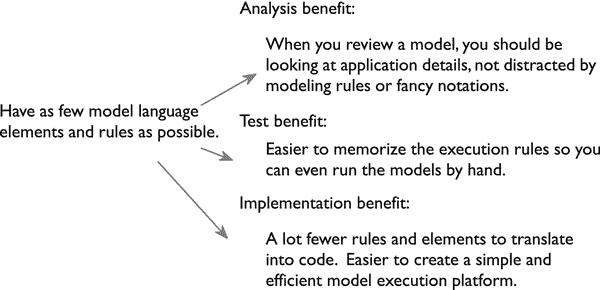

## 核心概念

### 域

域是一个主题领域，代表现实或抽象世界的规则和词汇。

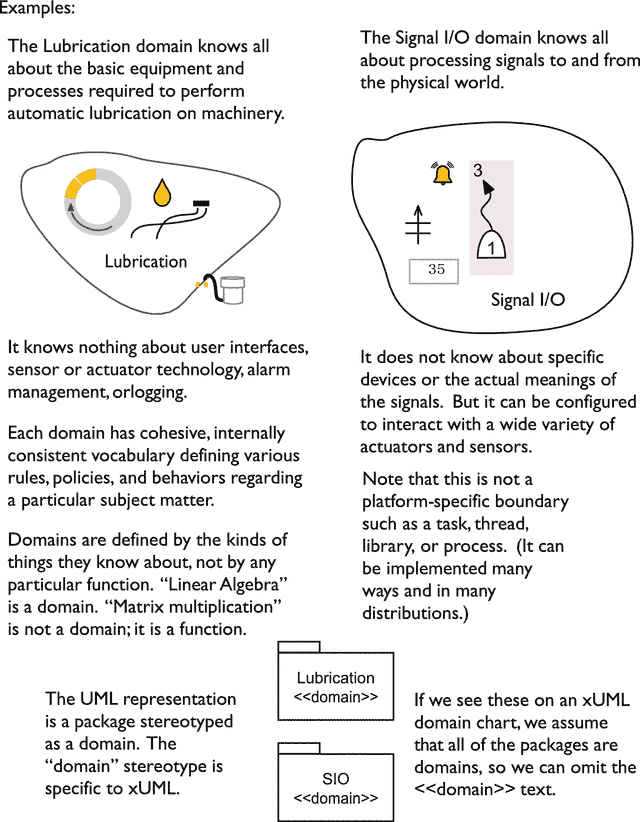

### 桥接

桥接是两个域之间的关系：一个域需要另一个域提供它自身无法实现的能力。需要该能力的域扮演客户端的角色。提供所需能力的域扮演服务端的角色。

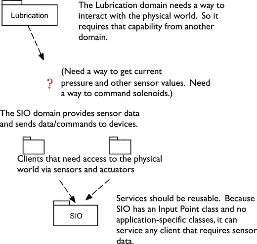

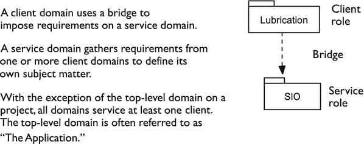

### 类

类是一组实例的定义，使得该集合中的所有成员：具有相同的特征；具有相同的行为；受相同的规则和策略约束。

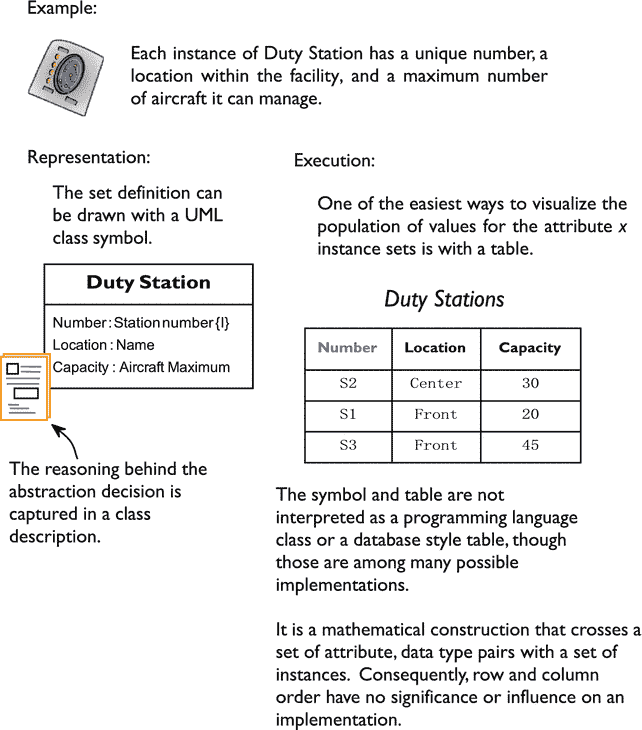

### 属性

属性是已被抽象为类的某个事物的特征。根据类定义，每个实例在任何时候都必须为其每个属性具有有意义的值。*在任何时候*：其含义和用法在相关的属性描述中说明。可以分配给属性的值受数据类型约束。

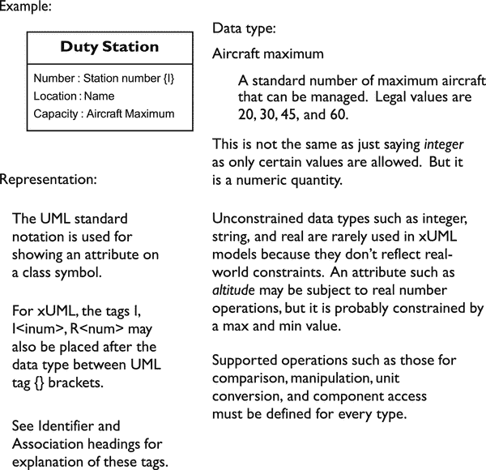

### 数据类型

数据类型是对可赋予属性的现实世界值以及可应用于这些值的操作的约束。

**示例：**

- **压力，MPa 计数**
  - `Count` 可定义为整数 `[0..maxint]`。尽管它基于整数，但唯一支持的操作是 `increment`、`decrement` 和 `reset`。
- **飞机尾号**
  - 这不被定义为 `string`，因为许多字符串是非法的。可以定义一个正则表达式来描述合法的尾号名称。同时，大多数字符串操作也不允许用于此类值。
- **点**
  - 可以定义一个二维点类型，其操作可以生成笛卡尔坐标或极坐标点，从而封装内部表示。

```python
r, theta = Track.Origin.Polar
x, y = Track.Origin.Cartesian
```

类型（类型理论）的定义与用于定义类和关联结构及行为的关系理论是正交的。

### 标识符

标识符是对同一类的一个或多个属性集合的约束，使得该类的任意两个实例不能共享相同的值。

| 现实世界标识符 | 虚构标识符 |
| --- | --- |
| 标识符可以是现实世界中的标识符，例如 `Tail Number`。现实世界的机构建立此约束。 | 或者，它也可以是为保证唯一性而虚构的任意值。在这种情况下，由建模者建立约束。 |
| 将现实世界的约束形式化。 | 与引用属性结合使用时，它有助于形式化关系和其他约束。 |

**符号**
每个类的标识符从 1 开始编号。标识符的每个属性组件都标记有 `{I}` 或 `{In}`，其中 `{I}` 表示 ID 1，`{In}` 表示参与的 ID 编号。一个标识符属性可以参与其所属类的一个或多个标识符。

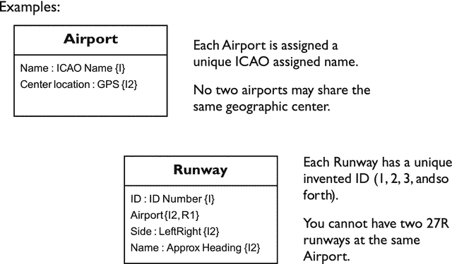

更广泛的 UML 社区鼓励隐含假设存在一个架构提供的句柄来管理实例之间的链接。在 xUML 中，我们依赖于每个类上至少有一个显式标识符。这确保了我们有了一致的关系引用系统，并且它为我们提供了表达关系限制约束的强大工具。

### 关联

关联是实例之间系统性维持的一种关系。

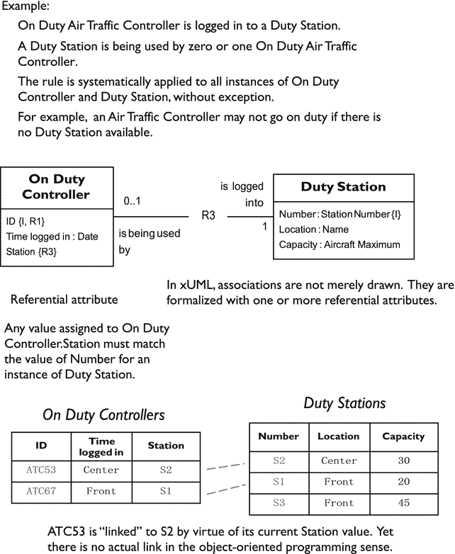

### 关联类

关联类将另外两个类之间的关联形式化。对于多对多以及任何条件对条件或多对 0..1 的关联，始终使用关联类，以确保引用属性始终具有非空值。

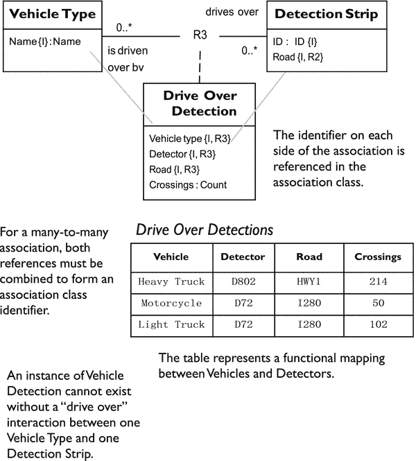

## 域图

构建整个软件系统所需的一组域及其连接桥接，显示在域图上。

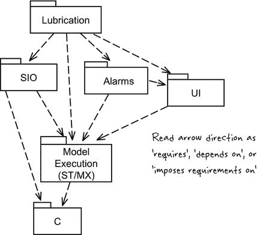

一个域可以用 xUML 建模、部分地用 xUML 建模、用另一种语言建模、手写代码、在现有的遗留软件中创建，或从第三方获取。请记住，任何域都可以跨多个处理器/线程/任务边界拆分，或者多个域可以放在同一个实现单元中。域图是独立于平台的，因此平台及其他特定技术的边界不会显示在域图上。

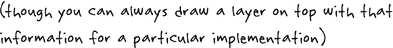

## 泛化/特化

一组实例可能共享属性和规则，同时又有例外情况。为了处理这种情况，由类建立的集合定义被划分为互斥的子集。在任何时候：
- 一个空中交通管制员（ATC）不能同时处于“值班”或“下班”状态之外。
- 一个“值班”或“下班”的管制员必然是 ATC。

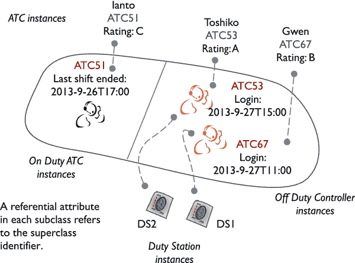

每个现实世界对象同时属于超类和子类集合。因此，在泛化中，一个对象 = 两个相连的实例。在这种情况下，使用泛化来建立互斥（XOR）约束。

## 其他活动类型

在 xUML 中，活动主要是状态活动。但它们也被编写在类方法、外部实体操作和域操作中。

**类方法**
将活动放在类方法中而非状态中有几个原因。例如，某个活动可能从多个状态触发。或者，某个类可能没有状态模型，但仍需进行无状态处理。

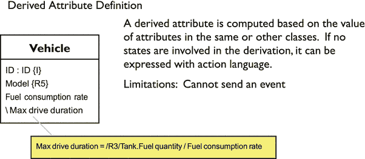
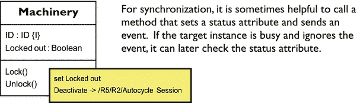

模型仅指出，当访问派生属性时，它会根据平台无关的公式提供正确的值。而值更新的时间和频率则是平台相关的，因此不在模型中体现。

**域操作**
- 域操作为外部域提供了一个运行时、模型级别的 API。这些活动应仅用于验证传入数据、定位相关模型元素，然后发出适当的事件或调用类方法。
- 限制：不能引用 `self` 属性，因为没有这样的属性。

通过 UI 域的桥接调用的润滑（Lubrication）域中的域操作

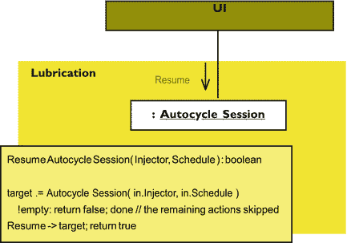

## 状态模型（实例生命周期）

根据定义，一个类的所有实例共享相同的行为。这种行为遵循一个共同的、可以用状态模型形式化的生命周期。（状态模型在软件中还有许多其他用途，但在 xUML 中，我们专门使用它们来捕获实例生命周期。）

**状态机行为**

- 一个实例停留在其状态机的某个状态中，等待事件发生。
- 当发生一个或多个事件时，将根据事件同步规则消费其中一个事件。
- 被消费的事件会导致以下三种响应之一：
  - **遵循转换**（如状态模型图所示）：实例跟随转换，并立即开始在目标状态（可以是同一个状态）执行活动。
  - **忽略该事件**：事件被消费后不再存在。
  - **不可能发生**：该事件是未预料到的，并构成模型中不可恢复的错误。模型执行域负责在模型外部处理该错误。

## 平台无关的同步规则

### 事件

事件生成后，会在某个时间点提供给目标实例或外部实体。

事件永远不会丢失：每个事件都将被送达其所指向的实例或外部实体。

事件被实例消费后，便不再存在。

一个给定的实例可能有多个待处理的事件。

- （例如，当实例正在执行活动时，事件可能到达该实例。或者，多个事件可能只是同时到达。）

如果某个实例有待处理的、由不同发送者生成的事件，则无法确定哪个事件会被首先消费。

发往自身的事件总是由发送它的实例在其消费任何其他事件之前消费。

如果一个实例向目标实例生成了多个事件，这些事件将按生成的顺序被接收。

### 活动

活动执行需要时间，也可能不需要时间（实际持续时间取决于平台）。

一旦启动，实例的状态活动必须完成，然后同一实例才能接受下一个信号。

在`xUML`中，活动总是运行至完成。因此，如果你需要在模型级别中断行为的能力，请将其分解为分布在多个状态模型上的多个活动。

任何给定实例的任一时刻只能有一个状态活动在执行，因为一个实例一次只处于一个状态。

一个活动中的多个动作可以并发执行。不同实例中的活动可以并发执行。

当一个活动完成时，它必须使系统保持一致状态。

## 状态模型（分配器）

一个`分配器`是一种特殊的状态模型，用于管理竞争性关联。它遵循所有同步规则，但本身没有实例。取而代之的是，一个令牌会在各个状态之间移动。

当实例之间的竞争使得关联两端的实例无法避免链接到同一个实例时，我们就需要用到分配器。

### 单一分配器

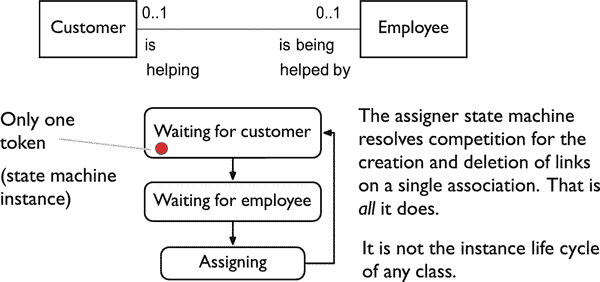

### 多重分配器

现在让我们扩大范围，考虑一个商店中的多个部门。在这种情况下，每个部门内的顾客和员工之间存在局部竞争。这就需要使用多重分配器。

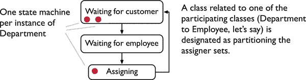

重要的概念是：1）在异步世界中，需要一个单一的控制点来解决竞争；2）`xUML`同步规则使得指定一个与平台无关的解决方案成为可能。这个解决方案不会被当作“实现细节”而搁置。

### 多态事件

多态事件是在一个超类上声明的。该超类并不定义对该事件的响应，甚至根本不需要拥有状态模型。

该事件通过源自该超类的每个特化分支进行委托。

在每个特化层级中遇到的每个子类，必须在其自身的状态模型中进一步委托该事件，或对该事件做出响应。

在单一或重复的特化（相同方向）中，必须有且仅有一个状态机对事件的任何运行时实例做出响应。

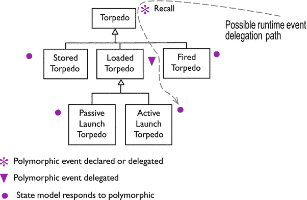

如果存在多个特化（不同方向），则该事件由每个特化方向中的一个状态机实例接收。

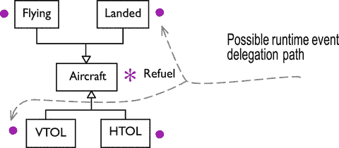

### 外部实体

外部实体充当与外部域进行运行时通信的代理。它的命名可以与域名称一致，也可以代表由该域处理的一个大规模或抽象实体。（应注意避免在另一个可能变动的域中命名特定的模型或代码元素。）

外部实体操作由域内部的同步或异步调用触发。该活动通常会调用由另一个域提供的域操作。

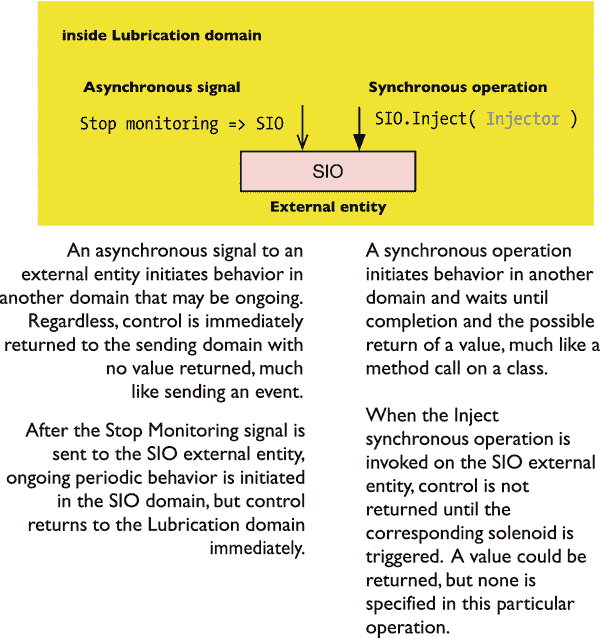