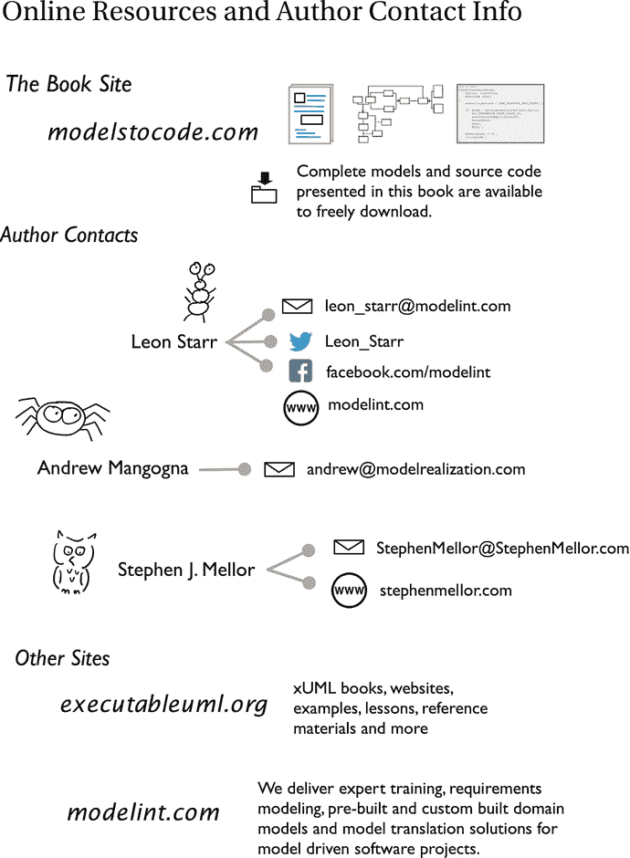

# 附录 C：Pycca 语言概述

本附录总结了 pycca 领域专用语言以及用于翻译状态活动的最重要的 C 预处理器宏。完整文档可在本书网站[`www.modelstocode.com`](http://www.modelstocode.com)找到。

## 调用

```
pycca ?OPTIONS? FILE ?FILE FILE ...?
```

pycca 程序将域的描述翻译成适用于 ST/MX 模型执行域的 C 代码。pycca 翻译的语言是一种简单的配置语言，允许指定域、类、状态机和其他模型元素。任何相关的处理都在普通的 C 代码中指定。

Pycca 根据其输入生成两个文件。一个文件是生成的 C 代码，通过在第一个输入文件的基本名称后附加`.c`后缀来命名。另一个文件是生成的具有`.h`后缀的头文件。在调用中可以给出多个输入文件。后续文件的处理方式如同所有文件已连接在一起。通常，第二个及后续的文件包含域填充信息，这样可以在不修改包含结构方面翻译的文件的情况下，以不同方式填充域。

### 选项

#### -help 或 -?

打印帮助信息。

#### -version

打印 pycca 的版本号和许可证，然后退出。

#### -noline

不要在生成的引用 pycca 源文件的文件中输出`#line`指令。通常，生成的 C 代码中也包含行指令，这样编译器错误消息会引用 pycca 源文件而非生成的代码。然而，某些调试器会被这些指令混淆。


`-output filename`

将结果输出到`filename`。此选项允许对输出文件名进行更精细的控制。默认情况下，`pycca`通过将第一个`FILE`参数中的任何后缀替换为`.c`和`.h`来从源名称派生输出文件名。如果`filename`是一个目录，输出文件名将照常构建，只是`filename`作为路径的前导部分。否则，`filename`将用作构建输出文件名的基名，通过替换`filename`可能具有的任何后缀为`.c`和`.h`。

`-instrument pattern`

为所有匹配`pattern`的类插入插桩代码。要检测所有内容，请将`pattern`指定为星号（`*`）。`pattern`是一个简单的通配符类型字符串匹配表达式列表。任何名称与给定模式匹配的类中的函数，都会在函数开头插入旨在帮助跟踪代码执行的插桩代码。请注意，`pattern`被解释为以空白分隔的元素列表，并且模式中的任何通配符规范通常都需要引号来防止被调用命令 shell 解释。

`-noC99`

默认情况下，`pycca`生成的代码适用于符合 C99 标准的 C 编译器。提供此选项会移除生成代码中的任何 C99 结构。这是为了兼容旧编译器。但请注意，`pycca`不会检查任何透传的代码，并且这些代码很可能包含特定“C”编译器不接受的构造。

`-dataportal`

在生成的代码文件中插入一组数据结构和编码，允许从域外部调用某些模型级操作。该数据与门户代码一起使用，以支持桥接到域中。

`-portalcode`

在当前目录下创建`pycca_portal.h`和`pycca_portal.c`文件。`Pycca`在创建文件后成功退出。这两个文件是与使用`-dataportal`选项生成的数据结构一起使用的 C 代码。

## 词法约定

Pycca 使用一些词法约定来区分用于 C 代码结构的语言结构。

#### 注释

以井号字符（`#`）开头，并持续到行尾。

#### 空白

通常被忽略，并且没有结构依赖于任何特定的空白排列。

#### C 变量

出现在匹配括号`(…)`之间的任何文本都被视为一个由逗号分隔的 C 变量或参数声明列表。参数列表和属性声明的 C 声明会被解析。由于`typedef`类型别名的固有歧义以及某些涉及常量表达式的 C 声明的复杂性，`pycca`可能会错误解析该声明。这些问题通常可以通过在实现序言部分包含适当的`typedef`来解决。

#### C 代码

出现在匹配花括号`{…}`之间的任何文本都被视为 C 代码序列，并且除此之外不再进行解释。匹配闭合花括号的确定考虑了 C 语言的语法。请注意，C 代码中的注释必须遵循 C 语言注释约定，因为任何代码都会透传给 C 编译器。

#### 名称

一个由字母后跟任意数量的字母、十进制数字或下划线字符组成的序列，且该序列不是关键字。这与 C 标识符使用的约定相同。

#### 数字

一个十进制数字序列。

#### 关键字

表 [A-1] 中的标记是关键字，不能在需要任意名称的地方使用。

表 A-1. Pycca 关键字

| `attribute` | `class` | `constant` | `constructor` |
| `default` | `destructor` | `domain` | `dynamic` |
| `end` | `epilog` | `event` | `external` |
| `final` | `implementation` | `initial` | `instance` |
| `interface` | `machine` | `operation` | `polymorphic` |
| `population` | `prolog` | `reference` | `set` |
| `slots` | `state` | `static` | `subtype` |

#### 其他标记

表 [A-2] 中的字符串也是词法标记。

表 A-2. 其他 Pycca 标记

| `->>` |
| `->>c` |
| `->>n` |
| `->>l` |
| `-ddd>>` ，其中`ddd`是一个十进制数字序列 |
| `->` |

## 域定义

pycca 语言允许定义域。域由一组组件组成，例如类和操作。在本节中，我们将展示定义域的语法。

### `domain`

域定义以`domain`关键字开头，后跟域名，并在匹配的`end`关键字处结束。

```
domain lube
# Put your domain definition here
end
```

本节中的其余语句可以出现在域定义内部。为简洁起见，我们假设这些语句包含在`domain`语句中。

### `class`

`class`是数据和行为的模板。类名必须是有效的 C 标识符。类定义以`class`关键字开头，并在匹配的`end`关键字处结束。有关定义类属性的语句，请参阅类定义部分。

```
class Air_Traffic_Controller
# statements defining the Air Traffic Controller class
end
```

### `domain operation`

域的编程接口由一组域操作组成。域操作被转换为普通的 C 函数。它们的作用域是外部的，并且它们的原型被插入到生成的头文件中。如果域操作返回一个值，则类型通过接口后跟一个冒号（`:`）和变量类型来指定。如果未指定返回类型，则该函数被类型化为`void`。为了帮助管理全局命名空间，域名和下划线会被添加到为域操作生成的 C 函数之前。

```
domain operation
Injector_max_pressure(
InstId_t injId)
{
PYCCA_checkId(Injector, injId) ;
ClassRefVar(Injector, inj) = PYCCA_refOfId(Injector, injId) ;
if (IsInstInUse(inj)) {
InstOp(Injector, Max_system_pressure)(inj) ;
}
}
```

### `external operation`

与域操作互补的是外部操作。它们的定义类似于域操作。外部操作定义了域的外部函数依赖关系。

```
external operation
SIO_Inject(InstId_t injectorId)
{
// any code here is not passed through
}
```

域期望这些函数从其他地方提供。前面的示例将以下外部声明放入生成的头文件中（假设该操作在`lube`域中定义）。

```
extern int eop_lube_SIO_Inject(InstId_t injectorId) ;
```

### `interface prolog`, `implementation prolog`, `interface epilog`, `implementation epilog`

额外的代码可以放置在生成文件的开始（`prolog`）或结束（`epilog`）处。`interface prolog`语句将代码放置在生成的头文件的开头附近，而`implementation prolog`将代码放置在生成的代码文件的开头附近。将`prolog`替换为`epilog`会导致代码包含在各自生成文件的末尾。可以有多个`prolog`或`epilog`语句，并且所有此类语句中的内容会被累积起来，放置在生成文件的适当位置。

```
interface prolog {
#include "pycca_portal.h"
#include 
// Any additional interface includes, etc.
typedef uint32_t Count ;
}
implementation prolog {
struct Point {
int x ;
int y ;
} ;
static int multPoint(int a, Point *p) ;
}
interface epilog {
#define POINT_DEFINED 1
}
implementation epilog {
static int multPoint(
int a,
Point *p)
{
// implementation of multPoint
p->x *= a ;
p->y *= a ;
}
}
end
```


### instance

`instance` 语句用于定义初始类实例。实例以 `class@name` 的形式指定名称。所有没有定义默认值的属性都必须指定值。对于已定义默认值的属性，如果在实例定义中未提及，则使用该默认值；否则，默认值会被实例定义中给定的任何值覆盖。

```
instance
Injector_Design@ihn4
(Model_Name Model)                  {"IHN4"}
(MPa Min_delivery_pressure)         {19}
(MPa Max_system_pressure)           {35}
(MPa Max_dissipation_pressure)      {32}
(Seconds Delivery_window)           {90}
(Seconds Good_injection_duration)   {9}
end
```

### table

当某个特定类有大量实例时，`instance` 语句使用起来可能很繁琐，并且会掩盖这些实例作为整体的性质。在这种情况下，`table` 命令允许以表格形式定义多个实例。属性的默认值可以用连字符（`-`）指定。

```
table
Lubrication_Schedule
(Name_t Name)
(Duration Wait_interval)
(Duration Monitor_interval)
(Count Max_low_lube_cycles)
(bool Default_continuous_operation)
(Count Default_max_cycles)
@gearbox    {"Gearbox"}     {210}   {45}   {8}    {true}   {5000}
@generator  {"Generator"}   {120}   {25}   {10}   {true}   {10000}
@shaft      {"Shaft"}       {90}    {30}   {10}   {true}   {10000}
@test2      {"Test2"}       {20}    {15}   {1}    {false}  {200}
end
```

## Class Definition

本节描述用于定义类属性的 `pycca` 语句。类定义包含在成对的 `class` 和 `end` 语句中。为简洁起见，从本节往后我们将省略外围的 `class` 和 `end` 语句。

### attribute

属性的声明方式与 C 语言中的结构体成员相同，但没有任何标点符号。遵循词法约定，C 声明放在括号内。还可以指定实例的默认值。默认值仅在定义类的初始实例且未指定值时使用。默认值仅在指定初始实例集时使用。对于动态创建的实例，所有属性值都由运行时代码设置。默认值必须求值为有效的 C 编译时常量表达式（因为它将被用作初始化器）。由于默认值规范会传递给编译器，它们必须用花括号（`{}`）括起来。

```
attribute (Model_Name Model)
attribute (MPa Min_delivery_pressure)
attribute (MPa Max_system_pressure)
attribute (MPa Max_dissipation_pressure)
attribute (Seconds Delivery_window) default {30}
attribute (Seconds Good_injection_duration)
```

### reference

`reference` 是一种特殊的属性，它被转换为指向特定类结构的指针。引用有一个名称，通常与其实现的关系同名（如果该关系是自反的，可能会附加一个注解）。属性的类型无需指定，因为它可以被推断为指向与该类名匹配的结构的指针。

### subtype

`subtype` 语句用于声明在类结构中保存泛化关系信息所需的数据结构。泛化关系可以作为引用泛化或联合泛化来实现。

#### Reference Generalization

一个类通过使用 `subtype ... reference` 语句为通过引用实现的泛化关系定义存储空间。该语句给出一个应被视为子类型的类列表。

```
subtype R1 reference
Off_Duty_Controller
On_Duty_Controller
end
```

#### Union Generalizations

在简单情况下（通常只有单层深度的泛化层次结构），将超类的子类作为 `union` 数据类型直接保存在超类实例的存储空间中通常更方便。

```
subtype R1 union
Off_Duty_Controller
On_Duty_Controller
end
```

### machine

`machine` 语句用于为一个类定义状态模型，以捕获其生命周期行为。在 `machine` 语句内用于定义状态模型的语句在“状态模型定义”部分中给出。

```
machine
# statements to define a state model for the enclosing class
end
```

### population

`population` 语句定义类实例群体的存储特性。类群体可以声明为 `dynamic`、`static` 或 `constant`。如果没有 `population` 子句，则假定为 `population static`。如果实例在运行时创建和删除，则类群体是 `dynamic`。不在运行时创建和删除的类群体称为 `static`。这意味着实例的数量在域运行期间不会改变。`static` 的一个特例是 `constant` 类群体。`constant` 群体既是静态的，又是只读的（其属性不会更新）。

```
population dynamic
```

### slots

`slots` 语句定义除初始实例占用的槽位之外分配的类实例存储槽位数。额外的槽位只能为动态的类群体定义。

```
population dynamic
slots 5
```

### class operation

一个类可以通过使用 `class operation` 语句定义基于类的操作。类操作并非源自模型元素，而是为将公共代码分解到单个函数中而提供的实现构造。

```
class operation
findByName(
char const *name) : (struct Lubrication_Schedule *) {
ThisClassRefVar(ls) ;
PYCCA_selectOneStaticInstOfThisClassWhere(ls, strcmp(ls->Name, name) == 0)
return ls == ThisClassEndStorage ? NULL : ls ;
}
```

### instance operation

`instance operation` 语句用于翻译基于实例的操作。实例操作有一个隐式的第一个参数，该参数是指向要执行操作的实例的指针。无需声明 `self` 变量，因为 `pycca` 会插入它。然而，由于这是 C 语言，在调用实例操作时，需要为隐含的 `self` 参数提供一个值。

```
instance operation Max_system_pressure() {
ExternalOp(ALARM_Set_pressure_error)(PYCCA_idOfSelf)    ;
ClassRefVar(Autocycle_Session, acs) = self->R2 ;
InstOp(Autocycle_Session, Deactivate)(acs) ;
}
```

### polymorphic event

`polymorphic event` 语句声明一个或多个事件为多态的。多态事件只能为超类声明。

```
polymorphic event
e1
e2
end
```

### constructor

`constructor` 语句为一个类定义构造函数。当该类的任何实例在运行时创建时，该函数仅使用隐式的 `self` 参数被调用。如果任何包含构造函数的类也指定了初始实例群体，`pycca` 将生成一个名为 `<domain name>_Ctor` 的函数，其中 `<domain name>` 被替换为域名。此函数将为所有定义了初始实例集并且也定义了构造函数的类的所有初始实例调用构造函数。用户需要在应用程序初始化阶段（例如，在初始化时调用的域操作中）调用此函数。

```
attribute (int count)
constructor {
self->count = 0 ;
}
```

### destructor

`destructor` 语句为一个类定义析构函数。当该类的任何实例在运行时被销毁时，该函数仅使用隐式的 `self` 参数被调用。

```
attribute (int count)
destructor {
reportCount(self->count) ;
}
```


## 状态模型定义

本节中的语句用于为类定义状态模型。状态模型定义语句必须包含在成对的 `machine` 和 `end` 语句中。为简洁起见，我们省略了外层的 `machine` 和 `end` 语句。

### `state`

`state` 语句用于在状态模型中定义一个状态。一个状态具有名称，并且可能包含参数，这些参数作为导致进入该状态的事件的一部分传递给它。这些参数（如果有）列在状态名称后的括号中。一个状态关联一段 C 代码，该代码在进入该状态时执行。提供了一组预处理器宏，以方便与 ST/MX 运行时交互。这些宏在“活动宏”部分中讨论。

```
state BUILDING_PRESSURE()
{
if (self->Pressure > self->R4->Min_delivery_pressure) {
PYCCA_generateToSelf(Above_inject_pressure) ;
}
}
```

### `transition`

`transition` 语句用于指定状态模型的转换行为。该语句列出了当前状态、事件和新状态。请注意，没有单独指定的事件列表。事件名称在其出现在 `transition` 语句中时被定义。由句点字符 (`.`) 组成的状态名称为伪初始状态，并将转换中的事件定义为创建事件。

```
transition BUILDING_PRESSURE - Above_inject_pressure -> INJECTING_AT_PRESSURE
```

### `default transition`

`default transition` 语句定义了任何未在 `transition` 语句中明确提及的转换的行为。默认转换可以是 `IG`，表示忽略该事件；或者 `CH`，表示该事件会导致错误条件。如果在状态模型定义中没有给出 `default transition` 语句，则假定为 `CH`。

```
default transition IG     # 忽略意外事件
```

### `initial state`

`initial state` 语句定义状态机的默认初始状态。如果在状态模型定义中没有给出 `initial state` 语句，则第一个定义的状态被视为默认初始状态。

```
initial state SLEEPING
```

### `final state`

`final state` 语句定义一个状态，在该状态的活跃期执行完毕后，类的实例将被运行时自动删除。

```
final state perish
```

## 活动宏

本节总结了最常用的预处理器宏。此列表并不详尽，完整列表可在在线资料中找到。我们根据接口描述所操作模型元素将其分为几组。

### `ClassRefVar(c, v)`

声明一个适合保存类实例引用的变量。

| `c` | 实例所引用的类的名称。 |
| `v` | C 变量的名称。 |

### `ClassConstRefVar(c, v)`

声明一个适合保存对类实例引用的变量，该实例的实例数量是恒定的。

| `c` | 实例所引用的类的名称。 |
| `v` | C 变量的名称。 |

### `ClassRefSetVar(c, v)`

声明一个适合引用一组类实例的变量。

| `c` | 实例集所引用的类的名称。 |
| `v` | `C` 变量的名称。 |

### `ClassConstRefSetVar(c, v)`

声明一个适合引用一组类实例的变量，该组实例的实例数量是恒定的。

| `c` | 实例集所引用的类的名称。 |
| `v` | 一个 C 变量的名称。 |

### 事件

发送事件是状态活动中的常见操作。

#### 无参数事件

对于事件不携带额外参数的常见情况，提供了多个宏来处理这三种事件类型。

###### `PYCCA_generate(e, c, i, s)`

向一个实例发送事件信号。

| `e` | 要发送的事件的名称。 |
| `c` | 接收事件的实例所属的类的名称。 |
| `i` | 指向要接收事件的实例的指针。 |
| `s` | 指向发送信号事件的实例的指针。如果事件源自实例上下文之外，则该值可以为 `NULL`。 |

###### `PYCCA_generateToSelf(e)`

向自身发送事件信号。

| `e` | 要生成的事件的名称。 |

###### `PYCCA_generatePolymorphic(e, c, i, s)`

发送一个多态事件。

| `e` | 要发送的多态事件的名称。 |
| `c` | 接收事件的实例所属的类的名称。 |
| `i` | 指向要接收事件的实例的指针。 |
| `s` | 指向发送信号事件的实例的指针。如果事件源自实例上下文之外，则该值可以为 `NULL`。 |

###### `PYCCA_generateCreation(e, c, s)`

发送一个创建事件。

| `e` | 要发送的创建事件的名称。 |
| `c` | 接收事件的实例所属的类的名称。 |
| `s` | 指向发送事件的实例的指针。如果事件源自实例上下文之外，则该值可以为 `NULL`。 |

###### `PYCCA_generateDelayed(e, c, i, s, d)`

发送一个延迟事件。

| `e` | 要发送的事件的名称。 |
| `c` | 接收事件的实例所属的类的名称。 |
| `i` | 指向要接收事件的实例的指针。 |
| `s` | 指向发送信号事件的实例的指针。如果事件源自实例上下文之外，则该值可以为 `NULL`。 |
| `d` | 延迟时间，以毫秒为单位。 |

###### `PYCCA_generateDelayedToSelf(e, d)`

向 `self` 发送一个延迟事件。

| `e` | 要生成的事件的名称。 |
| `d` | 延迟时间，以毫秒为单位。 |

#### 带参数事件

因为事件可以携带补充数据，所以发送此类事件是一个三步过程：

1. 获取一个事件控制块 (ECB)。对于三种事件类型，使用不同的宏来获取 `ecb`。
2. 填充事件数据。
3. 将事件投递到适当的事件队列。

例如，假设 `dog` 是类 `Dog` 的一个实例，并且 `Bark` 事件带有一个参数 `howLoud`。那么以下代码将向 `Dog` 的实例 `dog` 发送 `Bark` 事件。

```
MechEcb bark = PYCCA_newEvent(Bark, Dog, dog, self) ;
PYCCA_eventParam(bark, Dog, Bark, howLoud) = 20 ;
PYCCA_postEvent(bark) ;
```

###### `PYCCA_newEvent(e, c, i, s)`

为普通事件返回一个 `MechEcb`。

| `e` | 要发送的事件的名称。 |
| `c` | 接收事件的实例所属的类的名称。 |
| `i` | 指向要接收事件的实例的指针。 |
| `s` | 指向正在发送事件的实例的指针。如果事件源自实例上下文之外，则该值可以为 `NULL`。 |

###### `PYCCA_newEventToSelf(e)`

为普通事件返回一个 `MechEcb`，其中目标实例和发送信号事件的实例都是 `self`。

| `e` | 要发送的事件的名称。 |

###### `PYCCA_newPolymorphicEvent(e, c, i, s)`

为多态事件返回一个 `MechEcb`。

| `e` | 要发送的事件的名称。 |
| `c` | 接收事件的实例所属的类的名称。 |
| `i` | 指向要接收事件的实例的指针。 |
| `s` | 指向发送信号事件的实例的指针。如果事件源自实例上下文之外，则该值可以为 `NULL`。 |

###### `PYCCA_newCreationEvent(e, c, s)`

为创建事件返回一个 `MechEcb`。

| `e` | 要发送的事件的名称。 |
| `c` | 要从中创建实例的类的名称。 |
| `s` | 指向正在发送事件的实例的指针。如果事件源自实例上下文之外，则该值可以为 `NULL`。 |

###### `PYCCA_eventParam(ecb, c, e, p)`

检索事件参数的值。

| `ecb` | 指向事件控制块的指针。 |
| `c` | 接收事件的实例所属的类的名称。 |
| `e` | 要生成的事件的名称。 |
| `p` | 事件参数的名称。 |

###### `PYCCA_postEvent(ecb)`

将 `ecb` 放置在非自定向的事件队列上。

| `ecb` | 指向事件控制块的指针。 |


###### `PYCCA_postSelfEvent(ecb)`

将 `ecb` 放置到自定向事件队列上。注意，创建事件不应被投递到自定向事件队列。

| `ecb` | 指向事件控制块的指针。 |

###### `PYCCA_postDelayedEvent(ecb, d)`

投递一个延迟信号。

| `ecb` | 指向事件控制块的指针。 |
| `d` | 以毫秒为单位的延迟时间。 |

#### 延迟信号操作

延迟信号支持取消以及获取剩余延迟时间。

###### `PYCCA_cancelDelayed(e, c, i, s)`

取消一个延迟信号。

| `e` | 要取消的事件的名称。 |
| `c` | 接收事件的实例所属类的名称。 |
| `i` | 指向将要接收事件的实例的指针。 |
| `s` | 指向发送该事件的实例的指针。如果事件源自实例上下文之外，此值可为 `NULL`。 |

###### `PYCCA_cancelDelayedToSelf(e)`

取消一个发送给 `self` 的延迟事件。

| `e` | 要取消的事件的名称。 |

###### `PYCCA_remainDelayed(e, c, i, s)`

获取延迟信号的剩余时间。

| `e` | 要查询的事件的名称。 |
| `c` | 接收事件的实例所属类的名称。 |
| `i` | 指向将要接收事件的实例的指针。 |
| `s` | 指向发送该事件的实例的指针。如果事件源自实例上下文之外，此值可为 `NULL`。 |

###### `PYCCA_remainDelayedToSelf(e)`

获取一个自定向延迟信号的剩余时间。

| `e` | 要查询的事件的名称。 |

### 实例的创建与删除

类的实例可以在运行时创建和销毁。这些宏有助于对接实例管理机制。

#### `PYCCA_newInstance(c)`

在默认初始状态下创建一个类的实例。

| `c` | 要创建的实例所属类的名称。 |

#### `PYCCA_destroyInstance(i)`

销毁一个类的实例。

| `i` | 指向要删除的实例的指针。 |

### 实例选择

Pycca 提供了用于遍历实例并根据特定条件选择实例的宏。

#### `PYCCA_selectOneInstWhere(i, c, expr)`

此宏展开为对名为 `c` 的类进行线性搜索，以查找第一个使 `expr` 为真的实例。展开后的代码会搜索 `c` 的存储池，停在第一个正在使用且满足 `expr` 的实例处。`Expr` 应包含以 `i->a` 形式对 `c` 的属性的访问。`i` 变量的值会被修改，在循环结束时，它要么指向 `c` 中 `expr` 求值为非零的第一个实例，要么指向该类存储池的末尾（由 `EndStorage(c)` 宏给出，即如果 `i >= EndStorage(c)`，则搜索失败）。注意，此宏会测试实例当前是否已分配，因此仅对动态分配或具有状态机的类有用。

| `i` | 一个变量的名称，该变量是指向 `c` 类实例的指针。 |
| `c` | 与 `i` 对应的实例所属类的名称。 |
| `expr` | 一个将被解释为布尔值的 C 表达式。 |

#### `PYCCA_forAllInst(i, c)`

此宏是一个便捷宏，用于设置一个遍历某类所有实例的循环。该宏后面应跟一个语句（可以是复合语句并用花括号 (`{}`) 括起来）。在该语句中，`i` 将依次取类 `c` 所定义的每个实例的值。

| `i` | 一个变量的名称，该变量是指向 `c` 类实例的指针。 |
| `c` | 与 `i` 对应的实例所属类的名称。 |

```
ClassRefVar(Autocycle_Session, acs) ;
PYCCA_forAllInst(acs, Autocycle_Session) {
if (IsInstInUse(acs)) {
PYCCA_generate(Created, Autocycle_Session, acs, NULL) ;
}
}
```

#### `PYCCA_forAllRelated(v, i, r)`

此宏是一个便捷宏，用于设置一个循环，遍历与某类相关的实例。此宏假定这些相关实例是使用 `->>c` 语法声明的（相关实例属于计数类型）。该宏后面应跟一个语句（可以是复合语句并用花括号 (`{}`) 括起来）。在该宏中，`v` 应声明为 `ClassRefSetVar` 或 `ClassRefConstSetVar`。然后 `v` 会在相关实例的集合上进行迭代。

| `v` | 引用集变量的名称。 |
| `i` | 实例引用变量的名称。 |
| `r` | 迭代所跨越的关系的名称。 |

```
ClassRefConstSetVar(Injector, myinjs) ;
PYCCA_forAllRelated(myinjs, self, R5) {
ClassRefVar(Injector, inj) = *myinjs ;
ClassRefVar(Autocycle_Session, acs) = inj->R2 ;
InstOp(Autocycle_Session, Deactivate)(acs) ;
}
}
```

#### `PYCCA_forAllRelatedTerm(v, i, r)`

此宏与 `PYCCA_forAllRelated()` 相同，区别在于该关系必须使用 `->>n` 语法声明（关系存储由一个以 `NULL` 结尾的实例指针数组组成）。

| `v` | 引用集变量的名称。 |
| `i` | 实例引用变量的名称。 |
| `r` | 迭代所跨越的关系的名称。 |

#### `PYCCA_forAllLinkedInst(o, r, l)`

遍历使用链表实现的一对多关系中的实例。此宏与 `PYCCA_forAllRelated` 类似，区别在于该关系必须使用 `->>l` 语法声明（关系存储通过链表实现）。此宏展开为一个循环结构，在该结构中，所有通过关系 `r` 与 `o` 相关的实例都会被访问。链接变量 `l` 被依次赋值为与 `o` 相关（处于多端）的链接的值。链接变量 `l` 的值不是指向实例的指针。必须使用此处描述的 `PYCCA_linkToInstRef()` 宏来恢复实例指针。

| `o` | 指向一端实例的指针。 |
| `r` | 关系的名称。 |
| `l` | 类型为 `rlink_t *` 的变量的名称。 |

```
rlink_t *czlink ;
PYCCA_forAllLinkedInst(ondc, R2, czlink) {
ClassRefVar(Control_Zone, found) =
PYCCA_linkToInstRef(czlink, Control_Zone, R2) ;
if (strcmp(rcvd_evt->zone, found->Name) == 0) {
hoff_zone = found ;
break ;
}
}
```

#### `PYCCA_linkToInstRef(l, c, r)`

此宏将类型为 `rlink_t *` 的链接指针（该链接是关系 `r` 中的一个链表节点）转换为指向类 `c` 实例的指针。

| `l` | 类型为 `rlink_t *` 的变量的名称。 |
| `c` | `l` 所指关系多端类的名称。 |
| `r` | 关系的名称。 |

### 实例标识符

在调用外部操作时，使用一种方法来识别域外特定类的实例是很有用的。实例的指针值不适合此目的，但实例在其存储池中的数组索引是令人满意的。此组中的宏提供了一种方法，可以为实例生成一个可用作域外标识符的小整数，或者将实例标识符转换为指向该实例的指针引用。

#### `PYCCA_idOfSelf`

为 `self` 引用生成一个整数标识符。

```
ExternalOp(ALARM_Clear_lube_level_very_low)(PYCCA_idOfSelf) ;
```

#### `PYCCA_idOfRef(c, r)`

为类 `c` 的引用 `r` 生成一个整数标识符。

| `c` | 类的名称。 |
| `r` | 类 `c` 成员的引用值。 |

#### `PYCCA_refOfId(c, i)`

返回一个对类 `c` 实例的实例引用，该实例由整数标识符 `i` 标识。

| `c` | 类的名称。 |
| `i` | 该类实例的整数标识符。 |


### `PYCCA_checkId(c, i)`

生成对 `assert()` 宏的调用，以测试标识符 `i` 对于类 `c` 是否有效。当某个领域操作接受一个代表实例的整数标识符并希望断言其有效性时，此宏非常有用。

| `c` | 类的名称。 |
| --- | --- |
| `i` | 该类实例的整数标识符。 |

```
PYCCA_checkId(Autocycle_Session, sessionId) ;
ClassRefVar(Autocycle_Session, session) =
PYCCA_refOfId(Autocycle_Session, sessionId) ;
if (IsInstInUse(session)) {
InstOp(Autocycle_Session, Suspend)(session) ;
}
```

### 导航泛化关系

当泛化关系实现为 `union` 数据类型时，子类型的实例不使用指针来导航到超类型。相反，只需对 `self` 指针进行向上转型即可获得指向超类型的指针。

#### `PYCCA_unionSupertype(sub, supc, r)`

导航到包含在联合体中的实例的超类型。

| `sub` | 指向子类型实例的指针。通常是 `self`。 |
| --- | --- |
| `supc` | 超类型类的名称。 |
| `r` | 关系的名称。 |

**警告**

在此上下文中向上转型与在任何其他上下文中向上转型同样危险且容易出错。如果 `sub` 不是类 `supc` 的子类型，此宏将静默地产生错误结果，因为它涉及编译器无法检查的显式转换。

通过获取生成的联合体结构中子类型成员的地址来实现对子类型的导航。此宏隐藏了子类型成员的命名约定。

#### `PYCCA_unionSubtype(sup, r, subc)`

导航到包含在联合体中的子类型实例。

| `sup` | 指向超类型实例的指针。通常是 `self`。 |
| --- | --- |
| `r` | 关系的名称。 |
| `subc` | 子类型类的名称。 |

```
ClassRefVar(On_Duty_Controller, new_ondc) =
PYCCA_unionSubtype(new_controller, R1, On_Duty_Controller) ;
```

#### `PYCCA_isSubtypeRelated(sup, supc, r, subc)`

确定一个超类型实例当前是否与给定子类型的某个实例相关。如果 `sup` 与子类型类 `subc` 的某个实例通过关系 `r` 相关联，则返回 `true`。

| `sup` | 指向超类型实例的指针。通常是 `self`。 |
| --- | --- |
| `supc` | 超类型类的名称。 |
| `r` | 关系的名称。 |
| `subc` | 子类型类的名称。 |

#### `PYCCA_migrateSubtype(i, supc, r, subc)`

更改超类型实例的子类型。对于泛化关系，超类型维护一个编码值，指示其当前关联的子类型。此宏更改该编码值。

| `i` | 指向超类型的实例指针。 |
| --- | --- |
| `supc` | 超类型类的名称。 |
| `r` | 泛化关系的名称。 |
| `subc` | 子类型类的名称。 |

```
PYCCA_migrateSubtype(self, Air_Traffic_Controller, R1, Off_Duty_Controller) ;
```

#### `PYCCA_initUnionInstance(sup, r, subc)`

将包含在基于联合体的超类型中的子类型实例初始化为其默认初始状态。当联合体内的子类型发生迁移时，如果该子类型具有状态模型，则需要将体系结构结构初始化为新子类型的结构。此宏实现此目的。请注意，此宏不会运行子类型的任何构造函数。对于具有构造函数的子类型，需要显式调用。

| `sup` | 指向超类型实例的指针。通常是 `self`。 |
| --- | --- |
| `r` | 关系的名称。 |
| `subc` | 子类型类的名称。 |

#### `PYCCA_relateSubtypeByRef(s, supc, r, t, subc)`

将超类型实例与子类型实例关联起来（当关系通过引用存储时）。

| `s` | 指向超类型实例的指针。通常是 `self`。 |
| --- | --- |
| `supc` | 超类型类的名称。 |
| `r` | 关系的名称。 |
| `t` | 指向目标子类实例的指针。 |
| `subc` | 子类型类的名称。 |

## 书籍

- Stephen J. Mellor 和 Marc J. Balcer，*可执行 UML：模型驱动架构的基础*，Addison-Wesley (2002)，ISBN 0-201-74804-5。
- Chris Raistrick 等，*使用可执行 UML 的模型驱动架构*，Cambridge University Press (2004)，ISBN 0-521-53771-1。
- Leon Starr，*可执行 UML：如何构建类模型*，Prentice Hall (2001)，ISBN 0-13-067479-6。注意：本版已绝版，但覆盖所有模型方面的新扩展版计划于 2018 年出版，出版商待定。
- Sally Shlaer 和 Stephen J. Mellor，*面向对象系统分析：在数据中为世界建模*，Prentice Hall (1988)，ISBN 0-13-629023-X。
- Sally Shlaer 和 Stephen J. Mellor，*对象生命周期：在状态中为世界建模*，Prentice Hall (1991)，ISBN 0-13-629940-7。
- Lex de Hann 和 Toon Koppelaars，*数据库专业人员应用数学*，Apress (2011)，ISBN 1-43024-248-1。
- Fredrick P. Brooks，*人月神话（周年纪念版，新增四章）*，Addison-Wesley (1995)。
- *ACM 编程语言与系统通讯* 1, 3 (1992 年 9 月)，213–226。

## 论文

- E.F. Moore，“论序贯机器的思想实验”，*自动机研究*，普林斯顿大学出版社，普林斯顿，新泽西州 (1956 年)，第 129–153 页。
- George H. Mealy，“一种综合时序电路的方法”，*贝尔系统技术杂志* (1955 年)，第 1045–1079 页。
- Christopher W. Fraser、David R. Hanson 和 Todd A. Proebsting，“设计一个简单高效的代码生成器生成器”，*ACM 编程语言与系统通讯* 1, 3 (1992 年 9 月)，213-226。
- [`http://faculty.salisbury.edu/~xswang/Research/Papers/SERelated/no-silver-bullet.pdf`](http://faculty.salisbury.edu/%7Exswang/Research/Papers/SERelated/no-silver-bullet.pdf)

## 文章

- Leon Starr，“[如何构建清晰的 UML 类模型](http://www.modelint.com/how-to-build-articulate-uml-class-models) 并从 UML 中获得真正收益”(2008) 最初发表于 [`www.uml.org/news.htm`](http://www.uml.org/news.htm)。也可查阅 [`www.modelint.com/mbse`](http://www.modelint.com/mbse) 和 [`www.executableuml.org`](http://www.executableuml.org)。
- Leon Starr，“[可执行 UML 中的时间与同步](http://www.modelint.com/time-and-synchronization-in-executable-uml)”(2008) 论文和视频可在 [`www.modelint.com/mbse`](http://www.modelint.com/mbse) 和 [`www.executableuml.org`](http://www.executableuml.org) 获取。

## 在线资源与作者联系方式




