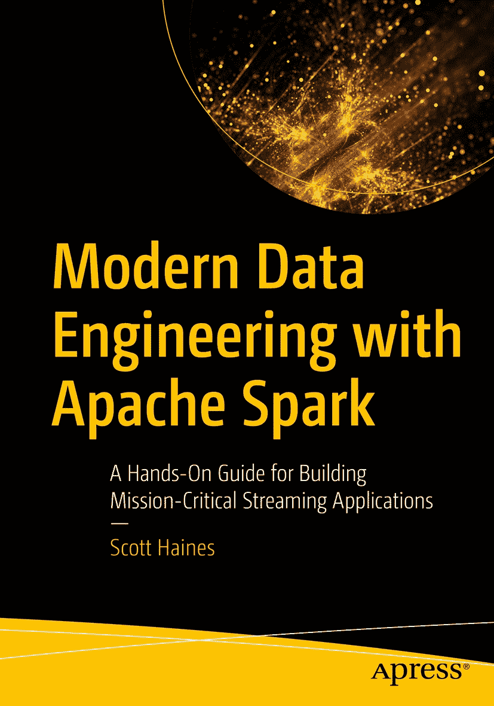

ISBN 978-1-4842-7451-4 e-ISBN 978-1-4842-7452-1 [`doi.org/10.1007/978-1-4842-7452-1`](https://doi.org/10.1007/978-1-4842-7452-1) © Scott Haines 2022 本作品受版权保护。所有权利均由出版商独家授权，无论涉及材料的全部或部分，特别是翻译、重印、重用插图、朗诵、广播、以缩微胶卷或任何其他物理方式复制、传输或信息存储与检索、电子改编、计算机软件，或采用目前已知或未来开发的类似或不同方法。本出版物中使用通用描述性名称、注册商标、商标、服务标志等，即使未作明确声明，也不意味着这些名称不受相关保护性法律和法规的约束，因此可自由使用。出版商、作者和编辑认为，本书中的建议和信息在出版之日是真实准确的。出版商、作者或编辑均不对本书所含材料或可能存在的任何错误或遗漏提供明示或暗示的保证。出版商对已出版地图中的管辖权主张和机构归属保持中立。

本 Apress 印记由注册公司 APress Media, LLC（Springer Nature 的一部分）出版。注册公司地址为：1 New York Plaza, New York, NY 10004, U.S.A.

献给我的妻子 Lacey，感谢你在漫长的夜晚和周末对我的包容，感谢你在写作过程中的起起伏伏中成为我的支柱。感谢你一直支持我那些疯狂的想法。

# 引言

我是在 COVID-19 疫情的不确定性中开始撰写这本书的。那段时间，我们作为人类，越来越多地待在室内（如果可能的话），通过增加数字连接和娱乐来分散对外部世界的注意力。在现实生活中社交互动的地方，我们转向了线上。通过 Zoom 与朋友和家人通话成为了常态，我们专注于对我们最重要的人和事。我们以唯一可能的方式分享我们的生活与世界：数字化。快进到今天，一年多过去了，虽然疫情仍在，但希望已经出现。我满怀希望。

这绝对不是我想象中开始我第一本书的方式——以回顾过去为开端。但当我们展望未来时，很难不看到过去两年（2020-2022 年）对人类与世界互动方式的持久影响。随着越来越多的体验转向虚拟世界，越来越多的协作在线进行，我们需要从根本上改变构建下一代平台、框架和技术的方式。系统规模和计算能力的量级变化需要进化思维、革命性的数据平台和以数据为中心的生态系统来推动这一数字未来。超连接和智能自动化将以惊人的规模驱动实时、一致的数据系统，而今天仅仅是个开始。

这本书并非关于未来，而是教你如何在当下构建可靠的数据系统，利用 Apache Spark 的强大能力，由你——现代数据工程师——从现代数据生态系统的基本构建块出发，编排一致且可扩展的流式应用程序。通过动手实践的方法，你将学习运用许多在数据工程这一激动人心的领域取得成功所必需的最佳实践和解决问题的技能。

# 关于本书

本书是使用 Apache Spark 构建一致、“关键任务”流式应用程序的入门指南。你不会从第一页就开始编写流式应用程序，而是会动手实践，使用 Spark 和一系列工具解决小问题，逐步推进。每一章都会介绍一个关键基础，以及你数据工程工具箱中的一个新工具。随着书籍的深入，你将接触到许多与 Apache Spark 配合良好的常见数据系统和服务。到本书结束时，你将编写并在 Kubernetes 上部署一个经过全面测试的 Spark Structured Streaming 应用程序。你将拥有一个完整的容器化本地数据平台，可以将本书涵盖的想法和实现带到你的下一个项目中。对于某些读者来说，本书所学内容可能是一次复习；对于其他人来说，接下来的课程可能感觉像是窥见了数据的未来。无论如何，这段探索之旅都将是值得的。

# 谁应该阅读本书？

如果你是一名软件工程师，希望将职业转向数据工程，或者你是一名数据科学家或分析师，希望快速上手使用 Apache Spark，那么你应该阅读本书。本书教你 Spark 的核心 API 和常用组件，重点在于使用 Spark SQL 和编写可重用的编译应用程序。本书也温和地介绍了如何编写 Scala 来构建可靠的 Apache Spark 应用程序。数据平台工程师或软件架构师可以将本书作为资源，了解如何使用开源软件构建可靠的流式系统，并作为构建可组合分布式数据系统的入门指南。最后，本书是一段动手实践之旅，任何对数据系统感兴趣的人，只要有一台电脑并好奇学习新事物，都可以体验。

# 动手实践材料与设置

本书包含从第 3 章到第 15 章的动手练习。要跟随学习并充分利用本书，你需要从 GitHub 下载本书材料。下载材料后，各章节将变得更有趣，互动性也更强。

## 本书的 GitHub 地址

[`https://github.com/newfront/spark-moderndataengineering`](https://github.com/newfront/spark-moderndataengineering)

## 注意事项

本书内容基于 macOS 和 Linux 系统编写。虽然你可以通过 Windows 上的 Docker 运行本书大部分材料，但示例和运行时脚本均为 Bash 执行而编写，并未在 Windows 上经过全面测试。

# 致谢

在我的职业生涯中，有太多人帮助过我，让我得以学习和成长。还有许多人直接或间接地帮助塑造了本书的内容。首先，我要感谢多年来在 Twilio 帮助构建 Voice Insights 产品和 Insights 平台的同事们（Marek Radonsky、Rohit Gupta、Nivedita Muska、Harshit Rastogi、Amogh Rao、Bhargav Kumar、Maruthi Kuchi、Kenny Law、Monica Ravichandran、Pavan Kotikalapudi、Jason Dielman 和 Vijay Jagannathan）。感谢你们早期就敢于尝试 Apache Spark，并采纳了 Protobuf（尽管这在当时是反主流文化的）。感谢 Oliver Pedersen 和雅虎游戏团队（Henrik、Arash、Alex、David、Dan、Sal 和 Yuan）将我引入 C# 和 Google Protocol Buffers 的世界，并让我自主选择探索方向。没有你们的支持，我不会爱上流处理系统，也不会与 Boson/Tachyon 团队交流（感谢 Satish 和 Shushant 的耐心），在那里我发现了 Apache Storm，并学会热爱和信任 Redis。

特别感谢 Nivedita 和 Angela（在 Twilio）帮助研讨本书的实践材料，提出建议并指出令人困惑之处。感谢 Apache Spark 社区，持续让 Spark 成为如此令人愉悦的工具；感谢 Databricks 帮助保持其精神和社区的活力。特别感谢 Holden Karau 为让 Spark 更易上手和可测试所做的一切；感谢 Denny Lee、Jules Damji 和 Karen Bajza-Terlouw，让我感觉自己是 Spark 社区的一员，并感谢多年来与你们的无数次交流。我还要特别感谢 Ed Elliot，忍受了无尽的章节并提供了出色的技术审阅。你的评论和建议帮助整合了所有内容。同样感谢 Apress 的各位（Jill Balzano 和 Jonathan Gennick），在我撰写第一本完整书籍时陷入过度思考时给予的建议和帮助。感谢一切。

# 关于作者

# 关于技术审阅者

