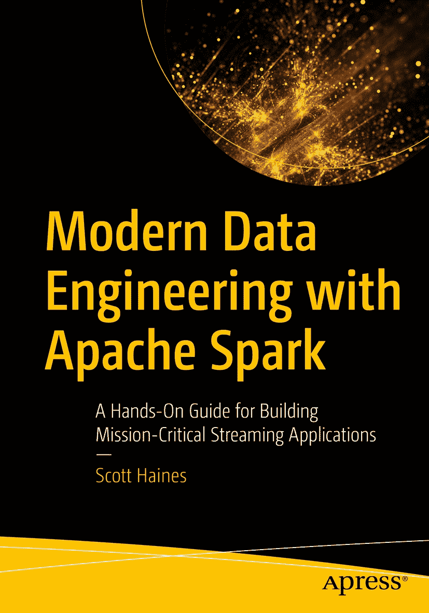

ISBN 978-1-4842-7451-4 e-ISBN 978-1-4842-7452-1 [`doi.org/10.1007/978-1-4842-7452-1`](https://doi.org/10.1007/978-1-4842-7452-1) © Scott Haines 2022 本作品受版权保护。所有权利均由出版商独家授权，无论涉及材料的全部或部分，特别是翻译、重印、重用插图、朗诵、广播、以缩微胶卷或任何其他物理方式复制、传输或信息存储与检索、电子改编、计算机软件，或采用目前已知或未来开发的类似或不同方法。本出版物中使用通用描述性名称、注册商标、商标、服务标志等，即使未作明确声明，也不意味着这些名称不受相关保护性法律和法规的约束，因此可自由使用。出版商、作者和编辑认为，本书中的建议和信息在出版之日是真实准确的。出版商、作者或编辑均不对本书所含材料或可能存在的任何错误或遗漏提供明示或暗示的保证。出版商对已出版地图中的管辖权主张和机构归属保持中立。

本 Apress 印记由注册公司 APress Media, LLC（Springer Nature 的一部分）出版。注册公司地址为：1 New York Plaza, New York, NY 10004, U.S.A.

献给我的妻子 Lacey，感谢你在漫长的夜晚和周末对我的包容，感谢你在写作过程中的起起伏伏中成为我的支柱。感谢你一直支持我那些疯狂的想法。
