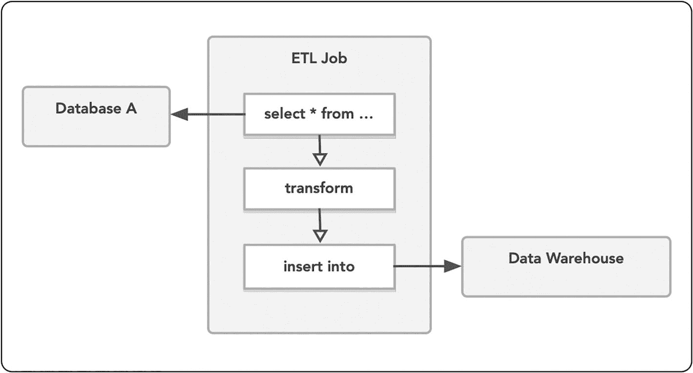
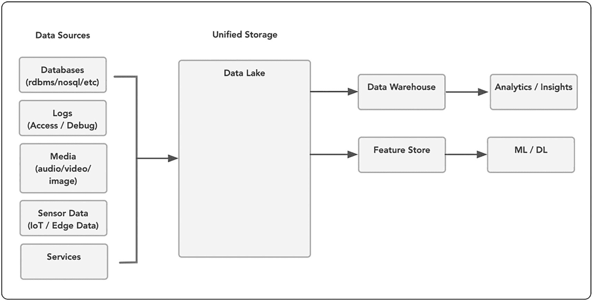

# 1. 现代数据工程导论

既然你已拿到这本书，我可以对你做出两个预测。第一个预测是，你目前正从事数据工程师的工作，并希望了解如何精进技艺，充分利用 Apache Spark 生态系统来实现这一目标。然而，如果第一个预测不准确，那么我相信你对成为数据工程师所需的条件感兴趣，并希望有一本友好的实践指南来引导你达成目标。

无论我的预测准确与否，我们的旅程都始于同一个地方——就在这一页，怀着同样的目标。这个目标是，到本书结束时，你将以新的、希望是意想不到的方式成长。我真诚地希望，额外的知识、技巧、窍门和实践材料能对你作为数据工程师的职业生涯产生深远影响。

第一章仅仅是数据工程的历史和介绍。你将了解这一专业领域的起源、基础技术以及那些帮助塑造和引导现代数据革命的演变。我们将共同识别那些将成为你基础数据工程工具箱一部分的常用工具和新兴技术。当然，我们会特别强调那些在 Apache Spark 生态系统中运行良好的技术。然而，在此过程中，你将发现现代数据工程师所需的常见角色、职责和挑战，并看到这些基本技能如何交织在一起，描绘出现代数据工程生态系统的全貌。

**注意**

随着时间的推移，我认识到记住任何事物的最佳方式是通过故事。让我们从头开始，倒带（还记得录像机吗！）回到数据工程的起点。这将为我们快进到当前（且不断演变的）我们称之为*数据工程*的伞状概念奠定基础。

## 数据工程的兴起

我大约在 20 年前开始了我的软件职业生涯。我记得读过一些工程师写的书和文章，他们回忆自己职业生涯的起点，以及软件领域在他们的职业生涯中如何变得更好。这通常归功于不断发展的最佳实践和设计模式，以及新兴技术和编程语言，它们简化了普遍存在的常见问题。

我的历史课从过去的情况开始，然后逐步梳理随时间发生的变化。它揭示了技术里程碑、新颖的创新以及看似简单的改进，这些不仅让我们的工作今天更加愉快，同时也带来了我们职业生涯中都在寻求的新挑战和刺激。那么，闲话少叙，让我们拨回时钟，回到一个关键的时间点——数据工程师的黎明。


### 云时代之前

我的职业生涯始于一个我称之为尴尬的*前云*阶段，这既是幸运也是不幸。我感到幸运，是因为我能体会到现代便利设施带来的好处，例如完善的版本控制、简化且可靠的云编排、远程调试器（泛指调试器）、日志聚合器、丰富的单元测试和集成测试框架、云的普遍可用性，以及更多其他功能。话虽如此，让我们来看看前云时代的情况。

在*云计算*普及之前，世界看起来有些不同，一切事物的节奏也慢得多。事实上，这样说还算是轻描淡写——事情的速度要慢上好几个数量级。回溯到 21 世纪初，我们拥有服务器、旋转式硬盘驱动器（HDD），以及数据中心之间（或至少是数据中心机架内）还算不错的网络连接。然而，大多数项目的进展速度，从最初的想法和概念验证，到开发、测试、手动质量保证（QA）签字，再到未来那个你最终将服务完全部署的特殊时刻，都感觉像冰川移动一样缓慢。如今，过去需要花费数月甚至数年的事情，可以在几周甚至几天内完成。

早在 21 世纪初，服务器端的软件栈看起来与现在类似，都运行着 Linux 或 Windows 操作系统，但最大的区别在于磁盘空间、计算能力（CPU）和内存（RAM）；这些都是存在争用的资源。我记得为了完成购买新硬件的流程，我等了六个月。这些事情总是从提案、规格说明、采购订单、运输、等待开始，然后是服务器安装（在数据中心/托管中心）、IP 地址分配，最后才能得到网络可寻址的计算机。然而，人们充分利用了他们工具箱中的简单工具，通过使用普遍可用的网站、基于文本的消息、基于文本的电子邮件，以及花哨的早期基于 HTML 的电子邮件，将各种东西拼凑在一起。他们还使用了其他形式的互联通信，从文本到音频，甚至低分辨率的视频。

在当时，公司将其服务托管在单一地点、使用自己拥有和维护的服务器、使用自己拥有的网络硬件，同时主要支付可靠电力、安全互联网连接以及一个拥有工作人员可以重启服务器或进行简单诊断和分类的设施，这种情况也并不罕见。

这可能与我们今天习惯的情况相去甚远，但在当时，大型团队致力于大型年度软件发布，而不是我们今天有时看到的每日持续发布，这并不罕见。这个时代只是我们走向当今运行平台旅程中的一块垫脚石，或者说是一个中途点。

### 自动化作为催化剂

大约在这个时期（90 年代末到 21 世纪初），托管网站和运行数据库有了第二种选择（而不是自己动手），那就是使用托管服务提供商。像 *Rackspace*、*GoDaddy* 和 *Media Temple* 这样的公司占据主导地位，并为当今基础性的云计算巨头铺平了道路。它们基本上是通过简化将服务上线所需的步骤来做到这一点的，从而降低了客户运行系统和服务的复杂性。

这些提供商提供了一系列打包解决方案，使得在专用虚拟机上分配服务器空间、分配静态 IP 地址、注册域名，以及轻松应用和修改 DNS 设置以将域名指向这些托管环境中运行的服务变得简单。

这些都是在运行自己的硬件时更难做到的事情，而这些提供商使得没有专门 IT 人员的小公司能够上线并拥有网络存在。这些公司提供了基本服务，加快了从构思到拥有在线运行网络体验所需的时间。这也成为了云托管提供商的蓝图，因为公司希望进一步降低运行其系统的复杂性，因为大多数公司仍然需要运营和维护完整的开发运维团队（DevOps）。

随着越来越多的公司将其业务转移到线上，对更好的设计和整体美学的质量与需求迅速增长，并推动了向功能更丰富的网络体验的转变。这些更丰富的体验有助于塑造更前沿的产品，正如我们将在下一节中看到的那样。

### 云时代

随着更好的在线体验的兴起，对为特定网站或*网络应用*的用户量身定制的个性化与定制化内容的需求也随之而来。对更好、更智能体验的需求也意味着需要更强的计算能力、更高的正常运行时间和更好的可靠性，以及最终需要海量的数据来追踪这些体验的关键指标。

**注意**

对于那些好奇的人来说，网络应用在 21 世纪中期风靡一时。简单来说，它们可以与移动应用或标准桌面软件相提并论。曾有一段时间，Adobe Flash 和 HTML5 和谐共存，使得在*大多数网络浏览器*上都能获得统一的体验。

### 公有云

改变游戏规则并开启云时代的公司是亚马逊。他们构想并构建了最广为人知且最成功的云基础设施即服务产品之一，即今天的亚马逊云服务（AWS）。随着 [AWS](https://aws.amazon.com/) 在 2006 年的公开亮相，现代云诞生了。这成为了推动数据优先和数据中心思维方式迅速崛起的催化剂。现在，任何个人和任何公司都可以在亚马逊的基础之上进行构建。

Netflix 可能是最著名的敢于冒险并全力押注 AWS 的公司。正如你可能知道的，他们的赌注获得了回报，但在当时，没有人能想象到 Netflix 今天能取得怎样的成就。通过将重心从管理基础设施转移开，他们可以专注于构建一个引人注目的产品，该产品如今已实现了完全由人工智能驱动的个性化，以及几乎任何设备上都能获得的独特观看体验，而观众只需观看内容即可。他们今天所构建的东西，在不久之前还感觉像是科幻小说。

当时，Netflix 还处于起步阶段。他们通过邮件向客户邮寄 DVD，并刚刚使用 Adobe Flash 和微软的 Silverlight（昔日网络媒体播放器的遗物）为其一小部分电影推出了初始流媒体服务。然而，Netflix 正在开发强大的分析系统，能够收集、分析并利用其客户使用数据的力量。为了分析和理解客户的行为并生成个性化推荐，Netflix 依赖了一些尖端的数据技术栈，并在 [Cassandra](https://cassandra.apache.org/) 的成功中发挥了不可或缺的作用，而 Cassandra 是 NoSQL 革命中的主要参与者之一。

**注意**

我们将在本章后面回顾 NoSQL 数据库，但现在有必要说明，数据有各种形状和大小。对于数据工程师来说，了解多种替代数据库技术，并理解不同方案相关的优缺点和风险，这一点非常重要。

亚马逊、Netflix 和其他成功公司的共同点是，如果没有专门的数据工程师、数据分析师和数据科学家团队通力合作，以大规模解决复杂问题，它们的任何商业冒险都不可能成功。

在下一节中，我们将探讨数据工程（尽管有时是在幕后）在这些极其成功的公司崛起过程中所扮演的关键角色。你将了解到这些角色、职责甚至职位名称是如何随时间演变的。


## 数据工程师的起源

严格来说，数据工程师已经存在了一段时间。只是他们曾以不同的名号出现，并与数据保护伞下的不同支撑支柱相关联。作为一门专业领域，数据工程源于传统软件工程、数据分析和机器学习的根基，这是因为随着时间的推移，公司和组织对数据的需求不断增长，数据需求也在不断演变。弥合这些学科之间鸿沟的需求，催生了一个专注于数据质量、可用性、可访问性、治理、可维护性和可观测性的新型工程专业。

在过去，访问数据是一个更为复杂的过程，需要非常专业的技能，尤其是因为当时的数据库通常是单点故障。鉴于数据对大多数组织的重要性和依赖性，数据访问的障碍层层叠叠，一直延伸到数据终点线。任何请求数据的人，比如为了季度报告，都必须付出相当大的努力才能获得数据问题的答案（查询）。这样做是为了保护稀缺且脆弱的数据资源，并保护这些数据投资，因为当时的计算和存储空间要昂贵得多。我相信你肯定听过一些恐怖故事，或者你甚至就是那个用一个糟糕的查询就搞垮数据库的人。虽然今天这种情况更难发生，但在仅仅十年前，这并不罕见。

如今的数据工程，本质上就是控制数据在各项服务之间、以及在不同数据库、数据流、数据湖和数据仓库之间的流动。这种通过数据网络的数据流支持不同的访问和处理方式，可以应用于捕获到的数据，范围涵盖历史数据分析、洞察生成、机器学习和智能的模型训练，以及为指标服务、运营洞察和监控、以及实时模型服务和智能提供快速数据访问。

为了取得成功并满足当前的数据需求，数据工程师必须理解如何可靠地捕获、处理和扩展在整个数据平台乃至整个数据生态系统中生成的汹涌数据流。这需要扎实理解软件工程最佳实践、分布式系统，对 `SQL`（包括数据建模、查询和查询优化）有具体理解，以及掌握与分析处理、查询相关的知识，甚至包括统计学和机器学习的基础知识。

尽管数据工程与数据保护伞下的许多支柱领域存在重叠，但全面招聘专家的需求依然存在。随着时间的推移，我观察到的关键区别在于，专家们致力于自动化流程和消除冗余。他们能够敏锐地理解并解决其专业领域内的通用复杂问题，因此这些优化减少了对大量专家的需求。多年来，似乎唯一不变的就是这些不断改进先前技术、软件、最佳实践和解决方案的演进与创新循环。就数据而言，这意味着每年我们都能以更安全、更可靠的方式存储、访问、处理数据并从数据中学习。

你还记得上次与数据库管理员（`DBA`）交谈是什么时候吗？或者直接与数据分析师互动呢？上次你需要提取或安排报告是什么时候？你是否使用了自动化其中一些流程的工具？

要牢牢掌握众多技术、操作系统、云供应商、服务、框架、`CPU`、`GPU`，或者每周新出现的容器技术，可能是一项艰巨的任务。与此同时，你还要努力工作、学习和掌握一切，甚至仅仅是试图跟上常规的、持续不断的变化。所以，为了简单起见，我将让你“作弊”，我们将一起学习一组精心挑选的核心技术和概念，它们对整个数据生态系统至关重要。当然，我们会从本书后续内容需要了解的知识点，以及那些与 Apache Spark 配合得特别好的技术角度来审视它们。

## 数据库的多种风味

数据库几乎与计算机拥有存储设备的历史一样悠久。我们要感谢[埃德加·F·科德](https://en.wikipedia.org/wiki/Edgar_F._Codd)（在 IBM 工作时）开创了关系型数据库，并为我们提供了一种通过连接及其关系来描述数据世界的方法。尽管如今市面上有众多类型的数据库，但我认为你通常会遇到四种基本风味的数据库。

### OLTP 与 OLAP 数据库

我敢打赌，在线事务处理（`OLTP`）风格的数据库是大多数人首先联想到的数据库概念。这种风格的数据库用于银行账户交易、预订航班座位等等。它特别适合处理系统内的小型、孤立（原子性）事务。这些事务是对数据的插入、更新和删除操作。原子性事务旨在实现尽可能小的孤立更改，例如递减或递增一个数字，比如航班剩余座位数或某人账户中的余额。

`OLTP` 数据库传统上是为处理事务而架构和优化的。这意味着有一个单一的中心化进程在运行，它通过预写式日志（`WAL`）来实现原子性、一致性和持久性。`WAL` 使数据库能够精确跟踪对每个表格数据行的更改，从而保证一致的状态。为了实现快速、持久的事务，这种风格的数据库是非分布式的，并在单一位置运行。通过消除任何网络 IO（分布式通信/传输），每个事务都可以运行得极快。

作为非分布式数据库运行的唯一问题是，如果你想增加数据库的规模（无论是硬盘空间还是工作内存 `RAM`），唯一的办法就是去找一个更大的服务器并迁移到新机器上。鉴于 `OLTP` 数据库是一种垂直扩展的数据库，为了满足不断增长的需求而进行扩展可能会变得非常昂贵。

#### 事务的麻烦

在线分析处理（`OLAP`）风格的数据库建立在与 `OLTP` 数据库相同的核心技术之上，关键区别在于数据库的优化方式。事务是有成本的，这意味着数据库需要锁定事务期间正在写入的表行。这个过程有利于一致性，因为它确保并发修改或可能的乱序写入不会破坏数据的完整性。

然而，分析查询传统上是在仅追加风格的数据库上进行的，这意味着数据永远不会被修改，因此不需要事务。当你从等式中移除事务时，也就移除了对行级锁定的需求，因为数据库中的每一行数据都将始终处于其不可变或最终状态。这在处理分析查询时尤其重要，我们接下来将探讨这一点。


#### 分析型查询

`分析型查询`起源于商业智能（BI）领域。这类查询通常涉及多个处理阶段，以提供可用于回答分析型查询的数据形式。我们将在第 12 章探讨`汇总`、`透视`和`窗口函数`，这些是分析处理中常见的计算和聚合操作。

例如，假设你需要编写一个查询，以确定过去一年中每周每天的最高销售额，并按关键地理区域进行细分，同时还需要提供每天销量排名前五的商品类别。这个查询可能需要数据库处理所有目标表中的所有行（数据），以生成多个数据集（定义为视图或临时表），这些数据集需要作为查询执行每个逻辑阶段的中间结果存储在内存中，以便快速获取结果。

一个大型分析型查询可能成为消耗大量数据库资源（CPU/内存）的运维负担。这类查询也可能难以维护（因其复杂性），并且由于大数定律而难以扩展。简而言之，大数定律指出，随着被查询的行数和数据规模（列数）的增加（这在大数据世界中很常见），查询的响应时间在最佳情况下会与查询的行数成比例增加（线性增长），在最坏情况下则呈指数级增长。虽然速度较慢，但这些查询最终仍有完成的机会；然而，由于事务带来的行级锁定开销，大型分析型查询甚至可能根本无法执行。

虽然能够运行这些`OLTP/OLAP`查询的关系型数据库（如`MySQL`、`PostgreSQL`、`DB2`、`SQL Server`和`Oracle`）在针对大型、相关/关联数据进行提问时很受欢迎，但还有另一种类型的数据库，它处理的是独立/反规范化的数据，通过键而非跨索引表的查询来访问。这种需要了解的下一种数据库风格被称为`NoSQL`数据库。

### 无模式，没问题。NoSQL 数据库

我记得在加州卡内基梅隆大学参加过一次聚会（与硅谷云计算聚会小组一起），当时演讲者们都在兴奋地热议这种新型数据库的优缺点。它针对惊人的速度（快速随机访问）和水平可扩展性（使数据库能够分布到多台机器上，通过机器集群存储前所未有数量的数据）进行了优化。锦上添花的是，这些数据库在写入第一条记录之前，无需定义明确的模式或表结构。

对我来说，这是 NoSQL 革命的第一天。这种数据不必是关系型的，甚至不必遵循具体模式的概念，深深吸引了我。它至今仍吸引着我，但方式已与最初不同。没有模式也意味着去掉了护栏，使得数据可以以不一致的方式写入。如果没有一个半防御性的系统来验证和维护某种数据一致性，就很难为大规模运行可靠的数据系统奠定基础。这意味着，你很容易在这个超快、可扩展的 NoSQL 数据库中积累大量损坏的数据。然而，NoSQL 数据库也开启了新的访问模式，包括数据读取者能够使用模式推断（我们将在第 3 章中看到）和其他读取时模式技术（Apache Spark 也支持）来动态发现数据结构的能力。

NoSQL 数据库是一种分布式数据库。这意味着一个由一台或多台机器组成的集群封装了整个数据库。虽然这使数据库能够水平扩展，但也意味着需要在如何处理分布式网络带来的常见问题上做出一些权衡。这些权衡被`CAP 定理`所概括，该定理指出，任何分布式系统在任何给定时间点都只能满足以下三个特性中的两个：**一**致性、**可**用性和**分**区容错性。

这意味着数据库必须牺牲一些东西，因为我们不能鱼与熊掌兼得。我们经常看到数据库被描述为`Cp`（一致性和分区容错性）或`Ap`（可用性和分区容错性）。你不会看到系统被描述为`Ca`（一致性和可用性），因为分布式系统会受到网络分区的影响。网络分区就像道路封闭且没有替代路线，也被称为脑裂，因为分布式系统的一个子集被切断，无法与系统的其余部分通信。为了将系统描述为`Cp`，意味着数据库中的数据有时不可用；另一种选择是将系统描述为`Ap`，意味着它们可能不是完全最新的（一致的），但它们仍然可用并能提供数据（可能是过时的）。

那次聚会中至今仍在使用的、最著名的数据库是`MongoDB`、`Redis`和`Cassandra`。你将在本书后面（第 10 章）使用`Redis`和 Spark。那里的练习结合了 NoSQL 的最佳特性与构成大规模可靠系统的刚性结构（即模式）的最佳特性。

沿着结合两个世界最佳特性的思路，我们来到了 NewSQL 数据库。它是传统关系型数据库（OLTP/OLAP）与 NoSQL 数据库的容错性和弹性优势的混合体。

## NewSQL 数据库

`NewSQL`数据库是两种 SQL 世界最佳特性的混合体，它融合了 OLTP 事务的一致性、可靠性和持久性，以及 NoSQL 的容错性和水平可扩展性，并在可用性和一致性（`Cp|Ap`）之间做出了最小（且通常是可配置的）权衡。

这些数据库是从头开始重新架构的，以便在云环境中良好运行。在云环境中，网络不可用可能导致节点离线，网络分区可能使节点不可见，服务器可能在没有太多通知的情况下离线，这使得跨节点复制数据成为这些大规模系统的首要需求。这些数据库跨节点复制数据，以确保在节点故障或网络分区情况下的一致性和可用性。

`CockroachDB`和`Google Spanner`是 NewSQL 市场的两大巨头，虽然本书不会直接使用任何 NewSQL 服务，但提及这些技术是值得的。你可以通过添加库依赖项，使用 Apache Spark 连接这些服务并与之互操作。

### 权衡利弊

处理数据几乎普遍意味着你迟早会与数据库打交道，了解你的选择有哪些，以及为什么选择一种技术而非另一种，对于项目的成功总是一个巨大的优势。我倾向于选择久经考验的经典技术，即市场上已经稳固确立的技术。此外，使用你公司支持的技术通常是明智之举，因为这样会有一个社区可以就任何成长中的烦恼或沿途的支持进行交流。


## 云存储

亚马逊的[简单存储服务 (S3)](https://aws.amazon.com/s3/) 可能是当今使用最广泛的云存储解决方案。[微软的 Azure Blob 存储](https://azure.microsoft.com/en-us/services/storage/blobs/) 和 [谷歌 GCP 的云存储](https://cloud.google.com/storage) 是其他云服务商提供的类似解决方案。无论你使用哪家云服务商，其技术目标都是殊途同归。

通用云存储范式的核心在于承诺提供一种简单易用、成本低廉的数据存储解决方案，该方案具备高可用性和高可靠性，以及近乎无限的弹性可扩展性，以满足任何规模公司日益增长的数据存储需求。

在可扩展的云存储服务出现之前，公司被迫运行、维护、扩展和运营大型 `Hadoop` 集群，以使用 `Hadoop 分布式文件系统` (`HDFS`) 实现类似的弹性可扩展性。如今，拥有了近乎无限的弹性数据存储，公司找到了比以往更多存储数据的理由。将所有数据都存储起来有利有弊，而处理盲目存储的数据则面临更多挑战，尤其是因为数据格式会随着时间的推移而不断演变。

## 数据仓库与数据湖

你可能已经遇到过或至少听说过数据仓库和数据湖的概念。虽然名称相似，但这两种数据存储和服务技术所提供的约定和实用程序却处于数据平台的两个不同侧面。一方面，你有数据湖，它是一个分布式的弹性文件系统；另一方面，你有一个分析型数据库，用于解决数据孤岛问题。然而，在实践中，它们仍然可以很好地相互配合。

## 数据仓库

数据仓库源于数据孤岛这一常见问题。数据孤岛字面意思就是数据分布在多个逻辑 SQL 表中，这些表位于不同的数据库或数据存储中，使得从单个数据库系统的上下文中访问回答查询所需的数据变得困难。

### ETL 作业

鉴于数据分散在许多独立的数据库中，一种与数据仓库相伴而生的常见技术出现了，那就是`提取-转换-加载` (ETL) 作业。图 1-1 从高层次展示了将数据从孤岛数据库迁移到公共数据仓库所需的一系列步骤。



图 1-1

提取-转换-加载 (ETL) 作业

ETL 作业通常被配置为批处理作业运行。这些批处理作业可以安排运行一次（这在一次性数据导入时很常见），也可以安排按基于时间的重复计划运行。这意味着每个作业（将数据从一个数据库迁移并加载到数据仓库的工作）都是独立的，并且一个作业要成功，就必须运行完成。

图 1-1 中所示的 ETL 作业首先连接到远程数据库，并运行一个查询，该查询`提取`（或读取）指定查询所要求的数据行。值得一提的是，这些查询并不局限于将数据从一个地方移动到另一个地方的简单任务；此步骤还可以包括更复杂的查询，例如跨多个表连接数据以生成宽表，这些宽表可在数据仓库中用于分析查询。

下一步是`转换`步骤，为将数据插入数据仓库做准备。在此步骤中，通常会对数据应用特定的模式或格式，以匹配通用的命名约定（分类法），并提高数据仓库中不同表之间的可连接性。此步骤是可选的，因为数据在复制到数据仓库时并不总是需要转换。

作业的最后一步是`加载`（或写入）过程。它完成了将数据从孤岛源迁移到主数据仓库中某个表的过程。

数据仓库充当了急需的中央数据库（通常是关系型、非事务性数据库），`数据分析师`或不同角色的人员会在此运行他们的商业智能查询，生成洞察，或探索数据以寻找有趣的趋势和模式。

虽然数据仓库是这种集中式的关系型数据库，但数据湖则崛起成为数据的集中暂存区。公司可以将管理这些大型分布式文件系统所需的可扩展性和运维工作外包给云供应商，其成本远低于拥有和运营维护这些数据基础设施所需的服务器、磁盘和人员。数据湖作为名副其实的“存储一切”的统一位置而兴起。我们现在就来探讨一下。


### 数据湖

*数据湖*的出现是为了解决与原始真实数据（即未经清理或未与其他数据关联的数据）的孤立存储相关的常见问题。真实数据是指数据最初由数据源发出或提供时的原始形态，我们将在图 1-2 中进一步介绍。与旨在缓解组织内数据孤岛和碎片化问题的数据仓库类似，数据湖的诞生是为了解决“原始”数据碎片化和孤立存储的问题。它是一个集中式的暂存区域，用于存储*任何类型的数据*，从称为*非结构化数据*的原始二进制数据（图像、音频、视频文件），到*半结构化数据*（CSV、JSON 数据），甚至*完全结构化数据*（具有显式类型和保证的数据）。



图 1-2

数据湖架构。数据（从左侧）流入数据湖，经过任意数量的自动或手动流程，并可以可靠地用于生成新的数据源，以满足公司、产品或功能的需求。一旦数据进入数据湖，它可以在被使用或最终删除之前，按需停留任意时长。

数据湖的核心本质上是一个*弹性分布式文件系统*。这一点很重要，因为弹性使数据湖能够水平扩展（伸缩），以满足当前数据需求的规模和存储要求，同时还能灵活地增加底层总存储分配，以*零停机*的方式处理未来的存储需求。通过使用商用云存储（如 Amazon S3）或运行 Apache Hadoop 的 HDFS，你可以为运行自己的数据湖奠定基础。最终，文件（在云存储中也称为对象）会存储在多个服务器上，以实现可靠性（容错性），并减少众多并发读写操作之间的争用。在阅读关于 MapReduce 的内容以及在第 2 章开始使用 Apache Spark 时，你将进一步了解数据湖的用途。

### 数据格式

如你所知，数据的形式和规模多种多样，“原始”数据涵盖了多种风格和结构，从半结构化的基于文本的数据格式（如日志数据、CSV 文件、换行符分隔的 JSON），到完全非结构化的二进制数据（包括图像和视频数据、物联网（IOT）发出的传感器数据），甚至包括完全结构化的数据协议（如 Apache Avro 和 Google 的 Protocol Buffers），你将在第 9 章学习如何使用这些协议。

图 1-2 展示了数据湖的高层概览。从左侧开始，你会看到许多外部数据源，它们是初始的上游数据源。这些数据源代表了真实数据的不同提供者。虽然每个上游数据源负责提供自己的数据集和数据格式，但所有这些不同的数据源都可以利用同一个底层“数据湖”，为下游系统提供一个统一或集中的位置来获取数据。目前，可以将下游系统理解为最终依赖一个或多个（如果已关联）上游（真实）数据源所生成数据的任何系统或服务。

数据湖本身不过是一个可靠的弹性文件系统，能够水平扩展以满足众多数据集的存储需求。通常，人们会使用目录来组织存储在数据湖中的数据。就像文件系统或 Java 中的包一样，这些目录的存在是为了提供上下文和创建命名空间，以防止表之间发生冲突或意外损坏。在代码清单 1-1 中，你可以看到如何使用层次树来定义分布式 SQL 表。这些表是你在后续章节中将创建的一些示例表。

```
.
├── bronze
│   └── customerratings
│       ├── _SUCCESS
│       └── part-00000-5607f490.snappy.parquet
├── common
│   └── customers
│       ├── _SUCCESS
│       └── part-00000-042d86a2.snappy.parquet
└── silver
├── coffee_orders
│   ├── _spark_metadata
│   │   └── 0
│   ├── date=2021-09-05
│   │   ├── part-00000-0cdf37bd.snappy.parquet
│   │   ├── part-00001-ffe1784b.snappy.parquet
│   │   ├── part-00002-3b79a605.snappy.parquet
│   │   └── part-00003-8b42fa49.snappy.parquet
│   ├── date=2021-09-06
│   │   ├── part-00000-83e42c85.snappy.parquet
│   │   ├── part-00001-0c4daaa2.snappy.parquet
│   │   ├── part-00002-1c63b2ef.snappy.parquet
│   │   └── part-00003-e8262e72.snappy.parquet
代码清单 1-1
数据湖内三个分布式 SQL 表（customerratings、customers 和 coffee_orders）的文件系统布局
```

如代码清单 1-1 所示，数据湖本身只是一种组织真实数据的方式。要处理（或查询）存储在数据湖中的数据，必须先将数据（由分布式表布局中的一个或多个文件表示）读取到能够直接查询数据的系统中（例如 Apache Spark SQL、Amazon Athena 等），前提是底层存储格式必须是可直接查询的（例如 Apache Avro 或 Apache Parquet）。在代码清单 1-1 中，显示的分布式表以 Apache Parquet 列式格式存储，并使用了 Snappy 压缩。随着章节的展开，你将进一步了解 Apache Parquet。

如果数据不幸地采用了不易查询的格式，也仍有希望。众多编程语言支持多种技术，这些技术可以执行初始读取（打开）、解析（转换）和转换原始真实数据的过程，将其转换为能够加载到物理数据库或更常见的托管云数据仓库中的格式。

**注意**

你将在第 3 章使用 Apache Spark 处理简单的工作负载，包括读取、转换和查询存储在文件系统上的数据。到第 6 章，你将使用托管表，这允许 Apache Spark SQL 处理管理分布式表元数据所需的操作。例如，这些元数据包含分布式数据库位置、表名、所有权和权限，以及注释表和数据库的元数据，以协助数据发现过程。

除了简单地将数据从数据湖加载到外部数据系统之外，读取和转换原始真实数据集的过程还可用于生成更专业的数据集，这些数据集可以作为上游数据集的子集或父数据集的依赖数据集保存回数据湖。这些专门的数据子集（视图）类似于子节点，而共同的上游父节点则类似于通用数据集（原始数据）与众多分支子集及其后代之间的关系。


## 数据依赖与数据管道架构

一个依赖数据集可以简单到只是一个父数据集的子集，也可能更复杂，例如当来自多个数据集的数据被连接以创建更复杂的子数据集时。增加复杂性的还有这样一个事实：每个子数据集也会成为任何从其派生的新下游数据的“数据源”，并且每个子数据集也可以是来自其他“数据家族树”的一个或多个附加数据集（节点）的连接输出。这就是数据血缘概念的来源，对于心智模型来说，将其想象成树形结构比想象成最终往往形成的、由相互依赖的数据集组成的更大图状结构更容易。只需将其视为一个家族树，但拥有更多潜在的父母，当然，是数据而非人！

考虑到所有可能的数据集都可以从无数个数据源数据集派生（或重新派生），事情很快就会从简单变得复杂。正因如此，分布式`SQL`表成为处理大量数据的流行方式。大量数据很快变成了“大数据”，随后又被“无界数据”的概念所取代，但元数据和存储机制基本保持不变，使用云数据湖进行无界存储，并通过存储在流行的`Apache Hive Metastore`中的元数据进行强化。

正如你将在本书后面看到的，`Apache Spark SQL`使得扩展这些常见的`SQL`工作负载变得简单，它可以连接到存储在一个或多个位置的数据，以多种不同的处理模式和访问模式运行，从近实时的连续流到更实时的结构化微批处理，再到简单的基于批处理、按需处理，甚至是即席处理。这个过程通常始于第一步：使用传统的`ETL`（提取-转换-加载）作业以及`ELT`（提取-加载-转换）将原始数据从数据湖移出并放入更可用的数据存储中，你将在后面了解这些内容。你将看到直接针对这些数据源数据运行工作负载是多么简单，使用`Apache Spark SQL`。

> **提示**
>
> 将数据源数据集中存储在一个中心位置可能是你最关键的数据资产之一。你不仅可以使用这些数据来解决许多问题并回答许多问题，还可以在需要重建表或从数据基础设施中的问题（例如糟糕的部署或其他下游损坏）中恢复时使用这些数据。当你进入本书后半部分时，你将了解更多关于如何为数据成功做好准备的内容。

数据湖和数据仓库在现代数据生态系统的结构中各有其作用。它们就像数据的阴阳。将这些不同的数据能力结合使用，封装了一个整体的数据连续体，并满足了数据平台的众多需求。

### 数据管道架构

数据工程师的关键职责之一在理论上非常简单——他们负责*数据管道*的基础设施和管理。数据管道只是一个花哨的名称，封装了在规模上、在源和汇之间可靠地移动和转换数据的过程。*源*和*汇*的概念是一种用于思考移动和转换数据的系统的心智模型，你也可以从*上游*和*下游*的角度来思考。

如果你从足够高的层次上审视事物，数据本质上是在一个大型网络图中，通过一系列有向的作业血缘和函数转换进行旅程。*源*指的是数据的上游来源，例如一个数据库。*汇*指的是可以物理映射到现实世界汇的引用。这是一个出口或出口点，数据流在此处被收集。

> **提示**
>
> 数据流通常用水来比喻，因为这是人们容易理解的事物。考虑水在自然界中的运作方式。水滴聚集并汇合形成水坑和水洼。根据收集速率和收集水的容器，小水洼很容易变成溪流。这些溪流流动并汇合形成河流，分散到三角洲、湖泊甚至海洋。在微观层面，每个水分子都由一个结构组成，可以用一个数据点来表示，从这个角度来说，这个比喻开始变得牵强。然而，作为一种心智模型，它确实有效。

我喜欢思考数据管道血缘中的每个作业如何以类似于描述`API`的方式工作。一个`API`有一个约定的契约，规定了`API`请求中必须包含哪些数据，并且`API`所有者对如何处理和响应好的和坏的请求，以及如何处理错误以及当出现问题时这些错误如何传播回调用者（客户端）做出强有力的保证。一个不按文档方式运行的`API`会让内部或外部客户非常生气，同样，那些“应该”以某种方式呈现或具有特定字段但实际上并非如此的数据，也会让任何在你或你团队拥有的管道作业下游处理数据的人感到愤怒。

