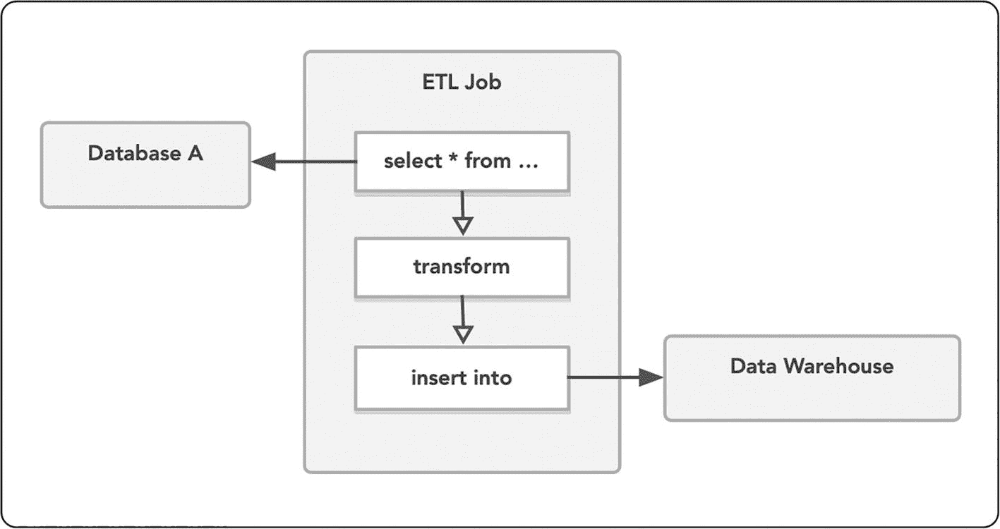
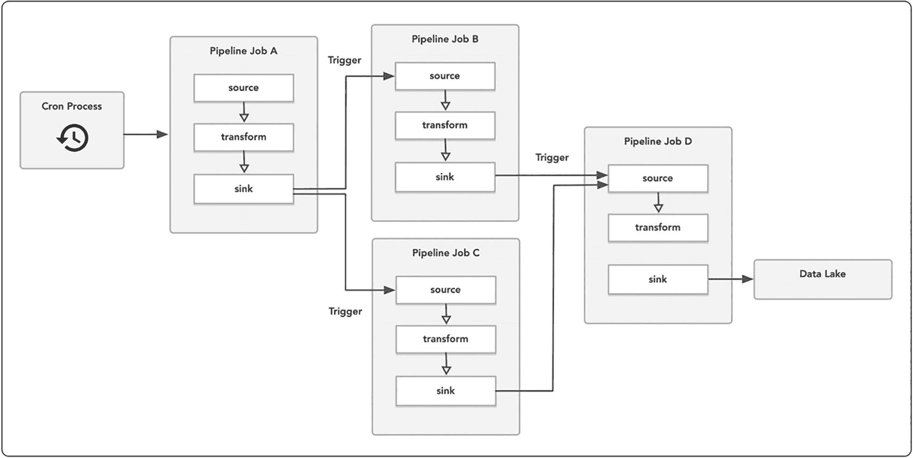
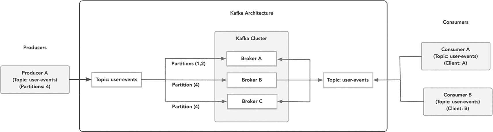

# 数据管道

数据管道可以用几种不同的方式来定义。在最简单的形式中，管道可以定义为一个作业或函数，它从单个上游数据源读取数据，并将数据集以其原始形式或转换后的形式移动（写入）到另一个位置（汇）。在极端情况下，数据管道也可以用来描述一个随时间变化的分布式数据转换的复杂网络，我们将在下一节讨论工作流编排时看到这一点。

如果你考虑本章前面提到的`ETL`作业的情况，它们被介绍为在源数据库表和目标数据库汇之间可靠移动数据中扮演着至关重要的角色。图 1-3 中展示了一个修改后的示例。它展示了`ETL`作业在定义数据管道中如何发挥基础性作用。

**图 1-3** 一个简单的`ETL`管道作业

当这些简单的作业跨一系列管道步骤和多个执行阶段连接起来时，事情开始变得更加令人兴奋。这些多步骤作业已经变得如此普遍，以至于像`Airflow`这样的工作流编排器在数据平台中已经变得司空见惯。

## 工作流编排

工作流编排是控制数据在大型数据网络中可靠流动的基本方式，它由一系列相互依赖的作业和数据管道定义。图 1-4 展示了一个多步骤的、有向的数据转换作业分布式网络。作业可以在工作流管理器中的特定时间被触发，例如在计划任务`cron`作业的情况下，它们也可以由上游作业的完成来触发。使用上游作业完成作为触发器来启动一系列数据转换阶段中的下一个（或多个）作业，通常被定义为有向无环图（DAG），即上游和下游作业的网络。第 8 章专门讨论工作流，并涵盖如何设置和运行 Apache Airflow。

**图 1-4** 一个多步骤的有向数据转换管道

图 1-4 是一个管道作业的有向无环图（DAG）的高级视图，这些作业共享一个共同的上游初始触发器。如果你只有少数几个作业需要运行，并且其中大部分作业可以独立运行（无需了解任何上游作业是否成功完成），那么工作流编排可能显得大材小用，可以委托给更简单的`cron`机制。

无论是作为简单的转换，还是通过 DAG 定义的一系列相互依赖的管道作业，运行数据管道的好处在于，它为数据管道内每个执行阶段（数据汇）所产生数据的位置（数据源）、格式或模式以及预期行为，提供了一个单一事实来源。拥有单一事实来源的数据不仅有益，对于运营大型数据依赖网络更是至关重要。正如工作流管理和编排服务介入以帮助可靠地运行分布式数据转换作业和管道一样，数据目录也介入以提供一种机制，用于发现数据源、这些数据源的上游和下游依赖关系，以及数据的模式、版本、所有者，甚至数据的谱系和访问策略。

### 数据目录

数据目录提供了组织内可用数据的基本视图，并且可以扩展以封装所有权，这由描述数据生产者（个人、团队或组织）的元数据来定义。这些生产者有时被称为*数据管理者*。数据目录还可以充当定义公共*数据契约*的角色，该契约可用于建立规则来管理数据的时效性、每个字段的可用性（例如，何时为默认值或空值），以及每个字段的治理和访问规则等。

我们将在第 6 章中通过介绍 Spark SQL Catalog 来探讨*数据目录*。你将在第 5 章中学习使用 Apache Hive Metastore 和 Spark SQL 来创建和管理 SQL 表，这些表可以在 Apache Spark 中轻松发现和直接使用。

### 数据谱系

这种关于数据如何在组织内无数数据管道中流动的高级视图，由逻辑数据源和数据汇定义，它创造了发布数据谱系的方法，该谱系表示为跨数据管道的一系列数据转换。

了解并理解数据如何流经这些数据管道是整体管理中最困难的事情之一，尽早采取这些步骤有助于解决构建可靠数据平台时出现的常见问题。如果没有合适的通用工具，随着事情变得越来越复杂，管理数据可能会变成一场噩梦。

我们将在本书后面更详细地探讨数据目录和数据谱系，并介绍数据治理的概念。接下来，我们将探讨流处理，它使管道架构能够以更流畅的方式移动，作为一种基于数据可用性的推送式系统，而不是批处理系统中常见的拉取式系统。

## 流处理

流处理是从操作系统（OS）进程之间通过总线传递消息的简单机制演变而来的。它们更广为人知的名字是*发布/订阅系统*，因为系统进程会以单台机器内跨应用通信的形式发布或订阅消息。

### 进程间通信

这种简单但有用的结构，通过允许单台计算机操作系统内的进程（应用程序和内核任务）参与对话，实现了并行处理能力的巨大提升。其美妙之处在于，进程可以以同步或异步方式参与对话，并在许多应用程序之间分配工作，而无需锁定和同步带来的必要开销。

### 网络队列

这种通过单系统上的发布/订阅消息总线实现并行处理的方法，使得工程师能够以分布式优先的方式扩展和演进这些系统。这导致了网络*消息队列*的出现。

基本的消息队列允许在一个分布式*先进先出（FIFO）* 风格的队列中创建一个或多个通道（即命名队列），该队列作为服务运行在可网络寻址的位置（例如，`ip-address:port`）之上。这使得基于网络的应用程序和服务能够异步通信，这意味着消息的生产者不需要直接了解订阅者（消费者）。相反，这被卸载到网络队列上，极大地简化了分布式系统。

### 从分布式队列到可重放消息队列

[Apache Kafka](https://www.kafka.apache.org/) 在技术社区中家喻户晓，它作为数据平台中的一个组件，就像精品苏打水和乒乓球之于任何初创公司一样普遍。`Kafka`始于 LinkedIn，后来被赠予 Apache 基金会，其目标是创建一个分布式、容错的平台，用于处理低延迟的数据馈送，即*数据流*。

`Kafka`以全新的方法构建了分布式网络队列。然而，它在处理来自消费者的部分故障方面采用了不同的方法。正如你可能想象的那样，如果我们有一个分布式队列，并且我们从该队列中取出一条消息，那么我们可以假设该队列会清除该消息，然后一切照旧。

然而，面对故障时，无论你将责任归咎于何处，如果由于应用程序代码中的错误导致处理消息的进程丢失，那么从队列中清除的消息就会导致数据丢失。读取消息的系统经常会遇到坏数据，如果没有适当的防御机制来处理损坏的数据，进程可能会意外终止，且无法恢复。现在你可以想象，这对业务来说可不是什么好事。

### 容错与可靠性

为了保护消费者免受这种不可避免的情况影响，`Kafka`的架构设计确保了下游故障不会立即导致数据丢失。解决方案是像数据库处理可靠性那样处理消息，即通过持久化写入。神奇的是，分布式预写日志（WAL）应运而生。我们现在来介绍关键术语、架构组件和 `Kafka`的命名法。如果你有`Kafka`的使用经验，可以跳过这部分，直接了解 Spark 如何作为现代数据拼图的最后一块发挥作用。

### Kafka的分布式架构

`Kafka`将生产者发出的数据存储在称为`主题`的结构中。一个 `Kafka`主题进一步被分解为一个或多个逻辑分区，这使得每个主题能够进行扩展，以处理可变的读写吞吐量。每个分区保证按时间顺序存储其接收到的数据（称为 *Kafka 记录*）。参见图 1-5。

图 1-5 Kafka 架构

鉴于每个分区都维护着这种同步的记录流，`Kafka`通常用于存储来自连续时间序列事件（例如用户将商品放入购物车，或信用卡交易）的事件流。这些时间序列事件流使系统能够分析那些原本难以高效分组的数据。

由于可以保证每个分区内事件的顺序，并且写入每个分区的事件是根据每条记录的键来分布的，这种分布方式有助于解决与时间序列分析相关的常见问题。数据无序、存储在许多不同位置以及不同数据存储中的问题，感觉就像本章前面讨论的数据孤岛问题。

应用程序无需先运行一个作业来跨所有分区或不同数据存储按键收集所有数据，而是可以直接处理 `Kafka`主题的各个分区或切片，而无需事先对数据进行混洗。

这可以大大减轻处理信用卡欺诈或基于用户实时活动提供推荐建议的系统的压力。通过为每条记录选择合适的键，可以保证数据在每个主题内的落盘方式。

#### Kafka 记录

记录是简单的数据行，以持久化的方式写入磁盘，类似于预写式日志（WAL）。每条记录由一个键标识，这有助于 `Kafka`将数据传递到正在写入的主题的正确分区。记录携带一条主要消息或有效负载，称为消息值。除了键/值对之外，还有一个内部时间戳（Unix 纪元毫秒），在消息被接收并写入主题日志时打上。这确保了插入顺序不会因时间问题（时钟漂移、时区差异等）而受到影响。最后，在较新版本的 `Kafka`中，每条记录都有一个可选的标头映射，可用于进一步注释数据。它可以应用关于生产者、有效负载模式以及你能想到的任何内容的元数据。

#### 代理

`Kafka`以类似于常见发布/订阅系统的方式管理数据生产者和消费者。存储在主题每个分区中的数据由 `Kafka`集群中的一个活跃代理管理。

这些代理管理写入主题的每条记录的副本，并保持同步，这样即使由于服务器离线或网络分区导致某个代理丢失，也不会造成数据丢失。下一个可用的同步副本会迅速接管数据的服务，并且 `Kafka`会找到另一个可用的代理来分配为下一个备份，以防止数据丢失的情况。

#### 为什么流处理很重要

Kafka 是使用最广泛的流处理框架，鉴于该框架灵活、低延迟、高可用的特性，不难理解其原因。然而，Kafka 并非该领域的唯一参与者。Apache Pulsar 源自雅虎内部项目，是 Kafka 的另一个开源替代方案。虽然本书不会使用 Apache Pulsar，但了解还有其他替代方案总是好的。第 11 章将介绍如何将 Apache Kafka 与 Spark 结合使用。

## 总结

在第一章中，我向你阐述了在当前数据工程这个激动人心的领域取得成功，需要采取哪些步骤以及技术需要取得哪些进步。

你看到了云优先解决方案的兴起如何使我们能够专注于真正想要处理的事情并确定优先级。在操作过 Hadoop 集群并使用过 Amazon S3 之后，我不得不说，不必担心磁盘和主机故障、数据复制、备份或恢复和灾难缓解，这让我能够专注于使用数据，并创建更多有用的工具，这些工具*与数据协同工作*，而不是处理数据运行所依赖的操作。

我们探讨了数据库如何随着时间的推移而演变，并讨论了传统 OLTP/OLAP 风格数据库、NoSQL 数据库以及最后的 NewSQL 数据库的一些基本概念和范式。这里有趣的一点是，在 NoSQL 时代，出现了从 SQL 的巨大转变，虽然文档存储（完全非规范化的数据集）对组织具有巨大价值，但能够通过 SQL 风格的查询和操作来表达我们如何处理数据，已经重新主导了市场。

鉴于可用的数据库种类繁多，以及这些数据孤岛内的碎片化，我们探讨了 ETL 作业和数据管道架构的兴起。这种能够高效地将数据从一个源移动到另一个源的概念，是催生数据仓库的催化剂，同时也催生了统一数据湖的发明。随着公司处理越来越多的数据，以及管道规模和复杂性的增加，像 Apache Airflow 这样的工作流管理器应运而生。这些技术就像是数据管弦乐队中缺失的拼图，而工作流管理器则成为了指挥，协助为整个数据平台带来和谐。

在本章的最后，我们讨论了消息队列和代理的演变。我们讨论了流处理，以及这种分布式的传话游戏如何为从批处理到更实时的、基于流的处理（随着 Kafka 的诞生）这一激动人心的转变奠定了基础。

在本书的其余部分，我们将深入探讨 Apache Spark 生态系统，采用动手实践、循序渐进的方法来解决现实世界中的数据工程问题。当你解决基础问题并在此过程中构建自己完全容器化的、可工作的数据平台时，你将逐步了解支撑数据工程保护伞的众多层次和技术。