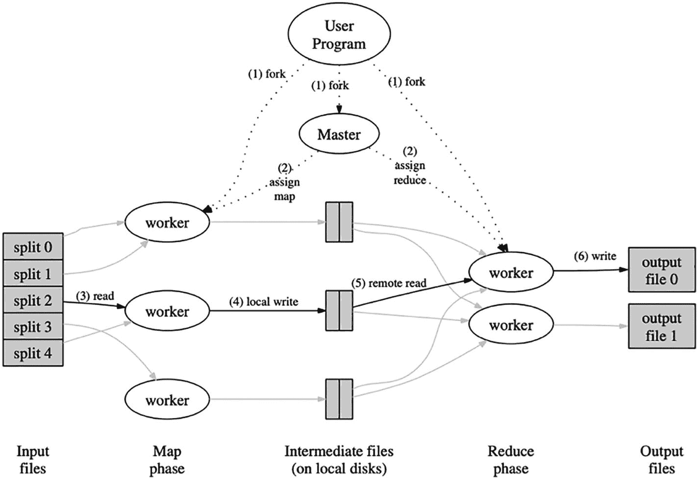
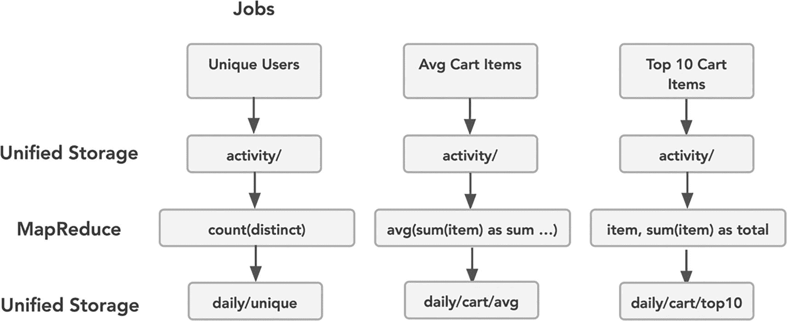
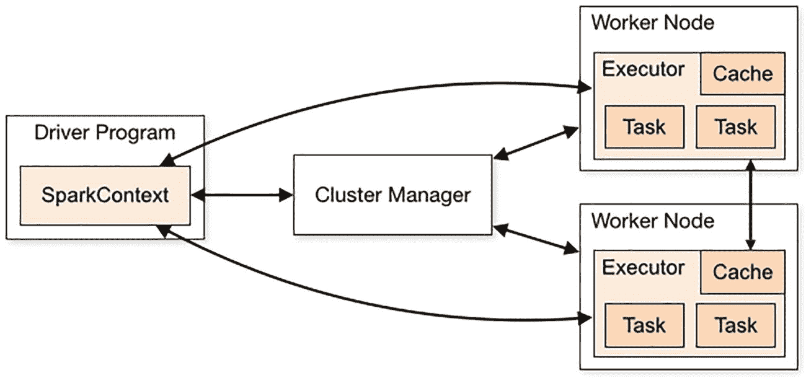
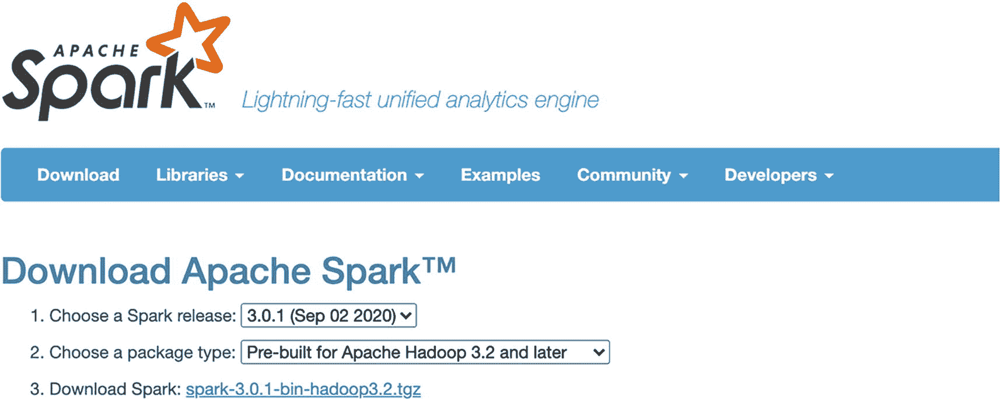

# 2. Apache Spark 入门

Apache Spark 是数据工程师的瑞士军刀。作为一个统一框架，它提供了必要的库，能够有效连接并建立共同的数据叙事，让工程师们能够跨学科协作。从原始数据的摄取和验证，到数据清洗、转换和聚合，再到趋势的分析探索和洞察的生成，Spark 将任何成功数据运营中的各个组成部分串联起来。它还支持用于特征工程和稳健机器学习的一致（可序列化）管道。

在本章中，你将学习 Apache Spark 如何作为数据平台内的核心中心组件发挥作用。正如数据仓库和数据湖解决了数据通用访问的核心问题一样，Spark 解决了在整个数据平台上大规模集中和统一数据处理方式的问题。这简化了你需要使用的工具数量，让你能专注于更少的事情，从而更高效地工作。作为附带效应，Spark 为简化组织中的许多系统和流程提供了绝佳机会。

本章的目标很简单；我们将共同为 Spark 生态系统打下坚实的理解基础，并牢固确立 Spark 在现代数据工程师中所扮演的角色。我们从 Spark 编程模型的基础概念开始，探索 Spark 应用架构中的核心基础知识和组件，并了解 Spark 如何通过委托优雅地处理关注点分离。

本章也是一个入门指南，包含了在本地启动并运行 Spark 的必要步骤。你将完成第一个 Spark 动手练习。这个练习有助于加深你对如何使用 `spark-shell`（或者我喜欢称之为 *Spark 游乐场*）处理商业智能领域一些基本问题的理解。到本章结束时，你将运行过你的第一个 Spark 应用程序，而对于那些更有 Spark 经验的读者，这个练习可能会为你提供处理 Spark 工作的不同视角。

## Apache Spark 架构

Apache Spark 是从 *MapReduce* 编程模型演变而来的。要理解这种演变是如何发生的，我们首先来看看什么是 MapReduce。MapReduce 因 Jeffrey Dean 和 Sanjay Ghemawat（谷歌）在其 2004 年的开创性论文《[MapReduce：大型集群上的简化数据处理](https://static.googleusercontent.com/media/research.google.com/en/archive/mapreduce-osdi04.pdf)》中而声名大噪。这种编程模型促成了谷歌搜索引擎的成功，这篇论文也为 Hadoop 等开源 MapReduce 框架的出现铺平了道路。这使得谷歌以外的公司也能够开始以标准化的方式高效处理大型集群计算数据问题，即所谓的*大数据*。

### MapReduce 范式

从非常高的层面来看，MapReduce 与第 1 章的 ETL 作业示例有一些相似之处。每个作业都从一组特定的输入数据（存储在分布式文件系统上的文件）开始，并使用 MapReduce API 在两个（或更多）不同的部分编写工作流。

一个典型的工作流从一些转换逻辑（映射阶段）开始。这个过程本质上是从分布式文件系统中提取信息，具体取决于所读取文件的编码方式，并负责将输入数据转换为键/值映射数据的集合。*可以说输入数据被解析并映射到特定的已知类型*。接下来，映射阶段的输出被传递给归约器，归约器处理来自映射阶段的结果排序数据集合，这些数据按公共分组键进行组织。

本质上，整个过程有效地映射了大量数据（比可靠地放入内存的数据量还要大），使用互连服务器（集群）网络，将数据排序并分组到分布式数据集中。然后进一步归约这些数据集以完成给定的目标，例如计算指向给定网站的入站引用数量，这曾帮助谷歌生成其 PageRank 算法。整个过程的输出随后再次写入可靠的存储，以便在其他地方重用。

与传统的 ETL 作业不同，MapReduce 作业不是直接从数据库读取，而是需要访问比当时（2004 年）任何现有数据库所能容纳的更多的数据。为了可靠地处理这些海量数据，一种分布式执行模型应运而生。它可以使用存储在可靠分布式文件系统上的数据来处理这些庞大的数据集，并能自动跟踪复杂的分布式工作流。

图 2-1 介绍了 MapReduce 编程模型。通过从概念上审视 MapReduce，你将更容易理解 Spark 是如何从这种编程模型演变而来的。



图 2-1

Jeff Dean 和 Sanjay Ghemawat 概念化的 MapReduce 编程模型。数据通过一个无环的分布式工作流从左向右移动

#### 映射器

MapReduce 编程模型围绕*作业*构建，这些作业本质上是编码好的例程，以水平分布式的方式读取和处理数据。每个作业可以通过采用分而治之的方法来处理大量数据（源自文件系统），该方法从一组有限的输入文件开始。这些输入文件（存储在分布式文件系统中）随后被分发到 MapReduce 集群中，作为一系列名为*分片*的分区进行处理（如图 2-1 左侧所示）。所有必需的分片随后由 MapReduce 引擎通过分配给*任务*转换为映射阶段任务。然后，每个映射任务完全隔离运行，使每个任务能够以松散耦合的方式完成工作。

> **心智模型**
>
> MapReduce 执行模式可以被视为一种分布式的*分而治之*方法，为了处理越来越大的数据集，可以添加更多机器来水平分担工作。每个任务在概念上可以被视为一个黑盒，它接收分配到的输入，并将其工作结果写入特定的输出位置。

#### 持久且安全的无环执行

每个隔离任务完成后，其结果输出会被写回分布式文件系统以实现持久性，并确认任务完成。

> **注意**
>
> 在分布式系统中，持久性、一致性和可靠性往往是相辅相成的。在讨论数据系统的持久性时，你几乎总是可以将这一系列问题归结为容错性和一致的数据行为。

从 MapReduce 方面来看，将所有中间文件（见图 2-1）持久地写入磁盘，在作业执行的每个阶段处理的数据之间建立了一个具体的屏障，这类似于示例多步骤数据管道（第 1 章的图 1-4）中定义的一系列作业。最后，持久写入中间文件还确保了大型复杂作业能够处理磁盘故障或网络分区，而无需重新启动整个作业。默认情况下，由于底层分布式文件系统（HDFS）的复制和容错机制，执行阶段之间存储的数据具有隐式的可用性保证。

正如你可以想象的，用于更新谷歌搜索索引的 MapReduce 作业（在 2004 年以及现在）需要在所有执行阶段以一致的保证运行完成，以确保每个作业的结果是确定且可信的。

### Reducers

我们以图 2-1 右侧所示的 *reducers*（reduce 阶段任务）来结束对 MapReduce 的快速浏览。每个 reducer 任务读取 mapper 任务（你可以将其视为上游数据准备阶段）的输出，这些输出以中间键/值映射的形式写入。对于每个键，映射值会被分组、排序，然后作为输入馈送到 reducer 任务中。

reducer 任务接收一个 `key` 和一个 `Iterator<value>` 作为输入，并处理数据集合以达到期望的结果。最后，每个任务的输出会被写回磁盘，当所有工作处理完毕，该作业即被视为成功。

MapReduce 之所以成功，是因为其编程模型使得大型集群计算作业能够运行，而工程师无需理解编写大型分布式系统和应用程序的底层复杂性。我并不是说构建直观的 MapReduce 程序很简单；在轻松采用这种思维模型时，总会遇到一些摩擦。我想你可以说，API 需要更多的灵活性或创造性。这就是 Spark 登场的地方。

Apache Spark 吸收了 MapReduce 范式的精华，同时使工程师能够直观地控制数据在每个作业或一系列作业的上下文中如何被访问、处理和缓存。接下来，我们将探讨 Spark 如何实现并行计算，这些计算既可以使用标准的分布式（基于磁盘）文件系统，也可以将中间数据存储（缓存）在内存中。这极大地加速了我们今天所知的分布式数据处理、分析和迭代算法。

### 从数据隔离到分布式数据集

Apache Spark 从 MapReduce 的种子中发展而来，引入了一种革命性的处理分布式数据的新方式。它吸收了 MapReduce 范式的精华，并通过支持跨共享的分布式数据集进行并行计算和迭代，引入了一种全新的编程模型。

2010 年，开创性论文《Spark：使用工作集的集群计算》向世界介绍了 Spark 编程模型，并着重改进了使用 MapReduce 时遇到的常见问题。其新颖之处在于，在多个并行操作之间重用工作数据集（在内存中），从而无需在执行和处理的每个阶段之间持续回退到磁盘（并产生额外的 IO/文件系统打开成本）。那么它是如何工作的呢？

## Spark 编程模型

要理解 Spark 编程模型，你需要吸收 MapReduce 的优点。MapReduce 的核心设计原则是在松散耦合任务的工作内存中进行隔离的数据访问。由于 MapReduce 作业使用无环数据流模型来分而治之地处理工作，类似于数据管道封装的常见数据处理任务流程，这使得 MapReduce 作业能够专注于将大型数据问题分解为较小的功能黑盒阶段。然而，这也意味着，为了在多个作业中处理相同的数据集，每个作业都必须重复工作，将相同的数据加载到工作内存中。这虽然高效，但也可能引起其他副作用，例如增加 MapReduce 集群有限资源的压力。

#### 你从未学会分享吗？

要理解 MapReduce 常见的缺点，请考虑以下情况。假设你被要求编写一个例程，需要统计某一天访问你公司网店的所有独立用户。你还需要计算每个客户购物车中添加的商品平均数量，同时找出当天所有购物车中最常添加的十大商品。你会如何回答这些问题？这类问题对于从事商业智能（BI）的分析师来说很常见。图 2-2 展示了一个使用 MapReduce 的解决方案。



**图 2-2** 从 MapReduce 获取答案需要多次访问原始数据集

要解决图 2-2 中提出的三个问题，你需要创建三个不同的作业：

*   图 2-2 中的第一个作业 *Unique Users*，从存储在分布式文件系统 `activity` 目录中的记录读取数据。为简单起见，我们假设该目录存在于一个每日目录中，例如 `/YYYYmmdd/activity`。此作业加载每日用户活动事件数据，并将其转换为一个映射，该映射可在 reducer 阶段使用，作为一种通过键获取当日独立用户的方法。然后对这些 ID 进行求和，以计算每日独立用户数。

*   图 2-2 中的第二个作业 *Avg Cart Items*，同样读取存储在 `activity` 目录中的数据。它将每个分片中的 *用户 ID* 映射到 *商品 ID*，然后对这些映射进行排序和分组，以馈送到 reducer。然后，reducer 对每个独立用户的购物车商品进行求和，并将此数据输出为用户与其每日购物车商品总和的映射。此数据会被写入另一个位置，由另一个 MapReduce 作业读取并生成所有用户的平均购物车商品数。最后，它将结果写入 `daily/cart/avg` 目录。

*   图 2-2 中的最后一个作业 *Top 10 Cart Items*，再次从 `activity` 目录读取原始数据，将数据映射为 *商品 ID* 到该商品在每个购物车中的总计数，并写入中间可靠存储。数据按商品 ID 排序和分组后馈送到 reducer，以便它们计算每个商品的总计数。这些每日运行的总计数随后被写入可靠存储，然后另一个作业从这里接手，可以从该数据集中选出前十名。

如今，像这样解决常见迭代问题的方案在分析领域以及其他更复杂的数据领域（如机器学习）中已司空见惯。

**注意：** 如果你觉得使用 MapReduce 解决图 2-2 中的问题所需的步骤总数过多，你的感觉没错。回顾来看，其中存在大量不必要的复杂性和许多活动部件，而这正是 Apache Spark 旨在改变的地方。

Apache Spark 改变了在同一应用程序上下文（例如图 2-2 中的 BI 查询）中跨并行操作加载、转换和处理数据的方式。它通过引入一个灵活的编程模型来实现这一点，该模型使工程师能够编写本地代码，这些代码在集群中运行时可以分布式执行，具有极高的容错性，并且可以使用函数式编程风格编写。Spark 编程模型的核心是 `弹性分布式数据集`，简称 `RDD`。

## 弹性分布式数据集模型

从高层视角来看，你可以将 `RDD` 视为一种 `只读`、`不可变的数据集合`，它被分区存储在一组连接到 Spark 应用程序的网络服务器（称为 `执行器`）上。`RDD` 对象本身编码了实现预期结果所需的转换谱系（例如图 2-2 中的查询），从输入数据（由分布式数据源和源元数据表示）开始，再到从输入到输出的整个过程中的每一次转换。输入数据可以是物理存储在机器上的文件、分布式文件系统中的文件，也可以是是按主题分区的数据（例如 Apache Kafka）。

> **注意**
>
> 如果你对分区的概念还不熟悉，没关系。文件中的分区只是基于范围的指针，允许文件被分割并由多个并行进程读取。如果你有一个 1GB 的文件，并将其分成十个大小相等的分区，那么每个分区就是 100MB。可分区文件通常意味着一种易于分割的文件格式，例如每行是一条记录的换行分隔 JSON 文件。你可能无法精确地分割文件，但可以将其视为搜索结果的分页概念。每个分区封装了一个数据范围，例如分区 1 从第 0 行到第 400 行，以此类推。

然而，`RDD` 超越了 MapReduce 范式，通过在 Spark 应用程序运行时的显式步骤序列中嵌入或记录所有分布式转换的谱系，实现了更好的性能（速度）和容错性。这种方法意味着 Spark 可以在作业运行期间优雅地处理故障，因为存在一个轻量级的记录或日志，记录了作业中发生的所有重要事件。可以将 `RDD` 视为区块链账本。这种跨 `RDD` 所有分区的分布式转换（事务）谱系可用于同步对共享变量的访问以及对缓存中存储数据的并行访问，但也可用于通过从故障点反向遍历作业谱系来重新创建丢失的分区。通过读取转换链，`RDD` 可以在 Spark 作业的任何时间点、为其任何分区重建，如果需要，可以一直回溯到原始数据源，或者回溯到沿途的任何其他缓存检查点。这个过程使 Spark 能够填充和恢复因硬件故障而丢失的数据，而无需重新启动作业或重新加载所有数据。这既节省了时间又节省了金钱！

此外，`RDD` 所表示的元素不必像 MapReduce 的分片和中间文件那样是物理对象。相反，`RDD` 就像一个转换指针图，因此在部分故障的情况下，代表特定处理阶段的 `RDD` 可以被高效地重新计算。`RDD` 本身不存储物理数据，只存储元数据，使其成为协调跨网络连接计算机的分布式集群进行数据处理的一种手段。

最后，虽然 `RDD` 并非专门共享数据模型，但 Spark 允许程序在数据谱系中的特定点缓存 `RDD`。这使得从该点开始可以对数据进行并行处理或多遍处理，而无需返回原始数据源，也无需不必要地重新转换数据或进行代价高昂的多次连接。我们将在本书后面介绍缓存和检查点，目前了解 `RDD` 模型就足以让你开始思考 Spark 是如何运作的了。

> **注意**
>
> 我花了一些时间才完全理解 `RDD` 缓存范式。许多程序不需要多次访问数据集，因此对于这些单遍应用程序来说，将数据内容存储在内存中没有意义。Spark 是惰性缓存的，因此为了缓存数据，Spark 需要对数据进行第一遍处理。因此，只有当你想要多次访问数据时，缓存才有意义。

在本章末尾，我们将再次回顾图 2-2 中的 BI 用例示例。我希望你将看到使用 Spark 以更少的步骤更高效地解决相同问题是多么简单。在开始练习之前，让我们先了解一下 Spark 架构，以便有一个可以回顾的参考。我们还将介绍安装 Spark 以运行后续练习中示例代码所需的步骤。这将非常令人兴奋。

## Spark 应用程序架构

考虑到即使是设计简单的应用程序也固有的复杂性，编写分布式软件可能是一项艰巨的任务。为什么这么难？很高兴你问到这个问题！分布式计算要求编写程序时采取特定操作，以确保程序的复杂部分能够以并行方式跨连接服务器（或节点）网络高效运行。同时，它必须协调跨节点通信，并在程序运行时的不同阶段之间编排（序列化/反序列化，或简而言之，与二进制表示之间的转换）数据。

我意识到我忽略了其他复杂性，例如如何处理导致集群内出现严重盲点的网络分区，如何处理节点故障，以及由于部分错误场景，这些问题如何变得更加复杂。使用 Spark 编写应用程序的好处在于，你不必花费大量脑力来制定编写分布式应用程序的策略。你只需编写应用程序，剩下的工作（大部分）就交给 Spark 了。

鉴于编写完全分布式应用程序的复杂性，编写 Spark 应用程序的方法简单地将分布式应用程序固有的复杂性抽象化了，这样工程师就可以专注于解决问题，而不是运行和管理复杂的分布式应用程序。本质上，Spark 框架使应用程序作者能够使用 Spark 编写程序，这些程序在各方面看起来都与非分布式软件无异。然而，当它们运行时，程序会以完全分布式、高度可并行化的方式运行，繁重的工作在幕后隐式完成。

Spark 程序（通常简称为应用程序）之所以成为可能，归功于以下三个主要组件：

- 驱动程序
- 集群管理器
- 程序执行器

驱动程序就是 Apache Spark 应用程序。每个应用程序都由驱动程序监督，执行阶段（工作）被划分并分布到程序执行器上，每个执行阶段（通常是某种 `转换`）使用简单的 RPC 通信，最终达到应用程序的预期结果，这被称为 `动作`。在幕后，集群管理器辛勤工作，持续监控集群状态，检查正在运行的应用程序，并观察集群中剩余的可用的计算容量。我们将在本书后半部分深入探讨 Spark Standalone 和 Spark on Kubernetes。

图 2-3 展示了这三个主要组件，以及 Spark 应用程序（驱动程序）在运行时如何与其他分布式组件（集群管理器和执行器）交互。



**图 2-3** Spark 应用程序及其运行时的核心组件

### 驱动程序的作用

驱动程序是任何 Spark 应用的核心与大脑。之前我提到分布式软件很复杂，而驱动程序则抽象了其中的大部分复杂性，并无私地代表你的应用，以高度容错的方式协调应用的执行。

图 2-3 左侧展示了驱动程序。驱动程序只是作为应用运行时的委托。作为 Spark 应用的代表，驱动程序身兼数职，并借助 `SparkContext` 管理运行应用的复杂性。在高层面上，`SparkContext` 控制着驱动程序的以下几个方面：

# Spark 应用架构核心组件

- **资源管理**：`Spark`驱动程序通过与集群管理器交互（见图 2-3）来请求和释放集群资源。这使得你的程序逻辑能够分布到一组指定的计算节点（称为执行器）的子集群上。鉴于驱动程序还负责在这些节点间分配工作，它也可以在执行器节点丢失（如果这些机器离线或无法访问）或任务失败时，与集群管理器进行协调。工作可以在任何可用的执行器上重新调度，以确保部分故障不会导致整个应用失败（在合理范围内）。

- **应用状态管理**：`SparkContext` 会跟踪活动作业和已完成作业。这样，应用状态机可以控制驱动程序的执行，同时处理应用内部的故障。

- **配置管理器**：`SparkContext` 还负责将初始应用配置同步到一个名为 `SparkConf` 的对象中。这是 Spark 应用配置的初始快照，可以在运行时通过另一个名为 `RuntimeConfig` 的对象进行修改（我们将在后续章节中用到它）。

- **作业调度器**：`SparkContext` 将跨集群的调度工作控制为一系列*作业*、*阶段*和*任务*。当你开始编写第一个 Spark 应用时，我们将在第 3 章中详细介绍。

我们可以用本章剩余部分来强调*Spark 驱动程序*和 `SparkContext` 的众多职责，但在后续章节中进行更实际的探索时，逐步深入理解会更容易。我们现在先暂停一下，来熟悉 Spark 集群管理器。

## 集群管理器的作用

集群管理器（图 2-3 中间部分）与 Spark 驱动程序一样，扮演着核心角色。如果你将每个抽象层视为支撑 Spark 架构的一根支柱，那么集群管理器就是*集群协调器*，是负责管理和维护集群状态以及分配给每个活动 Spark 应用的执行器的委托。

为了在集群内启动 Spark 应用，驱动程序必须首先向集群管理器请求资源。这是一种刻意的*关注点分离*，它将集群本身的管理职责与应用运行时环境的控制职责分离开来。

## 自带集群

为了对实际的 Spark 集群本身实现更细粒度的控制，Spark 集群可以以可插拔的方式运行在几种流行的分布式集群计算框架上，这使得组织能够重用业界已经成熟的技术。或者，他们也可以选择在 Spark 的原生集群编排器（称为 Spark Standalone）上运行集群。

Spark 目前支持的分布式计算框架有：

- **`Spark Standalone`**：原生的 Spark 集群管理器。此运行模式需要划分出特定资源来协调集群状态，包括一个充当*集群管理器*的 `Spark Master`，以及一个可选的*备用*主节点，用于在*活动*主节点离线时实现高可用性（HA）。此模式需要集群计算节点，这些节点被称为*工作*节点，它们运行一个或多个*执行器* `JVM`。我们将在第 14 章中更详细地介绍 `Spark Standalone`。

- **`Mesos`**：`Mesos` 是一个流行的通用分布式计算框架，由 `Matei Zaharia` 共同创立，他也是 Spark 的核心创建者之一。本书不涉及如何使用 `Mesos` 部署应用，但感兴趣的读者可以在网上找到大量资源。

- **`Kubernetes`**：`Kubernetes` 是一个家喻户晓的名字，在过去几年中，它作为一种管理基础设施即代码的方式变得极其流行。它最初在谷歌内部构建，然后开源，是 Spark 可以运行的最新集群支持。我们将在第 15 章中探讨部署选项时，介绍 Spark on `Kubernetes`。

- **`Yarn`**：`Hadoop` 在许多组织中仍然非常流行，用于运行 `MapReduce` 类型的作业。`Yarn` 管理器使得 Spark 应用能够在数据源处或尽可能靠近特定任务存储在 `HDFS` 中的数据的位置运行执行器进程。本书不涉及如何使用 `Yarn` 部署应用，但感兴趣的读者可以在网上找到大量资源。

最后但同样重要的是，我们来看图 2-3 中 Spark 应用架构的最后一个组件，即*执行器节点*。

## Spark 执行器的作用

如图 2-3 右侧所示，执行器的职责简单但至关重要，即作为 Spark 驱动程序所分配任务的**计算代理**。简而言之，你的大部分工作将在执行器上运行，而非驱动程序本身。

每个执行器实例都以一次性（临时）方式运行。这意味着当集群中的某个节点离线，或 Spark 应用程序运行时遇到异常需要停止时，工作负载可以轻松地被重新调度。由于执行器是松散耦合的，你可以忽略幕后发生的许多事情，只需知道 Spark 应用程序具有弹性，且执行器本身易于替换即可。

顺便提一下，由于 Spark 具有如此强的弹性，许多公司选择在成本较低的云计算资源（如 Amazon `EC2` Spot 实例，价格低廉但极不可靠）上运行优先级较低的工作负载，但仍能完成任务，同时成本降低 90%。这种弹性的根源可以追溯到本章前面介绍的 `RDD`，简而言之，它能够实现数据的快速恢复，确保一旦驱动程序分配了新的执行器实例，程序就能继续运行。请记住，`RDD` 存储了所有分区数据转换步骤的分布式记录，它是实现故障期间快速可靠恢复的催化剂。

根据 Spark 集群所使用的集群管理器，执行器要么在 `worker` 进程中运行（如 Spark Standalone 的情况），要么由资源管理器控制（当使用 `Yarn`、`Mesos` 或 `Kubernetes` 时）。如前所述，我们将在本书后面（第 13 章）探讨 Spark 应用程序的部署策略，届时将专门介绍 Spark Standalone 和 `Kubernetes` 部署。

**提示**

执行器可以在低成本或高成本实例上运行。在配备高 `IOPS` 优质 `SSD`、多 `CPU` 以分发任务以及大量工作内存的昂贵硬件上运行执行器，有助于作业更快完成。但根据应用程序的配置方式，并非越大越好。对于某些子问题，过度配置 Spark 应用程序实际上会损害整体性能。

我希望，通过介绍 Spark 应用程序架构的核心组件（驱动程序、集群管理器和程序执行器），并审视 Spark 基于组件的委派机制，你已经开始从高层对 Spark 的工作原理有了初步了解。随着我们继续这段旅程，我们将不断回顾这些核心组件，并拓宽视野，加深对如何将 Spark 作为核心框架来处理现代数据工程师常见问题的理解。

为了结束对 Spark 特性和组件的介绍，有必要谈谈 Spark 生态系统以及扩展 Spark 核心能力的 `API`。

## 模块化的 Spark 生态系统

Spark 的核心是用 `Scala` 和 `Java` 编写的，并设计为在 `Java` 虚拟机（`JVM`）上运行，但这并不妨碍你使用 `Python`、`R` 甚至 `SQL` 来运行 Spark 操作。这些编写 Spark 应用程序的替代方式都是通过使用命令接口或网关实现的。这意味着未来可以编写 Spark 解释器来进一步扩展 Spark 支持的语言，并为这些新语言添加惯用的函数式支持。这也意味着在编写数据工程管道和作业时，你可以选择如何与 Spark 交互。接下来你将看到，你还可以通过混合使用额外的模块，选择如何在 Spark 作业之上叠加额外的功能。

### 核心 Spark 模块

Spark 的核心能力分布在几个核心模块中。这些库增强了 Spark 的能力，从而支持在 Spark 应用程序中以不同方式处理数据。从支持像传统 `OLTP` 或 `OLAP` 数据库一样查询数据的 `SparkSQL`，到支持以微批次或连续模式处理真正数据流的 `Spark Structured Streaming`，再到用于训练和嵌入机器学习模型的 `Spark MLib`，以及通过 `GraphX` 和社区驱动的 `GraphFrames` 查询图形关系。这些库中的每一个都增强了 Spark 的能力，使你能够在同一个统一平台上处理复杂的用例。本章稍后你将初步了解 `SparkSQL`。

### 从 RDD 到 DataFrame 和 Dataset

我们在本章前面讨论了*弹性分布式数据集*（`RDD`），尽管 `RDD` 对 Spark 的早期成功至关重要，但你主要将使用 `RDD` 之上的一个更高级抽象，称为 `DataFrame`，以及它的强类型兄弟 `dataset`。我们将在本章末尾的练习中更详细地探讨 `DataFrame`，并了解它如何与 `SparkSQL` 良好配合，以简化我们向数据提问的方式。在本书后面，我们还将花大量时间讨论 `dataset`。现在，如果你准备好了，让我们开始运行 Spark。

# 开始使用 Spark

在短短几十页的篇幅里，我们一起涵盖了很多内容和历史。我想可以肯定地说，我们都准备好开始使用 Spark 了。下一节的目标很简单。你将了解如何在本地安装 Spark，然后通过一个入门练习来结束本章。

**注意**

以下安装说明使用 `macOS` 的 `Homebrew`。如需在 `Linux` 或 `Windows Subsystem for Linux` 上使用 `Homebrew`，请参考 [`https://docs.brew.sh/Homebrew-on-Linux`](https://docs.brew.sh/Homebrew-on-Linux)。

## 安装 Spark

安装 Spark 轻而易举。我们现在就来逐步完成在 Spark 3 上启动和运行的步骤。如果你想使用 Spark 2.x 阅读本书，则必须使用 `Java 8`，但值得一提的是，本书的源代码是为 Spark 3 编写和测试的。

# 运行它所需的条件

运行它所需的唯一条件如下：

*   Java 开发工具包（[JDK](https://www.oracle.com/java/technologies/javase-jdk11-downloads.html)）
*   Scala 2.12（Spark 3 的默认版本）

如果你已经安装了 Java 和 Scala，可以直接跳到下载 Spark 的步骤。

## 下载 Java JDK

Java JDK 有两种版本：`官方 Oracle Java JDK` 和 `OpenJDK`。Spark 3 同时支持 Java 8 和 Java 11，选择哪种版本由你决定。本书将使用开源的 OpenJDK 11。你可以访问 Oracle 网站 [https://www.oracle.com/java/technologies/javase-jdk11-downloads.html](https://www.oracle.com/java/technologies/javase-jdk11-downloads.html) 下载官方 JDK，并选择适合你环境的构建版本。或者，如果你使用的是装有 Homebrew 的 Mac 笔记本电脑，只需在终端窗口中运行以下命令：

```
brew install openjdk@11
```

现在你的笔记本电脑上应该已经安装了 Java。接下来，让我们确保也安装了 Scala。

## 下载 Scala

如果你在 Mac 笔记本电脑上进行这些练习，可以使用 Homebrew 并运行以下命令来满足此要求：

```
brew install scala@2.12
```

如果你计划在其它环境（Windows/Linux）中工作，请参考 [https://www.scala-lang.org/download/](https://www.scala-lang.org/download/) 上的下载说明来安装 Scala。

好了。现在你已经准备好了先决条件，是时候下载并安装 Spark 了。

## 下载 Spark

现在可以下载 Spark 3 版本了。图 2-4 展示了 Spark 官方下载页面的示例。



图 2-4

从稳定版发布包中下载 Spark，访问 [https://spark.apache.org/downloads.html](https://spark.apache.org/downloads.html)。

操作步骤很简单：

1. 选择 Spark 3.x 版本。
2. 选择为 Apache Hadoop 3.2 及更高版本构建的包类型。
3. 点击“Download Spark”链接。

这样就会将压缩的 Spark 发布包下载到你的笔记本电脑上。好了，到目前为止一切顺利。现在你只需要解压这个包，并将 Spark 移动到一个方便的主目录中。打开你最喜欢的终端应用（我使用的是 Mac 笔记本电脑上的默认终端应用），然后执行以下命令：

```
mkdir ~/sources
cd ~/sources
mv ~/Downloads/spark-3.0.1-bin-hadoop3.2.tgz ~/sources
tar -xvzf spark-3.0.1-bin-hadoop3.2.tgz
mv spark-3.0.1-bin-hadoop3.2 spark-3.0.1
rm spark-3.0.1-bin-hadoop3.2.tgz
```

如果你正确执行了这些步骤，那么 Spark 现在应该已经安装在 `~/sources/spark-3.0.1/` 目录下了。让我们测试一下一切是否正常，并启动本地的 Apache Spark。

**注意：** 当你阅读本书时，可用的 Spark 版本会因新版本的发布日期而有所不同。本书是为 Apache Spark 3.x 编写的。书中使用的版本可能略有不同，所以在跟随练习时请留意这一点。

## 试运行 Spark

既然 Spark 已经安装好了，你应该运行一个简单的测试来确保一切工作正常。打开一个新的终端窗口，并执行清单 2-1 中的命令。

```
export JAVA_HOME=/usr/local/opt/openjdk@11/libexec/openjdk.jdk/Contents/Home/
export SPARK_HOME=~/sources/spark-3.0.1/
$SPARK_HOME/bin/spark-shell
```

清单 2-1：导出所需的 `JAVA_HOME` 和 `SPARK_HOME` 环境变量，并启动 Spark Shell 以测试安装过程

**注意：** 你笔记本电脑上的路径可能与我的设置不同。如果 Spark Shell 无法启动，请参考安装说明。

假设一切按计划进行，你现在应该在终端窗口中看到一些调试信息，包括 Spark 标志的 ASCII 版本、运行时 Java 和 Scala 版本信息，以及正在运行的 Spark 发布版本。以下是我机器上的一个示例：

```
Spark context Web UI available at http://192.168.1.18:4041
Spark context available as 'sc' (master = local[*], app id = local-1609119924108).
Spark session available as 'spark'.
Welcome to
____              __
/ __/__  ___ _____/ /__
_\ \/ _ \/ _ `/ __/  '_/
/___/ .__/\_,_/_/ /_/\_\   version 3.0.1
/_/
Using Scala version 2.12.10 (OpenJDK 64-Bit Server VM, Java 11.0.9)
Type in expressions to have them evaluated.
Type :help for more information.
scala>
```

## Spark Shell

可以把 `Spark Shell` 看作一个快速测试想法的工具，或者干脆就是一个 Spark 游乐场。我这么说是因为在开始一个新想法之前，你不需要编写任何代码或进行编译。这个 Shell 程序的魔力在于它处理类动态加载的方式。对于每一行新的输入，Shell 会保存其先前状态，读取并响应输入，动态编译和链接新的类和函数，如果没有抛出错误，则保存其新状态。如果你好奇 REPL 究竟是如何工作的，可以查看 Spark REPL 的源代码。不过，更简单的方法是先通过实际操作建立一个心智模型，然后当你准备好时，再让好奇心带你走完剩下的路。现在，让我们从一些基础知识开始，通过本书的第一个动手练习来热身。

## 练习 2-1：重温商业智能用例

你还记得图 2-2 中展示的假设性商业智能问题吗？回顾一下，我们需要创建一系列作业来读取与虚构电商网站上用户活动相关的事件数据，目标是得出以下三个常见的每日报告：

- 查找每日活跃用户（或每日独立用户）。
- 计算所有用户购物车中商品的每日平均数量。
- 生成所有用户购物车中被添加次数最多的前十件商品。

### 定义问题

解决大多数数据问题都始于*数据*以及我们想要达成目标的规格说明。在这种情况下，我们对需要完成的任务有了一个粗略的想法，如本练习引言所述，现在我们可以开始了。但在更正式的场合，你还需要考虑以下几点：

- 你可以访问哪些数据源？
- 谁拥有这些数据？你知道谁生成数据并控制数据集的格式（或模式）吗？
- 数据能否被 Spark 原生读取？

这只是团队在开始处理数据之前需要提出的一些问题的示例。幸运的是，我们可以直接推进并解决问题，因为我们将要创建自己需要处理的数据。

### 解决问题

如果你没有运行 `spark-shell`，请返回清单 2-1 中的步骤启动 shell。启动 `spark-shell` 后，我们将创建几行数据以供使用。你可以复制并粘贴代码（如果在笔记本电脑上阅读），直接粘贴到 `spark-shell` 中，或者逐行输入到 `spark-shell` 中。

**提示**

要启用粘贴模式，只需输入 `:paste` 并按回车键。你应该会看到 `// Entering paste mode (ctrl-D to finish)`。要退出粘贴模式并解释清单 2-2 中的代码块，只需按 Ctrl+D。你应该会看到 `// Exiting paste mode, now interpreting`。

# 2.3 Spark 基础实践：用户行为分析

## 清单 2-2

```scala
import spark.implicits._
import org.apache.spark.sql.functions._
case class Activity(
    userId: String,
    cartId: String,
    itemId: String)
val activities = Seq(
    Activity("u1", "c1", "i1"),
    Activity("u1", "c1", "i2"),
    Activity("u2", "c2", "i1"),
    Activity("u3", "c3", "i3"),
    Activity("u4", "c4", "i3"))
val df = spark.createDataFrame(activities)
    .toDF("user_id", "cart_id", "item_id")
// 输出表格行
df.show()
```
**清单 2-2 导入 Spark 辅助工具、定义 Activity 案例类并生成一些数据**

清单 2-2 中的代码为我们第一个微应用奠定了基础。该示例首先从“魔法 spark 对象”中导入一些 Spark 的隐式辅助函数。`spark-shell` 在启动时会创建所谓的 *SparkSession*，并将其赋值给变量 `spark`。接下来，我们导入使用 SparkSQL 所需的函数，并使用 `Activity` 案例类定义数据模型。

当我们生成一些 `Activity` 数据，并最终使用 Spark 解释这些活动并创建初始 DataFrame 时，事情变得更加有趣。这里涉及很多魔法，但现在你只需知道 `spark.implicits._` 使我们能够将 Scala 对象转换并编码为 DataFrame API 所需的 Spark 格式。我们将在后续章节中更详细地介绍 DataFrame。

当你调用 `df.show()` 时，清单 2-2 中代码块的输出就开始了。此时，Spark 会以格式化表格的形式展示你的活动 DataFrame。

```
+-------+-------+-------+
|user_id|cart_id|item_id|
+-------+-------+-------+
|     u1|     c1|     i1|
|     u1|     c1|     i2|
|     u2|     c2|     i1|
|     u3|     c3|     i3|
|     u4|     c4|     i3|
+-------+-------+-------+
```

有了数据，让我们继续并逐步解决本练习开始时提出的三个问题。

> **提示**
> 如果你是 Scala 新手，那么案例类需要一些介绍。简而言之，案例类创建了扩展 Scala 产品类型的模板化类，并自动生成不可变构造函数、伴生对象（辅助模板）、字段级访问器，以及 `copy`、`equals`、`hashCode` 和 `toString` 方法。案例类在编写新类时为你节省时间，并且案例类表示的不可变对象对于函数式编程和分布式系统都很重要。有关完整详细信息，请参阅[在线 Scala 书籍](https://docs.scala-lang.org/overviews/scala-book/case-classes.html)。

## 问题 1：查找指定日期的日活跃用户

现在我们有了清单 2-1 中定义的 DataFrame，获取唯一用户就像计算 DataFrame 中不同的 `user_ids` 一样简单。清单 2-3 中的代码片段将计算唯一用户数。

```scala
scala> df.select("user_id").distinct().count()
res1: Long = 4
```
**清单 2-3 获取不同用户**

你应该会看到数字 4。你会注意到你立即得到了这个问题的答案。

## 问题 2：计算所有用户购物车中每日平均商品数量

下一个问题稍微复杂一些，因为它需要对数据进行分组和聚合。但正如你将看到的，它也可以直观地表达。将清单 2-4 中的代码粘贴到 `spark-shell` 中（记得使用 `:paste`，然后复制，最后按 Ctrl+D 解释）。

```scala
val avg_cart_items = df.select("cart_id","item_id")
    .groupBy("cart_id")
    .agg(count(col("item_id")) as "total")
    .agg(avg(col("total")) as "avg_cart_items")
```
**清单 2-4 计算所有购物车中每日平均商品数量**

当你运行清单 2-4 中的代码时，你会注意到你不会像在清单 2-3 中那样立即得到答案。这与 Spark 的执行方式有关，这是一个明确的设计选择，称为*惰性执行*。Spark 会制定一个执行计划，但除非有*动作*（在清单 2-3 中，`count()` 就是动作），否则不会立即执行任何操作。我们将在本书后面介绍查询计划，但为了先睹为快，请对 `avg_cart_items` 使用 `explain()` 方法，如清单 2-5 所示。

```scala
scala> avg_cart_items.explain()
== Physical Plan ==
*(3) HashAggregate(keys=[], functions=[avg(total#87L)])
+- Exchange SinglePartition, true, [id=#109]
+- *(2) HashAggregate(keys=[], functions=[partial_avg(total#87L)])
+- *(2) HashAggregate(keys=[cart_id#57], functions=[count(item_id#58)])
+- Exchange hashpartitioning(cart_id#57, 200), true, [id=#104]
+- *(1) HashAggregate(keys=[cart_id#57], functions=[partial_count(item_id#58)])
+- *(1) LocalTableScan [cart_id#57, item_id#58]
```
**清单 2-5 使用 Explain 函数查看 Spark 在后台执行的操作**

> **注意**
> 此时运行 `explain()` 的输出可能看起来像天书。如果你是 Spark 或 DataFrame API 的新手，这是意料之中的。还记得本章前面我们讨论过 Spark RDD 如何存储所有转换回原始数据源的数据血统吗？DataFrame 在 RDD 之上运行，而这个计划就是那种转换数据血统的逐步示例。要读取输出，请从 explain 输出的末尾 `*(1) LocalTableScan` 开始，然后反向追溯到 `*(3) HashAggregate`。你会看到 Spark 会自动分析查询以创建执行计划，从而实现最佳结果。在这种情况下，它是一个简单的 (1) 对 DataFrame 中的活动数据进行本地表扫描，(1) 选择我们需要的字段，`groupBy` 并聚合 (2) 每个购物车的总商品数，最后 (3) 生成聚合购物车总数的平均值。真是一段奇妙的旅程！

现在要获取购物车商品总数的平均值，我们需要添加一个动作。这里最简单的方法是调用 `show()`，这是 DataFrame 上的一个动作。这将执行清单 2-4 中的语句，如清单 2-6 所示。

```scala
scala> avg_cart_items.show()
+--------------+
|avg_cart_items|
+--------------+
|          1.25|
+--------------+
```
**清单 2-6 使用 show() 动作查看计算结果**

我们将在后续章节中更详细地介绍 SparkSQL、DataFrame 和聚合，请将此视为对后续内容的预览。现在，让我们解决本练习的最后一个问题。

## 问题 3：生成所有用户购物车中被添加次数最多的前十件商品

该问题与问题 2 类似，要求我们对整个 DataFrame 中的结果进行分组和排序。清单 2-7 展示了完整的解决方案。

```scala
scala> :paste
// 进入粘贴模式（按 Ctrl-D 结束）
df.select("item_id")
  .groupBy("item_id")
  .agg(count(col("item_id")) as "total")
  .sort(desc("total"))
  .limit(10)
  .show()
// 退出粘贴模式，开始解释。
+-------+-----+
|item_id|total|
+-------+-----+
|     i3|    2|
|     i1|    2|
|     i2|    1|
+-------+-----+
```
**清单 2-7 对结果集进行分组、聚合、排序和限制，以查看用户购物车中排名前 N 的商品**

由于购物车中只有三件商品（除非你添加了更多），因此我们的查询只得到三个结果。然而，在现实世界中，你的 Spark 作业可能需要处理数百万行数据，但 Spark 使得从五行数据扩展到数百万行变得异常简单。

完成此练习后，我们可以安全地停止 `spark-shell`。为此，你只需按 `Ctrl+C` 关闭会话，或按 `:q` 退出而不会产生任何错误代码。这将通知驱动程序应用程序停止运行 `spark-shell`。

### 练习 2-1：总结

本练习让你通过使用 `spark-shell` 获得了 Spark 的实践经验。虽然这些练习中的代码很简单，但我希望它能让你开动脑筋，并对接下来的内容感到兴奋。

## 总结

本章涵盖了 Apache Spark 的历史，它源于对 MapReduce 的知识和学习。你了解了 Spark 编程模型，以及它如何比 MapReduce 提供更大的灵活性，同时实现容错性和可靠性。它还通过 Spark 应用程序内运行的进程之间共享内存数据集，带来了数据缓存和重用的额外优势。

你了解了 Spark 是如何以真正的模块化方式进行架构设计的，从而在集群管理、Spark 应用程序的运行时，甚至 Spark 应用程序所需的可插拔库和 API 之间实现了真正的关注点分离。

本章还介绍了 Spark 是如何构建在 JVM 上运行的，但像 Python 和 R 这样的不同编程语言如何通过命令处理网关来控制 Spark 驱动程序的操作。这意味着拥有不同技能或语言偏好的团队成员可以协同工作，编写运行在同一个底层 Spark 集群和生态系统之上的程序。

我们以你的第一个练习结束了本章，你了解到 Spark 使回答常见的商业智能问题变得多么简单和富有表现力。事实上，解决不同用户计数问题（清单 2-3）可以使用 Spark SQL 和临时内联视图进一步简化，如清单 2-8 所示。

```
df.createOrReplaceTempView("activities")
spark.sql("""
select count(distinct(user_id)) as unique_users
from activities
""").show
清单 2-8
创建临时视图以查找不同用户的总数
```

如前所述，Spark 提供了多种访问和处理数据的方式。事实上，Spark SQL 可以使用 Spark Thrift 服务运行，允许你使用 [Tableau](https://www.tableau.com/) 或 [Apache Superset](https://superset.apache.org/) 连接到 Spark 进行数据分析和可视化。

下一章重点介绍核心 Spark API 所支持的基础功能，这些功能可帮助你在处理各种外部数据源以及各种常见文件格式、协议和压缩类型时发挥作用。你将通过强化练习和示例，学习如何使用核心 Spark API 解决作为数据工程师可能遇到的许多问题，这些练习和示例将帮助你熟悉核心 Spark API。如果你准备好了，我们就开始吧。


