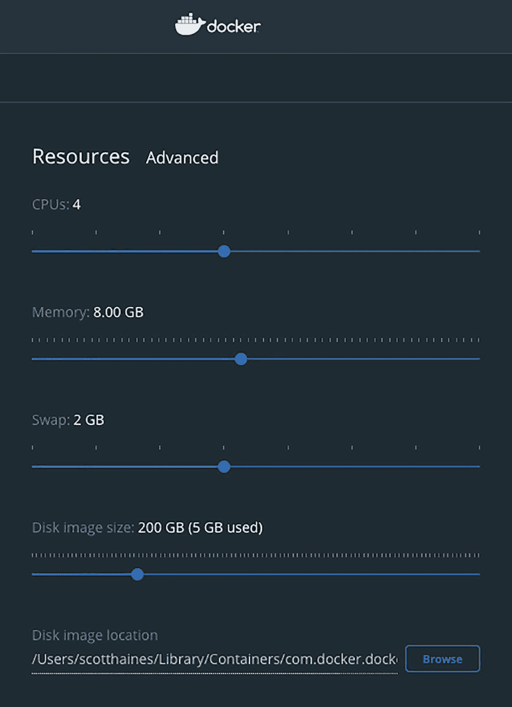
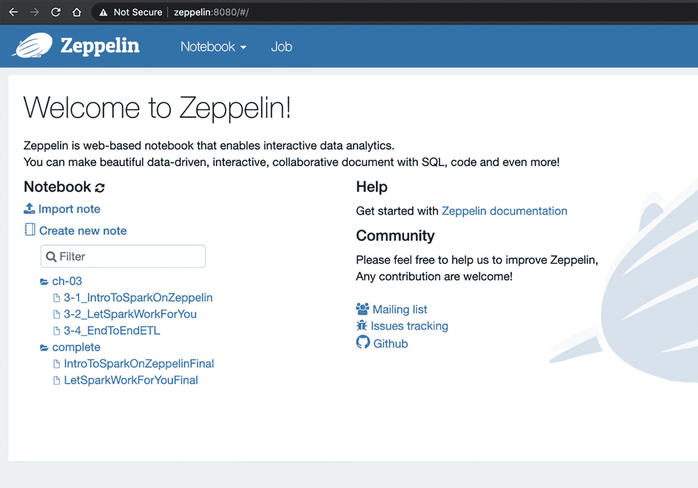
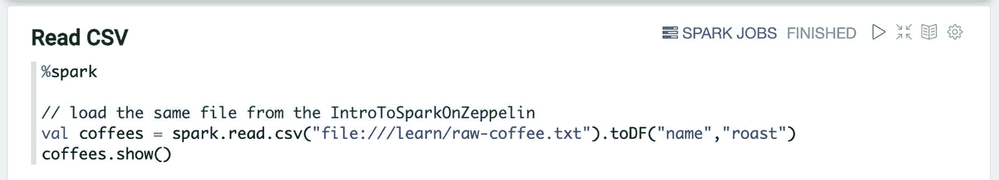

# 3. 处理数据

上一章向你介绍了 Spark 的架构和编程模型。我们快速浏览了核心 Spark 组件和 API，并以一个练习结束，该练习向你介绍了 `spark-shell` 和 `DataFrame` API。你还首次看到了 Spark SQL API，它使你能够以结构化的方式快速轻松地表达复杂的分析查询。它还能在编写复杂的 SQL 表达式时，干净地抽象掉底层的复杂性。

在本章中，我们将继续上一章的内容，并在前两章的基础上进行构建。我们将探索通过 `DataFrame` API 读取、转换和编写结构化数据的过程，并再次审视如何使用 Spark SQL。在整个过程中，你将通过专注于使用 Spark 核心[数据源](https://spark.apache.org/docs/latest/sql-data-sources.html)功能的入门练习进行动手实践。

作为一名数据工程师，你的工作取决于轻松处理数据的能力，我坚信这是日常工作中最重要的核心技能之一。你需要思维敏捷，找出摄取、解析和验证新数据源的新方法，这些数据源可能并非总是以最优化或最容易摄取的形式存在。但无论如何，你的任务是将数据转换为干净、结构良好且最重要的是可靠的数据。幸运的是，Apache Spark 支持当今许多更常用的数据格式，并且你很快就会发现，跨数据源和格式工作根本不需要是一项困难的任务。

在开始之前，你将学习并在开发环境中安装两个额外的基础设施组件。第一个是 [`Docker`](https://www.Docker.com) 运行时，第二个是一个名为 [`Apache Zeppelin`](https://zeppelin.apache.org/docs/0.9.0/) 的笔记本环境。这些工具将成为你作为数据工程师旅程中的关键工具，这个过程现在就开始！

## Docker

对于那些尚未在容器化生态系统中工作过的人来说，`Docker` 是当今市场上使用最广泛的容器平台之一。`Docker` 在帮助建立 [`开放容器倡议`](https://opencontainers.org/) (`OCI`) 方面也发挥了重要作用，该倡议定义了容器格式和运行时应该如何工作及互操作的标准。那么，容器到底是什么？

### 容器

首先，我们来理解为什么容器如此重要。如果你从事过传统 DevOps 工作，或曾尝试在多台笔记本电脑或少量服务器上搭建本地环境，你就会知道，要简化每个物理环境的设置和部署步骤是多么困难。即使使用包管理器（如 `apt-get`、`yum` 或 `homebrew`），让每个环境高效运行所需的步骤也可能很快变得难以控制。此过程中最常见的痛点集中在**一致性**和**运行时保障**上。通常，你在本地能正常工作的内容，其他工程师可能无法以同样的精细度（甚至完全无法）运行。最后，也是最重要的一点，即使你和所有人在本地都能正常运行，最终部署时情况也可能大相径庭。

正是由于这些原因，容器已成为关键任务应用的必备工具。有了容器，你可以专注于编写软件，因为你知道，只要共享相同的底层容器和文件系统层，你运行的内容也能在其他人那里运行，无需担心运行时包冲突或系统需求不满足的问题。

`Docker`（以及广义上的容器）通过让软件在轻量级、独立、可执行的环境中轻松运行，解决了软件部署的常见问题。你的软件与所有必要组件打包在一起，无论底层操作系统和硬件配置如何，都能可靠运行。这是通过在 Mac 或 PC 上进行虚拟化，创建一个 Linux 环境来实现的。在 Linux 操作系统中，控制组（`cgroups`）能够将这些轻量级、隔离的环境与共享的主机操作系统隔离开来（即“监禁”）。`CGroups` 超出了本书的讨论范围，但如果你好奇[容器的工作原理](https://www.linuxjournal.com/content/everything-you-need-know-about-linux-containers-part-i-linux-control-groups-and-process)，可以上网查阅相关资料。这非常有趣。

最后，容器实现了跨 Linux、Mac 和 Windows，以及跨不同 CPU（如当今市场上常见的 Intel x64（64 位）、x86（32 位）和 ARM 处理器）的统一开发体验。一切都能直接运行，无需为不同的发布环境编译和维护多个目标构建版本。

安装 `Docker` 非常简单，只需下载运行时即可；或者，你也可以选择最省力的方式，安装 [`Docker Desktop`](https://www.docker.com/products/docker-desktop)，下一节将对此进行介绍。

### Docker Desktop

按照 [`https://www.docker.com/products/docker-desktop`](https://www.docker.com/products/docker-desktop) 上的下载说明操作，很快你的计算机上就会拥有运行 `Docker` 所需的所有组件。`Docker Desktop` 会自动保持系统更新，并在有新版本或安全补丁可供安装时通知你。如果你直接在 Linux 上运行，可以安装 [`Docker 引擎`](https://docs.docker.com/engine/install/)。

> **注意**
>
> 在撰写本文时，`Docker Desktop` 对于使用 M1 芯片组 macOS 的用户仍处于测试阶段。要安装 M1 预览版，你必须使用此链接：[`https://docs.docker.com/docker-for-mac/apple-m1/`](https://docs.docker.com/docker-for-mac/apple-m1/)。

### 配置 Docker

`Docker` 运行时用于协调和运行使用共享操作系统的容器。这意味着你的系统需要与 `Docker` 运行时以及宿主机（例如你的笔记本电脑、台式机或服务器）共享资源。为了有效运行 `Docker` 环境，你需要预先为 `Docker` 分配一部分（子集）CPU 核心和 RAM 内存。

我建议为 `Docker` 分配以下最低资源，以确保其有效运行。CPU 核心和内存越多越好。

- CPU：4 核
- 内存：8GB
- 交换空间：2GB
- 磁盘映像大小：100GB

> **注意**
>
> 作为经验法则，最好至少保留 1GB RAM 和至少一个 CPU 供宿主机的主操作系统使用。

要重新配置你的 `Docker` 偏好设置，请按照以下步骤操作：



*图 3-1：Docker Desktop：偏好设置 ➤ 资源视图（来自用户界面）*

1. 打开 `Docker Desktop`。
2. 点击配置图标（偏好设置），然后点击“资源”菜单项（参见图 3-1）。
3. 更新配置。
4. 点击“应用并重启”。

现在你已经安装了 `Docker` 运行时，可以继续学习 Apache Zeppelin 了。你将使用 Zeppelin 来运行本章的练习。

## Apache Zeppelin

[`Apache Zeppelin`](https://zeppelin.apache.org/) 是一个开源的笔记本环境。如果你不熟悉笔记本环境是什么，没关系，学完本章你就会了解了。你可能听说过 [`Jupyter`](https://jupyter.org/)，它是数据科学家和机器学习工程师的标准实验环境。与 Jupyter 类似，Zeppelin 也是一个基于 Web 的交互式开发环境，但它原生支持 Apache Spark 以及许多其他连接器，这些连接器被称为解释器。

### 解释器

在 Zeppelin 中，解释器是一个通用接口，它允许 Zeppelin 运行时通过一个通用的远程过程调用（RPC）框架来控制本地库和远程服务。RPC 使得软件客户端能够通过轻量级消息协议向后端 RPC 服务发出外部调用，从而让 RPC 客户端能够以抽象的方式在服务器上运行代码，感觉就像客户端在本地运行相同的例程一样。这种抽象使得创建高效的接口变得容易，以便与许多其他服务进行互操作，而无需更改客户端调用各种连接服务的方式。就 Zeppelin 而言，你可以将 Zeppelin 运行时视为通往许多后端服务的路由器，但具有统一的用户界面。在接下来的练习中，我们将使用 `Markdown`、`SQL` 和 `Spark` 解释器。

### 笔记本

笔记本环境的神奇之处在于它能够动态编译并按需运行代码。一个笔记本由一系列笔记组成。每个笔记被拆分为一个或多个段落。每个段落包含独立的代码片段、文档、图表等内容。在每个笔记本中，代码可以按过程化级联方式解释运行（即按顺序依次执行每个段落，也称为播放笔记本），也可以异步方式单独运行某个段落。Zeppelin 的工作方式与 `spark-shell` 类似，能够即时读取并编译你的代码，但它还能让你超越终端限制。例如，你可以：

1. 将会话进度保存在笔记本中，这样就能快速重启环境并从中断处继续工作。笔记本会自动保存，因此即使电脑意外关机，你也不会措手不及。

2. 通过内置的 SparkSQL 解释器可视化 DataFrame 中存储的数据。这是一个有用的工具，因为人脑并不擅长阅读基于文本的数据输出并理解其含义。将数据绘制成图表对项目成功至关重要，因为你可以发现缺失数据以及其他可能被忽略的数据特征。

3. 在同一个笔记本中与多个用户实时交互。*此功能仅在你运行托管版 Zeppelin 或通过 [`ngrok`](https://ngrok.com/) 隧道连接到本地主机时可用。

4. 轻松导入和导出笔记本，共享常见问题的解决方案，无需任何人编译任何代码。

在下一节中，我们将启动 Zeppelin 并探索如何充分利用这个有价值的工具。

## 书籍源代码

如果你还没有下载本书的源代码，我建议你现在就下载。只需访问 [`https://github.com/newfront/spark-moderndataengineering`](https://github.com/newfront/spark-moderndataengineering) 并下载其中的内容即可。在后续练习中，你将使用位于 `/ch-03/start` 的起始点。

## 准备你的 Zeppelin 环境

要跟随练习操作，你需要在本地安装并运行 Spark。第二章 2 已经介绍了这一过程。

假设一切安装完毕，并且你能够在上一章的练习中测试 `spark-shell`，那么你可能还记得，在启动 `spark-shell` 之前，你需要手动将环境变量导出到终端会话中。更好的做法是将这些变量导出到你的 `.bashrc` 或 `.zshrc` 文件中。

列表 3-1 展示了运行 Spark 所需的环境变量参考。同样的过程也可以使用 `.bashrc` 或 `.bash_profile` 完成。每次运行 Spark 时手动添加这些参数很快就会变得烦人，因此你可以将它们复制到你的 Bash 环境配置文件中。只需确保路径与你本地的设置一致即可。使用临时环境变量（如第二章 2 所示）进行测试的原因，是为了在导出之前确保路径定义正确且一切正常。

```bash
export JAVA_HOME="/Library/Java/JavaVirtualMachines/zulu-11.jdk/Contents/Home/"
export SPARK_HOME=~/install/spark-3.1.0
```
*列表 3-1*
*来自 `.zshrc` 配置文件的示例*

现在环境已经设置好，在继续之前，请确保调用 `source ~/.zshrc` 来刷新你的 Bash 会话（从终端）。现在，你可以开始行动了！

### 使用 Docker 运行 Apache Zeppelin

执行以下两个简单步骤来启动 Zeppelin 进程。该过程将安装并启动 Zeppelin。如果这是你第一次安装 Zeppelin Docker 镜像，根据你的网络连接情况，可能需要几分钟时间。一旦此 Docker 镜像被本地缓存，启动和停止 Zeppelin 环境将非常迅速。

```bash
1.   cd ch-03/start/docker
2.   ./run.sh start
```

此时，Apache Zeppelin 将在你的笔记本电脑上运行。

查看 `ch-03/start/docker/run.sh` 脚本可以更全面地了解环境是如何设置的。`start` 函数如列表 3-2 所示。

```bash
function start() {
sparkExists
createNetwork
docker compose -f ${DOCKER_COMPOSE_FILE} up -d --remove-orphans zeppelin
echo "Zeppelin 将在 http://127.0.0.1:8080 上运行"
}
```
*列表 3-2*
*`run.sh` 脚本中的 `start` 函数确保你的本地环境按预期设置，然后将 Zeppelin 容器的实际运行委托给 Docker Compose 进程*

在短暂停顿讨论 Docker 运行时之后，我们将继续介绍 Zeppelin。

**注意**

以下部分将进一步深入探讨调用 `run.sh start` 时的工作进程。如果你熟悉 Docker 和容器，可以跳过此部分。

### Docker 网络

`run.sh` 脚本在 Docker 内部创建了一个名为 `mde` 的网络。这个桥接网络允许在 Docker 运行时内运行的容器之间相互通信，但前提是它们也共享对同一 Docker 网络的访问权限，并且该网络也受到外部主机网络的保护。这意味着，除非采取进一步操作（使用端口转发到宿主机），否则你实际上创建了一个在 Docker 运行时内受到保护的私有网络。

```bash
docker network create -d bridge mde
```

鉴于 Docker 运行的是自包含的 Linux 可执行文件，这意味着在 Docker 内部运行的容器既受到其自身容器的隔离，也受到 Docker 运行时的隔离。这很好，因为 Docker 对容器运行时采取了安全的、无共享的风格，但如果你想要从一个容器连接到多个不同的容器——例如，运行数据库、分布式文件系统或像 Kafka 或 Redis Streams 这样的流式数据源——如果不打开容器之间的共享网络，你将无法做到这一点。

在接下来的章节中，我们将使用 Docker 网络来运行各种流式管道所需的一切，并处理不同批处理作业的编排。

**注意**

如果你想从本地主机网络使用与容器关联的主机名，可以修改你的 `/etc/hosts` 文件，在记录底部为 Zeppelin 添加一行。例如：`127.0.0.1 zeppelin` 将使你能够在 `http://zeppelin:8080` 查看 Zeppelin UI。

### Docker Compose

编排 Zeppelin 环境的过程相当简单。在第一个用例中，大部分繁重工作由 `ch-03/start/docker/docker-compose-all.yaml` 完成。Docker Compose 配置如代码清单 3-3 所示。此处展示的配置是一个简单的示例，包含一个名为 `zeppelin` 的单一 `service`。

```yaml
version: '3'
services:
  zeppelin:
    image: apache/zeppelin:0.9.0
    container_name: zeppelin
    volumes:
      - ${PWD}/notebook:/notebook
      - ${PWD}/logs:/logs
      - ${PWD}/data:/learn
      - ${SPARK_HOME}:/spark
    environment:
      - SPARK_HOME=/spark
      - ZEPPELIN_LOG_DIR=/logs
      - ZEPPELIN_NOTEBOOK_DIR=/notebook
      - ZEPPELIN_ADDR=0.0.0.0
      - ZEPPELIN_SPARK_MAXRESULT=10000
      - ZEPPELIN_INTERPRETER_OUTPUT_LIMIT=204800
    healthcheck:
      interval: 5s
      retries: 10
    ports:
      - 8080:8080
      - 4040:4040
      - 4041:4041
    networks:
      - mde
    hostname: "zeppelin"
networks:
  mde:
    external:
      name: mde
```
*代码清单 3-3*
*Docker Compose 文件 `docker-compose-all.yaml` 创建了一个一致的配置，用于可靠地运行一个或多个容器*

Docker Compose 配置是一种声明式资源，由 Docker 引擎解释，用于可靠地运行一致的服务。查看代码清单 3-3 中的 `services` 块，你会看到一系列嵌套配置，这些配置允许 Docker 运行时组装该服务。例如，`zeppelin` 服务指示 Docker 使用或拉取 `apache/zeppelin:0.9.0` 镜像，并将生成的绑定服务关联到名为 `zeppelin` 的容器。`container_name` 属性可用作特定名称的别名。默认情况下，`docker runtime` 会创建一个唯一命名的容器。

**注意**

`0.9.0` 是本书编写时 Zeppelin 的镜像标签和发布版本。

#### Volumes

`volumes` 块用于将外部卷挂载到 Docker 容器的运行时中。如果你查看 `zeppelin` 服务的配置，会看到我们将主机文件系统中的特定目录正向挂载到 `zeppelin` 容器中。这些声明使我们能够使用相对路径 `${PWD}/notebook:notebook` 自动导入 Zeppelin 入门笔记。你还会看到 `${PWD}/data:/learn` 中包含一个数据目录，以及通过 `${PWD}/logs:logs` 输出的 Zeppelin 日志。虽然所有以 `${PWD}` 开头的资源都位于我们的本地文件系统中，但生成的路径是容器内挂载卷的绝对位置（在此例中为 Zeppelin）。

**提示**

容器是不可变的。这是一个重要的细节，因为 Docker 容器中创建的所有文件在设计上都被隔离（或困在）在容器内。如果你不记得导出运行时所做的更改，那么根据设计，如果你停止并移除容器，启动容器后所做的所有更改都将丢失，包括任何新笔记、对配置的任何更改或运行时所做的任何其他操作。使用卷挂载，你可以共享完全可用的实验，而无需修改容器本身。这个概念是容器生态系统的核心，你将在后续章节中学习许多技术和最佳实践（以及一些有趣的技巧）。

## Environment
环境变量是一种在运行时修改 Docker 容器行为的简单方法。`environment` 块使我们能够覆盖 Zeppelin 的一些默认设置，以创建（或接入）基础容器，从而实现我们期望的结果。这种技术很重要，因为自定义容器的另一种方法会导致创建新的 Docker 镜像。在 `docker-compose-all.yaml` 中，我们使用主机系统环境变量，通过 `$SPARK_HOME` 引用并挂载本地 Spark 安装路径。这个技巧提供了一个基于本地容器的挂载 `$SPARK_HOME=/spark`，可以在 `volumes` 块下看到。然后更新 Docker 容器中的环境变量，使其指向你挂载的 Apache Spark，这让你可以在 Zeppelin 运行时中自带 Spark。很巧妙。

## Ports
每个 Docker 容器都在自己隔离的环境中运行。为了允许访问外部世界，我们必须有目的地显式暴露我们想要使用的任何端口。使用 `ports` 块，我们启用了从内部 Docker 网络到主机系统的端口转发。这允许 Docker 运行时将外部请求转发到特定端口，再转发到内部容器。这一步对于暴露 Zeppelin UI 以及 Spark UI 的端口是必要的。

在本书的大部分练习中，你将使用 `docker-compose`。如果你想回顾 Docker 网络的基础知识或查看 `docker-compose` YAML 的结构，请再次访问本节。现在，让我们回到 Zeppelin。

## 使用 Apache Zeppelin
打开 Zeppelin 主页（使用你喜欢的网络浏览器），地址为 localhost 端口 8080（[`http://127.0.0.1:8080`](http://127.0.0.1:8080)）。这是之前执行 `ch-03/start/docker/run.sh start` 命令的结果。确认主页加载成功，然后我们可以一起运行第一个笔记。服务主页如图 3-2 所示。



图 3-2

加载 Zeppelin 主页将确认一切已正确启动

在 Zeppelin 环境运行后（你应该会看到与图 3-2 类似的屏幕），你会看到主页左侧有一个标有 Notebook 的部分。在此部分中，你会看到一些笔记已加载，可供动手练习使用。本地笔记本目录已通过卷挂载到你的主机系统，因此你可以添加新笔记并修改现有笔记，而无需担心更改是否会持久保存。

从 Zeppelin 主页，点击 `ch-03` 下名为 `3-1_IntroToSparkOnZeppelin` 的笔记本。这将打开初始启动笔记。你会注意到笔记被分成多个单独的文本块。笔记的这些单独部分称为段落。每个段落可以单独运行，或者你也可以使用笔记本顶部的播放图标，以同步级联方式运行所有段落。图 3-3 展示了如何运行所有段落。


图 3-3

使用笔记顶部的播放图标运行所有段落

运行所有段落是确保笔记内容已执行且 Spark 解释器按预期工作的简单方法。这个初始步骤可能需要一点时间，因为有一些后台进程正在准备笔记本环境。

**提示**
我更喜欢以与在线滚动浏览文章相同的方式来浏览笔记本，即采用自上而下的方法。这仅仅意味着我喜欢按顺序手动运行每个段落。这种探索策略可以帮助你理解笔记本的架构、作者的意图，并再次确认笔记中没有破坏性代码。如果你操之过急，已经点击了“运行所有段落”，那也完全没问题。不过，作为经验法则，三思而后行总是更好的，尤其是在第一次运行笔记时。

### 绑定解释器
Apache Zeppelin 使用解释器，让笔记中的每个段落能够通过统一的用户界面与不同的数据源进行交互。在后台，保持连接活跃的复杂性被委托给了 Zeppelin 服务本身。通常，每个笔记会连接到一小部分服务，但随着你逐渐习惯使用 Zeppelin，你可能会发现，交织使用多个数据源来创建整体仪表板，或调试和调查来自多个位置的数据，会更有用。

Zeppelin 通过初始的模数行来标识每个段落关联的是哪个解释器，例如，在每个段落中都能看到 `%{interpreter}`。在你当前打开的入门笔记中，我们混合使用了 Markdown `%md` 和基于 Scala 的 Spark `%spark`。在本章的剩余部分，我们将专注于对所有新段落使用 `%spark` 解释器。图 3-4 可作为解释器绑定的参考。



图 3-4

Zeppelin 中 Spark 解释器的一个示例

如果你还没有点击“全部运行”，现在可以点击笔记中“读取 CSV”段落上的播放图标。

快速回顾一下，我们刚刚了解到，一个笔记包含一个或多个段落，并且每个段落都绑定到一个独立的解释器。例如，Spark/Scala `%spark` 或 Markdown `%md`。本质上，由 Zeppelin 笔记本环境处理的关注点分离，能够提供比直接使用 Spark shell 更一致的体验，正如你在上一章中所体验到的。

让我们正式开始本章的练习，目标是学习如何使用 Apache Zeppelin 来加速 Apache Spark 的探索和实验过程。

### 练习 3-1：读取纯文本文件并转换 DataFrame
正如我在本章开头提到的，作为数据工程师，你处理的数据并不总是定义良好、格式规范或文档齐全的。在某些情况下，就像这第一个练习，你将探索未知数据，并且需要一些自定义解析来将数据集格式化为 Spark 可以高效处理和分析的形式。那么，请设身处地，想象你是一家名为 CoffeeCo 的特色咖啡公司新入职的数据工程师。这是第一天，你被要求找到一种简单的方法来处理和清理纯文本文件，以便下游数据系统能够可靠地使用它们。

#### 将纯文本文件转换为 DataFrame
在 Zeppelin 入门笔记中，向下滚动到标题为“读取和分析”的段落。该段落纯文本文件的内容会进入一个 DataFrame。段落代码将为你预填好，并在清单 3-4 中显示以供参考。DataFrame 的模式会打印到标准输出，让你了解 Apache Spark 如何解释纯文本文件。

```
%spark
val df = spark.read.text("file:///learn/raw-coffee.txt")
df.printSchema
```
清单 3-4
该代码片段通过指示 `spark.read.text` 读取纯文本文件来生成一个 DataFrame

清单 3-4 中的简单代码片段使用了 `DataFrameReader` 类。`DataFrameReader` 类使你能够通过一个简单的接口，将各种数据集作为 DataFrame 加载到 Spark 中。我们将使用这个段落（Zeppelin 对笔记本中可运行部分的术语）作为练习的起点。从现在开始，你将添加新的段落、编写代码，并在进行过程中运行笔记本。

继续，点击段落右上角的播放按钮来运行该段落。Spark 引擎初始化后，你将看到以下输出。

```
root
|-- value: string (nullable = true)
```

该输出是调用 `df.printSchema` 的结果。Spark 将所有数据源与一个模式关联起来，该模式定义了数据的类型化结构。在这种情况下，我们正在读取一个基于文本的文件，因此生成的 DataFrame 将有一个名为 `value` 的单一类型列，由 `StringType` 表示。我们将在本章末尾更详细地介绍模式，这些模式由 Spark 的 `StructType` 和底层的 `StructFields` 封装。

你可能会注意到输出的模式有点模糊。主要是，你可能会问自己，整个文件是否由这一个值表示，或者是什么。为了发现模式代表什么，让我们创建一个新的段落，并在这个简单的 DataFrame 上调用 `show()` 操作。

#### 窥视 DataFrame 的内容
将鼠标悬停在“读取和分析”段落下方，你会看到一个提示，显示“添加段落”。点击该提示，你会看到一个新的段落出现。这个新段落将根据前一个解释器自动填充解释器，这意味着第一行将是 `%spark`。现在，只需在 DataFrame (`df`) 上调用 `show()`，如清单 3-5 所示。

```
%spark
df.show()
```
清单 3-5
在 DataFrame 上调用 `show()` 将读取最多前 20 行，并以简单的控制台格式化表格输出

# 使用 Apache Spark 和 Zeppelin 进行数据处理

现在运行清单 3-5 中的代码。你会看到 Spark 已经对未知的文本文件进行了基本的初步处理，根据换行符 (`\n`) 分隔符拆分文本文件的每一行。你还会注意到输出被格式化以表示 DataFrame 的表格结构（行和列），在这种情况下，总共五行数据，只有一列（名为 `value`）。

```
+--------------+
|         value|
+--------------+
|   folgers, 10|
|     yuban, 10|
|nespresso, 10,|
|    ritual, 4,|
|four barrel, 5|
+--------------+
```

这个输出让我们对数据本身有了更深入的了解。我们可以观察到，`value` 列表示一个名称和一个数值，以逗号分隔的对形式出现。作为数据工程师，在规范化和清理数据时编写自定义解析器是很常见的。我们将逐步讲解如何解析 DataFrame 的每一行，将其转换为一对命名列，分别代表咖啡品牌（例如，Folgers、Yuban）和相应的烘焙程度（或者简单地说，咖啡豆的深浅）。

### 使用模式匹配进行 DataFrame 转换

利用你对底层数据格式的了解（通过代码清单 3-5 获得），你可以构建一个自定义转换器来格式化 DataFrame。简而言之，此转换会将每一行原始文本（来自 `value` 列）转换为一个表示咖啡品牌（`String`）和烘焙程度（`Int`）的 DataFrame。

在代码清单 3-5 所在段落的下方新建一个段落。然后将代码清单 3-6 的内容复制到该段落中并运行。

```
%spark
val converted = df.map { r =>
r.getString(0).split(",") match {
case Array(name:String,roast:String) =>
(name,roast.trim.toInt)
}
}.toDF("name","roast")
converted.printSchema
代码清单 3-6
使用一系列转换创建新的 DataFrame
```

代码清单 3-6 是一个使用 Scala 创建函数式转换（`map`）并结合模式匹配技术的示例，从而实现了我们的自定义解析器。

简而言之，代码清单 3-6 中的转换代码执行了以下操作：

1.  通过在 DataFrame 上调用 `map` 函数，你可以生成一个内联函数式转换（使用 Scala），该转换将应用于 DataFrame 的每一行（由 `r =>` 表示）。

2.  鉴于 DataFrame 是行的集合（由 `Row` 类表示），并且我们知道每一行由一个 `String` 列组成，因此我们可以显式调用 `r.getString(0)` 访问器方法。这将提供一个 `String`，我们可以对其调用 `split` 来手动细分该 `String`。

3.  接下来，我们使用[模式匹配](https://docs.scala-lang.org/tour/pattern-matching.html)来解构（或[提取](https://docs.scala-lang.org/tour/extractor-objects.html)）包含两个元素的 `String` 数组，将其赋值给 `name` 和 `roast` 变量。这种技术允许我们使用命名变量，这些变量可以放入元组中。为了将烘焙程度的值转换为整数，我们首先使用 `trim` 方法移除 `String` 上任何不必要的填充（空格），以确保转换为 `int`（`roast.trim.toInt`）能够成功。值得一提的是，此处展示此方法是为了简单起见，并非完全防御性编程。对于任何包含超过两个逗号的行，此示例都会出错。完整的笔记本（在章节材料中）展示了如何使用全匹配模式 `case _ =>` 添加防御性回退。

4.  最后，使用 `toDF("name","roast")` 方法将 Scala 元组转换回 DataFrame。由于我们是从元组转换而来，DataFrame 的默认列名将是 `_1`、`_2`，这不太具有可读性。

运行这个新段落（通过 Zeppelin 本地运行）后，你会看到生成的 DataFrame（名为 `converted`）具有所需的模式。

```
root
|-- name: string (nullable = true)
|-- roast: integer (nullable = false)
```

再创建一个段落，并调用 `converted.show()` 来查看自定义转换的效果。

```
%spark
converted.show()
+-----------+-----+
|       name|roast|
+-----------+-----+
|    folgers|   10|
|      yuban|   10|
|  nespresso|   10|
|     ritual|    4|
|four barrel|    5|
+-----------+-----+
```

虽然这第一个练习并非高深莫测，但它应该能让你对学习使用 Apache Zeppelin 快速测试想法，甚至学习 Apache Spark 的方方面面感到兴奋。

### 练习 3-1：总结

本练习介绍了在 Docker 上运行 Apache Zeppelin 的基础知识。你学会了使用 Spark 读取和解析原始文本文件，并在此过程中了解到 DataFrame 本质上由具有强类型列的数据行组成。接下来，我们将更深入地研究 DataFrame，揭示模式的工作原理，并学习如何让 Spark 为我们工作，从而使我们的数据工程工作更轻松，最终让我们能够更高效地工作。

## 处理结构化数据

本着探索的精神，我们将继续研究在内容解析和转换方面，如何使用 Spark 为我们完成繁重的工作。这基本上消除了对复杂自定义解析器的需求，取而代之的是，你可以学会更多地依赖 Spark，因为它会读取数据并为其应用结构。

### 练习 3-2：DataFrame 与半结构化数据

返回 Zeppelin 主页。打开名为 `3-2_LetSparkWorkForYou` 的笔记本，这是练习 3-2 的起点。你将学习使用 CSV `DataFrameReader`，作为练习 3-1 的后续，你在练习 3-1 中创建了一个简单的类型化 CSV 解析器。虽然你本可以在练习 3-1 中使用 CSV 读取器，但那样你就无法学到手动解析和转换数据所带来的宝贵技能。继续前进！

代码清单 3-7 中显示的段落内容使用 CSV 读取器创建了一个 DataFrame。现在你可以加载咖啡数据，而无需手动拆分列。

```
%spark
val coffees = spark.read.csv("file:///learn/raw-coffee.txt").toDF("name","roast")
coffees.show()
代码清单 3-7
通过用更强大的 CSV 读取器替换基于文本的读取器来增强代码清单 3-4
```

运行代码清单 3-7 中的段落后，输出显示咖啡数据在第一次解析时似乎被正确解释（解析）。

```
+-----------+-----+
|       name|roast|
+-----------+-----+
|    folgers|   10|
|      yuban|   10|
|  nespresso|   10|
|     ritual|    4|
|four barrel|    5|
+-----------+-----+
```

尽管看起来一切顺利，但事实并非如此。让我们通过添加一个新段落来测试 `coffees` DataFrame 的模式（`printSchema`），看看原因何在。以代码清单 3-8 中的代码片段为指导。

```
%spark
coffees.printSchema
代码清单 3-8
一个简单的 Zeppelin 段落，用于测试 Spark 通过 CSV 读取器自动生成的模式
```

嗯，事实证明 `coffees` DataFrame 的底层模式只是简单的字符串。

```
root
|-- name: string (nullable = true)
|-- roast: string (nullable = true)
```

虽然 Spark 为我们省去了手动拆分 CSV 数据每一行字符串的麻烦，并且完全有能力为我们做一些繁重的工作，但我们仍然缺少拼图中的一个重要部分，那就是如何强制 Spark 为我们提供正确的模式。

#### 模式推断

默认情况下，Spark 采用平衡配置。这意味着你可以快速上手，并且引擎会根据 Spark 社区的集体共同需求做出决策。这也意味着许多选项默认是关闭的，以优化引擎的整体性能。模式推断就是这种情况。

如果你思考一下 Spark 在尝试推断给定输入数据集的模式时需要做什么，那么这与你的大脑在浏览和扫描同一文件时的工作方式并没有太大不同。你本能地寻找模式，并且仅通过观察就能轻松判断文件是字符串数据还是数值数据，但 Spark 并没有那么高效。Spark 必须打开文件、读取、解析并测试每个列中的数据，以生成共识，或达成一致，确定要绑定到每个列行的不同类型。

# 对于小文件与大文件的模式推断考量

对于像我们在本练习中使用的小文件来说，这不是问题。测试所有内容是成本效益高的，因为只有几行数据。然而，如果你想推断一个大型文件（恰好每行包含大量列）的模式，那么你很容易发现自己内存不足。

## 使用推断模式

在笔记本（`3-2_LetSparkWorkForYou`）中，在刚刚添加的清单 3-8 段落下方，新增一个段落。这个新段落（如清单 3-9 所示）将用于增强 Spark 在加载纯文本内容时对模式的解释和推断能力。

```scala
%spark
val coffeeAndSchema = spark.read
.option("inferSchema", true)
.csv("file:///learn/raw-coffee.txt")
.toDF("name","roast")
coffeeAndSchema.printSchema
```
*清单 3-9：在 DataFrameReader 上设置 inferSchema 选项*

通过添加这个可选配置，你现在可以释放 Spark 引擎自动推断（测试并生成）模式的能力。生成的 DataFrame（`coffeeAndSchema`）自行学习到每一行包含一个 `String` 列和一个 `Double` 列。在读取 CSV 或 JSON 等半结构化数据时，推断过程会选择最佳匹配类型。

```
root
|-- name: string (nullable = true)
|-- roast: double (nullable = true)
```

使用这种技术可以让 Spark 从数据的一个较小子集（例如大文件的前 10,000 行）中学习。在实践中，上游数据可能会以不可预见的方式发生变化，因此在处理半结构化数据时，使用显式模式（声明式）通常更符合你的最佳利益。

## 使用声明模式

你可以使用模式推断来生成并导出一个具体的模式，以便后续复用。在处理关键数据集时，使用严格模式可以让你忽略（跳过）损坏的数据，或者在遇到不符合规范或解析错误的数据时快速失败并抛出异常。最后，使用特定模式能让 Spark 更高效地运行，因为模式推断需要测试数据集子集（样本）中的所有列，才能为每个列类型达成一致。我将向你介绍一种我称之为“窃取模式”的有趣技术，你可以用它来生成并导出严格模式。

## 窃取模式

创建一个新段落，并以清单 3-10 为指导。完成后，继续运行它。

```scala
%spark
import org.apache.spark.sql.types._
// 窃取模式
val coffeeSchema: StructType = coffeeAndSchema.schema
val coffeeSchemaDDL: String = coffeeSchema.toDDL
// `name` STRING,`roast` DOUBLE
// 创建一个显式模式（从窃取的模式中）
val coffeeDDLStruct: StructType = StructType.fromDDL(coffeeSchemaDDL)
// 直接使用窃取的模式读取咖啡 CSV 文件
val coffees = spark.read
.option("inferSchema", false)
.schema(coffeeDDLStruct)
.csv("file:///learn/raw-coffee.txt")
```
*清单 3-10：使用 DataFrame 上的 DDL 方法导出推断模式*

清单 3-10 中的“窃取模式”展示了如何将推断模式提取为 DDL 字符串。应用此技术时，你可以将 `coffeeSchemaDDL` 的值直接导出到文件系统，或者简单地手动复制粘贴到配置文件中。关键之处在于，你可以将 DDL 字符串直接加载到 `DataFrameReader` 中，从而绕过模式推断，并最终为 Spark 应用程序中的数据处理添加更明确的严格规则。

```scala
spark.read
.schema("`name` STRING,`roast` DOUBLE")
.csv("file:///learn/raw-coffee.txt")
```

这种模式可以节省时间，并使你的应用程序能够在生产环境中强制执行严格模式，而无需依赖推断。虽然在你从一个已知模式开始时这个过程并非必需，但了解其可能性以及 `StructType` 如何在 DDL 和内部 Spark 模式之间轻松转换是值得的。你也可以使用 Spark DSL 手动创建数据定义。

## 构建数据定义

使用“窃取模式”（清单 3-10）得到的推断模式与练习 3-1 中的结果模式略有不同。区别在于与 `roast` 列关联的推断数据类型。我们想要一个整数，但 Spark 将其解释为 `double`，即 Spark 的 `DoubleType`。我们可以通过手动构建 `StructType` 来纠正这个模式。

在 Zeppelin 笔记本中添加另一个段落，并将清单 3-11 中的代码片段复制到该段落中；点击运行。这种手动操作带来的额外好处是为模式中的每个字段提供了文档说明。

```scala
%spark
val coffeeSchema = StructType(
Seq(
StructField("name", StringType,
metadata = new MetadataBuilder()
.putString("comment", "咖啡品牌名称")
.build()),
StructField("roast", DoubleType,
metadata = new MetadataBuilder()
.putString("comment", "咖啡烘焙度 (1-10)")
.build())))
val coffees = spark.read
.option("inferSchema", "false")
.schema(coffeeSchema)
.csv("file:///learn/raw-coffee.txt")
```
*清单 3-11：构建一个 coffeeSchema StructType，以便在将咖啡数据作为 DataFrame 读取时直接使用*

手动定义 `StructType` 可以解锁 `StructField` 对象上直接可用的额外选项，包括声明每个命名列的 `DataType` 以及至关重要的元数据选项。让我们深入幕后，进一步了解 `StructType`、`StructField`、`DataType` 和元数据。

## 关于 StructType 的一切

正如我们在清单 3-11 中看到的，当我们组合一个模式定义时，实际上是在生成一个 `StructType` 类的实例。`StructType` 是一个元数据对象，用于存储 DataFrame 中每个列的字段级信息。这类似于 SQL 中的表定义。`StructType` 本身只是一个容器对象，由一系列 `StructFields` 组成。

### StructField

`StructField` 是一个与 DataFrame 中列关联的简单对象。每个 `StructField` 都有一个唯一的字段名、一个 `DataType`、一个声明该列是否可为空的布尔值，以及一个可选但重要的元数据。

### Spark 数据类型

Spark 支持多种可在 DataFrame 中表示的数据类型。每种类型都可以在 Java JVM 和本地内存之间自动转换。我们将在第 6 章深入探讨 Catalyst 引擎，但本节可作为对开箱即用类型的入门介绍。表 3-1 可在后续练习中作为快速参考。虽然该表并非所有可用数据类型的完整列表，但足以帮助您入门。

**表 3-1** Apache Spark 可在 Scala 类型与本地编码的 DataType 之间进行原生转换

| DataType | Scala 中的值类型 | Spark API |
| --- | --- | --- |
| `ByteType` | `Byte` | `ByteType` |
| `ShortType` | `Short` | `ShortType` |
| `IntegerType` | `Int` | `IntegerType` |
| `LongType` | `Long` | `LongType` |
| `FloatType` | `Float` | `FloatType` |
| `DoubleType` | `Double` | `DoubleType` |
| `DecimalType` | `java.math.BigDecimal` | `DecimalType` |
| `StringType` | `String` | `StringType` |
| `BinaryType` | `Array[Byte]` | `BinaryType` |
| `BooleanType` | `Boolean` | `BooleanType` |
| `TimestampType` | `java.sql.Timestamp` | `TimestampType` |
| `DateType` | `java.sql.Date` | `DateType` |

您可能熟悉表 3-1 中的部分（或全部）Scala 类型。我们甚至已经使用过一些原生的 `DataType`。您还记得是哪些吗？到本书结束时，您将使用过该表中的大部分原生类型（尽管是隐式地），此外，随着我们进入本书后续章节，还会接触到更复杂的类型。现在，请先记住这张表，我们将花一点时间来了解如何使用 `Metadata` 类。

## 为结构化模式添加元数据

`Metadata` 类是对 `Map[String, Any]` 的简单封装，它允许您在字段级别为模式添加描述性元数据。`comment` 字段是一个保留的元数据键名，会自动带入您的表定义中。最终，使用元数据可以让您记录数据集，并解决因数据文档不完善而导致的发现难题。通过使用一个简单的内置结构，您可以为其他工程师、系统和分析师提供便利。

## 练习 3-2：总结

此时，您可能已经开始理解，甚至可能对 Spark 的能力感到兴奋。我发现从内到外解决问题很有帮助，而在迄今为止的练习中，我们正是这样做的。您在练习 1 中学习了如何读取纯文本并将其转换为一个干净且定义明确的 DataFrame，并发现了如何利用模式推断来省去编写自定义字段级解析器的工作。然后，您了解到手动构建模式（`StructType`）并提供字段级元数据和声明式 `DataType` 还有一些额外的好处。我们已经涵盖了很多内容，但我们还有更长的路要走，所以如果您准备好了，我们将开始接触一点 Spark SQL。