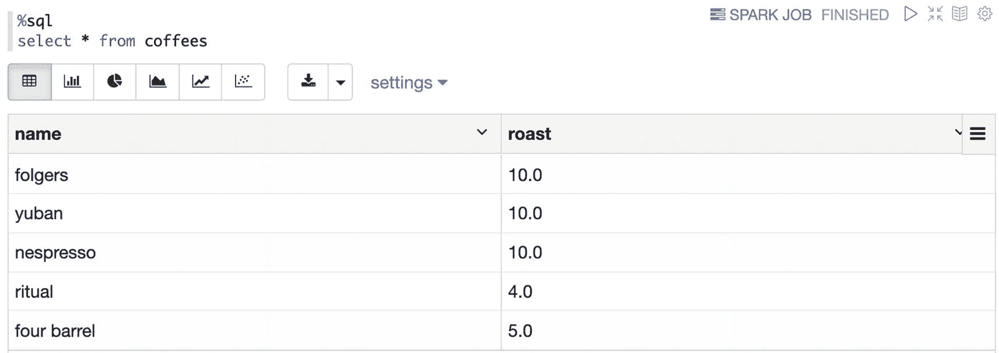

# 使用解释型 Spark SQL

这里有谁喜欢 SQL？Spark 作为数据工程师让我们的生活更轻松的方式之一，是使我们能够像在传统 SQL 数据库中简单查询表一样处理数据。您可能会问，这是如何实现的？嗯，只需利用它已知的数据结构即可。这是一种迂回的说法，即 Spark 依赖 `StructType` 来物化视图，供您的应用程序使用。让我们通过一个实际示例来看看如何操作。

## 练习 3-3：SparkSQL 快速入门

在本练习中，您可以继续使用练习 3-2（“3-2_LetSparkWorkForYou”）中的 Zeppelin 笔记。我们上次结束时（见清单 3-11），您刚刚创建了一个手动模式并重建了 `coffees` DataFrame。

### 创建 SQL 视图

在笔记中添加一个新段落，并输入清单 3-12 的内容。

```
%spark
coffees.createOrReplaceTempView("coffees")
spark.sql("desc coffees").show(truncate=false)
清单 3-12
使用 DataFrame 通过 createOrReplaceTempView 创建 SQL 视图
```

只需一行代码（清单 3-12），您就可以使用 `coffees` DataFrame 轻松生成一个临时的内存视图。这将在您的 `SparkSession` 上下文中注册一个临时表，该表将在会话期间存在，直到您显式删除它。清单 3-12 的第 2 行引入了 SQL 解释器，该解释器可通过 `SparkSession` 使用。

```
spark.sql("desc coffees").show(truncate=false)
```

在段落（清单 3-12）上点击运行后，您将看到输出显示表元数据。您注意到什么有趣的地方了吗？

```
+--------+---------+-------------------------+
|col_name|data_type|comment                  |
+--------+---------+-------------------------+
|name    |string   |咖啡品牌名称             |
|roast   |double   |咖啡烘焙等级 (1-10)      |
+--------+---------+-------------------------+
```

如练习 3-2 所述，元数据有一个名为 `comment` 的保留键，其值将应用于您创建的任何表。为模式定义元数据的主要好处之一是通过记录数据为其他工程师提供便利。这个简单的示例说明了字段级文档为何有益。现在，任何描述 `coffees` 表的人都可以立即理解每个列的含义。这可谓价值连城。

在您的活动 Zeppelin 会话中有了临时视图（`coffees`）之后，是时候学习如何使用 `%sql` 解释器了。

### 使用 Spark SQL Zeppelin 解释器

在您的笔记中添加另一个新段落，然后添加清单 3-13 中的简单 SQL 命令。

```
%sql
select * from coffees
清单 3-13
在 Apache Zeppelin 中使用 Spark SQL 解释器
```

点击运行，您将看到清单 3-12 中的临时视图直接呈现在 Zeppelin UI 中。渲染后的输出如图 3-5 所示。在探索新数据集时，可视化数据集是一个有用的工具，即使您只是将输出视为基本表格，也可以利用 SQL 表达式本身来修改输出，或使用 Zeppelin UI 进行基本排序。



**图 3-5** 通过 Zeppelin UI 显示的 coffees 表格式良好的输出

在幕后，Zeppelin 使用活动的 `SparkSession` 将您的 SQL 命令传递给 SQL 解释器。`SparkSession` 上的 SQL 入口点是 `SQLContext` 的一个实例。

让我们看一个更有趣的例子。让我们使用 Spark SQL 解释器来计算 `coffees` 表的平均烘焙等级。


#### 计算平均值

使用 Spark SQL（以及 SQL）计算平均值是一项直接的任务。你只需对某一列调用 `avg` 表达式即可。

在笔记中新建一个段落，并输入来自代码清单 3-14 的 Scala 代码片段。

```
%spark
spark.sql("select avg(roast) as avg_roast from coffees").show
代码清单 3-14
使用 Spark SQL 计算列的平均值
```

运行代码清单 3-14 中的代码，你会发现平均烘焙度为 `7.8`。这是一个简单的分析查询。你认为还有哪些理由适合使用 Spark SQL？

根据你使用 SQL 的背景以及你在 Apache Spark 学习之旅中所处的阶段，你可以在熟悉编写 Spark 应用程序的同时使用 SQL 解释器。归根结底，SQL 解析器足够强大，你不会看到任何重大差异。在大多数情况下，你也不会影响应用程序的整体性能。另外值得一提的是，调用 `spark.sql("select * from coffees")` 的返回类型是 `DataFrame`，因此你可以在应用程序中根据需要混合使用不同的模式。

#### 练习 3-3：总结

你学会了生成临时 SQL 视图，这使你能够使用 SQL 查询 DataFrame。虽然我们这里只是浅尝辄止，但练习的主要目的是向你展示使用 Spark 处理数据的不同方式。回顾一下，`DataFrame` 具有一个模式（schema），并且在 `SparkSession` 的上下文中生成表或视图时会使用该模式的 DDL。虽然在后续章节中你将处理更丰富、更复杂的数据集，但你可以继续探索这第一个数据集。

我建议花些时间对你加载的 `coffee` 数据尝试一些额外的命令。以下是一些供你继续探索的建议：

*   查找表中 `roast` 列的 `min` 和 `max` 值。提示：`min(roast) as min`
*   尝试使用 `ORDER BY` 子句对表进行 `sort` 排序。提示：`order by roast desc`
*   尝试按咖啡名称对数据进行排序

完成后，还剩最后一个练习，那就是构建一个简单的端到端 ETL 应用程序。

## 你的第一个 Spark ETL

在本章中，你学习了如何读取、转换和查看数据。要构建一个正式的 ETL，你需要将转换结果写入一个可靠的位置。

打开完整的 ETL 示例（在 Zeppelin 主页上，位于“3-4_EndToEndETL”下）。

### 练习 3-4：一个端到端的 Spark ETL

加载笔记后，你会看到我们定义了 `coffeeSchema`（从练习 3-2 复制而来），并且有一个包含代码清单 3-15 中代码的主段落。

```
%spark
spark
.read
.option("inferSchema", "false")
.schema(coffeeSchema)
.csv("file:///learn/raw-coffee.txt")
.write
.format("parquet")
.mode("overwrite")
.save("file:///learn/coffee.parquet")
代码清单 3-15
完整的 ETL 作业
```

ETL 作业的前半部分应该与练习 3-2 类似。加粗部分包含了 `write` 流程，其中引入了 `DataFrameWriter`。

#### 写入结构化数据

一旦我们将数据加载到 `DataFrame` 中，我们的数据处理故事就开始了。每个项目、功能或用例都会驱动 Spark 应用程序所需的步骤和期望的数据结果。以代码清单 3-15 中的 ETL 作业为例，除了以某种格式写入干净、结构化的数据以便于下游处理之外，并没有太多其他操作。在这个例子中，作业的最终输出是将 Parquet 数据写入文件系统，这是一个简单的过程，将半结构化的 CSV 数据转换为完全结构化的 Parquet 数据。

#### Parquet 数据

Parquet 数据是一种完全结构化的列式数据格式。这意味着无需推断任何类型，因为模式本身已编码在文件中。这意味着你可以直接读取 Parquet 文件，Spark 会自动将模式应用于生成的 `DataFrame`。

#### 读取 Parquet 数据

使用代码清单 3-15 中 ETL 作业的结果就像引用文件位置一样简单。此过程如代码清单 3-16 所示。

```
%spark
spark.read
.parquet("file:///learn/coffee.parquet")
.createOrReplaceTempView("coffee")
代码清单 3-16
Spark 原生支持使用 DataFrameReader 读取 Parquet
```

因为你已经付出了努力来清理、转换并将最终转换结果写为完全结构化的 Parquet 格式（`coffee.parquet`），所以这减少了将来任何需要使用相同数据集的人的工作量。虽然本章的练习很简单，但还有一个值得指出的有趣副作用。你在 ETL 中生成的 Parquet 文件继承了 `StructType` 的所有元数据，包括字段级别的注释。你可以向笔记中添加另一个段落，并简单地描述咖啡表（基于代码清单 3-16 中替换的临时视图）。

```
%spark
spark.sql("desc coffee").show(false)
+--------+---------+-------------------------+
|col_name|data_type|comment                  |
+--------+---------+-------------------------+
|name    |string   |咖啡品牌名称             |
|roast   |double   |咖啡烘焙度 (1-10)        |
+--------+---------+-------------------------+
```

即使你将数据写出为 Parquet 格式，你的字段级别描述仍被编码并保留下来，这是一个有效的交付方式。它确保任何使用此数据（假定已写入你的数据湖）的人都能轻松理解每个字段的含义。

#### 练习 3-4：总结

最后一个练习旨在巩固你在本章中学到的内容。最终，通过一点前期的努力，不仅可以有效地提取、转换和加载数据，还可以减少数据管道下游任何人的工作量。

## 总结

本章涵盖了很多内容。它向你介绍了作为数据工程师使用 Apache Spark 的实用示例，并希望向你介绍一种新的工作方式，即使用 Notebooks 按程序处理数据。我发现本章介绍的技术在教学以及我的实际日常工作中都非常有用。Zeppelin 和 Docker 相结合，可以让你快速进行初步检查并测试想法，从而节省大量时间和金钱。能够共享完全可用的环境和应用程序（只需几个简单步骤即可启动并运行）的额外好处可能是无价的，尤其是在远程工作时（就像我们许多人在疫情期间所做的那样）。

本章介绍了一些在 Apache Spark 生态系统中处理数据的有用模式。这里的意图仅仅是开始向你展示如何做某事，然后介绍如何改进早期解决方案的方法。我们本可以从本章末尾开始读取 Parquet 数据，但那样我们就错过了学习读取纯文本和手动转换 `DataFrame` 的机会。在了解核心 Spark 类和处理数据的方法的同时思考如何解决问题，可以帮助你为未来几年打下坚实的基础。

下一章将介绍数据转换。这是对前三章所建立基础的延续，重点介绍 Spark 中可用于结构化数据集的核心函数和操作。


