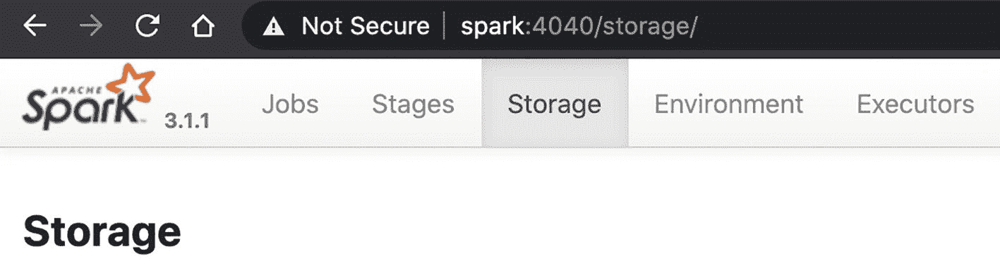
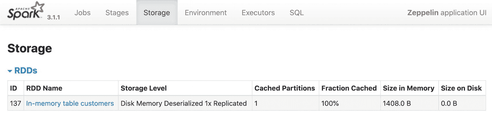
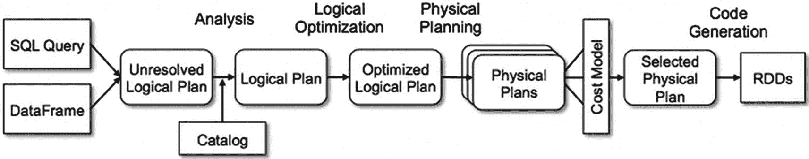

# 6. 数据发现与 Spark SQL 目录

能够连接并处理大多数公司现代技术栈中包含的数据系统和服务，是数据工程师的一项关键技能。幸运的是，Spark 提供了处理和转换数据的机制，使您能够采取行动并解决问题，而无需编写和维护另一套自定义基础设施代码。通过依赖 Spark 的核心能力，您学会了利用 `JDBC` 的强大功能与传统数据库中存储的数据进行互操作。访问任何兼容 `JDBC` 的 `RDBMS`，使您能够一次性编写 `SQL` 查询，这意味着您无需为支持具有不同业务逻辑的独立应用程序而烦恼。

本章延续了第 5 章的学习内容。这将是我们首次探讨如何结合使用数据湖和关系数据库来填充 `Spark SQL` 目录的内容。此过程使您能够为数据源添加丰富的元数据注释，这些元数据描述了 `Spark` 应用程序生成的表。这些上下文信息详细说明了数据管道的输入和输出格式，还可以扩展用于自动生成数据血缘图，或用作内部乃至外部数据目录的通用数据可发现性服务。这不仅对您和您的团队至关重要，对数据组织中任何希望重用或分析 `Spark` 作业输出数据的其他成员也同样宝贵。

在本章的最后，我们将通过扩展之前的练习，使用 `Spark` 的强类型数据集，来了解 `Spark` 如何优化您的转换流程。这个最终练习将向您介绍 `Spark` 如何编码应用程序代码的意图，并通过内部的 `Catalyst` 优化器，神奇地生成并优化从开始到结束运行应用程序所需的逻辑执行阶段。

本章分为以下几个部分：

- `Hive Metastore` 与 `Spark SQL` 目录
- `Catalyst` 优化器
- `Spark` 数据集

## 练习内容

您可以在本书 `GitHub` 仓库的 `ch-06/` 文件夹中找到本章所需的材料，地址为 [`https://github.com/newfront/spark-moderndataengineering`](https://github.com/newfront/spark-moderndataengineering)。只需使用运行脚本启动环境，然后访问 `http://localhost:8080` 即可。

```
cd ch-06/docker && ./run.sh start
```

## 数据发现与数据目录

在上一章中，我们探讨了在 `Apache Spark` 中通过 `JDBC` 连接数据库（`RDBMS`）是多么容易。虽然我们能够连接到为练习而启动的数据库，但有一个主要问题可能会在日后造成麻烦。这个障碍具体是：如果事先不了解数据库的位置、数据库中物理表所代表的数据类型，以及这些数据在底层表模式中的表示方式，那么简单的数据发现行为几乎就不存在。然而，数据发现实际上是数据驱动型企业成功的关键，作为数据工程师，这确实应该引起您的重视。

### 数据目录为何重要

数据发现可能看起来不是我们当前需要立即关注的问题，因为本书上下文中我们正在处理的数据，仅代表一家虚构公司初始客户数据库中的少量客户、少量咖啡品牌及一些基本元数据（以浓度表示的烘焙程度）、少量门店以及白天每家门店客流量的部分信息。然而，在现实世界中，数据发现问题是一个更为重大的关切。让我为您描绘一下这个场景。

### 数据的一厢情愿

随着任何公司的发展，新员工的加入自然会导致小团队扩张。随着团队持续壮大，在某个节点上，团队自然会发生分叉，再次拆分成更小的团队，并拥有更具体的职责范围和关注领域。由原团队成员组成的新团队，会随着公司的有机增长而继续这种成长与分裂的循环。在一段时间内，团队可以依赖部落知识，或者依赖在公司长期积累但文档记录不足的流程，而跨团队沟通使得团队能够直接分享部落知识、数据位置、表结构和原始数据格式。

出于某种原因，许多初创公司，甚至一些非常成熟的公司，都陷入了这样一种想法：在云时代，团队能够更加敏捷、快速行动，甚至打破常规，以跟上令人目眩的创新步伐。这样一来，工程师和产品经理很容易跳过或忽视详尽文档和软件测试这一步骤。这种做法不言而喻的副作用是，技术债务很容易堆积，成为难以启齿的隐患。这是为了公司持续向前发展而必须承担的风险！不幸的是，历史往往会重演，这种高额的技术债务可能导致流程和模式迅速变得不可持续。

随着公司发展壮大、收购新公司、工程师更替、部门重组，以及其他跨团队/跨项目数据平台的出现，过去依赖部落知识，或者期望团队等待核心团队成员回复 `Slack` 消息、加入视频会议，甚至亲自到场，来引导新团队了解过时流程的做法，会变得对公司及其员工的福祉有害。在处理数据时，清晰的文档和已建立的跨职能工作方式显得尤为重要。

对于数据团队而言，依赖手动沟通数据模式变更，或者玩那种古老的“传话游戏”（你知道的，鲍勃告诉爱丽丝，爱丽丝又告诉我，`X` 团队正在更改他们的数据格式），会带来巨大的成本和进展阻碍。不可靠的流程在压力下会迅速崩溃，其副作用是，将原本核心、可靠的数据变成了不可靠、不可信的数据。对某个数据库表的模式，或数据湖中记录的原始格式的变更沟通不足，将导致生产中断，因为团队可能甚至不知道谁依赖于他们的数据，或者谁会受到上游破坏性变更的影响。中断意味着人们会生气，然后开始互相指责。这是一个转折点，一个分岔路口，也是当公司达到一定规模时，数据平台、集中化流程和其他“做事方式”出现的原因之一。

### 数据目录来救场

幸运的是，在公司内部环境之外，存在着标准的做事方式。就像大多数设计模式一样，人们遵循它们是因为它们可以节省时间，并避免在事情崩溃时遭受打击带来的潜在痛苦。我之前描绘的画面，是当公司内部核心数据层的信任崩溃时可能发生的最坏情况。事实是，数据文档与任何 `API` 文档同等重要。这些基于元数据的数据定义代表并充当了一个集中式契约，规定了如何、何时以及为何消费和使用表中存储的数据。而实现这一目标最广泛使用的标准方法之一，就是使用 `Apache Hive Metastore`。

## Apache Hive Metastore

`Hive Metastore` 最初是为了提供重要的元数据而构建的，这些元数据可用于简化不同团队处理其数据湖中分布式数据的方式。这些伪表定义映射了关键缺失的信息，包括与存储在这些分布式 `SQL` 表中的数据进行互操作所需的模式、分区、编码器和解码器。

这些元数据在运行时被用作粘合剂，使 [Apache Hive](https://cwiki.apache.org/confluence/display/Hive/Home) 能够对存储在 `HDFS` 中的数据运行类似 `SQL` 的分布式查询。回顾第 1 章，我们讨论了分布式文件系统、数据管道和 `ETL` 的出现。曾几何时，对于使用 `MapReduce` 编写和维护 `ETL` 作业的数据工程师来说，`Apache Hive` 简直是天赐之物。

大数据实际上只是一种用于存储、处理和查询大规模分区且完全分布式数据的技术，这些数据无法放入传统的 `SQL` 数据库中。`Hive` 提供了一种机制，让人们可以像对待传统数据库那样对待这些分布式文件系统，即将其视为带有模式的表。这使得数据工程师能够专注于将数据摄入 `HDFS` 的管道、将数据表示为具有代表性数据结构和模式的表，以及将所有这些信息汇总到每个分布式 `Hive` 表的表定义中的数据血缘信息。

这些表元数据存在于 `Hive Metastore` 中，并提供了描述每个 `Hive` 表的谁、什么、哪里和为什么的关键信息。此外，元数据存储使有权限访问它的团队能够发现新表，并找到重用此分布式数据仓库中可用数据的新途径。所有这一切都无需依赖大量的跨团队沟通、冗长的会议和分享部落知识，就能开始高效工作。

### 具有现代风格的元数据

如今，`Hive Metastore` 依然健在且运行良好，但其用途已与最初设计有所不同。现在，典型的做法是运行元数据存储，却从未打算使用 `Hive` 本身。这种变化可以被视为一种演进，它与现代数据技术栈中的其他变化同步发生。基于云的分布式对象存储（如 `Amazon S3` 和 `Azure Blob Storage`）的日益普及，使得行业焦点从 `Hadoop` 和 `HDFS` 转移开来。

类似的迁移也发生在公司身上，它们正在远离许多较老的 `Hadoop` 技术，比如 `Hive` 本身。在第 2 章中，你了解到 `Spark` 是如何从 `MapReduce` 成功的精华中诞生的。它改变了核心执行模型，以在内存中重用计算，并允许对同一数据进行多次迭代，而无需显式返回数据源，这本身就是一次自然的技术演进。

类似于回收利用的概念，生态系统只是重用了 `MapReduce` 的组件，但做了一些改变。`Spark SQL` 和 `Hive` 之间的关系也是如此。`Spark SQL` 完全有能力作为一个功能完备的 `SQL` 引擎运行，并且正如你即将亲身体验的那样，它也可以利用 `Hive Metastore`。虽然它可以与 `Hive` 互操作，但它自己也能运行得很好。

## 练习 6-1：使用 Hive Metastore 增强 Spark SQL

`Hive Metastore` 为描述表的位置、数据编码（例如 `Parquet`、`ORC`）、列式模式以及统计信息提供了单一可信源，旨在实现数据民主化，供数据工程师、分析师、机器学习工程师和数据科学家等人员使用。借助 `Metastore`，人们无需四处询问或大海捞针就能找到数据集！

下一节将引导您完成启动并运行 `Hive Metastore` 所需的五个简单步骤。与上一章的练习类似，您可以使用章节源材料实时运行所有内容。

### 引导选项

`run.sh` 提供了一个引导选项。如果您只想引导此环境而不关心所有曲折细节，我保证我不会介意。标题为“6_1_HiveMetaStore”的 Apache Zeppelin 笔记以 `Bootstrap the Environment` 开头，它将引导您完成命令和设置。您可以跳到 Spark SQL Catalog 部分，稍后再回到本节以获取有关初始化数据库表、用户权限和 Spark 配置的更多信息。

## 配置 Hive Metastore

配置 Hive Metastore 需要几个步骤，让我们从让它在 Spark 上下文中工作开始。幸运的是，这些步骤相当简单：

1.  创建 `metastore` 数据库。
2.  授予您的 MySQL 用户对该数据库的访问权限。
3.  创建数据库表。
4.  配置 Spark 环境以访问 `metastore`。
5.  为 Spark 环境提供 Hive 依赖项。

这些步骤应该不会太多。实际上，Spark 能够运行 Hive Metastore，而无需运行任何额外的服务（或容器）。唯一真正的要求是您已初始化数据库和表，并已授予您的 Spark `dataeng` 用户对数据库的访问权限。

## 创建 Metastore 数据库

为了简化在完成实际 `metastore` 数据库创建后初始化 Hive Metastore 表的过程，表定义 SQL 文件已提供在章节的 `exercise` 目录中。`docker file copy` 命令已包含在 `run.sh` 中。命令行参数 `hiveInit` 将代表您将必要的文件复制到正在运行的 `mysql` 容器中。只需执行清单 6-1 中的命令即可。

```
cd /path/to/ch-06/docker &&
./run.sh start &&
./run.sh hiveInit
```

启动章节练习环境并初始化 Apache Hive Metastore。

`hiveInit` 命令将运行以下两个 Docker `copy` 命令。

```
docker cp hive/install/hive-schema-2.3.0.mysql.sql mysql:/
docker cp hive/install/hive-txn-schema-2.3.0.mysql.sql mysql:/
```

### 连接到 MySQL Docker 容器

使用以下 `docker exec` 命令登录到容器上下文。

```
docker exec -it mysql bash
```

### 以 root 用户身份认证 MySQL 用户

登录到本地 MySQL 容器后，使用 `mysql` shell 以 MySQL root 用户身份进行认证。

```
mysql -u root -p
```

`MYSQL_ROOT_PASSWORD` 值可以在 `ch-06/docker/docker-compose-all.yaml` 中找到。

### 创建 Hive Metastore 数据库

进入 `mysql` shell 后，继续创建 `metastore` 数据库。

```
mysql> CREATE DATABASE `metastore`;
```

现在数据库已创建，是时候授予您的 Spark `mysql` 用户访问权限了。

### 授予对 Metastore 的访问权限

授予 `dataeng` 用户对 `metastore` 数据库的访问权限。

```
REVOKE ALL PRIVILEGES, GRANT OPTION FROM 'dataeng'@'%';
GRANT ALL PRIVILEGES ON `default`.* TO 'dataeng'@'%';
GRANT ALL PRIVILEGES ON `metastore`.* TO 'dataeng'@'%';
FLUSH PRIVILEGES;
```

**提示**：通常的做法是创建特定于用例的用户来管理对 Hive Metastore 数据库的访问。应根据应用程序的访问模式，授予用户对 `metastore` 的读/写或只读访问权限。许多应用程序仅消费数据，并将表数据复制到 Hive Metastore 上下文之外的不同位置。请记住，数据访问是一种特权！

您现在已完成 `root` 用户会话。您应该退出此会话，并以 `dataeng` MySQL 用户身份重新登录。

```
mysql> exit
```

## 创建 Metastore 表

我们即将完成 `metastore` 的设置。接下来要做的是创建底层的 Hive Metastore 表本身。配置 `metastore` 数据库表需要一次性设置成本。幸运的是，我们可以直接将表定义导入到 `mysql` 控制台中。

### 以 dataeng 用户身份认证

在 MySQL 容器上下文中，将您的认证 MySQL 用户更改为 `dataeng`。

```
mysql -u dataeng -p
```

### 切换到 Metastore 数据库

```
mysql> use metastore;
```

### 导入 Hive Metastore 表

`SOURCE` 命令可用于轻松读取和应用适用于我们 Hive 版本（v2.3.0）的 SQL 表配置命令。此文件在 `mysql` Docker 容器中可用，因为您在设置过程的早期使用了 `hiveInit` 命令。

```
mysql> SOURCE /hive-schema-2.3.0.mysql.sql;
```

就是这样。您现在是一个全新安装的 Hive Metastore 的快乐拥有者。如果您想查看在此过程中初始化了哪些表，可以从当前的 MySQL 会话运行以下命令。

```
use metastore;
show tables;
```

运行 `show tables` 命令将产生一长串表名（超过 50 个）。您可以随意使用 `DESCRIBE` 命令查看任何表以获取更多上下文，或者直接退出控制台。现在，您的 `metastore` 已准备好投入使用。接下来，我们将添加 Spark 访问 Hive Metastore 所需的配置。

## 配置 Spark 以使用 Hive Metastore

Hive Metastore 传统上通过 `hive-site.xml` 进行配置。Spark 会自动在 `$SPARK_HOME` 目录下的 `conf` 目录中查找此配置文件。此文件及其他文件已为您预先配置好，并可在 `ch-06/docker/spark/conf/` 目录下的 `exercise` 文件中找到。

如果您现在不想查看配置，可以跳过本节，直接转到 Spark SQL Catalog。

### 配置 Hive Site XML

`hive-site.xml` 文件仅包含四个属性。它们为 Spark 提供了将在您的应用程序中使用的 Hive Metastore 数据库的默认连接属性。这些属性如表 6-1 所示。

**表 6-1** Hive Metastore 配置选项

| 属性 | 描述 |
| --- | --- |
| `javax.jdo.option.ConnectionURL` | 定义到您的 `metastore` 的 JDBC 连接 URL。 |
| `javax.jdo.option.ConnectionDriverName` | 定义用于连接到 `metastore` 的 JDBC 驱动 `ClassName`。 |
| `javax.jdo.option.ConnectionUserName` | 定义 `metastore` 数据库用户名。 |
| `javax.jdo.option.ConnectionPassword` | 定义 `metastore` 用户的密码。 |

官方 Hive 文档中提供了更多配置选项，包括对共享 Hive Metastore 的不同访问模式。这些包括运行完全独立的 Hive Metastore 服务器（v3.x 及以上版本）以及 *Hive Thriftserver*，以及如何为域分片提供多个 thrift URL，这有助于减少因过多连接到单个 Hive Metastore 实例而导致的拥塞。由于 `metastore` 是无状态的，这意味着服务本身不存储物理状态，您可以简单地创建多个前端服务，以便对 thrift 服务器的连接进行负载均衡，然后连接到底层的 `metastore` 数据库。

### 配置 Apache Spark 以连接到外部 Hive Metastore

您刚刚了解到 Apache Spark 使用 `hive-site.xml` 文件连接到 Hive Metastore。练习开始时我们没有提到的是，所有必需的配置都已为您提供在练习的 `conf` 目录中。然后，该目录通过 `docker-compose-all.yaml` 文件挂载到 Docker 环境中。

这意味着您无需将任何文件复制到`$SPARK_HOME`位置。打开 Docker Compose 文件`/ch-06/docker/docker-compose-all.yaml`，查看`services:zeppelin:volumes`部分以了解更多详情。

在`ch-06/docker`目录的上下文中，以下三个目录被挂载为卷：

- `/spark/conf` – 此目录包含`spark-defaults.conf`和`hive-site.xml`。
- `/spark/jars` – 此目录包含我们启动 Spark 时希望在本地包含的所有 MySQL JDBC 驱动程序 JAR 包。
- `/spark/sql` – 此目录被挂载，以便我们可以将其用作 Spark SQL Warehouse 的根目录。

`spark-defaults.conf`文件是一个可选文件，可用于覆盖在该 Spark 安装上下文中运行的所有 Spark 作业的默认 Spark 配置值。对于当前的用例，我们只关心表 6-2 中详述的七个属性。

**表 6-2** Hive Metastore 配置属性

| Spark 属性名称 | 描述 | 示例 |
| --- | --- | --- |
| `spark.sql.warehouse.dir` | 读取和写入分布式 SQL 表的默认位置。此位置可以位于本地文件系统或任何兼容 HDFS 的文件系统上。 | `hdfs://metastores/hive/` `file:///spark/warehouse/` `s3a://your-bucket/hive/` |
| `spark.sql.catalogImplementation` | 定义 Spark 会话的后端 SQL 目录。 | `hive` |
| `spark.sql.hive.metastore.version` | 定义 Metastore 的 Hive 版本。 | 2.3.7 |
| `spark.sql.hive.metastore.jars` | 定义要加载到 Spark 类路径中的 Hive JAR 包的位置。Spark 默认使用内置的 JAR 包。 | `builtin`、`maven` 或 `/path/to/the/jars` |
| `spark.sql.hive.metastore.sharedPrefixs` | 用于搜索和加载特定版本 Hive Metastore 的逗号分隔的类名前缀。 | `com.mysql.cj.jdbc`、`com.mysql.jdbc`、`org.postgresql` |
| `spark.sql.hive.metastore.schema.verification` | 如果设置为`true`，则 Spark Metastore 版本必须与 Hive Metastore 中`VERSION`的值匹配。 | `true` |
| `spark.sql.hive.metastore.schema.verification.record.version` | 如果设置为`true`，Spark 将针对 Hive Metastore 中发布的内容强制执行记录级模式验证。 | `true` |

表 6-2 中描述的配置已在章节练习的`spark-defaults.conf`文件中预先配置。为简单起见，我们使用标准的 Hive 内置 JAR 包（撰写本文时为 v2.3.7）。

### 使用 Hive Metastore 进行模式强制

值得指出的是，Hive Metastore 可以作为写入分布式表的应用程序之间任何模式争议的可靠仲裁者。这意味着不良数据不会污染您的数据湖。这是使用 Hive Metastore 的众多原因之一。此选项通过`spark.sql.hive.metastore.schema.verification.record.version`设置进行配置（如表 6-2 所述）。

> **注意：** 您可以使用表 6-2 中的配置升级与 Spark 一起使用的 Hive Metastore 版本。具体来说，使用`spark.sql.hive.metastore.jars`和`spark.sql.hive.metastore.version`属性。您可以从官方 [Apache Hive 网站](https://hive.apache.org/downloads.html) 下载所需的 Hive Metastore JAR 包，以运行替代版本的 Hive Metastore。

### Spark 默认配置

`spark-defaults.conf`文件中定义的默认值使我们能够“一次定义”特定的集群范围设置，这些设置将自动应用于在默认值上下文中启动的任何 Spark 应用程序。在我们的案例中，这意味着在 Zeppelin 环境中启动的任何应用程序。可以使用应用程序级覆盖或在应用程序启动时提供显式配置`--conf`值来显式覆盖默认值。

#### 使用 Spark 默认值保护集群

您可以将默认配置值视为重要的通用设置，这些设置提供给您的 Spark 应用程序，以利于应用程序运行时并保护集群中运行的其他应用程序。

例如，如果您正在管理或运行自己的 Spark 集群，您很可能需要平衡运营成本，并且通常会部署一个固定大小的集群，该集群考虑了将按日或按小时运行的应用程序的需求。此外，您还需要考虑这些是批处理应用程序还是流式应用程序，以及应用程序是 IO 密集型还是 CPU 密集型。然后，启动到集群中的每个应用程序都可以从集群总资源中获取固定或动态数量的资源（最小/最大份额）。如果所有应用程序都尊重其他应用程序资源的边界，那么这种策略可以很好地发挥作用。

#### 提供默认限制

鉴于每个应用程序可以从共享集群资源中请求非固定数量的资源，至少可以说，集群管理可能很困难。尤其是当您期望数据管道中的每个作业都能运行时。因此，在设置应用程序可以消耗的资源总数的预定义限制时，采取高度防御性的措施变得非常重要，因为并非每个应用程序都需要相同数量的计算核心或 RAM 才能成功运行。这就是默认值发挥作用的地方。这里的妙处在于，应用程序所有者实际上需要了解某些配置的工作原理才能覆盖它们，根据我的经验，许多应用程序可以在默认的少量核心和 RAM 上正常运行。

例如，如果您考虑常见的 T 恤尺码方法（S、M、L、XL），一个小型应用程序可能包含以下内容：

```
spark.cores.max 8
spark.executor.cores 1
spark.executor.memory 1g
```

此配置会将一个应用程序固定到八个计算核心和八个运行 1GB JVM 大小的执行器上。

通过让其他应用程序所有者更容易地声明共享集群的一部分，或者在像 Kubernetes 这样更动态的环境中，有许多配置选项可以简单地抽象到默认值中。第 14 章介绍了使用 Spark Standalone 部署应用程序，第 15 章介绍了使用 Kubernetes 部署应用程序。

### 生产环境 Hive Metastore 注意事项

使用外部 Hive Metastore 的好处在于，你的表定义将在 Spark SQL 会话之间持久保存。如果没有为`SparkSession`提供`hive-site.xml`，则会使用 Derby 创建一个本地 Metastore。基于 Derby 的 Metastore 不适用于生产环境，且只能与单个`SparkContext`配合使用，你可以将其理解为“单一位置”。

同样值得指出的是，Hive Metastore 并非直接与 MySQL 绑定。大多数常见的关系型数据库（MS SQL Server、MariaDB、Oracle 和 Postgres）也受支持。有关配置和使用其他外部关系型数据库的更多信息，你可以在线查看管理手册。

最后，为了运行生产级、高可用的 Metastore，必须防范任何单点故障，包括底层数据库本身。运行兼容 SQL/JDBC 的托管式云数据库，例如 [Amazon Aurora DB](https://aws.amazon.com/rds/aurora/%253Faurora-whats-new.sort-by%253Ditem.additionalFields.postDateTime%2526aurora-whats-new.sort-order%253Ddesc) 或 [Google Cloud Spanner](https://cloud.google.com/spanner)，为减少在没有资深 DBA 的情况下运营数据库时可能出现的故障提供了良好选择。如果你不具备自行运维的条件，建议使用任何具备监控、备份和自动故障转移功能的完全托管型关系型数据库，而不是自行搭建。

### 练习 6-1：总结

这个初始练习引导你完成了引导 Hive Metastore 以创建外部、可靠的 Hive Metastore 的过程。现在你已经完成了 Hive Metastore 的引导、`hive-site.xml` 文件的配置以及 `spark-defaults.conf` 文件的准备，接下来可以专注于 Spark SQL Catalog，并学习如何使用外部 Hive Metastore 来驱动更可靠的 SQL 体验。

## Spark SQL Catalog

`Spark SQL Catalog` 是 Spark 内部的 SQL 元数据管理器。Spark SQL Catalog 提供的功能为处理数据库、临时表或托管表、视图、函数等提供了资源。你刚刚了解了 Hive Metastore；Spark SQL Catalog 提供了简单的抽象，使你能够轻松地与 Hive Metastore 进行互操作。如前所述，确保你生成的数据以自文档化的方式呈现，以便其他团队能够按需获取数据，而无需再安排会议来理解 `wU35` 或 `l2W` 这些列的含义（当然，它们分别代表 35 岁以下女性和最近两周），这对于数据平台和组织目标的成功至关重要。显然，代号并不会让数据团队的工作变得简单。如果每个表定义都有模式支持，并且每个列不仅存储数据类型，还存储简短的注释，那么使用你表的其他工程师就可以通过 Spark SQL Catalog 以自助方式了解你的数据。

### 练习 6-2：使用 Spark SQL Catalog

Spark SQL Catalog 可直接通过 `SparkSession` 访问，并提供了许多有用的方法来检查数据仓库和数据湖中可用的数据。

**注意**

请使用标题为`6_2_SparkSQLCatalog`的 Zeppelin 笔记跟随本练习。与之前的章节一样，在笔记中创建一个新段落，并使用 `%spark` 代码块来构建工作笔记。

#### 创建 Spark Session

让我们学习从头开始创建 `SparkSession`。使用代码清单 6-2 中的代码片段，在你的 Zeppelin 笔记中创建一个新段落并运行它以生成 `SparkSession`。

```
%spark
import org.apache.spark.sql._
val sparkSessionHive = SparkSession.builder
.master(spark.conf.get("spark.master"))
.config(spark.sparkContext.getConf)
.appName("hive-support")
.enableHiveSupport()
.getOrCreate()
代码清单 6-2
创建支持 Apache Hive 的新 SparkSession
```

我们刚刚创建的 `SparkSession` 可用于进一步探索 Spark SQL API。接下来，我们将通过一个有趣的探索过程来使用 `SparkSession`。鉴于我们在数据库（本地 MySQL 数据库）中有数据，第一个探索领域将是列出并查看可用的内容。

#### Spark SQL 数据库

刚开始时，我们知道希望能够查找并找到可用的数据库。这个过程可以利用我们熟悉的老朋友 SQL，帮助我们站稳脚跟并理解 SQL Catalog 的功能。

##### 列出可用数据库

```
%spark
sparkSessionHive
.sql("show databases;")
.show
```

此方法允许我们查看可用的数据库。在我们的例子中，只有 `default` 数据库。你可能注意到了一条明显缺失的信息。你能发现它吗？也许问问自己 `default` 到底是什么意思？这是指上一章中我们命名为 `default` 的 MySQL 数据库，还是其他含义？

要了解更多信息，你需要深入 Spark SQL Catalog，如代码清单 6-3 所示。

```
%spark
sparkSessionHive
.catalog
.listDatabases
.show(truncate=false)
代码清单 6-3
使用 Spark SQL Catalog 列出数据库
```

运行代码清单 6-3 中 `listDatabases` 代码块的结果如表 6-3 所示。

**表 6-3**  

默认的 Spark SQL 数据库，即仓库

| 名称 | 描述 | locationUri |
| --- | --- | --- |
| `default` | 默认 Hive 数据库 | `file:/spark/sql/warehouse` |

这说得通。当我们在本章前面配置 Hive Metastore 时，我们只提供了连接到 Metastore 的 JDBC 信息，而没有提供连接到实际 MySQL 数据库的信息，而该数据库恰好也被命名为 `default`。

# 查找当前数据库

当前数据库相当于使用 SQL 的 `use` 命令。这仅用于告知你 Spark 会话中当前激活的是哪个数据库。

```
%spark
sparkSessionHive
.catalog
.currentDatabase
```

我们已经了解了如何列出和查看本地数据湖中存储的数据库。如果我们想创建一个新数据库，以便按团队名称或业务部门等维度来组织其下的表，该怎么做呢？

使用数据库作为对单个团队所拥有的表进行分类的一种手段，是一种高效查看元存储中所有权归属的好方法。这种模式之所以重要，原因有很多，但主要归结为常见的文件系统最佳实践和设计模式。

在 Hive 元存储中，数据库是与分布式“仓库”中某个物理目录相关联的路径前缀。数据库结构是一种限制对表集合的访问、识别一组表或单个表所有权的机制，它并不表示一个独立的物理数据库。

如果所有团队都将其表共享在同一个 `default` 数据库位置，那么随着时间的推移，表名发生冲突的可能性会很高。更糟糕的是，你可能会因为用户错误和命名冲突而意外删除自己的表。因此，按数据库名称来区分团队或业务部门非常重要。此外，数据库前缀化也有助于缓解因读写容量问题而产生的故障。

无论你是在 HDFS 上运行，还是使用像 S3 这样的云对象存储作为数据湖的分布式文件系统，为了横向扩展以支持更高的读写能力需求，最终都意味着文件系统应该能够使用路径前缀进行组合。对于 HDFS，你可以设置一个 `NameNode`（可以将其视为协调节点，因为它了解分布式文件系统的路由工作原理）来使用[联合路由](https://hadoop.apache.org/docs/current/hadoop-project-dist/hadoop-hdfs-rbf/HDFSRouterFederation.html)，根据文件系统的路径前缀将入站请求路由到不同的 HDFS 集群。你可以利用这种技术为大型和小型工作负载实现智能扩展（如果你正在运行自己的 Hadoop 集群）。对于 S3 和其他云对象存储，通常使用 base64 编码的前缀，这可以在 S3 文件系统中实现动态分片（或分区），其中每个路径前缀都可以通过元存储或解析数据库进行查找和解析。

现在，假设元存储的性能问题已经得到处理。你将学习如何创建一个数据库，该数据库将在分布式文件系统中映射为一个前缀绑定的目录。

# 创建数据库

在元存储中创建数据库可以按照清单 6-4 中的示例进行操作。

```
%spark
val dbName = "coffee_co_common"
val dbDescription = "此数据库存储关于库存、门店和客户的通用信息"
val defaultWarehouse = spark.catalog.getDatabase("default").locationUri
val warehousePrefix = s"$defaultWarehouse/common"
spark.sql(s"""
CREATE DATABASE IF NOT EXISTS $dbName
COMMENT '$dbDescription'
LOCATION '$warehousePrefix'
WITH DBPROPERTIES(TEAM='core',LEAD='scott',TEAM_SLACK='#help_coffee_common');
""")
清单 6-4
使用 Spark SQL 在 Hive 元存储中创建数据库
```

清单 6-4 中 SQL 查询的 `LOCATION` 属性将数据库与用于驱动 SQL 表的分布式文件系统中的目录或路径前缀绑定在一起。能够使用 Spark SQL 目录和 Hive 元存储定义基于团队或组织的数据库，其美妙之处在于，你可以提供所有必要的工具，让团队能够跟踪特定数据库及其底层表的所有权。这个简单的步骤非常有用，能使团队成为负责任的数据管理者。

# 使用 JDBC 加载外部表

现在你已经了解了如何创建新数据库，接下来让我们看看如何将外部数据库表`bettercustomers`加载到我们新的`coffee_co_common`数据库中。第一步是向 Spark 提供连接信息，以验证我们的 MySQL 数据库。然后，我们可以读取该表并将其写入我们的数据湖。使用清单 6-5 中的代码连接到`bettercustomers`表（该表是在第 5 章的持续探索中创建的）。

```
%spark
val jdbcDriver = spark.conf.get("org.mariadb.jdbc.Driver")
val dbHost     = spark.conf.get("mysql")
val dbPort     = spark.conf.get("3306")
val defaultDb  = spark.conf.get("default")
val dbTable    = spark.conf.get("bettercustomers")
val dbUser     = spark.conf.get("dataeng")
val dbPass     = spark.conf.get("dataengineering_user")
val connectionUrl = s"jdbc:mysql://$dbHost:$dbPort/$defaultDb"
val betterCustomers = sparkSessionHive.read
.format("jdbc")
.option("url", connectionUrl)
.option("driver", jdbcDriver)
.option("dbtable", "bettercustomers")
.option("user", dbUser)
.option("password", dbPass)
.load()
betterCustomers.createOrReplaceTempView("customers")
清单 6-5
使用 JDBC 读取外部 Bettercustomers 表以在 Spark 中创建临时视图
```

这个初始步骤仅仅是为最终加载客户表做准备。鉴于 Spark 不会立即加载临时视图，你可以确保该表对 Spark 会话是可访问的。这是一种与你的会话进行交互并确保所有预期加载的数据确实可用的好方法。

# 列出表

Spark SQL 目录使你能够列出和查看特定 Spark 会话可用的所有表。

```
%spark
sparkSessionHive
.catalog
.listTables
.show(truncate=false)
```

这将显示 Spark 会话目录中存储的当前状态。

```
+---------+--------+-----------+---------+-----------+
|     name|database|description|tableType|isTemporary|
+---------+--------+-----------+---------+-----------+
|customers|    null|       null|TEMPORARY|       true|
+---------+--------+-----------+---------+-----------+
```

`customers` 表的 `tableType` 为 `TEMPORARY`，这仅意味着它只在内存中可用。如果我们停止 Spark 上下文（关闭 Zeppelin），该表将不再存在于 Spark SQL 目录元数据中。我们希望这些数据在我们的数据湖中可用，并且可以通过 Hive 元存储访问。因此，我们需要将这些数据加载到我们的数据湖（仓库）中。

如果你回想一下本书前面提到的 ETL 流程示例，这仅仅是另一种类型的 ETL。在这种情况下，我们只是将数据加载到数据湖中，以便其他数据团队，甚至你自己的数据团队，能够更轻松地处理这些数据。

## 创建持久化表

在上一章中，我们探讨了在 `DataFrameWriter` 上使用 `saveAsTable` 方法。我们将再次使用此方法，将表写入 `coffee_co_common` 数据库，并全部存储在数据仓库中。

```
%spark
val coffeeCoDatabaseName = "coffee_co_common"
sparkSessionHive.catalog
.setCurrentDatabase(coffeeCoDatabaseName)
betterCustomers
.write
.mode("errorIfExists")
.saveAsTable("customers")
```

就像我们使用传统 SQL 切换数据库上下文一样，我们必须告诉 Spark 要使用哪个数据库，除非我们希望默认回到 `default` 数据库。这可以通过在 Spark SQL Catalog 上使用 `setCurrentDatabase` 方法轻松完成。一旦 Spark Session 的上下文切换到使用 `coffee_co_common` 数据库，我们就可以自由地将表保存到 SQL Catalog 中。

如果你继续列出 SQL Catalog 上下文中可用的表，你会看到这个新表现在出现了。

```
%spark
sparkSessionHive
.catalog
.listTables.show
+---------+----------------+-----------+---------+-----------+
|     name|        database|description|tableType|isTemporary|
+---------+----------------+-----------+---------+-----------+
|customers|coffee_co_common|       null|  MANAGED|      false|
|customers|            null|       null|TEMPORARY|       true|
+---------+----------------+-----------+---------+-----------+
```

在 `customers` 行的 `database` 列下，你会看到该表确实存储在我们的新 `coffee_co_common` 数据库中，并且该表现在完全由 Spark 管理。这意味着不仅元数据被管理（在此例中，数据存储在 Hive Metastore 中），而且数据湖中的底层分布式表也被管理。

## 查找表是否存在

最后一项可能派上用场的功能是在 Spark 应用程序中检查特定数据库上下文中是否存在表。

```
%spark
val dbName = "coffee_co_common"
val tableName = "customers"
sparkSessionHive
.catalog
.tableExists(dbName, tableName)
```

这可以用作一个简单的布尔值，来检查你需要操作的表是否存在。如果你的应用程序期望首次写入特定位置，此检查也可以用作合理性检查。最终，在 `DataFrameWriter` 上使用默认保存模式（`errorIfExists`）比担心应用程序是否会覆盖共享位置中的数据更安全。

好了，继续往下。我们将了解 Metastore 数据库的布局，并做一些练习，旨在帮助你充分了解 Hive Metastore，以便你能自信地自行探索。在暂时离开 Zeppelin 练习之后，我们将回到 Zeppelin 笔记本，并学习如何从这些受管理的 Spark 表中读取（加载）数据。你将看到如何为你的表和表列启用数据发现选项，最后，你将通过了解如何在 Spark 应用程序中管理表缓存，以及如何在不再需要时最终删除表，来结束本节内容。

## Hive Metastore 中的数据库和表

要理解数据库和表的元数据是如何管理的，了解元数据存储在哪里以及如何找到通往 Hive Metastore 数据库的路径会很有帮助。你可以按照以下步骤查看此记录：

1. 打开一个新的终端会话，或在当前上下文中添加一个新标签页。
2. 然后，在 MySQL Docker 容器上创建一个新的 Bash 会话，并使用容器上的 `secrets` 文件登录到 MySQL CLI。
3. 切换到 `metastore` 数据库并查询 `TBLS` 表。

```
docker exec -it mysql bash
mysql --defaults-file=./secrets
mysql> use metastore;
```

接下来，我们将查看新数据库和受管理表的元数据。

### 查看 Hive Metastore 数据库

存储在 Hive Metastore 中的数据库位于 `DBS` 表中。该表的可用模式只需一个简单的 `describe` 命令即可查看，这有助于高效地查询它。在此例中，你只有一个条目，但在实际环境中，可能有成百上千个数据库条目，找到你的目标可能会有点复杂。

```
mysql> describe DBS;
+-----------------+---------------+------+-----+---------+-------+
| Field           | Type          | Null | Key | Default | Extra |
+-----------------+---------------+------+-----+---------+-------+
| DB_ID           | bigint        | NO   | PRI | NULL    |       |
| DESC            | varchar(4000) | YES  |     | NULL    |       |
| DB_LOCATION_URI | varchar(4000) | NO   |     | NULL    |       |
| NAME            | varchar(128)  | YES  | UNI | NULL    |       |
| OWNER_NAME      | varchar(128)  | YES  |     | NULL    |       |
| OWNER_TYPE      | varchar(10)   | YES  |     | NULL    |       |
+-----------------+---------------+------+-----+---------+-------+
```

鉴于我们在 Spark 中创建了一个名为 `coffee_co_common` 的数据库，我们可以使用一个简单的按 `NAME` 的等值查询来找到该数据库。

## Hive Metastore 深入探查

```
mysql> select * from DBS where NAME = 'coffee_co_common';
+-------+--------------------------------------------------+-------------+
| DB_ID | DESC   | DB_LOCATION_URI   | NAME   | OWNER_NAME | OWNER_TYPE |
+-------+--------------------------------------------------+-------------+
|     1 | This database stores ... | file:...warehouse/common | coffee_co_common | zeppelin   | USER       |
+-------+--------------------------------------------------+-------------+
```

目前你真正需要关心的唯一一行是`DB_ID`行，因为它是主键。这将在下一节中用于查找受管理的`customers`表。

### 查看 Hive Metastore 表

Hive Metastore 将表元数据存储在`TBLS`表中。这句话听起来很“元”！和之前一样，我们先描述一下`TBLS`表的模式，以便了解查询时可以使用哪些列。

```
mysql> describe TBLS;
+--------------------+--------------+------+-----+---------+-------+
| Field              | Type         | Null | Key | Default | Extra |
+--------------------+--------------+------+-----+---------+-------+
| TBL_ID             | bigint       | NO   | PRI | NULL    |       |
| CREATE_TIME        | int          | NO   |     | NULL    |       |
| DB_ID              | bigint       | YES  | MUL | NULL    |       |
| LAST_ACCESS_TIME   | int          | NO   |     | NULL    |       |
| OWNER              | varchar(767) | YES  |     | NULL    |       |
| RETENTION          | int          | NO   |     | NULL    |       |
| SD_ID              | bigint       | YES  | MUL | NULL    |       |
| TBL_NAME           | varchar(256) | YES  | MUL | NULL    |       |
| TBL_TYPE           | varchar(128) | YES  |     | NULL    |       |
| VIEW_EXPANDED_TEXT | mediumtext   | YES  |     | NULL    |       |
| VIEW_ORIGINAL_TEXT | mediumtext   | YES  |     | NULL    |       |
| IS_REWRITE_ENABLED | bit(1)       | NO   |     | b'0'    |       |
+--------------------+--------------+------+-----+---------+-------+
```

现在，我们可以使用 Spark 查询刚刚创建的表，看看`TBLS`级别存储了哪些信息。

```
select TBL_ID,TBL_TYPE,TBL_NAME,SD_ID
from TBLS where DB_ID = 1;
+--------+---------------+-----------+-------+
| TBL_ID | TBL_TYPE      | TBL_NAME  | SD_ID |
+--------+---------------+-----------+-------+
|      4 | MANAGED_TABLE | customers |     4 |
+--------+---------------+-----------+-------+
```

经过这些操作，我们基本上只检索到了已经知道的`TBL_NAME`和`TBL_TYPE`信息，但这确实给了我们另一个线索，即`TBL_ID`。Metastore中的`TABLE_PARAMS`表将是我们开始看到 Spark 运行所需信息的地方。

随着我们继续深入这个“兔子洞”，你可能想知道这到底什么时候是个头。这段旅程还将连接另外两个点，之后你就可以选择自己的探索路径了，因为 Metastore 拥有大量额外的表，它们协同工作，为你的数据提供了一个强大的发现层。

### Hive 表参数

接下来值得提及的表是核心参数表，它类似于`spark-defaults.conf`文件或其他属性或配置文件。不同之处在于，它存储在数据库中，而不是分布式文件系统中的平面文件中。

```
mysql> describe TABLE_PARAMS;
+-------------+--------------+------+-----+---------+-------+
| Field       | Type         | Null | Key | Default | Extra |
+-------------+--------------+------+-----+---------+-------+
| TBL_ID      | bigint       | NO   | PRI | NULL    |       |
| PARAM_KEY   | varchar(256) | NO   | PRI | NULL    |       |
| PARAM_VALUE | mediumtext   | YES  |     | NULL    |       |
+-------------+--------------+------+-----+---------+-------+
```

使用之前的`TBL_ID`，我们可以查看`customers`表的表属性。

```
mysql> select * from TABLE_PARAMS where TBL_ID = 4;
+--------+-----------------------------------+----------------------+
| TBL_ID | PARAM_KEY                         | PARAM_VALUE          |
+--------+-----------------------------------+----------------------+
|      4 | comment                           | Loyal patrons of...  |
|      4 | numFiles                          | 1                    |
|      4 | spark.sql.create.version          | 3.1.1                |
|      4 | spark.sql.partitionProvider       | filesystem           |
|      4 | spark.sql.sources.provider        | parquet              |
|      4 | spark.sql.sources.schema.numParts | 1                    |
|      4 | spark.sql.sources.schema.part.0   | {"type":"struct"...} |
|      4 | totalSize                         | 1896                 |
|      4 | transient_lastDdlTime             | 1615756742           |
+--------+-----------------------------------+----------------------+
```

这最后一张表使我们能够查看 Spark "自动"应用于托管表的重要配置。这包括指导 Spark 读取我们表所需的所有信息。它还简化了我们使用数据的方式，包括简化了将表加载或读取到 Spark 中的过程。

换个话题，让我们回到 Zeppelin 环境，以便将保存的数据加载到我们的托管表中。

## 使用 Spark SQL 目录中的表

一旦元数据在 `SparkSession` 的 `catalog` 对象中可用，你就可以使用 `table` 方法加载数据以供应用程序使用。

```scala
%spark
val dbName = "coffee_co_common"
sparkSessionHive
.catalog
.setCurrentDatabase(dbName)
sparkSessionHive
.table("customers")
.show()
```

嗯，这真是让人耳目一新，不是吗？除了在会话目录上下文中设置当前数据库之外，访问表时不需要任何特殊的指导或指引。Spark SQL 目录抽象了所有关于查询 Hive Metastore 的业务逻辑。正如我们在手动查询 Hive Metastore 时所看到的，内省、加载和转换这些分布式表所需的所有元数据几乎都触手可及。

## 通过表和列级注释进行数据发现

本节主要介绍如何使用 Spark SQL 目录来帮助您、您的团队或任何数据团队高效地发现数据。您已经了解了 `Hive Metastore` 在帮助团队发现存储在这些混合数据湖/数据仓库中的数据方面所起的关键作用。我们研究了如何使用命名空间模式来组织数据，该模式本质上创建了一个物理目录，其中记录了表的所有权，以及特定上下文中的所有表所有者。您还学习了如何直接查询 Hive Metastore 中的众多表，因为掌握您或您的团队所使用的底层技术对于任何数据系统的健康都至关重要。

最后，我们将通过手动修改表和列级注释来结束对 Hive Metastore 的深入探讨，这样任何使用我们生成数据的人都能完全理解我们的意图。他们无需在单独的 wiki 或文档档案中查找信息，而是可以使用他们最熟悉的工具。

### 添加表级描述与列出表

表级描述有助于记录表的用途。想象一下，如果新团队想要理解 `customers` 表，却看到以下内容，会发生什么。

```scala
%spark
sparkSessionHive
.catalog
.listTables
.where($"database".equalTo("coffee_co_common"))
.select($"name", $"description", $"tableType")
.show()
+---------+-----------+---------+
|     name|description|tableType|
+---------+-----------+---------+
|customers|      null |  MANAGED|
+---------+-----------+---------+
```

这个表可能代表任何东西。如果存在多个可能被使用的表，例如 `customers_current`、`customers_a` 和 `customers_test`，该怎么办？现在需要查看很多地方，这意味着有两种选择。团队或个人可以安排会议询问你或你的团队该用哪个表，或者同样可能的是，特别是当他们急于生成报告时，团队可能会抛硬币决定，使用看起来更新一些的表。他们甚至可能花费数小时、数天或数周梳理数据来搞清楚问题，最后在截止日期临近时才来求助。

我们可以通过一个简单的 `ALTER TABLE` 命令来预防这个问题，添加 `TBLPROPERTIES` 来描述 `customers` 表。

```scala
%spark
sparkSessionHive.sql(
"""
ALTER TABLE customers
SET TBLPROPERTIES (
'comment' = 'Production Customers Data',
'active' = 'true'
)
""")
```

现在，当列出表时，团队将看到 *Production Customers Data* 描述符，这可以帮助他们确定这是要使用的正确表。

```
+---------+-------------------------+---------+
|name     |description              |tableType|
+---------+-------------------------+---------+
|customers|Production Customers Data|MANAGED  |
+---------+-------------------------+---------+
```

### 添加列级描述与列出列

现在你已经为表本身添加了描述，你可以重复此过程，应用列级描述符。此过程类似于使用 `TBLPROPERTIES` 添加表级注释，但这里我们针对的是表上使用 `ALTER COLUMN` 的 `comment` 字段。

```sql
%sql
use coffee_co_common;
ALTER TABLE customers ALTER COLUMN id
COMMENT "Unique identifier for our Customer.";
ALTER TABLE customers ALTER COLUMN created
COMMENT "timestamp when the account became active";
ALTER TABLE customers ALTER COLUMN updated
COMMENT "timestamp when this record last changed";
ALTER TABLE customers ALTER COLUMN first_name
COMMENT "The first name on the account";
ALTER TABLE customers ALTER COLUMN last_name
COMMENT "The last name on the account";
ALTER TABLE customers ALTER COLUMN email
COMMENT "customers email on file. Unique Constraint. Not to be used for Marketing";
```

更新 Hive Metastore 中的列后，现在很容易理解每一列。如果任何团队现在需要列出表的列，他们可以轻松做到。

```scala
%spark
val dbName = "coffee_co_common"
val tableName = "customers"
sparkSessionHive
.catalog
.listColumns(dbName, tableName)
.select($"name", $"description", $"dataType")
.show(truncate=false)
```

[Spark SQL Catalog](https://github.com/apache/spark/blob/master/sql/core/src/main/scala/org/apache/spark/sql/catalog/Catalog.scala) 的 `listColumns` 方法有两个变体。对于我们的用例，由于我们在 `catalog` 上下文中加载了两个表（一个非托管表和一个名为 `customers` 的托管表），存在一些歧义，即使我们将当前数据库上下文指向 `coffee_co_common` 数据库，Spark 在列出列时也可能提供错误信息。根据我的经验，这类用例通常不会发生，因为你的作业通常会根据特定的关注点分离进行拆分，一个批处理作业（或流处理作业）将数据写入托管表，而另一个作业从托管表中读取数据并继续转换数据以解决数据用例。无论如何，最好先进行测试；记住那句老话："三思而后行。"

输出现在为任何人提供了理解每列用途的必要信息。注意：此输出已被截断以适应页面。

```
+----------+--------------------+---------+
|      name|         description| dataType|
+----------+--------------------+---------+
|        id|Unique identifier...|      int|
|   created|timestamp when th...|timestamp|
|   updated|timestamp when th...|timestamp|
|first_name|The first name on...|   string|
| last_name|The last name on ...|   string|
|     email|customers email o...|   string|
+----------+--------------------+---------+
```

我们已经探索了 Spark SQL Catalog 的大部分功能，但还没有结束。还有一些内容可以很好地完善这次深入探讨。首先，我们还没有讨论表缓存、缓存表意味着什么、如何清除缓存（以释放内存）、以及当另一个进程修改了你正在处理的表时如何更新缓存。然后是更有趣的部分，即如何删除或丢弃表。考虑到数据只应在需要存在的时间内保留，保持工作区整洁比以往任何时候都更重要。

## 缓存表

缓存你正在处理的表有很多原因。这有助于减少分布式文件系统（例如 S3 或 HDFS）的负担，因为处理复杂查询时无需多次往返数据湖。复杂查询是指任何需要多次处理和转换同一数据集的查询。在报表或任何分析查询的情况下，例如，通常使用自连接来处理去重。或者，对于复杂的子集，使用半连接可能更容易，就像你在本书前面学习使用连接时看到的那样。

### 删除临时视图

为了简化事情，我们可以删除临时的 `customers` 视图，这样我们只需要关注托管表 `customers`。

```
%spark
sparkSessionHive
.catalog
.dropTempView("customers")
```

现在进入 catalog 中的缓存管理。

### 在 Spark 内存中缓存表

仅使用 Spark Session 上的 catalog，我们可以使用 `cacheTable` 方法将表数据存储在内存中（或者如果表太大，我们也可以处理）。

```
%spark
val tableName = "customers"
spark.catalog.cacheTable(tableName)
```

就是这样。嗯，差不多。在本书中，我们还没有查看 Spark UI。现在我们将只看它的一个功能，即 Storage 选项卡。

#### Spark UI 的 Storage 视图

你可以在 `http://localhost:4040/storage/` 打开 Spark UI 的 Storage 选项卡。如果你没有在笔记本中跳过前面的内容，你会看到一个漂亮的空白屏幕，如图 6-1 所示。



图 6-1 Spark UI 的 Storage 选项卡

鉴于我们还没有触发任何操作，`customers` 表中的数据虽然被标记为缓存，但实际上并不存在于 Spark 的存储中。这是因为没有理由急切地对表进行完整加载，因为你正在编写的应用程序可能只需要对数据执行一次遍历。在这种情况下，Spark 喜欢懒惰，这样做是为了保护你的应用程序，避免在开始任何工作之前就遇到内存问题。

**提示**

如果你已将映射 `127.0.0.1 spark` 应用到你的 `/etc/hosts` 文件中，那么你也可以使用 `http://spark:4040/storage/` 来查看此选项卡。此过程在章节材料中有所介绍，示例可以在 `/ch-06/docker/etc` 中找到。

### 强制 Spark 缓存

要强制 Spark 缓存来自 `customers` 表的数据，你需要调用 Spark 执行操作。在这种情况下，你可以简单地调用 `head` 来返回表中的第一行。

```
%spark
val tableName = "customers"
sparkSessionHive.table(tableName).head
```

这样就完成了。现在，如果你刷新存储界面，你将看到内存中的表。参考界面如图 6-2 所示。



图 6-2 显示已缓存 RDD 列表的 Spark 存储界面

这很有趣，不是吗？现在你有了另一种方法来确保你编写的应用程序确实按照你期望的方式运行。由于 `customers` 表存在于缓存中，当你想要从该缓存中移除一个表时，检查其行为就变得很简单了。

### 取消缓存表

当我们在 Spark 应用程序的内存中缓存数据时，这意味着你正在减少为 Spark 应用程序中对象存储分配的可用总内存。我们不会深入探讨内存管理的细节，但每个 Spark 应用程序都会将分配的可用内存分成两个空间——一个空间专用于运行应用程序所需的内存（来自 JVM 开销、IO 连接等），另一个空间专用于应用程序中的对象存储（就像我们缓存内存表时看到的那样）。这由 `spark.memory.fraction` 控制，默认情况下是 60/40 的分割。

现在，让我们看看取消缓存我们之前缓存的表的过程。

```
%spark
val tableName = "customers"
sparkSessionHive.catalog.uncacheTable(tableName)
```

### 清除所有表缓存

在 Spark 应用程序的不同位置可能缓存了许多表。如果你想从头开始，可以使用简单的 `clearCache` 目录方法。

```
%spark
sparkSessionHive.catalog.clearCache
```

这比追踪所有已缓存的表要容易得多。是的，你可以遍历目录中所有可用的表，检查它们是否存在缓存，然后选择性地移除每个缓存，但有时直接清除所有内容更好。

### 刷新表

在清除所有缓存的兴奋中，我们跳过一个重要的概念。当你将表缓存到内存中，并且上游数据存储在你无法控制的情况下被更新时（例如，另一个应用程序正在写入表的位置，从而使你的缓存失效），为了确保你拥有最新的数据，你可以在 Spark 目录上使用 `refreshTable` 方法。这会刷新关于表的元数据以及构成表的底层文件。

```
%spark
sparkSessionHive
.catalog
.refreshTable("customers")
```

这里有一个有趣的事实。如果你的 Spark 应用程序有意覆盖了你已缓存的表，它也会使你的本地缓存失效，从而无需在你自己的应用程序逻辑中包含任何表刷新操作。

## 使用 Spark 托管表测试自动缓存刷新

这是一个有趣的部分。要完整展示这个用例，需要几个步骤：

1.  将 `customers` 表的内容复制到一个名为 `customers_temp` 的新托管表中。
2.  从这个新的托管表 `customers_temp` 中读取数据到一个名为 `tableCopy` 的引用变量中，然后缓存该表。
3.  调用 `tableCopy.head` 以在本地 Spark 内存中缓存该表。
4.  将 `tableCopy` 与自身进行 `Union` 操作以复制数据。
5.  写入另一个名为 `union` 的托管表。
6.  现在，你可以自由地覆盖初始的 `customers_temp` 表，而 Spark 不会通知你正在尝试覆盖当前正在读取的表（顺便说一句，它通常会这样做）。
7.  你已经绕过了安全检查，现在 `customers_temp` 中加载了 `duplicates`。
8.  有趣的是，如果你查看 Spark UI 中的存储选项卡（`http://localhost:4040/storage/`），你会看到 Spark 已经清除了无效的缓存表视图。

你可以在“6_2_SparkSQLCatalog”笔记本中“Testing Automatic Cache Refresh in Spark”标题下跟随此示例，或者不看示例，尝试利用你在本章中学到的关于 Spark SQL 目录的知识。最后，你必须创建两个额外的托管表来欺骗 Spark，使其覆盖另一个托管表。完成此练习后，你可以继续清理刚刚创建的表。

## 移除表

删除表可以使用 `DROP TABLE` 命令完成。或者，稍微费点功夫，你也可以直接使用底层的 Spark SQL 目录 Catalyst 操作。这些操作都属于传统的数据操作语言（DML）类别。

### 数据操作语言

*DML* 代表数据操作语言。这是由 `INSERT`、`UPDATE` 和 `DELETE` 命令封装的一类 SQL 操作。在本章前面设置 Hive Metastore 时，曾简要提到 Spark 应用程序对 Hive Metastore 的只读、只写和读写访问。

## 授权

通过 DCL 授权管理传统关系型数据库的授权（权限）同样适用于管理连接到 Hive Metastore 的 Spark 应用程序的访问。为了数据安全最佳实践，你必须控制对数据的访问。应该只设置最小权限集，例如为用户启用只读操作的权限，如 `SELECT`。根据应用程序的实际需求添加功能。

例如，如果我们的 `dataeng` 用户需要读取基本的 Hive Metastore 表元数据以读取上游表数据，然后进行转换，最后使用 `saveAsTable` 将数据写入一个新的托管表，我们可以安全地使用该用户权限的子集。

```
# 权限配置

读写访问
```sql
REVOKE ALL PRIVILEGES ON `metastore`.* TO `dataeng`@`%`;
GRANT CREATE, SELECT, INSERT ON `metastore`.* TO 'dataeng'@'%';
FLUSH PRIVILEGES;
```

只读访问
```sql
REVOKE ALL PRIVILEGES ON `metastore`.* TO `dataeng`@`%`;
GRANT SELECT ON `metastore`.* TO 'dataeng'@'%';
FLUSH PRIVILEGES;
```

完全访问
```sql
REVOKE ALL PRIVILEGES ON `metastore`.* FROM `dataeng`@`%`;
GRANT ALL PRIVILEGES ON `metastore`.* TO 'dataeng'@'%';
FLUSH PRIVILEGES;
```

#### 角色

本书不会涵盖安全和数据访问管理的所有细节。不过，值得思考的一点是，研究一下是否支持基于角色的用户数据访问授权。这个强大的功能可以根据常见的角色名称实现高效的访问治理。以下是一个对 Hive Metastore 进行读写访问的示例。

```sql
-- 创建角色
CREATE ROLE readwrite;
GRANT CREATE, SELECT, INSERT, UPDATE, ALTER ON `metastore`.* TO readwrite;

-- 应用角色
REVOKE ALL PRIVILEGES ON `metastore`.* FROM `dataeng`@`%`;
GRANT readwrite TO `dataeng`@`%`;
FLUSH PRIVILEGES;

-- 查看授权
mysql> SHOW GRANTS FOR `dataeng`@`%`;
+------------------------------------------------------+
| Grants for dataeng@%                                 |
+------------------------------------------------------+
| GRANT USAGE ON *.* TO `dataeng`@`%`                  |
| GRANT ALL PRIVILEGES ON `default`.* TO `dataeng`@`%` |
| GRANT `readwrite`@`%` TO `dataeng`@`%`               |
+------------------------------------------------------+
```

这可以大大减少授予和撤销对 Hive Metastore 的通用访问权限所需的工作量。

### Drop Table

使用`DROP TABLE`会根据表是托管表还是外部表执行不同的操作。如果表由 Spark 管理，该命令将完全删除分布式表所有分区中的所有文件，以及所有元数据和表上提供的任何注释。如果表被定义为外部表，`DROP TABLE`命令将仅从 Hive Metastore 中移除表元数据，外部表将不受影响。

请记住像现在这样通过 Docker 在本地尝试操作，这样你可以在对真实数据存储执行命令之前测试不同的命令。

```sql
%sql
DROP TABLE customers_temp;
DROP TABLE unioned;
```

正如你刚刚体验到的，使用 SparkSession 上的 SQL 解释器删除表非常简单。如果你的应用程序尝试两次删除同一个表，该操作将抛出异常。如 DML 侧边栏中所述，基于角色的访问或显式用户权限有助于保护这些共享数据存储免遭意外删除。

### 条件删除表

为了保护你的应用程序，明智的做法是使用条件。`IF EXISTS`条件是一个布尔操作，`false`条件将短路或停止命令的处理。

```sql
%sql
DROP TABLE IF EXISTS customers_temp;
DROP TABLE IF EXISTS unioned;
```

最后但同样重要的是，让我们看看如何直接使用 Spark SQL 的 Catalyst 类来删除表。这是你刚刚运行的条件删除分布式`customers`表的解释型 SQL DML 查询的功能等价物。

### 使用 Spark SQL Catalyst 删除表

这将是我们第一次直接使用 Spark Catalyst 类；在下一节中，我们将更深入地研究 Catalyst 优化器。

```scala
%spark
import org.apache.spark.sql.catalyst.TableIdentifier
val catalog = sparkSessionHive.sessionState.catalog
val tableName = "customers_temp"
val tableId = TableIdentifier(tableName)
catalog.dropTable(tableId, ignoreIfNotExists = true, purge = true)
```

你可能会问，我们为什么要费这么大劲？事实证明，使用 Spark SQL Catalog 中的方法并没有一个简单的方法来删除表。

这实际上是一件好事，因为这种高级技术要求你，应用程序的作者，非常坚定地使用 DSL 来删除表。毕竟，Spark SQL Catalog 中没有`dropTable`方法是有原因的。或者，是的，你可以使用 Spark SQL 解释器中的简单`DROP TABLE`，但让我们想象一个不可能做到的世界。如果人们开始行为不端，你可以使用 DML 侧边栏中提到的基于角色或用户授权的方法，限制在你的数据平台内运行的 Spark 应用程序可用的操作。特殊权限应授予数据管理员，或仓库中特定表或数据库的负责任维护者。

### 练习 6-2：总结

Spark SQL 和 Hive Metastore 更好地协同工作，作为一个团队，为你的所有 Spark 应用程序提供一个集中的元数据服务，用于组织中通常可用的数据。正如你在上一节中学到的，要全面了解这种强大的数据发现形式，需要掌握许多细微差别。我们研究了基于用户的访问，如何使用 SparkSession 上的简单方法将数据从传统 RDBMS（在我们的例子中是 MySQL）移动到分布式数据仓库。我们研究了通过注释 Hive Metastore 数据库所有权、表列描述和表名称属性来为未来做铺垫。

继续。现在是时候参观 Spark Catalyst 优化器了。这是贯穿本书向你介绍的已解释 SQL 查询和 DataFrame 功能之间的粘合剂。

## Spark Catalyst 优化器

在本书中我们遇到的功能转换和强大 DataFrame 操作的幕后，存在一个强大但看似透明的引擎。它默默地工作，以优化和编排应用程序执行所需的每一个作业、阶段和任务。本质上，Catalyst 优化器解析你的应用程序代码，并将其高效地转换为一系列优化的步骤，称为*执行计划*。见图 6-3。



图 6-3：Catalyst 优化器解析 Spark 应用程序的高级意图，并将每个步骤通过一系列转换转换为高度优化、可分发、可执行的作战计划

此过程分为四个不同的阶段：

*   分析

*   逻辑优化

*   物理规划

*   代码生成

为了充分理解 Catalyst 引擎所做的工作，让我们使用 Spark 内置的内省层来查看每个不同的阶段。以下示例针对存储在我们数据仓库中的 parquet 数据分析了一个简单查询。

注意：请使用标题为“6_3_CatalystOptimizer”的 Zeppelin 笔记进行跟随。此最终笔记要求你已完成整章练习，以生成该部分所需的数据。

### 使用 Explain 内省 Spark 的 Catalyst 优化器

你可以在 DataFrame 上调用操作之前的任何时间点使用`explain`方法，或者在 Spark SQL 解释器中使用`EXPLAIN`子句。

```scala
%spark
sparkSessionHive
.table("customers")
.where(
col("email").like("scott%")
)
.select($"id", $"email", $"last_name")
.explain("extended")
```

此 DataFrame 查询在功能上等同于以下 SQL 查询。

```sql
%sql
select id, email, last_name from customers
where email like 'scott%'
```

无论你决定如何构建查询，Spark Catalyst 优化器都将从同一起点开始，即查询解析。这第一个操作标志着 Catalyst 从解析到优化和规划之旅的开始。

### 逻辑计划解析

执行的初始阶段负责将查询的意图转换为层次树。
```

# Spark查询计划解析

```
== Parsed Logical Plan ==
'Project [unresolvedalias('id, None), unresolvedalias('email, None), unresolvedalias('last_name, None)]
+- Filter email#5 LIKE scott%
+- SubqueryAlias spark_catalog.coffee_co_common.customers
+- Relation[id#0,created#1,updated#2,first_name#3,last_name#4,email#5] parquet
```

此步骤负责将每个查询转换并构建为关系以及这些关系上的表达式的树。第一步是识别未知列（`UnresolvedAlias`）的工作，并且在解释型 Spark SQL 的情况下，你会看到`coffee_co_common.customers`表，即`relation`，被标记为`UnresolvedRelation`。

```
|== Parsed Logical Plan ==
'Project ['id, 'email, 'last_name]
+- 'Filter 'email LIKE scott%
+- 'UnresolvedRelation [coffee_co_common, customers], [], false
```

这就是逻辑分析器发挥作用的地方。

## 逻辑计划分析

分析后的逻辑计划负责实体解析（`UnresolvedAlias`、`UnresolvedRelation`等），以便可以根据已知的模式和数据源或接收器位置验证列和表。

```
== Analyzed Logical Plan ==
id: int, email: string, last_name: string
Project [id#0, email#5, last_name#4]
+- Filter email#5 LIKE scott%
+- SubqueryAlias spark_catalog.coffee_co_common.customers
+- Relation[id#0,created#1,updated#2,first_name#3,last_name#4,email#5] parquet
```

在优化器旅程的每一步，都会完成一组特定的子任务。在上面的例子中，这就像解析列和验证数据源可以提供查询请求的数据一样简单。

## 不可解析的错误

不可解析的列可能由多种因素导致，例如在自由格式 SQL 查询中列名拼写错误。Spark 会快速失败，并通过`AnalysisException`告诉你分析阶段失败的原因。

你可以通过向`select`中添加一个新的、不可解析的字段，来让查询抛出异常。

```
%spark
customersTable
.where(col("email").like("scott%"))
.select($"id", $"email", $"last_name", $"unknown")
.show()
```

这会在实际执行物理计划之前触发异常，快速失败。

```
org.apache.spark.sql.AnalysisException: cannot resolve '`unknown`' given input columns: [spark_catalog.coffee_co_common.customers.created, spark_catalog.coffee_co_common.customers.email, spark_catalog.coffee_co_common.customers.first_name, spark_catalog.coffee_co_common.customers.id, spark_catalog.coffee_co_common.customers.last_name, spark_catalog.coffee_co_common.customers.updated];
'Project [id#0, email#5, last_name#4, 'unknown]
+- Filter email#5 LIKE scott%
+- SubqueryAlias spark_catalog.coffee_co_common.customers
+- Relation[id#0,created#1,updated#2,first_name#3,last_name#4,email#5] parquet
```

分析器阶段的这种短路机制非常有用，尤其是在尝试调试与数据相关的问题时。接下来，在解析了计划中的所有未解析实体后，Spark 将进入查询优化阶段。

## 逻辑计划优化

在此规划阶段，Spark 会在你的查询之上引入优化，例如添加空值检查，并将已知的静态表达式（如下面优化计划中的`StartsWith`）进行转换。

```
== Optimized Logical Plan ==
Project [id#0, email#5, last_name#4]
+- Filter (isnotnull(email#5) AND StartsWith(email#5, scott))
+- Relation[id#0,created#1,updated#2,first_name#3,last_name#4,email#5] parquet
```

此优化阶段转换了以下内容：

```
Filter email#5 LIKE scott% 变为
Filter (isnotnull(email#5) AND StartsWith(email#5, scott))
```

现在进入最终的规划阶段：物理计划。

## 物理计划

物理计划是 Spark 将你的查询转换为生成的 Java 字节码之前的最后一步。

```
== Physical Plan ==
*(1) Project [id#0, email#5, last_name#4]
+- *(1) Filter (isnotnull(email#5) AND StartsWith(email#5, scott))
+- *(1) ColumnarToRow
+- FileScan parquet coffee_co_common.customers[id#0,last_name#4,email#5] Batched: true, DataFilters: [isnotnull(email#5), StartsWith(email#5, scott)], Format: Parquet, Location: InMemoryFileIndex[file:/spark/sql/warehouse/common/customers], PartitionFilters: [], PushedFilters: [IsNotNull(email), StringStartsWith(email,scott)], ReadSchema: struct
```

该计划为 Spark 提供了所有必要的信息，以生成一个真实的执行计划，用于读取、过滤和加载投影字段（`ID`、`email`和`last_name`）到 Spark 中作为 DataFrame。拼图的最后一块是代码生成组件。

## Java 字节码生成

这最后一步将物理计划编译并转换为实际的 Java 字节码。这个过程被称为*全阶段代码生成*，它通过将所有 Java 方法调用内联到一个针对 JVM 优化的单一函数中来优化你的查询，而不是为了人类可读（尽管有些人以能够阅读并完全理解生成的代码为傲）。

```
%spark
customersTable
.select($"id", $"email", $"last_name")
.where(col("email").like("scott%"))
.explain("codegen")
```

这将输出部分人类可读的详细信息以供分析。

```
```
Found 1 WholeStageCodegen subtrees.
== Subtree 1 / 1 (maxMethodCodeSize:369; maxConstantPoolSize:142(0.22% used); numInnerClasses:0) ==
*(1) Project [id#0, email#5, last_name#4]
+- *(1) Filter (isnotnull(email#5) AND StartsWith(email#5, scott))
+- *(1) ColumnarToRow
+- FileScan parquet coffee_co_common.customers[id#0,last_name#4,email#5] Batched: true, DataFilters: [isnotnull(email#5), StartsWith(email#5, scott)], Format: Parquet, Location: InMemoryFileIndex[file:/spark/sql/warehouse/common/customers], PartitionFilters: [], PushedFilters: [IsNotNull(email), StringStartsWith(email,scott)], ReadSchema: struct
Generated code:
/* 001 */ public Object generate(Object[] references) {
/* 002 */   return new GeneratedIteratorForCodegenStage1(references);
/* 003 */ }
/* 004 */
/* 005 */ // codegenStageId=1
/* 006 */ final class GeneratedIteratorForCodegenStage1 extends org.apache.spark.sql.execution.BufferedRowIterator {
/* 007 */   private Object[] references;
/* 008 */   private scala.collection.Iterator[] inputs;
/* 009 */   private int columnartorow_batchIdx_0;
...
```

对于大多数 Spark 工程师来说，了解这些高级特性并非必需，但对于理解 Spark 的运行方式至关重要。此外，利用 Catalyst 对于创建 Spark 引擎的扩展非常有价值，例如当你想要读取和写入 Spark 核心编码器未知/不支持的数据格式时。

现在你已经了解了 Spark 优化应用程序流程所经历的步骤，我们将通过查看数据集来结束这一内容丰富的章节。

## 数据集

简而言之，数据集是一个强类型、高效编码的对象集合，驻留在系统原生内存中，由 Spark 引擎访问和编排。虽然概念上与 DataFrame 类似，但 Dataset API 暴露了类型化能力，包括创建自定义有状态聚合（用于流式应用程序）和其他强类型聚合，以便与更传统的基于批处理的分析一起使用。

当谈到类型化与非类型化时，这仅仅意味着 Spark 预先明确知道数据的格式和结构，即其模式。另一件值得一提的事情是，数据集具有不可变的固定模式。

### RDD

回想一下，我们在本书前面讨论 Spark 编程模型时，讨论过 RDD（弹性分布式数据集）对象。作为复习，RDD 是 DataFrame 和 Dataset 的智能骨干。它们存储了关于应用程序中数据血统的分布式（分区）元数据的逻辑映射——从最初从可靠数据源或内存数据结构加载数据开始，经过每个转换（变更）阶段，直到 Spark 应用程序中的终端操作（触发点）。每次我们调用 `write`、`show` 或 `collect` 时，我们都见证了操作的实际执行。

虽然 RDD 本身不存储任何物理对象数据。Spark 驱动程序应用程序的 `SparkContext` 明确知道数据在分配给应用程序实时运行时的 Spark 执行器的内存和磁盘空间中的位置。在每个完整的执行阶段，生成的输出数据存储在不可变的数据缓冲区中，并记录转换数据血统的新步骤。尽管这个过程或多或少是透明的，但我们将在本书中更仔细地研究这个过程。

我们刚才说到哪了？数据集是强类型、不可变的数据集合，它们是从 JVM 对象（Scala 或 Java 类）编码而来的。它们与 Spark 生态系统的其他部分配合良好，因为它们只是 RDD 之上的一层。由于数据集具有不可变或固定的模式，这意味着 Spark 在应用程序的上下文中处理数据时可以采取某些自由。同样值得一提的是，Python 和 R API 不能使用数据集，这是使用 Scala API 的一大优势。

### 练习 6-3：将 DataFrame 转换为 Dataset

让我们从一个实际示例开始。假设你能够访问之前管理过的客户数据，我们可以将这些数据复用于当前场景。现在需要做的就是生成一个简单的 Case 类来充当客户数据的中介。回想一下上一章中，我们在创建要插入到关系型数据库管理系统（RDBMS）的额外行时，研究了 Java 类型的互操作性。同样的技术可以应用于 Case 类，它可以与 Catalyst 行进行隐式互操作。

#### 创建客户 Case 类

```scala
%spark
import java.sql.Timestamp
import org.apache.spark.sql.Dataset
case class Customer(
  id: Integer,
  created: Timestamp,
  updated: Timestamp,
  first_name: String,
  last_name: String,
  email: String)
```

定义好类之后，我们现在可以将 DataFrame 转换为 Dataset。

### Dataset 别名

有一个名为 `as` 的简单辅助方法，它使用编码器将 DataFrame 转换为 Dataset。

```scala
%spark
import org.apache.spark.sql._
implicit val customerEnc = Encoders.product[Customer]
val customerData: Dataset[Customer] = customersTable
  .as[Customer]
```

Dataset 使你能够使用 Scala 的标准函数式编程，或者根据你的用例使用 Catalyst 表达式。这种范式为你的数据工程任务提供了最大的灵活性，因为有时复杂的任务无法转换为有意义的 SQL 操作。在这些情况下，回归到核心的工程技能会非常有用。例如，你可以混合使用 Catalyst 和 Scala 操作。

### 混合使用 Catalyst 和 Scala 功能

我们可以创建自己的 Lambda 函数，这些函数可以被内联，并用于过滤以特定模式开头的电子邮件字符串，例如我的名字。

```scala
customerData
  .filter(_.email.startsWith("scott"))
  .explain("formatted")
```

这种过滤方法允许你编写专门的 Scala 过滤器，这些过滤器可以直接使用 Scala `Customer` 类进行操作，而不是使用纯 Catalyst 表达式（正如我们在本章前面看到的那样）。此函数将在每一行上被调用，因为 Spark 在遍历内部 Spark 行时，会封装每个批次。对于每个过滤操作，该行将从内部 Spark 格式（一种称为 Tungsten 的优化的原生内存格式）转换为可与 Scala Lambda 函数一起使用的 Java 对象。

**注意**

这种从原生内存到 JVM 内存的转换可能会导致垃圾回收周期，从而降低应用程序的性能，因此请注意这一点，并记住尽可能不要忽视 Catalyst 原生函数。`org.apache.spark.sql.functions` 是经过效率优化的，并且随 Apache Spark 免费提供。根据经验法则，过多的垃圾回收（更不用说对 Lambda 函数的支持）会拖慢你的 Spark 应用程序。例如，我曾见过从使用 Lambda 表达式切换到使用原生 SQL 函数时，性能提升了 50-60%。

同样的过滤操作也可以使用类型化的 Catalyst 表达式轻松调用。

#### 使用类型化的 Catalyst 表达式

以下示例在功能上与前一个示例等效，不同之处在于我们使用类型化的 Catalyst 列表达式来执行 `startsWith` 过滤。

```scala
%spark
customerData
  .filter($"email".startsWith("scott"))
  .explain("formatted")
```

这使我们能够使用谓词下推（优化功能），而不是先将所有 Parquet 数据读入内存，然后进行过滤。在你后续的 Spark 学习旅程中，将会了解到更多优化技术，但使用 `Dataset` 能够实现两全其美，你可以在混合执行模型中利用 Spark 或传统的 Scala。

### 练习 6-3：总结

在构建 Spark Structured Streaming 应用程序时，通常更倾向于使用 `Dataset`，因为其固定的结构在编译时提供了明确的数据契约，避免了在运行时出现问题。此外，随着时间的推移，我更喜欢使用 `Dataset` 来定义我所编写应用程序的入口和出口（输入和输出）。这确保了我为生成的数据提供了一个坚实的 API 边界。由于从 `Dataset` 转换为 `DataFrame` 非常简单（`ds.toDF`），应用程序可以选择它们需要如何操作。然而，能够在整个组织中共享这些格式（通过 `Hive Metastore` 或在一个包含通用数据格式的共享库中）有助于你复用数据，而无需担心数据在应用程序之下发生变化。

我还发现 `Dataset` 能够极大地加速并改进编写单元测试的过程。只需投入一点前期努力，就可以使用更具测试驱动的方法来编写 Spark 应用程序。这可以节省漫长的编译和部署周期，而且良好的测试使工程师能够轻松调试任何类型的 Spark 应用程序，从标准批处理到流处理。我们将在第 7 章中探讨编写和测试完整端到端管道应用程序的过程。

## 总结

在本章中，你学习了如何将 `Hive Metastore` 与 `Spark SQL Catalog` 结合使用。你发现了为 Hive 数据库的所有权添加重要富元数据、为生成的表添加简单描述和定义、以及如何提供丰富的列级信息是多么容易，以便通过你的操作实现轻松的数据发现。这种改善数据发现的简单行为，有助于在数据平台环境中进行前瞻性投入。现在，其他团队可以有能力去寻找他们今天所需的数据，以解决未来的数据问题。

然后，我们更深入地探讨了幕后机制，并查看了 Spark 在 `Catalyst` 优化器中使用的优化管道。我们看到了它如何规划并将你的查询从解析计划转换为分析计划，再到优化计划，最后到物理计划。这一系列事件极大地改善了在代码生成阶段生成的 Java 字节码，最终，你的应用程序会直接受益于这种精心编译。

本章最后，我们探讨了使用显式编码将 Case 类转换为 `Dataset` 的过程。在接下来的几章中，当你着手构建和运行批处理及流处理的管道作业时，你将依赖前六章中的这些信息，以务实的方法构建现代数据工程环境的核心组件。
