# 8. 使用 Apache Airflow 进行工作流编排

总的来说，作为一名数据工程师，你会发现自己最常遇到两类问题。第一类源于背弃的承诺，也就是糟糕的上游数据源，以及关于数据在你的管道中流动的更普遍的“未知的未知”。你将要面对的第二类问题是*时间*。这里我不是要开始跟你谈论生命、死亡和决策，而是把时间作为一个界限或阈值。时间存在于作业的物理运行时间之间，也体现在与数据服务等级协议相关的非常现实的底线中。这些数据契约围绕着对数据格式（即*模式*）以及数据预期可用的约定时间的期望。时间让我们陷入困境的另一种方式是在这两个常见问题的交汇处，例如，上游问题与陈旧数据“幸福地”结合在一起，或者错过了服务等级协议。

如果你思考这两类问题（数据质量差和时间约束），你可能会开始理解进行工作流编排的必要性，因为缺失或陈旧数据问题会引发蝴蝶效应。管道中糟糕的上游数据会导致管道堵塞，进而影响整个数据管道。这可能是由于直接接入你数据管道的任何 API 和服务宕机，以及数据管道中任何环节导致服务等级协议被违反的作业故障或配置错误造成的。

我倾向于将数据管道想象成地图上的路径、道路、路标点和目的地。*作业*可以被视为路标点以及最终目的地，而数据流本身可以比作在地图上移动的实体，无论是自行车、火车、汽车还是介于两者之间的任何东西。当出现问题时，事情往往会积压起来（在不那么极端的情况下则会从裂缝中掉落）。你可能自己在一天中的特定通勤时间遇到过这种情况，例如在高峰时段，也可能在某些随机时间点，当你发现自己受困于意外的道路施工，或者汽车意外爆胎时。解决这些问题的办法是清除道路上的障碍，随着时间的推移，正常的交通流量就会恢复。当一切再次顺畅运行时，你就可以放松下来（呼吸），享受旅程了。

工作流编排不仅仅用于摆脱困境。它还用于构建可靠完成一组任务的蓝图，例如通过数据管道移动和转换数据。让我们简要地谈谈工作流编排，然后看看 Airflow 如何帮助我们解决这些司空见惯的问题。

## 工作流编排

`工作流`是一组常见的可执行任务，需要以特定顺序执行才能达到预期效果。换句话说，`工作流`关注的是全局视野。它以结果为导向，也就是说，只要每个任务按时完成且不影响最终结果，它就不会纠结于每个任务如何完成的具体细节。

就数据而言，`工作流`传统上由`管道作业`封装，这些作业本身作为任务运行，并赋予各个操作员职责，这些操作员在一个连续、分布式的数据处理网络中协同工作。`图 8-1` 显示了左侧`管道作业 (A)` 的放大视图，右侧则是完整的`工作流 (作业 A-E)`。

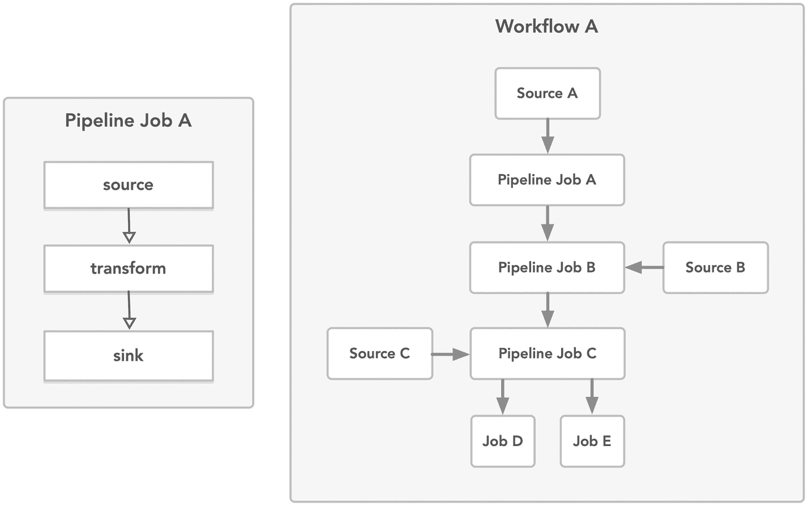

`图 8-1` 从管道到工作流。工作流封装了构成跨数据管道网络运行的分布式作业网络的输入和输出链

理解工作流编排的另一种方式是将其与大多数公司和组织中心常见的典型层级结构联系起来。一位主管与一位或多位经理合作，这些经理又管理一组员工，员工完成分配给他们所需的工作。工作如何作为一个有凝聚力的单元按时完成，这属于工作流编排中“编排”的范畴。你可以将这个组件想象成从主管到经理，再到完成工作的团队，在整个网络中传递的截止日期和需求。

当你将所有这些整合在一起时，你就拥有了一个协同运作的单元，它根据优化了可用资源总量的时间表，完成一个分布式目标。现在请记住这个概念，我们将把注意力转向 Apache Airflow，从理论转向实践。

# Apache Airflow
Apache Airflow 是目前（在撰写本文时）最流行的开源工作流编排平台。该项目始于 2014 年底 Airbnb 的内部项目。它源于一个普遍需求：以集中化方式解决日益复杂的工作流这一常见问题，从而通过简单的 UI 实现对作业的程序化编写和调度。本质上，一个作业在简单的 Python 脚本中定义了自己的计划和配置。这种由代码驱动的作业调度方法提供了丰富的定制化能力，这是仅靠静态配置难以实现的。你可能会想，这对于 Airbnb 这样规模的公司来说很棒，但为什么你需要使用 Airflow 或任何类型的自动工作流编排器呢？

## 何时编排至关重要
考虑以下情况：你和你的团队可以管理不断增加的工作量，直到达到一个临界点，此时每个新任务都意味着要放弃或自动化另一个任务，以便为更多任务腾出空间。如果你的团队规模较小，你至少可以在一段时间内手动管理任务负载。例如，启动每日批处理作业或为公司内不同团队运行手动报告。然而，从长远来看，自动化几乎总是团队成功的关键因素。通过移除那些容易自动化的工作，团队可以转向新任务，实现新目标，收获新成果，并扩展他们的集体能力和影响范围，而无需随着工作量不必要地线性扩张团队。

你如何知道从哪里开始？如果你发现自己或团队中的其他人在冗余工作上花费了更多时间，并且无意义地重复着单调的任务，这就是你开始自动化的催化剂。制定一个行动计划，将那些不令人满意或重复性的工作自动化，以释放开发周期，为接下来出现的任何任务腾出空间。有趣的是，到了某个节点，你会发现即使是这些自动化任务也需要通过自动化来管理，而这就是 Apache Airflow 和其他编排框架发挥作用的地方。

## 协同工作
回顾上一章，你学习了无状态和有状态批处理作业的区别，Airflow 可以被用作这两种操作模式的交汇点。它允许你定义健壮的工作流，这些工作流通过 Python 辅助库、额外的 Airflow 插件以及我们的老朋友 Apache Spark 的支持，引入了更动态的配置。让我们从上一章继续，使用 Airflow 来自动化运行我们的 Spark 应用程序。

## 练习 8-1：启动并运行 Airflow
当你能够使用 Docker Compose 管理事情时，启动并运行 Apache Airflow 可能是一个简单的过程。前往你的 IDE，打开第 8 章的练习内容。

### 练习材料
你可以在本书 GitHub 资源中的 `ch-08/` 文件夹中找到本章的材料，地址为 [`github.com/newfront/spark-moderndataengineering`](https://github.com/newfront/spark-moderndataengineering)。

我们将从简单地启动 Airflow 开始。打开你的终端，将工作目录更改为 `ch-08` 目录以开始。

# 安装 Airflow

在命令行中，将当前工作目录切换到 `airflow` 目录。运行 `cd ch-08/airflow`。在 `airflow` 目录中，你需要执行一些常规维护任务，以确保流程顺畅。

## 添加目录

以下 Airflow 目录将被卷挂载到 Airflow 容器运行时中，从而让你能够将所有作业定义和运行时日志保留在简单的本地位置。在 `airflow` 目录中运行清单 8-1 中的命令。

```
mkdir ./dags ./logs ./plugins
```

清单 8-1：在 `airflow` 目录下添加 Dags、Logs 和 Plugins 目录。

现在进入下一项任务。

## 为 Docker Compose 添加环境变量

你是否知道可以将环境变量导出到 `.env` 文件中，该文件将在 Docker Compose 过程中被使用？`.env` 文件可用于将可配置的路径、用户、Docker 镜像、密码等内容注入到 Docker Compose 中。这使你能够复用 `docker-compose.yaml` 定义，而无需硬编码用户名、密码或任何可能最终成为安全隐患的内容。

例如，本章练习中的 `.env` 文件（位于 `/ch-08/airflow/.env`）已被预填充。如果你想要更新运行时与 Airflow 关联的用户 ID 和组 ID，或者甚至更改 Airflow UI 端口，你可以直接编辑该文件，或使用追加运算符 `>>` 来添加新变量，如清单 8-2 所示。

```
echo -e "AIRFLOW_UID=$(id -u)\nAIRFLOW_GID=0\n _AIRFLOW_WEB_SERVER_PORT=8088" >> .env
```

清单 8-2：使用 Shell（命令行）、`Echo` 和追加运算符修改 Airflow 的 `.env` 文件。

**端口冲突**
Airflow 默认会绑定到端口 `8080`，这与你的内部 Zeppelin 主机使用的端口相同。清单 8-2 中显示的更新通过将 Airflow 端口切换为 `8088`，使得这两个服务可以协同运行。如果你不想记住服务运行的端口，可以运行 `nginx` 并根据主机名进行路由。

## 初始化 Airflow

是时候下载、设置并初始化 Airflow 了。从 `ch-08/airflow` 工作目录，在命令行中执行清单 8-3 中的命令。这将准备好环境并引导数据库表，但你暂时还不会启动 Airflow 容器。

```
docker compose up airflow-init
```

清单 8-3：使用 Docker Compose 初始化 Airflow。

清单 8-3 中的 Docker Compose 初始化命令可能需要一些时间来下载所有依赖的 Docker 容器。接着，`airflow-init` 命令将激活并引导 Airflow 元数据数据库，该数据库存储了你所有的 Airflow 作业配置，然后设置 Redis 数据库。该数据库与作业调度器一起使用。Redis 是一种极快、高性能且流行的键值对和数据结构存储，Airflow 用它来管理调度和缓存。你将在第 10 章学习如何使用 Redis 来驱动你的第一个结构化流应用程序。

在初始化过程中，你会注意到大量日志输出。这个过程将运行数据库迁移、引导以及所有其他的初始化脚本和程序。如果你感兴趣（或者想从中获得编写自己初始化程序的灵感），可以滚动查看输出；否则，你就可以准备运行 Airflow 了。

# 运行 Airflow

初始化完成后，你可以执行清单 8-4 中的命令。
```
docker compose up
```
清单 8-4：从 Airflow 工作目录运行 `docker compose up` 命令以启动本地 Airflow 集群。

Docker Compose 过程将总共启动七个 Docker 容器。这是在本地环境中启动并运行一个功能完备的 Airflow 集群所需的全部组件。需要指出的一点是，与之前章节中我们使用 `run.sh` 脚本来启动或停止 Zeppelin 环境不同，`docker compose up` 命令只会在终端窗口的生命周期内运行。如果你想将其作为长期运行的进程，接下来你将学习如何以分离模式运行 Airflow。

# 以分离模式运行 Airflow

以分离模式运行允许你将每个容器作为后台进程运行，该进程会持续运行，直到你显式地停止容器进程（或关闭机器）。在分离模式下运行时，需要考虑两件事。首先是用于启动和关闭容器的方法。例如，你是偏好使用命令行别名还是脚本文件？第二件要考虑的事情是你想如何管理使用多服务 Docker Compose 定义创建的复合运行时环境，以及你希望共享卷和目录位于何处以及如何引用。让我们先了解如何以分离模式运行 Airflow，然后提供一个解决方案，用于创建更精简的本地 Docker 环境。

## 启动服务

Docker Compose 进程接受显式的文件指针 `-f`，可用于传递绝对路径，同时还有 `-d` 标志，它会将进程更改为在后台而不是前台运行。这两种模式的区别在于，在前台你会看到由你的 `docker-compose.yaml` 定义控制的所有容器的所有日志。而在后台，如果你想要重新连接到容器的输出并查看输出，则必须引用实际的容器标识符：`docker logs -f container_ID`。

以下命令显示了更长的 `docker compose` 命令。你可以从 Airflow 工作目录运行此命令（清单 8-5）。

```bash
docker compose \
  -f docker-compose.yaml \
  up -d
```

## 关闭服务

当你准备好关闭 Airflow 集群时，可以再次使用 `docker compose` 来停止所有容器。执行清单 8-6 中的命令来关闭你的 Airflow 集群。

```bash
docker compose \
  -f docker-compose.yaml \
  down --remove-orphans
```

从本地目录（例如 `/ch-08/airflow/`）中启动和关闭 Airflow（或任何由 Docker Compose 控制的服务）的过程足够简单。然而，从长远来看，除非你努力组织好自己的本地环境，否则这个过程会比实际需要的更困难。例如，如果你有许多由多个 `docker-compose.yaml` 定义控制的环境，以支持许多不同的本地数据工程用例，那么容器命名冲突或其他环境问题可能会出现。从长远来看，创建一个服务层次结构，整齐地嵌套在根目录下，会容易得多。现在我们来看看如何优化你的本地环境，以降低后续流程的复杂性。

### 优化本地数据工程环境

随着你为本地数据工程环境添加越来越多的技术，你可能会发现创建一个统一的位置（父目录）很有用，该目录可用于创建一个有序的本地数据平台，按服务划分，并结合特定的服务卷挂载、`docker-compose.yaml` 定义和 `.env` 规范来组织，从而为 Docker 运行特定技术创建一致的环境。

现在让我们来优化你的环境。将本章迄今为止完成的所有工作复制到 `dataengineering` 父目录中。执行清单 8-7 中的命令，将 `dataengineering` 目录添加到你的主目录中。

```bash
mkdir ~/dataengineering && \
cp -R /path/to/ch-08/airflow ~/dataengineering
```

Airflow 已顺利安置在新家，下一步是添加一个简单的别名来启动和停止 Airflow。别名可以添加到你的本地 Bash 或 shell 环境设置文件（`.bashprofile`、`.bashrc` 或 `.zshrc`）中，具体取决于你运行的命令行。清单 8-8 展示了如何为 UNIX 风格系统添加 `airflow2_start` 和 `airflow2_stop` 别名。

```bash
# 适用于 Apache Spark 的 MDE 辅助工具
export DATA_ENGINEERING_BASEDIR="~/dataengineering"

alias airflow2_start="docker compose -f ${DATA_ENGINEERING_BASEDIR}/airflow/docker-compose.yaml up -d"
alias airflow2_stop="docker compose -f ${DATA_ENGINEERING_BASEDIR}/airflow/docker-compose.yaml down --remove-orphans"
```

对配置文件进行更改后，请确保运行`source`命令将更改加载到当前会话中。例如，执行`source ~/.zshrc`命令会将这两个 Airflow 别名添加到当前终端会话中。现在，无论何时需要启动本地 Airflow 集群，你只需记住`airflow2_start`；同样，当你完成工作或想释放一些系统资源时，只需调用`airflow2_stop`即可。你已经让启动和停止 Airflow 变得更加容易。你可能也迫不及待想查看效果了。让我们回到正题。

## 健康检查：Airflow 在运行吗？

假设你已经使用`airflow2_start`别名或清单 8-4 与清单 8-5 中的任一命令启动了 Airflow，那么检查程序是否运行的最简单方法是打开你常用的浏览器，访问`http://localhost:8088`。你会看到一个登录界面，如图 8-2 所示。

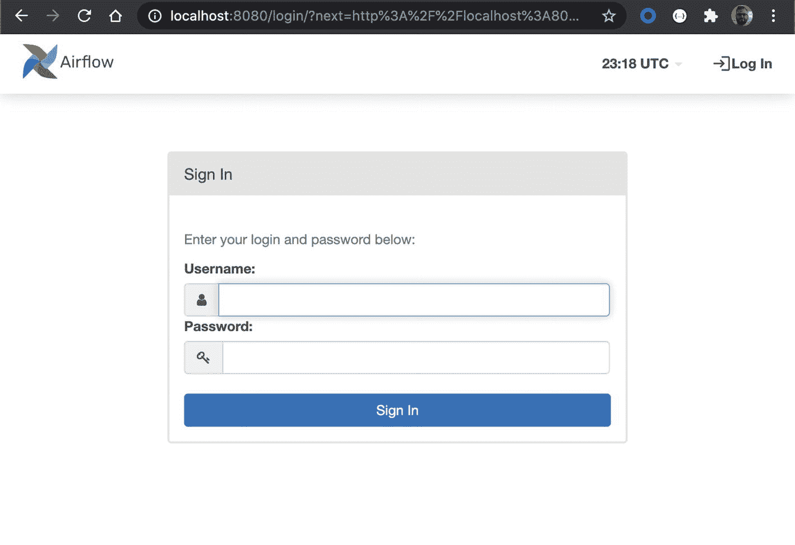

图 8-2

Airflow 登录界面

登录界面确认至少 Airflow 的 Web 服务器进程已启动并正在运行。你可以使用用户名（`airflow`）和密码（`airflow`）登录。登录后应会进入 Airflow 的主用户界面（见图 8-3）。

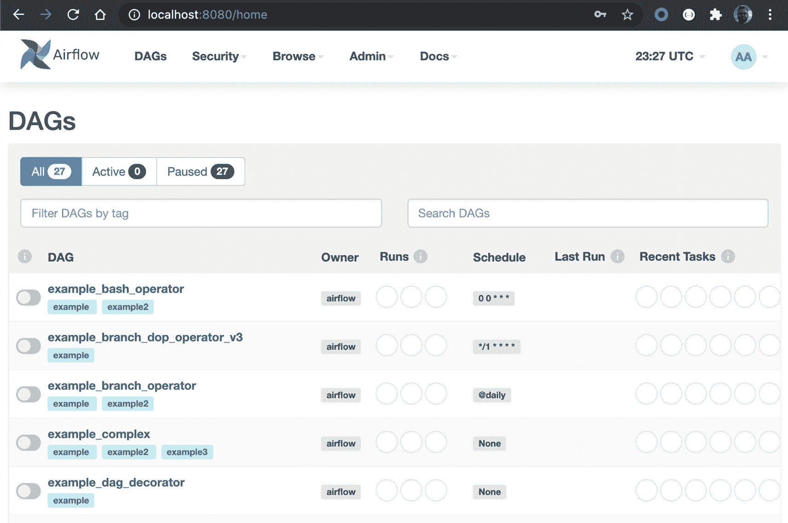

图 8-3

Airflow 的默认用户界面

> **注意**
> 你的浏览器可能会提示用户名和密码已泄露。这是因为`airflow:airflow`这个用户名:密码组合是 Airflow 的默认值，除了本地测试外，绝不应在其他任何场合使用。

在 Airflow 主屏幕上，你将看到所有作业定义、作业元数据以及每个作业先前运行（如果有）的统计信息。这也是进行常规安全管理和常见管理任务的出发点。在本章中，我们将花一些时间了解用户/角色控制，并探讨如何添加安全配置（如密码）。

首先，你的作业定义官方称为 *DAG*（有向无环图）。这是因为每个作业都被定义为一个或多个操作的有向无环图，本质上每个 DAG 本身就是一个管道操作或一个完整的复杂工作流。

> **注意**
> 你可以选择保留或删除这些默认作业。我建议保留它们，以便你可以浏览示例，了解 Airflow 能实现哪些功能。

## 运行 Airflow DAG

在 Airflow 运行且你已处于 DAG 屏幕的情况下，让我们运行其中一个示例作业。点击`example_bash_operator`（位于示例列表顶部）进入 DAG 概览屏幕（见图 8-4）。

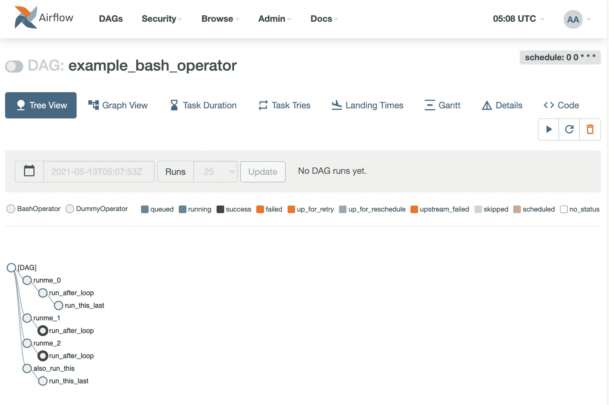

图 8-4

Airflow 的 DAG 详情用户界面是你完成大部分工作的地方

图 8-4 中的 DAG 用户界面为你提供了一个多步骤管道作业的总体概览。要运行此示例作业，你需要执行以下两步：

1.  将开关图标（图 8-4 中“DAG”字样左上角）切换至启用状态。默认情况下 DAG 处于禁用状态以节省集群资源。你需要选择启用以运行每个计划或单次执行。

2.  点击播放图标（右侧，刷新和删除按钮旁边）开始运行管道。

当你按下“触发”按钮后（确认可选的 JSON 配置后），作业将启动，随后你会看到作业过渡到“运行中”状态。图 8-5 中的用户界面显示了实时的 Airflow 作业视图。

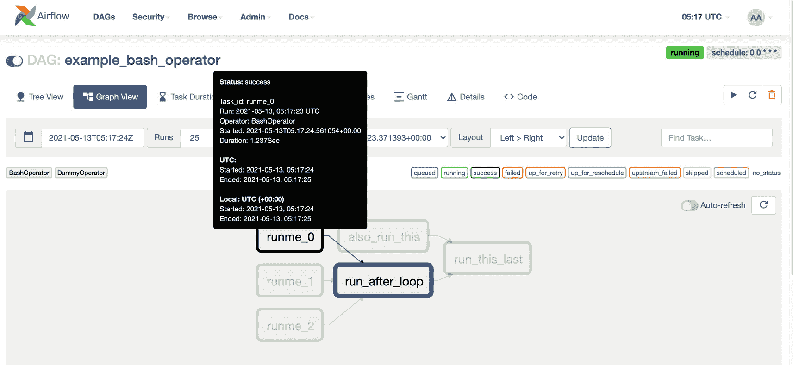

图 8-5

实时 Airflow 作业的运行视图

值得一提的是，该作业几乎会立即完成；但更新后的 Airflow 2 用户界面的一个不错功能是自动刷新选项（如图 8-5 右侧所示）。如果启用此选项，你可以在管道在操作阶段之间主动切换时观察其进度，这有助于在 DAG 中任务完成或失败时监控/观察进度或故障。

## 练习 8-1：总结

现在，无论何时你想要启动 Apache Airflow，它都已准备就绪。但是，要从 Airflow 启动 Spark 批处理作业，你还需要完成更多工作。下一节将向你介绍 Airflow 的组件，然后我们将安装 Spark 运算符。

## Apache Airflow 的核心组件

在运行了第一个 Airflow DAG 之后，现在是时候讨论最初让 DAG 得以运行的组件了。主要是 Airflow 的任务、运算符、调度器和执行器。

### 任务

在每个 DAG 内部，都存在一系列一个或多个*任务*，这些任务被执行以完成特定 DAG 所规定的要求。任务是 Airflow 中的基本执行单元，对于 Spark 应用程序也是如此。这里的重叠之处在于，对于 Spark，你有作业，每个作业由分配任务的任务阶段组成。对于 Airflow，你的 DAG 由任务组成，这些任务按特定预定义顺序运行，工作是在管理特定 DAG 的 Airflow 执行器上下文中完成的。任务可以使用运算符执行任意代码，因此每个 DAG 可以处理许多任务。每个任务可以根据所使用的运算符在本地或远程执行。

### 运算符

Airflow 运算符是模板化的任务。你可以将其视为一个可复用的蓝图，用于封装通用用例，使得通用的 Python 代码能够被复用以完成特定操作。在示例 DAG（`example_bash_operator`）中，你已经接触了两个核心的 Airflow 运算符——`BashOperator` 和 `DummyOperator`。

`BashOperator` 的功能正如其名：它用于执行 bash（或命令行）操作。`DummyOperator` 用于确保 DAG 在任务图中有一个最终的公共节点。在构建更复杂的 DAG 时，`DummyOperator` 也可用作占位符。清单 8-9 展示了`example_bash_operator` DAG 的 Python 代码。

```python
from datetime import datetime, timedelta

from airflow import DAG
from airflow.operators.bash import BashOperator
from airflow.operators.dummy import DummyOperator

with DAG(
    dag_id='example_bash_operator',
    schedule_interval='0 0 * * *',
    start_date=datetime(2021, 12, 28),
    dagrun_timeout=timedelta(minutes=60),
    tags=['example', 'example2'],
    params={"example_key": "example_value"},
) as dag:
    run_this_last = DummyOperator(task_id='run_this_last',)

    run_this = BashOperator(
        task_id='run_after_loop',
        bash_command='echo 1',
    )
    run_this >> run_this_last

    for i in range(3):
        task = BashOperator(
            task_id='runme_' + str(i),
            bash_command='echo "{{ task_instance_key_str }}" && sleep   1',
        )
        task >> run_this

    also_run_this = BashOperator(
        task_id='also_run_this',
        bash_command='echo "run_id={{ run_id }} | dag_run={{ dag_run }}"',
    )
    also_run_this >> run_this_last

    this_will_skip = BashOperator(
        task_id='this_will_skip',
        bash_command='echo "hello world"; exit 99;',
        dag=dag,
    )
    this_will_skip >> run_this_last

if __name__ == "__main__":
    dag.cli()
```

清单 8-9

创建包含同步和异步任务的 DAG

在清单 8-9 中，每个任务都被定义为 `DummyOperator` 或 `BashOperator` 的一个实例。你定义的每个任务都作为图中的一个节点，而作为设计管道的工程师，你需要通过将任务（节点）相互设置为子节点或父节点来建立处理顺序。

在图模式（如图 8-6 所示）下查看你的 DAG，有助于你规划更复杂的工作流。本质上，每个任务可以复杂也可以简单。`SparkOperator` 就是一个可以添加到工作流中的复杂任务示例。


我们将在本章后面更详细地介绍专门的 `SparkSubmitOperator` 和 `SparkSQLOperator`。为了让你全面掌握 Airflow 的各种功能，我的建议是你在新的本地沙盒环境中尽情探索和实验。接下来，我们将探讨 Airflow 如何在 DAG 中运行每个任务背后的过程。

## 调度器与执行器

执行器是 Airflow 中的进程，负责根据计划启动 DAG 中的任务。例如，假设你有一个需要在每天结束时运行的作业。调度此 DAG 的属性如清单 8-10 所示。

```python
DAG(
    dag_id="daily_active_users_reporting_job",
    start_date=days_ago(2),
    default_args=args,
    tags=["coffee_co","core"],
    schedule_interval="@daily",
)
```
*清单 8-10：配置每日 Cron 作业的 DAG 示例*

Airflow 在启动时会解析 DAG 定义，并定期解析以支持在运行时添加 DAG。当遇到新的 `dag_id` 时，DAG 元数据会被写入关系数据库管理系统（RDBMS），并且一旦超过 `start_date` 的阈值，调度器执行器进程将触发 DAG 运行（如果作业未被禁用）。

清单 8-10 中配置的计划将 `start_date` 设置为 `days_ago(2)`，并将 `schedule_interval` 设置为 `@daily`。这是一个回填作业的示例。它会查看当前日期（在 Airflow 服务器上）并回溯，以便在按每日计划（每天开始时或午夜）运行之前，先补跑前两天。更多信息可参考 Airflow 官方文档中 DAG 运行下的 Cron 预设部分。

Airflow 执行器会等待调度器通知它某个 DAG 已准备好运行。实际上，执行器本身运行在调度器进程内部。由于这种关系，考虑到调度与执行之间的紧密耦合，对于给定的 Airflow 集群，你只能指定一种执行模式。

Airflow 自带了几个有用的执行器，提供本地或远程的执行模式。

### 本地执行

如果你运行的是小型集群，可以使用 `SequentialExecutor` 或 `LocalExecutor`。本地执行意味着任务执行将与执行器进程位于同一位置，而执行器进程本身运行在调度器进程内部。这种进程嵌套方式可能适合测试，但这种模式无法扩展以并行运行多个 DAG。

### 远程执行

对于拥有必须运行的关键工作流的**生产环境**，你**别无选择**，只能使用远程执行。这使得多个 DAG 的工作负载能够跨 Airflow 工作节点网络并行执行。要查看你的 Airflow 集群正在运行哪种执行模式，请执行清单 8-11 中的命令。

```bash
docker exec \
  -it airflow_airflow-webserver_1 \
  airflow config get-value core executor
```
*清单 8-11：查看 Airflow 执行器配置*

输出将显示 `CeleryExecutor`，这是 Airflow 中较流行的远程执行器选项之一。`CeleryExecutor` 使用 Redis 进行调度，并将其工作分发到 Airflow 工作进程上。现在，让我们将注意力转向如何将 Apache Spark 与 Airflow 集成。

## 使用 Airflow 调度 Spark 批处理作业

Airflow 是一个强大的外部调度器，你可以依靠它来运行关键的 Apache Spark 批处理作业。此外，工作流编排正成为数据平台的重要组成部分，用于自动化日益复杂的数据管道，并满足众多内部和外部数据客户的需求。正如你在练习 8-1 中学到的，在 Airflow 上运行一个 DAG 非常容易（一旦你掌握了基础知识）。要开始使用 Airflow 和 Spark，你所需要的只是 *Spark Airflow Provider*，它允许你使用几种不同的 Spark 运算符。

### 练习 8-2：安装 Spark Airflow Provider 并运行 Spark DAG

本练习将重点教你安装 Apache Spark provider。你将学习如何手动安装，然后我们将注意力转向使用一个预构建的、已打包好所需组件的 Airflow 容器。接着，你将学习如何使用 Admin UI 在 Airflow 中配置一些运行时配置，最后通过 Airflow 运行上一章中的批处理应用程序。

让我们先从你在练习 8-1 中设置的 Airflow 版本开始。你将直接在 webserver 和 worker Airflow 容器上执行 `pip install` 命令，因为 Spark Python 模块必须在本地可用。

#### 定位 Airflow 容器

要运行安装命令，你需要列出 Airflow 容器的完整名称。执行清单 8-12 中的命令来查看容器名称。

```bash
docker ps | grep airflow_airflow-w*
```
*清单 8-12：使用 Docker 查找 Airflow 容器元数据*

获得容器名称后，你可以使用 Docker CLI 运行安装脚本（使用 pip/Python）。

### 手动安装 Spark 提供商

以下流程演示了如何以 `airflow` 用户身份进行身份验证并安装 Spark 提供商。请以代码清单 8-13 和 8-14 作为安装指南。

> **注意**
> 该示例演示如何在 Web 服务器上安装提供商。你还需要在工作节点上重复此过程，或者继续阅读以使用预构建的容器。

```
docker exec \
  --user airflow \
  -it airflow_airflow-webserver_1 \
  bash
```
*代码清单 8-13：以 Airflow（管理）用户身份打开 Bash 会话以获取安装新提供商的正确权限*

在 Docker 容器中，执行代码清单 8-14 中所示的 `pip install` 命令。

```
pip install \
  --no-cache-dir \
  --user \
  apache-airflow-providers-apache-spark
```

```
代码清单 8-14：使用 Pip 安装 Spark 提供商

你已完成 Web 服务器上的操作。不幸的是，现在需要为每个工作节点实例重新开始整个过程。这将确保提供商在 Airflow 集群中一致地安装。一致性至关重要，因为 Airflow 作为分布式服务运行，并且你无法总是保证 DAG 将在何处被调度。

> **注意**
> 你可以将命名队列与 `CeleryExecutor` 结合使用，以协助在 worker 之间分配工作，你也可以将任务分配到预配置的处理池中，但队列和池不在本书的讨论范围内。

当 DAG 被触发时，对于每个独立的 DAG 运行，封装该 DAG 的所有任务将一直运行，直到全部成功或关键任务失败，从而阻止其余任务的完成。在实际使用中，你会看到工作节点轻松扩展到数十到数百个实例，而在企业集群中规模甚至更大。现在想象一下，你的任务是确保整个系统保持同步，同时记住必须为每次部署重复此步骤以确保一致性。你愿意承担让一切保持同步的任务吗？

当然不。这显然是一种反模式，尤其考虑到我们最初是使用容器来运行事物的。诚然，你可以添加一些容器启动时运行的脚本，但这意味着你会因为依赖关系失败而面临潜在的运行时错误。当中央软件包仓库（如 Pypi 或 Maven）发生故障，或者软件包位置发生更改时（归档的制品版本经常如此），你可能已经遇到过此类问题。

### 使用容器实现运行时一致性

基于一致容器的运行时环境在故障排除时消除了环境方面的猜测，因此你可以集中精力并快速让系统恢复运行。对我们来说，这意味着我们不必手动安装 DAG 操作所需的任何东西。

> **注意**
> `ch-08/airflow/README.md` 中的“高级操作”一节包含了构建自定义 Airflow Docker 镜像的说明，该镜像预装了 Apache Spark 提供商和 Java 11（JRE）。

为了使用预先构建的 Docker 容器（`newfrontdocker/apache-airflow-spark:2.1.0`），你需要对位于 `~/dataengineering/airflow/.env` 的环境文件进行快速调整。然后，为了使更改生效，你还需要重启你的 Airflow 集群。首先，使用 `airflow_stop` 别名关闭你现有的集群。

> **注意**
> 如果你尚未设置本地环境，请返回代码清单 8-7 获取说明。

现在，编辑 `.env` 文件（使用编辑器或命令行），取消注释代码清单 8-15 中所示的这一行。

```
AIRFLOW_IMAGE_NAME=newfrontdocker/apache-airflow-spark:2.1.0
```

代码清单 8-15：将自定义 Airflow 镜像添加到 Docker 环境文件

完成后，保存更改，并使用 `airflow_start` 别名重新启动集群。你无需重新初始化任何内容，因为您只是切换了运行时容器（而不是切换到不同的 RDBMS 或执行器后端）。

现在我们可以继续运行一个 Spark DAG。

### 使用 Apache Airflow 运行 Spark 作业

你已经处理了所有必需的依赖项，Airflow 现在已准备好运行你的 Spark 批处理作业。在接下来的部分，你将使用 Airflow UI 添加一些额外的配置和辅助工具来运行 Spark 作业。

#### 添加 Airflow 变量

Airflow 变量类似于环境变量，但它们在元数据数据库中配置，并可通过 `airflow.models` Python 包访问。变量可以直接在 Airflow 中使用 Admin UI（管理 ➤ 变量）管理，或直接使用 Airflow 命令行管理。此服务允许你在 DAG 中配置可重用的键/值对。

代码清单 8-16 将 `SPARK_HOME` 变量添加到可通过 Airflow DAG 访问的运行时变量集合中。变量可以增强你的 DAG，更重要的是，变量由管理员控制，并且需要基于角色的用户权限才能添加或删除。

```
docker exec \
-it airflow_airflow-webserver_1 \
airflow variables set SPARK_HOME /opt/spark
```

代码清单 8-16：Airflow 变量使你能够将配置直接注入到你的 DAG 中

现在打开 Airflow UI（`http://localhost:8088`），然后点击 Variables 控件（在 Admin 菜单中）以在列表中看到新变量（如图 8-7 所示）。

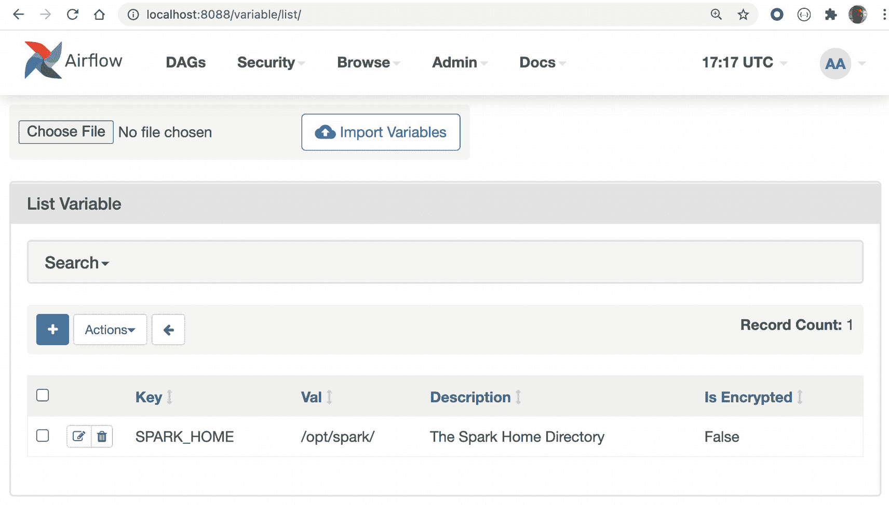

图 8-7：列表中可见 `SPARK_HOME` 变量

你还可以为你添加到 Airflow 中的任何变量编辑元数据以添加描述。这个简单的操作有助于记录给定变量的用法并清晰地传达你的意图。

> **注意**
> `admin` 菜单仅对具有 Admin 角色的用户可用，因此并非任何人都可以编辑这些变量。本章的“继续探索”部分向你展示了如何创建普通用户并介绍了 Airflow 角色（基于角色的访问控制）的概念。

#### 添加 Airflow 连接

连接使 Airflow 能够与外部服务（如 Apache Spark）进行通信，并且可以直接使用 Admin UI（管理 ➤ 连接）或命令行（`airflow connections list`）设置新的连接。

鉴于 Spark Airflow 提供商是一个扩展 Airflow 的模块，因此有简单的方法连接到给定的 Spark 集群（或进程）是合理的。打开 Airflow UI 并转到 Admin ➤ Connections 页面。点击 + 按钮（在左侧）为 Spark 创建一个新连接。此操作将带你进入一个带有空白表单的新页面。

使用该表单，从 Conn Type 菜单中选择 Spark 类型来创建 `local_spark_connection`。完成的表单如图 8-8 所示。

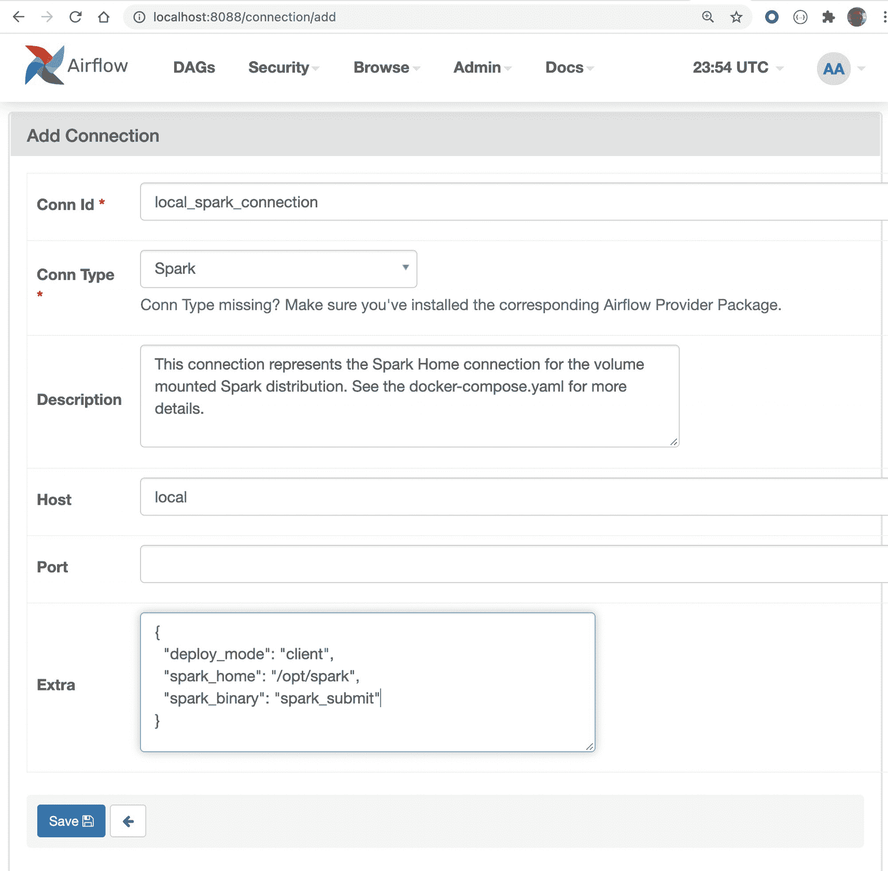

图 8-8：使用 Airflow UI 添加 Apache Spark 连接

连接创建完成后，让我们继续编写你的第一个 Spark DAG。你将要使用 `SparkSubmitOperator`，它包含在你安装到 Airflow 集群中的 Spark 提供商里。

### 编写你的首个 Spark DAG

Spark 附带了一些示例应用。其中之一名为 `SparkPI`。我们将使用这个 Spark 示例应用来熟悉如何编写一个新的 DAG。让我们从“每日 Pi”这个想法开始。

首先，在 Airflow DAGs 目录下创建一个名为 `daily_spark_pi.py` 的文件（路径为 `~/dataengineering/airflow/dags/daily_spark_pi.py`）。然后输入（或复制）代码清单 8-17 中的代码并保存你的更改。

```python
from airflow.providers.apache.spark.operators.spark_submit import SparkSubmitOperator
from airflow.models import DAG, Variable
from airflow.utils.dates import days_ago

args = {
    'owner': 'airflow',
}

spark_home = Variable.get("SPARK_HOME")

with DAG(
    dag_id='daily_spark_pi',
    default_args=args,
    schedule_interval='@daily',
    start_date=days_ago(1),
    tags=['coffeeco', 'core'],
) as dag:
    spark_pi_job = SparkSubmitOperator(
        application=f'{spark_home}/examples/jars/spark-examples_2.12-3.1.1.jar',
        conn_id="local_spark_connection",
        java_class="org.apache.spark.examples.SparkPi",
        task_id="spark_pi_job"
    )
```

代码清单 8-17 中的 DAG 首先导入了 `SparkSubmitOperator` 和一些辅助库，这些库使你能够访问 Airflow 变量，以及一些用于调度的其他实用程序。然后，我们创建了一个字典，用于存储 DAG 的所有者元数据。接下来，我们获取 `spark_home` 变量，以便在创建 `spark_pi_job` 时使用。最后，我们指定了 DAG 的元数据和调度计划。

```python
with DAG(
    dag_id='daily_spark_pi',
    default_args=args,
    schedule_interval='@daily',
    start_date=days_ago(1),
    tags=['coffeeco', 'core'],
) as dag:
```

# 在 Airflow 中运行 Spark 作业

## 编写一个简单的 Spark DAG

然后，我们使用 `SparkSubmitOperator` 向 DAG 块添加了一个任务。

```python
spark_pi_job = SparkSubmitOperator(
    application=f'{spark_home}/examples/jars/spark-examples_2.12-3.1.1.jar',
    conn_id="local_spark_connection",
    java_class="org.apache.spark.examples.SparkPi",
    task_id="spark_pi_job"
)
```

现在你已经写好了 DAG，让我们运行它。

### 运行 Spark DAG

所有新 DAG 默认均处于暂停状态。这可以进行不同的配置，但通常来说这是个好主意，因为这种行为用于保护你的 Airflow 集群资源，避免被多个同时启动的 DAG 所淹没。让我们通过命令行取消暂停此 DAG。

```bash
docker exec \
    -it airflow_airflow-webserver_1 \
    airflow dags unpause daily_spark_pi
Dag: daily_spark_pi, paused: False
```

DAG 取消暂停后，你可以手动触发它。

```bash
docker exec \
    -it airflow_airflow-webserver_1 \
    airflow dags trigger daily_spark_pi
```

假设一切按预期工作，你应该能够列出此 DAG 的成功运行记录。

```bash
docker exec \
    -it airflow_airflow-webserver_1 \
    airflow dags list-runs \
    -d daily_spark_pi \
    --state success
```

你还可以使用 Airflow UI 查看 DAG 运行期间生成的日志。为此，请按以下步骤操作：
1.  进入 Airflow DAGs 主页，使用 `coffeeco` 标签过滤出活动任务（`/home?status=active&tags=coffeeco`）。
2.  点击 `daily_spark_pi` DAG，切换到图表视图（`/graph?dag_id=daily_spark_pi`）。
3.  点击 `spark_pi_job`。你会在顶部看到一个名为“日志”的按钮；点击它以查看此次任务运行的日志。参见图 8-9。

日志将显示任务的输出，包括运行 Spark DAG 的结果。如果向下滚动页面，你会看到以下内容：

```
{spark_submit.py:526} INFO - Pi is roughly 3.1411757058785295
```

这确认了你能够从 Apache Airflow 运行 Spark 工作流。尽管这令人兴奋，但你接下来要做的是创建一个 DAG，用于运行你在第 7 章中创建的 Spark 应用程序。

### 练习 8-2：总结

本练习教你如何安装 Apache Spark 提供商、配置变量和连接，以及使用 `SparkSubmitOperator` 编写并运行一个简单的 Spark DAG。在本章的最后一个练习中，你将学习运用前两个练习中掌握的技能，运行第 7 章中的 `SparkEventExtractorApp`。

## 使用 Airflow 运行 SparkEventExtractorApp

在上一章中，你编写并编译了你的第一个 Spark 应用程序。你学会了如何创建一个由配置驱动的应用程序，该应用程序仅将来自本地数据仓库的两个表中的数据连接起来。这个类似简单 ETL 的过程合并了来自 `customers` 表和 `customerRatings` 表的数据。

在本章的剩余部分，你将设置一个 Airflow DAG，以便使用 Airflow 配置并运行此应用程序。

### 从可运行的 Spark Submit 开始

鉴于我们的目标是创建一个 DAG 来运行 `SparkEventExtractorApp`，那么首先要做的就是查看运行该应用程序需要什么。回顾一下，我们必须提供大量的配置、JAR 文件位置以及用于启动应用程序的驱动程序配置。

```bash
$SPARK_HOME/bin/spark-submit \
    --class "com.coffeeco.data.SparkEventExtractorApp" \
    --packages=org.mariadb.jdbc:mariadb-java-client:2.7.2 \
    --conf "spark.event.extractor.source.table=..." \
    --conf "spark.event.extractor.destination.table=... " \
    --conf "spark.event.extractor.save.mode=..." \
    --conf "spark.sql.warehouse.dir=..." \
    --driver-java-options "-Dconfig.file=conf/local.conf" \
    target/scala-2.12/spark-event-extractor...jar
```

当我们在 Airflow 中使用 `SparkSubmitOperator` 时，它本质上是在 Airflow 集群上下文中生成一个类似的 `spark-submit` 命令。这要求我们稍微修改 Spark 提交代码，以便它可以作为 DAG 运行。让我们从后往前看，先看一下最终的 DAG，然后将所需的配置和 JAR 文件移到正确的位置，以便一切都能正常运行。

### 练习 8-3：编写并运行客户评分 Airflow DAG

在 `~/dataengineering/airflow/dags` 目录下创建一个新文件，命名为 `customer_ratings_etl_dag.py`。然后复制（或粘贴）以下 Python 代码片段，以组装最终的 DAG。

```python
from airflow.providers.apache.spark.operators.spark_submit import SparkSubmitOperator
from airflow.models import DAG, Variable
from airflow.utils.dates import days_ago
```

接下来，我们将添加用户归属信息，并复用上一个 DAG 中的 Spark 主目录变量。

```python
args = {
    'owner': 'scotteng',
}

spark_home = Variable.get("SPARK_HOME")
```

到目前为止一切顺利。接下来，我们将创建一个新的字典，用于存储作业的完整 Spark 配置。

```python
customer_ratings_conf = {
    "spark.sql.warehouse.dir": "s3a://com.coffeeco.data/warehouse",
    "spark.hadoop.fs.s3a.impl": "org.apache.hadoop.fs.s3a.S3AFileSystem",
    "spark.hadoop.fs.s3a.endpoint": "http://minio:9000",
    "spark.hadoop.fs.s3a.access.key": "minio",
    "spark.hadoop.fs.s3a.secret.key": "minio_admin",
    "spark.hadoop.fs.s3a.path.style.access": "true",
    "spark.sql.catalogImplementation": "hive",
    "spark.sql.hive.metastore.version": "2.3.7",
    "spark.sql.hive.metastore.jars": "builtin",
    "spark.sql.hive.metastore.sharedPrefixes": "org.mariadb.jdbc,com.mysql.cj.jdbc",
    "spark.sql.hive.metastore.schema.verification": "true",
    "spark.sql.hive.metastore.schema.verification.record.version": "true",
    "spark.sql.parquet.compression.codec": "snappy",
    "spark.sql.parquet.mergeSchema": "false",
    "spark.sql.parquet.filterPushdown": "true",
    "spark.hadoop.parquet.enable.summary-metadata": "false",
}
```

"spark.hadoop.mapreduce.fileoutputcommitter.algorithm.version": "2",

"spark.sql.hive.javax.jdo.option.ConnectionUserName": "dataeng",

"spark.event.extractor.source.table": "bronze.customerRatings",

"spark.event.extractor.destination.table": "silver.customerRatings",

"spark.event.extractor.save.mode": "ErrorIfExists"

}
```

这个字典可以直接在 `SparkSubmitOperator` 中使用，从而减少了在 DAG 内部扫描配置的麻烦。在编写实际的 DAG 之前，你需要添加以下变量（`app_jars` 和 `driver_class_path`），以提高最终 DAG 的可读性。

```python
app_jars=f'{spark_home}/user_jars/hadoop-aws-3.2.0.jar,{spark_home}/user_jars/hadoop-cloud-storage-3.2.0.jar,{spark_home}/user_jars/mariadb-java-client-2.7.2.jar,{spark_home}/user_jars/mysql-connector-java-8.0.23.jar,{spark_home}/user_jars/aws-java-sdk-bundle-1.11.375.jar'
driver_class_path=f'{spark_home}/user_jars/mariadb-java-client-2.7.2.jar:{spark_home}/user_jars/mysql-connector-java-8.0.23.jar:{spark_home}/user_jars/hadoop-aws-3.2.0.jar:{spark_home}/user_jars/hadoop-cloud-storage-3.2.0.jar:{spark_home}/user_jars/aws-java-sdk-bundle-1.11.375.jar'
```

最后，我们现在可以使用这些变量和属性来创建我们的 ETL DAG。

```python
with DAG(
    dag_id='customer_ratings_etl_dag',
    default_args=args,
    schedule_interval='@daily',
    start_date=days_ago(1),
    tags=['coffeeco', 'core'],
) as dag:
    customer_ratings_etl_job = SparkSubmitOperator(
        application=f'{spark_home}/user_jars/spark-event-extractor.jar',
        jars=app_jars,
        driver_class_path=driver_class_path,
        conf=customer_ratings_conf,
        conn_id="local_spark_connection",
        name='daily-customer_ratings',
        verbose=True,
        java_class="com.coffeeco.data.SparkEventExtractorApp",
        status_poll_interval='20',
        task_id="customer_ratings_etl_job"
    )
```

就是这样。保存文件，然后轻轻拍拍自己的肩膀，给自己一点鼓励。

设置工作中最繁重的部分就是所有的配置。你可能已经注意到，为了连接这个作业，我们使用了许多新的 Spark 设置。让我们首先看看 Spark SQL 仓库的配置。

#### Spark 配置

作业配置声明了我们 Spark SQL 仓库的设置。

```json
"spark.sql.warehouse.dir": "s3a://com.coffeeco.data/warehouse",
"spark.hadoop.fs.s3a.impl": "org.apache.hadoop.fs.s3a.S3AFileSystem",
"spark.hadoop.fs.s3a.endpoint": "http://minio:9000",
"spark.hadoop.fs.s3a.access.key": "minio",
"spark.hadoop.fs.s3a.secret.key": "minio_admin",
"spark.hadoop.fs.s3a.path.style.access": "true"
```

`spark.sql.warehouse.dir` 属性在上一章中使用过。复习一下，这是当你的应用程序启动时，为 `SparkContext` 提供的单个不可变仓库路径。我们将其配置为通过另一个名为 MinIO 的服务指向 Amazon S3。MinIO 的工作方式类似于 Amazon S3，可以作为即插即用的替代方案在本地或云端运行。在本节完成后，我们将更详细地介绍其工作原理。然而，通过从本地挂载的目录迁移到 S3 克隆，我们通过引入一个完全可互操作的本地服务，简化了未来的工作（在我们将要使用 S3 的情况下）。这使得在本地环境和其他环境（包括生产环境）之间切换变得轻松，而无需过多改变我们的思维模型。

##### 本地作业配置

我们还提供了三个必需的配置，用于告知我们的 Spark 批处理作业在哪里查找我们打算进行连接的数据。这些配置在第 7 章中介绍过，允许你修改数据库表和名称。

```json
"spark.event.extractor.source.table": "bronze.customerRatings",
"spark.event.extractor.destination.table": "silver.customerRatings",
"spark.event.extractor.save.mode": "ErrorIfExists"
```

##### Spark 提交属性

`SparkSubmitOperator` 的属性使我们能够配置如何启动 Spark 应用程序，其约定与实际的 `spark-submit` 命令几乎相同。

```python
SparkSubmitOperator(
    application=f'{spark_home}/user_jars/spark-event-extractor.jar',
    jars=app_jars,
    driver_class_path=driver_class_path,
    conf=customer_ratings_conf,
    conn_id="local_spark_connection",
    name='daily-customer_ratings',
    verbose=True,
    java_class="com.coffeeco.data.SparkEventExtractorApp",
    status_poll_interval='20',
    task_id="customer_ratings_etl_job"
)
```

在运行此 Spark 应用程序的情况下，我们需要向运行时提供一些额外的 JAR。我们添加了 `jars` 和 `driver_class_path` 配置，以告知 Spark 加载一些特定于驱动程序的 JAR（主要是 Hive JDBC JAR），以及 Amazon S3 JAR，以便我们能够与 MinIO S3 客户端通信。

我们还开启了详细日志记录（`verbose=True`），以便从 Airflow 方面监控作业。最后，我们将作业完成轮询设置为每 20 秒一次（`status_poll_interval='20'`）。这允许我们持续从作业获取更新，并每 20 秒获取一次新的日志更新，而不是在作业等待失败或完成时看不到任何信息。

#### Docker 嵌套

由于 Airflow 在 Docker 内部运行，我们必须确保 Spark JAR 和配置对 Airflow 工作进程都是可用的。回顾一下，这是因为我们正在运行 `CeleryExecutor`，这意味着我们在 Airflow 工作进程上远程运行。可以通过为你的 Docker 实例提供一个共享文件系统，甚至使用云对象存储（如 Amazon S3）来简化此过程。然后，Airflow 可以按需获取你的依赖项（JAR）和其他应用程序配置。

##### 将 Spark 应用程序 JAR 复制到共享的 Spark JAR 位置

由于你正在复用你在第 7 章中创建的 Spark 应用程序，你需要将 JAR 复制到 `~/dataengineering/airflow/docker-compose.yaml` 中引用的 `spark/jars` 目录中。

```bash
```

cp `/path/to/ch-07/app/target/scala-2.12/spark-event-extractor-assembly-0.1-SNAPSHOT.jar` `~/dataengineering/airflow/spark/jars/spark-event-extractor.jar`

现在，让我们运行这个 DAG。

### 运行客户评价 ETL DAG

要运行该 DAG，您需要完成扩展环境搭建。相关说明位于章节材料中的主`README`文件中。该搭建过程将为您提供运行新 DAG 所需的一切。请注意，若需多次运行该任务，您必须将`spark.event.extractor.save.mode`切换为`Overwrite`。或者，您也可以直接从 Spark SQL 数据仓库位置删除`silver.customerratings`目录。

使用 Airflow UI，进入主 DAG 页面，点击`customer_ratings_etl_dag` DAG。在 UI 中，点击“立即触发”按钮。您将看到一个成功状态，如图 8-10 示例所示。

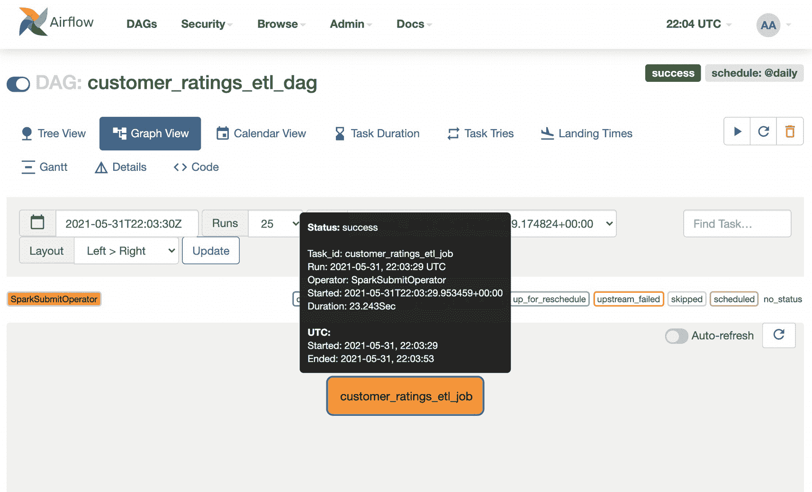

图 8-10 在 Airflow 中成功运行`SparkEventExtractorApp`

您可以查看 Spark 日志，了解所有动态组件如何协同工作。但本质上，您在本书所学内容值得获得掌声。

#### 练习 8-3：总结

本章最后一个练习展示了如何使用 Airflow DAG 启动更复杂的 Spark 批处理作业。为了能够使用最终的`docker-compose-chapter-end.yaml`替换练习 8-2 中使用的`docker-compose.yaml`，需要进行大量准备工作。在结束本章之前，让我们探讨一下使 DAG 能够运行所需的基础架构和组件。

### 审视混合架构

现在，运行此 DAG 时需要记住许多动态组件。首先，您需要管理本地 MySQL 支持的（`Hive Metastore`）以及 Airflow Docker 容器，并以某种方式为 Spark SQL 数据仓库提供额外的共享卷。所有这些中央数据平台组件共同构成了您基础设施的关键部分，并使 Airflow 能够运行 Spark DAG。

图 8-11 是您本地数据平台当前简化状态的示例。您已经运行了使 Airflow 工作所需的一切。您拥有由 MySQL 支持的 `Hive Metastore`，负责存储分布式数据表的元数据；同时还有新的 `MinIO` S3 数据湖。您现在可以重用本地 Spark 安装中的共享配置，并在 Zeppelin 和 Airflow 之间重用配置和 JAR 包。这为您提供了 Spark UI，用于交互查看从 Airflow 生成的数据。另一方面，您拥有 Airflow，它可以运行作业，将数据存储到您的数据湖中，或作为 JDBC 表存储到 MySQL 中。

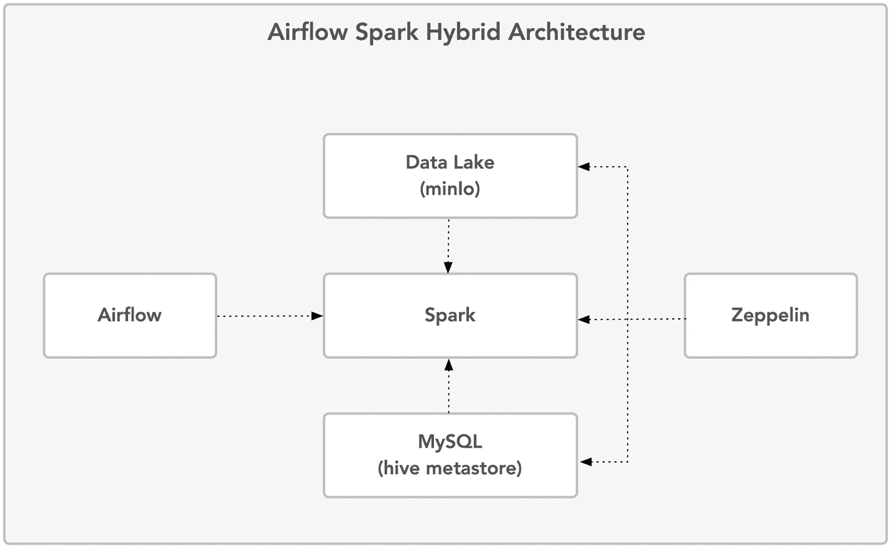

图 8-11 客户评价 ETL DAG 背后的组件架构

#### 设置扩展环境

章节材料中的主`README`提供了扩展本地环境启动和运行的分步说明。关于 `MinIO` 以及迁移 `Hive Metastore`，还有一些额外的要点值得说明。

扩展环境将此实践环境的所有关键组件移至您笔记本电脑上的一个单一位置。这将使您能够从今以后重用所有这些通用架构组件，而无需记住我们在哪个章节练习中添加了哪些内容。该路径设置为您主目录下的一个名为`dataengineering`的文件夹。

```
~/dataengineering
-/airflow
-/minio
-/mysql
-/spark
-/zeppelin
```

#### 从本地文件系统迁移到 `MinIO`

为简化后续操作，章节材料中提供了使用 `MinIO` 分布式文件系统的说明。简而言之，`MinIO` 是 Amazon S3 的克隆，并与 S3 API 完全兼容。这将在未来章节中降低一些复杂性。需要注意的一点是，首次运行 `MinIO` 时，您必须在文件系统上设置一些权限。幸运的是，您可以通过 UI 完成此操作。参见图 8-12。

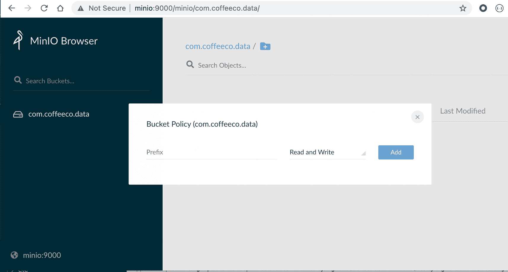

图 8-12 将文件系统从默认的“只读”切换为“读写”

您需要打开 `MinIO` UI（`http://localhost:9001`）。您也可以在`/etc/hosts`文件中添加一条记录，以便更容易地找到它。我的记录是`http://minio:9001`。进入主页后，系统将提示您进行身份验证（用户和密码存储在 `MinIO` 的`docker-compose.yaml`文件中）。或者，如果您未做任何更改，则用户名为`minio`，密码为`minio_admin`。这将允许您应用前缀权限。

#### 应用存储桶前缀权限

在屏幕左侧（如图 8-13 所示），您将看到`com.coffeeco.data`。这是默认存储桶名称，您只需将鼠标悬停在该名称上，点击出现的小圆点，即可打开权限菜单。

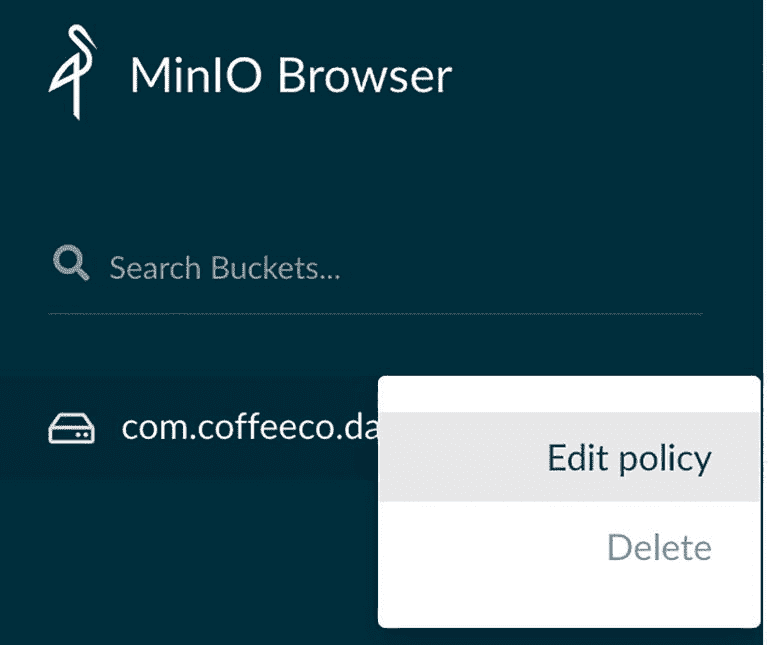

图 8-13 在 `MinIO` 浏览器中编辑

只需添加前缀`/warehouse/*`并将其设置为“读写”，即可大功告成。

接下来您可能想要做的是将 `Hive Metastore` 表迁移到一个更好的公共位置。

#### 在公共位置引导 MySQL

您的 `Hive Metastore` 很可能位于`ch-06`目录中。您可以从当前 metastore 中导出 SQL 数据库和表，并将现有内容移动到`~/dataengineering/mysql`；或者您可以从头开始，在`~/dataengineering/mysql`目录中进行引导。章节材料中的`mysql`目录包含一个`README.md`文件，提供了从头开始全新 Hive 安装的分步说明。

从现在开始，我们将在探索数据领域时重复使用此通用设置。

### 持续探索

本章全面介绍了如何使用 Airflow 调度 Apache Spark 应用程序。如您所知，总有更多可以学习的内容（但并非所有内容都适合放入书中）。作为持续探索，我建议如下：

- 在运行 DAG 时，您可以添加 DAG 覆盖变量。这使得您能够对底层 DAG 进行额外更改，而无需返回并修改底层 Python 代码。尝试添加一个变量来更改以下变量：

    `spark.event.extractor.save.mode`

    可用选项为`ErrorIfExists`、`Overwrite`、`Ignore`和`Append`。

- 使用第 7 章的通用特性创建另一个 Spark 应用程序，并使用 Airflow 运行它。
- 尝试生成一个新的数据集，或思考一个可以利用本地数据仓库中的数据解决的新问题。

除了持续探索之外，下一节将介绍创建单个用户和分配角色的过程。

### 创建用户

使用 Airflow 命令行创建新用户非常简单。本质上，所有用户命令都嵌套在 `users` 子命令中。

```
docker exec \
    -it airflow_airflow_webserver-1 \
    airflow users [子命令]
```

例如，假设你需要创建一个新用户，并为其授予 Airflow 内的有限权限。你可以使用 `User` 角色来分配常规权限。例如，执行清单 8-18 中的命令来生成 `scotteng` 用户。

```
docker exec \
    -it airflow_airflow_webserver-1 \
    airflow users create \
    --username scotteng \
    --firstname Scott \
    --lastname Haines \
    --role User \
    --email scott@coffeeco.com
```

清单 8-18 通过 Airflow 命令行生成新用户

该命令会要求你输入密码，因此只需按照提示完成新用户的创建即可。创建完成后，退出 Airflow，然后以 `scotteng` 用户身份重新登录。你会注意到 `Admin` 或 `Security` 菜单已经消失，但你仍然可以运行 DAG（见图 8-14）。

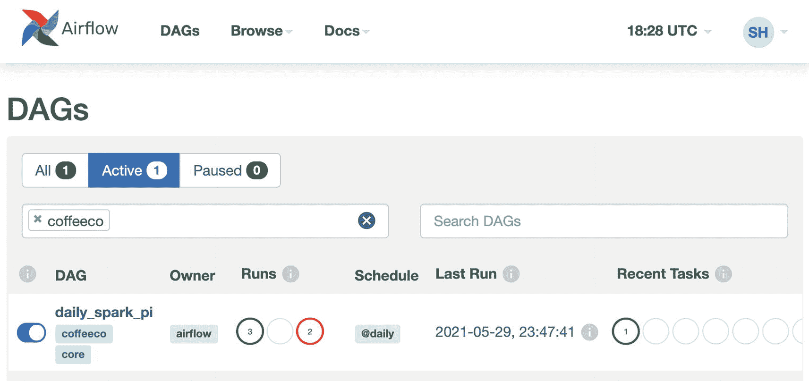

图 8-14 以普通用户身份查看 Airflow 界面

这就是目前的内容。

## 小结

本章从较高层次介绍了工作流自动化的概念，并向你介绍了 Apache Airflow。虽然我们可以轻松地用本书剩余部分讨论如何创建越来越复杂的 Airflow DAG，并深入探究 Airflow 的更多细微之处，但这项工作将留给你自己完成。在继续我们的旅程时，我们还会再次提到 Airflow，但下一站我们将进入一个激动人心的主题：使用 Apache Spark 编写 Structured Streaming 应用。系好安全带，事情即将加速发展！
