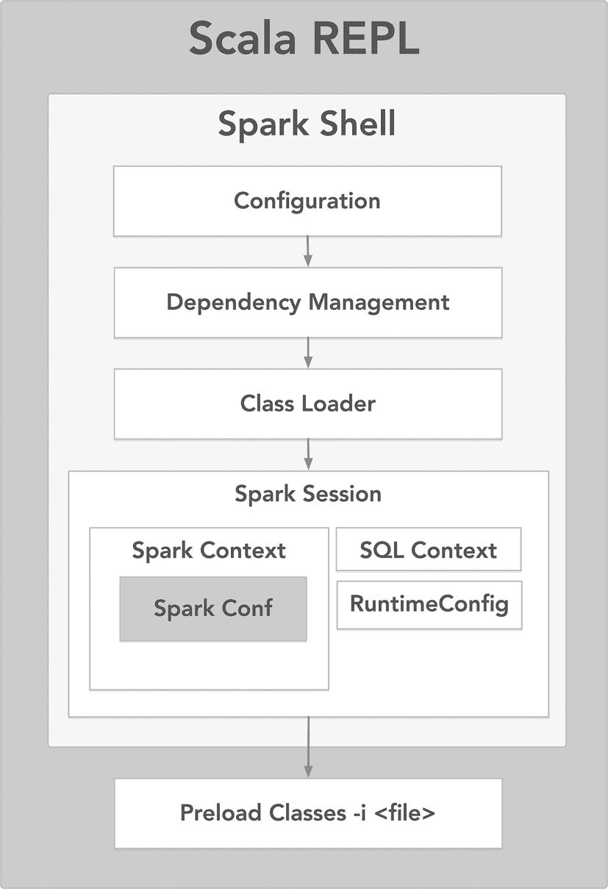

# Docker 上的 MySQL 速成课

本章将从熟悉 Docker 上的 MySQL 开始。

## 启动 Docker 环境

**练习内容**

你可以在本书 GitHub 仓库 [`https://github.com/newfront/spark-moderndataengineering`](https://github.com/newfront/spark-moderndataengineering) 的 `ch-05/` 目录下找到本章所需的材料。只需使用运行脚本启动环境，然后访问 http://localhost:8080 即可。

`cd ch-05/docker && ./run.sh start`

使用 `run.sh start` 命令启动 Docker 环境后，你会注意到输出中现在包含了对 `mysql` 的引用。为清晰起见，示例 5-1 展示了该输出。

**示例 5-1.**

*启动本章练习的 Docker 运行时环境后的输出，现在包含了对 MySQL 的引用*

```
ch-05/docker/run.sh start
```

```
SPARK_HOME is set. location=/Users/me/install/spark-3.0.1-bin-hadoop3.2
1c9d09c28d3d   mde       bridge    local
docker network already exists mde
Creating mysql ... done
Creating zeppelin ... done
Zeppelin will be running on http://127.0.0.1:8080
```

这个额外的服务是通过对本章的 `docker-compose-all.yaml` 文件进行微小改动而添加的。让我们查看 Docker Compose 服务配置，了解 MySQL 是如何添加的。

## Docker MySQL 配置

`ch-05/docker/docker-compose-all.yaml` 中的配置现在在 `services` 区域下包含了一个 `mysql` 部分，如代码清单 5-1 所示。

```
services:
mysql:
image: mysql:8.0.23
container_name: mysql
command: --default-authentication-plugin=mysql_native_password
restart: always
volumes:
- ${PWD}/data/mysqldir:/var/lib/mysql
environment:
- MYSQL_DATABASE=default
- MYSQL_USER=dataeng
- MYSQL_PASSWORD=dataengineering_user
- MYSQL_ROOT_PASSWORD=dataengineering
healthcheck:
interval: 5s
retries: 10
ports:
- 3306:3306
networks:
- mde
hostname: mysql
代码清单 5-1
来自 Docker Compose 配置的 mysql 服务定义
```

这个新配置允许我们在本地 Docker 环境中，将 MySQL 与 Apache Zeppelin 一起运行。该配置覆盖了 MySQL 容器启动时的默认行为，从而实现以下功能：

*   启动时创建一个名为 `default` 的数据库
*   生成 `dataeng MYSQL_USER` 用户
*   为 `dataeng` 用户提供密码 `MYSQL_PASSWORD`
*   授予 `dataeng` 用户所有权限
*   声明容器端口 `3306`（MySQL 默认端口）

此配置还将 `mysql` 主机名添加到共享的 Docker 网络（`mde`）中。这使得我们的 Zeppelin 服务能够从 Notebook 环境内部（跨容器边界）访问 MySQL 数据库。

**提示**

如果你想要引导或重建一个包含来自其他环境（如预发布或生产环境，若来自生产环境则需脱敏或清理数据）的表和数据的开发环境，在本地运行 MySQL 容器会非常方便。你可以直接导入表的 SQL 定义以及为每个表添加一些行所需的任何数据。

或者，你也可以添加引导 SQL 文件来 `CREATE` 表和视图，并 `INSERT` 数据到一个初始化的本地测试环境中。假设数据不包含任何个人身份信息（PII），这些有用的脚本可以检入 GitHub 或你喜欢的版本控制系统。这样做可以让其他工程师或分析师在开始使用初始数据集时，导入数据定义（DDL）和示例数据。

## 练习 5-1：探索 Docker 上的 MySQL 8

第一个练习将引导你在新的 MySQL 容器中完成一些管理任务。你将首先直接在 MySQL Docker 容器内的 MySQL shell 中使用纯 SQL 创建一个表并填充一些行。

### 处理表

要在 MySQL Docker 容器内创建并填充一个新表，请遵循以下四个步骤：

1.  连接到 Docker 容器。
2.  以数据库用户 `dataeng` 身份认证到 MySQL shell。
3.  在 MySQL 数据库中创建一个名为 `customers` 的新表。
4.  向 `customers` 表中插入一些初始行。

我们的第一个目标是连接到 `mysql` Docker 容器，然后在 `mysql` 命令行上进行身份认证，以便创建并初始化 `customers` 表。

**注意**

在你刚才启动的 Apache Zeppelin 实例中，有一个名为“ConnectingToMySQL”的笔记。你可以将该笔记作为实践指南，引导你完成连接 Docker、认证到 MySQL shell、创建 `customers` 表、向 `customers` 表插入数据以及执行一些简单的 `select` 查询以确保行数据正确的整个过程。

##### 连接到 MySQL Docker 容器

打开一个新的终端会话。在此会话中，你可以使用以下 `docker exec` 命令直接连接到你的 `mysql` 容器。

```
docker exec -it mysql bash
```

当你登录到容器后，终端提示符将变为 `root@mysql:/#`。接下来，你需要通过 `mysql` shell 连接到实际的 MySQL 数据库。

### 使用 MySQL Shell

在 `mysql` 容器内部，你将使用 `mysql shell` 来认证你的用户并连接到数据库。

```
mysql -u dataeng -p
```

**提示**

`dataeng` 用户的密码位于 `ch-05/docker/docker-compose-all.yaml` 文件中，代码清单 5-1 中也显示了该密码。只需查找 `services:mysql:environment:MYSQL_PASSWORD`，你就会看到密码是 `dataengineering_user`。

连接成功后，你会看到一些关于 MySQL 版本的信息输出，随后是 `mysql>` 命令提示符。这意味着你已经准备好大干一场了！

### 默认数据库

容器启动过程会创建两个数据库。分别是 `information_schema` 数据库和 `default` 数据库。你可以切换到 `default` 数据库，因为你将在此构建表定义。`use` 命令用于切换数据库上下文。

```
mysql> use default;
```

现在，你已经准备好创建表定义了。


### 创建客户表

`customers` 表是一个存储客户信息的简单表。该表代表 CoffeeCo 中的基本注册客户，如清单 5-2 所示。

```
CREATE TABLE IF NOT EXISTS customers (
id VARCHAR(32),
created TIMESTAMP DEFAULT CURRENT_TIMESTAMP,
updated TIMESTAMP DEFAULT CURRENT_TIMESTAMP,
first_name VARCHAR(100),
last_name VARCHAR(100),
email VARCHAR(255)
);
清单 5-2
customers 表的创建表语法
```

现在剩下的唯一事情就是插入一些客户记录。我们将在本章末尾再次回顾这个表结构。

### 插入客户记录

既然我们已经定义了 `customers` 表，剩下的就是添加几条记录，以便我们有数据可以操作。输入清单 5-3 中的 SQL 命令，然后按 Enter 键执行该命令。

```
INSERT INTO customers (id, first_name, last_name, email)
VALUES
("1", "Scott", "Haines", "scott@coffeeco.com"),
("2", "John", "Hamm", "john.hamm@acme.com"),
("3", "Milo", "Haines", "mhaines@coffeeco.com");
清单 5-3
使用 INSERT 语法添加示例 CoffeeCo 客户
```

在退出 MySQL shell 并切换到 Zeppelin 之前，让我们快速进行一个完整性检查，确保一切正常。

### 查看客户表

我们刚刚创建的客户记录可以使用一个简单的 `select` 查询轻松查看。为简单起见，我们只投影了 `id`、`first_name` 和 `email` 列。请跟随 shell 操作，查看新表中存储的行。

```
mysql> select id, first_name, email from customers;
+------+------------+----------------------+
| id   | first_name | email                |
+------+------------+----------------------+
| 1    | Scott      | scott@coffeeco.com   |
| 2    | John       | john.hamm@acme.com   |
| 3    | Milo       | mhaines@coffeeco.com |
+------+------------+----------------------+
3 rows in set (0.00 sec)
```

现在你已经确认表存在并且有数据行，可以退出 `mysql` shell 了。

**提示**

严格来说，选择特定的数据库上下文并非必需，因为你始终可以在查询前加上数据库选择器。如果你不想每次都运行 `use {database};` 命令，可以通过添加数据库前缀来查询 `customers` 表。

`select * from default.customers;`

这种模式允许你从多个数据库源进行查询。

### 练习 5-1：总结

到目前为止，本练习向你展示了使用 Docker 启动、连接和操作 MySQL 是多么简单。这个过程使你能够在本地构建一致的环境，从而在部署后避免意外问题。这意味着你可以运行完整性检查、测试或尝试新事物，而无需启动和维护一个永久环境。

在下一个练习中，你将学习如何使用 Apache Spark 和 Java 数据库连接（JDBC）连接到 MySQL、获取表（结构）定义、读取、查询和写入数据。

## 将 RDBMS 与 Spark SQL 和 JDBC 结合使用

从 Spark 连接到关系数据库管理系统（RDBMS）需要两样东西：*一个 JDBC 兼容的驱动程序*和*数据库属性*。为简单起见，我可能会互换使用 RDBMS 和数据库这两个术语。

JDBC SQL 驱动程序（JAR）可以直接添加到你的应用程序中（编译时），或者放入 Spark 的 JARs 目录（作为自定义发行版的一部分，需要管理员支持），或者按需获取。数据库属性包括主机名（`mysql`）、RDBMS 监听端口（`3306`）、数据库名称（`default`）和凭据（`user/pw`）。有了这些，Apache Spark 可以轻松处理存储在外部数据库中的数据。

管理应用程序依赖关系的过程可以在编译时处理，甚至可以在运行时更新或覆盖。例如，以下是处理 Spark 依赖关系的三种常见方法：

1.  使用 [maven](https://maven.apache.org/what-is-maven.html) 或 [sbt](https://www.scala-sbt.org/) 将必要的 JAR 作为直接依赖项提供给应用程序，并与应用程序 JAR 一起编译（这可以称为构建一个*胖* JAR）。

2.  在运行时使用 Spark 内置的运行时依赖支持下载所需的包。这意味着在提交应用程序或启动 `spark-shell` 时使用 `--packages` 选项。

3.  在提交应用程序或启动 `spark-shell` 时，使用 `--jars` 选项引用一个本地或远程位置，应用程序可以在该位置找到额外的依赖项。

在下一节中，我们将研究如何管理依赖项以及为 `spark-shell` 提供额外配置。你可以使用这些部署模式来增强应用程序在运行时的行为。在此过程中，你将学习如何处理依赖项、增强配置，以及更重要的是，这些技术如何用于创建*复合命令行应用程序*。

### 管理依赖项

到目前为止，我们还没有在本地构建或编译过 Spark 应用程序。相反，我们依赖 `spark-shell` 和 Apache Zeppelin 笔记本环境来动态编译和运行这些部分应用程序。在后面的章节中，你将使用 Scala 构建工具（`sbt`）来构建、打包和管理 Spark 应用程序的依赖项，但我们现在不进行长篇的题外话，而是通过一个练习来查看 Spark 中内置的其他选项，该练习将从 `spark-shell` 连接到你的本地 MySQL。

**注意**

MySQL 应该在 localhost 的 `3306` 端口上运行。你可以使用终端中的网络连接（`nc`）命令测试 `3306` 端口是否处于活动状态。

`> nc -z localhost 3306`

`Connection to localhost port 3306 [tcp/mysql] succeeded!`

在运行时为 Spark 应用程序提供额外的 JAR 可能非常有益。你将学习这种能力如何使你通过混合额外的依赖项来增强应用程序的行为。虽然对应用程序进行运行时修改可能导致行为不一致，但这是一种常用于测试和调试的策略，因为你无需重新编译和重新发布应用程序即可更改某些行为。你将了解到这个过程值得深入研究，因此我们将在下一节中就此展开讨论。


### 练习 5-2：基于配置驱动的 Spark Shell 与 JDBC 开发

假设我们被要求编写一个通用应用程序，该应用原则上依赖用户或环境提供的配置，以可靠的方式连接远程数据库，用于执行按需的临时数据库查询。在研究过程中，我们发现 Apache Spark 已包含此基本功能，并且只要包含相应的依赖项，就可以连接到任何兼容 JDBC 的数据库。

我们制定了以下行动计划：

1.  定义我们的配置参数名称。这将创建一个可在文档中共享的通用配置接口。
2.  提供应用程序中常用的、受支持的数据库驱动程序（连接器）。这些驱动程序可以自动引入，无需其他工程师担心额外的依赖管理。不过，如果他们希望自带连接器，也可以在启动应用程序时使用 `--packages` 选项来实现。
3.  通过处理所有其他必要步骤来准备和保护应用程序，帮助其他人无需成为 Spark 专家即可轻松使用该工具。

**提示** 我坚信“循序渐进”的学习方法。就像学走路时，我们常常会绊倒摔跤，但我们可以从沿途的错误中学习。构建可靠的模块或共享库也是如此。如果你提供的护栏不会造成障碍，而是提供流畅的体验，并且库的用户在必要时可以进行调整，那么所有参与者都会感到满意。例如，你可以为代码添加合理的默认值，以方便他人。

我们将研究如何将此行为构建到简单的 `spark-shell` 流程中。我们将确定所需的配置，编写一个简单的 Scala 文件（填充层），并研究如何为我们的 MySQL 连接器使用本地和远程依赖管理。我们将使用的两个 MySQL 连接器已添加到练习材料中，方便地存放在章节练习材料的 `/ch-05/docker/spark/jars/` 目录下的 `jars` 文件夹中。

#### Spark Shell 中的配置、依赖管理和运行时文件解释

首先，让我们仔细看看 `spark-shell`，并了解可用于修改此动态 Apache Spark 应用程序运行时行为的选项。鉴于我们以 `spark-shell` 作为此练习的起点，在启动此 Spark 应用程序时，你可以利用以下参数，包括用于增强运行时配置、远程和本地依赖管理以及动态类编译和解释的参数。

## 运行时配置

在 Spark Shell 中使用运行时属性 `--conf "key=value"` 会将额外的配置推入不可变的 `SparkConf` 中，供应用程序在运行时使用。使用运行时配置属性添加的任何配置的值都将覆盖所提供的任何键的值。因此，请务必小心，并记录可用的运行时覆盖项。

##### 本地依赖管理

使用 `--jars "<file.jar>,<file.jar>"` 会在启动时将额外的 JAR 包添加到应用程序类路径中。这些 JAR 包应位于本地文件系统上，或者可以从 `s3a` 或 `HDFS` 获取。

##### 运行时包管理

使用 `--packages "<groupId:artifactId:version>,"` 属性为 Spark 提供 Ivy 参数，以便在运行时下载一个或多个依赖项。你可以使用运行时包管理器即时获取库。请记住，并非所有包在你需要时都可用，因此当可靠性不是首要任务时再使用此技巧，因为它可能导致生产环境中的承诺落空。


### 动态类编译与加载

使用 `-i <file>` 参数可以在将 `spark-shell` 的控制权交还给你之前，将任何 Scala 文件解释并加载到会话上下文中。此选项直接存在于 Scala REPL 中，因此由于 Spark REPL 扩展了默认的 Scala REPL，它也是 `spark-shell` 的一部分。

现在，假设你希望从 Spark 内部连接到 MySQL，你需要根据 Spark JDBC 连接器属性创建一些额外的配置选项，以便在运行时传递给 shell 程序。

Spark JDBC (`DataFrameReader`) 的配置选项如表 5-1 所示。

**表 5-1** Spark JDBC `DataFrameReader` 配置表

| 配置项 | 描述 | 示例 |
| --- | --- | --- |
| `url` | JDBC 连接 URL。此字符串由 *JDBC* 协议、主机或服务器名称、端口和数据库组成。 | `jdbc:mysql://127.0.0.1:3306/default` |
| `dbtable` | 要加载的可选表。 | `customers` |
| `query` | 可选的查询语句。 | `select * from customers` |
| `driver` | JDBC 驱动程序的 `ClassName`。 | `com.mysql.cj.jdbc.Driver` |
| `user` | 访问 `db` 的数据库用户。 | `dataeng` |
| `password` | 访问 `db` 的用户的密码。 | `*********(secret)` |
| `numPartitions` | 用于拆分对数据库表的一系列条件查询的最大分区数（可选）。默认为单个连接 [TODO – 检查真实默认值]。 | `4` |
| `partitionColumn` | 用于根据 `numPartitions` 值对查询进行分桶的列。如果使用 `numPartitions`，则此项为必填。列类型必须是 `Integer`、`Timestamp` 或 `Date`。 | `created` |
| `lowerBound` | 拆分查询时使用的下界。这会为你创建一个小于 (`<`) 条件。如果使用 `numPartitions`，则此项为必填。 | `2021-02-16` |
| `upperBound` | 拆分查询时使用的上界。这会为你创建一个大于 (`>`) 条件。如果使用 `numPartitions`，则此项为必填。 | `2021-02-21` |

了解了驱动 *JDBC* 连接行为的因素后，让我们花些时间来构思一些配置名称。我们为这个应用提出了基本配置，如表 5-2 所示。

**表 5-2** 基本应用运行时配置选项

| 配置名称 | 默认值 |
| --- | --- |
| `spark.jdbc.driver.class` | `com.mysql.cj.jdbc.Driver` |
| `spark.jdbc.host` | `localhost` |
| `spark.jdbc.port` | `3306` |
| `spark.jdbc.default.db` | `default` |
| `spark.jdbc.table` | `customers` |
| `spark.jdbc.user` | `dataeng` |
| `spark.jdbc.password` | 无。密码绝不应出现在你的代码中！ |

好了。现在事情开始变得更加规范了。我们知道如何配置连接，并创建了回退（默认值）以使我们的应用更易于使用。包含特定的应用配置选项以及可以作为护栏（或辅助轮）的回退，使得使用你的库代码成为一种愉快的体验。

启动脚本如示例 5-4 所示。

> **提示**  
> 以下代码片段假设你的本地工作目录是本章练习文件夹中 Docker 目录的根目录。`/ch-05/docker/`

```
$SPARK_HOME/bin/spark-shell \
--conf "spark.jdbc.driver.class=com.mysql.cj.jdbc.Driver" \
--conf "spark.jdbc.host=127.0.0.1" \
--conf "spark.jdbc.port=3306" \
--conf "spark.jdbc.default.db=default" \
--conf "spark.jdbc.table=customers" \
--conf "spark.jdbc.user=dataeng" \
--conf "spark.jdbc.password=dataengineering_user" \
--packages=mysql:mysql-connector-java:8.0.23 \
--jars=spark/jars/mariadb-java-client-2.7.2.jar \
-i examples/connect-jdbc.scala
```

**示例 5-4** 使用本地提供的 JAR、额外的运行时配置以及要解释和加载的 Scala 文件启动 Spark Shell

此命令从示例 5-4 启动 `spark-shell`，并在后台以一致的顺序执行大量额外工作，使你能够增强由 `spark-shell` 驱动的 Spark 应用的运行时行为。当你使用 `spark-submit` 命令时（你将在后续章节中看到更多相关内容），这些相同的功能也可供你使用。

图 5-1 显示了启动 `spark-shell` 时的事件顺序。



**图 5-1** 在 Spark Shell 实例中将控制权交还给你之前执行的一系列步骤

Spark Shell 扩展了 Scala REPL，使你能够使用 Apache Spark 特定的参数，并混入 Scala REPL 特定的命令。当 Spark Shell 被实例化时，所有使用 `--conf` 选项声明的运行时配置都已添加到 `SparkConf` 和 `SparkContext` 中，所有依赖项都已使用 `--packages` 选项下载并解析，并且 JAR 和相关的类路径都已加载，包括使用 `--jars` 选项定义的、需要添加到应用类路径中的任何其他本地 JAR。最后，在 `spark-shell` 初始化之后，作为最后一步，由于 Scala REPL 的行为，任何使用 `-i <file>` 选项包含的额外 Scala 文件都会被加载。

> **注意**  
> 如果你好奇的话，REPL 代表**读取**、**求值**、**打印**、**循环**。对于 Scala REPL 来说，这个小控制台程序读取每一行文本（作为标准输入），逐行求值（动态编译并存储类信息、变量等），然后只要没有抛出异常，就打印处理后的每一行的输出（如果有的话）。然后它将最后一行（或几行）保存到会话的命令堆栈中，最后返回到第一个读取状态（等待你的下一行输入）。整个过程成为一个从 R -> E -> P 再回到 R 的循环。

掌握了图 5-1 中关于 `spark-shell` 行为的知识后，我们可以可靠地保证，由启动 `spark-shell` 提供的 Spark 会话 (`spark`) 可以被 `spark-shell` 环境上下文中的任何 Scala 文件（使用 `-i` 包含）可靠地引用。正是这个事件顺序使你能够从 `spark-shell` 创建复合应用。这与 Zeppelin 中每个段落内动态解释 Spark 代码的过程类似。每个段落都被读取、求值（动态编译）并加载到 Spark 应用上下文中，而你无需动一根手指！

让我们看看 `connect-jdbc.scala` 的源代码，如示例 5-5 所示。它包含了建立与我们的 MySQL 数据库（容器）连接所需的最少内容，并且很快就能使我们能够迭代地查询数据库并测试我们的临时查询。此源代码的完整版本位于 `ch-05/docker/examples/connect-jdbc.scala` 的 `examples` 目录中，其中包含适用于相关情况的配置回退到默认配置值。

```
// spark: SparkSession (来自 spark-shell)
// 从 spark conf 中赋值
val jdbcDriver = spark.conf.get("spark.jdbc.driver.class")
val dbHost     = spark.conf.get("spark.jdbc.host")
val dbPort     = spark.conf.get("spark.jdbc.port")
val defaultDb  = spark.conf.get("spark.jdbc.default.db")
val dbTable    = spark.conf.get("spark.jdbc.table")
val dbUser     = spark.conf.get("spark.jdbc.user")
val dbPass     = spark.conf.get("spark.jdbc.password")
val connectionUrl = s"jdbc:mysql://$dbHost:$dbPort/$defaultDb"
// 加载远程 SQL 表
val df = spark
.read
.format("jdbc")
.options(MapString, String
)
.load()
```

**示例 5-5** `connect-jdbc.scala` 的源代码

示例 5-4 中展示的这个部分应用直接依赖于 Spark 的核心配置，以及启动 `spark-shell` 时创建的 Spark 会话。由于它是在 `spark-shell` 完成启动应用所需的所有工作*之后*才被加载的（见图 5-1），因此在运行时，你的代码可以方便地访问所有这些内容。

如果你还没有尝试运行代码，现在就去运行，然后我们将更深入地探讨我们是如何在示例 5-5 的这个部分应用范围内读取配置的。


#### Spark 配置：访问模式与运行时变更

Spark 配置在运行时分为两个独立的类。第一个是主要的不可变配置 `SparkConf`。这个只读对象可通过 `SparkContext` 访问，而 `SparkContext` 又可通过 `SparkSession` 获取。此核心应用配置在应用启动时从多个位置组装而成：

1. 标准 Spark 发行版提供的默认或内部配置（由你自行构建，或下载官方构建版本）。
2. 在 `$SPARK_HOME/conf` 中定义的 Spark 环境级别覆盖。示例文件位于 `/path/to/ch-05/docker/spark/conf/spark-defaults.conf`。
3. 应用提交时使用 `--conf <key=value>` 选项进行的覆盖。
4. 应用内部配置。这些配置在构建 Spark Session 时直接指定。某些配置（如 `spark.sql.warehouse.location.dir` 等）在应用的整个生命周期内只能设置一次。

最终生成的 `SparkConf` 是不可变的，用于构造驱动程序应用的 `SparkContext`。

第二个配置是存储在 `RuntimeConfig` 对象中的运行时配置。它基本上是 `SparkSession` 中完全不可变配置的一个可变副本。图 5-1 是可视化 Spark 配置类型二元性的良好参考。

#### 查看 SparkConf

由于 `SparkConf` 是不可变的，我们只能读取对象内的值。你可以使用在清单 5-4 中启动的 `spark-shell` 来转储当前配置。在 `spark-shell` 中，你可以使用当前的 `SparkSession`（`spark`）来获取 `SparkContext`，最后获取 `SparkConf` 本身，然后将其配置作为调试字符串打印出来。此过程如清单 5-6 所示。

```
scala> spark.sparkContext.getConf.toDebugString
spark.app.id=local-1613941330294
spark.app.name=Spark shell
spark.driver.host=192.168.1.18
spark.driver.port=52829
spark.executor.id=driver
spark.home=/Users/me/install/spark-3.0.1-bin-hadoop3.2
spark.jars=file:///Users/me/git/newfront/spark-moderndataengineering/ch-05/docker/jars/mariadb-java-client-2.7.2.jar,file:///Users/me/.ivy2/jars/mysql_mysql-connector-java-8.0.23.jar,file:///Users/me/.ivy2/jars/com.google.protobuf_protobuf-java-3.11.4.jar
spark.jdbc.default.db=default
spark.jdbc.driver.class=com.mysql.cj.jdbc.Driver
spark.jdbc.host=127.0.0.1
spark.jdbc.password=*********(已编辑)
spark.jdbc.port=3306
spark.jdbc.table=customers
spark.jdbc.user=dataeng
spark.master=local[*]
spark.repl.class.outputDir=/private/var/folder...
清单 5-6
使用 spark-shell 访问并打印不可变的 SparkConf
```

你可能已经注意到，配置自动编辑了 `spark.jdbc.password` 的值。这是 Spark 引擎设置的安全防护措施之一，并且可以使用名为 `spark.redaction.regex` 的属性来扩展或替换 `redaction` 正则表达式的值。默认情况下，Spark 会自动编辑任何匹配 `secret|password|token` 的配置属性。如果你有其他用于机密的模式或命名约定，只需覆盖 `spark.redaction.regex` 即可。要查看更多细节，可以查阅官方 Spark 文档中的运行时环境设置（`http://spark.apache.org/docs/latest/configuration.html#runtime-environment`）。

#### 访问运行时配置

你可以使用 `SparkSession` 对象（`spark-shell` 中的 `spark` 变量）来获取（读取）和设置（写入）`RuntimeConfig` 的值。在活动的 `spark-shell` 中，使用清单 5-7 来读取 `spark.jdbc.driver.class` 的值，亲自尝试一下。

```
spark.conf.get("spark.jdbc.driver.class", "com.mysql.cj.jdbc.Driver")
清单 5-7
获取带有回退值的运行时配置
```

这种访问模式（在适用情况下带有回退值）贯穿于部分应用 `connect-jdbc.scala` 中。我们将 JDBC 配置值读取并赋值给便捷变量，然后构造 JDBC `DataFrameReader`。

你可以通过调用 `SparkSession` 上的 set 方法来使用运行时配置更新大多数值。使用活动的 `spark-shell`，尝试使用清单 5-8 中的代码设置 `spark.jdbc.driver.class` 的值。

```
spark.conf.set("spark.jdbc.driver.class", "org.mariadb.jdbc.Driver")
清单 5-8
动态设置 RuntimeConfig 的值
```

通过获取和设置值，你可以在特定的时间节点，或者换句话说，在执行的*特定阶段*内更新应用的行为。

注意

在本书的后续旅程中，我们还会看到更多关于 `RuntimeConfig` 的内容，但值得指出的是，每个 `SparkSession` 都可以修改不可变 `SparkConf` 的一个子集，而不会改变 Spark 应用的默认行为。这是因为 `SparkContext` 保留了默认配置（在初始应用启动时定义），从而确保了 `SparkSession` 的一个或多个实例之间的关注点分离。

回到正在运行的 `spark-shell`（在清单 5-4 中启动），让我们看看使用 Spark Shell 进行迭代开发的过程。

#### 使用 Spark Shell 进行迭代开发

在活动的 `spark-shell` 中，尝试调用 `printSchema` 或在标识为 `df` 的 `DataFrame` 上执行 `show()` 操作。你甚至可以尝试使用选择（selection）和限制（limit）子句，如清单 5-9 所示。

```
df
.select("id", "first_name", "email")
.limit(3)
.show()
清单 5-9
与 JDBC 支持的 DataFrame 交互，抽象了连接远程（外部）RDBMS 的复杂性
```

在 JDBC 支持的 `DataFrame` 上调用 `show` 的结果，会从你的 MySQL 数据库的 `customers` 表中返回前三条记录。

```
+---+----------+--------------------+
| id|first_name|               email|
+---+----------+--------------------+
|  1|     Scott|  scott@coffeeco.com|
|  2|      John|  john.hamm@acme.com|
|  3|      Milo|mhaines@coffeeco.com|
+---+----------+--------------------+
```

现在让我们学习如何描述视图和表。


#### 描述视图与表

你已经学会了使用 `JDBC` 连接到 MySQL Docker 容器。那么，通过简单的 SQL 风格的描述来查看表的模式（schema）是否合理呢？理论上，Spark 应该能够引用底层的关系——在本例中就是我们的 `customers` 表，所以不妨试试看。请跟随清单 5-10 中的代码片段进行操作。

```
df.createOrReplaceTempView("customers")
spark.sql("desc customers").show()
清单 5-10
在 spark-shell 中，创建客户视图并描述表
```

在 `desc customers sql` 命令上调用 `show` 后，你将看到以下输出。

```
+----------+---------+-------+
|  col_name|data_type|comment|
+----------+---------+-------+
|        id|   string|   null|
|   created|timestamp|   null|
|   updated|timestamp|   null|
|first_name|   string|   null|
| last_name|   string|   null|
|     email|   string|   null|
+----------+---------+-------+
```

如果这个过程看起来有些绕，那是因为它确实如此。如果我们已经能够访问数据库，为什么还需要事先知道 `customers` 表的存在才能执行描述操作呢？这样的流程又如何能扩展？如果不依赖团队内部的知识，又该如何发现这张表的位置或模式呢？

我们将在下一章中使用 Hive Metastore 来简化数据发现的过程，但现在请记住这种感受。它应该像是你在数据发现道路上遇到的一个不必要的障碍。不过，让我们先完成这个练习，使用我们的 `JDBC` 连接信息将数据写回 `customers` MySQL 表。

#### 将 DataFrame 写入外部 MySQL 表

为了完成从 MySQL 到 Spark 再返回的完整往返，我们需要继续将数据写回数据库。你可能会想，我们需要先创建一些新记录才能做到这一点，没错，我们确实需要增加表中的记录数。

#### 生成一些新客户

你已经擅长在 Zeppelin 和 Spark Shell 中生成数据，甚至可以直接使用 MySQL Shell。虽然我们可以继续使用 MySQL Shell 来添加更多客户，但直接从 Spark 中操作会更有乐趣。

我们可以复用刚才描述过的当前客户表的模式。作为参考，你可以运行 `df.printSchema` 或 `df.schema.toDDL` 来快速查看数据结构。你将看到以下模式。

```
root
|-- id: string (nullable = true)
|-- created: timestamp (nullable = true)
|-- updated: timestamp (nullable = true)
|-- first_name: string (nullable = true)
|-- last_name: string (nullable = true)
|-- email: string (nullable = true)
```

现在第一个障碍来了。为了向数据库中添加更多行，你需要创建一个与 `customers` 数据库表模式匹配的 `DataFrame`。这意味着我们需要想出一种生成老式 *时间戳* 的方法。

如果你还记得第 3 章，我们讨论过模式（schemas）和 `StructType`。我们还介绍了 Spark 的数据类型。作为复习，用于时间戳的内部 Scala 类型是 `java.sql.Timestamp`。如果每行数据都包含适当的 Scala 类型，那么 Spark 可以为我们隐式转换为内部的 `TimestampType`，这样我们就可以继续正常工作了。

清单 5-11 中的代码片段展示了创建新客户所需的代码。（提供了 `ts` 和 `time` 函数以简化客户创建过程。）我们为 Spark 提供了构建和写入更多客户所需的一切！

**提示**

请记住，你可以使用 `:paste` 命令将多行代码一次性粘贴到 `spark-shell` 中。粘贴完代码后，按 `Cmd+D` 即可运行所有粘贴的内容。

```
import org.apache.spark.sql._
import java.sql.Timestamp
import java.time._
// spark: SparkSession (来自 spark-shell)
assert(spark.isInstanceOf[SparkSession])
def ts(timeStr: String) = Timestamp.valueOf(timeStr)
def time = Timestamp.from(Instant.now())
// 创建一些新客户
val records = Seq(
Row("4",ts("2021-02-21 21:00:00"),time,"Penny","Haines","penny@coffeeco.com"),
Row("5",ts("2021-02-21 22:00:00"),time,"Cloud","Fast","cloud.fast@acme.com"),
Row("6",ts("2021-02-21 23:00:00"),time,"Marshal","Haines","paws@coffeeco.com")
)
val newCustomers = spark.createDataFrame(
spark.sparkContext.parallelize(records),
customers.schema
)
清单 5-11
创建一个 DataFrame 来表示更多客户
```

清单 5-11 中的代码创建了一个名为 `ts` 的简单辅助函数，它接受一个简单的 `DateTime` 字符串（例如 `2021-02-21 21:00:00`），并将其转换为 `Timestamp` 类的实例，Spark 可以将其隐式转换为内部的 `TimestampType`。除了这个函数之外，还有一个用于获取当前时间的简单函数，名为 `time`。

接下来，我们生成三个新客户，并通过将客户记录的 `RDD` 与从临时视图 `customers`（来自清单 5-10）中提取的模式包装在一起，创建一个新的 `DataFrame`。

*对于一直在记录的人来说，这是我们遇到的创建 DataFrame 的第四种方法！*

剩下的就是将我们的新记录写入外部的 `customers` 表。

#### 使用 JDBC DataFrameWriter

我们可以复用 `connect-jdbc.scala` 定义的大部分变量，这些变量通过 `spark-shell` 可用，因为我们最初将 `connect-jdbc.scala` 加载到了同一个上下文中。现在，让我们学习如何使用清单 5-12 中的代码片段将数据写回 `customers` 表。

```
newCustomers
.write
.format("jdbc")
.options(MapString, String
)
.save()
清单 5-12
创建 JDBC DataFrameWriter 实例，并尝试将 DataFrame newCustomers 定义的行保存到 MySQL 的 customers 表
```

如果你从本章开始就一直跟着练习，那么你刚刚应该看到了一个错误弹出。

`Table or view 'customers' already exists.`

`SaveMode: ErrorIfExists.`

抛出这个错误是因为 Spark 默认是防御性的（又一个防护栏）。当我们保存三个新列时，我们实际上可能会覆盖数据库表或添加重复的行。让我们庆幸吧，因为我们刚刚被 `SaveMode` 拯救了。


### SaveMode

表 5-3 详细列出了由 `SaveMode` 枚举指定的模式。

**表 5-3** `DataFrameWriter` 上的 SaveMode 选项

| SaveMode | 描述 |
| --- | --- |
| `Append` | 如果数据或表已存在，则 `DataFrame` 的内容将被追加到现有数据中。 |
| `ErrorIfExists` | 如果数据已存在，则抛出异常。 |
| `Ignore` | 如果数据已存在，则保存操作不会保存 `DataFrame` 的内容，也不会更改现有数据。 |
| `Overwrite` | 如果数据或表已存在，则现有数据将被 `DataFrame` 的内容覆盖。 |

修改清单 5-12 中的代码，手动指定*保存模式*并尝试再次保存。更改内容如清单 5-13 所示。完整示例位于 Zeppelin 笔记本（“5-2_MySQLAndSpark”）中。只需访问 `http://localhost:8080` 即可加载示例。

```
newCustomers
.write
.format("jdbc")
.mode("append")
.options(MapString, String
)
.save()
清单 5-13
向 Customers 表追加新行
```

这次你不会看到任何异常抛出。你甚至可以使用以下查询来查询之前（在清单 5-10 中）创建的临时 `customers` 视图。

```
spark.sql("select * from customers").show
```

神奇的是，你的新行无需刷新任何内容就显示出来了。这是为什么呢？这是因为临时 `customers` 视图只是一个承诺，最终会通过我们的 JDBC 连接去获取数据。事实上，如果你重新连接到 MySQL Docker 实例，`docker exec -it mysql bash`，并重新登录到 `mysql` shell，你可以查询 `default.customers` 表，你会看到你的新行已经愉快地存在于我们默认数据库的 `customers` 表中。

**注意：** 通过 JDBC 写入 MySQL 的源代码可在章节练习材料的 `/ch-05/docker/examples/save-jdbc.scala` 中找到。如果使用 `:paste` 的过程变得有些难以控制，你可以使用 Scala REPL 的 `:load` 函数。只需 `:load` 该文件即可。最终结果将类似于使用你在图 5-1 中学到的 `-i <file>`。

现在，你已经正式完成了从 MySQL 到 Spark 再返回的完整往返！请为自己鼓掌，并退后一步，思考一下你刚刚完成的所有工作。考虑到我们最初的目标是创建一个命令行工具，使用户能够运行即席 SQL 查询，并且几乎完成了除此之外的所有其他工作，我们现在应该先完成这个目标，然后再继续前进。

利用你在本练习中学到的所有知识，你可以扩展之前的 `connect-jdbc.scala` 示例，使其能够通过命令行接收 SQL 查询。使用清单 5-14 中的应用程序启动命令来指导你创建命令行 SQL 应用程序。这个最终练习的代码位于 `examples` 目录下的 `/path/to/ch-05/docker/examples/jdbc-adhoc-query.scala`。

```
$SPARK_HOME/bin/spark-shell \
--conf "spark.jdbc.driver.class=com.mysql.cj.jdbc.Driver" \
--conf "spark.jdbc.host=127.0.0.1" \
--conf "spark.jdbc.port=3306" \
--conf "spark.jdbc.default.db=default" \
--conf "spark.sql.query=select id, first_name, email from customers where email LIKE '%coffeeco%' ORDER BY email ASC LIMIT 3" \
--conf "spark.jdbc.user=dataeng" \
--conf "spark.jdbc.password=dataengineering_user" \
--jars=spark/jars/mariadb-java-client-2.7.2.jar,spark/jars/mysql-connector-java-8.0.23.jar \
-i examples/jdbc-adhoc-query.scala
清单 5-14
用于查询表的命令行驱动 Shell 脚本
```

清单 5-14 中的应用程序配置属性将 `connect-jdbc.scala` 引入的 `spark.jdbc.table` 配置属性替换为 `spark.sql.query`。此更改考虑到了 Spark 中 JDBC `DataFrameReader` 的工作方式。你可以传入以下两个连接属性之一——`dbtable` 或 `query`——但不能同时传入两者。有关参数的完整列表，请返回表 5-1。

尝试创建可工作的 Spark 部分应用程序，以运行清单 5-14 中基于 `spark-shell` 的应用程序。请记住，在现实世界中，你可能希望将数据库用户操作限制为只读，并且根据表的大小，你可能还需要为查询添加默认限制。你不会希望有人触发像 `` DROP DATABASE `default` `` 这样的查询。

**提示：** 任何使用 `spark-shell` 命令启动的应用程序都会等待（或挂起），直到你手动退出应用程序。这是由于 REPL 中循环的性质所致。如果你想自动退出 `spark-shell`，作为应用程序的最后一步，你可以使用 `sys.exit(0)` 正常退出程序。如果执行过程中出现问题，例如查询格式错误，那么 `spark-shell` 将抛出异常并退出。对于命令行应用程序，通常使用零表示成功，非零值表示操作不成功。可以将其视为 HTTP 状态码。

### 练习 5-2：总结

本练习涵盖了很多内容，不仅向你介绍了如何将 JDBC 与 Apache Spark 结合使用，还介绍了使用复合文件和 `spark-shell` 进行迭代开发的强大功能。虽然在 `spark-shell` 上使用复合应用程序模式并非旨在为生产应用程序提供支持，但它确实使你作为工程师能够将问题分解为一系列逻辑步骤，并从 `spark-shell` 或像 Apache Zeppelin 这样的其他交互式开发环境中获得近乎即时的反馈。这种将问题迭代分解为其逻辑部分的过程对于数据工程师、软件工程师或任何处理复杂问题解决的人来说都至关重要。

在最纯粹的形式中，我们在练习 5-1 和 5-2 中实际上将关注点分离到了逻辑 Docker 容器边界。你学会了直接在数据库（MySQL Docker 容器）中创建表，并手动插入行以创建一个基础的 MySQL 表，供 Apache Spark 读写。你学会了利用 `spark-shell` 的优势，添加动态运行时依赖项和自定义配置。你甚至可以说你已经开始编写可重用代码，即使这些代码被拆分到由 `spark-shell` 驱动的复合应用程序中的几个单独文件中。

## 继续探索

**注意：** 本节是可选的，涵盖了一些更高级的过程。你可以跳过本节，稍后再回来阅读。

章节练习都假设我们必须处理定义不佳的 `customers` 数据库表模式。*是的，它并不好！* 我们可以做得更好。考虑到我们目前可以向数据库添加几乎无限数量的重复项。这确实不是一个好的设计，尤其是在 MySQL 支持约束的情况下。我提供这些继续探索作为额外的思考素材，并深入一些更高级的领域，包括表截断和列级去重技术。

**注意：** 标题为“5_2_MySQLAndSpark”的笔记可以从 Zeppelin UI 运行。其中包含使用 JDBC 连接器进行读取和写入的额外步骤和扩展说明（`http://localhost:8080/#/notebook/2G1SGWZBW`）。


### 好的模式设计带来更优方案

如果我们能为 `customers` 表设计一个更好的模式，结果会怎样？它能让我们的工作更轻松吗？清单 5-15 展示了 `bettercustomers` 表的 `create table` 语法。

```
CREATE TABLE IF NOT EXISTS `bettercustomers` (
`id` mediumint NOT NULL AUTO_INCREMENT COMMENT '客户自动编号',
`created` timestamp DEFAULT CURRENT_TIMESTAMP COMMENT '客户注册日期',
`updated` timestamp DEFAULT CURRENT_TIMESTAMP COMMENT '最后记录更新时间',
`first_name` varchar(100) NOT NULL,
`last_name` varchar(100) NOT NULL,
`email` varchar(255) NOT NULL UNIQUE,
PRIMARY KEY (`id`)
);
清单 5-15
bettercustomers 表的修改版建表语法
```

你可能会立刻想到，对 `email` 字段添加 `UNIQUE` 约束是个好主意。不是吗？或许你注意到我们现在有了自动“单调”递增的行号，这是朝着正确方向迈出的一步？又或者是因为我们在表定义中加入了列级注释？实际上，所有这些答案都是正确的。通过定义良好的表结构，我们可以依赖数据库来处理部分核心业务逻辑，比如存储下一个客户 ID 以及防止重复数据。这能腾出更多时间来专注于解决应用程序中的其他问题。

使用 Zeppelin 笔记（`5_2_MySQLAndSpark`），你可以逐步完成以下示例。首先从修复 `customers` 表开始。这包括如何仅使用表模式中的非默认列来创建 `bettercustomers` 表并写入初始行，以及其他操作。这意味着只需要 `first_name`、`last_name` 和 `email` 这三列。

注意

对于这些附加练习，你需要通过 MySQL 控制台创建 `bettercustomers` 表。请按照笔记本中的说明，或运用本章所学知识，根据清单 5-15 中的表定义来创建新表。

### 使用最小模式写入客户记录

清单 5-16 中的段落展示了一种向 `bettercustomers` 表添加客户的简化方法。该代码流程基于清单 5-11，并省去了手动指定时间戳的步骤。这种技术更为高级，它显式地忽略了某些可能随时变化、从而在未来引发问题的特定列。你可以按照章节说明，使用 Apache Zeppelin 运行此代码。

```
%spark
import org.apache.spark.sql.types._
import org.apache.spark.sql._
val simpleFieldNames = Set("first_name", "last_name", "email")
val simpleSchema = StructType(
betterCustomers.schema.fields.filter(sf => simpleFieldNames.contains(sf.name)))
val saveMode = "append"
// 创建简化的行！
val rows = spark.createDataFrame(
spark.sparkContext.parallelize(
Seq(
Row("Nanna","Haines","nhugs@coffeeco.com"),
Row("The","Rock","djohnson@coffeeco.com"))),
simpleSchema)
rows
.write
.format("jdbc")
.mode(saveMode)
.options(MapString, String)
.save()
清单 5-16
利用数据库表约束和默认值，可以直接从 Spark 向远程数据库写入稀疏行，从而降低带宽传输成本
```

这难道不令人兴奋吗！同样令人兴奋的是，这个查询可能引发的问题。没有什么比一个老掉牙的麻烦更能破坏你辛苦付出、自以为大功告成的努力了。

实话实说——你刚刚运行的查询*就是一场等待发生的灾难*。你可能会问，这是为什么？问题源于 `SaveMode` 值被存放在一个变量中。作为工程师，我们喜欢做的一件事就是简化问题，而这通常意味着以更配置驱动或基于库的方式编写核心组件（就像 Spark 社区编写 JDBC 连接器那样）。对于清单 5-16 中的简单用例，这意味着有人可能会天真地将 `SaveMode` 的值改为 `overwrite`，对于 JDBC 的 `DataFrameWriter` 来说，这会删除当前表，并用写入的 DataFrame 内容重新创建表。考虑到我们刚刚花费时间和精力定义并创建了表定义，这将导致灾难性的后果。

此外，新表将被替换为仅包含行 DataFrame 中的三列（`first_name`、`last_name` 和 `email`）。本质上，我们本想让生活更轻松——在这个例子中是通过使用最小模式插入新行——但我们却可能因此引入了一个关键缺陷，并让任何关键的生产数据库表都面临一场等待发生的灾难。哎呀！更糟糕的是，之后数据库中只会存在清单 5-16 中的两条记录。

好消息是，如果你的意图确实是覆盖 `bettercustomers` 表，你可以通过在 JDBC 的 `DataFrameWriter` 上添加 `truncate` 选项来保留现有的表定义。该选项会保持清单 5-15 中的原始表语法不变。更新后的 JDBC 配置如清单 5-17 所示。

```
rows
.write
.format("jdbc")
.mode(saveMode)
.options(MapString, String)
.save()
清单 5-17
使用 Truncate 保留表定义
```

这样就好多了。在接下来的探索中，你将学习如何处理由定义不佳的 `customers` 模式所引入的问题。你也可以依赖*截断（truncation）*来解决下一个问题。不过，这里有一个有趣的陷阱。那么，请继续阅读，祝你好运！

### 对表进行去重、重新排序和截断

在这个延续的练习中，你需要想出一种方法来对 `customers` 数据库表中存储的记录进行去重、重新排序和截断。这个练习教你如何处理固定的、有问题的模式以及一般的数据。对于这个用例，你不能简单地修改 `customers` 数据库表的模式。当对清单 5-2 中的原始 `customers` 表模式应用 *保存 + 追加* 操作时，存在一个小问题。由于*表模式上没有声明任何约束*，如果你简单地命令 Spark 写入，它会愉快地一遍又一遍地写入重复的行。仅使用 JDBC 连接器且没有基于 RDBMS 的约束时，Spark 没有现成的方法来忽略写入数据库时的重复行。

正如你在“好的模式设计带来更优方案”探索中所看到的，重复记录的拒绝可以通过约束来处理。然而，简单的 `customers` 表可以拥有无限数量的重复记录。为了了解创建大量重复记录是多么简单，请尝试在你启动的活跃 `spark-shell` 中（如清单 5-4 所示）运行 `:load examples/save-jdbc.scala` 几十次，以创建大量重复数据。

现在来解决这个问题。你可以使用以下技术来帮助你完成。


#### 删除重复行

使用 `dropDuplicates` 函数可以有条件地删除 DataFrame 中的重复行。该函数仅保留由唯一列值标识的第一行，并忽略其他重复项。例如：`df.dropDuplicates("id")`。

若希望对重复行的选择拥有更多控制权，可以结合分组子句与 distinct min/max 运算符，例如仅选择创建日期最早且更新日期最新的行。这种使用聚合函数进行预处理的技巧，在读取和处理变更数据捕获（CDC）日志时非常有用。您可以参考 Zeppelin 中名为“Select Distinct and Sort”的段落，查看交互式示例。

#### 使用 Order By 排序

通过 `ORDER BY` 子句对临时 `customers` 视图进行排序，或直接在 DataFrame 上使用 `sort` 函数，可以对数据集中的记录进行重新排序。例如：`df.sort(asc("id"))`。

#### 截断 SQL 表

截断表会清除所有已提交的记录，即所有已写入数据库预写日志（WAL）并被 RDBMS 确认的行。这类似于调用 `DELETE FROM customers` 而非 `DROP TABLE customers`，在必要时比直接删除物理表更优。您已在清单 5-17 中了解了截断表的 JDBC 选项。

请记住，删除整个表可能会破坏依赖该表的其他应用程序。

警告

请谨慎使用表截断操作，因为当您执行全表*覆盖*时，可能会误删表中的所有数据。

#### 暂存与替换

考虑一下，当您需要覆盖整个表以进行去重或修复损坏条目时，如何在执行实际覆盖操作之前存储表的当前快照。Apache Spark 允许您使用 DataFrame 的 `saveAsTable` 函数存储数据集的持久化快照。该方法利用 Hive Metastore 和分布式文件系统来存储可靠的（持久化）备份。然后，您可以使用该持久化表保存去重排序后的表，再截断物理表本身，并用暂存的（持久化）记录进行替换。您将在下一章学习如何使用 Hive Metastore。

注意

问题的完整解决方案位于 `/ch-05/docker/examples/deduplicate-reorder-truncate.scala`。我建议您在查看答案之前先尝试各种方法并探索可能的解决方案。祝您顺利！

## 本章小结

本章教您如何仅依靠原生 JDBC 驱动程序、JDBC `DataFrameReader` 和 `DataFrameWriter`，完成从 MySQL 到 Spark 再返回的完整数据往返流程。如果您将使用 `spark-shell` 编写复合应用程序的过程与使用 Apache Zeppelin 的体验进行比较，那么您可能会清楚地发现，复合（部分）应用程序提供了另一种快速开发的途径。它使您能够再次重用相同的基于 Docker 的开发环境，自主选择数据工程探索之路！

在下一章中，您将学习如何使用 Apache Hive Metastore。您将设置、配置并运行完全由基于 Docker 的 MySQL 数据库支持的 Metastore。您将看到 Metastore 如何简化数据发现过程，并支持在 Spark 应用程序上下文中进行数据探索。您将了解 Hive Metastore 如何引入使用数据库表的新方式，以及如何保护您的数据源存储，并在多个 Spark 应用程序之间提供文档和共享表定义。

准备好了吗？

