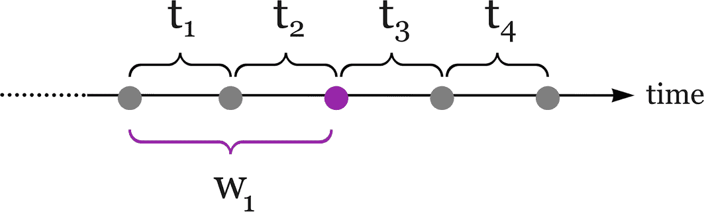
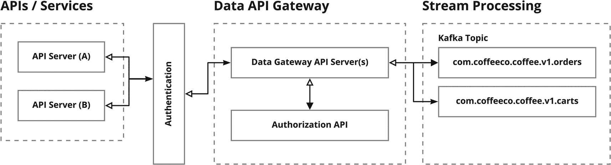

# 流处理入门

由于每个数据工程问题可能涉及多个维度，学习解决和优化这些问题颇具挑战性。在每个新问题开始时，你必须考虑数据发现、数据整理、数据摄入、数据转换以及数据责任——这是一个涵盖数据契约（严格定义的数据定义）的范畴，同时还需要优化数据摄入足迹（因为大规模数据很容易侵蚀运营成本）。此外，数据访问、数据谱系和数据治理等问题也需要时刻放在心上。理解如何运用你的综合知识来制定快速的数据行动计划，是一项能让你作为现代数据工程师走得更远的技能。

回顾你在本书中学到的处理数据的各种方式：无论是从使用 `spark-shell` 探索初步想法的小规模起步，还是使用笔记本（Apache Zeppelin）进一步深入这些想法，最后将学到的经验整合到 Spark 应用中。通过这个过程，你学会了创建可复用、经过测试的 Spark 应用，也掌握了通过探索来解决问题的重要技能。你学会了如何经历问题识别与分解的阶段——理解问题、制定行动计划、测试和验证结果，最后将解决方案封装成一个完整的应用。更重要的是，你通过实践学会了如何分解这些端到端的数据问题：使用 Spark SQL 编写转换查询，学习测试这些微应用（通过查询）的行为，甚至学会了如何安排它们的定期运行（使用 Apache Airflow）。

所有这些步骤都是为了现在这一刻。正如上一章结尾所承诺的，事情即将开始加速。为什么会这样？因为现在我们正从批处理迈向流处理，即处理无界数据集。

对于许多用例来说，在数据可用时立即进行流式处理，有助于将一个非常庞大的数据问题（由于事件数据的规模）转化为一个更易于管理的问题。只需更频繁地处理更少的数据点，你就可以分而治之地解决一个可能成本高昂的数据问题。然而，如何从批处理思维过渡到流处理思维也颇具挑战性。

例如，假设你的任务是创建一个每天必须处理约 10 亿个事件的应用。虽然由于数据规模庞大，这听起来可能有些牵强，但后退一步思考应用/流程的意图通常会有所帮助。如果数据可以被分解（分区）并作为流式操作并行处理，你只需创建一个能够每秒摄入和处理区区 11.5 千个事件的应用（如果事件流是恒定的，每分钟约 69.5 万个事件）。

尽管这些数字可能看起来遥不可及，但这也是分布式流处理真正大放异彩之处。本质上，你是在缩小问题的视角或范围，以便在分区数据集上以更分布式的方式，随时间推移达成目标。虽然并非所有问题都能通过流式处理解决，但相当多的问题确实适用于这种处理模式。

本章是对流处理的温和介绍，为你直接进入第 10 章构建自己的端到端 Structured Streaming 应用铺平道路，而无需回过头来讨论大量决策过程背后的理论。

到本章结束时，你应该理解以下内容（高层次概述）：

-   如何思考流数据及流数据处理问题
-   为什么数据责任始于生产者
-   在 API 边界处理数据质量的方法
-   为什么二进制可序列化的结构化数据至关重要

## 流处理

流数据并非静止不动。事实上，你可以将其视为“活着的”（即使只是短暂的）。这是因为流数据是封装了当下的数据——它记录事件和动作在传输过程中的发生情况。让我们看一个实用但理论性的例子，从一个简单的传感器数据事件流开始。在你的脑海中，想象你最后去过的那个停车场（或停车库）。

### 用例：实时停车位可用性

想象一下，你刚刚找到停车位，全靠那些指引你前往空位的指示牌。现在，假设这一切都源于本地停车传感器互联网络发出的数据。这些传感器的唯一用途，就是识别当下时刻可用停车位的数量。

这是一个实时数据问题，其中实时准确度是可衡量的，并且停车结构的用户可以实际感受到。要实现这些功能，首先要声明系统场景。

> “我们希望创建一个系统，能追踪所有可用停车位，识别车辆何时停放，并知道车辆在某个位置停留了多久。这个过程应尽可能自动化。”

优化这样的系统，可以从每个停车位安装一个简单传感器开始（关联 `sensor.id`/`spot.id` 引用）。该传感器负责以位置标识符、时间戳和简单比特位（0 或 1）的形式发出数据，以表示车位是空置还是被占用。这些数据可以编码成一种紧凑的消息格式，如代码清单 9-1 所示，该格式将被高效编码，并由每个设备定期发送。

```protobuf
message ParkingSensorStatus {
  uint32 sensor_id = 1;
  uint32 space_id  = 2;
  uint64 timestamp = 3;
  bool   available = 4;
}
```

`代码清单 9-1` 传感器事件示例（封装于 Google Protocol Buffer 消息格式中）


在一天正常的车流过程中，由于个体驾驶员的动态时间安排，每个传感器的状态会以不可预测的方式在开或关（二元状态）之间切换。这些传感器数据可以实时告知驾驶员，车库里现在总共有 `X` 个可用车位。这些数据有助于自动化人类的决策过程，甚至可以通过一个简单的 `Web` 服务在线提供，用于实时状态追踪。此外，这些数据还可用于追踪每个传感器的上次签到时间，这可用于诊断故障传感器，甚至追踪传感器离线和故障的频率。如今，技术更先进的停车场甚至能通过方向标志和提示，引导驾驶员前往结构中的可用车位。这减少了停车场内的交通和拥堵，进而提高了客户满意度，而这一切仅仅通过捕获传感器数据的实时流并对其进行近实时处理就能实现。

考虑到从这些传感器事件流中收集到的时间信息，聪明的停车场运营者可以根据过往趋势，基于对停车位的实时需求和当前可用性，来降低或提高每日或每小时的定价。通过在合理范围内优化定价，运营者可以找到完美的临界点，即每小时/每日的价格能使停车场满员。换句话说，“在什么价格下，大多数人会选择停车，且车位不会被闲置？”

这是一个源于实时传感器数据收集的优化问题示例。越来越多的组织开始研究如何重用数据来同时解决多个问题。物联网（`IoT`）用例只是你在编写流式应用程序时可能处理的众多数据流之一。在本书的前面部分，我们讨论了创建一个系统，该系统可以获取咖啡店上座率信息，从而告知人们附近哪家店有能容纳他们聚会规模人数的座位。在那个故事中，我们只是创建了一个可用于连接展示此示例的合成表。然而，这是另一个可以通过传感器解决的问题，或者通过像签到系统这样简单的东西来解决，该系统会发出相关的事件数据，并通过流式数据管道可靠地传递到下游。这两个例子都采用了基础分析，并且都可以从简单的机器学习中受益，以发现新的行为模式，从而实现更优化的运营。在过深入之前，我们先稍作停留，深入探讨流式数据网络所提供的能力。

### 时间序列数据与事件流

从静态数据的思维模式，转变为随着时间推移来解释数据的思维模式，即从跨越多个视角和时刻的无界数据流的角度来看待数据，这既是一种视角上的练习，也可能是一种难以适应的挑战。通常，当你考虑流式系统时，连续事件流的概念会浮出水面。这是最常见的用例之一，可以作为理解流式数据概念的温和入门。例如，图 9-1 中所示的抽象时间序列。



图 9-1 事件发生在精确的时间点，可以单独收集和处理（`t1->t4`），也可以跨时间窗口聚合（`w1`）

如你所见，数据本身根据给定系统（或应用程序）所采用的视角，存在于各种状态中。每个事件（`T1->T4`）在其狭窄的参考框架内只了解*发生了什么*，换句话说，事件捕获了一个有限的（相对的）*时间*视角。当一系列事件在一个有界集合（窗口）中被一起处理时，你获得了一系列数据点（事件），这些事件封装了完全实现或部分实现的想法。当你缩小范围查看整个时间线时，你可以描绘出一个从第一个事件到最后一个事件更准确的故事。让我们进一步阐述这个想法。

#### 事件是孤立的吗？

考虑一个简单的事实。你的事件数据要么作为一个完整的想法存在，要么作为部分的想法或念头存在。我发现，将数据视为随时间展开的故事，有助于赋予这些数据字节以生命力。因此，每个数据点都有助于构成一个完整的故事，就像一系列随时间交织、组合或实现的想法和念头。

在你尝试采用分布式数据视角看待事物时，这个数据构成概念可以作为一个透镜。我还发现，在构建和定义新的分布式数据模型，以及处理大规模现实世界数据网络时，这个概念也非常有用。如果将这些事件视为一个整体，它们共同讲述一个特定的故事，事件留下的线索可以告知事物发生的顺序，而每个事件的时间戳则极大地增强了这种叙述能力。没有时间的事件会呈现事物发生的扁平化视图，而时间的加入则赋予你动量或速度的概念，或者是事件之间或整个数据点系列在时间上的减慢和拉伸。理解流经众多管道和数据通道的数据行为，对于数据运营至关重要，并且需要可靠的监控来保持数据以最佳速度流动。让我们看一个用例，其中时间维度有助于更清晰地描绘真实世界的场景。

#### 用例：追踪客户满意度

如果我告诉你，两位顾客走进咖啡店，点了饮料，然后带着饮料离开，你可能会问我为什么费心告诉你这些——毕竟这就是咖啡店里常发生的事。但如果我告诉你，这两杯咖啡几乎是同时制作的，而故事中的第一位顾客在五分钟内就进出咖啡店了呢？如果我告诉你那是一个工作日，且故事发生在早高峰时段呢？如果我告诉你第二位顾客（恰好排在队伍中下一位）在咖啡店里待了 30 分钟呢？你可能会问，这位顾客是不是留下来看报纸或使用洗手间了——这些都是合理的疑问。

如果我告诉你，这位顾客之所以等待，是因为在四步咖啡制作流程的第 3 步和第 4 步之间出现了错误，那么我们就更能理解未来如何优化顾客体验了。这四步分别是：

1.  顾客点单：`{customer.order:initialized}`
2.  完成支付：`{customer.order:payment:processed}`
3.  订单排队：`{customer.order:queued}`
4.  订单完成：`{customer.order:fulfilled}`

无论错误是发生在自动化环节，还是源于现实系统的故障（如打印机卡纸、咖啡师漏单，或其他任何原因），结果都是顾客需要主动介入，告知运营流程（咖啡制作流水线）似乎有人忘了他们的饮料。

此时，讨论可以转向如何处理顾客的情绪反应——这种反应可能在积极与消极之间剧烈波动：从乐于助人的高兴（1 分），到轻微受挫（4 分），再到因拖延和流程故障而爆发的愤怒（10 分）。但通过这个假设的用例推演，我们现在都更清楚地了解了如何利用优秀的数据采集技术来服务于各种场景。

#### 事件时间、事件记录顺序及事件间延迟，皆蕴含信息

如果不了解从第一个事件（`customer.order:initialized`）到最终事件（`customer.order:fulfilled`）之间经过了多少时间，或者每个步骤通常需要多长时间完成，我们就无法对体验进行评分，也无法真正理解发生了什么——这实际上为系统中的异常延迟或故障制造了盲区。了解顾客在不同规模订单中通常等待时间的统计数据（平均值、中位数和 99 百分位）是很有价值的，因为这些历史数据点可以通过自动化方式用于预防性解决问题——例如，当订单耗时超出预期时。这直接决定了顾客是感到不满还是成为终身客户。

这也是企业向客户征求反馈的重要原因之一——无论是针对体验给出“赞/踩”，还是奖励性的应用内参与（用积分兑换免费商品和服务）。这些通过现实互动收集并捕获的数据，编码为事件，并按你的需求进行处理——如果它能对公司的运营和声誉产生积极影响，那将非常有用。只需确保遵守数据隐私法规，最终不要让你的客户感到不适。

这个小小的思维实验旨在揭示一个事实：你在事件数据中捕获的细节（以及数据故事随时间演变的脉络）可能带来颠覆性的改变。时间是赋予这些旅程动力的维度。但时间本身也存在一个问题。

### 时间的问题

虽然事件在精确的时间点发生，但时间的问题在于，它也受制于时间和空间（位置）的难题。爱因斯坦用相对论从宇宙尺度解释了这一问题，但在更局部的尺度上，这也是一个问题。例如，我的家人居住在美国的不同地区。协调大家的时间表让每个人的日程同步就很困难。即使是像通过视频通话叙旧或现实世界中的家庭聚会这样简单的事件也会遇到这种情况。即使一切都协调好了，人们也习惯性地会迟到一点。

将视角从我家人或一般人身上拉远——从事件集中协调的角度来看——你会发现问题不仅仅关乎跨时区（东部/中部/西部海岸）的同步。如果仔细观察，你会发现，相对于我们本地/物理空间的时间，也存在一定程度的时间漂移或时钟偏差。

以现代数字时钟为例。它在你的智能手机、手表或众多“智能”联网设备上作为一个进程运行。保持不变的是时间保持显著的同步性（即使漂移只有几毫秒）。许多人仍然有模拟（非数字）时钟。这些设备的精度差异很大，从高端手表（“精密时计”）的难以置信的精确，到有时需要每隔几天重新校准一次的廉价时钟。

这里的要点是，两个系统对精确时间达成一致的情况很少见，就像人们也难在时间和空间上进行协调一样。因此，必须使用一个中央参考（或视角）来同步跨多个时区运行的系统的时间。

#### 时间校正

在任何现代云基础设施中运行的服务器都采用一种称为[网络时间协议](https://en.wikipedia.org/wiki/Network_Time_Protocol)（`NTP`）的进程来纠正时间漂移问题。`NTP` 进程负责使用可靠的中央时间服务器同步本地服务器时钟。此进程将本地时间校正到与协调世界时（`UTC`）相差几毫秒以内。这是一个需要牢记的重要概念，因为运行在大型网络中并产生事件数据的应用程序将负责创建时间戳，而这些时间戳必须精确，才能使分布式事件对齐。此外，还有一个棘手的夏令时问题，因此，要协调来自不同时区以及不同本地日期时间语义的系统数据，就需要从这个中央同步的视角来审视时间。

我们已经从理论上探讨了时间与基于事件的数据的关系，但为了完善背景知识，我们还应该从时间与系统中数据需要被捕获和处理的优先级（无论是流式处理还是其他方式）的关系来审视它。

### 按优先级排序的事件处理模式

你可能熟悉这句话：“时间至关重要。”这是说某件事很重要且是最高优先级的。解决速度至关重要。这种优先级意识可以用作一种工具或定义性指标，在处理关键数据时，为实时、近实时、批量或最终（按需）处理提供依据。这四种处理模式对时间有不同的处理方式，从而对当前的数据问题产生特定的关注点。其范围基于进程必须完成的速度，这反过来又限制了任务的复杂度（作为时间的一个因素）。将这些处理风格视为由截止日期驱动的。完成某个动作只有一定的时间限制。

## 实时处理

实时系统的预期是，从上游系统发出事件，到该事件被处理并可供分析和洞察使用，端到端延迟在毫秒到几秒之间。这些事件会直接发送到事件流处理服务（如 `Apache Kafka`），在正常情况下，该服务能让监听器/消费者在事件写入后立即使用。真正的实时系统有许多典型用例，包括物流（例如停车位示例以及在咖啡店找空桌）。对业务产生全新影响的流程，例如欺诈检测、主动网络入侵检测或其他恶意行为检测，在这些场景中，较长的平均检测时间（平均毫秒/秒级检测时间）可能导致灾难性的声誉或财务损失。

对于其他系统，以近实时方式运行是完全可接受的。由于解决棘手问题需要时间，实时决策需要对其要提出的问题提供高性能、预计算或低延迟的答案。这就是纯粹的内存式流处理。

## 近实时处理

大多数人想到“实时”时，实际想到的是近实时。它与实时拥有一组类似的时间约束，唯一的区别在于端到端延迟的预期从数秒放宽到了几分钟。对于大多数系统来说，并没有真正的理由需要对每个到达的事件立即做出反应，因此，虽然时间仍然至关重要，但数据可用性的 `SLA` 优先级被放宽了。

保持更新的运营仪表盘和指标系统（每 30 秒到五分钟刷新图表和检查监控）通常足以快速发现问题并提供对现实状况的近似呈现。对于所有其他数据系统，则存在批处理或按需处理的概念。

## 批处理

我们在前两章中介绍了批处理和周期性调度，但为了清晰起见，需要说明的是，通过定期作业将数据从可靠的数据源（数据湖或数据库）推送到其他关联系统，过去是，并且现在仍然是现实世界中处理大量数据的方式。其原因在于成本。这归结为运营成本和维护大型流式系统的人力成本。

流式系统需要全天候访问可变数量的资源，从 `CPU`、`GPU` 到网络 `IO` 和 `RAM`，并且期望这些资源不会稀缺，因为流处理中的延迟（阻塞）可能会迅速累积。另一方面，从长远来看，批处理可能更易于维护，前提是数据的使用者理解从数据首次在上游发出，到数据可用于下游使用之间总是存在时间差。

最后需要考虑的是按需处理（或即时处理）。

## 按需处理或即时处理

面对现实吧。有些问题（即查询）很少被提出，或者其提出方式根本不适合任何预定义的模式。

例如，自定义报表作业和探索性数据分析是两种非常适合这些范式的数据访问方式。大多数情况下，回答这些查询所需的后备数据会直接从数据湖加载，然后使用共享计算资源或隔离的计算集群进行处理。这些查询所提供的数据，可能是其他实时或近实时系统处理并存储后用于批处理或历史分析的副产品。

使用这种模式，数据可以通过从较慢的商品对象存储（如 `Amazon S3`）导入记录到内存中，或快速访问的固态硬盘（`SSD`）上，来解冻并按需加载。根据数据的大小、格式和布局，可以直接从云对象存储中查询。这种模式可以轻松地通过 `Spark SQL` 委托给 `Apache Spark`。这使得可以通过 `Apache Zeppelin` 等工具进行临时分析，或者通过使用 [Apache Spark thrift-server](https://spark.apache.org/docs/latest/sql-distributed-sql-engine.html) 和 `Apache Hive Metastore` 的 `JDBC` 绑定在应用程序内直接进行分析。

这四种处理方式的区别在于时间。

回到视图和视角的概念，每种方法或模式都有其适用的*时机和场景*。流处理处理的是在特定时间点捕获的事件，正如我们在本章前半部分所讨论的，我们如何关联时间、如何捕获和测量一系列事件（作为数据），共同描绘出当前正在发生什么或过去发生了什么。同样重要的是要讨论流处理的基础。在下一节中，我们将介绍处理连续、无界数据流时的一些常见问题和解决方案。因此，将数据作为核心支柱并由此向外扩展是合情合理的。

### 流处理基础

基础是结构赖以建立的不可动摇、坚不可摧的根基。在构建成功的数据架构时，数据是整个系统的核心租户，也是该基础的主要组成部分。目前，数据进入数据平台的最流行方式是通过像 `Apache Kafka` 这样的流处理平台。这意味着围绕数据模式、可用性和有效性制定的数据契约，成为了该数据基础的关键支撑（考虑到 `Apache Kafka` 所提供的去中心化、分布式流处理能力）。

## 构建可靠的流式数据系统

作为数据工程师，构建可靠的数据系统实际上就是我们的工作，这意味着数据停机时间应该像业务的其他任何组成部分一样被衡量。你可能在某个时候听说过 `SLA`（服务水平协议）、`SLO`（服务水平目标）和 `SLI`（服务水平指标）这些术语。简而言之，这些缩略词与用于评估系统的契约、承诺和度量相关联，它们最终使服务所有者为其成功和失败负责。例如，你的团队或组织与客户之间的服务水平协议（`SLA`）用于就你提供的服务创建具有约束力的合同。对于数据团队来说，这意味着基于你的服务水平目标（`SLO`）来识别和捕获指标（`KPMs`：关键绩效指标）。`SLO` 是你承诺根据 `SLA` 需要履行的约定，它们可以是从承诺近乎完美（`99.999%`）的服务可用性，到像承诺特定数据集保留 `90` 天这样简单的事情。最后，你的服务水平指标（`SLI`）是你按照服务水平契约运作的证据，通常以运营分析（仪表盘）或报告的形式呈现。

明确目标有助于制定实现目标的计划。这段旅程始于数据接入点（即数据摄取点）。具体来说，始于每个数据点的正式结构和身份标识。考虑到“越来越多的数据通过像 `Apache Kafka` 这样的流处理平台进入数据平台”这一观察，对发射到这些数据流的数据进行编译时保证、向后兼容性和快速二进制序列化会很有帮助。数据问责制本身就是一个挑战。让我们看看原因。

## 管理流式数据问责制

流式系统每周 `7` 天、每天 `24` 小时、每年 `365` 天运行。如果不在前期对这个问题投入精力，这可能会使事情复杂化；而其中一个时不时冒出来的问题就是损坏的数据，即传输中的数据问题。

## 处理飞行中的数据问题

在飞行中减少数据问题有两种常见方法。首先，你可以在数据网络边缘引入看门人，通过传统应用程序编程接口（`API`）来协商和验证数据；其次，你可以创建并编译辅助库（即软件开发工具包，`SDK`），以强制执行数据协议，并使分布式写入者能够接入你的流式数据基础设施。你甚至可以同时采用这两种策略。

### 数据看门人

在数据网络边缘添加网关 `API` 的好处在于，你可以在数据生产点强制执行*身份验证*（该系统能否访问此 `API`？）、*授权*（该系统能否向特定数据流发布数据？）和*验证*（此数据是否可接受或有效？）。图 9-2 展示了数据网关的流程。



图 9-2 数据网关服务可以充当数据网络的看门人。它们提供了用于认证 `API` 访问的机制，授权哪些上游服务（`API`/服务）可以发布数据，并且还可以在损坏或错误数据进入数据网络（流处理）之前，对来自发布者的数据进行验证。

这意味着上游数据生产系统可以在生产数据时*快速失败*。这能阻止损坏数据在数据网络边缘进入流式或静态数据管道。它是一种通过错误代码和有用的消息，以更自动化的方式与生产者就问题发生的具体原因和方式建立对话的手段。

```json
```

{
    "error": {
        "code": 400,
        "message": "The event data is missing the userId, and the timestamp is invalid (expected a string with ISO8601 formatting). Please view the docs at http://coffeeco.com/docs/apis/customer/order#required-fields to adjust the payload."
    }
}
```

这种方法有其利弊。优点在于，大多数编程语言都原生支持 `HTTP`（或 `HTTP/2`）传输协议（或只需添加一个小型库），而 `JSON` 数据是目前几乎最通用的数据交换格式。另一方面（缺点），有人可能会认为这又多了一个需要管理的服务，而且如果没有某种形式的 `API` 自动化或遵循像 [OpenAPI](https://spec.openapis.org/oas/latest.html%2523format) 这样的开放规范，每个新的 `API` 路由都可能开始耗费过多时间。`API` 会成为一个集中的故障点，而且更多的变更并不一定意味着更好的功能！要扭转这个问题，这正是单元测试和功能测试如此重要的原因。理想情况下，数据本身（模式/格式）可以通过启用字段级验证（谓词）、生成有用的错误消息并采取自我保护行动，来决定其自身数据级契约的规则。嘿，只需一点路由级或数据级的元数据和一些创造性思维，`API` 就可以自动生成自我定义的路由和行为。

最后，网关 `API` 可被视为集中的麻烦制造者，因为上游系统未能生成有效数据（例如被看门人阻止）的每一次失败，都意味着有价值的信息（事件数据或指标）被丢弃。这里的责任归属问题也往往是双向的，因为看门人的一次糟糕部署可能会使一个未设置好在网关宕机（即使是几秒钟）时处理重试的上游系统陷入盲目。

撇开所有利弊不谈，使用网关 `API` 在损坏数据进入数据平台之前阻止其传播，意味着需要排查问题原因的地点更少了。这肯定比调试一个由数据管道、服务和无数最终数据目的地组成的分布式网络要好得多。那么 `SDK` 呢？

## 软件开发工具包

`SDK` 是导入到代码库中的库（或微框架），用于简化一个操作、活动或其他复杂流程。它们还有另一个名字：客户端。以之前关于使用良好错误消息和错误代码的例子来说，这个流程对于告知客户端其先前的操作无效是必要的。然而，直接在 `SDK` 中添加适当的安全护栏以减少潜在问题的范围可能更有优势。例如，假设我们设置了一个 `API`，用于通过事件追踪来跟踪客户与咖啡相关的行为。一个客户端 `SDK` 理论上可以包含所有必要的工具来管理与 `API` 服务器的交互，包括身份验证、授权和验证。事实上，如果 `SDK` 能发挥其作用，验证问题就会不复存在。清单 9-2 展示了一个可用于可靠跟踪客户事件的 `SDK` 示例。

```scala
import com.coffeeco.data.sdks.client._
import com.coffeeco.data.sdks.client.protocol._

Customer.fromToken(token)
  .track(
    eventType = Events.Customer.Order,
    status = Status.Order.Initalized,
    data = Order.toByteArray
  )
```

清单 9-2  
`SDK` 使应用程序能够以一致的方式可靠地发出事件数据

通过一些额外的努力（即客户端 `SDK`），数据验证或事件损坏的问题几乎可以消失。其他问题可以在 `SDK` 本身中处理，例如当服务器离线时如何重试发送请求。与其让所有请求立即重试，或陷入一个无限冲击网关负载均衡器的循环中，`SDK` 可以采取更智能的行动，例如使用指数退避。

### 惊群问题

假设你有一台网关 `API` 服务器。你编写了一个出色的 `API`，公司内许多团队都在向此 `API` 发送事件数据。一切顺利，直到有一天，一个新的内部团队开始向服务器发送无效数据。（他们没有遵守你的 `HTTP` 状态码，而是将所有非 200 的 `HTTP` 码视为重试的原因。他们忘了添加任何重试启发式算法，比如指数退避，所以所有请求都在一个不断增长的重试队列中无限重试。）请注意，在这个新团队加入之前，从来没有理由运行 `API` 服务器的多个实例，也从未需要使用任何形式的服务级速率限制器，因为一切都在约定的 `SLA` 内平稳运行。

好吧，那是今天之前的事了。现在你的服务离线了。数据在积压，上游服务正在填满它们的队列，人们很沮丧，因为他们的服务因为你这个单点故障而开始遇到问题。

这些问题都源于一种资源匮乏形式，被称为“惊群问题”。当许多进程在等待一个事件（例如系统资源变得可用，或者在这个例子中 `API` 服务器重新上线）时，就会发生这个问题。然后所有进程都会争相尝试获取资源，在许多情况下，单个进程（`API` 服务器）上的负载足以使服务再次离线。不幸的是，这又开始了新一轮的资源匮乏循环。当然，除非你能安抚这群“惊马”，或者将负载分散到更多的工作进程中，从而降低整个网络的负载，让资源有喘息的空间。

虽然这个最初的例子更像是一次无意的分布式拒绝服务攻击（`DDoS`），但这类问题可以在客户端（使用指数退避或自我节流）和 `API` 边缘（通过负载均衡和速率限制）得到解决。

最终，如果没有由运营指标、监控器和系统级（`SLA`/`SLO`）告警所构建的恰当洞察渠道，数据可能会消失无踪，而这将成为一个难以解决的挑战。

无论你决定在数据网络边缘添加数据网关 `API`，采用自定义 `SDK` 来实现上游一致性和可问责性，还是决定采用其他方法来处理数据进入数据平台的问题，了解你有哪些可选方案总是好的。无论数据以何种路径进入你的数据流，如果不深入探讨数据格式、协议以及二进制可序列化数据的话题，那么这篇关于流式数据的入门介绍便不算完整。谁知道呢，你或许会发现一种更好的方法来处理数据可问责性问题！

## 为任务选择正确的数据协议

当你想到结构化数据时，脑海中首先浮现的可能是 `JSON` 数据。`JSON` 数据具有结构，是一种基于 Web 的标准数据协议，而且最重要的是，它非常易于使用。这些都是快速上手的好处，但随着时间的推移，如果没有适当的防护措施，在为流式系统标准化使用 `JSON` 时，你可能会面临问题。第一个问题是 `JSON` 数据是可变的。这意味着作为一种数据结构，它很灵活，因此也很脆弱。数据必须保持一致才能实现可问责，并且在网络间传输数据（在线传输）时，序列化格式（二进制表示）应该具有高度可压缩性。对于 `JSON` 数据，你必须为载荷中表示的每个对象发送其（所有字段的）键。这不可避免地意味着，在一系列对象中，每增加一条记录（除了第一条），你通常都要发送大量额外的数据负担。

幸运的是，这并不是一个新问题，而且恰好存在处理这类事情的最佳实践，以及关于什么才是最佳数据序列化策略的多种学派思想。这并不是说 `JSON` 没有优点。只是当涉及到奠定坚实的数据基础时，结构越多越好，压缩程度越高越好，只要这不会消耗大量 `CPU` 周期即可。

### 可序列化的结构化数据

在高效编码和传输二进制数据方面，通常会提到两种序列化框架：[Apache Avro](https://avro.apache.org/) 和 Google [Protocol Buffers](https://developers.google.com/protocol-buffers)（`protobuf`）。这两个库都提供了高效的 `CPU` 技术用于序列化基于行的数据结构，并且两者也都提供了它们自己的远程过程调用（`RPC`）框架和功能。我们先来看 Avro，然后是 `protobuf`，最后我们会简要介绍远程过程调用。

#### Avro 消息格式

使用 Avro，你可以通过记录（record）的概念为结构化数据定义声明式模式。这些记录只是 `JSON` 格式的数据定义文件（模式），以 `avsc` 文件类型存储。列表 9-3 展示了一个咖啡模式的例子。

```json
{
  "namespace": "com.coffeeco.data",
  "type": "record",
  "name": "Coffee",
  "fields": [
    {"name": "id", "type": "string"},
    {"name": "name", "type": "string"},
    {"name": "boldness", "type": "int", "doc": "从轻度到深度烘焙。1 到 10"},
    {"name": "available", "type": "boolean"}
  ]
}
```

列表 9-3  
`coffee.avsc`: 定义咖啡模式可以相当容易地完成

处理 Avro 数据可以根据你希望在运行时的工作方式，分为两条不同的路径。你可以采用编译时方法，也可以在运行时按需动态处理。这带来了一种灵活性，可以增强交互式数据发现会话。例如，Avro 最初被创建为一种高效的数据序列化协议，用于在 Hadoop 文件系统中长期存储大型数据集合为分区文件。鉴于数据通常在`HDFS`内部从一个位置读取并写入另一个位置，Avro 可以为每个文件存储一次（在写入时使用的）模式。

#### Avro 二进制格式

当你将一组 Avro 记录写入磁盘时，该过程会将 Avro 数据的模式直接编码到文件本身中（一次）。`Parquet`文件编码也有类似的过程，其中模式被压缩并作为二进制文件页脚写入。我们在第 4 章末尾亲身经历了这个过程，当时我们为`StructType`添加了`StructField`级别的文档。这个模式被用来编码我们的`DataFrame`，当我们写入磁盘时，它在下一次读取时保留了我们内联的文档。

##### 启用向后兼容性并防止数据损坏

在将多个文件作为单个集合读取的情况下，如果记录之间的模式发生变化，可能会出现问题。Avro 将二进制记录编码为字节数组，并在反序列化时将模式应用于数据。

这意味着你必须采取额外的预防措施来保持向后兼容性，否则你将发现自己遇到`ArrayIndexOutOfBounds`异常的问题。

这可能会以微妙的方式发生在模式上。例如，假设你需要将模式中某个特定字段的整数值更改为长整数值。不要这样做。这会因为从`int`到`long`的字节大小增加而破坏向后兼容性。这是因为模式定义被用来确定记录中每个字段在字节数组中的起始和结束位置。为了保持向后兼容性，你需要弃用该整数字段的后续使用（同时在你的 Avro 定义中保留它），并在模式中添加（追加）一个新字段供后续使用。

#### Avro 流式数据的最佳实践

从带有有用内嵌模式的静态 Avro 文件，转向无界的高质量二进制数据流，主要的区别在于你需要自带模式。这意味着你需要支持向后兼容性（以防你需要回退并重新处理模式变更前后的数据），以及正向兼容性，以防已有消费者正在从流中读取数据。

这里的挑战是同时支持这两种兼容性，因为 Avro 不具备忽略未知字段的能力，而这正是支持正向兼容性的一个要求。为了应对 Avro 的这些挑战，Confluence 公司开源了他们的[模式注册表](https://docs.confluent.io/platform/current/schema-registry/index.html)（用于与 Kafka 配合使用），这使得可以在`Kafka`主题（数据流）级别进行模式版本管理。

在不使用模式注册表支持 Avro 时，你必须确保在更新编写者上的模式库版本之前，已经更新了所有活跃的读取者（Spark 应用程序或其他）以使用新模式版本。在你切换的那一刻，你可能会发现自己正站在一次事故的起点。

#### Protobuf 消息格式

使用 protobuf，你可以通过“消息（messages）”这一概念来定义结构化数据。消息的编写格式类似于在 C 语言中定义结构体。这些消息被写入带有 `.proto` 扩展名的文件中。协议缓冲区的一个重要优势是支持 *导入（imports）*。这意味着你可以定义通用的消息类型和枚举，这些类型和枚举可以在大型项目中使用，甚至可以导入到外部项目中，从而实现大规模的复用。使用 protobuf 创建 `Coffee` 记录（消息类型）的简单示例如清单 9-4 所示。

```
syntax = "proto3";

option java_package="com.coffeeco.protocol";

option java_outer_classname="Common";

message Coffee {

string id       = 1;

string name     = 2;

uint32 boldness = 3;

bool available  = 4;

}
```

*清单 9-4 coffee.proto：使用 Protobuf 定义 Coffee 数据类型*

使用 protobuf，你只需定义一次消息，然后就可以为你选择的编程语言进行编译。例如，我们可以使用 [ScalaPB](https://scalapb.github.io/) 项目（由 [Nadav Samet](https://www.linkedin.com/in/nadav-samet/) 创建和维护）中的独立编译器，通过 `coffee.proto` 文件为 Scala 生成代码。

##### 代码生成

编译 protobuf 可以实现简单的代码生成。下面的示例取自 `/ch-09/data/protobuf` 目录。本章的 `README` 中说明了如何安装 ScalaPB，并包含了设置正确环境变量以执行清单 9-5 中命令的步骤。

```
$SCALAPBC/bin/scalapbc -v3.11.1 \
--scala_out=/Users/`whoami`/Desktop/coffee_protos \
--proto_path=$SPARK_MDE_HOME/ch-09/data/protobuf/ \
coffee.proto
```

# 清单 9-5 为 Scala 编译 Protobuf 消息

从长远来看，这个过程可以节省时间，因为你无需再编写额外的代码来序列化和反序列化数据对象（无论是在不同语言之间，还是在不同代码库中）。

## Protobuf 二进制格式

序列化后的格式（二进制线路格式）是使用“二进制字段级分隔符”的概念进行[编码](https://developers.google.com/protocol-buffers/docs/encoding)的。这些分隔符作为标记，用于识别序列化后的 protobuf 消息中封装的数据类型。在示例 `coffee.proto` 中，你可能已经注意到每个字段类型旁边都有一个索引标记（`string id = 1;`）。这用于辅助消息在网络上传输时的编码/解码。这意味着与 avro 二进制格式相比，它会增加一点点额外开销，但如果你仔细阅读过[编码规范](https://developers.google.com/protocol-buffers/docs/encoding)，你会发现其他方面的效率（如位打包、对数值数据类型的高效处理、以及对每条消息的前 15 个索引进行特殊编码）完全弥补了这些额外的字节开销。关于将 protobuf 作为流式数据的首选二进制协议，从全局来看，其优点远远多于缺点。它能弥补自身不足的方式之一，就是对向后和向前兼容性的支持。

## 启用向后兼容性并防止数据损坏

在修改 protobuf 模式时，有一些与我们在讨论 avro 时类似的规则需要牢记。根据经验法则，你可以更改字段的名称，但**绝不能**更改字段的类型或位置（索引），除非你想破坏向后兼容性。在需要长期支持任何类型数据时，这些规则不容忽视，尤其是当团队对 protobuf 的使用越来越熟练时，情况会变得特别棘手。如果不够小心，那种想要重新排列和优化的需求，最终可能会给你带来麻烦。（更多背景信息，请参见“随时间推移维护数据质量”。）

## 流式 Protobuf 数据的最佳实践

Protobuf 同时支持向后和向前兼容性，这意味着你可以部署新的写入器，而无需担心先更新读取器，反之亦然。你可以用更新版本的 protobuf 定义来更新读取器，而无需担心对所有写入器进行复杂的部署。Protobuf 通过“未知字段”的概念来支持向前兼容。这是一个在 avro 规范中不存在的额外概念，它用于追踪那些由于本地 protobuf 版本与当前正在读取的版本之间存在差异而无法解析的索引和关联字节。这样做的好处是，你可以在任何时候选择采用 protobuf 定义中的新变更。

例如，假设你有两个流式应用程序 (a) 和 (b)。应用程序 (a) 正在处理来自上游 Kafka 主题 (x) 的流式数据，为每条记录增加额外的信息，然后将其写入一个新的 Kafka 主题 (y)。应用程序 (b) 从主题 (y) 读取数据并进行处理。假设 protobuf 定义有了一个新版本，而应用程序 (a) 尚未更新到最新版本。上游的 Kafka 主题 (x) 和应用程序 (b) 已经更新，并期望使用升级后提供的一些新字段。令人惊叹的是，即使应用程序 (a) 并不知道这些未知字段的存在，也仍然可以将它们传递给应用程序 (b)。

**提示**

*随时间推移维护数据质量*：在使用 avro 或 protobuf 时，你应该像对待要推送到生产环境的代码一样对待模式。这意味着要创建一个可以提交到公司 GitHub（或你使用的任何版本控制系统）的项目，也意味着你应该为模式编写单元测试。这不仅提供了如何使用每种消息类型的实际示例，而且测试数据格式的重要原因在于确保对模式的修改不会破坏向后兼容性。锦上添花的是，为了对模式进行单元测试，你首先需要编译 (`.avsc` 或 `.proto`) 文件，并使用相应的库进行代码生成。这使得创建可发布的库代码变得更加容易，你还可以使用发布版本（例如 `1.0.0`）来对模式的每次变更进行编目。

实现此过程的一个简单方法是，在项目生命周期中，将所有模式变更对应的每条消息的二进制副本序列化并存储起来。我发现直接在单元测试中添加这个步骤非常成功，即使用测试套件创建、读取这些记录，并将其直接写入项目的测试资源目录。这样，所有模式变更对应的每个二进制版本都可以在代码库中找到。

只要前期多花一点功夫，从全局来看，你就可以为自己省去很多麻烦，并且可以高枕无忧，因为你知道数据是安全的（至少在数据生产和消费这一端是如此）。

现在你已经知道，在实施长期数据问责策略时，使用 avro 或 protobuf 是有好处的。通过使用这些与语言无关、基于行的结构化数据格式，你可以减少长期被特定语言锁定的问题，为将来可能使用的任何主流编程语言留有选择余地。支持遗留的库和代码库可能是一件吃力不讨好的工作。此外，序列化格式还有助于降低与发送和接收大量数据相关的网络带宽成本和拥塞。这也有助于降低长期保存数据的存储开销。

最后，让我们来看看这些结构化数据协议如何在通过远程过程调用（RPC）发送和接收数据时，进一步提高效率。

## 远程过程调用

简而言之，RPC 框架使客户端应用能够通过来回传递序列化消息，以本地函数调用的方式透明地调用远程（服务端）方法。客户端和服务端的实现使用相同的公共接口定义来定义可用的功能性 RPC 方法和服务。接口定义语言（`IDL`）定义了协议和消息定义，并作为客户端和服务端之间的契约。让我们通过查看流行的开源 RPC 框架 [gRPC](https://grpc.io/) 来实际了解这一点。

### gRPC

`gRPC` 最初由 Google 构思和创建，代表“通用型”远程过程调用，是一个强大的开源框架，用于高性能服务，从分布式数据库协调（如 [CockroachDB](https://www.cockroachlabs.com/docs/stable/architecture/distribution-layer.html) 所示）到实时分析（如 [Microsoft 的 Azure 视频分析](https://docs.microsoft.com/en-us/azure/media-services/live-video-analytics-edge/grpc-extension-protocol) 所示）。

通过使用协议缓冲区（protocol buffers）进行消息定义、序列化以及服务的声明和定义，`gRPC` 可以简化您捕获数据和构建服务的方式。例如，假设我们希望继续创建一个用于追踪客户咖啡订单的 API。API 契约可以在一个简单的服务文件中定义，然后服务端实现以及任意数量的客户端实现都可以使用相同的服务定义和消息类型来构建。

#### 定义一个 gRPC 服务

您可以轻松地定义一个服务接口，包括其请求和响应对象，以及需要在客户端和服务端之间传递的消息类型，如清单 9-6 中的示例所示。

```protobuf
syntax = "proto3";

service CustomerService {
  rpc TrackOrder (Order) returns (Response) {}
  rpc TrackOrderStatus (OrderStatusTracker) returns (Response) {}
}

message Order {
  uint64 timestamp    = 1;
  string orderId      = 2;
  string userId       = 3;
  Status status       = 4;
}

enum Status {
  unknown_status = 0;
  initalized     = 1;
  started        = 2;
  progress       = 3;
  completed      = 4;
  failed         = 5;
  canceled       = 6;
}

message OrderStatusTracker {
  uint64 timestamp = 1;
  Status status    = 2;
  string orderId   = 3;
}

message Response {
  uint32 statusCode = 1;
  string message    = 2;
}
```

清单 9-6 `services.proto`：定义 gRPC 服务和消息
