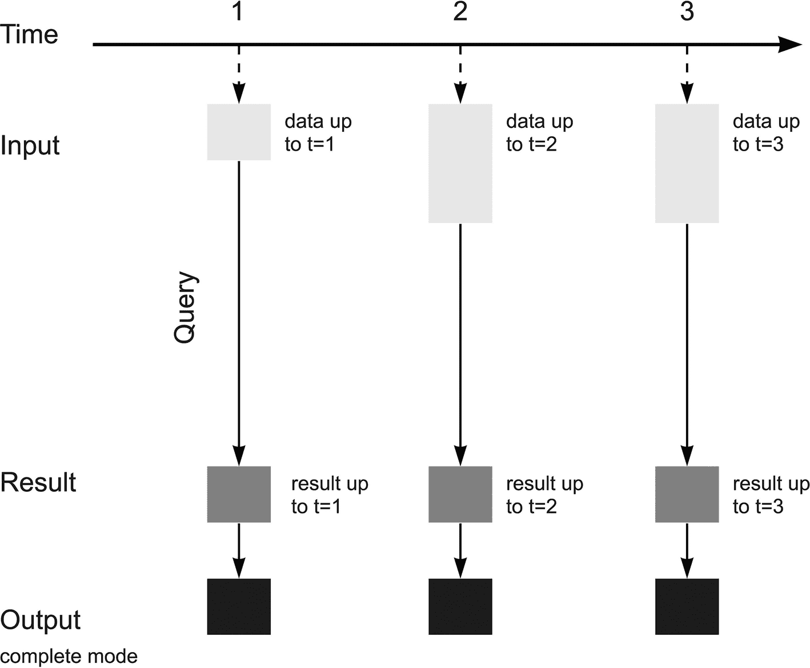
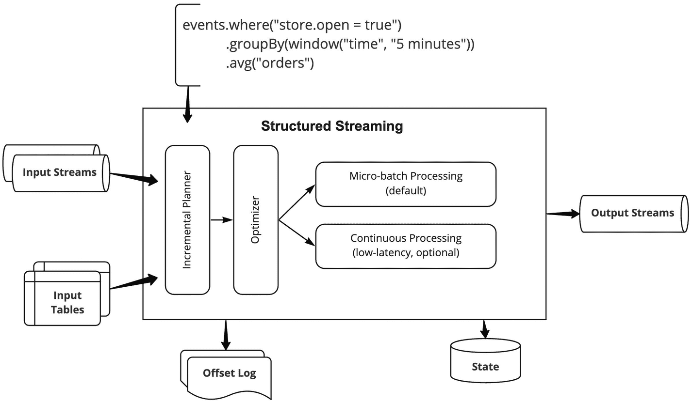
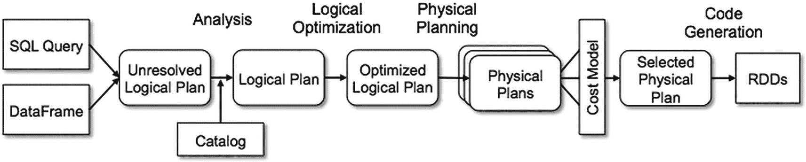
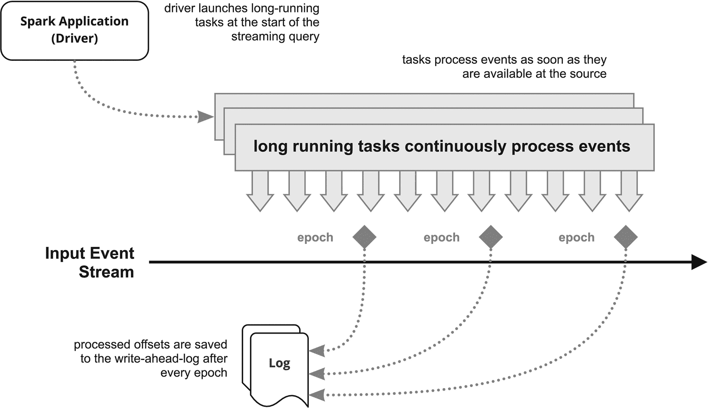
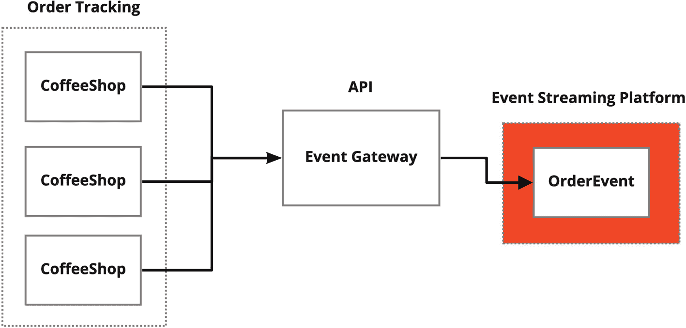
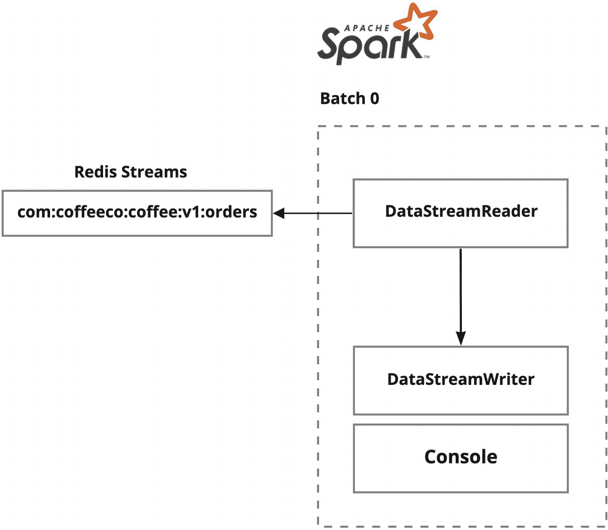
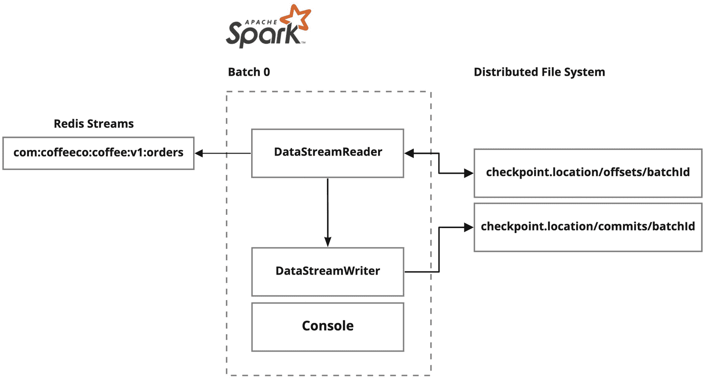
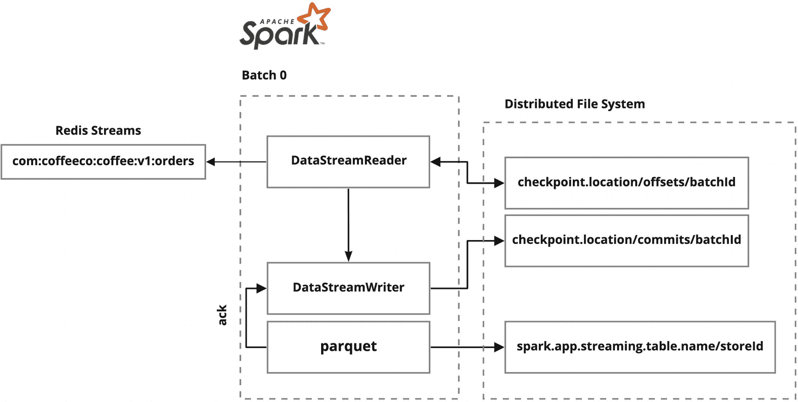

# 10. 编写结构化流式处理应用的模式

在上一章中，我们为处理传输中的数据建立了一个流式处理参考框架。通过介绍那些常常阻碍流式处理成功之路的常见问题和陷阱，您发现了本地协调时间与全局协调时间之间的细微差别，也就是时间带来的麻烦。您还了解了当损坏或无效数据进入您的数据网络时所产生的复杂问题，即传输中的数据问题。在一个完美的世界里，每个事件或数据点都会神奇地以正确的时间对齐（同步）顺序出现，但在一个不完美的世界里，有一些工具可以帮助您。

在本章中，您将发现用于在使用 Spark Structured Streaming 时解决流式数据问题的有效设计模式。首先，您将了解封装 Spark Structured Streaming 的核心编程模型和概念。从简单入手，逐步深入，您将编写一系列 Structured Streaming 应用，这些应用将应对读取和写入无界数据流所必需的核心语义。

本章将教您：

- 使用 `Redis Streams` 处理结构化流式数据。这将强化上一章中关于严格模式对于构建可问责数据系统必要性的课程。
- 了解什么是检查点，以及它们如何为有状态的结构化流式处理应用提供动力。
- 通过触发器与 Spark 配置的结合，使用速率限制来控制您的应用。
- 理解如何设计 Structured Streaming 应用。

让我们从学习 Spark Structured Streaming 的核心原则开始，奠定基础。

## 什么是 Apache Spark Structured Streaming？

简而言之，Apache Spark Structured Streaming 让你能够以一种易于理解的方式利用实时流式数据的强大功能。借助结构化的 Spark API 所提供的基础，它使你（工程师）能够将流式数据视为跨无限系列微批次（数据集）的时间点视图，或视为单个事件（数据点）的连续流。

Spark Structured Streaming 编程模型的核心是我们的老朋友 SparkSQL。作为一个统一的处理过程，SparkSQL 使你在编写处理流式数据、静态数据（批处理数据）或两者混合的应用程序时，能够应用相同的思维模型。通过模糊*表*和*视图*之间的界限，Structured Streaming 有效消除了在这两种数据访问模型之间处理数据所带来的认知负担。在下一节中，你将了解这种处理模式的工作原理，从*无界表*的概念开始。

## 无界表与 Spark Structured Streaming 编程模型

无界表是一种结构，它使得在你的应用程序上下文中，更容易概念化用于转换和查询流式数据的处理模式。如果你真的存储一张无界表，应用程序最终将因所有这些数据的重量（数据点数量）和压力（内存和 CPU）而崩溃。在大多数现实世界的 Structured Streaming 应用程序中，被摄入到你流式应用程序中的数据流，在每个数据点对于实时处理变得不必要、无趣或无用之前，都有一个处理截止日期，或数据存活时间（TTL）。更稳妥的说法可能是，当你编写一个 Structured Streaming 应用程序时，实际上是在创建一个应用程序，它在内存中处理和存储一组有界数据，跨越一个随时间变化的、无限或无界的最终数据流。图 10-1 展示了无界表的概念。



**图 10-1** — Spark Structured Streaming 编程模型

图 10-1 是一个高层级的序列图，展示了在 Spark 中随时间推移，能够可靠地摄取结构化无界流式数据的过程。在示例中，随着新数据被摄入到应用程序中，一个确定性的周期随着系统的每次“滴答”（即微批次）而开始。在每个批次中，Spark 在处理下一组数据之前，会执行一系列有向步骤（输入 --> 查询 --> 结果 --> 输出）。这一系列确定性的步骤（称为 DAG）代表了 Spark Structured Streaming 的四个基本处理范式：

*   执行/处理模式（微批次或连续模式）
*   触发器（有效的处理窗口/边界）
*   增量查询（随时间推移的渐进式数据处理）
*   流式输出模式（完整、更新和追加）

接下来你将探索这些范式，并理解它们在 Spark Structured Streaming 中所扮演的角色。

### 处理模式

最初，微批次处理是 Structured Streaming 唯一引入的执行模式，并且至今仍是默认模式。流式微批次的调度和执行使应用程序开发者能够转向一个可靠、结构化的流处理模型，而远离由 Spark 第一个流式编程模型引入的自定义方法。

**Apache Spark Streaming 与*离散化流（DStreams）***

使用 DStreams 时，工程师必须深入了解 `RDD` API（*Apache Spark 的核心数据结构和编程模型*）。这意味着工程师必须学会有效地使用较低级别的 `RDD` API。这包括理解如何从故障中恢复、实现接收器、高效地序列化/反序列化他们的代码和数据，以及扩展和性能调优他们的应用程序。这些仍然是需要学习的内容，只是通过 `DataFrames` 和 `Datasets` API 以及 SparkSQL 提供的抽象，学习层次更高了。你可以将这视为通往 Structured Streaming 道路上一个更自然的垫脚石，它展示了社区为克服障碍所采用的设计模式中的优点、缺点和丑陋之处。

幸运的是，本书不介绍 Apache Spark Streaming，而是介绍更易于理解、性能更高且能自我优化的 *Apache Spark Structured Streaming*。我建议你回顾一下 Spark 的发展历程，以理解过去的状况，并欣赏其演进的成果。现在，回到 Structured Streaming 的处理模式。

连续执行模式被引入，用于实现极低端到端延迟的真正实时处理。两种执行模式都能使应用程序管理流处理的复杂性，同时仅改变应用程序中数据处理方式的语义。图 10-2 显示了数据在输入源和输出端之间的一般流程如何保持一致，而主要的区别在于触发机制。



**图 10-2** — Structured Streaming 的处理流程

理解何时使用每种处理模式，是你在编写任何初始代码之前必须做出的关键决策。我们来看看原因。

#### 微批处理

如前所述，微批处理在结构化流式处理诞生之初便被引入。这种处理范式使应用程序开发者能够使用结构化的 Spark API（`DataFrame`/`Dataset`）编写流式应用。微批执行的机制依赖于周期性轮询新数据的概念。这使得 Spark 结构化流式引擎能够生成新一批数据进行处理。值得指出的是，这些应用不仅体现在数据层面的结构化（数据严格绑定到真实的结构化模式 `StructType`），还体现在每个微批处理前后的规划与执行的有序性上。

每个批次都以执行计划为起点，该计划是 Spark 引擎进行规划、分析和优化等一系列预处理步骤的结果，如图 10-3 所示。



**图 10-3** — Spark 处理的每个批次（或微批）数据的优化过程

生成物理计划（如图 10-3 所示，详情参见第 6 章）后，输入数据源及其相关元数据会被预写（预写日志），为每个微批创建一个称为检查点的参考点。这使得应用在运行过程中可以安然失效，并以确定性的方式从最后一个完整保存点回滚并恢复。

在每个微批处理的另一端，输出写入器会确认其操作成功，这一过程被称为*提交*。同样值得指出的是，每个微批必须成功处理完成后，下一个微批才能开始处理。这种确认机制通过完全提交微批内所有已完成的工作来实现，或者在发生终态不可恢复故障时中止所有后续执行。

综合这些原则，你的应用将能够从可靠的数据源处理结构化数据，以一系列确定性的微批形式，为整个应用生命周期内的所有输入和输出提供清晰一致的模式，从而应对看似无限的流式数据。我们将在下一节的章节练习中实际演示这一过程。

#### 连续处理

结构化流式处理发布后不久，低延迟（亚秒级）的连续处理执行框架也随之推出。Spark 执行框架不再依赖对数据源的周期性轮询，而是依靠长期运行的任务来处理从数据源到数据接收器的端到端连续数据处理。这意味着数据会以最快的速度逐事件处理，无需等待每个批次的所有事件数据完全提交而带来的开销。图 10-4 提供了一个高层级示意图，以帮助理解这一模型。



**图 10-4** — 连续处理执行模式

虽然这种执行模式可以实现极低的延迟（约 100ms 端到端），但它最适合处理单个事件的流，而非那些可以分组、分析或整体处理的微批事件集合。例如，如果你要构建一个系统，用于通知顾客他们点的咖啡已准备好取餐（类似苹果的推送通知服务），从技术上讲，你可以将此负载分布到 Spark 集群上，确保每条消息精确发送一次。你肯定不想惹恼顾客，导致他们选择退出通知。

你将在第三个和第四个练习中学习如何使用检查点和触发器。这也将是一次尝试连续处理和微批处理的机会。

### 练习材料

第 10 章的练习材料位于 [`https://github.com/newfront/spark-moderndataengineering/tree/main/ch-10`](https://github.com/newfront/spark-moderndataengineering/tree/main/ch-10)。材料中的 `README` 文件将为你提供有关其他安装步骤或注意事项的更多背景信息。这些练习依赖于第 8 章中扩展的 `~/dataengineering/` 环境设置，该设置提供了通用的 MySQL（Hive Metastore）和 MinIO（S3）。

## 练习概述

以下练习旨在教你使用 Apache Spark 结构化流式处理的核心功能。你在完成一系列练习时，将采用不同的方法模式。这些练习都围绕同一个核心挑战展开并延伸。

### 挑战

你需要创建一个系统，用于摄取 CoffeeCo 旗下所有咖啡店的实时事件数据。该系统将用于追踪整个网络中的顾客使用模式，从订单追踪开始。对于每个订单，可以预期一个可靠的上游网关（如第 9 章所述示例）会生成可靠事件，供你的 Spark 应用摄取。

图 10-5 展示了为流式应用提供必要数据的高层级系统工作流程。为简化起见，本章练习将重点放在事件流平台之后的数据处理上。因此，我们需要先定义一个事件格式。



**图 10-5** — 订单追踪的入口路径。每个订单通过事件网关 API 发送一个事件，并排入事件流平台

### OrderEvent 格式

虽然在没有约定数据格式的情况下编写基于事件的应用程序并非不可能，但这样做难度更大，并且长期来看会使事情复杂化。在本例中，假设每个事件的格式需要提供订单 ID、关联客户 ID、交易门店 ID、订购商品数量以及交易总价。这些信息将被封装在一个我们称之为 `OrderEvent` 的结构中。我们清楚最终需要摄取的内容，只需将实际事件形式化即可。

**注意：** 在现实世界中，数据工程师常常需要负责创建结构化数据格式，甚至编写上游系统来生成数据并输入到他们自己的数据域中。这样他们便拥有自己域的数据合约，从而理解网络中其他上游数据提供者/生产者之间的数据血缘关系。

正如上一章所述，事件应保持一致且可靠；否则你的流式应用可能会突然停止运行，给你带来一团乱麻（以及停机故障）。这并不意味着在测试某个想法之前，你需要花费大量时间将上游数据梳理得井井有条。事实上，通常正确的做法是从粗略的概念/想法入手，然后分阶段逐步完善。

现在我们就采用这种方法。我们将首先在 Spark 引擎内部构建将要处理的数据。

### 深入理解 Spark Struct

鉴于您使用 Spark SQL 进行的结构化数据转换依赖于 `StructType`，您可以先通过简单的 DataFrame 概念来构思应用程序。这使您能够在正式确定特定应用的数据契约之前快速行动。请记住，始终从小处着手，逐步构建。

```scala

```

new StructType()
  .add(StructField("timestamp", LongType, false))
  .add(StructField("orderId", StringType, false))
  .add(StructField("storeId", StringType, false))
  .add(StructField("customerId", StringType, false))
  .add(StructField("numItems", IntegerType, false))
  .add(StructField("price", FloatType, nullable false))
```

现在，我们对应用程序中将要使用的数据结构有了一个概括性的表示，可以开始第一个练习了。

## 练习 10-1：使用 Redis Streams 驱动 Spark Structured Streaming

[Redis Streams](https://redis.io/topics/streams-intro) 可用于快速构建和测试完整的端到端流式应用程序。正如您将在本练习中看到的，这有助于发现构建应用程序的流程。

Redis Streams 运行开销很小，这得益于它是 [Redis](https://redis.io/) 的一个原生数据结构。Redis 是一个高度优化的数据结构存储系统，在社区中非常知名且受欢迎。如果您从未使用过 Redis，您仍然可以从本练习中学习。

**练习 10-1**

练习材料位于 `/ch-10` 目录下的 `/applications/redis-streams` 文件夹，具体路径为 `/exercises/01_redis-streams`。

## 启动本地环境

使用 `exercises/01_redis-streams` 目录下提供的 `docker-compose` 文件开始。您将再次使用 Docker Compose 启动环境，这意味着您也需要启动 Docker。

```bash
docker compose -f docker-compose.yaml up -d --remove-orphans
```

这将启动练习的外部依赖项：Redis、MinIO 和 MySQL。然后，是时候连接到新的 Redis 容器了。

## 连接到 Redis

打开终端或创建一个新的会话。您将使用连接到 Redis Docker 容器的终端，并通过 `redis-cli` 提供到 Redis 的命令行连接。此连接将用于将新的事件数据推送到您的流中。这也是读取、写入和管理事件流（或其他 Redis 需求）数据的完整生命周期的便捷方式。额外的好处是，您无需编写任何应用程序代码即可开始。

### 连接到 Redis CLI

借助 Redis 容器，您现在可以通过执行清单 10-1 中的命令来连接到 `redis-cli`。

```bash
docker exec -it redis redis-cli
```

*清单 10-1：连接到 Redis 容器并使用 `redis-cli`（命令行）*

在提示符下执行 `ping` 命令。您将看到返回了 `PONG`，这意味着一切正常。

```bash
127.0.0.1:6379> ping
PONG
```

接下来，您将学习监控流入 Redis 的命令流。这是观察系统中不同点之间发生了什么的好方法。

### 启用 Redis 命令监控

打开另一个终端窗口并执行清单 10-2 中的命令。连接成功后，您应该会看到一条 `OK` 消息。

```bash
docker exec -it redis redis-cli monitor
```

*清单 10-2：使用 Redis 容器中的 `redis-cli` 监控发送到 Redis（本地或远程）的命令*

监控进程是一个有用的视图，可以实时查看哪些命令正在被发送到 Redis。如果等待几秒钟，您将看到来自 Redis 容器健康检查的 ping 消息通过监控器。

```bash
1626138124.541908 [0 127.0.0.1:59704] "ping"
```

**容器健康检查**

`docker-compose` 文件（`ch-10/exercises/01_redis-streams/`）中提供的 `healthcheck` 块使服务能够使用简单的命令自我监控。对于 Redis，健康检查只是通过 `redis-cli` 发送一个 ping 并确保其不会超时。这意味着容器运行正常。

```yaml
healthcheck:
  test: ["CMD", "redis-cli", "ping"]
  interval: 5s
  timeout: 30s
  retries: 50
```

现在是时候使用 Redis 创建您的第一个流了。

## 创建 Redis Stream

*Redis Stream* 是自动生成的，并且在您添加数据时会立即可用。由于 Redis 是一个内存数据库，流生成的开销很小，因为没有需要立即创建的文件、新的磁盘空间分配或与流生成相关的昂贵锁定。您只需发布第一个事件，流就会神奇地出现。在后台，Redis 会定期将整个数据库持久化到 RDB（这是您整个 Redis 数据库的一个时间点快照）。如果您熟悉 Redis，那么流类型在概念上是列表、有序集合和哈希映射[数据结构](https://redis.io/topics/data-types)的混合体。

### 流的保证

Redis *保证* 流中每个事件的字段顺序，以及插入顺序的一致性。每个事件标识符将始终大于在其之前插入的任何事件。

**为什么字段级顺序很重要**

字段级顺序的重要性不仅仅是为了安心。作为由 Redis Stream 封装的事件存储的每个编码负载，都是指向一个哈希映射的指针。根据设计，哈希映射可以通过其键随机访问，但它们开箱即用不会保留任何特定顺序。例如，Java 中的 `HashMap` 和 `LinkedHashMap` 有很大的区别。当您想要维护 `EntrySet` 中键的顺序时，会使用链接变体。为了 Redis Stream 内部的可靠性和一致性，Redis 负责处理字段级顺序，但您仍然必须提供一个可靠的事件。我们将在练习后面部分查看这是如何处理的。

**事件标识符**

您使用 `XADD` 命令添加新事件。该命令包括使用自动生成的 ID 而不是提供您自己的标识符的选项。有效的事件 ID 格式是 `<number>-<number>`。对于自动生成的 ID，Redis 将事件被摄取到 Redis 时的 UNIX 纪元毫秒数（时间戳）和在同一毫秒内接收到的事件的单调递增 ID 连接起来。

```
1625766684875-0
```

这种模式确保了每个事件的标识大于其之前的任何事件。如果您决定使用自己的标识符，则必须记住这一点。否则，由于事件 ID 的预期被打破，您将看到错误消息 `ERR Invalid stream ID specified as stream command argument`。

#### Redis Streams 是仅追加的

理解 Redis 的流是一种仅追加的流式数据结构非常重要。仅追加意味着您无法更改插入顺序。这迫使希望重新组织事件（排序、添加缺失数据）的上游系统读取流、重新组织它，然后将事件推送到新的流中，或者将这些结果推送到另一个可靠的存储中。当您拥有一个不可变的、仅追加的流式数据源时，您可以保持一致性。这降低了使用这些数据的复杂性，并为您提供了流式处理的理想可靠数据源。

让我们发布一个事件并生成您的第一个流。

### 向 Redis Stream 发布事件

你可以通过发布事件来创建 Redis Stream。复制清单 10-3 中从 `xadd` 开始的命令，并将其粘贴到 `redis-cli` 中。

```
127.0.0.1:6379> xadd com:coffeeco:coffee:v1:orders * timestamp 1625766472513 orderId ord126 storeId st1 customerId ca183 numItems 6 price 48.00
```

*清单 10-3：向 Redis Stream 发布事件*

Redis 将通过返回已发布事件的事件 ID 来确认你的命令。例如，返回 `"1625766684875-0"`。

### 从 Redis Stream 消费事件

现在你已经发布了一个事件并生成了一个流。你可以使用 `redis-cli` 读取（消费）所有可用的已发布事件。为此，你将使用 `xrange` 或 `xrevrange` 命令，这些命令允许你读取流中的项目。使用 `redis-cli` 执行清单 10-4 中的命令。

```
127.0.0.1:6379> xrange com:coffeeco:coffee:v1:orders - + COUNT 1
```

*清单 10-4：使用 `xrange` 从 Redis Stream 读取事件*

### Redis Stream 数据获取

这将按照插入顺序（升序）获取添加到流中的第一个项目，该顺序基于流的尾部（可以思考一下链表如何使用头指针或尾指针）。从概念上讲，这个过程相当于 SQL 中的 `order by asc limit 1`。

```sql
select * from v1.orders

order by timestamp asc limit 1
```

与此相反的是 `xrevrange` 选项。它使用降序插入顺序，从流的头部（最新的项目优先）读取数据。现在你已经对 Redis Stream 的工作原理有了基本了解，是时候进入 Spark 应用程序本身了。

### SparkRedisStreamsApp

打开 `SparkRedisStreamsApp`，它位于本章材料中 `applications` 目录的 `/ch-10/applications/redis-streams` 路径下。此应用程序可追溯到第 7 章，当时你在 Scala 中创建了第一个编译好的 Spark 应用程序。应用程序的整体结构相同，但增加了一个 Dockerfile 和一个非托管库项（`lib/spark-redis`）。在撰写本文时，`spark-redis` 库尚不普遍适用于 Spark 3.x。

```text
redis-streams/

conf/

lib/

project/

src/

Dockerfile

build.sbt
```

该项目提供了构建端到端应用程序所需的所有基础模块。我们不妨先不浏览代码，而是换个策略，先编译，再提问。

让我们先使用 `sbt` 编译应用程序。

#### 编译应用程序

从项目根目录（`redis-streams`）开始，编译应用程序。

```bash
sbt clean assembly
```

**注意**

编译应用程序需要 Redis 在 Docker 中运行。返回练习的开始位置，在练习目录中执行 `docker compose` 命令。

应用程序编译完成后，你的 JAR 文件将位于 `target/scala-2.12/spark-redis-streams-assembly-0.1-SNAPSHOT.jar`。下一步我们将应用程序包装到自己的 Docker 容器中，届时会用到这个资源。

#### 构建 Docker 容器

编译好应用程序后，你现在可以构建 Docker 容器了。打开项目根目录中的 `Dockerfile`（如清单 10-5 所示）。

```dockerfile
FROM newfrontdocker/apache-spark-base:spark-3.1.2-jre-11-scala-2.12

COPY target/scala-2.12/spark-redis-streams-assembly-0.1-SNAPSHOT.jar /opt/spark/app/spark-redis-streams.jar

EXPOSE 4040
```

清单 10-5

用于创建我们的统一 Redis Streams 应用程序的 Dockerfile

容器定义文件（`Dockerfile`）只是在 `apache-spark-base` 基础容器之上添加了一个新层，该层将你的应用程序 JAR 复制到 `/opt/spark/app` 目录（由 `spark-base` 容器创建）。它还暴露了端口 4040，这是 Spark UI 运行的端口。从项目根目录执行清单 10-6 中的 `docker build` 命令。

```bash
docker build . \

-t `whoami`/spark-redis-streams:latest
```

清单 10-6

构建 spark-redis-streams Docker 容器

你会看到容器构建几乎不需要时间（假设 `apache-spark-base` 容器已缓存在本地 Docker 中）。

```text
[+] Building 0.4s (7/7) FINISHED

=> [internal] load build definition from Dockerfile                                                                                                       0.0s

=> => transferring dockerfile: 37B                                                                                                                        0.0s

=> [internal] load .dockerignore                                                                                                                          0.0s

=> => transferring context: 34B                                                                                                                           0.0s

=> [internal] load metadata for docker.io/newfrontdocker/apache-spark-base:spark-3.1.2-jre-11-scala-2.12                                                  0.0s

=> CACHED [1/2] FROM docker.io/newfrontdocker/apache-spark-base:spark-3.1.2-jre-11-scala-2.12                                                             0.0s

=> [internal] load build context                                                                                                                          0.2s

=> => transferring context: 11.90MB                                                                                                                       0.2s

=> [2/2] COPY target/scala-2.12/spark-redis-streams-assembly-0.1-SNAPSHOT.jar /opt/spark/app/spark-redis-streams.jar                                      0.1s

=> exporting to image                                                                                                                                     0.1s

=> => exporting layers                                                                                                                                    0.1s

=> => writing image sha256:2e542656e6e8c5e165fac6e308c68252f2396152a00785c7094c15f55a702939                                                               0.0s

=> => naming to .../spark-redis-streams:latest                                                                                              0.0s
```

构建过程很快完成，因为本质上你只是添加一个 `JAR` 文件（已在本地编译）并定义一个要暴露的端口。

提示

思考一下如何通过复用容器来创建可堆叠的环境。在清单 10-5 的示例中，堆栈从 `apache-spark-base` 开始，然后通过添加应用程序 `JAR` 来扩展堆栈。

现在，你已经准备好运行应用程序并消费 `Redis Stream`。

### 运行应用

该应用的功能类似于一个简单的回声服务器。当您向 `Redis Stream` 添加新事件时，应用将（几乎）立即处理该事件并输出格式化后的 `DataFrame` 和批处理标识符（微批次）。这个应用代表了我们进行的初次尝试，目的是确保所有组件正确连接。请务必牢记：始终从简单的部分开始，然后逐步构建。

此时，`redis-cli` 监视器（来自代码清单 10-2）开始变得有趣。如果您的屏幕空间足够，请同时打开 `redis-cli` 窗口和 `redis-cli` 监视器窗口（来自代码清单 10-1 和 10-2），然后再打开第三个终端窗口来运行应用。

执行代码清单 10-7 中的命令来启动容器并触发 `Spark` 应用运行。

```
docker run \
  -p 4040:4040 \
  --hostname spark-redis-test \
  --network mde \
  -v ~/dataengineering/spark/conf:/opt/spark/conf \
  -v ~/dataengineering/spark/jars:/opt/spark/user_jars \
  -it `whoami`/spark-redis-streams:latest \
  /opt/spark/bin/spark-submit \
  --master "local[*]" \
  --class "com.coffeeco.data.SparkRedisStreamsApp" \
  --deploy-mode "client" \
  --jars /opt/spark/user_jars/mariadb-java-client-2.7.2.jar \
  --driver-class-path /opt/spark/user_jars/mariadb-java-client-2.7.2.jar \
  --conf "spark.sql.warehouse.dir=s3a://com.coffeeco.data/warehouse" \
  --conf "spark.app.source.stream=com:coffeeco:coffee:v1:orders" \
  /opt/spark/app/spark-redis-streams.jar
```

代码清单 10-7：用于启动运行于本地数据平台的 `Spark Redis Streams` 应用（容器内）的 `docker run` 命令

`Docker` 容器将使用您之前编译并封装进容器的 `SparkRedisStreamApp` `JAR` 包启动。检查日志时，您会注意到许多来自 `Spark` 的信息级别（`info-level`）日志。您始终可以通过 `log4j`（将根级别日志记录更改为 `WARN` 或 `ERROR`，或仅选择应用日志）来减少这些无关信息。目前，这些日志可以帮助您更深入地了解其运行机制。

### Redis Streams 消费者组与偏移量

应用启动时，它将连接到 `spark.app.source.stream` 配置值中指定的 `Redis Stream` 标识符。您可以在输出日志中看到此过程。只需查找以下输出。

```
INFO RedisSource: Getting batch...
start: None
end: {"offsets":{"com:coffeeco:coffee:v1:orders":{"groupName":"spark-source","offset":"1626552490734-0"}}}
```

在此过程中，`Spark` 与 `Redis` 之间会发生一次快速握手，您可以使用 `redis-cli` 监视器来观察。您将在监视器中看到以下输出。

```
"XGROUP" "create" "com:coffeeco:coffee:v1:orders" "spark-source" "$" "mkstream"
"XINFO" "STREAM" "com:coffeeco:coffee:v1:orders"
"XREADGROUP" "group" "spark-source" "consumer-1" "count" "100" "block" "500" "noack" "streams" "com:coffeeco:coffee:v1:orders" ">"
"XINFO" "STREAM" "com:coffeeco:coffee:v1:orders"
```

这些命令是应用在无先前状态启动时的握手过程的一部分。（您将在练习 10-3 中学习如何通过检查点来存储应用状态。）这个信息收集流程会查询流并为应用创建新的消费者组。

### 消费者组

为了追踪流的位置并将 `Spark` 应用与特定组关联，使用了 `XGROUP` 命令。鉴于该应用之前从未运行过，首先会创建一个新组，然后查询流（`XINFO`）以获取与流相关的所有元数据，以便 `Spark` 能够开始接收新事件。

您可以在 `redis-cli` 中运行 `xinfo` 命令来查看返回的数据。

```
xinfo STREAM com:coffeeco:coffee:v1:orders
```

然后，使用 `XREADGROUP` 命令，应用会创建一个初始位置来阻塞并等待新事件。

现在，应用已经了解了其初始状态，便可以继续执行并开始工作。这是任何 `Structured Streaming` 应用的关键第一步。实际上，您会发现这个过程也会创建第一个批次。

```
Batch: 0
+---------+-------+-------+----------+--------+-----+
|timestamp|orderId|storeId|customerId|numItems|price|
+---------+-------+-------+----------+--------+-----+
+---------+-------+-------+----------+--------+-----+
```

此过程现在仅在有新数据从 `Redis Stream` 到来时才会重复执行。让我们添加另一个事件。

### 创建下一个批次

您可以从步骤 3 复制 `XADD` 命令并将其粘贴到 `redis-cli` 中，以触发一个新批次。

```
xadd com:coffeeco:coffee:v1:orders  * timestamp 1625766472513 orderId ord126 storeId st1 customerId ca183 numItems 6 price 48.00
```

在 `Spark` 应用容器中，您将看到应用对事件做出响应并进行处理。从日志中，重要的输出部分是批次的确认以及批次格式化后的输出。

```
Batch: 1
+-------------+-------+-------+----------+--------+-----+
|    timestamp|orderId|storeId|customerId|numItems|price|
+-------------+-------+-------+----------+--------+-----+
|1625766472513| ord126|    st1|     ca183|       6| 48.0|
+-------------+-------+-------+----------+--------+-----+
```

尝试将以下事件粘贴到 `redis-cli` 中。您会注意到应用的运行行为有何特点？

```
> xadd com:coffeeco:coffee:v1:orders  * timestamp 1625766472503 orderId ord124 storeId st1 customerId ca153 numItems 1 price 10.00
> xadd com:coffeeco:coffee:v1:orders  * timestamp 1625766472513 orderId ord125 storeId st1 customerId ca173 numItems 2 price 7.00
> xadd com:coffeeco:coffee:v1:orders  * timestamp 1625766472513 orderId ord126 storeId st1 customerId ca183 numItems 6 price 48.00
```

> `xadd com:coffeeco:coffee:v1:orders * timestamp 1625766472613 orderId ord127 storeId st1 customerId ca184 numItems 1 price 3.80`

您会注意到应用会将每个事件放在其自己的批次中处理。好吧，您可能会问，这是为什么呢？这似乎与我们预期的微批次行为不太一致，我们期望其更具连续性。确实如此，这种行为可以通过在应用的控制路径中添加触发器来控制。

现在，您可以停止 docker 进程（`^+C`）或直接退出其运行的窗口。

我们将在练习 10-2 中深入探讨应用代码本身，以了解构成此应用运行机制的各个组件。在此过程中，您将学到一些有助于简化应用编写的技巧。

### 练习 10-1：总结

第一个练习从宏观层面教您了解了 Redis Streams 的工作原理。您学会了使用 `redis-cli`，弄清楚了 `redis-cli` 监视器的用途，并掌握了如何驾驭这些新的流处理方式。最后，您预览了 Spark Redis Streams 应用，接下来将学习其具体内容。

### 练习 10-2：解析 Redis 流应用

你在练习 10-1 中运行的应用是一个不完整的结构化流应用。这是因为该应用尚未跟踪自身状态（因此它是无状态的），也没有对消费的事件进行任何有效处理。不过这都是有意为之；该应用的当前状态如图 10-6 所示。



图 10-6：结构化流的起点。它连接到 Redis 并持续轮询新事件

图 10-6 展示了你刚在练习 10-1 中运行的应用。以此逻辑模型为基础，在你喜欢的 IDE 中打开 `redis-streams` 项目，并导航到位于 `/ch-10/applications/redis-streams/SparkRedisStreamsApp.scala` 的文件。

你会注意到我们再次使用了在第 7 章介绍的 `SparkApplication` 特质。

```scala
object SparkRedisStreamsApp extends SparkApplication
```

作为回顾，这个特质的用途是为应用提供 `SparkSession`、应用名称句柄以及不可变的 `SparkConf`，这样在设置每个新应用时能大幅减少模板代码。

### DataStreamReader

参考上图，我们从 `DataStreamReader` 开始。这是核心的结构化流接口之一，它提供了一种通用方式来将流式数据集加载到 Spark 中。在应用中，你会找到以下代码块。

```scala
lazy val inputStream: DataStreamReader = {
  sparkSession.readStream
    .format("redis")
    .option("stream.keys", inputStreamName)
    .schema(streamStruct)
}
```

与批处理应用类似，我们使用 `SparkSession` 作为接口来配置数据源并生成新的读取器（即入口）。唯一区别在于，这里我们通过使用 `readStream` 而非 `read` 来将数据源指定为流式数据源。

**扩展 Spark**

你可能也是第一次见到自定义数据源格式。Spark 是一个可插拔平台，它明白 `format("redis")` 将通过 `spark-redis` 库（借助 `DataSourceRegister` 和 `StreamSourceProvider` 接口）提供。你可以创建自己的源和接收器格式，为 Spark 添加新功能，而无需重复造轮子。

然后我们填充数据源所需的配置。在本例中，只需提供流的名称（流的键名）以及该数据源期望的 schema。

#### Schema 是必需的吗？

对于大多数流式数据源，*schema* 是必需的。JSON 数据源可以推断 schema，但它是通过采样来完成的，这可能导致不一致性。这意味着在事件数据稀疏（例如可选字段）的情况下，你无法获得确定的 schema。为了省心，最好基于上游数据契约提供 schema。这样，你的应用就能建立在明确的预期之上。

在练习的介绍部分，你已经了解了订单事件格式。以下 `struct` 是该应用的正式结构化数据契约。

**OrderEvent 的 Schema**

```scala
lazy val streamStruct = new StructType()
  .add(StructField("timestamp", LongType, false))
  .add(StructField("orderId", StringType, false))
  .add(StructField("storeId", StringType, false))
  .add(StructField("customerId", StringType, false))
  .add(StructField("numItems", IntegerType, false))
  .add(StructField("price", FloatType, false))
```

值得一提的是，`DataStreamReader` 的 `schema` 构建方法既可以接受完全格式化的 `StructType`（如上所示），也可以接受 DDL 字符串。Spark 会解析 DDL 字符串并为你组装好相应结构。

**通过 DDL 字符串生成 StructType。这等价于调用 `StructType.fromDDL(streamStruct.toDDL)`**

```scala
StructType.fromDDL("""
  `timestamp` BIGINT,
  `orderId` STRING,
  `storeId` STRING,
  `customerId` STRING,
  `numItems` INT,
  `price` FLOAT""")
```

这种灵活性使你能够编写丰富的、可配置驱动的流式应用，同时仍遵循严格的数据契约。

以上就是应用如何知道连接到哪里以及期望上游提供什么 schema 的方式。鉴于第一个流式应用较为简单，我们将直接进入 `DataStreamWriter`。

### DataStreamWriter

`DataStreamWriter` 是用于将流式数据集写入 Spark 外部存储的核心接口。该接口提供的方法集比其批处理模式的对等体 `DataFrameWriter` 更少。我们将在练习 10-3 中介绍 `outputMode`、`partitionBy` 和 `trigger` 的使用。查看 `run` 方法将向你展示实际用法。

**来自 `SparkApplication` 特质的 `run` 方法的流式实现**

```scala
override def run(): Unit = {
  ...
  val writer: DataStreamWriter[Row] = SparkRedisStreams(sparkSession)
    .transform(inputStream.load())
    .writeStream
    .queryName("orders")
    .format("console")
  startAndAwaitApp(writer.start())
}
```

`run` 方法利用了一些可能不易察觉的简单应用设计模式。接下来我们将介绍懒加载调用和依赖注入的精妙用法。这些技术与第 7 章介绍的 Spark 委派模式协同工作。

#### 懒加载调用

`run` 方法依赖 Scala 伴生类构造和懒加载依赖注入，以降低 Spark 读取此应用意图并生成执行计划的复杂度。

```scala
SparkRedisStreams(sparkSession)
  .transform(...)
```

传递给 `transform` 方法的 DataFrame 是对我们的 `DataStreamReader` 调用 `load` 方法的结果。

```scala
.transform(inputStream.load())
```

## 依赖注入

这种模式让你能利用依赖注入为 `transform` 方法提供 `DataFrame`。这使测试更简单，并为上游数据源提供了灵活性。目前应用连接的是 Redis，但你同样可以轻松接入 Kafka，且除了上游配置外，应用本身无需更改。由于接口绑定的是 `DataFrame` 而非 `DataStreamReader`，这种模式还允许你针对批处理或流式数据源复用同一个应用。

至此，我们已接近拼图的最后一块。要构建一个结构化流应用，你需要同时具备数据源和数据接收端。我们已经介绍了上游数据源 Redis。快速回顾一下：这个流式数据源是通过 Spark Session 的 `readStream` 方法生成的，该方法返回一个 `DataStreamReader`。现在，要满足最后一个需求，我们只需要一个接收端。

## 写入流式数据

`writeStream` 方法是 `Dataset` 类的成员。`DataFrame` 本质上就是一个 `Dataset[Row]`，而应用的 `transform` 方法返回一个 `DataFrame`。因此，当我们调用 `writeStream` 时，实际上是将我们的 `DataFrame` 转换为 `DataStreamWriter`。

在应用中，使用的输出格式是 `"console"`。这是一个特殊的接收端，可用于观察应用的输出，因为它不会将任何数据写入可靠的数据存储。

```
.writeStream
.queryName("orders")
.format("console")
```

当完整的应用链路（数据源 → 转换 → 接收端）搭建完毕后，剩下的就是启动应用。`DataStreamWriter` 的 `start` 方法会创建一个 `StreamingQuery`。

```
startAndAwaitApp(writer.start())
```

### 流式查询

[`StreamingQuery`](https://spark.apache.org/docs/latest/api/java/org/apache/spark/sql/streaming/StreamingQuery.html) 接口封装了端到端的结构化流。它提供了在 Spark 应用中运行时对查询进行内省的方法。该接口还是线程安全的，因此你可以从驱动器的任何位置观察流。在本应用通过第 11 章的测试进行扩展和强化时，你将直接使用这个接口。

目前，你只需关注一个方法：`awaitTermination`。

```
def startAndAwaitApp(query: StreamingQuery): Unit = {
  streamingQuery.awaitTermination()
}
```

当你在流式查询上调用 `awaitTermination` 时，应用将持续运行，直到抛出无法恢复的异常，或进程被退出（例如停止 Docker 容器或发送终止信号）。

这个端到端过程全部由应用入口点内的 `run()` 调用启动。

## 应用入口点

应用入口点是提供 `main` 方法的类。该应用扩展了 `SparkApplication` 特质，而后者又扩展了 Scala 的 `App` 特质。因此，当你之前运行此应用时，本质上是在调用 `SparkRedisStreamsApp` 的 `main` 方法，该方法会调用 `run()`。

```
/opt/spark/bin/spark-submit \
--master "local[*]" \
--class "com.coffeeco.data.SparkRedisStreamsApp" \
...
/opt/spark/app/spark-redis-streams.jar
```

现在你已经了解了初始应用的工作原理，我们可以更进一步，对应用进行二次迭代。在练习 10-3 中，你将学习使用检查点使应用具备状态管理能力。

## 练习 10-2：总结

在练习 10-2 中，你学习了练习 10-1 中介绍的应用如何工作。你逐步了解了如何将流式数据源连接到流式数据写入器，并学习了接收的事件（跨每个批次）如何从源头流向接收端。这个简单的练习向你介绍了 Structured Streaming 的核心 Spark 接口：`DataStreamReader`、`DataStreamWriter` 和 `StreamingQuery` 接口。最后，你学习了如何分层使用懒调用和依赖注入来创建易于理解和维护的 Spark 应用。

在下一个练习中，你将学习为此应用添加检查点。

## 练习 10-3：使用检查点进行可靠的有状态流处理

在练习 10-1 中，应用启动时 Spark 和 Redis 之间发生了一次握手。这个过程为我们有状态的应用生成了初始状态。不幸的是，当你终止进程时，所有这些临时状态基本上都被清除了。这意味着应用在离线期间会跳过处理所有添加到 Redis Stream 的数据。

你可能已经猜到我要说什么了。是的，这并非理想情况，而且确实无助于建立对应用的信心。

### 为什么检查点很重要

检查点为你提供了一个保存点。就像任何经典电子游戏一样，这为你提供了一个安全的地方，在失败时可以回到这里。现在，对于我们的应用来说，如果它失败了，我们需要能够从精确的断点处重新开始。

### 可靠的检查点

可靠的检查点始于一致性和持久性的概念。这应该会让你想到容错性，而且将其与原子性联系起来也并不困难。Apache Spark 通过依赖分布式文件系统（即 HDFS）的基础，将应用检查点（状态）存储在外部，从而实现了可靠的检查点功能。这样，即使应用运行的机器宕机，应用也能被重新启动。

### 启用可靠的检查点

打开 `StatefulSparkRedisStreamsApp`。此应用在引入可靠检查点时几乎无需改动。实际上，只有两个明显的变更。

第一个变更体现在 `run` 方法中。

*向 DataStreamWriter 添加 checkpointLocation*

```
SparkRedisStreams(sparkSession)
.transform(inputStream.load())
.writeStream
.queryName("orders")
.option("checkpointLocation", appCheckpointLocation)
.format("console")
```

传入此参数的值通过 `SparkConf` 传递给应用。

```
lazy val appCheckpointLocation: String = sparkConf.get("spark.app.checkpoint.location")
```

现在让我们运行这个应用。

### 运行有状态应用

你可以通过在练习 10-1 中使用的 Docker `run` 脚本上进行轻微修改来测试此应用。

```
docker run \
...
--class "com.coffeeco.data.StatefulSparkRedisStreamsApp" \
--conf "spark.sql.warehouse.dir=s3a://com.coffeeco.data/warehouse" \
--conf "spark.app.source.stream=com:coffeeco:coffee:v1:orders" \
--conf "spark.app.checkpoint.location=s3a://com.coffeeco.data/apps/spark-redis-streams-app/1.0.0/simple" \
/opt/spark/app/spark-redis-streams.jar
```

两处高亮显示的变更分别对应应用入口点以及提供应用检查点位置所需的新增配置。

### 观察有状态行为

在应用运行状态下，打开你的 `redis-cli`（如果已关闭），并粘贴一个练习 10-1 中的 `OrderEvents` 示例。

```
> xadd com:coffeeco:coffee:v1:orders  * timestamp 1625766472503 orderId ord124 storeId st1 customerId ca153 numItems 1 price 10.00
```

这将触发批次处理，其行为与之前相同。接下来是激动人心的部分：停止 Spark 应用（按 Control+C）。在重新启动应用之前，向 Redis 流中再添加三个事件。

```
> xadd com:coffeeco:coffee:v1:orders  * timestamp 1625766472503 orderId ord124 storeId st1 customerId ca153 numItems 1 price 10.00
```

```markdown
> xadd com:coffeeco:coffee:v1:orders * timestamp 1625766472613 orderId ord127 storeId st1 customerId ca184 numItems 1 price 3.80
>
> xadd com:coffeeco:coffee:v1:orders * timestamp 1625766472513 orderId ord125 storeId st1 customerId ca173 numItems 2 price 7.00

重新启动 Spark 应用。你可能首先观察到的（如果扫描日志）是，Redis Source 输出现在包含一个起始参数。

```
INFO RedisSource: 正在获取批次...

start: Some({"offsets":{"com:coffeeco:coffee:v1:orders":{"groupName":"spark-source","offset":"1626658307940-0"}}})

end: {"offsets":{"com:coffeeco:coffee:v1:orders":{"groupName":"spark-source","offset":"1626658362223-0"}}}
```

你还会发现应用能无缝衔接，仿佛从未离线过。与重新从批次 `0` 开始不同，你会看到下一个批次是非零的。例如：

```
批次: 2

+-------------+-------+-------+----------+--------+-----+

|    timestamp|orderId|storeId|customerId|numItems|price|

+-------------+-------+-------+----------+--------+-----+

|1625766472503| ord124|    st1|     ca153|       1| 10.0|

|1625766472613| ord127|    st1|     ca184|       1|  3.8|

|1625766472513| ord125|    st1|     ca173|       2|  7.0|

+-------------+-------+-------+----------+--------+-----+
```

这意味着你现在可以在应用宕机后无缝恢复，不会遗漏任何数据处理。

#### 检查点的工作原理

对于每个批次，流数据源会将用于该批次的显式偏移量写入可靠存储（即分布式文件系统），这被称为`预写式日志`。在每个成功批次完成后，会以提交的形式将确认信息写入可靠存储。你可以从图 10-7 中了解此过程。


图 10-7

检查点处理流程

每个批次都会重复此过程。这意味着批次中的故障不会“移动”游标，你的应用将从上一个成功的保存点重新启动。

你可以通过 MinIO 浏览器 `http://127.0.0.1:9000/minio/com.coffeeco.data/apps/spark-redis-streams-app/1.0.0/simple/` 或文件系统下的 `~/dataengineering/minio/` 路径检查应用检查点。

#### 删除检查点

仅当应用生命周期结束，或应用正在更新且底层 DAG 发生变化时，才需要删除检查点。当你更改数据源或数据接收器，或向表中添加更多数据源（例如来自多个上游的流式连接）时，DAG 会发生更改。

### 练习 10-3：总结

第三个练习向你介绍了使 Structured Streaming 可靠的关键机制——检查点。你了解到每个批次都通过预写式日志（WAL）进行控制，每个成功批次都通过提交标记为完成。即使运行应用的物理服务器或机器发生致命故障，这个简单的过程也能跟踪你的应用状态。

在本章的最后一个练习中，你将学习如何通过添加处理触发器来控制应用的运行时行为。

### 练习 10-4：使用触发器控制应用运行时行为

触发器可用于控制 Structured Streaming 应用的行为。在本练习中，你将学习在增强应用的同时应用三种不同类型的触发器。更改内容如图 10-8 所示。


图 10-8

对 Redis Streams 应用进行的最终更新。此更改将写入通过 Redis Streams 读取的数据内容，然后将这些事件写出到持久的分布式表中。

打开名为 `TriggeredStatefulSparkRedisStreamsApp` 的文件。你将在此文件中找到几个新方法、新配置以及对 `run` 方法的更新。直接跳转到 `outputStream` 方法，因为我们将从这里开始。此方法负责构建一个部分的 `DataStreamWriter`。

```scala
lazy val outputStream: DataStreamWriter[Row] = {
  SparkRedisStreams(sparkSession)
    .transform(inputStream.load())
    .writeStream
    .queryName("orders")
    .format("parquet")
    .partitionBy("storeId")
    .option("path", streamingSinkLocation)
    .outputMode(OutputMode.Append())
}
```

流式接收器的输出格式是 *parquet*。这意味着应用正在将从 Redis 流中读取的数据转换为 parquet 格式，然后将这些事件按 `storeId` 分区写出到由 `streamingSinkLocation` 定义的路径中。当你使用 `partitionBy` 写入时，本质上是在创建键/值命名的目录。

```
/tables/coffee.order.events/storeId={storeId}/
```

**提示**：根据经验法则，你应该在低基数列上对表进行分区。通常的做法是使用日期（`date=YYYY-mm-dd`）和年份部分（`year=YYYY/month=mm/day=dd`）。为了增加多样性，你可以包含与你将要执行的查询相关的列。在本练习中，该列是 `storeId`。

最后，我们将输出格式更改为仅追加模式：`OutputMode.Append()`。这只会让流式 DataFrame/dataset 中的新行写入接收器。当我们下一章研究使用聚合时，输出模式会更有意义，因为它们有助于减少有状态聚合和其他分析处理的输出量。我们现在来看看触发器。

### 更新后的触发式运行方法

`run` 方法现在会利用提供的触发器配置，对 `outputStream` 方法生成的 `DataStreamWriter` 进行进一步定制。让我们来看看这两个配置值。

```scala
lazy val triggerEnabled: Boolean = sparkConf.getBoolean(
  "spark.app.stream.trigger.enabled", true)
```

为什么你需要启用或禁用触发功能？在应用恢复或重放场景中，触发器可能会阻碍应用达到最大吞吐量。例如，`ProcessingTime` 触发器能让 Spark 应用基于一个时间间隔（如 30 秒、5 分钟或 1 小时）来执行。每次应用触发时，它会运行至完成所需的时间，然后计时器开始倒计时，直到下一次可以触发下一个批次。如果你希望应用快速处理，能够为这类特殊用例切换开关并短路触发机制就非常有用。

```scala
lazy val triggerType: String = sparkConf.get(
  "spark.app.stream.trigger.type", "processing")
```

触发器类型与 `processing`、`once` 或 `continuous` 这些值相关联。这三种类型的触发器在 Spark Structured Streaming 中均可使用。

让我们看看这两个配置如何协同工作，以控制用于在 `run` 方法中生成最终 `StreamingQuery` 的配置项。

```scala
override def run(): Unit = {
  super.run()
  val writer: DataStreamWriter[Row] = triggerType match {
    case "continuous" if triggerEnabled =>
      val checkpointInterval = "30 seconds"
      outputStream
```


.option("checkpointLocation", s"$appCheckpointLocation/trigger/continuously/")
.trigger(Trigger.Continuous(checkpointInterval))

case "once" if triggerEnabled =>
    outputStream
        .option("checkpointLocation", s"$appCheckpointLocation/trigger/once/")
        .trigger(Trigger.Once())

case "processing" if triggerEnabled =>
    outputStream
        .option("checkpointLocation", s"$appCheckpointLocation/trigger/processing/")
        .trigger(Trigger.ProcessingTime("10 seconds"))

case _ =>
    outputStream
        .option("checkpointLocation", s"$appCheckpointLocation/trigger/none/")

startAndAwaitApp(writer.toTable(streamingTableName))
```

我们已经介绍过 `DataStreamWriter` 接口的作用。这里我们只是使用了一种更函数式的方法，通过 `triggerType` 的模式匹配来生成最终的 writer。

```
triggerType match {
    case "continuous" if triggerEnabled =>
    case "once" if triggerEnabled =>
    case "processing" if triggerEnabled =>
    case _ =>
}
```

模式匹配使得检查 `triggerType` 是否等于 `continuous`、`once` 或 `processing` 变得更容易。否则，应用将回退到默认的无触发器的微批处理模式。在每个代码块内部，都发生着一些有趣的事情。现在让我们来逐一分析。

### 持续处理模式

本章前面部分我们介绍了什么是持续处理模式。本质上，它会对来自数据源的每个事件进行处理直到完成，并异步提交，而不关心其他任何事件的状态（因为没有批次这个概念）。

```
Trigger.Continuous(checkpointInterval)
```

不幸的是，我们只能在使用 Kafka 作为数据源时使用这种执行模式，因此我们必须等到下一章再介绍。（你可以使用第 11 章中的环境进行测试，作为后续探索。）

### 周期处理

有时候，你会发现需要控制应用触发每个微批次的频率。例如，你需要每分钟运行一次作业，但又不想使用 Airflow 来实现。

你可以使用这个触发器来替代 Airflow 调度器，每五分钟运行一个新批次：`Trigger.ProcessingTime("5 minute")`。

```
case "processing" if triggerEnabled =>
    outputStream
        .option("checkpointLocation", s"$appCheckpointLocation/trigger/processing/")
        .trigger(Trigger.ProcessingTime("10 seconds"))
```

在这个应用中，该时间间隔被固定为十秒。你可以轻松地添加一个配置参数，以更动态的方式控制触发器。

### 有状态批处理作业

回到第 7 章，你了解了有状态批处理作业。好的，现在我们就在这里，你正在查看用于将应用从持续有状态 Structured Streaming 应用转变为有状态批处理应用的控制器。虽然从技术上讲，这仍然是一个 Structured Streaming 应用，但它在首次运行后不会继续执行，这一事实给了我们将其称之为有状态批处理应用的空间。

```
case "once" if triggerEnabled =>
    outputStream
        .option("checkpointLocation", s"$appCheckpointLocation/trigger/once/")
        .trigger(Trigger.Once())
```

### 流式表写入器

在测试应用之前的最后一项任务，是简要讨论一下对 `run` 方法末尾所做的更改。

```
startAndAwaitApp(
    writer.toTable(streamingTableName)
)
```

`DataStreamWriter` 有一个名为 `toTable` 的方法。这个方法，就像你之前看到的 `start` 方法一样，会生成一个 `StreamingQuery`。其背后的原理是，表的元数据现在被写入 Hive Metastore（正如你在第 6 章中所学的），而物理分区的 parquet 文件的其余部分则被写入分布式文件系统。

`streamingTableName` 存储在 `sparkConf` 中，具体配置项为 `spark.app.streaming.table.name`。在本例中，它被命名为 `coffee_orders`。

#### 使用触发器运行有状态应用

接下来只需运行应用即可。你需要打开 `redis-cli`，并准备好订单事件，以便在应用启动后立即开始输入。

##### 使用一次性触发器运行

必要的配置如下所示。你可以直接从应用目录中的 `README` 获取完整命令，或者对练习 10-1 中展示的原始完整`docker run`命令进行必要的调整。

```
docker run \
    ...
    --class "com.coffeeco.data.TriggeredStatefulSparkRedisStreamsApp" \
    --conf "spark.sql.warehouse.dir=s3a://com.coffeeco.data/warehouse" \
    --conf "spark.app.source.stream=com:coffeeco:coffee:v1:orders" \
    --conf "spark.app.stream.trigger.enabled=true" \
    --conf "spark.app.stream.trigger.type=once" \
    --conf "spark.app.checkpoint.location=s3a://com.coffeeco.data/apps/spark-redis-streams-app/canary/" \
    --conf "spark.app.streaming.sink.path=s3a://com.coffeeco.data/tables/coffee.order.events/" \
    --conf "spark.app.streaming.table.name=coffee_orders" \
    /opt/spark/app/spark-redis-streams.jar
```

应用将启动。如果没有检查点，它将创建初始的批次 0，然后应用完成。然而，就像练习 10-3 中的有状态应用示例一样，你可以向 Redis 流中添加任意数量的事件，然后重新启动应用。它会处理所有事件，然后再次停止运行。其美妙之处在于，你可以使用 Docker 操作符从 Airflow 运行此应用，从而执行完全一致、可靠的、有状态的批处理作业。很简洁。

##### 使用处理时间触发器运行

这将启动应用，并为其提供全新的检查点。然后，你可以自由添加任意数量的新事件，并观察应用的行为。它会在每次运行之间暂停十秒钟。

```
docker run \
    ...
    --class "com.coffeeco.data.TriggeredStatefulSparkRedisStreamsApp" \
    --conf "spark.sql.warehouse.dir=s3a://com.coffeeco.data/warehouse" \
    --conf "spark.app.source.stream=com:coffeeco:coffee:v1:orders" \
    --conf "spark.app.stream.trigger.enabled=true" \
    --conf "spark.app.stream.trigger.type=processing" \
    --conf "spark.app.checkpoint.location=s3a://com.coffeeco.data/apps/spark-redis-streams-app/canary/" \
    --conf "spark.app.streaming.sink.path=s3a://com.coffeeco.data/tables/other.coffee.order.events/" \
```

#### 持续运行

目前我们还无法以持续模式运行。我们需要将 Kafka 引入其中，这将在下一章进行。

#### 查看结果

你可以通过跳转到运行 MySQL 的 Docker 实例并直接查询 Hive Metastore 来检查其中存储的值。

```bash
docker exec -it mysql bash
mysql -u dataeng -p
use metastore;
select * from TABLE_PARAMS
where TBL_ID =(
  select TBL_ID from TBLS
  where TBL_NAME = "coffee_orders"
);
```

该输出将是与 `coffee_orders` 表相关的元数据。

*使用 DataStreamWriter 上的 toTable 方法生成的 Hive Metastore 记录*

```
+------------------------------------------------------------+
| TBL_ID | PARAM_KEY                            | PARAM_VALUE|
+--------+--------------------------------------+------------+
|     16 | EXTERNAL                             | TRUE       |
|     16 | spark.sql.create.version             | 3.1.2      |
|     16 | spark.sql.partitionProvider          | catalog    |
|     16 | spark.sql.sources.provider           | parquet    |
|     16 | spark.sql.sources.schema.numPartCols | 1          |
|     16 | spark.sql.sources.schema.numParts    | 1          |
|     16 | spark.sql.sources.schema.part.0      | {schema}   |
|     16 | spark.sql.sources.schema.partCol.0   | storeId    |
|     16 | transient_lastDdlTime                | 1626675149 |
+--------+--------------------------------------+------------+
```

你会看到该表是一个外部表。这意味着你可以从 Spark 目录中删除该表，但仍保留位于分布式文件系统中的物理表。

### 练习 10-4：总结

这个最后的练习教你如何在应用程序中连接多种执行模式，并使用由配置驱动的特性标志来改变应用程序的行为。虽然你可以将这些示例进一步扩展，但这已经是使用 Apache Spark Structured Streaming 的一个很好的入门介绍了。

## 本章总结

本章我们涵盖了很多内容。你了解了 Spark Structured Streaming 的核心处理原则。

-   执行/处理模式（微批处理或持续处理模式）
-   触发器（有效的处理窗口/边界）
-   增量查询（跨时间的渐进式数据处理）
-   流式输出模式（完整模式、更新模式和追加模式）

你学习了如何使用触发器在微批处理执行模式和持续执行模式之间切换。虽然当前没有可用的正确组件（即 Kafka），但你仍然有一个可插入的应用程序以应对该用例（这即将到来）。你使用了仅追加输出模式，这意味着只有 Spark 之前未见过的数据才会通过接收器写入。你将在下一章学习如何使用其他模式。最后，你拥有一整套可用的工具，包括在将 Apache Spark 应用容器化方面的新技能。

在下一章中，我们将继续 Structured Streaming 的学习，重点放在更高级的数据处理上，从流式连接到聚合以及其他分析处理。你还将亲自使用 Kafka，将其纳入你庞大的数据工程工具集。我们开始吧。
