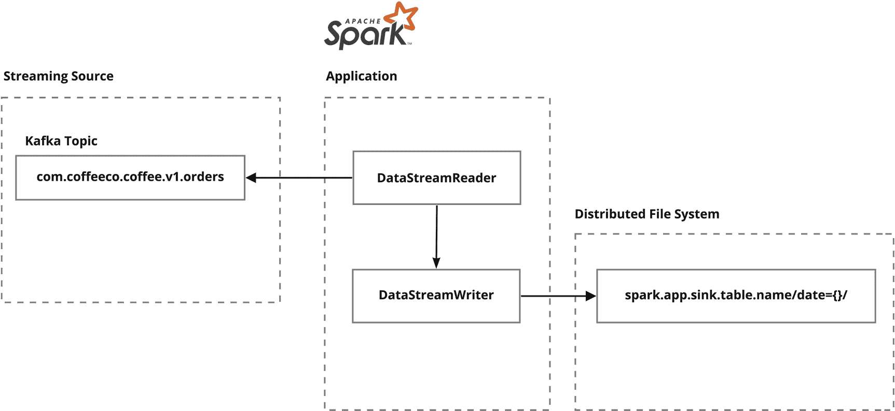
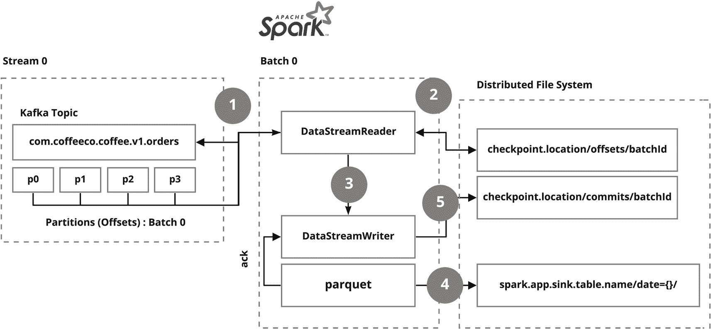

# 11. Apache Kafka 与 Spark Structured Streaming

上一章介绍了如何使用 Apache Spark Structured Streaming。你了解了如何使用流行的 Redis 数据库来创建结构化的内存事件流，并探讨了如何编写有状态的流式应用程序。

本章将扩展上一章学到的技能，包括：如何使用核心的 Structured Streaming API——`DataStreamReader` 和 `DataStreamWriter`；如何利用应用程序检查点创建能够处理容错和重启的有状态流式应用；如何使用触发器控制应用处理频率和运行风格；以及最后，有状态流和有状态批处理中应用的流程如何工作。你将通过重点学习如何使用 Apache Kafka 作为 Spark 与其余数据生态系统之间的管道，继续探索 Structured Streaming 的工作原理。

## Apache Kafka 简介

Apache Kafka 在第 1 章中介绍过，它是当今应用最广泛的事件和数据流处理框架。Kafka 在数据工程生态系统中的主导地位与其提供的稳定功能有关。它介入并解决了与分布式系统和服务间通信相关的常见问题。

### 异步通信

API 及其他 HTTP 服务要求所有依赖的系统和服务均处于运行状态，才能以同步方式处理请求。后端服务通常会实现不同级别的重试机制，以便在遇到无响应的系统或服务时进行退避，并在多次尝试后放弃并向调用方返回错误。第 9 章介绍了“惊群效应”问题以及资源稀缺如何在进程争相弥补损失时间时引发麻烦。Kafka 能够使（可处理异步请求的）系统摆脱传统的请求/响应周期，转变为一种新的模式：可以查询请求标识符以获取完成状态，或者通过使用 webhook 或回调来通知该 API 请求所封装操作的最终成功或失败状态。

### 水平可扩展性

Kafka 能够高效处理因主题（用于存储一组相关事件/类型的持久化存储机制）的消费者（读取者）、生产者（写入者）或两者数量增加而给系统带来的常见负载问题。其实现方式是支持集群中服务器数量向外扩展（水平扩展），而非单纯扩展服务器本身的规模（CPU/内存/磁盘）。

与可能因单台服务器资源有限而饱受过多连接困扰的传统数据库不同，Kafka 的代理节点可以横向扩展，从而整体提升整个集群的吞吐能力。

代理节点是一种服务器端（集群成员）服务，负责处理集群中所有分布式请求的一部分。每个代理节点都被分配并负责一个或多个分布式主题分区（数据文件）的一部分，其角色可以是分区领导者（分区的主要所有者），也可以是副本（当前领导者分区的冗余备份）。通过增加代理节点数量，可以在集群中更均匀地分担读取、写入或冗余恢复等更高负载。这使得平台能够扩展以满足主题的数据需求，同时也能管理分布式系统在可用性和一致性方面带来的各种问题。

### 高服务可用性与一致性

你在第 1 章中了解了 CAP 定理，鉴于 Kafka 是一个分布式、网络连接的服务，一致性、可用性和网络分区容错性问题至关重要。该定理指出，为了维持分布式一致性，服务在处理网络分区（集群中的盲点）时无法保持完全可用。因此，Kafka 在主题内部使用分区复制来实现高可用性和一致性。为确保在担任分区领导者的代理节点（服务器）离线（或服务器关机/宕机）时，有不止一个完整的同步副本（ISR）可用于冗余，每次写入都会持久化地写入预写日志并向写入者（生产者）确认。Kafka 集群可以利用 ISR 协议来可靠地选择丢失分区的下一个可用 ISR（冗余副本），并将该代理节点提升为新的主题分区领导者。每当代理节点离线时，此循环就会重复，以在最大程度上减少对给定主题的消费者和生产者的影响，恢复主题的一致性和可用性。

与 Kafka 将主题内容分布到多个分区的方式相同，代理节点本身也可用于在节点之间传播主题级别的命令。例如，为了以零停机方式增加主题的分区数量，可以使用任何代理节点来进行消息传播（类似流言协议）。主题级别的配置也可以在实时、零停机的情况下进行调整，以应对因生成的有效负载（事件）规模增大而导致的数据需求增加，或因生产和消费的记录数量增长而带来的需求变化。为何要进行横向扩展？这个概念让我们回到大数定律。所有系统在单进程内需要处理的负载越大，速度就会越慢。因此，拆分主题的分区（例如，增加封装整个主题的分区数量）是应对大数据系统规模需求的一种方式。

### 灾难恢复

通过允许应用程序从更早的时间点重放事件（数据），系统和服务可以应对一定的停机或服务中断情况，并从原本可能导致数据丢失的场景中恢复过来。这对于数据管道尤为重要，因为丢失一个事件就等于数据丢失，而具有恢复选项的降级服务最终仍能达到最终一致性。

### 事件流与数据管道生态系统

Apache Kafka 解决了一个类似于*数据湖*（在第 1 章中介绍）的问题。请记住，数据湖为来自整个组织的原始、未处理数据提供了一个统一、弹性可扩展的单一真实来源，它充当一个中心化暂存区域，以便数据可以在稍后时间点被可靠地重新读取、重新处理和转换为可用数据。这个中心化数据暂存区域解决了一个与数据管道以及过早进行有损数据转换有关的问题。如果你无法追溯到事件的原始真实来源，那么损坏的数据就会简单地向下游流动。

另一方面，Apache Kafka 提供了一个统一的事件流解决方案，它将事件数据组织成*主题*，其作用类似于支撑数据湖的分区式分布式文件系统。主题支持构建由编码二进制数据组成的数据管道，这些管道可以被接入以生成丰富的数据网络。数据湖与 Kafka 之间的关键区别在于时间，特别是最小化数据生成（写入主题）与数据可被下游消费（读取）之间的时间差。

Kafka 使连接的客户端能够在分配给某个主题的服务器端代理节点组（仲裁）提交并确认收到来自已连接数据生产者发布的事件（记录）后，立即（近实时地）消费数据。连接的客户端只需按预定时间间隔轮询一个主题，以记录（事件）集合的形式获取任何新数据。Kafka 有意最小化事件创建与事件可被处理之间的时间差（增量），这对于实时事件流处理以及实时数据处理至关重要。

在本章中，你将会学习以下内容：

- 使用 Docker 配置并运行一个 Kafka 集群
- 创建和修改 Kafka 主题
- 连接并配置 Spark Kafka 库
- 使用 Kafka 数据源
- 将来自 Kafka 的二进制数据转换为 DataFrame 和数据集
- 使用 Kafka 数据接收器

`练习材料`

第 11 章的练习材料位于 `https://github.com/newfront/spark-moderndataengineering/tree/main/ch-11`。每个练习中的 `README` 文件将为你提供有关任何额外安装或注意事项的更多背景信息。

## 章节练习

以下练习将帮助你继续探索 Spark 结构化流框架的特性与功能。首先，你将使用 `docker-compose` 在本地启动 Kafka。在深入探讨如何充分利用 Kafka 丰富流生态系统的模式之前，这也是一个熟悉 Kafka 各种架构组件运行原理的机会。

## 练习 11-1：启动并运行 Apache Kafka

打开章节材料，导航至名为 `ch-11` 的目录，开始进行练习。

### 练习 11-1：材料

练习材料位于 `ch-11` 目录下。

```
ch-11

├── docker

│   └── kafka

│       ├── README.md

│       └── docker-compose.yaml

└── exercises

    └── 01_kafka_up_and_running
```

### 启动本地环境

使用 `docker/kafka` 目录下提供的 `docker-compose` 文件开始操作。按照 `README.md` 文件中的步骤，将 Kafka 纳入你的数据工程工具箱。现在，你可以使用 `docker compose` 命令启动一个完整的 Kafka 集群，运行 Zookeeper（有状态元数据存储）和三个 Kafka 代理。

```bash
docker compose \
  -f ~/dataengineering/kafka/docker-compose.yaml \
  up -d --remove-orphans
```

`docker-compose` 文件配置了一个功能完整的 Kafka 集群（使用前几章的 `mde` Docker 网络），从而允许从你的笔记本电脑和 Docker 运行时内部进行访问。现在，你可以从你的 Spark 应用程序连接到该 Kafka 集群。

运行 Kafka 集群的容器可以使用以下 `docker ps` 命令查看。这将过滤出名字匹配 `kafka_` 前缀的运行中容器。

```bash
docker ps \
  --filter "name=kafka_*" \
  --filter "network=mde" \
  --format "table {{.Names}}\t{{.Mounts}}\t{{.Networks}}" \
  -s
```

输出将显示运行你全新 Kafka 集群的四个容器。

```
NAMES               MOUNTS              NETWORKS
kafka_kafka-2_1     kafka_kafka_2_...   mde
kafka_kafka-1_1     kafka_kafka_1_...   mde
kafka_kafka-0_1     kafka_kafka_0_...   mde
kafka_zookeeper_1   kafka_zookeepe...   mde
```

三个容器代表集群代理，第四个容器是 Apache Zookeeper。Zookeeper 负责存储 Kafka 集群元数据（状态），包括代理标识符、分区领导者以及每个主题在集群中的副本位置。接下来你将了解更多关于主题如何工作的信息，并创建你的第一个主题。

### 创建你的第一个Kafka主题

现在你的 Kafka 集群已经启动并运行，你可以创建你的第一个主题了，但在创建之前，让我们先了解一些与 Kafka 主题相关的更多特性或行为。然后你就可以开始创建你的第一个主题了。

#### 主题的行为方式

从高层次来看，主题的行为类似于数据库中的表，但更像是一个分布式提交日志，用于存储结构化的键/值对记录。

从 Spark 的角度来看，基于键/值的 Kafka 记录的一般结构如列表 11-1 所示。Kafka 记录（`StructType`）的格式至少包含一个名为 `value` 的列，该列在静态存储时被编码为字节数组（二进制），以及数据被读取的 `topic`、记录静态所在的分区 `partition`，以及单个记录的 `offset`（可以将其视为指向主题分区内行位置的指针）。

```
root
 |-- key 
 |-- value 
 |-- topic 
 |-- partition 
 |-- offset 
 |-- timestamp 
 |-- timestampType 
 |-- headers >

列表 11-1
Kafka 记录结构数据格式
```

Kafka 记录被分片（或简单地分布）在关联主题的总分区数上。由于记录键列对每条 Kafka 记录是可选的，对于空键的默认分区机制是以轮询方式插入记录，这意味着每条生产记录的最终分区分配是非确定性的。这最终意味着在相同数据集上重复运行时，数据无法保证落在相同的分区上。然而，通过为每个记录键提供一个非空值，Kafka 将使用提供的键作为分区机制（哈希分区），使得每条记录能够确定性地路由到给定主题的特定分区。

**提示**

对于事件流，事件数据要么依赖于流中的其他事件来讲述发生了什么（或正在发生什么），要么每个事件可以独立存在，自行讲述完整的故事。第 9 章介绍了相互依赖和独立事件数据的概念，你可以利用 Kafka 来优化事件在每个主题分区内的发出方式，从而针对相互依赖或独立事件的用例进行优化。

我们已经确定主题是一种集合机制，它像导管或通道一样用于事件流，但我们尚未涵盖是什么让 Kafka 如此出色。每条已发布的记录在插入时都会被打上代理端的时间戳（以毫秒为单位），并且仅在成功写入（提交）后才得到确认。伴随确认而来的保证是，主题将在逐个分区的基础上维护时间同步的插入顺序，本质上是为你提供一组按插入时间排序的记录。

由于插入顺序的保证仅在分区级别上，这使得 Kafka 能够在一个非分布式的、隔离的主题子集上管理其他情况下复杂的分布式插入排序任务。基于分区的主题架构，在较低层面上，实际上更像是一个分布式文件系统，并且像任何文件系统一样，独立的 Kafka 不会强制为记录中的每个值应用显式的记录模式。

通过移除模式强制，Kafka 主题可以变得非常灵活，但灵活性也带来了可能意外将损坏或错误的数据流向下游的风险。因此，一种常见的做法是为每个主题关联一个特定的、二进制编码的事件类型（或多个类型）。

#### 创建 Kafka 主题

可以使用 Kafka 附带的 admin shell 脚本来创建主题。执行列表 11-2 中的命令来创建你的第一个主题。

```bash
docker exec \
  -it kafka_kafka-0_1 \
  /opt/bitnami/kafka/bin/kafka-topics.sh \
  --create \
  --if-not-exists \
  --topic com.coffeeco.coffee.v1.orders \
  --bootstrap-server kafka_0:9092,kafka_1:9092,kafka_2:9092 \
  --partitions 4 \
  --replication-factor 2

列表 11-2
使用 Kafka 开箱即用的命令行工具创建 Kafka 主题
```

运行该命令的结果是创建一个名为 `com.coffeeco.coffee.v1.orders` 的新 Kafka 主题。该主题将在集群中有条件地创建（`if-not-exists`），并配置有四个分区。为了提高可用性，每个主题分区都被复制两次。你将在下一节中了解有关修改主题的更多信息。

**可选**

既然你已经创建了第一个主题，我猜你一定想继续对它进行更多操作。你可以随意跳到练习 11-2。你随时可以回到这里，了解更多关于 Kafka 如何处理主题管理和安全性的信息。

### Kafka 主题管理

管理 Kafka 主题归根结底就是理解系统行为以及学会使用 Kafka 附带的 admin 工具。本节将向你介绍一些操作 Kafka 所需的常用命令和必要技能。

#### 列出 Kafka 主题

列出集群中可用的主题是发现主题的关键。您可以通过在 `kafka-topics.sh` 脚本上使用 `--list` 操作来实现，如清单 11-3 所示。

```bash
docker exec \
  -it kafka_kafka-0_1 \
  /opt/bitnami/kafka/bin/kafka-topics.sh \
  --list \
  --bootstrap-server kafka_0:9092,kafka_1:9092,kafka_2:9092

清单 11-3
列出 Kafka 主题返回一个简单的主题列表
```

`list` 操作将打印集群中所有可用主题的名称。

#### 描述一个主题

不时检查与给定主题相关的元数据是很有帮助的。这有助于调试您在将 Kafka 作为日常职责的一部分进行运维时，不可避免地会遇到的问题。执行清单 11-4 中的命令将返回与分区相关的元数据以及每个代理所扮演的角色，从而维护主题的一致性和可用性。

```bash
docker exec \
  -it kafka_kafka-0_1 \
  /opt/bitnami/kafka/bin/kafka-topics.sh \
  --describe \
  --topic com.coffeeco.coffee.v1.orders \
  --bootstrap-server kafka_0:9092,kafka_1:9092,kafka_2:9092

清单 11-4
描述一个主题
```

`describe` 命令的输出与下面显示的输出会略有不同，因为您的集群会有不同的指定主题领导者和分区副本位置。以下是我环境中的修改后的输出：

```
Topic: com.coffeeco.coffee.v1.orders
TopicId: eENgTy01QUWOAe2gJzi_rw
PartitionCount: 4
ReplicationFactor: 2
Configs: segment.bytes=1073741824
```

## Topic: com.coffeeco.coffee.v1.orders

Partition: 0    Leader: 2    Replicas: 2,1    Isr: 1,2

Partition: 1    Leader: 1    Replicas: 1,0    Isr: 1,0

Partition: 2    Leader: 0    Replicas: 0,2    Isr: 0,2

Partition: 3    Leader: 2    Replicas: 2,0    Isr: 0,2

`describe` 命令的元数据揭示了每个分区是如何分布在这三个代理上的。代理 ID 分别为 0、1 和 2。您可以看到，对于每个分区，都有一个领导者负责存储该分区的一份副本，以及一个与领导者同步的副本。这种能力允许分区领导者丢失，而由同步中的副本无缝地接管成为新的领导者。

## 修改一个主题

Kafka 主题的配置并非一次性设置后就置之不理。在大多数情况下，初始配置仅是对给定主题所需总分区数和条件配置需求的预估。幸运的是，动态修改（或更改）主题是可行的，而不会中断连接到该主题的客户端。

您可以通过增加被视为健康所需的最小主题副本数来修改之前创建的主题，以提高其一致性和可用性或整体容错能力。`min.insync.replicas` 的默认值是 `1`，我们将把它增加到 `2`。

## 更改主题配置

要在初始创建后修改主题，您可以使用 `kafka-configs.sh` 脚本来添加或删除（移除）主题的配置属性。执行清单 11-5 中的命令来更改最小同步主题副本数。

```bash
docker exec \
-it kafka_kafka-0_1 \
/opt/bitnami/kafka/bin/kafka-configs.sh \
--alter \
--bootstrap-server kafka_0:9092,kafka_1:9092,kafka_2:9092 \
--entity-type topics \
--entity-name com.coffeeco.coffee.v1.orders \
--add-config min.insync.replicas=2
```

清单 11-5 修改现有主题的配置

重新配置您的主题后，每个分区现在需要两个同步副本。您能看到这里可能存在的问题吗？也许与主题复制因子有关？如果一个代理丢失（离线/无法访问/宕机），集群将承受额外的压力，因为可用的代理需要为分配给丢失代理的任何主题的分区恢复丢失的分区。二级代理需要复制丢失的主题分区，以恢复到与这些分区的领导者同步（一致）的状态。这可能导致大量的文件传输，从而增加整个集群的网络 IO 和 CPU 负载，并降低受影响主题的可用性。这进而可能导致写入该主题的生产者在恢复一致、可用状态时进行客户端退避。

为了确保您的集群能够处理代理丢失，您可以将主题的复制因子从 `2` 改为 `3`。这样，您就可以处理单个代理丢失的情况，而无需手忙脚乱。在创建主题时，通过添加 `--replication-factor 3` 来执行此操作更容易，而不是像您接下来要做的那样使用手动副本分配。

## 增加主题分区副本

为了确保在丢失一个代理时，您的集群仍能保持健康，并且至少拥有两个同步副本，您需要创建一个副本重新分配 JSON 文件。可以使用 `describe topic` 命令中的信息来生成此文件。只需获取当前分配，并在 `replicas` 数组中添加另一个代理 ID。这将作为 Kafka 的模板，用于将主题的复制因子从 `2` 增加到 `3`。清单 11-6 中的示例展示了副本重新分配的 JSON 格式。

```json
{
    "version": 1,
    "partitions": [
        {
            "topic": "com.coffeeco.coffee.v1.orders",
            "partition": 0,
            "replicas": [2,1,0]
        },
        {
            "topic": "com.coffeeco.coffee.v1.orders",
            "partition": 1,
            "replicas": [1,0,2]
        },
        {
            "topic": "com.coffeeco.coffee.v1.orders",
            "partition": 2,
            "replicas": [0,2,1]
        },
        {
            "topic": "com.coffeeco.coffee.v1.orders",
            "partition": 3,
            "replicas": [2, 0, 1]
        }
    ]
}
```

清单 11-6 Kafka 主题副本重分配（`replication-reassignments.json`）文件格式

有了这个副本文件，您需要将其复制到您的某个 Kafka 代理中，以便能够从该代理运行 `kafka-reassign-partitions.sh` 脚本。复制命令如清单 11-7 所示。

```bash
docker cp \
./exercises/01_kafka_up_and_running/replication-reassignments.json \
kafka_kafka-0_1:/opt/replication-reassignments.json
```

清单 11-7 用于将 `replication-reassignments.json` 上传到 Kafka 代理的 Docker 复制命令

现在代理上有了 `replication-reassignments.json` 文件，您就可以运行重新分配分区的脚本了。使用您上传 `replication-reassignments.json` 文件的同一个代理，并执行清单 11-8 中的命令。

```bash
docker exec \
-it kafka_kafka-0_1 \
/opt/bitnami/kafka/bin/kafka-reassign-partitions.sh \
--bootstrap-server kafka_0:9092,kafka_1:9092,kafka_2:9092 \
--reassignment-json-file /opt/replication-reassignments.json \
--execute
```

清单 11-8 运行 `kafka-reassign-partitions.sh` 脚本以增加主题复制

作为运行副本重新分配的结果，您现在可以处理 Kafka 集群中丢失一个代理的情况，而不会对集群的行为造成重大中断。在非生产场景中，有时简单地删除主题并从头开始更容易，但理解如何修改主题的行为可以帮助您学会务实地解决问题。

> **提示**：分区重新分配的另一个用例是 Kafka 代理倾斜的情况。这种情况出现在一个或多个代理因承载了某个主题的过多分区而过载时。这可能会减慢连接到该代理（作为其主题分区的领导者）的生产者和消费者，因为更多的数据和更多的连接不均衡地分布在代理之间。

# 截断主题

Kafka 中的主题（Topic）只会保留达到配置保留毫秒数的记录。了解这一点后，你可以通过修改主题配置来截断（清除所有记录）一个主题。你需要先缩短主题（记录）的保留期限，这样 Kafka 才会开始清理主题记录。等待一两分钟后，Kafka 不会立即删除这些记录，因此只需为你的主题重新添加一个合理的保留期限（常见为一天或七天）。

## 缩短主题保留期限

第一步使用 `--alter` 命令，将主题的 `retention.ms` 值设置为 1 秒（1000 毫秒）。执行`清单 11-9` 中的命令来修改主题保留期限。

```
docker exec -it kafka_kafka-0_1 \
/opt/bitnami/kafka/bin/kafka-configs.sh \
--bootstrap-server kafka_0:9092,kafka_1:9092,kafka_2:9092 \
--entity-type topics \
--alter \
--entity-name com.coffeeco.coffee.v1.orders \
--add-config retention.ms=1000
```
`清单 11-9` 截断 Kafka 主题以清除所有记录

现在主题正在被清理，等待一两分钟，然后恢复主题的保留期限。

## 增加主题保留期限

既然主题已经清理完毕（假设你已经等待了一段时间），现在你可以将主题保留配置改回一天的保留期限（参见`清单 11-10`）。

```
docker exec -it kafka_kafka-0_1 \
/opt/bitnami/kafka/bin/kafka-configs.sh \
--bootstrap-server kafka_0:9092,kafka_1:9092,kafka_2:9092 \
--entity-type topics \
--alter \
--entity-name com.coffeeco.coffee.v1.orders \
--add-config retention.ms=86400000
```
`清单 11-10` 为 Kafka 主题添加一天的保留期限

当你需要清除主题内的所有记录时，可以使用此技术。在练习 11-2 中创建 `CoffeeOrder` 生成器后，你可能想在测试完毕后清理该主题。这也可以用于测试 Kafka 的不同故障模式。

# 删除 Kafka 主题

Kafka 主题只应在两种情况下被删除。第一种原因是主题已终止生命周期，且没有生产者和消费者使用该主题。第二种原因是你在非生产环境中，并且没有其他团队（或服务）依赖此主题。事实上，Kafka 代理默认配置为不允许删除主题。这是因为意外删除主题可能对依赖流数据源访问的数据管道网络造成灾难性影响。

在强调完这些限制和警告之后，你可以通过执行清单 11-11 中的 `delete` 命令来测试删除你的主题。

```
docker exec \
-it kafka_kafka-0_1 \
/opt/bitnami/kafka/bin/kafka-topics.sh \
--delete \
--topic com.coffeeco.coffee.v1.orders \
--bootstrap-server kafka_0:9092,kafka_1:9092,kafka_2:9092
```

清单 11-11
可以使用 `kafka-topics.sh` 来删除 Kafka 主题

`delete` 命令会执行软删除（仅在 Zookeeper 中标记），除非 Kafka 代理配置了 `delete.topic.enable=true`。你可以通过更新用于启动集群的 `docker-compose.yaml` 文件，将你的 Kafka 集群修改为使用此危险配置。找到 Kafka 代理的环境配置部分，并添加清单 11-12 中的环境变量。

```yaml
services:
  kafka-0:
    environment:
      ...
      - KAFKA_CFG_DELETE_TOPIC_ENABLE=true
```

清单 11-12
在 Kafka 代理上使用 `delete.topic.enable=true` 标志启用主题删除功能

这个例子展示了如何为三个代理中的一个修改 `docker-compose.yaml` 文件中的代理配置。你可以修改其他两个代理配置，然后重启你的 Kafka 集群以使这些更改生效。现在你可以执行不可逆的删除操作，但这并不推荐。

# 保护对主题的访问

[保护对 Kafka 的访问](https://kafka.apache.org/documentation/%2523security)以及相关的集群元数据、主题和底层物理数据似乎是理所当然的事情。然而，就像生活中的许多事情一样，安全有时会被遗漏，成为待解决的问题。简而言之，有几种方法可以保护对 Kafka 集群的访问，从基本的防火墙规则开始，到访问控制列表（ACL），最后使用 SSL/TLS 实现全加密的端到端传输。

## 防火墙规则

防火墙规则使用 Linux 风格的 [iptables](https://en.wikipedia.org/wiki/Iptables) 或安全的基于云的访问，在托管中心或虚拟私有云（VPC）内的主机之间建立点对点连接。这包括 AWS 安全组，它管理跨 IP 地址和开放端口之间的入站和出站连接及数据传输。这相当于在夜间锁好你的门。它可以防止恶意行为者进入你的系统，除非他们找到撬锁的方法。

## 访问控制列表

Apache Kafka 自带了一个名为 [Authorizer](https://kafka.apache.org/documentation/%2523security_authz) 的、开箱即用的 ACL 实现。它可用于在防火墙规则之外，使用访问控制列表（ACL）进一步保护 Kafka。默认情况下，ACL 规则存储在 Zookeeper 中。ACL 用于授权和管理用户（称为主体）对一个或多个主题或集群本身的操作访问。Kafka 中的 ACL 类似于 SQL 数据控制语言（DCL），用于授予特定的基于集群的操作集合，限制读取、写入、更新和删除能力。

启用 ACL 需要在每个代理上进行操作，这可以通过 `docker-compose.yaml` 完成。就像启用主题删除一样，你可以从环境配置中打开 Authorizer（如清单 11-13 所示）。

```yaml
services:
  kafka-0:
    environment:
      ...
      - KAFKA_CFG_AUTHORIZER_CLASS_NAME=kafka.security.authorizer.AclAuthorizer
```

清单 11-13
启用代理 ACL

一旦 Authorizer 被打开（这需要重启每个代理），你就可以使用 Kafka 命令行添加 ACL。执行清单 11-14 中的命令，为你的主题添加基于用户的访问控制。

```
docker exec -it kafka_kafka-0_1 \
/opt/bitnami/kafka/bin/kafka-acls.sh \
--bootstrap-server :9092 \
--add \
--allow-principal User:dataengineering \
--operation read \
--operation write \
--topic com.coffeeco.coffee.v1.orders
```

清单 11-14
为 Kafka 主题级别的授权添加 ACL

防火墙规则配合维护良好的 ACL，可以大大加强你的 Kafka 集群的安全性。如果对系统范围的访问进行审查以保持规范性，并且不向不安全的客户端软件授予管理超级用户或“上帝模式”访问权限，那么你应该能够顺利运行。

## 使用双向 TLS 的端到端加密

Apache Kafka 支持端到端的 SSL/TLS 加密，以处理传输中的加密数据。这需要一个共享证书和私钥对，可以在 SSL/TLS 握手期间进行验证，以确保来自连接两端（客户端或服务器）的数据流免受恶意行为者的侵害。

### 练习 11-1：总结

在第一个练习中，你了解了运行本地 Kafka 集群的方方面面。本练习旨在介绍 Kafka 本身的术语和组件，并让你熟悉和掌握操作 Kafka 集群的方法。虽然我们仅仅触及了各种代理配置、管理/实用命令行操作以及常规安全加固的皮毛，但现在你已经拥有了一个可用的 Kafka 集群，可以与 Structured Streaming 结合使用。

在下一个练习中，你将学习如何在 Apache Spark 内部使用二进制结构化数据（protobuf）来生产和消费数据，这是对上一章从 Redis Streams 读取 `OrderEvent` 数据的后续练习。

## 练习 11-2：使用 Spark 生成二进制可序列化事件数据并发布到 Kafka

在本练习中，你将学习如何在 Apache Spark 内部生成二进制序列化的结构化数据。对于专注于与数据平台生态系统之外的系统进行互操作的数据工程师来说，这是一项基本技能。你在第 9 章中了解了如何设计更具弹性的数据系统，并了解到数据在通过各种 API 网关发出之前，通常会被编码为二进制 Avro 或 Protobuf 格式。这种技术有助于减少带宽开销（由于传输二进制数据），并且网关作为路由事件数据（负载）到各个 Kafka 主题的安全且受控的途径。这一简单的操作使得下游消费者能够在数据进入数据网络时可靠地获取原始事件数据，因为他们知道已经完成了一些检查与平衡（即初始授权和数据验证）。

### 练习 11-2：准备工作材料

本练习包含一个 Spark 应用程序以及用于运行该应用程序的 Docker 环境。

```
ch-11
├── applications
│   └── spark-kafka-coffee-orders
└── exercises
    └── 02_binary_serialization_in_spark
```

在本练习中，你将学习编写一个可以生成任意数量 `CoffeeOrders` 的事件生成器，这些订单将使用 Google 的 Protocol Buffers（protobuf）进行编码。我们首先查看 `CoffeeOrder` protobuf 定义，然后进入生成器部分。本练习的最后，你将运行生成器，同时使用 Kafka 的简单控制台消费者来观察数据到达情况。本练习展示了使用 Apache Spark 进行事件生产与事件消费之间的区别。

### CoffeeOrder 事件格式

`CoffeeOrder` protobuf 定义看起来可能很熟悉。它本质上是在第 10 章中用于从 `com:coffeeco:coffee:v1:orders` 读取数据的 `StructType`。

`CoffeeOrder` protobuf 定义如代码清单 11-15 所示。

```protobuf
message CoffeeOrder {
  uint64 timestamp  = 1;
  string order_id   = 2;
  string store_id   = 3;
  string customer_id = 4;
  uint32 num_items  = 5;
  float  price      = 6;
}
```

代码清单 11-15
CoffeeOrder Protobuf 数据定义

`CoffeeOrder` 消息提供了跟踪 CoffeeCo 咖啡订单所需的所有事件信息。这设置了 protobuf 记录所表示的底层二进制数据结构。Apache Spark DataSource API 与 Apache Kafka 之间的互操作需要三个步骤：

1.  你需要使用 `scalapbc` 编译器将 protobuf 数据定义编译成 Scala 样例类。
2.  你需要在 `build.sbt` 应用程序中包含 `scalapb-spark` ScalaPB Spark 库。该库提供了互操作类，用于处理 protobuf 原生二进制格式与 Spark 原生二进制格式（Catalyst Rows）之间的转换。
3.  你需要包含名为 `spark-sql-kafka-0-10` 的 Apache Kafka Spark SQL 库。

在构建 `CoffeeOrder` 事件生成器时，我们将逐步完成这三个步骤。

### 编译 Protobuf 消息

接下来，让我们编译 protobuf。这可以使用独立的 [ScalaPB](https://scalapb.github.io/docs/scalapbc/) 编译器来完成。编译器的位置可以添加到你的 `PATH` 环境变量中，或者作为一个简单的环境变量导出，例如命名为 `SCALAPBC`。

提示

在 protobuf 目录的 `README` 文件中有一组更详细的说明，包括如何下载和链接独立的 ScalaPB 编译器。请查看 `/ch-11/applications/spark-kafka-coffee-orders/data/protobuf/README.md` 目录。

编译命令如代码清单 11-16 所示。编译器使用输入路径 `--proto_path`（这是存放 protobuf 定义文件的目录）和输出路径 `--scala_out`（这是你希望放置编译后 Scala 代码的目录）。以 `/ch-11/applications/spark-kafka-coffee-orders` 作为工作目录，执行代码清单 11-16 中的命令。

```
$SCALAPBC/bin/scalapbc -v3.11.1 \

  --proto_path=./data/protobuf/ \

  --scala_out=./src/main/scala \

  coffee.common.proto
```

代码清单 11-16

编译 `CoffeeOrder` Protobuf

编译器将解析名为 `coffee.common.proto` 的文件，并生成 Scala 样例类，以及在每个类实例的内部 JVM 对象表示与二进制 protobuf（线格式）表示之间进行转换所需的反序列化器和序列化器。由于 protobuf 可以跨平台编译，相同的 `coffee.common.proto` 文件可以使用特定语言的编译器进行编译，以实现 Node.js、Python、C++、Go、Scala、Java 等众多语言之间的互操作性。

注意

在第 9 章中，你学习了 GRPC，以及该框架如何通过使用通用的二进制数据协议（即 Google Protocol Buffers (protobuf)）实现跨语言互操作性。这些二进制消息与所有 gRPC 组件原生互通。对于已经采用 gRPC 技术栈的公司来说，说服他们使用相同的技术支持数据传输系统和摄取服务并非难事。如果有丰富的结构化数据能够进入 Kafka 主题和其他数据流，那么每个人都将受益。

生成了 Scala 类之后，我们可以进入练习的核心部分，学习如何将 Kafka 用作 Apache Spark 的传输工具。你将使用 Spark 作为事件生成的通道，并使用 Kafka DataFrameWriter 写入这些记录。由于我们需要生产数据才能消费数据，我们将先完成这个过程，然后在练习 11-3 中再转向消费这些记录。

### Protobuf 消息与 Spark 和 Kafka 的互操作性

在上一章中，你学会了使用 Redis 命令行生成新的咖啡订单。你将构建一个 `CoffeeOrder` 生成器来处理生成随机订单并编码这些记录的过程，然后将它们发布到新的 Kafka 主题。你很可能没有多少手动编码二进制数据的经验。这不是大多数人需要做的事情，因此你可以借助一些简单的代码来完成这项工作。

生成器是数据工具箱中一个有用的工具，它可以用于多种目的，从生成压力测试和发现性能瓶颈，到生成好数据和坏数据以理解应用程序行为，甚至帮助复现事件或调查期间暴露的 bug。

#### 添加 `Protobuf` 和 `Kafka` Spark 依赖项

在你喜欢的 IDE 中打开名为 `spark-kafka-coffee-orders` 的应用。该应用的设置方式与第 7 章和第 10 章中的应用相同，因此在你学习旅程的这个阶段，其布局应该开始显得熟悉。

在本节前面，我提到使用 protobuf 需要三步流程。第一步是编译消息定义，第二步包含名为 `sparksql-scalapb` 的 Spark 扩展库，第三步包含 `spark-sql-kafka` 库依赖项。打开应用目录根目录下的 `build.sbt`，你还会看到这些 Spark 依赖项被包含在 `libraryDependencies` 中。

```
"org.apache.spark" %% "spark-sql-kafka-0-10" % sparkVersion
"com.thesamet.scalapb" %% "sparksql-scalapb" % scalaPbVersion
```

清单 11-17  
额外的应用库依赖项，用于实现 Protobuf 与 Apache Spark 的互操作性，并支持读写 Apache Kafka

在 `build.sbt` 的底部，你会看到应用 `sbt` 中的两个新代码块。这两个代码块是 `assemblyMergeStrategy` 和 `assemblyShadeRules`。

#### 逃离 JAR 地狱

在构建 Spark 应用时，你有时会发现自己陷入了所谓的 JAR 地狱。这实际上是一个试图弄清楚应用为何无法编译的循环过程。为了解决不同库依赖项之间的冲突，你可以借助合并策略（如清单 11-18 所示）来控制 JAR 的构建方式、添加哪些类文件，以及哪些文件会被去重、删除或重命名。

```
assembly / assemblyMergeStrategy := {
  ...
  case _ =>
    MergeStrategy.deduplicate
}
```

清单 11-18  
合并规则包括在构建胖 JAR 时选择如何解决冲突的能力。

合并几乎能让你完全脱离 JAR 地狱；然而，有时会出现你无法控制的问题，这时阴影化就派上了用场。

以 Apache Spark 为例。当运行 Spark 应用时，已经有一个正在运行的进程（其实就是 Spark），它包含自己的类依赖项。由于这些类在 Spark 启动时被加载，你的应用依赖项有可能被覆盖，因为你的应用是加载到 Spark 运行时中的。你可以使用阴影化过程（如清单 11-19 所示）通过重命名冲突类来解决类版本冲突的问题。这反过来将解决运行时问题。`NoClassDefFoundError` 问题是需要警惕的众多警告信号之一，它源于应用类路径中的冲突。

```
assembly / assemblyShadeRules := Seq(
  ShadeRule.rename("com.google.protobuf.**" -> "shadeproto.@1").inAll,
  ShadeRule.rename("scala.collection.compat.**" -> "scalacompat.@1").inAll
)
```

清单 11-19  
阴影化可用于重命名那些可能在运行时引入冲突的类。

当结合使用时，这两种技术共同确保你的 Spark 应用能够顺利部署，避免 JAR 地狱带来的麻烦。现在，你可以继续学习生成器。

#### 编写 `CoffeeOrderGenerator`

本章材料中生成器的包提供了一个可正常工作的 `CoffeeOrderGenerator` 实现。本质上，生成器需要完成三件事才算成功。生成器需要：

1.  生成一个或多个 `CoffeeOrder` 事件的序列。
2.  以 Spark 能理解的格式对序列事件进行编码。
3.  连接到 Kafka 并将事件写入一个主题。

打开名为 `CoffeeOrderGenerator.scala` 的文件。这个单例类扩展了本书前面介绍的 `SparkApplication` 特质，使我们能够为这个新的 Spark 应用创建一个入口点。事实上，我们将复用它的一些应用辅助功能，从而让应用也能生成 `SparkConf` 和 `SparkSession`。这意味着应用唯一需要做的就是遵循前面三个步骤。查看生成器的基本接口（如清单 11-20 所示），你会发现内容并不多。

```
object CoffeeOrderGenerator extends SparkApplication {
...
```

## CoffeeOrderGenerator 核心接口与功能

def generateCoffeeOrder(

from: Instant,

to: Instant,

totalRecords: Int = TotalRecords,

indexOffset: Int = IndexOffset): Seq[CoffeeOrder]

override def run(): Unit

}

清单 11-20  
`CoffeeOrderGenerator` 的核心接口

`generateCoffeeOrder` 方法是生成器的核心（见清单 11-21）。它负责生成实际的 `CoffeeOrder`。该方法参数提供了一种简单的方式来声明生成订单事件的时间窗口。使用 `from` 和 `to` 来指定窗口边界，生成的 `CoffeeOrders` 将分布在这个范围内。可以这样理解：“我想生成特定总数（`totalRecords`）的订单事件，这些事件分布在由 `from` 和 `to` 界定的时间范围内。”

```scala
def generateCoffeeOrder(...): Seq[CoffeeOrder] = {
  val random = new Random(totalRecords)
  val stepSize = (to.toEpochMilli - from.toEpochMilli)/1000
  (0 to totalRecords).map { index =>
    CoffeeOrder(
      from.plusMillis(index*stepSize).toEpochMilli,
      s"orderId${indexOffset+index+1}",
      s"store${random.nextInt(4)+1}",
      s"cust${random.nextInt(100)+1}",
      BoundRandom.nextInt(20)+1,
      BoundRandom.nextFloat()+1.0f
    )
  }
}
```

清单 11-21  
`CoffeeOrderGenerator` 的核心功能是创建任意数量的订单，并只需用户提供最少的可覆盖参数

清单 11-21 中的方法使用 `totalRecords` 的值作为随机数生成器的种子。这使得应用能够为特定的种子生成相同的伪随机数序列。这意味着如果 `totalRecords` 的值为 15，你可以两次生成相同的序列。

然后，该方法使用 `to` 和 `from` 值之间的秒数差作为 `stepSize`。`stepSize` 用于将生成的订单均匀分布在提供给该方法的时间范围内。你可以在 `Range` 迭代器（`0 to totalRecords`）内的 lambda 函数中看到这一点。每次迭代，都会使用循环索引、可选的索引偏移量以及随机数生成器（`random` 和 `BoundRandom`）生成一个新的 `CoffeeOrder`。

**注意：** 请注意，随机数也是限定范围的。例如，`random.nextInt(4)+1` 将选择一个介于 0（包含）和指定值（4，不包含）之间的随机数。

该方法返回一个 `Seq[CoffeeOrder]`。这满足了生成器的第一个要求（生成 `CoffeeOrder` 事件）。生成器本身在 `run` 方法中被调用。清单 11-22 展示了生成器是如何融入 `run` 方法的。

```scala
override def run(): Unit = {
  val until = LocalDateTime...
  val orders: Seq[CoffeeOrder] = CoffeeOrderGenerator
    .generateCoffeeOrder(
      from = until.minusHours(8).toInstant(ZoneOffset.UTC),
      to = until.toInstant(ZoneOffset.UTC))
  ...
}
```

代码清单 11-22  
`CoffeeOrderGenerator` 调用 `generateCoffeeOrder` 生成任意数量的 `CoffeeOrder`，这些订单可发送至 Kafka。

`run` 方法依赖 `TotalRecords` 配置来限制生成的订单数量。

```scala
lazy val TotalRecords = sparkConf.getInt("spark.data.generator.totalRecords", 10)
```

这个简单的配置让你能够控制应用运行时生成的咖啡订单数量。默认情况下，生成器设置为在八小时的时间窗口内创建记录，以当前时间（运行生成器时）的毫秒数作为结束时间。作为后续优化，你可以添加另一个值来修改时间窗口，甚至可以为特定时刻指定 `from` 和 `to` 的值。

生成订单序列后，`run` 方法使用 `SparkSession`（由 `SparkApplication` 特质提供）创建一个 `Dataset[CoffeeOrder]`（参见代码清单 11-23）。这正是 ScalaPB 库发挥魔力的地方。生成器顶部有一个特殊的 `import`，即 `import scalapb.spark.Implicits._`，这些 `implicit` 提供了在原生 protobuf 与 Spark 的 catalyst 行之间进行转换的互操作函数。

```scala
val orderEvents = sparkSession.createDataset[CoffeeOrder](orders)
  .map { order =>
    KafkaRecord(ByteString.copyFrom(order.orderId.getBytes),
      order.toByteString, KafkaTopic)
  }
```

代码清单 11-23  
在原生 protobuf 与 Spark 的 catalyst 引擎之间优雅地生成和转换 `CoffeeOrder`。

生成数据集后，立即执行 `map` 操作。`map` 函数用于遍历数据集中的每一行，并将每条记录转换为写入这些事件作为 Kafka 记录所需的二进制格式。`KafkaRecord` 是另一种 protobuf 消息类型，它与 `CoffeeOrder` 消息一起打包在 `coffee.common.proto` 中。

```protobuf
message KafkaRecord {
  bytes  key   = 1;
  bytes  value = 2;
  string topic = 3;
}
```

`KafkaRecord` 消息格式提供了 Kafka 生产流程的最后一块拼图，即必要的 API 契约，用于将序列化的 `CoffeeOrder` 导入 Kafka 生态系统。

> **注意**  
> 在幕后，Spark 正在执行一些繁重的工作。当在数据集上调用 `map` 时，每条记录的值会从本机内存（Tungsten）传输，每一行都会被转换回 JVM 对象。代码中的这一行会生成一个新的 protobuf 消息，名为 `KafkaRecord`。由于我们同时使用了 protobuf 和 Spark 的 Dataset API，因此我们只是将 `CoffeeOrder` protobuf 映射（转换）为另一个名为 `KafkaRecord` 的 protobuf。此功能会消耗更多内存，因为 Spark 引擎需要为值的序列化和反序列化分配内存。这是因为 Spark 无法直接优化从 `CoffeeOrder` 到 `KafkaRecord` 的转换。可以通过创建 Spark SQL UDF 来优化这一过程。这在第 13 章中有所介绍。

现在，我们已经生成了订单，并将其转换为从 Spark 向 Kafka 发布记录所需的二进制格式，剩下的工作就是写入这些记录。由于 `orderEvents` 封装的数据是类型化的数据集而非 DataFrame，我们需要对 `orderEvents` 调用 `select` 来提取 Kafka DataFrameWriter 所需的列。这一转换过程如代码清单 11-24 所示。

```scala
orderEvents
  .select($"key",$"value",$"topic")
  .write
  .format("kafka")
  .option("kafka.bootstrap.servers", KafkaBootstrapServers)
  .save()
```

`代码清单 11-24`
使用 Spark 结构化 API 中的 `DataFrameReader` 接口，即可将生成的 `CoffeeOrder` 写入 Kafka。

现在，生成器的所有要求都已满足，剩下的就是编译应用程序并运行生成器。

### 运行生成器

你可以先编译 Spark 应用程序，构建 Docker 容器，最后运行生成器。

> **注意**
> 要运行端到端示例，你需要启动 Kafka 集群。请按照`ch-11/exercises/02_binary_serialization_in_spark`下的`README`文件获取详细指引。

编译应用程序并创建一个名为`spark-kafka-coffee-orders`的新 Docker 容器，以便运行生成器。

```shell
sbt clean assembly &&
docker build . -t `whoami`/spark-kafka-coffee-orders:latest
```

要查看端到端示例，你需要打开两个终端窗口。第一个窗口将运行 Kafka 控制台消费者。这是一个随 Kafka 附带的命令行应用程序。它会等待新数据到达 Kafka 主题，并打印每条记录的值。你可以通过执行代码清单 11-25 中的命令来启动 Kafka 控制台消费者应用程序。

```shell
docker exec -it kafka_kafka-0_1 \
/opt/bitnami/kafka/bin/kafka-console-consumer.sh \
--bootstrap-server kafka_0:9092,kafka_1:9092,kafka_2:9092 \
--topic com.coffeeco.coffee.v1.orders
```

`代码清单 11-25`
运行 Kafka 控制台消费者应用程序。

在一个终端窗口中运行 Kafka 控制台消费者，然后打开另一个终端窗口，在其中运行 Spark `CoffeeOrder` 生成器。执行代码清单 11-26 中的 `docker run` 命令来运行生成器。

```shell
docker run \
-p 4040:4040 \
--hostname spark-kafka \
--network mde \
-v ~/dataengineering/spark/conf:/opt/spark/conf \
-v ~/dataengineering/spark/jars:/opt/spark/user_jars \
-it `whoami`/spark-kafka-coffee-orders:latest \
/opt/spark/bin/spark-submit \
--master "local[*]" \
--class "com.coffeeco.data.generators.CoffeeOrderGenerator" \
--deploy-mode "client" \
--jars /opt/spark/user_jars/mariadb-java-client-2.7.2.jar \
--driver-class-path /opt/spark/user_jars/mariadb-java-client-2.7.2.jar \
--conf "spark.sql.warehouse.dir=s3a://com.coffeeco.data/warehouse" \
--conf "spark.app.sink.option.kafka.bootstrap.servers=kafka_0:9092,kafka_1:9092,kafka_2:9092" \
--conf "spark.app.sink.kafka.topic=com.coffeeco.coffee.v1.orders" \
--conf "spark.data.generator.totalRecords=100" \
/opt/spark/app/spark-kafka-coffee-orders.jar
```

`代码清单 11-26`
运行生成器以生成基于 protobuf 的 `CoffeeOrder`，并将其写入 Kafka。

生成器将启动并生成新的咖啡订单。如果你正在运行 Kafka 控制台消费者，你会看到每个订单的二进制表示形式打印在终端窗口中。你将在 Kafka 控制台消费者应用程序中看到 `CoffeeOrder` 行的二进制表示形式（参见代码清单 11-27）。

```
???orderId5store4"cust15(5,!??
?????orderId8store3"cust815?H??
?????orderId11store1"cust10(5????
```

`代码清单 11-27`
使用`kafka-console-consumer`可以实时查看发布到 Kafka 的二进制序列化记录。

现在可以给自己一点掌声。你现在已经拥有一个使用 Apache Spark 编写未来事件生成器（当然也包括当前这个）的可行方案。剩下的就是串联各个部分，学习如何消费订单事件。

### 练习 11-2：总结

你刚刚学会了如何在 100 行代码内组装一个功能完备的事件生成器。虽然这是一个很酷的练习，但其目的是传授一个重要经验：使用 Spark 作为数据生产者，以互操作的方式编写严格类型化（强类型）的事件。在本章的最后一个练习中，你将学习如何复用在本练习中学到的所有知识，快速搭建一个事件消费者，用于将这些 `CoffeeOrder` 转换为 Parquet 数据，并存储到你的数据湖或数据仓库中。

### 练习 11-3：使用 Spark 消费可序列化结构化数据流

在对 Kafka 和 Spark 进行 360 度深入探讨的最后一块拼图，是读取（消费）练习 11-2 中生成的序列化 `CoffeeOrder`。你将重新进入熟悉的领域，使用 Spark 的 Structured Streaming 核心 API，并学习如何利用`spark-sql-kafka-0-10`库提供的 Kafka 支持来使用`DataStreamReader`。

#### 练习 11-3：材料

本练习接续练习 11-2。要运行端到端应用，你需要运行本地 Kafka 集群、MySQL（Hive Metastore）和 MinIO（分布式数据湖）。

本练习是第 10 章应用程序的修改版。还记得那个从 Redis 消费订单数据并写入 MinIO 数据湖中分布式表的应用程序吗？练习 11-3 的修改后应用流程如图 11-1 所示。



**图 11-1** Spark 应用程序（练习 11-3）用 Kafka 替换了 Redis；应用程序的其余部分与第 10 章中的相同

该应用程序通过订阅一个主题（在本例中为`com.coffeeco.coffee.v1.orders`）从 Kafka 流式消费源数据。源主题分布在四个物理分区上（我们在清单 11-2 中进行了配置）。这意味着支持 Kafka `DataFrame` 的 RDD 源中的默认分区数也将是四个。Spark 保留了来自源的分区信息，以便更容易地将数据沿袭追溯回特定的绝对分区。这对于恢复在 Spark 应用程序失败期间丢失的数据，在起始偏移量和结束偏移量之间读取的所有数据非常有用。当 Spark 集群中的执行器（节点）离线时，这种恢复是必要的。应用程序必须恢复封装分布式计算状态的所有数据。有状态应用程序使用 Kafka 操作的方式如图 11-2 所示。



**图 11-2** Structured Streaming 应用程序中每个微批处理的流程

对于每个微批处理，Spark 应用程序驱动程序（1）查询 Kafka 以确定是否有任何新数据需要消费。如果有新数据，则预先将每个主题分区要分配的起始和结束偏移量写入（2）应用程序检查点目录。此过程使应用程序能够在发生处理故障时从 Kafka 主题的精确位置恢复。预写日志（WAL）对于确保所有数据都被处理并且以确定性方式完成恢复至关重要。然后，主题偏移量范围作为主题分配传递给应用程序执行器（3）。这使得执行器能够通过为 Spark 应用程序中的特定微批处理进行显式分配，以分布式方式获取数据。然后，应用程序将 Kafka 二进制数据转换为数据集并处理数据。处理完成后，结果被写入（4）分布式表，并将成功写入输出的结果提交回检查点目录（5）。这种使用 WAL、处理和提交的端到端过程构成了一个完整的微批处理。现在，让我们来看看构建此过程的方法。

#### 从 Apache Kafka 消费二进制数据

打开与 `CoffeeOrderGenerator` 位于同一项目中的`SparkKafkaCoffeeOrdersApp`。让我们从 Kafka `DataStreamReader` 开始，然后从那里反向推导。

与 Redis Streams 应用程序一样，我们使用`inputStream`块（如清单 11-28 所示）来配置和引导`DataStreamReader`实例。

# 配置驱动的流处理

```scala
lazy val inputStream: DataStreamReader = {
  sparkSession
    .readStream
    .format(inputStreamFormat)
    .options(sparkConf
      .getAllWithPrefix(
        s"$StreamConfigSourcePrefix.option.").toMap)
}
```

清单 11-28 创建通用的配置驱动型 `DataStreamReader`

调用 `inputStream` 的结果确实为我们的 Kafka 连接引导了一个 `DataStreamReader` 实例。这是一个使用纯配置驱动方法使用 Spark 核心 API 的示例。例如，清单 11-29 中的设置使应用程序能够从 Docker 网络内连接到 Kafka 集群（只要容器正在运行），并订阅 `com.coffeeco.coffee.v1.orders` 主题，从主题内每个分区可用的最早偏移量开始。

```
--conf "spark.app.source.format=kafka" \
--conf "spark.app.source.option.subscribe=com.coffeeco.coffee.v1.orders" \
--conf "spark.app.source.option.kafka.bootstrap.servers=kafka_0:9092" \
--conf "spark.app.source.option.startingOffsets=earliest"
```

清单 11-29 配置 Kafka `DataStreamReader` 的最小配置

一旦将配置应用于 `inputStream`，生成的对象（如清单 11-30 所示）就被设计为连接到 Kafka，但它足够灵活，可以处理任何额外的配置以自定义 Kafka 连接或行为。

```scala
sparkSession
  .readStream
  .format("kafka")
  .option("kafka.bootstrap.servers", "kafka_0:9092")
  .option("subscribe","com.coffeeco.coffee.v1.orders")
  .option("startingOffsets","earliest")
```

清单 11-30 通过读取外部应用配置创建的 `InputStream` 对象

其工作方式完全依赖于 `SparkConf` 上的一个特殊方法。使用 `sparkConf.getAllWithPrefix` 方法的美妙之处在于，你无需为了每个微小的更改而回到源代码，即可修改 `DataStreamReader` 的行为。我们将在第 13 章再次讨论这种模式。

接下来展示的是常见的 Kafka 主题属性。

### Kafka源配置

#### 主题订阅

例如，你可以同时订阅多个主题（使你的应用程序能够从多个位置读取数据）。这种技术可以用于处理多个事件流，而无需为每个流运行一个应用程序。只需在逗号分隔的列表中传入一个或多个主题名称即可。

```
.option("subscribe",
  "com.coffeeco.coffee.v1.orders,
  com.coffeeco.customers.v1.events")
```

或者，你可以订阅一个主题模式。这种技术使你的应用程序能够订阅所有匹配基于前缀的正则表达式的主题。例如：

```
.option("subscribePattern","com.coffeeco.coffee.v1.*")
```

你可以使用 `subscribe`、`subscribePattern` 或 `assign`，我们接下来将介绍 `assign`。

#### 主题分配

订阅为你的应用程序分担了大量繁重工作。这包括在 Spark 应用程序生命周期内的操作过程中，确定哪些分区可用，以及需要哪些偏移量来分配给任务。有时，你可能希望将特定主题分区分配给一个应用程序，而不是订阅所有主题分区。我们不会直接介绍这个用例，但值得了解它的存在。例如，某些主题分区可能成为热点，因为发布到 Kafka 的上游应用程序意外地使用空字符串作为记录键来发布记录。这将导致所有使用空字符串作为键的记录被路由到同一个分区，从而可能形成热点。你可以通过强制使用非空字符串来主动缓解此问题，但由于系统中的常见行为，你也可能会遇到热点。

#### Kafka 限流

我们在第 10 章使用了 `stream.read.batch.size` 配置来控制 Spark 应用程序从 Redis Stream 读取（消费）数据的速率。对于 Kafka 源，你可以通过为每个微批次提供要读取的最大记录数来限制速率。这是通过 `maxOffsetsPerTrigger` 选项完成的。

```
"spark.app.source.options.maxOffsetsPerTrigger=1000"
```

此数字针对整个批次（跨所有分区）。

#### 处理故障

故障总会发生。如何处理取决于应用程序。Kafka 源提供了一个选项来处理此问题。当应用程序期望从上一次成功的批次中继续处理，但数据（主题分区的偏移量）恰好丢失（超时或损坏）时，Spark 应用程序可以简单地失败，而不是在数据存在缺口的情况下继续处理。使用 `failOnDataLoss` 选项来控制此行为。

```
--conf "spark.app.source.options.failOnDataLoss=false"
```

#### 拆分分区

如果你有四个分区，例如 `com.coffeeco.coffee.v1.orders` 主题，但希望进一步划分 Spark 应用程序正在处理的数据集，则可以使用 `minPartitions` 设置。这意味着你可以分而治之，将工作负载分布到可变数量的执行器（或处理线程）上，并为你的 Spark 应用程序实现更高的吞吐率。

```
--conf "spark.app.source.options.minPartitions=8"
```

这将使默认分区数加倍（针对我们的四个分区主题）。

在完成后续练习后，你将有机会使用这些额外的配置。现在回到源代码。

### 从 Kafka 行到数据集

`KafkaOrderTransformer` 类负责反序列化来自 Kafka `DataFrame` 的字节数组（值），并将其转换为 `CoffeeOrder`。这与之前构建 `CoffeeOrderGenerator` 时所经历的过程相反。该类如代码清单 11-31 所示。

```scala
class KafkaOrderTransformer(spark: SparkSession)
    extends DatasetTransformer[CoffeeOrder]
    with Serializable {
  import scalapb.spark.Implicits._
  override val encoder = typedEncoderToEncoder[CoffeeOrder]
  override def transform(df: DataFrame): Dataset[CoffeeOrder] =  df
    .map(_.getAs[Array[Byte]]("value"))
    .map(CoffeeOrder.parseFrom)
    .as[CoffeeOrder]
}
```

代码清单 11-31 将 Kafka `DataFrame` 转换为类型化数据集

此转换器继承自第 7 章和第 10 章中 `DataFrameTransformer` 的类型化版本。

```scala
trait DatasetTransformer[T] {
  val encoder: Encoder[T]
  def transform(df: DataFrame): Dataset[T]
}
```

这随后提供了粘合剂，用于告知 Spark 如何处理来自转换器的数据，在本例中即为 `CoffeeOrder` 本身。

转到主应用程序代码清单 11-32 中的 `run` 方法，你将看到 `inputStream` 和 `KafkaOrderTransformer` 如何协同工作以生成 `streamingQuery` 的输入。

```scala
override def run(): Unit = {
  import scalapb.spark.Implicits._
  super.run()
  val inputSourceStream = KafkaOrderTransformer(sparkSession)
    .transform(inputStream.load())
  val writer = outputStream(inputSourceStream)
  startAndAwaitApp(writer.start())
}
```

# 使用 Apache Spark 消费来自 Kafka 的数据

这里剩下的唯一内容是查看 `outputStream` 方法。`startAndAwaitApp` 方法来自第 10 章。`outputStream` 方法使用了前面 `inputStream` 方法（代码清单 11-23）中展示的配置模式，并如代码清单 11-33 所示。

```scala
def outputStream(ds: Dataset[CoffeeOrder]): DataStreamWriter[Row] = {

...

val streamOptions = sparkConf
    .getAllWithPrefix("$StreamConfigSinkPrefix.option.")

val dataStream = ds
    .withColumn("date", to_date(
      to_timestamp($"timestamp".divide(1000).cast(LongType))))
    .writeStream
    .format(outputStreamFormat)
    .queryName(outputStreamQueryName)
    .outputMode(outputStreamMode)
    .partitionBy("date")
    .options(streamOptions)

triggerType match {
    case "continuous" if triggerEnabled =>
      dataStream.trigger(
        Trigger.Continuous(processingInterval))
    case "once" if triggerEnabled =>
      dataStream.trigger(Trigger.Once())
    case "processing" if triggerEnabled =>
      dataStream.trigger(
        Trigger.ProcessingTime(processingInterval))
    case _ =>
      dataStream
}
}
```

*代码清单 11-33: 将 `CoffeeOrders` 转换为按日期分区的 Parquet 数据*

这里的最后一块拼图是将 `Dataset[CoffeeOrder]` 转换为 `DataStreamWriter`，后者会将所有可用的数据行写入数据湖，实现与第 10 章应用程序类似的结果。现在只剩下运行应用程序了。

## 运行消费者应用程序

现在您已经有机会浏览了应用程序，如果做了任何修改，可以编译该应用程序。否则，构建应用程序和创建 Docker 容器的输出将与之前相同，因此如果您一直跟随练习操作，应该已经编译并容器化了消费者应用程序。

```shell
docker run \
-p 4040:4040 \
--hostname spark-kafka-coffee-consumer \
--network mde \
-v ~/dataengineering/spark/conf/hive-site.xml:/opt/spark/conf/hive-site.xml \
-v ~/dataengineering/spark/jars:/opt/spark/user_jars \
-it `whoami`/spark-kafka-coffee-orders:latest \
/opt/spark/bin/spark-submit \
--master "local[*]" \
--class "com.coffeeco.data.SparkKafkaCoffeeOrdersApp" \
--deploy-mode "client" \
--jars /opt/spark/user_jars/mariadb-java-client-2.7.2.jar \
--driver-class-path /opt/spark/user_jars/mariadb-java-client-2.7.2.jar \
--driver-java-options "-Dconfig.file=/opt/spark/app/conf/coffee_orders_consumer.conf" \
--conf "spark.sql.streaming.kafka.useDeprecatedOffsetFetching=false" \
--conf "spark.app.source.option.startingOffsets=earliest" \
--conf "spark.app.stream.trigger.type=once" \
/opt/spark/app/spark-kafka-coffee-orders.jar
```

*清单 11-34: 运行 `CoffeeOrder` 消费者应用程序*

`spark-kafka-coffee-orders` 应用程序根目录中提供的 `README.md` 文件提供了一个更完整的 `run` 命令版本，其中包含了所有配置覆盖项。命令（11-34）还使用了应用程序的替代配置，这是通过 Spark Submit 上的 `driver-java-options` 实现的。虽然 `Configuration` 助手一直能够读取替代配置（得益于 `TypeSafe` 配置库），但这是第一个在工作中使用我称之为`自带配置`模式的示例。

```
--driver-java-options "-Dconfig.file=/opt/spark/app/conf/coffee_orders_consumer.conf"
```

这种替代配置在容器内部的可用方式是通过对 Dockerfile 进行一个小的更改实现的。

```dockerfile
FROM newfrontdocker/apache-spark-base:spark-3.1.2-jre-11-scala-2.12

COPY target/scala-2.12/spark-kafka-coffee-orders-assembly-0.1-SNAPSHOT.jar /opt/spark/app/spark-kafka-coffee-orders.jar
```

# 复习应用程序配置

```
COPY conf /opt/spark/app/conf

EXPOSE 4040
```

`COPY` 指令只是在构建时将配置从应用程序根目录移动到容器中。这样，您可以将任何相关配置移动到一个更合适的最终位置，而不是依赖 `spark-submit` 的运行时配置。这样做的方式更不容易出错。

### 练习 11-3：总结

本练习是展示如何在 Apache Spark 生态系统中处理可序列化结构化数据的最后一步。您已经完成了处理可序列化结构化数据的完整流程：从消息（`protobuf`）定义、编译、随机记录生成，到以端到端模块化方式写入（生产）和读取（消费）消息。我希望这能激发您关于如何以可互操作方式处理数据的一些新思路，而不必退回到 `JSON` 或 `CSV`。

## 总结

Apache Kafka 是数据工程师的瑞士军刀。它为处理近实时的丰富数据流提供了一个可靠的平台。虽然在 Kafka 和 Spark 生态系统中有多种处理数据的方式，但值得一提的是，使用显式类型在这些独立系统之间提供了丰富的数据契约，可以为构建可靠且更重要的是可互操作的数据系统提供更坚实、更稳定的基础。

在下一章中，我们将继续使用结构化流式处理，重点放在更高级的聚合和分析处理上。如果您准备好了，让我们开始吧。
