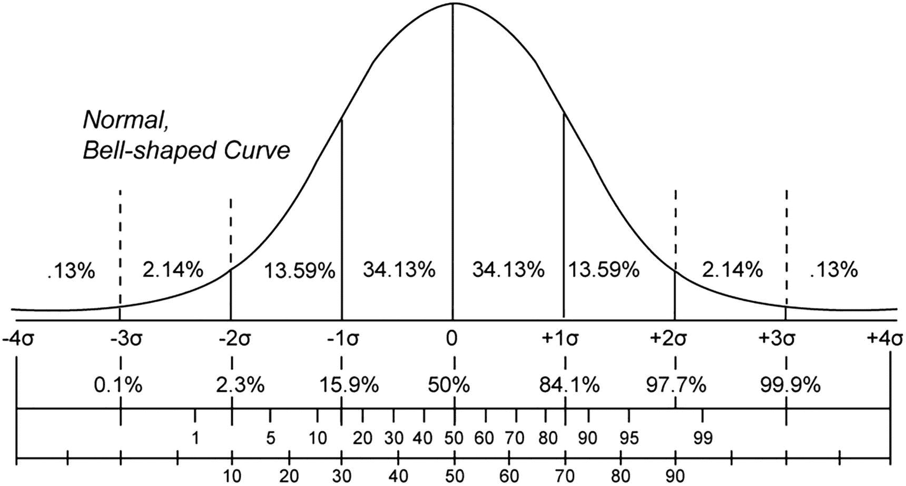

# 12. 分析处理与洞察

在整本书中，您一直专注于构建数据工程工具箱，并学习处理与转换数据（包括静态数据和流数据）的强大技术。在学习 Spark 的同时，您也一直在动手学习使用容器以及操作与 Apache Spark 生态系统良好互操作的其他技术。

鉴于现代数据工程师身兼多职，职责涵盖了数据生态系统的广泛范围——从数据生产和摄取、数据验证和清理、数据传输和加载、批处理和流处理，到更分析性的职责如简单和复杂聚合，甚至流式分析处理与洞察，本章专注于填补与分析数据预处理相关的知识空白，并学习使用强大的聚合运算符。

## 练习与资料

本章的练习将向您介绍 Apache Spark 丰富的分析处理能力。为了充分利用本章内容，所有练习都可以使用 Apache Zeppelin 交互式运行。

本章分为以下两个动手实践部分：

* 使用常见的 Spark 函数进行分析预处理
* 分析处理与洞察工程

学习如何交互式地使用 Spark 的高阶函数，将使您能够编写和操作第 13 章中有状态的结构化流式处理分析应用程序。

第 12 章的练习资料位于 [`https://github.com/newfront/spark-moderndataengineering/tree/main/ch-12`](https://github.com/newfront/spark-moderndataengineering/tree/main/ch-12)。位于 `ch-12/exercises` 目录中的 `README` 文件将为您提供一整套设置说明。

### 环境搭建

再次重申，我们将依赖老伙计 Apache Zeppelin，不过这次你将构建一个名为 `zeppelin-spark` 的 Zeppelin 容器。你可能会想，为什么需要创建一个不同的容器呢？很高兴你能这么问。

在整本书中，你一直需要使用*卷挂载*和*环境变量*，在运行时将本地 Apache Spark 接入 Zeppelin 容器。在第 10 章中，你应该还记得，我们迁移到了使用基础的 Spark 容器来构建一致的容器化 Spark 应用程序。鉴于本地数据平台的复杂性日益增加，并且要确保应用程序在运行时拥有一致的环境，这一步是必要的。到目前为止，Zeppelin 要求你自带 Spark，但这个新容器将把官方 Zeppelin 容器与你过去几章一直在使用的基础 Spark 容器结合起来。

*Zeppelin-Spark 目录布局和容器依赖*

```
ch-12

├── docker

│   ├── README.md

│   └── zeppelin-spark

│       ├── Dockerfile

│       ├── conf

│       │   ├── interpreter.json

│       │   └── zeppelin-env.sh

│       └── spark

│           ├── conf

│           └── jars
```

在终端中，切换到 `docker/zeppelin-spark` 目录。位于该目录下的 *Dockerfile* 展示了 Docker 多阶段构建模式，它实质上是从基础 Spark 容器中精选资源，同时也在核心的 `apache/zeppelin` 容器之上添加资源。该文件的内容如代码清单 12-1 所示。

```
ARG spark_image=spark-3.1.2-jre-11-scala-2.12

FROM newfrontdocker/apache-spark-base:${spark_image} as spark

FROM apache/zeppelin:0.9.0

COPY --from=spark /opt/spark /opt/spark

COPY --from=spark /usr/local/openjdk-11 /opt/openjdk-11

COPY ./spark/conf/hive-site.xml /opt/spark/conf/

COPY ./spark/conf/spark-defaults.conf /opt/spark/conf/

COPY ./spark/jars /opt/spark/user_jars/
```

# 1. 在 Spark 类路径中直接添加 MariaDB 驱动

```dockerfile
COPY ./spark/jars/mariadb-java-client-2.7.2.jar /opt/spark/jars/
COPY ./conf/interpreter.json /zeppelin/conf/
COPY ./conf/zeppelin-env.sh /zeppelin/conf/
```

代码清单 12-1：在官方 Apache Zeppelin Docker 容器之上添加新的文件系统层，引入 Java 11 和 Spark 3.1.2 以及自定义配置和 JAR 包。

多阶段 Docker 构建允许你创建常用容器的可靠实例，而无需处理更复杂的构建过程。就 `zeppelin-spark` 容器而言，我们可以直接从 `apache-spark-base` 容器中提取 Java 11（JRE）以及 Spark 发行版（见代码清单 12-2）。这与使用模块构建 Spark 应用程序的理念类似，你可以使用 `FROM` 来堆叠容器，或者将容器用作资源的提供者。

```dockerfile
FROM newfrontdocker/apache-spark-base:${spark_image} as spark
FROM apache/zeppelin:0.9.0
COPY --from=spark /opt/spark /opt/spark
COPY --from=spark /usr/local/openjdk-11 /opt/openjdk-11
```

代码清单 12-2：使用多阶段构建模式有助于减小容器的最终体积，也可以用来减少管理复杂容器的开销。

在本地构建容器是一个可选步骤。你可以使用公开的 `newfrontdocker/zeppelin-spark` 容器，但只需运行以下构建命令（从 `zeppelin-spark` 目录）即可轻松构建自己的容器。

```bash
docker build . -t `whoami`/zeppelin-spark:latest
```

接下来，你可以启动环境了。

### 启动本地环境

在 Docker 目录下，你会找到另一个名为 `zeppelin` 的目录。将该目录复制到 `~/dataengineering/zeppelin-spark`。与前面的章节一样，该目录下的 `docker-compose.yaml` 文件为你提供了启动环境所需的所有配置。

```bash
docker compose \
  -f ~/dataengineering/zeppelin-spark/docker-compose.yaml up \
  -d
```

这个 compose 进程将启动 Apache Zeppelin（`localhost:8080`）、MySQL（`:3306`）和 MinIO（`localhost:9000`）文件系统。

## 2. 使用通用 Spark 函数进行分析预处理

第一个练习将是实践性的导览，使用 `org.apache.spark.sql.functions` 包中更常见的`高阶函数`（列式表达式），重点关注那些有助于准备分析数据的函数。

### 练习 12-1：为分析预处理数据集

在浏览器中打开 Zeppelin（`localhost:8080`），创建一个新的笔记，并为其取一个容易记住的名称，例如 `01_common_dataframe_functions`。从这一点开始，你将学习使用那些有助于修改和准备数据进行分析处理的函数：

*   处理时间戳和日期
*   处理时区
*   处理并替换空列值
*   使用 Case 语句
*   使用用户自定义函数

### 处理时间戳和日期

处理时间可能是一件棘手的事情。你在第 9 章中了解到，时钟漂移和不正确的时区信息如何引发问题，以及如何通过统一使用 UTC 并在服务器上使用 NTP 同步时钟漂移来普遍解决这些问题。虽然标准化有助于未来的项目，但你可能会发现自己需要以不同的方式处理时间，或者需要修正和规范化时间戳。

#### 常用日期和时间戳函数

从空笔记（在 Zeppelin 中）开始，复制代码清单 12-3 中的代码块并运行该段落。这条 SQL 语句会生成一行数据，其列代表 Spark 在运行时捕获的日期和时间信息。

```sql
%spark
spark.sql("""
SELECT current_timestamp() as ts,
       current_timezone() as tz,
       current_date() as date,
       TIMESTAMP 'yesterday' as yesterday,
       TIMESTAMP 'today' as today,
       TIMESTAMP 'tomorrow' as tomorrow
""").show(6,0,true)
```

代码清单 12-3：使用 Spark SQL 获取时间概念。

结果行的输出将是代码被评估时捕获的标准系统日期和时间信息的快照。

```
-RECORD 0-------------------------------
ts        | 2021-09-12 00:54:03.691464
tz        | Etc/UTC
date      | 2021-09-12
yesterday | 2021-09-11 00:00:00
today     | 2021-09-12 00:00:00
tomorrow  | 2021-09-13 00:00:00
```

`current_timestamp`、`current_timezone`、`current_date` 以及 `TIMESTAMP` 常量 `yesterday`、`today` 和 `tomorrow` 都是 Spark SQL 中的高阶日期时间函数。接下来，我们将使用 Spark DSL 函数直接重新创建相同的输出。

#### 使用 `withColumn` 应用高阶函数

创建一个新的段落。在该段落中，我们将创建一个仅存储一个时间戳的 1x1（行/列）`DataFrame`。模拟 `current_timestamp` 表达式，清单 12-4 展示了如何包装一个简单的 Java `Instant` 来复制 `current_timestamp` 表达式。

```scala
%spark
val tsDf = Seq(Instant.now).toDF("ts")
```

清单 12-4：创建一个包含单行单列且存储时间戳的 `DataFrame`。

清单 12-4 中的简单技术利用了隐式转换，将 `Scala Seq[Instant]` 编码为带有 `TimestampType` 列的 Catalyst `Row`（`DataFrame`）。使用 `tsDf DataFrame`，我们现在可以通过 `DataFrame` 上的 `withColumn` 方法来添加列。

`DataFrame.withColumn(colName, col)`

`withColumn` 方法会在 `DataFrame` 的所有行上迭代地添加一个新列。`col`（`Column`）参数是一个强大的原语，它封装了一个列式 SQL 表达式，可用于将用户自定义函数应用到你的应用程序中。需要牢记的是，`withColumn` 只能引用一行中相邻列的数据。还有其他技术可以用于处理所有行或行子集，以使用窗口函数生成派生聚合结果。

清单 12-5 中的代码块添加了一个包含时区的列字面量（意思就是“该列的字面值就是你看到的这样”），以及通过列操作 `to_date` 派生出的日期。

```scala
import org.apache.spark.sql.functions._
import org.apache.spark.sql.types._

val dtInfoDf = tsDf
    .withColumn("tz",
        lit(spark.conf.get("spark.sql.session.timeZone"))
    )
    .withColumn("date", to_date($"ts"))
```

清单 12-5：使用 `withColumn` 添加列字面量和通过 `to_date` 派生出的日期列。

转换的结果是一个新的 `DataFrame`，它代表了在源 `DataFrame` 上添加两个新列的组合。请记住，由于 Spark 是惰性执行的，在到达某个特定的行动操作之前，不会执行任何实际工作。清单 12-5 中的操作添加了在最终系列执行时提供新日期列的承诺。第一列使用了一个名为 `lit` 的特殊列。`lit` 列使用隐式类型编码器（如果可用）将底层数据类型包装并编码为一个类型化列。第二列（`date`）被称为派生列。当你使用 `to_date` 函数并传入一个源列（`$"ts"`）时，Spark 会使用引用列（`ts`）来生成一个 `DateType`。

如果此时打印 `dtInfoDf` 的模式，你会看到以下内容：

```
root
 |-- ts: timestamp (nullable = true)
 |-- tz: string (nullable = false)
```

| -- date: date (nullable = true)

要处理从清单 12-3 重建 `DataFrame` 所需的其余缺失列，还需要处理 `yesterday`、`today` 和 `tomorrow` 这三列。

### 使用日期加法和减法

日期时间函数 `date_sub` 和 `date_add`，以及一个简单的 `cast` 表达式，可以组合起来派生 `yesterday`、`today` 和 `tomorrow`，如清单 12-6 所示。

```
tsDf

...

.withColumn("yesterday",

date_sub($"date", 1).cast(TimestampType))

.withColumn("today", $"date".cast(TimestampType))

.withColumn("tomorrow",

date_add($"date", 1).cast(TimestampType))
```

清单 12-6

使用日期减法、加法和数据类型转换来模拟清单 12-3 的输出

现在，你可以创建时间戳、从时间戳派生日期，以及对日期进行加减操作。作为日期时间函数巡览的收尾，我们将介绍 `year`、`month`、`dayofmonth`、`dayofweek` 和 `dayofyear` 这些日历函数。

### 日历函数

在分析和洞察中，通常使用日历比较显式的时间段（窗口）。趋势分析和时间序列预测是使用统计方法来测量数据点之间随时间变化率（增量）的技术。可以使用`固定`或`相对`窗口，通过 Spark SQL 对数据集进行分区（分桶）和分析，从而创建按秒、分钟、小时、天、周、月甚至年细分的聚合结果。

`固定窗口`与`相对窗口`

一个`固定窗口`由明确的开始和结束时间定义。例如，昨天是一个由 00:00:00 开始到 23:59:59 结束的 24 小时时间段定义的窗口。固定窗口通常用于计算两个或多个数据集之间的变化，常见的有逐小时、逐日、逐周和逐月计算。

一个`相对窗口`使用非固定的时间点来定义基于时间边界的一端。这个边界随后可用于计算开始或结束时间戳，从而产生一个任意窗口来观察统计数据。例如，你可以使用相对时间隔离出最近 30 分钟的数据集，而不是在固定的 30 分钟间隔内拆分一个小时（06:00:00 – 06:29:59 | 06:30:00 – 06:59:59）。

以清单 12-7 中的代码为参考，我们将向`tsDf DataFrame`添加五个列。

```
tsDf

...

.withColumn("year", year($"date"))

.withColumn("month", month($"date"))

.withColumn("day", dayofmonth($"date"))

.withColumn("day_of_week", dayofweek($"date"))

.withColumn("day_of_year", dayofyear($"date"))
```

清单 12-7

使用单个日期时间列派生年、月、日、当前周中的天以及当前年中的天

最终的`DataFrame`代表当前日期，其中的列表达了从初始时间戳列生成的不同观测值。

```
-RECORD 0--------------------------------
ts          | 2021-09-12 01:04:39.04086
tz          | Etc/UTC
date        | 2021-09-12
yesterday   | 2021-09-11 00:00:00
today       | 2021-09-12 00:00:00
tomorrow    | 2021-09-13 00:00:00
year        | 2021
month       | 9
day         | 12
day_of_week | 1
day_of_year | 255
```

现在，每当你需要快速复习日期和时间操作时，都有一个可靠的参考。但是，实际的时区呢？

## 时区与 Spark SQL 会话

处理基于时间的数据需要进行时区之间的转换，其原因不仅仅是遵守像 UTC 这样的通用时区。你还可以将时区视为一个透镜，从特定事件观察者的视角来查看数据集。当产生与特定地理位置和时区相关的洞察时，就会出现这种用例。

### 配置时区

Spark 默认使用其环境的本地系统时间（你的笔记本电脑或远程服务器）。在处理数据时，使用默认系统时间可能会导致不一致。为了确保无论应用程序在何处运行都能保持行为一致，你可以使用配置项`spark.sql.session.timeZone`来设置默认时区。

### 在运行时修改 Spark 时区

`SparkSession`会自动为您全局处理时间戳转换。不过，有时您可能希望显式更改特定查询所使用的时区。在 Zeppelin 中创建一个新段落，并添加清单 12-8 中的示例代码块，该代码块演示了如何动态设置时区。

```
%spark
import java.time._
val ts = Seq(Instant.now).toDF("ts")
spark.conf.set("spark.sql.session.timeZone", "UTC")
ts.show(truncate=false) // utc
spark.conf.set("spark.sql.session.timeZone", "America/Los_Angeles")
ts.show(truncate=false) // pst
```

清单 12-8

观察基于 `SparkSession` 时区配置的 Spark 时间输出中的时区变化

运行该段落，您将亲眼目睹 Spark 观测到的时间如何与时区配置值同步变化。输出分别捕捉到了通过 UTC 和 PST 时区视角观察到的同一不可变时间戳（`ts`）的引用。

```
UTC |2021-09-12 03:02:32.434387
PST |2021-09-11 20:02:32.434387
```

利用 Spark 运行时配置来切换时间观测视角的能力，使您能够使用单一且不可变更的真实来源（UTC 时间戳）作为底层数据，同时简化下游应用程序为特定时区构建查询的过程。这一切都无需忍受为处理时间戳时区转换而创建多个数据集副本的烦恼。

### 使用 SET TIME ZONE

您还可以使用`SET TIME ZONE`（如清单 12-9 所示）通过 Spark SQL 直接设置时区配置，从而动态切换时区。

```
%sql
SET TIME ZONE 'America/Los_Angeles';
SELECT TIMESTAMP 'now' as now_pst;
%sql
SET TIME ZONE 'UTC';
SELECT TIMESTAMP 'now' as now_utc;
```

清单 12-9

使用 `SET TIME ZONE` 配置 Spark 会话时区

现在，您可以通过`SparkSession`在 Spark 中以声明方式更改时区。这个简单的配置使得每个应用程序在查询和展示基于时间的数据时，能够选择如何观测时间。请记住为您的 Spark 应用程序设置一个默认时区，以确保获得可靠且可重复的结果。

### 季节性、时区与洞察

考虑以下示例。您的任务是设计一个系统，该系统能够自动追踪并比较 CoffeeCo 销售商品中观察到的客户购物行为的相对变化，从而得出购买趋势的洞察。在测试系统是否按预期运行时，您偶然发现了一个起初看似异常的商品销售数据。经过进一步调查，发现该商品是南瓜拿铁，其销售额从日均零销售，在短短几天内就飙升至与类别中所有其他商品相比创纪录的水平。这是异常吗？还需要哪些其他数据？

有些商品仅在特定时间段或一年中的特定时间才有供应。南瓜拿铁具有季节性，因为它被视为秋季饮品，但季节（节假日）是如何影响销售的呢？情绪因素又扮演了什么角色？

我在美国东北海岸长大，对我来说，十月总是标志着季节的明显变化。树叶从树上飘落，气温降低意味着要穿毛衣和夹克，以及新英格兰地区雪景带来的宁静与反思。伴随着这种变化，是对冬季假期的期盼，这意味着苹果酒（加香料的）和南瓜派，而作为成年人，南瓜拿铁唤起了美好的回忆。这是否仅对我个人而言？这是否与美国东海岸的更高销售额存在关联？销售额是由温度驱动，还是由暴风雪或降雨等其他天气模式驱动？

虽然您可能对新英格兰的秋天没有任何情感联系，也可能讨厌南瓜拿铁，但重要的是思考哪些类型的数据能够用于从分析观察中产生有意义的洞察。归根结底，要像数据侦探一样思考，或者与优秀的数据分析师合作，确保数据收集、聚合和分析工作能够产生新颖的洞察，从而推动创造让客户满意的体验。

### 时间戳与日期总结

思考从单个时间戳中能够衍生出的不同角度、视角或视图，为您开辟了一条通往基于事件洞察的道路。您可以计算一年中的时间信息（季节性）、判断某个日期是周末还是工作日（特定于事件的地理位置，甚至本地时区），或者检查事件是否发生在节假日，甚至该日期是否接近任何其他有意义的历史日期。将发生的事件与现实世界的行为关联起来并将数据与之关联，是许多成功分析和洞察计划的驱动因素。如果您需要更多证据，可以在线搜索“diapers beer correlations”（尿布与啤酒的关联），看看零售商如何从客户交易中获取洞察，将常共同购买的商品摆放得更近，从而增加看似不相关商品的销售额。接下来，我们将探讨一些为分析准备数据的技术。

## 准备分析数据

数据形态各异，规模不一。不幸的是，这也意味着数据可能因为数据损坏或用户错误之外的原因而缺失（为空）。例如，数据集中的空值并不一定需要在静态状态下用默认值填充，因为这可能只会增加给定数据集的整体存储占用。

此外，根据数据集存在的时间长短，以及数据是否仍在被积极收集并追加到该数据集中，数据的底层模式很有可能随着时间的推移缓慢变化。缓慢变化的模式是导致空值的常见原因之一，因为较旧的记录需要被强制转换为新的通用模式（`StructType`），才能与来自数据集（表）的较新数据项并行处理。

除了简单的缺失值之外，您还知道数据集经常被转换并与其他数据集连接，以实现更具体的视图，以满足不同数据域的需求，并帮助回答更专门化的问题（查询）。

我们将探讨条件填充空值的过程，以及使用 `case` 语句（列表达式）来生成派生列，这些派生列可用于条件标记（标签）、分桶（分区）以及解决常见的数据问题。

## 替换 DataFrame 中的空值

在 `DataFrame` 上使用 `na.fill` 可以有条件地填充缺失数据。在 Zeppelin 中新建一个段落，将代码清单 12-10 中的代码块复制进去，然后运行。该示例创建了一个简单的 `DataFrame`，代表 `CoffeeCo` 已注册和未注册客户下的四笔订单，每笔订单价格各异。这里我们选择使用 `null` 值来表示 `customer_id` 列中未注册的客户。

```
%spark
val nullOrdersDF = Seq(
(1, null, "decafe", 3.12),
(2, "cust123", "pour_over", 5.15),
(3, "cust234", "latte", 3.89),
(4, "cust345", "special_pour_over", 6.99)
)
.toDF("order_id", "customer_id", "item_name", "price")
nullOrdersDF.show()
Listing 12-10
创建一个包含空 customer_id 的 DataFrame 以使用 na.fill
```

运行该段落后，生成的 `DataFrame` 将如下所示：

```
+--------+-----------+-----------------+-----+
|order_id|customer_id|item_name        |price|
+--------+-----------+-----------------+-----+
|1       |null       |decafe           |3.12 |
|2       |cust123    |pour_over        |5.15 |
|3       |cust234    |latte            |3.89 |
|4       |cust345    |special_pour_over|6.99 |
+--------+-----------+-----------------+-----+
```

现在，你可以使用 `na.fill` 操作，用一个通用值替换一个或多个列中的空值，并返回一个新的干净 `DataFrame`。以代码清单 12-11 为参考，测试将 `customer_id` 列填充为值 `"unknown"`。

```
%spark
val nonNullOrdersDF = nullOrdersDF
.na.fill("unknown", Seq("customer_id"))
nonNullOrdersDF.createOrReplaceTempView("order_nonnull")
nonNullOrdersDF.show(truncate=false)
Listing 12-11
使用值 Unknown 替换列 customer_id 中的空值
```

通过调用代码清单 12-11 中的 `na.fill` 创建的非空（已清理）`DataFrame`，被保存到新的引用变量以及名为 `order_nonnull` 的临时视图中。操作结果如下所示：

```
+--------+-----------+-----------------+-----+
|order_id|customer_id|item_name        |price|
+--------+-----------+-----------------+-----+
|1       |unknown    |decafe           |3.12 |
|2       |cust123    |pour_over        |5.15 |
|3       |cust234    |latte            |3.89 |
|4       |cust345    |special_pour_over|6.99 |
+--------+-----------+-----------------+-----+
```

使用像 `unknown` 这样的特定常量填充空值，有助于声明列的含义，而不是让其他工程师去猜测该列的意图。

作为替代方案，如果该表在 Spark SQL `Catalog` 中管理，那么作为优秀的数据管理员，你可以更进一步，在 `Hive Metastore` 中描述空列的含义。这样，其他数据团队就可以一致地以相同方式处理这些空值。

在准备分析数据时，你很可能会发现自己需要使用一个或多个条件表达式来添加派生列。无需创建自定义用户定义函数（UDF），直接使用 SQL `case` 语句和 Spark SQL 的 `when`/`then`/`otherwise` 表达式即可。`case` 语句的工作方式类似于模式匹配块或传统的 `switch` 语句。

## 使用 Case 语句标记数据

`case` 语句提供了一种基于一个或多个链式布尔表达式（谓词）的结果来添加新列的机制。你可以在处理数据时，使用 `case` 语句来*打标签*、*分类*或*标记*数据。`case` 语句的语义会有所不同，具体取决于你是在 `DataFrame` 上使用 Spark SQL 函数，还是在表或视图上使用 SQL 表达式。

### Dataset 上的 Case 语句

在 Zeppelin 笔记本中新建一个段落。你将通过添加两个名为 `is_registered` 和 `order_label` 的列来转换目标 `DataFrame` `nonNullOrdersDF`（代码清单 12-11），从而创建一个带标签的订单。代码清单 12-12 中的代码块展示了如何使用 `when`, `otherwise` 表达式。第一个列 `is_registered` 测试订单是否有已知或未知的 `customer_id`，而 `order_label` 表达式则使用 `boolean` 和 `numeric` 条件判断，有条件地将订单标记为 `vip`、`rush` 或 `normal`。

```
%spark
nonNullOrdersDF
.withColumn("is_registered",
when(col("customer_id").notEqual("unknown"), true)
.otherwise(false)
)
.withColumn("order_label",
when(col("is_registered").equalTo(true).and(col("price") > 6.00), "vip")
.when(col("is_registered").equalTo(true).and(col("price") > 4.00), "rush").otherwise("normal")
)
.show(truncate=false)
Listing 12-12
使用 When, Then, Otherwise 在 DataFrame 上创建复杂的派生列
```

如前所述，第一个新列（`is_registered`）代表客户的注册状态。该列表达式是一个谓词，用于检查求值条件是否满足。*当*列的值不等于 `unknown` *时*，我们将列值设置为 *true*，*否则*回退到将该列值设置为 *false*。

第二个派生列使用 `is_registered` 的值，根据客户的注册状态及其订单价格，有条件地装饰客户的订单。结果是一个具有三个可能值的列：`normal`、`rush` 或 `vip`。该列表达式通过引入表达式*与*（也可以是或条件）的概念，使用了更复杂的分支条件。思考 `when-then-otherwise` 表达式最简单的方法，就是将其视为典型的分支条件。

```
if (row.is_registered) {
if (row.price > 6.00) "vip" else "rush"
} else "normal"
```

让我们看看如何使用 Spark SQL 实现相同目标。

### Spark SQL 表上的 Case 语句

可以使用 `order_nonnull` 临时视图以及嵌套的内联 select 语句来实现与代码清单 12-12 所示相同的效果。新建一个 Zeppelin 段落，复制代码清单 12-13 中的 SQL 语句并运行。你会发现输出结果与代码清单 12-12 相同。

```
%sql
SELECT *,
CASE
WHEN x.is_registered = TRUE and x.price > 6.00 THEN 'vip'
WHEN x.is_registered = TRUE and x.price > 4.00 THEN 'rush'
ELSE 'normal'
END as order_label
FROM (
SELECT *,
CASE
WHEN customer_id != 'unknown' THEN TRUE
ELSE FALSE
END as is_registered
FROM order_nonnull
) x
Listing 12-13
在 Spark SQL 表上使用解释型 SQL 创建复杂的派生列
```

代码清单 12-13 中的 Spark SQL case 语句为你提供了添加复杂条件表达式的通用框架，这些表达式有助于在数据集中进行打标签、分桶或查找其他模式。

> **提示**
>
> 当你只想让 Spark 完成工作，而不必提供在 DataFrame API 上执行相同操作所需的全部函数式转换时，Spark SQL 解释器是一个极好的支持工具。最终，在摸索时，如果你在批处理模式下（包括通过 Zeppelin）使用 DataFrame 和 Dataset API，可以轻松混合执行模式。

# Case 语句的价值

Case 语句提供了一种完美的机制，用于添加条件表达式，这些表达式可用于以声明方式为数据集打标签、分区或分桶，以便后续分析。例如，了解哪些客户每笔订单消费超过 20 美元，或者超过 100 美元，这可能会很有价值。又或者，您可能希望为购买非普通商品的客户打上标签，因为他们的行为模式可能与其他购买非普通商品的客户相似。通过在数据中添加 `order_type` 等标签，您可以为您组织内的数据科学家和机器学习工程师提供输入特征，以便他们能更好地利用数据。这种技术是一种轻量级的测试数据理论的方法，它有助于通过分离数据来探索数据集，从而发现模式和洞察。

## Spark 中的用户自定义函数

用户自定义函数（UDF）使您能够使用封装在 `Spark UDF` 中的传统 Scala 函数来编码复杂的过程。UDF 甚至可以注册到 `SparkSession` 中，以扩展 Spark SQL 目录中可用的函数。

我们将逐步介绍如何将清单 12-12 中引入的 `order_label` 表达式转换为一个名为 `coffee_order_label` 的 UDF。这个基础函数将接收一个 `String` 和一个 `Double` 参数，并返回一个 `String`。`Spark SQL` 的 `udf` 函数可以包装一个传统的 Scala 函数、函数字面量或内联函数字面量。

### 在 UDF 中使用 Scala 函数

清单 12-14 创建了一个传统的 Scala 函数（`labeler`），并使用 Spark 的 `udf` 函数来包装一个已应用的 `labeler` 函数调用。

```
%spark
import org.apache.spark.sql.functions.udf
def labeler(customerId: String, price: Double): String = {
  if (customerId != "unknown") {
    if (price > 6.0) "vip" else "rush"
  } else "normal"
}
val coffeeOrderLabeler = udf(labeler(_,_))
```

清单 12-14：编码一个用于结构化 Spark API 的传统 Scala 函数

使用传统函数可能是开始使用 UDF 最简单的方式。根据您偏好的工作方式，函数字面量提供了另一种表达 UDF 的方式。

### 在 UDF 中使用函数字面量

Scala 中的函数字面量提供了一种将函数作为参数传递给另一个函数的方式。在清单 12-14 的示例中，需要使用 `udf(label(_,_))` 表达式来应用该函数。清单 12-15 演示了如何使用函数字面量来简化 `udf` 操作，但这会略微降低代码块的可扫描性（对于非函数式编程者而言）。

```
%spark
import org.apache.spark.sql.functions.udf
// udf 可以使用函数字面量
val coffeeOrderLabelerFunc: ((String, Double) => String) =
  (customer_id: String, price: Double) => {
    if (customer_id != "unknown") {
      if (price > 6.0) "vip" else "rush"
    } else "normal"
  }
val coffeeOrderLabeler = udf(coffeeOrderLabelerFunc)
```

清单 12-15：将函数字面量传递给 UDF

由于函数字面量可以作为方法参数传递，`udf` 操作可以推断所需的函数参数类型（`String`、`Double`）并自动生成一个 lambda 表达式。最后，我们将探讨如何向 `udf` 操作提供一个内联函数。

### 在 UDF 中使用内联函数

`udf` 操作会包装您传递给 `udf` 方法的任何函数，因此您可以简单地提供一个内联函数（如清单 12-16 所示），Spark 将对该函数进行编码，无需在 Spark 作用域之外做任何额外操作。

```
val coffeeOrderLabeler = udf(
  (customer_id: String, price: Double) => {
    if (customer_id != "unknown") {
      if (price > 6.0) "vip" else "rush"
    } else "normal"
  })
```

清单 12-16：将内联函数（Lambda 表达式）与 `Spark SQL` 的 `udf` 方法一起使用

现在我们已经介绍了如何创建用户自定义函数，接下来应该了解它们是如何工作的，然后学习如何使用它们。

### 用户自定义函数的工作原理

`spark.sql.functions.udf` 方法返回的对象类型是抽象类 `UserDefinedFunction` 的一个实例。具体来说，它是具体类 `SparkUserDefinedFunction` 的一个实例。该对象负责使用隐式编码器在 JVM 数据类型和 Spark 数据类型之间进行转换。更有趣的是，在您的 `udf` 上调用 `apply` 的返回类型是 `Column`。这正是 UDF 能够与结构化 Spark API 在列级别进行互操作的魔力所在。UDF 本质上只是另一种列表达式。

### 将 UDF 与 Spark DSL 一起使用

现在，可以使用 `withColumn` 来调用新定义的 UDF。如果尚未执行，请在您的笔记本中创建一个段落，并运行清单 12-16 中的代码块以创建 `coffeeOrderLabeler`。然后创建另一个新段落，并复制清单 12-17 中的代码块，将清单 12-12 中的 `when/otherwise` 语句替换为新的 `coffeeOrderLabeler` UDF。

```
nonNullOrdersDF
  .withColumn("is_registered", ...)
  .withColumn("order_label", coffeeOrderLabeler(
    $"customer_id", $"price"))
```

清单 12-17：使用 UDF 和结构化 Spark DSL

如果您想将新的 UDF 与 `Spark SQL` 一起使用，则必须注册该 UDF，使其成为 `Spark SQL` 目录的一部分。之后，该函数就可以像任何其他 SQL 表达式一样使用了。

### 为 Spark SQL 注册 UDF

一旦您拥有了一个 UDF，就可以使用 `SparkSession.udf` 方法对其进行注册。这会将函数添加到 `Spark SQL` 目录中。

```
// 注册 udf 以用于 Spark SQL
spark.udf.register("coffee_order_label", coffeeOrderLabeler)
```

您可以通过 `SparkSession` 使用 `Spark SQL` 目录方法来检查您的 UDF 是否已注册。

### 内省 UDF 函数

搜索并测试您的 UDF 是否存在非常有用。注册一个新函数后，您可以通过调用 `Spark SQL` 目录（`catalog`）的 `listFunctions` 方法来列出 `SparkSession` 的所有可用函数。

```
spark.catalog.listFunctions.show()
```

因为 `listFunctions` 方法返回一个 `Dataset[Function]`，您还可以通过模式查询该数据集中的函数（以防您记不住全名）。

```
spark.catalog.listFunctions
  .where($"name".like("%coffee%"))
```

如果您已经知道了函数的名称，例如 `coffee_order_label` UDF，您可以检查该函数在当前 `SparkSession` 上是否存在。

```
spark.catalog
  .functionExists("coffee_order_label")
```

### UDF 的可见性与可用性

用户自定义函数会为每个 `SparkSession` 实例加载到 SQL 目录中。例如，如果您的 Spark 应用程序派生了 `SparkSession`，则不能保证 UDF 会自动可用。这是因为 UDF 与临时视图类似，默认情况下仅在其创建的 `SparkSession` 的生命周期内可用。在使用 UDF 之前检查其是否存在，有助于解决未来可能遇到的问题（参见清单 12-18）。

### 在 Spark SQL 目录中创建并注册永久 UDF

在 UDF 函数必须全局可用的场景下，也有一种在默认 Spark SQL 上下文中创建和注册永久 UDF 的模式。

在 Spark 应用程序之间共享一组通用的 UDF 是很常见的做法。为此，你需要额外执行创建、打包和分发通用 UDF 的步骤。例如，清单 12-19 展示了如何创建一个名为 `CoffeeOrderLabeler` 的具体类。该类继承了 Hive UDF 类，从而使实现类能够在 Hive Metastore 中注册。这一能力还允许从分布式文件系统（如 HDFS 或 S3）加载 UDF 函数，以按需提供功能。

```scala
import org.apache.hadoop.hive.ql.exec.UDF;
class CoffeeOrderLabeler extends UDF {
def evaluate(customerId: String, price: Double): String = {
if (customerId != null && customerId != "unknown") {
if (price > 6.0) "vip" else "rush"
} else "normal"
}
}
```

*清单 12-19: 扩展 Hive UDF 以创建可重用的 UDF 类*

创建类之后，你可以通过在 Spark SQL DDL 中使用 `CREATE FUNCTION` 语句来注册 Hive UDF 函数。参见清单 12-20。

```sql
%sql
CREATE FUNCTION native_coffee_order_label
AS 'CoffeeOrderLabeler'
USING JAR 's3a://.../udfs/orders/jars/udfs.jar'
```

*清单 12-20: 在 Spark SQL 目录中注册永久全局函数*

现在，UDF 不仅已在 Hive Metastore 中注册，而且在共享文件系统中也存储了指向该 JAR 位置的路径。接下来回到 Spark SQL 中使用 UDF 的话题。

### 在 Spark SQL 中使用 UDF

你已经了解了创建、注册和检查用户定义函数的来龙去脉，剩下的就是在 Spark SQL 语句中使用这些函数。清单 12-21 展示了清单 12-13 中 Spark SQL 语句的修改版本。

```sql
%sql
SELECT *,
coffee_order_label(customer_id, price) as order_label
FROM (
SELECT *,
CASE
WHEN customer_id != 'unknown' THEN TRUE
ELSE FALSE
END as is_registered
FROM order_nonnull
) x
```

*清单 12-21: 在 Spark SQL 中使用已注册的 UDF*

清单 12-21 中的 SQL 语句展示了 `coffee_order_label` UDF 的简单用法。UDF 使你能够扩展 Spark SQL 的功能，并添加可广泛重用的新词汇（表达式和运算符）。该技术对于重用非 Spark 原生库很有用，但其中也存在一个陷阱。

### 关于用户定义函数

正如你所见，用户定义函数允许你定义新的基于列的操作，这些操作表现为原生函数，可供 Spark SQL 和 Spark DSL 使用。UDF 可以填补那些难以表达，或者默认 Spark SQL 函数无法原生表达的操作空白。这里存在一个陷阱，它与 Spark 编码 UDF 的方式有关。简单来说，Spark 无法优化 UDF 中的代码块，因为它将内部操作视为一个黑盒。请留意你的 UDF 操作的复杂性，以免在不知不觉中拖慢你的 Spark 应用程序。当性能至关重要时，总是优先使用原生的 Spark SQL 函数，因为它们已经针对 Catalyst 引擎进行了优化。

### 练习 12-1：总结

第一个练习深入探讨了在准备聚合和分析处理数据时常用的 SQL 函数。从处理时间戳和日期函数，到声明处理数据集时使用的时区，再到填充空值和使用条件 case 语句，最后定义你自己的函数（UDF）来扩展 Spark SQL 生态系统中可用的通用功能。现在，我们将注意力转向在 Spark 中使用常见的聚合和分析函数。

## 分析处理与洞察工程

捕获和收集数据通常只有在数据能用来回答问题、揭示趋势、分析客户行为、协助决策自动化，或为复杂的流程和操作提供额外的视角时才有用。考虑一下运营一家咖啡初创公司（如虚构的 CoffeeCo）所需的运营数据。为了在竞争激烈的精品咖啡领域与更成熟的公司竞争，并维持同等水平的客户满意度，一切都必须管理得当。从每家门店的氛围，到提供的咖啡，再到合同物流和关于公平贸易及咖啡豆采购的供应商谈判，基本上，推动业务前进的所有流程都需要从众多数据点出发，通过多视角分析来确保平稳运营。这正是分析、洞察和机器学习相结合，构建智能系统之处。这个故事通常从数据聚合开始。

## 数据聚合

*数据聚合*是一种用于分析大量数据以生成报告或统计数据的技术，这些报告或统计数据与数据集中观察到的模式相关。数据聚合在探索性数据分析（EDA）、数据挖掘、洞察生成、机器学习和人工智能等领域扮演着重要角色。与许多其他事物一样，数据聚合始于一个数据集，而这个数据集是数据工程师可靠捕获并一致处理的结果。

### 练习 12-2：分组数据、聚合、分析和洞察

如果 Zeppelin 没有运行，请重新启动它并创建一个新笔记。给它取一个名字，比如 `02_grouping_aggregations_analytics`。在接下来的练习中，你将使用此笔记学习使用分组和聚合函数来创建报告，并试验复杂的分析函数。

**注意：** 本练习重用了第 11 章中使用随机 `CoffeeOrder` 生成器创建的数据。

### 关系分组数据集

分析处理通过 `groupBy`、`cube`、`rollup` 和 `pivot` 这些 DataFrame 方法实现。这些方法将 DataFrame 转换为 `RelationalGroupedDataset`，并暴露出广泛的分析处理功能。伴随这一新身份而来的是 Spark 处理范式的一个重要变化。Spark 将改变其处理数据的方式，从使用基于行的迭代器（主要关注对单个列执行行级转换）转向处理特定列中包含的数据点，这些数据点在由分组表达式或替代分区逻辑划分的数据集子集的所有行中进行处理。

### 使用分组进行列式聚合

在本节中，你将创建一个简单的报表，根据每笔交易的年份和月份，按门店（`store_id`）汇总已售商品的总数。首先，创建一个名为 `coffee_orders` 的临时视图，并引用来自 `silver.coffee_orders` 表（来自 `ch-11`）的日期分区数据。可以将清单 12-22 放入 Zeppelin 并运行以建立此关联。

```scala
%spark
val dbName = "silver"
spark.catalog.setCurrentDatabase(dbName)
val dbUri = spark.catalog.getDatabase(dbName).locationUri
val df = spark.read.parquet(s"$dbUri/coffee_orders/")
df.createOrReplaceTempView("coffee_orders")
```

*清单 12-22: 通过创建一个可在新 Zeppelin 笔记中使用的视图，准备读取和分析已分区的 `coffee_orders` 表*

以 `coffee_orders` 视图为起点，清单 12-23 中的 Spark SQL 查询将创建一个名为 `coffee_orders_datetime` 的新临时视图，该视图添加了 `year`、`month` 和 `day` 派生列。

```sql
%sql
CREATE OR REPLACE TEMP VIEW `coffee_orders_datetime`
AS SELECT *, year(date) as year, month(date) as month, day(date) as day
FROM coffee_orders
```

*清单 12-23: 创建一个新的临时视图 (`coffee_orders_datetime`)，该视图向 `coffee_orders` 视图添加派生列 `year` 和 `month`*

现在，使用新的 `year` 和 `month` 列，你可以计算与月度（甚至年度）销售总额相关的统计数据。清单 12-24 中的查询使用原生 Spark SQL 和 `SUM` 聚合运算符来计算已售商品的总数。此查询可以在没有分组子句的情况下运行，以计算全局已售商品的总数。通过添加*分组表达式*（`GROUP BY`），你可以轻松地基于分组列 `year`、`month` 和 `store_id` 创建多个不同的子集。

```sql
%sql
SELECT store_id, year, month, sum(num_items) AS total_items_sold
FROM coffee_orders_datetime
GROUP BY year, month, store_id
ORDER BY store_id asc
```

清单 12-24：按年份和月份分区报告每家门店的已售商品总数

此聚合的结果如下所示：

```
+--------+----+-----+----------------+
|store_id|year|month|total_items_sold|
+--------+----+-----+----------------+
|  store1|2021|   10|           61955|
|  store1|2021|    9|          197421|
|  store2|2021|    9|          199030|
|  store2|2021|   10|           63842|
|  store3|2021|    9|          202279|
|  store3|2021|   10|           62134|
|  store4|2021|    9|          200684|
|  store4|2021|   10|           62705|
+--------+----+-----+----------------+
```

接下来，我们将介绍如何使用 Spark DSL 创建相同的聚合。

### 使用 Spark DSL 进行聚合

我们刚刚介绍了如何使用 `GROUP BY` 和列聚合运算符 `SUM`。在下一个示例中，我们使用 DataFrame 来创建分组聚合。在 Zeppelin 中创建一个新段落，并复制清单 12-25 中的代码。此示例展示了 DataFrame 如何转换为 `RelationalGroupedDataset`，然后再在聚合后转回 DataFrame。

```scala
%spark
import org.apache.spark.sql.RelationalGroupedDataset
val coffeeOrdersDf = spark.sql("""
SELECT store_id, year, month, num_items
FROM coffee_orders_datetime
""")
val groupedRelation: RelationalGroupedDataset = coffeeOrdersDf
.groupBy($"year",$"month",$"store_id")
val aggDf = groupedRelation
.agg(sum($"num_items") as "total_items_sold")
.sort(asc("store_id"))
```

清单 12-25：使用 `RelationalGroupedDataset` 计算列式 `SUM` 聚合

清单 12-25 中的代码块创建了一个 `SUM` 聚合，以专门按年份和月份计算每家门店的总销售额。Spark SQL 与 Spark DSL 之间一个有趣的区别在于后者向工程师公开每个操作的方式。从逻辑上讲，你需要遵循以下步骤是有道理的：

1.  使用 `year`、`month` 和 `store_id` 列，将所有记录分成不相交的集合（`GROUP BY` / 分组集）。

2.  在每个不相交的集合内（`year-month-store_id`），将 `num_items` 列中的所有值相加（聚合）。

3.  最后，按 `store_id` 升序对结果进行重新排序。

这个简单的报表只观察每个不同组内的最终总数。那么表现最差或最好的日期呢？百分位数数据呢？通常需要提供额外的信息，这些信息有助于概括聚合中数据的形态。接下来，我们将介绍如何计算汇总统计信息，并将向你介绍额外的聚合运算符 `min`、`avg`、`percentile_approx` 和 `max` 字段，以表示最终数值总数背后的统计数据。

### 计算汇总统计信息以获取洞察

`分析`是指随着时间的推移捕获关键绩效指标（度量）的实践，例如我们在上一节中计算的总销售额数字。`洞察`是解释指标为何随时间变化的艺术。比较分析以观察变化的好坏，需要捕获（或推导）额外的数据以及随时间变化的关键绩效指标。

能够观察数据集的形态随时间的变化，需要为每个观察（窗口）计算更详细的统计数据。

### 使用 `Describe` 计算简单的汇总统计信息

由 `count`、`mean`（均值）、`stddev`（标准差）、`min` 和 `max` 构成的聚合函数集通常用于生成跨数值（甚至非数值）列的汇总统计信息。汇总统计信息有助于衡量底层数值分布的形态，或者让你了解基于字符的列的字典序最小/最大值。Spark 自带了一种使用 `describe` 函数快速计算列式汇总统计信息的简单方法。

```
coffeeOrdersDf.describe("num_items").show
+-------+-----------------+
|summary|        num_items|
+-------+-----------------+
|  count|           100102|
|   mean|10.48980040358834|
| stddev|5.772833965567237|
|    min|                1|
|    max|               20|
+-------+-----------------+
```

### 使用 `Agg` 计算复杂汇总统计量

在探索数据集时，可以使用 `describe` 快速且低成本地计算一些基本统计量。然而，如果你想获取更高级的统计量，例如中位数（第 50 百分位数）、四分位距（第 25 和第 75 百分位数之间的距离），或列中不同值数量的其他计数，则可以将这些计算移回 `aggs` 块。新建一个段落，并添加清单 12-26 中所示的代码块。

```scala
%spark
val summaryDf = coffeeOrdersDf
.groupBy($"year",$"month",$"store_id")
.agg(
count($"num_items") as "count",
sum($"num_items") as "total_items_sold",
stddev_pop($"num_items") as "sd", //sqrt(variance)
min($"num_items") as "daily_min_items",
ceil(avg($"num_items")) as "daily_avg_items",
max($"num_items") as "max_daily_items",
percentile_approx($"num_items",
array(lit(0.25),lit(0.50),lit(0.75),lit(0.99)), lit(95)
) as "percentiles"
)
.withColumn("daily_p25_items", $"percentiles"(0))
.withColumn("daily_median_items", $"percentiles"(1))
.withColumn("daily_p75_items", $"percentiles"(2))
.withColumn("daily_p99_items", $"percentiles"(3))
.withColumn("iqr",
floor($"daily_p75_items" - $"daily_p25_items")
)
.sort(asc("year"),asc("month"), asc("store_id"))
```

清单 12-26：计算汇总统计量可以让你了解数据集在给定度量（`num_items`）方面的整体形态

清单 12-26 示例中的统计聚合混合了 `describe` 方法中的所有列，并使用了 `percentile_approx` 聚合函数添加了第 25、第 50 和第 75 百分位数。

### 百分位数

百分位数用于观察一个离散数字，该数字代表一个边界，数据集中所有值（按从小到大排序）都落在此边界上或其下方。第 50 百分位数，也称为中位数，代表一组已排序数字的中点，其中 50%的所有值都等于或低于该数字。百分位数用于捕捉数据分布的形态，一种常见的分布是正态分布，如图 12-1 所示。



正态分布呈现为所谓的“钟形”曲线。

计算百分位数需要你先对给定列中的所有值按升序排序，然后利用数据集的大小（总记录数）来计算给定百分位数的值。在非常大的数据集中，这可能会耗费大量资源，而这正是`percentile_approx`方法发挥作用的地方。

```
percentile_approx(col, percentage, accuracy)
```

`percentile_approx`函数根据提供的百分比参数（可以是双精度浮点数数组或单个双精度浮点数），高效地计算已排序的连续数值数据序列的百分位数。精度参数让你可以定义生成百分位数时允许的误差（数字越低，内存开销越低，但误差范围越大）。

百分位数可用于创建常见的分箱（`bins`），以衡量连续数值度量的频率。例如，直方图是一种数据点落入特定分箱的频率（或趋势）的图形表示。时间序列直方图分析可用于观察特定分箱的质量（百分比）随时间的变化。

清单 12-26 中的聚合还引入了数值`ceil`（向上取整）函数，用于将平均`num_items`向上舍入到最接近的整数。如果你想向下舍入到最接近的整数，可以使用`floor`表达式。

在初始聚合之后，我们立即使用基础的列式表达式添加列，以提取百分位数数据并计算四分位距。

```
.withColumn("daily_p25_items", $"percentiles"(0))
.withColumn("daily_median_items", $"percentiles"(1))
.withColumn("daily_p75_items", $"percentiles"(2))
.withColumn("daily_p99_items", $"percentiles"(3))
.drop("percentiles")
.withColumn("iqr",
floor($"daily_p75_items" - $"daily_p25_items")
)
```

代表第 25、第 50、第 75 和第 95 百分位数的列使用了一种技术，该技术本质上是将数组值从 DataFrame 的百分位数列中提取出来，然后从最终的 DataFrame 中删除百分位数数组，因为它已不再有用（列已被提取）。最后，使用`p75-p25`计算四分位距，该范围有助于（在统计上）识别第 25 和第 75 百分位数之间的距离，在正态分布中，这个距离是相等的。能够观察数据集中的偏斜（左偏或右偏）有助于理解度量值如何随时间变化。清单 12-26 中聚合的输出将如下所示：

```
-RECORD 0------------------------------
year               | 2021
month              | 9
store_id           | store1
count              | 18951
total_items_sold   | 197421
sd                 | 5.777909019367008
daily_min_items    | 1
daily_avg_items    | 11
max_daily_items    | 20
daily_p25_items    | 5
daily_median_items | 10
daily_p75_items    | 15
daily_p99_items    | 20
iqr                | 10
```

接下来，我们将了解如何使用`rollup`和`pivot`，它们提供了分析分组数据的不同方式。

## 使用 Rollup 实现层次化聚合

`Rollup`提供了另一种创建聚合的方式，它是分组集（`groupBy`的扩展，被称为分组集）。`Rollup`与`groupBy`的区别在于数据分析的方式。为了生成层次化聚合，`rollup`会从左到右对`rollup`分组集中包含的所有列进行计算。`Rollup`使你能够生成以树状结构呈现的细粒度报告。最顶层的行代表所有数据的全局聚合，然后对于每一列（从左到右），会生成额外的行，表示按每个不同列值切片的数据子集。

清单 12-27 中的代码块展示了一个创建层次化聚合的具体示例。

```
%spark
val rollupReport = ordersDf
.rollup($"store_id", $"year", $"month")
.agg(
sum($"num_items") as "total",
min($"num_items") as "min_daily",
ceil(avg($"num_items")) as "avg_daily",
max($"num_items") as "max_daily"
)
.sort(asc("year"),asc("month"),asc("store_id"))
.limit(20)
```
清单 12-27：在分组集`store_id, year, month`上使用`Rollup`聚合数据集

`groupBy`与`rollup`之间的差异可以在输出`rollupReport`的结果时看出，如清单 12-28 所示。

```
+--------+----+-----+-------+---------+---------+---------+
|store_id|year|month|total  |min_daily|avg_daily|max_daily|
+--------+----+-----+-------+---------+---------+---------+
|null    |null|null |1050050|1        |11       |20       |
|store1  |null|null |259376 |1        |11       |20       |
|store2  |null|null |262872 |1        |11       |20       |
|store1  |2021|null |259376 |1        |11       |20       |
|store2  |2021|null |262872 |1        |11       |20       |
|store1  |2021|9    |197421 |1        |11       |20       |
|store2  |2021|9    |199030 |1        |11       |20       |
|store1  |2021|10   |61955  |1        |11       |20       |
|store2  |2021|10   |63842  |1        |11       |20       |
+--------+----+-----+-------+---------+---------+---------+
```
清单 12-28：`Rollup`从左到右计算分组集上的层次化聚合

在清单 12-28 的输出中，你会看到全局聚合之后是第一个分组列（`store_id`），然后是下一层级（`store_id`和`year`），接着是（`store_id`、`year`和`month`）。这种聚合风格适用于探索性报告。接下来，我们将讨论数据透视。

## 使用数据透视

数据透视是一种技术，它允许在众多行之间进行复杂的聚合，其方式类似于`rollup`和`groupBy`聚合。`pivot`操作的输出是一个新的数据集，该数据集已围绕特定列（例如`order_id`或月份或年份）进行了透视。这种技术可用于生成报告，也可用于在跨多行数据中寻找模式，从而产生新颖的洞察。

我们将探索创建一个数据集，该数据集表示顾客从咖啡店可用菜单中订购的每一件商品。这些菜单项随后将与`CoffeeOrder`上的`num_items`列关联。这个新数据集将存储在一个名为`coffee_order_items`的表中。这种细粒度的订单信息通常可以在数据库或数据湖中用于数据挖掘和分析目的，并可用于找出顾客通常会购买的品类或典型商品。

在这个例子中，我们将把订单商品分成两个简单的类别，名为`beverage`和`food`，并使用这些标识符，基于价格创建订单内所购商品的分类汇总，所有操作都通过数据透视完成。

让我们先从创建`menu_items`表开始。按照清单 12-29 中的代码创建`Item`样例类，并生成一些菜单项来完成这个数据透视教程。

## 创建与使用菜单项视图

我们将从创建一个名为 `menu_items` 的视图开始，该视图包含所有可用的菜单项（代码清单 12-29）。

```scala
%spark
import org.apache.spark.sql.types._
import org.apache.spark.sql._
case class Item(item_id: Int, name: String, category: String, price: Double)
val menuItems = Seq(
  Item(0, "拿铁", "beverage", 3.46),
  Item(1, "美式咖啡", "beverage", 2.59),
  Item(2, "卡布奇诺", "beverage", 3.89),
  Item(3, "手冲咖啡", "beverage", 5.26),
  Item(4, "茶", "beverage", 2.99),
  Item(5, "水", "beverage", 2.99),
  Item(6, "饼干", "food", 2.99),
  Item(7, "沙拉", "food", 4.99),
  Item(8, "三明治", "food", 6.99),
  Item(9, "爆米花", "food", 3.49)
)
val df = spark.createDataFrame(menuItems)
df.createOrReplaceTempView("menu_items")
```

菜单项可以通过使用 `saveAsTable` 保存以备将来重用（代码清单 12-30）。

```scala
%spark
df
  .repartition(1)
  .write
  .mode("overwrite")
  .saveAsTable("silver.menu_items")
```

现在你已经有了一些可用的菜单项，让我们使用这些项，并将它们与特定 `CoffeeOrder` 的一系列商品（作为整数数组形式的 `menu_item_ids`）关联起来。我们将创建 `OrderItems` 结构来存储这个数据集。

### 创建订单商品

我们需要创建一个名为 `OrderItems` 的新样例类，它存储一个 `orderId` 和一次订单中购买的商品序列（代码清单 12-31）。

```scala
%spark
case class OrderItems(orderId: String, items: Seq[Int])
spark.createDataFrame(Seq(
  OrderItems("orderId1314", Seq(3, 7, 5, 0, 1, 1, 1)),
  OrderItems("orderId1696", Seq(3, 7, 7, 5, 0, 1, 1, 1, 2, 2, 8))
)).createOrReplaceTempView("coffee_order_items")
```

### 使用数组展开从一行创建多行

处理数组数据并非总是那么直截了当。直接使用数组索引指针时，尤其是在没有保护措施的情况下，很容易在代码中引入错误。`explode` 功能是一种有用的技术，它可以从嵌套数组中提取所有数据，通过为每个项生成新行，从而展平嵌套结构。让我们看看如何利用它将一个订单的所有商品进行旋转。

作为参考，单行 `OrderItem` 如下所示。

```
Row("orderId1314", array(3, 7, 5, 0, 1, 1, 1))
```

当我们应用 `explode` 函数时，如下所示。

```scala
%spark
spark
  .sql("select * from coffee_order_items")
  .selectExpr("orderId", "explode(items)")
  .show
```

我们生成了一个新 `DataFrame`，其中每行对应一个菜单项。

```
+-----------+---+
|    orderId|col|
+-----------+---+
|orderId1314|  3|
|orderId1314|  7|
|orderId1314|  5|
|orderId1314|  0|
|orderId1314|  1|
|orderId1314|  1|
|orderId1314|  1|
+-----------+---+
```

使用 `explode` 允许你解包数据，从一行创建多行。该技术相当于在 Scala 中使用 `flatMap` 从一个项生成一系列项。那么，我们如何利用 `explode` 和连接来计算订单的总成本呢？

### 使用数组展开与连接来计算订单总额

现在您已经掌握了各个部分，可以将转换（`explode`）与连接（`order_items` 与 `menu_items`）混合使用，创建一个新的视图，将订单项与订单中每个菜单项的价格结合起来。请按照代码清单 12-32 中的代码块生成 `order_items_with_price` 视图。

```scala
%spark
val coffeeOrderItemsDf = spark.sql("""
  SELECT orderId, EXPLODE(items) as menu_item_id
  FROM coffee_order_items
""")
val menuItemsDf = spark.table("silver.menu_items")
val joinedDf = coffeeOrderItemsDf
  .join(
    menuItemsDf,
    coffeeOrderItemsDf("menu_item_id") === menuItemsDf("item_id"),
    "inner"
  )
  .sort(asc("orderId"))
  .select($"orderId".as("order_id"), $"name", $"category", $"price")
joinedDf.createOrReplaceTempView("order_items_with_price")
```

现在，您已经将订单项与订单中每个项的分类和价格连接起来，您将获得一个新的视图，如下所示：

```
+-----------+----------+--------+-----+
|   order_id|      name|category|price|
+-----------+----------+--------+-----+
|orderId1314| pour over|beverage| 5.26|
|orderId1314|     water|beverage| 2.99|
|orderId1314| americano|beverage| 2.59|
|orderId1314|     salad|    food| 4.99|
+-----------+----------+--------+-----+
```

您可以使用数据透视操作来计算订单中每个子分类的项目成本，这可以作为观察 CoffeeCo 客户购买行为趋势的有效策略。

### 使用数据透视表计算每个订单中菜单项类别的价格汇总

使用 `order_items_with_price` 视图（代码清单 12-32）中的数据，您现在可以运行代码清单 12-33 中的 SQL 语句，按 `order_id` 分组，并计算饮料和食品菜单类别的小计。

```sql
%sql
select * from order_items_with_price
pivot (
  cast(sum(price) as decimal(4,1)) as category_total,
  count(name) as items
  for category in (
    'beverage', 'food'
  )
)
```

生成的聚合围绕 `order_id` 对数据进行透视，然后在命名类别上计算子聚合。结果如下所示：

```
+-----------+-------------+-----------+---------+
|   order_id|beverage_total|beverage_items|food_total|food_items|
+-----------+-------------+-----------+---------+
|orderId1314|         11.8|          4|      5.0|         1|
|orderId1696|         18.8|          7|     15.0|         4|
+-----------+-------------+-----------+---------+
```

数据透视是一种强大的分析操作，它将分组提升到了一个新的水平，可用于在数据的复杂子集上创建细项报告。我们将要学习的最后一个操作是 Spark 对分析窗口函数的支持。

## 分析窗口函数

Spark 开箱即用地提供了多种分析支持和操作。本章已经涵盖了可用的分组聚合（`groupBy`，`rollup`），并解释了如何利用强大的 `agg` 运算符来支持并行聚合。您学会了生成基本求和、提取 `min` 和 `max` 值以及计算百分位数。上一节教会您使用强大的 `pivot` 操作来转置（旋转）多行数据以创建复杂的子聚合，但所有这些先前的聚合函数都有一个共同点：它们都创建了一个全新的数据集。窗口函数的工作方式略有不同。

窗口函数能够实现与纯聚合不同的分析模式。关键区别在于，分组聚合（`groupBy`，`rollup` 等）将多个值归约为（每个分组集）一个单一值，而窗口函数则向输入数据集的每一行添加一个分析值或聚合结果作为新列，从而保留所有行。

例如，假设我们想要创建一个按小时和跨商店的订单有序索引（运行计数）。为了构造查询，我们将使用 `partitionBy` 而不是 `groupBy`，因为我们不是在进行分组聚合。`partitionBy` 创建一个窗口规范，可用于最佳地分割数据集的一个子集并对其进行排序，以便进行分析处理。让我们看看如何使用窗口函数。代码清单 12-34 中的代码块生成了一个窗口，我们可以使用它为 `coffeeOrdersDf` 添加新列。

```scala
%spark
import org.apache.spark.sql.expressions.Window
val hourlyOrders = coffeeOrdersDf
.withColumn("timestamp",
to_timestamp($"timestamp"/1000)
)
.withColumn("hour", hour($"timestamp"))
val window = Window
.partitionBy("store_id","date","hour")
.orderBy(asc("timestamp"))
hourlyOrders
.withColumn("transaction_number", row_number.over(window))
.withColumn("running_total",sum($"num_items").over(window))
.limit(6)
.show
```
Listing 12-34：创建一个窗口规范，用于计算每小时的交易编号以及在窗口内累计售出的商品总数

该窗口表示数据集的一个视图，该视图按 `store_id`、`date` 和 `hour` 进行分区，然后将分区后的数据子集按时间戳升序排序。这将使我们能够计算从每小时第一笔交易到最后一笔交易售出的商品总数。请参见代码清单 12-35。对于每笔交易，我们看到后续每一行的商品总数（`num_items`）都会根据前一个 `num_items` 的值增加。

```
+--------+----------+----+-----------+---------+------+
|store_id|      date|hour|transaction|num_items|totals|
+--------+----------+----+-----------+---------+------+
|  store1|2021-09-06|   3|          1|       11|    11|
|  store1|2021-09-06|   3|          2|       19|    30|
|  store1|2021-09-06|   3|          3|        3|    33|
|  store1|2021-09-06|   3|          4|       20|    53|
|  store1|2021-09-06|   3|          5|        5|    58|
|  store1|2021-09-06|   3|          6|       17|    75|
+--------+----------+----+-----------+---------+------+
```
Listing 12-35：应用 `row_number` 和 `sum` 窗口聚合函数后的输出

能够向咖啡订单添加交易编号（`row_number`）和运行总计（`totals`）对于统计销售额非常有用。根据您想要分析的内容，还可以完成其他有趣的事情。

### 计算交易间累计平均购买商品数量的差值

例如，假设你想计算两笔交易之间售出商品数量的差值，并同时计算每小时交易量的累计滚动平均差值？

这可以通过使用窗口函数中的 `lag` 来实现。Lag 意为“滞后”，滞后操作利用“当前行”、提供的列以及前方行的值，向后查找以获取数据集中任意行的值。在代码清单 12-36 中，我们使用 `lag($"num_items",1)` 向后查找一行，从而计算出交易之间购买商品数量的绝对差值。最后，我们在窗口上使用 `avg($"diff_last_sale")` 来创建累计平均值。

```spark
hourlyOrders
.withColumn("transaction", row_number.over(window))
.withColumn("totals", sum($"num_items").over(window))
.withColumn("diff_last_sale",
abs($"num_items" - lag($"num_items", 1).over(window))
)
.withColumn("avg_diff",
bround(avg($"diff_last_sale").over(window),2)
)
```
清单 12-36：使用窗口函数 `lag(column,step)` 计算上次售出商品数量与本次交易售出商品数量之间的差值

计算窗口函数（代码清单 12-36）的结果如下所示。

```spark
+-----------+------+--------------+--------+
|transaction|totals|diff_last_sale|avg_diff|
+-----------+------+--------------+--------+
|          1|    11|          null|    null|
|          2|    30|             8|     8.0|
|          3|    33|            16|    12.0|
|          4|    53|            17|   13.67|
|          5|    58|            15|    14.0|
|          6|    75|            12|    13.6|
|          7|    87|             5|   12.17|
|          8|    99|             0|   10.43|
+-----------+------+--------------+--------+
```

虽然输出只截取了前八笔交易，但你已经明白了。通过从 `groupBy`（分组集）转向 `partitionBy`（窗口）操作，你可以实现很多功能。通过混合搭配窗口函数的分析功能和强大的聚合能力，你可以创建复杂的报告并生成真正新颖的见解。

如果最后一个例子让你觉得关联性不强，那么设想一下，你的任务是优化 CoffeeCo 咖啡店的订单流程，你处理的数据与发现（隔离）每家店铺运营中可能存在的问题和低效环节有关。利用捕获的数据，并测量从订单创建到订单完成的时间，你可以使用相同的 `lag` 技术，结合数据透视、连接和额外的汇总操作，来计算按类别和店铺细分的菜单项物流和时间的报告。最长排队时间的原因可能是某些商品制作困难（高级手冲咖啡或食品），从菜单中移除某一商品可能就能加快所有其他交易的速度。

### 练习 12-2：总结

本章的第二个练习让你接触了如何使用分组聚合方法，并解释了如何转换数据以创建复杂的报告，从而协助你进行数据侦探工作。

## 总结

理解如何可靠地捕获、验证、清理和存储数据是数据工程师工作的一部分。能够利用行业工具高效地完成工作是需要时间和实践积累的。本章深入探讨了如何使用分析数据，并学习如何处理这些数据以理解更高级的数据转换工作，从而服务于分析场景。本章前半部分重点介绍了如何清理数据、切换时区、替换空值、创建和使用用户自定义函数。最后，我们探讨了 Apache Spark 中可用的聚合和分析处理方法及操作。

下一章内容稍短，主要关注两个简单的结构化流式应用程序。第一个是咖啡订单指标应用程序，它能够生成可用于实时仪表盘和运营的实时报告。第二个应用程序更为高级，使用了 `flatMapGroupsWithState` 操作符。在探讨部署模式和监控之前，这是我们需要编写代码的最后一章。

