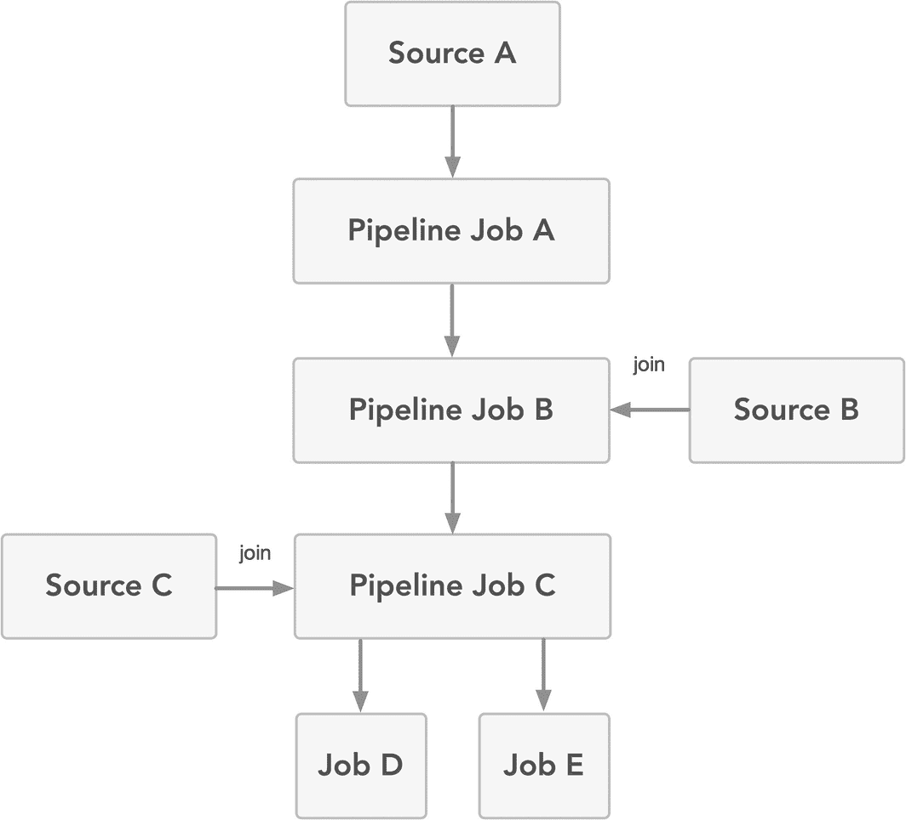
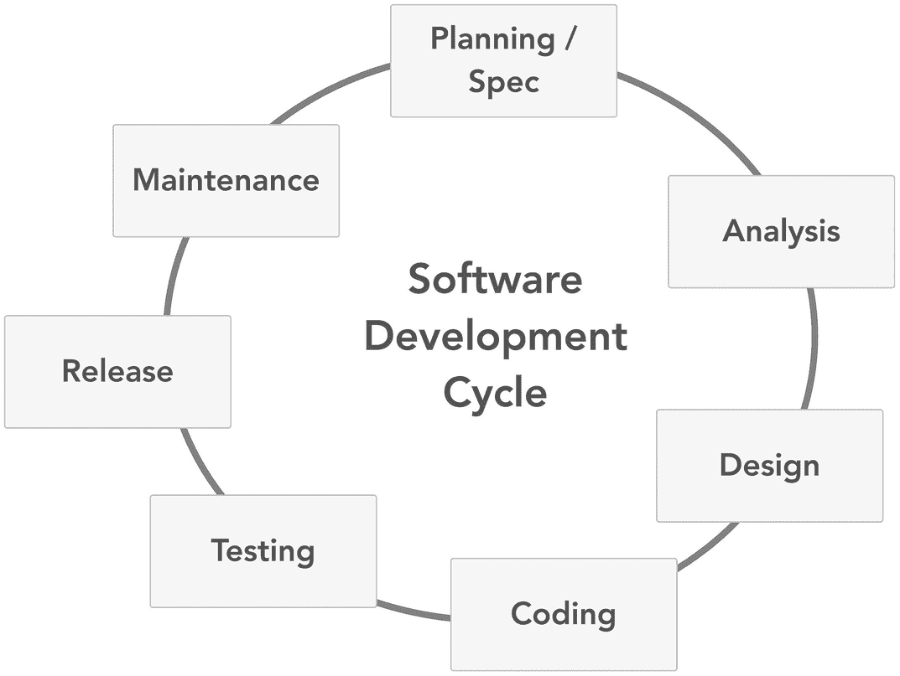

# 数据管道

在第一章中，你了解了数据管道的起源，以及管道工作如何从著名的**抽取-转换-加载（ETL）**设计模式演变而来。从概念上讲，ETL 使得像 `MapReduce` 这样的框架日益流行，因为复杂的问题可以被定义为工作流或一系列任务，从而将困难的分布式数据处理分而治之，分解为可消化的小型计算。数据管道建立了用于处理批处理或流处理的一致处理范式。由于数据管道仅仅是在系统间可靠移动数据的通道，开始思考数据在使用 ETL 处理时，如何在更大的数据拓扑中的各点之间流动，有助于建立一个清晰的思维模型。当你越来越熟悉那些数据流扇出、分叉或汇入一个或多个数据处理管道的复杂数据处理时，你的思维模型就可以开始转变为一个通过工作流编排（我们将在下一章讨论）来协调的相互依赖任务图。

打个比方，可以将数据管道视为一个由软件驱动的汽车或制造装配线。装配线上的每个工位都只专注于做好一项工作，这在同步数据处理中很有意义，因为每个任务都依赖上游任务的成功来完成其预定目标。图 7-1 展示了一个更复杂的数据管道的例子，其中一些任务需要按照装配线式的处理方式同步运行，而其他任务则可以完全异步运行。



*图 7-1 – 混合同步/异步数据管道*

图 7-1 显示，管道任务 A 到 C 相互依赖，需要按特定的同步顺序完成。这通常是组合式数据处理的典型情况。你将新的数据对象作为其他可用数据的复合体或组合来进行组合。这在数据源 A、B 和 C 的组合中可以看到。然而，在前三个上游管道任务完成后，下游任务 D 和 E 是独立的，可以异步运行。

鉴于数据管道的动态特性，只要数据流的变更不破坏任何依赖任务的下游数据需求，就可以在数据处理网络中新增、插入或移除数据处理任务。虽然这种灵活性提供了一种高效机制来重用上游工作产生的数据，但数据血缘问题或数据处理盲点可能会悄然出现，导致孤立的问题。这可能导致数据陈旧，主要原因在于管道破损（糟糕的上游任务），或数据网络中任何关键点的数据损坏所引发的系统范围问题。

随着数据管道复杂度的增长，你将看到对自动化的需求日益增加。起初，像 crontab 以及由 webhooks 和 API 触发的简单工作流之类的简单解决方案就能维持运行。然而，随着规模随时间扩大和增长，通常会迁移到更专业的工作流编排框架来管理更大的数据处理规模。你将在第八章学习如何使用 `Apache Airflow` 搭配 `Spark`，届时我们将探讨工作流编排。本章则提供了构建可靠的基于批处理的 `Spark` 应用程序的蓝图，使其准备好接入 `Airflow`。

## 管道基础

在之前的六章中，你一直在为数据管道之旅做准备，学习了现代数据工程师所需的重要历史、概念、组件和基础。作为回顾，前两章介绍并讲解了过去的状况和发展趋势，并让你在本地上手运行了 `Apache Spark`。第三章和第四章探讨了数据的读取、解析、转换和写入，并讨论了数据文档、强类型以及为他人铺路的重要性。

随着第五章中 JDBC 数据源的引入，你学会了使用 `Apache Spark` 与现有数据存储进行互操作，以便处理外部数据库。第六章介绍了 Spark SQL Catalog。你学会了使用外部的 `Apache Hive Metastore` 为 Spark SQL 提供支持，这可以简化处理外部表或托管表的过程，并能解决一些与数据发现、数据所有权和数据访问相关的常见问题。

在这个过程中，你一直在学习使用 `Spark` 来解决数据问题，而无需不必要地分心去思考如何编写能够按照标准软件开发最佳实践进行编译、单元测试、文档化和发布的应用程序。你将在本章中学习如何将常见的软件工程最佳实践应用于你作为数据工程师所做的工作中。

## Spark 应用程序：形式与功能

在本书的这一部分之前，你一直依赖 `Apache Zeppelin` 或手动使用 `spark-shell` 来交互式地输入命令和处理数据。这些*交互式应用程序*只是 `Spark` 应用程序可以采用的众多形式之一。`Spark` 应用程序可以采用的另外两种形式是*基于批处理的应用程序*和*流式应用程序*。了解这三种风格之间的异同可以帮助你决定编写哪种风格的 `Spark` 应用程序。这个过程也是从构思到生产过程中的一个关键决策点。

### 交互式应用程序

顾名思义，交互式应用程序在某种意义上是有生命力的，因为它们等待读取、评估和处理来自用户的输入。这种机制为许多不同的用例提供了良好的即时反馈循环，包括数据发现和探索性数据分析，以及在学习和尝试新事物时可以依赖的工具。`Spark Shell` 和 `Apache Zeppelin`（笔记本环境）提供了使用 `Spark` 的温和入门方式，无需编译代码或设置任何 IDE。不过，这些方法也存在局限性。

## Spark Shell

`Spark` 自带的 `REPL`（也就是 `spark-shell`）在第五章中有详细介绍，当时我们探讨了如何在 `Spark` 运行时环境之上创建快速的动态应用程序。尽管你可以通过动态文件加载和 `Spark` 配置的组合来构建相当复杂的例程，但其限制因素在于，这些 Shell 应用程序并非为满足生产系统黄金时段所需的完全一致性和可靠性而设计。充其量，这种操作模式就像一个强大的交互式脚本环境。


#### Notebook 环境

在本书中，我们全程使用了 Apache Zeppelin，以便通过 Notebook 简化与 Apache Spark 和 Scala 的协作方式。Notebook 环境是一个强大的工具。它将 `spark-shell` 的简洁性与一致的运行时环境融为一体，并且可以通过传递笔记或实时协作（托管版 Zeppelin）在同事之间共享。Zeppelin 让想法（启发式方法和代码流程）能够在一系列段落中得以充分实现，这些段落既可以作为同步流程（整体上）运行，也可以单独运行，这在调试某个段落时通常是常见情况。

锦上添花的是（至少在我看来），它能将内联文档与交互式图表和表格混合在一起，并与每个笔记中处理的数据并行展示。我们将在第 12 章中再次使用 Zeppelin 进行分析处理和洞察生成。

在工作中使用 Notebook 环境也是利弊参半。虽然编写一系列相对复杂的数据处理操作来访问内部和外部数据源可能很简单，但这种易用性也带来了损害生产系统的潜在风险。设想一个笔记，它对非生产数据系统（在非生产环境中）执行了大量相对昂贵的查询。虽然编写该笔记的工程师无意造成损害，但这些昂贵的查询有可能导致某个服务或数据库宕机——如果同一个笔记被迁移到生产环境或意外保存，就可能引发事故。

> **提示：** 了解你的数据规模：要清楚你正在处理的数据的规模，不仅仅是总记录数/行数，还包括所需的内存和 IO（带宽）开销。理解你正在处理的数据规模，对于运行健康的数据应用至关重要。这就是为什么许多应用在规划阶段使用 Notebook，而最终却以编译后的流处理或批处理应用形式进入生产环境的原因。

## 批处理应用

批处理应用不一定比你在 Zeppelin 中编写的一些简单段落更复杂。主要区别在于创建编译后的批处理应用的过程，而不是在 Zeppelin 中编写一个快速笔记或段落。我们将在本章下一节中介绍为批处理应用构建蓝图的过程，但在那之前，请记住以下几点。

与传统软件开发的最佳实践一样，编写健壮、可靠的数据应用需要你编写包含测试（单元测试和自动化测试）、符合团队或公司的卓越标准、经过代码审查、并采用分阶段方法发布的代码。它还必须确保下游系统以及其他依赖系统得到保护。最后，它必须确保每个作业都以高性能方式运行，并配备适当的指标和应用级监控，以确保每个作业都能履行并满足约定的 SLA。

在编写 Spark 批处理应用时，有两种方法可以帮助你设计接口和配置。应用可以是**无状态**的或**有状态**的。

#### 无状态批处理应用

无状态批处理应用不需要状态管理。这种编写批处理应用的方法旨在处理非常特定的任务，所有必要的配置都在运行时提供给应用。这类应用非常适合传统的数据管道作业。例如，管道作业可以配置为在开始和结束日期之间从外部表中导入所有行。由于职责划分清晰，且没有长期状态管理，每次运行批处理应用都可以自行设定其边界。例如，如果需要回填数据，可以创建一个或多个作业，并触发这些作业并行运行，而无需担心交叉污染（只要边界明确，例如按天加载分区数据）。**回填**是将缺失数据加载到数据源的过程。

> **提示：** 为复用而设计：虽然你可以创建一次性应用，但更好的做法是考虑如何让应用通过外部配置驱动以实现复用。否则，你将不得不反复对内部配置进行微小修改、发布、运行，然后重复这一过程。

无状态批处理应用的一个例子是每日报表作业。报表作业通常针对特定的数据子集运行，例如每日或每小时的指标或事件汇总。清单 7-1 中显示的批处理作业配置展示了一个示例应用如何被配置为从外部运行。

```
$SPARK_HOME/bin/spark-submit \
--class "com.coffeeco.reporting.DailyReport" \
--master "spark://thehost:7077" \
--deploy-mode "client" \
--conf "spark.report.table.source=daily-summaries" \
--conf "spark.report.table.sink=daily-reports" \
--conf "spark.report.range.start=2021-03-01" \
--conf "spark.report.range.end=2021-03-02" \
...
清单 7-1 外部配置让您的批处理应用可以一次编写，多种方式使用
```

与无状态批处理应用相对的是有状态批处理应用。

#### 有状态批处理应用

有状态批处理应用可以被设计为使用任意数量的外部系统来可靠地管理其配置和应用状态，例如 Apache ZooKeeper 或 HDFS。然而，另一种技巧是使用 Spark Structured Streaming，并将其配置为每次触发仅执行一次。这种技术使你可以利用强大的 Structured Streaming 引擎的有状态语义，来跟踪和管理一切的有效状态，包括数据源、已处理并完全提交的数据，以及批处理作业的每次运行。所有这些都无需你手动捕获和管理数据管道中批次间的作业元数据。对于更复杂的数据处理作业（包括从多个外部数据源读取和关联数据，且这些数据源混合了批处理和流处理来源），手动管理外部状态很快就会变得难以应付。

> **提示：** 如果你的有状态批处理作业将作为周期性批处理作业运行，用于将数据从流处理源可靠地移动到 HDFS 或 S3 等可靠数据存储中，请确定作业中哪些方面可以复用，以构建通用的基础应用。通用应用可以是配置驱动的，也可以建立在抽象类（库）之上，并在通用接口之间共享。基础化应用使得常见的数据工程问题能够一次性解决，并将经验教训进行复用，而无需从想法到生产耗费漫长的前置时间。


#### 从有状态批处理到流式应用

有状态批处理应用的另一个常见用途是周期性处理来自流式数据源（如 Apache Kafka）的数据。在给定主题的所有分布式分区中，可靠地追踪应用在数据流中的位置需要大量元数据，而这对于无状态批处理任务来说并不太适用。

最后，你可以在将应用开启为全天候流式处理之前，利用有状态批处理应用帮助进行性能调优。通过将外部配置与内部有状态处理相结合，你可以增加每批处理的记录数，并测试应用在不同 CPU/RAM 分配组合下的表现。能够先在批处理模式下测试的应用，可以逐步增加负荷直至达到其极限点，或配置为获得最大数据吞吐量。当你对结果满意后，只需切换触发器，你的应用就可以作为流式任务运行，并从上一次批处理结束的位置继续处理。你可以在第 10 章学习如何编写可靠的有状态批处理任务，包括使用外部配置来控制每个微批次的处理频率和速率的详细细节。

## 流式应用

Apache Spark 使你能构建处理无界数据源的应用，而无需过多改变你从批处理中形成的思维模式。鉴于 Spark Structured Streaming 应用默认会作为一系列持续处理的微批次数据来运行，因此按批次逐一处理问题是非常直观的。Spark 使你能通过两种主要的处理模式来处理流式数据：*微批次处理* 和 *持续处理*。

#### 微批次处理

这种处理模式会定期检查流式数据源（如 Apache Kafka），并触发一个新的批次进行处理。这意味着你可以将你的应用视为在无限数据流中，周期性处理有限数据集。

微批次处理更适合常见的分析处理需求，例如在时间窗口内汇总指标。回顾第 4 章，当时我们通过关联每家咖啡店的当前店内顾客数据，来构建一种判断是否有足够座位容纳不同规模聚会的方法。这种事件处理非常适合实时场景，因为这些数据流如果不及时处理，很快就会失去意义。例如，这些数据可用于驱动一个移动应用，帮助顾客找到离他们最近且有可用座位的门店。

然而，考虑到之前的有状态批处理用例，这些数据从历史角度来看也很有意义，只是精度要求不同。你可能需要将这些数据按 15 到 30 分钟的间隔进行汇总，以便让其他团队能够生成每家门店的日/周/月绩效报告。

#### 持续处理

与基于微批次处理不同，持续处理支持对每条记录进行单独处理，确保每个数据点都以有状态的方式被精确处理一次。这种处理方式可用于实现实时计费场景，即你需要单独（且持久地）处理每笔交易。对于计费来说，每个操作在事件级别上要么成功要么失败尤为重要，这与“至少一次”的处理方式相反，因为后者可能导致对客户重复计费。在微批次内发生部分故障的情况下，Spark 会回滚并重新处理该部分数据集，这是微批次流处理和计费时常见的一个陷阱。

**注意**  
本书不涉及持续处理，但如果你感兴趣，可以使用第 11 章（Apache Kafka）的环境自行测试。（在撰写本文时，唯一支持持续处理的数据源是 Apache Kafka。）

了解 Spark 应用可以采用的多种运行模式，是设计可靠数据应用的第一步。第二步，当然就是实际编写应用。接下来我们将进行一项练习，为你编写本章后续部分的内容做好准备。

## 设计 Spark 应用

如你所知，数据工程本质上是高效、可靠地移动和转换数据的艺术。为了做好我们的工作，每个任务，或者我们在数据管道中运行的系列任务，都应该是特定数据需求的结果，并编码为经过传统软件开发周期的已发布数据应用。软件开发周期如图 7-2 所示。它总结了成功构建和运行软件所需的七个常见概念执行阶段。同样的流程可以（也应该）应用于任何数据工程团队或数据组织的规划和成功运营。



图 7-2

软件开发周期

可靠的数据应用遵循传统的软件开发周期。你计划编写什么、为什么需要编写它、目标受众是谁、以及需要在何时完成——所有这些问题都源于传统的基于规范的规划和构思。这些计划会引出需要快速且仔细分析的工作，然后才能开始设计和编写完成任务的代码。在项目的规划、分析和设计阶段，你可能会在像 Apache Zeppelin 这样的笔记本环境中工作。你也可能会回到这些交互式环境中去调试生产中的问题，或者快速调出一个图表与同事分享。

**提示**  
交互式环境因多种原因而格外宝贵，但对于快速进行调研尝试尤其不可替代。它们帮助你在软件生命周期早期就发现缺口，避免在之后花费时间规范化代码、编写单元测试、进行代码审查以及准备生产发布。

我们将在下一节中通过一个扩展用例来展开工作。此练习的目的是帮助你思考如何用数据解决问题。鉴于数据工程师专注于数据，学习抽象地思考数据和数据建模是核心技能。数据建模对所有数据从业者来说都是一项基本技能，虽然关于分类法、命名约定和通用理论的讨论不在本书范围内，但下一个用例将向你介绍如何构建基础数据问题的框架。


