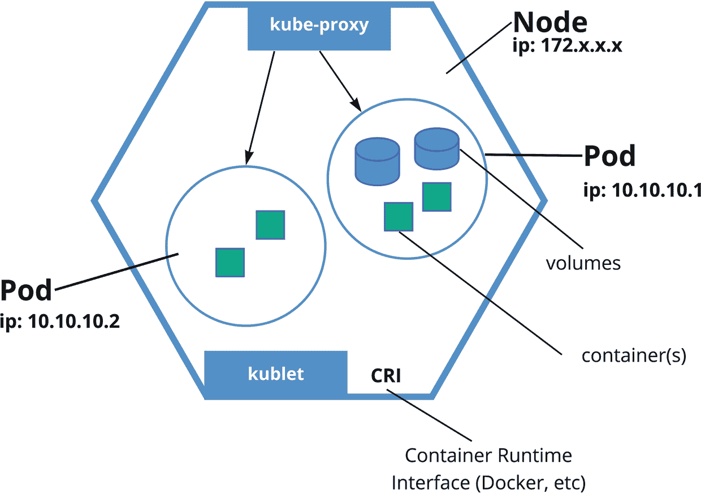

# 15. 在 Kubernetes 上部署关键任务型 Spark 应用

在深入探讨什么是 `Kubernetes` (K8s) 以及 `Apache Spark` 如何融入分布式 K8s 生态系统之前，有必要先简单明确一点：`Kubernetes` 使得 `Apache Spark` 应用能够在隔离环境中运行，它将弹性可扩展性与容器的运行时一致性相结合，共同部署在称为 `pods`（你很快就会了解）的独立微环境中。最终，你可以依赖一致的运行时环境，而无需处理在共享一切生态系统中多租户带来的烦恼和诸多困难。相反，可以想象每个应用程序都在自己独立的世界中运行，从高层次上看，这类似于你使用 `docker-compose` 在本书一直在构建的本地数据平台上运行 Spark 应用所使用的本地环境。

细节中常常隐藏着魔鬼，但许多源于在生产集群中运行 `Apache Spark` 应用的常见痛点（我们在上一章中看到过），例如集群范围内资源竞争的问题、大型多租户集群的（向上或向下）扩展问题，或者从更高层面看，甚至运行一个或多个物理 Spark 集群的问题，都简单消失了。取而代之的是，每个 Spark 应用都被部署并自动连接，即搭建（并运行）其完全独立的 Spark 集群（按需），这些集群由编排在支撑你 `Kubernetes` 集群的物理节点之上的 `pods` 组成。通过移除运行独立集群和管理其中运行的应用所需的众多活动部件，你可以转而关注每个应用的独立需求，并将其余部分通用化。

`Kubernetes`，在 `Apache Spark Kubernetes 资源管理器` 的支持下，为你的关键任务型 Spark 应用提供动力。

在本章中，你将学习如何在 Kubernetes 上部署 Spark 应用。此外，你还将看到如何利用 K8s 部署提供的固有幂等性，并结合资源请求与限制（例如 CPU 和内存分配）。你还将学习 Spark 的动态分配如何发挥作用，为你自组装的 `Apache Spark` 应用增添超能力。到本章结束时，你将亲眼目睹 `Apache Spark` on Kubernetes 如何协同工作以满足任何数据平台的各种需求，以及 Kubernetes 如何融入现代数据生态系统。让我们开始吧。

## Kubernetes 入门

用他们自己的话说，“Kubernetes 是一个用于自动化部署、扩展和管理生产级容器化应用的开源系统。”简而言之，Kubernetes 是一个可靠的编排框架，它提供分布式计算和资源调度即服务，建立在隔离性、一致性和可靠性这些首要原则之上。它还恰好拥有丰富的 API，在规模化运营应用和服务时，可以利用这些 API 实现更智能的决策和灵活性。

本书在教你架构和构建使用 `Apache Spark` 的容器化应用时，已逐渐将你引入容器的世界。你学会了如何使用 Docker、Docker Compose 和 Docker 网络来运行应用并编排本地工作流。每个工作流都需要设置和引导定制的、特定于应用的环境，以支持书中处理的众多数据工程用例。这些用例范围从常见的数据处理工作流（如 ETL/ELT），到作业调度和编排，再到架构和构建可插拔（可组合）、配置驱动的 Spark 流水线应用。

此前的每一章都像是这段旅程中的向导，深入探讨数据工程生态系统的特定方面，引导你沿着一条精选路径，了解最重要的（需要掌握的）工具和技术、思维模型以及架构，为你提供优雅且巧妙地解决流式处理问题所需的技能。所有前面的章节都在为这里做准备，作为通往 K8s 革命旅程中的进化步骤，以及我们一起度过的最后一章。

这最后一章分为两个主要部分。在第一部分中，你将在本地开始 [Kubernetes](https://kubernetes.io/) 入门。你将在构建环境的同时，动手学习常用的组件和资源 API。之后，在第二部分中，你将学习如何在 K8s 上部署你的 `Apache Spark` 结构化流式处理应用。本章以后续步骤和建议作为总结，让你能够将本地学到的所有内容应用到云端，并从此继续前进。

练习材料

第 15 章的练习材料位于：

```
https://github.com/newfront/spark-moderndataengineering/tree/main/ch-15
```

## 第一部分：在 Kubernetes 上启动并运行

你可以在不到一小时内开始在本地使用 Kubernetes。要全面拥抱整个生态系统并学习众多的 API 和最佳实践可能需要更长的时间，但有许多书籍（以及在线教程和视频）可以在更低的层次上引导你了解核心 API。我们将转而介绍入门所需的基本知识，涉及绝对需要了解的结构、概念和范式。让我们开始并运行起来。

# 使用 Minikube 驱动本地 Kubernetes

Minikube 是一个易于使用的环境（及 Shell），能在虚拟机（Mac/Windows/Linux）中本地运行一个小型专用 Kubernetes 集群。安装说明可在线查阅[`https://minikube.sigs.k8s.io/docs/start/`](https://minikube.sigs.k8s.io/docs/start/)，若使用 macOS 系统，亦可运行`brew install minikube`进行安装。以下侧边栏提供了 minikube 基础命令的补充概览。若想深入了解，可稍后返回本节内容；否则，直接运行`minikube start`即可启动运行。

## Minikube 基础

安装完成后，仅需少量命令即可高效操作 minikube。以下命令可在您选择的终端中运行。

### `minikube start`

该命令会启动一个本地单节点 Kubernetes 集群，并自动下载安装所有额外依赖项。

```
minikube start
```

默认情况下，minikube 虚拟机配备两个（CPU）核心和 2GB（RAM）内存。您可通过多种选项自定义安装并指定 K8s 集群的运行方式。例如，可选择 K8s 版本、分配给虚拟机的总内存以及 CPU 核心数。

```
minikube start \
--kubernetes-version v1.21.2 \
--memory 16g \
--cpus 4 \
--disk-size 80g
```

准备停止工作时，您可以选择保持虚拟机运行，仅暂停 k8s 集群中的进程；也可以选择完全停止集群并回收系统资源。

### `minikube pause`

暂停（Pause）是 minikube 的一项创新功能。您不必完全关闭集群，而是可以选择暂停（冻结）特定资源（由命名空间管理）或暂停所有运行中的内容。暂停特定资源（如本地 Kafka 或 Redis）有助于观察应用程序在服务丢失时的行为表现。

```
minikube pause -A
minikube pause -n kafka,redis
```

### `minikube unpause`

此前暂停的所有容器均可取消暂停。

```
minikube unpause -n kafka, redis
```

若本地系统资源有限，使用`pause`和`unpause`可以成为救命稻草；此外，它们还提供了一种简单机制，可让您恢复至特定的环境配置。这与使用`docker compose`确保 Spark 应用运行所需系统服务可用的方式类似。

### `minikube stop`

当您决定完全停止所有内容并关闭物理虚拟机时，只需使用`stop`命令。

```
minikube stop
```

### `minikube status`

您将不时需要检查 minikube 虚拟机的状态。只需运行`status`命令即可查看环境状态。

```
minikube status
```

至此，minikube 基础速览结束。如需回顾任何基本命令，可返回本节查看。

拥有了本地（单节点）Kubernetes 集群，您即可开始搭建运行 Spark 应用所需的基础框架。

## Kubernetes API 实践之旅

使用任何新工具时，首要目标是理解或至少熟悉其核心运行部件。就 Kubernetes 而言，这意味着理解核心服务、概念和组件。在本节中，您将使用 minikube 安装的`kubectl`直接与 Kubernetes API 交互。

> **提示**

>

> 若需在笔记本电脑上支持多个版本的`kubectl`（用于测试或其他目的），可使用`minikube kubectl --`将命令转发至 minikube 虚拟机内部的`kubectl`。

让我们从核心概念——*节点*开始。

## 节点

[节点](https://kubernetes.io/docs/concepts/architecture/nodes/)是 Kubernetes 集群中可扩展性的核心单元。节点通过集群管理器（K8s 主节点）独立注册并加入集群。新加入的节点通过扩展总可调度资源（CPU 核心和内存）来提升集群的水平扩展能力。同样，退出集群的节点（关闭或故障）会减少集群的总资源，从而实现松耦合的弹性扩展。

## 常见节点服务与职责

集群中的每个节点至少包含三个组件：*kubelet*、*kube-proxy*和*容器运行时*。

### `kubelet`

`kubelet`是一个代理程序（运行在每个节点本地），负责确保节点能够执行其主要目标——保证所有容器在其各自的 Pod 中持续运行。

### `kube-proxy`

`kube-proxy`是一个代理进程，运行在集群的每个节点上。它负责维护网络规则，用于转发进出由`kubelet`管理的 Pod 的数据包。这一关键服务实现了节点级别应用程序与服务之间的集群范围通信，并参与服务层，使外部请求能够被转发至 Pod 中运行的容器。

### 容器运行时

*容器运行时*是一个可插拔接口，扩展了*Kubernetes 容器运行时接口*（CRI）。它支持 Docker 及其他流行的容器运行时。这三个组件——`kubelet`、`kube-proxy`和*容器运行时*——协同工作，支撑集群中的工作负载。它们通过确保每个节点与集群保持松耦合，并主要关注本地的隔离问题（而非集群范围的问题）来实现这一点。

## 查看所有集群节点

要列出集群中的所有可用节点（使用 minikube 时默认有一个节点），可通过`kubectl`对*节点资源*使用`get`动词。

```
% kubectl get nodes
NAME       STATUS   ROLES                  AGE   VERSION
minikube   Ready    control-plane,master   64m   v1.21.2
```

获取到指定节点的唯一节点*名称*后，使用`describe`*动词*查看该节点的元数据。

```
% kubectl describe node minikube
```

`describe node`命令的结果会提供该节点的所有可用信息，包括节点 IP 地址（主机名）、标签（可视为标签）、注解，以及可用和已使用的节点资源（核心/内存等）。我建议当集群中运行更多服务时，再次使用此命令。毕竟，集群中只有一个本地节点时，所有 Pod 和进程都将被调度到该节点上。接下来是*命名空间*。

## 命名空间

命名空间发挥着至关重要的作用：它能够保护并隔离服务组，防止用户误操作；在多团队（多人）于单个联邦 Kubernetes 集群中运行多种工作负载时，实现关注点分离；并可控制对受保护资源（如命名空间范围内的密钥、计算和存储分配）的访问，防止资源枯竭。

根据团队或公司的需求，您可以决定如何管理生产集群。不过，在运行本地开发集群时，我发现按上下文和所有权分离服务非常有用。例如，数据库和其他数据服务位于`data-services`命名空间，而 Spark 应用程序则位于另一个命名空间。通过这种方式，您可以有效隔离运行 Spark 应用程序所需的依赖服务，使其与 Spark 应用运行的命名空间分开。

> **提示**

>

> 在 minikube 中，命名空间还可用于暂停或取消暂停该命名空间中的所有 Pod：`minikube pause -n data-services`。使用此技术可观察 Spark 应用程序的容错能力。

接下来，您将创建`data-services`命名空间。

### 创建命名空间

在创建命名空间（以及 Kubernetes 中的大多数资源和服务）时，你有两种选择。你可以直接使用`kubectl`，也可以提供一个可应用的外部资源配置文件。

使用命令行，执行以下`create`命令。

```
% kubectl create namespace data-services
```

成功执行。你应该会看到`data-services`命名空间已被创建。你可以通过对`namespaces (ns)`资源使用`get`动词来检查可用的命名空间，以确认这一假设。

```
% kubectl get namespaces
```

结果将返回所有活跃命名空间的有序列表。现在，让我们删除刚刚创建的命名空间，以便稍后使用资源文件重新创建它。

### 删除命名空间

通过 Kubernetes API 创建的资源，可以使用相应资源上的`delete`动词来销毁。

```
% kubectl delete namespace data-services
```

接下来你将重新创建`data-services`命名空间，但这是一个重要的步骤，能让你学会以一种无压力的方式管理资源，因为一切都可以重新构建。

### 使用 Apply 创建 Kubernetes 资源

打开你喜欢的文本编辑器（或 IDE），创建一个名为`namespace.yaml`的文件，如列表 15-1 所示。

```
# 使用 kubectl apply 和 delete 管理资源

现在，可以一致地使用 `kubectl` 的 `apply` 动词来创建该命名空间。

```
% kubectl apply -f namespace.yaml
```

## 删除基于文件的资源

任何使用 `apply -f {file}` 创建的资源，都可以使用同一个文件来删除。

```
kubectl delete -f namespace.yaml
```

现在你已经看到了使用 `kubectl` 创建和删除资源的两种不同方式。

> **注意**
>
> 你可能会想，既然命令行更快（也更简单），为什么有人会选择使用文件呢？这个决定可以归结为一致性。如果你希望在实现系统和服务的良好可移植性的同时，维护一个既能在本地轻松运行，也能在云端运行的生态系统，那么你需要一种`简单`的方法来重建（搭建）一个完整的工作环境，而这个过程始于一个持久的蓝图。

接下来，你将学习如何使用新创建的 `data-services` 命名空间，将 Redis 部署到你的 `minikube` 集群中。

## Pod、容器和部署

我们将从一个关于 Pod 的快速介绍开始，然后进行练习。你将亲身体验 Pod 部署是如何工作的，并且作为副产品，你将了解什么是 Pod，以及容器是如何融入其中的。在此过程中，你将学会在容器级别管理集群资源。更棒的是，你还将了解如何使用持久卷来实现有状态（持久）存储。

在你着手将第一个 `Spark Structured Streaming` 应用部署到 `Kubernetes` 的过程中，所有这些步骤都是必要的。正如你将在本章第 2 部分中发现的，Spark 为你做了很多神奇的事情，但如果不了解其组成部分，这种简单性可能会反过来困扰你。

## 什么是 Pod？

Pod 的名称源于自然。比如豆荚中的一颗豌豆，或者一群鲸鱼。在 `Kubernetes` 中，`Pod` 是最小的可部署计算单元。将 Pod 视为一个结构，它为一组一个或多个容器封装了一个隔离的环境，这组容器为底层组的共享资源提供运行时保护（可以想象成保护豌豆的豆荚壳）。这些共享资源包括本地网络（Pod 内部网络，即 `localhost/127.0.0.1`）的共享，以及对共享存储（卷/磁盘空间）的本地访问。所有这些都有一个运行时保证：只有当所有资源请求（CPU/内存/存储）和其他特殊需求在所有容器上都完全满足时，Pod 才会被成功调度。这是 Pod 被认为处于健康状态的必要条件。Pod 与节点的关系如图 15-1 所示。通用组件（本章前面已介绍）包括节点、`kubelet`、容器运行时和 `kube-proxy`，它们协同工作，运行 Pod，并将流量路由到 Pod 内的容器以及从这些容器路由出来。



**图 15-1** Pod 被调度到一个或多个节点上运行，并在物理节点上分配资源，由 `kubelet` 进程控制。

由于每个 Pod 都有自己的本地范围，因此许多 Pod 可以被调度到同一个底层节点上运行，而无需担心在可寻址网络空间内发生冲突。此外，对全局用户空间中共享密钥或受限文件的节点级访问问题，可以在 Pod 级别进行管理，从而使安全性和关注点分离变得更加容易。Pod 通过分离跨共享集群以及同一物理节点上运行的工作负载，引入了一种很好的范式。

根据设计，在 Pod 中运行的容器不能打破隔离，也不能触及在同一节点上运行的其他 Pod。这从安全角度来看会引发担忧，而且也会破坏松耦合的概念，因为 Pod 首先需要知道其他 Pod 的存在。好的，这听起来很棒，但为了真正理解 Pod，我们将创建一个 Pod 规范来运行 Redis。

## 创建 Redis Pod 规范

在第 10 章中，你了解了通过 `docker compose` 运行 Redis。让我们重新回顾一下该章练习中 `docker-compose.yaml` 文件的 Redis 服务，然后将该配置转换为 Kubernetes Pod 规范。列表 15-2 提供了第 10 章中的 Redis 服务。

```
services:
  redis:
    image: redis:6.2
    container_name: redis
    hostname: redis
    ports:
      - 6379:6379
    healthcheck:
      test: ["CMD", "redis-cli", "ping"]
      interval: 5s
      timeout: 30s
      retries: 50
    restart: always
```

**Listing 15-2** 基于 Docker Compose 的 Redis 服务

以 `docker compose` 服务配置为思维模型，让我们创建一个简单的 Redis `PodSpec`，然后启动该 Redis Pod。列表 15-3 提供了所需的配置。打开你喜欢的编辑器，创建一个名为 `redis-pod-basic.yaml` 的新文件，并添加列表 15-3 中的内容。

```
apiVersion: v1
kind: Pod
metadata:
  name: redis-basic
  namespace: data-services
  labels:
    app: redis
    type: basic
spec:
  restartPolicy: OnFailure
  containers:
    - name: redis
      image: redis:6.2
      imagePullPolicy: Always
      ports:
        - containerPort: 6379
          protocol: TCP
      resources:
        limits:
          memory: "1G"
          cpu: "2000m"
        requests:
          memory: "500Mi"
          cpu: "1000m"
```

**Listing 15-3** 用于配置和启动 Redis 的基本 `PodSpec` (`redis-pod-basic.yaml`)

列表 15-3 中的 Redis `PodSpec` 创建了一个具有唯一名称的 Pod 模板。我们之所以称之为 `PodTemplate`，是因为它可以用来启动一个或多个 Pod。从顶部开始，我们首先为我们的 *Pod 资源*（`kind: Pod`）指定 `K8s apiVersion`。通过声明 API，`Kubernetes` 可以自由地支持或弃用旧版 API，而无需强制收敛。

### 元数据

接下来，使用 `metadata` 属性为我们的 Pod 分配一个唯一名称（`redis-basic`），并添加可用于调度和定位我们 Pod 的配置。在本例中，我们分配了 `data-services` 命名空间，并添加了一些标签，我们以后可以使用这些标签来定位特定的 Pod 子集，或者在命名空间内隔离单个 Pod。
```

# spec

接下来讨论最重要的配置：Pod 规范（`spec`）块本身。如前所述，Pod 为一个或多个容器封装了隔离环境，因此 `PodSpec` 被拆分为多个部分，以便对共享资源进行通用配置，同时包含容器特定的配置。你会在清单 15-2 的 `docker-compose.yaml` 和清单 15-3 的 Redis Pod 规范中看到容器规范中的一些重叠之处。最大的区别在于资源请求和限制的精细控制，以及端口配置。

现在让这个 Pod 投入使用吧。

## 调度 Redis Pod

使用 `kubectl` 我们可以应用 `redis-pod-basic.yaml`，让 Kubernetes 调度我们的 Pod。然后我们最终能够达到与理想世界状态的一致。

```bash
% kubectl apply -f redis-pod-basic.yaml
```

如果一切顺利，你会看到 `kubectl` 输出 `pod/redis-basic` 已创建的消息。接下来让我们找到我们的 Pod。

## 列出、描述和定位 Pod

在命令行中，对 `pods` 资源调用 `get` 命令。

```bash
% kubectl get pods
```

此时你可能感到困惑，为什么没有显示任何结果（在默认命名空间中未找到任何资源）。这是因为 Kubernetes（默认情况下）只会列出来自单个命名空间的资源，而这个命名空间恰好是默认命名空间。通过添加 `explicit` 命名空间或包含 `--all-namespaces` 标志，你可以获得期望的结果。

```bash
% kubectl get pods -n data-services
NAME           READY   STATUS    RESTARTS   AGE
redis-basic    1/1     Running   0          44m
```

现在你可以找到你的 Pod，还可以通过对 Pod 资源使用 Pod 名称并调用 `describe` 动词来获取有关 Pod 本身的更多信息。

```bash
% kubectl describe pod/redis-basic
```

调用 `describe` 的结果可用于获取有关 Pod 本身的详细信息，包括启动日期、容器、节点、IP 地址、当前观测到的 Pod 状态等。

最后，在未来你可能运行了许多 Pod 的情况下，并且想要找到一个特定的 Pod（或一组 Pod），你可以依靠 Pod 资源的元数据标签来找到你要找的内容（跨一个或多个命名空间）。清单 15-4 在所有命名空间中执行通用搜索，以找到任何具有匹配标签（`app=redis`）且类型不是 `pv`（`type!=pv`）的 Pod。

```bash
% kubectl get pods \
--all-namespaces \
-l app=redis,type!=pv
清单 15-4
使用标签选择器跨所有命名空间定位 Pod
```

清单 15-4 中的查询将返回所有匹配的 Pod。在我们的案例中，目前只有一个。

```bash
NAMESPACE      NAME          READY   STATUS    RESTARTS   AGE
data-services  redis-basic   1/1     Running   0          78s
```

我们的下一个任务就是简单地进入新的 Redis Pod，并使用 `redis-cli` 执行几个命令。

## 在 Redis Pod 上执行命令

就像你已经习惯于使用 `docker exec` 命令一样，你可以直接将你的技能迁移到 Kubernetes 和 `kubectl` 上。清单 15-5 中的命令将连接到 `redis-basic` Pod 并启动 `redis-cli`。

```bash
% kubectl exec \
-n data-services \
-it redis-basic \
-- redis-cli
清单 15-5
使用 kubectl exec 连接到正在运行的 Pod
```

设置并获取一个键，以确保 Redis 按预期工作。

```bash
127.0.0.1:6379> set app redis-basic
OK
127.0.0.1:6379> get app
"redis-basic"
```

退出进程（Command+C），这样我们就可以删除 Pod。

## 删除 Redis Pod

你可能已经知道需要什么命令。就像命名空间一样，你可以简单地对 Pod 资源使用 `delete` 动词，通过名称删除 Pod。

```bash
% kubectl delete -n data-services pod/redis-basic
```

那么为什么要费劲做所有这些工作，最后却要删除呢？答案在于我们对特定服务的期望。在现实世界中，考虑到 Pod 几乎可能随时被杀死（由于任何云原生基础设施的正常生命周期），你最终需要一个可靠的机制来确保你的所有服务（包括 Spark 应用程序）能够以一致的方式部署、监控和恢复，且只需有限或无需人工干预。

接下来我们将研究 Kubernetes 的部署资源，学习如何创建一致且可靠的部署。

## 部署与处理故障时自动恢复

在上一节中，你学会了如何配置 Pod 规范。使用简单的 Pod 模板，你可以在 `data-services` 命名空间中调度和运行 Pod。通过这个过程，你学习了如何使用 Pod 的元数据装饰 Pod（使用标签进行标签选择），以及如何配置一个简单的单容器规范。利用你运行 `redis-basic` Pod 所学到的技能，接下来你将学习如何使用 Kubernetes 的部署资源创建受管部署。

### 创建 Kubernetes 部署

*部署*是一种特殊的 K8s 资源，它引入了针对给定 Pod 规范管理和运行可靠部署的扩展能力。作为一项服务管理可靠性，Kubernetes 集群将监督部署中配置和包含的资源，确保诸如节点故障等常见问题不会导致你的服务停滞不前。

创建一个名为 `deploy-redis-memory.yaml` 的新文件，并将清单 15-6 中的部署配置内容添加到文件中。然后保存它。

```yaml
apiVersion: apps/v1
kind: Deployment
metadata:
name: redis-memory
namespace: data-services
labels:
app: redis-memory
type: canary
spec:
replicas: 1
strategy:
rollingUpdate:
maxUnavailable: 100%
type: RollingUpdate
selector:
matchLabels:
app: redis
type: memory
template:
metadata:
labels:
app: redis
type: memory
spec:
containers:
- name: redis
image: redis:6.2
volumeMounts:
- name: redis-storage
mountPath: /data
imagePullPolicy: Always
ports:
- containerPort: 6379
protocol: TCP
resources:
limits:
memory: "1G"
cpu: "2000m"
requests:
memory: "500Mi"
cpu: "1000m"
volumes:
- name: redis-storage
emptyDir:
medium: Memory
清单 15-6
部署为基于 Pod 的服务提供运行时一致的行为，包括故障时自动恢复，以及处理复制服务滚动更新的开箱即用能力
```

你会注意到，清单 15-6 中的初始部署配置包装了清单 15-3 中引入的 Pod 规范，并做了两个小改动以引入基于 Pod 的本地 `卷` 存储。`卷` 是 Pod 中的共享资源，但不是立即可用于所有容器，每个容器必须使用 `volumeMounts` 声明式地添加卷。将卷挂载（或附加）到容器还带来了额外的好处，即允许每个容器创建自定义挂载路径。

```yaml
volumeMounts:
- name: redis-storage
mountPath: /data
```

稍后我们将介绍 `volumes` 和 `volumeMounts`，但现在请注意，`volumes` 规范是在与 `containers` 规范同级的级别上配置的，而 `volumeMounts` 是在每个容器的基础上配置的。现在让我们创建部署。

### 部署与资源管理

使用清单 15-6 中的部署配置，通过应用配置来创建并启动您的部署。

```bash
% kubectl apply -f deploy-redis-memory.yaml
```

现在部署已经创建成功，让我们来点有趣的尝试。与其详细解析所有部署细节，不如通过以下四个步骤来探究部署：定位、连接、观察和删除。

#### 定位新部署的 Pod

使用本章学到的任意技术，找到您新部署的 `redis-memory` pod。定位后，您会注意到该 pod 的名称比之前更长。例如，我创建的 pod 名称为 `redis-memory-78d89d7c87-zchc2`。如果您想了解原因，可以查看部署元数据。

```
% kubectl get deployment/redis-memory -n data-services
```

现在，连接到被管理的 pod。

### 连接到被管理的 Pod

连接到被管理的 Redis pod，并重复清单 15-5 中的步骤。在断开与 pod 的连接前，请记得检查键是否已保存。

### 观察 Pod 状态与行为

在第二个终端窗口（最好与当前终端会话并排显示）中，运行以下命令。

```
% kubectl get pods -n data-services --watch
```

通过观察 pod，您将能够实时查看目标命名空间中所有 pod 的状态变化。

### 删除被管理的 Pod

回到第一个终端窗口，删除 Redis pod。

```
% kubectl delete -n data-services pod/redis-memory-78d89d7c87-zchc2
```

会发生什么？

您会观察到，在删除被管理 pod 的瞬间，几乎实时就会有一个新 pod 被调度来替换已删除的 pod。

清单 15-7 中的输出显示了我集群上观察到的状态变化消息。输出显示了我的初始 pod（`redis-memory-78d89d7c87-zchc2`）从 `Running` 状态变为 `Terminating` 状态。同时，一个新 pod 被创建，以确保我们始终至少有一个副本，因为我们的部署声明了期望副本数：1。替换的 pod 最初处于 `Pending` 状态，然后变为 `ContainerCreating`，最后变为 `Running`。所有这些过程在本地环境下不到五秒内完成。除非删除部署，否则 Kubernetes 将确保您的 pod 永远运行。

```
NAME                            READY   STATUS              RESTARTS   AGE
redis-memory-78d89d7c87-zchc2   1/1     Running             0          35m
redis-memory-78d89d7c87-zchc2   1/1     Terminating         0          36m
redis-memory-78d89d7c87-p4hzl   0/1     Pending             0          0s
redis-memory-78d89d7c87-p4hzl   0/1     Pending             0          0s
redis-memory-78d89d7c87-p4hzl   0/1     ContainerCreating   0          0s
redis-memory-78d89d7c87-zchc2   0/1     Terminating         0          36m
redis-memory-78d89d7c87-p4hzl   1/1     Running             0          4s
redis-memory-78d89d7c87-zchc2   0/1     Terminating         0          36m
redis-memory-78d89d7c87-zchc2   0/1     Terminating         0          36m
```

清单 15-7 当被管理的 Pod（位于有状态副本集之后）终止时观察到的状态变化

现在来说说坏消息。虽然部署控制器能够恢复已删除的 pod，但您会发现 Redis 数据库中没有任何键。您可以使用 `redis-cli` 自行验证。这是为什么呢？Pod 不应该是一致的和可靠的吗？

事实上，这完全是设计使然。为了声明每个部署是幂等的，并一致地支持运行时容错，pod 及其底层容器必须使用不可变约定。否则，当 pod 终止或遭遇不可恢复故障时，对任何 pod 本地资源（例如向 Redis 数据库添加新键）的运行时更改（变更）将会丢失。鉴于按照约定，pod 需要能够在集群中快速移动，因此最佳实践是由 Kubernetes 管理外部配置、密钥以及存储，以确保一致性。

让我们通过学习如何在部署之间持久化数据，来完成 Kubernetes 的实践之旅。然后，我们将动手实践 Apache Spark 的 Kubernetes 资源管理器。

## 在部署之间持久化数据

Kubernetes 基于 `volumes` 和 `volumeMounts` 的概念，为文件系统（和内存）存储提供了丰富的抽象层。在上一节（清单 15-6）中您已经了解了这两个概念，现在您将学习如何启用能够抵御 pod 故障的持久化存储。

首先，我们将使用节点级存储，它在 Kubernetes 节点上持久存在，并在 pod 终止时防止数据丢失。值得注意的是，如果您删除 minikube 虚拟机，节点级数据也会随之丢失。在命令行中，通过 `ssh` 登录到 minikube，然后创建一个位于 `/mnt/data` 的空目录。

```
% minikube ssh
$ sudo mkdir -p /mnt/data
```

完成此步骤后，我们可以继续创建持久卷资源。

> **警告**
> 在托管的生成环境 Kubernetes 集群（如 EKS/AKS/GKE）中，通常不需要 `ssh` 访问。请考虑限制 `ssh` 访问或完全关闭它，以防止恶意行为者干扰您的 Kubernetes 集群。

### 持久卷（PV）

容器在运行时进行的本地更改，会在 pod 因正常生命周期事件（如全新部署）而终止、失败或以其他方式被替换（重新调度）时消失。正如您所见，这还包括添加到本地 pod 环境中的任何数据库记录。

幸运的是，可以使用底层 Kubernetes 节点的本地文件系统存储，或采用更松耦合的实践，即附加托管的云网络文件系统存储，来为 Kubernetes 集群配置可靠的存储。以主流云厂商的产品为例：亚马逊的[弹性块存储](https://aws.amazon.com/ebs/)、微软的[AzureFile](https://docs.microsoft.com/en-us/azure/storage/files/)/[AzureDisk](https://azure.microsoft.com/en-us/services/storage/disks/)以及谷歌的[持久磁盘](https://cloud.google.com/persistent-disk)。持久卷将存储提供者与实际消费者隔离开来，使得应用能够请求存储，并由 Kubernetes 负责查找并声明与存储请求匹配的资源。

#### 配置持久卷（PV）

创建一个名为 `persistent-volume.yaml` 的文件，并添加清单 15-8 所示的 `PersistentVolume` 资源配置。随后，可将此模板应用于 Kubernetes 集群，以在 minikube 集群的单个节点上物理创建一个持久卷。

```yaml
apiVersion: v1
kind: PersistentVolume
metadata:
  name: general-pv-volume
  namespace: data-services
  labels:
    type: local
spec:
  storageClassName: manual
  capacity:
    storage: 2Gi
  accessModes:
    - ReadWriteOnce
  hostPath:
    path: "/mnt/data"
```

清单 15-8 为 Redis 创建 PersistentVolume (`persistent-volume.yaml`)

清单 15-8 中的资源配置会在 minikube 节点的 `/mnt/data` 目录下创建一个容量为 2GB 的卷（并将其隔离）。应用此配置以创建新资源，然后使用 `persistentvolume`（`pv`）资源类型的 `get` 和 `describe` 命令查看已创建的资源，深入了解这一新的资源类型。

##### 创建持久卷

```
% kubectl apply -f persistent-volume.yaml
```

##### 查看持久卷

```
% kubectl get pv general-pv-volume
NAME               CAPACITY   ACCESS MODES   RECLAIM POLICY
general-pv-volume  2Gi        RWO            Retain
```

##### 描述持久卷的详细信息

```
% kubectl describe pv general-pv-volume
```

有了 `general-pv-volume` 后，下一步是创建一个声明策略，通过 `PersistentVolumeClaims` 资源来管理对卷的读写访问。

## 持久卷声明（PVC）

PV 是集群中特定于存储的资源。PVC 作为一种资源，用于声明 PV 的一部分（或全部）。正如一个节点可以被分割以运行不同规模的工作负载（由 Pod 规范控制），涉及 CPU 核心和内存一样，PVC 代表了一种对特定存储空间的请求，并带有特定的访问模式，以管理对底层存储资源的独占或共享读写访问。

### 配置持久卷声明（PVC）

使用清单 15-9 中的配置，创建一个名为 `persistent-volume-claim.yaml` 的新文件。

```
apiVersion: v1
kind: PersistentVolumeClaim
metadata:
  name: redis-pv-claim
  namespace: data-services
spec:
  storageClassName: manual
  accessModes:
    - ReadWriteOnce
  resources:
    requests:
      storage: 500Mi
清单 15-9
创建 PersistentVolumeClaim (persistent-volume-claim.yaml)
```

清单 15-9 中的 PVC 配置了一个名为 `redis-pv-claim` 的声明，请求至少 500 Mi（兆字节）的存储空间，并采用 `ReadWriteOnce` 访问模式。此访问模式允许一个 Pod 声明对绑定的 PV 进行独占访问，这符合 Redis 服务所需的正确访问模式。你可能也注意到，PVC 完全未提及实际的 PV（这是因为存储供应和存储消费是松耦合的；具体细节被抽象化了）。接下来，创建 PVC 资源，然后使用 `persistentvolumeclaim (pvc)` 资源类型的 `get` 和 `describe` 命令进一步了解你所创建的内容。

#### 创建持久卷声明（PVC）

```
% kubectl apply -f persistent-volume-claim.yaml
```

#### 使用 Get 查看 PVC

检查 PVC 的状态，可以查看声明是否已绑定到某个 PV，包括绑定卷的名称。

```
% kubectl get pvc -n data-services
NAME             STATUS   VOLUME              CAPACITY
redis-pv-claim   Bound    general-pv-volume   2Gi
```

#### 查看 PV

由于 PV 与 PVC 的关系是双向的，你也可以通过 PV 来发现 PVC 声明及其状态（引用）。

```
% kubectl get pv redis-pv-volume
NAME              RECLAIM STATUS CLAIM
general-pv-volume Retain  Bound  data-services/redis-pv-claim
```

**提示：** Kubernetes 会使用 PVC 中的 `resources:requests:storage` 值来尝试找到匹配的 PV。在我们的例子中，尽管我们只请求了 500Mi，但实际上声明了 2Gi。如果你感兴趣，我建议你进一步了解 PV 的动态供应。

### 使用数据持久化增强 Redis 部署

现在，让我们将 PV 和 PVC 付诸实践，并修改之前清单 15-6 中的 Redis 部署。结果发现，我们只需要修改 Pod 规范中的卷配置即可。打开你之前的部署配置文件，将卷类型从 `emptyDir` 修改为 `persistentVolumeClaim`（如清单 15-10 所示）。

```
apiVersion: apps/v1
kind: Deployment
...
spec:
  template:
    spec:
      volumes:
        - name: redis-storage
          persistentVolumeClaim:
            claimName: redis-pv-claim
清单 15-10
使用持久卷声明来持久化数据
```

保存部署的更改并应用更新后的部署。你的 Redis 数据库中保存的任何数据（流对象、键等）都将以有状态且一致的方式在多次部署之间持久保留。按照清单 15-6 的流程执行一遍，然后删除你的 Pod。观察你的 Redis 服务是否在你离开时的状态下重新启动。

## Kubernetes 服务与 DNS

作为最后一步，让我们为 Redis Pod 部署添加一个 Service 定义。Kubernetes 中的服务支持在单个命名空间范围内（默认情况下）进行服务发现，例如，允许你在 `data-services` 命名空间内使用 Redis，该命名空间可用来支持 Airflow 或作为 MySQL 的缓存层。

### 创建服务

创建一个名为 `redis-service.yaml` 的文件，并添加清单 15-11 中的以下 Service 配置。然后使用 `kubectl apply -f` 应用该配置。

```
apiVersion: v1
kind: Service
metadata:
  name: redis-service
  namespace: data-services
spec:
  selector:
    app: redis
    type: memory
  type: ClusterIP
  ports:
    - name: tcp-port
      port: 6379
      targetPort: 6379
      protocol: TCP
清单 15-11
为 Redis 定义 Kubernetes Service 资源
```

清单 15-11 中的 Redis 服务定义创建了一个动态服务，指向与 `Service` 选择器（`app=redis,type=memory`）匹配的零个或多个 Pod 组上的端口 6379。这种抽象使你能够定义一个松耦合的服务，该服务依靠 Kubernetes 使用选择器动态填充端点。绑定的端点是与选择条件匹配的 Pod 子集的 Pod IP 地址。

### 查看服务（SVC）

```
kubectl get services -n data-services
NAME            TYPE        CLUSTER-IP     PORT(S)    AGE
redis-service   ClusterIP   10.106.24.62   6379/TCP   8d
```

我们将在第 2 部分中再次讨论服务。现在，让我们先回顾一下我们所学的内容。

### 第一部分：总结

本章上半部分向你介绍了在 Kubernetes 上运行云原生应用所需的许多核心组件、概念和 API。如前所述，在 Kubernetes 上运行 Apache Spark（使用官方的 [Spark Kubernetes 资源管理器](http://spark.apache.org/docs/latest/running-on-kubernetes.html)）能够抽象化（并保护你免受）启动 K8s 所需的大量运行时细节和复杂性的影响。然而，当从概念验证转向生产环境时，始终有必要不仅为工具，而且为其运行的环境建立坚实的基础。这就是我们逐步讲解如何设置和配置持久化 Redis 部署的原因。

作为后续练习，请将 MySQL 和 MinIO 引入你的本地 Kubernetes 集群，以测试你在本章前半部分学到的内容。你可以参考本书前面的课程，查阅你所需的一切，包括使用 `docker-compose` 文件和初始化步骤。发挥你的创造力来解决这些问题，并在构建心智模型的过程中，通过这个过程更仔细地审视哪些方法有效，哪些无效。

现在，我们期待已久的时刻到了——是时候学习如何在 Kubernetes 上部署你的 Apache Spark 应用了。
