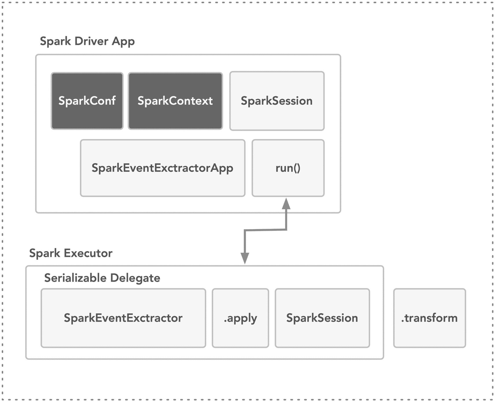

# 用例：CoffeeCo 与咖啡仪式

并非每个人都喜欢咖啡或茶。然而，说到仪式感和社群文化，咖啡产业背后蕴藏着巨大的成功。在本书的开篇，我们已经简要提及了在名为 CoffeeCo 的公司担任新数据工程师所需应对的一些琐碎事务。你可以将其视为你日常光顾的任何一家主流咖啡品牌。或者，如果你对咖啡有强烈的抵触情绪，你也可以运用相关工具处理并转化这些数据，使其更符合你的喜好（希望我们还能做朋友）。

贯穿本章及本书后续内容，你将专注于编写 Spark 应用程序，以促进并协调 CoffeeCo 的数据需求。你将扩展之前章节的基础原语，例如我们为咖啡店、库存、顾客以及顾客购买行为建立的模型。你将使用这些数据编写目标驱动的应用程序，像在实际工作中一样推动 CoffeeCo 的业务发展。这些经验几乎可以应用于你作为数据工程师横向处理数据平台、或纵向专注于特定功能或业务单元时所遇到的所有工作。所学到的技能可用于解决大多数企业面临的常见问题。

恭喜你升职了。你现在是 CoffeeCo 的创始数据工程师。你的首要任务是构建能够代表 CoffeeCo 业务多个方面的核心数据模型。要做到这一点，你需要更深入地了解业务。

## 思考数据

如果你从一个足够高的视角来看，会发现大多数面向客户的企业都存在一条共通的主线。即，企业都有待售的某种产品、销售产品的场所（线上或实体店），以及购买产品的顾客。这类似于名词的概念：业务围绕着人、地点和事物展开。

思考一家公司的数据需求时，需要考虑哪些业务方面需要被捕捉，以便做出明智的决策，以及我们如何从数据中提取意义？对于所有新的数据运营来说，这些可能是艰巨的任务。策略因地而异，但你可以使用一种非常有帮助的机制，它直接借鉴自产品管理和用户故事流程。简化来说，我们将采用一个颇具创意的名称：数据故事。

## 数据故事讲述与数据建模

无论你在何处工作、以何种方式工作，所有工作都围绕着任务的概念展开。这是一个分解的过程：你将庞大的想法或琐事分解成可以在不必一次性考虑所有问题的情况下完成的较小任务。这是一项需要时间积累的技能。许多工程师经过多年磨练，学会了如何思考问题，将其拆解为功能性子组件、可复用的类和接口。由于数据工程与传统软件工程紧密相关，这些技能可以很容易地迁移到我们思考数据问题的方式上。这只需要一点练习。幸运的是，你现在将逐步了解高层次的数据建模过程。

## 练习 7-1：数据建模

故事讲述的过程可以成为一个有用的工具，用于理解数据关系，这些关系对于分解像公司这样复杂的想法是必要的。在我们的案例中，公司是 CoffeeCo。我们将把它分解为一个由想法、实体、类别和关系构成的层级结构，用于构建数据模型。在决定捕获和集成哪些数据时，这个过程甚至对战略规划和决策也很有用。取决于你在公司的角色，你可能需要推动许多超出你数据工程师职责范围的工作。理解全局图景或事物（与数据相关的）如何各得其所，是一项宝贵的技能。与许多事情一样，数据建模始于一个故事。

### 故事

CoffeeCo 致力于为人们提供独特的咖啡饮用体验，并根据个人需求和口味进行定制。我们从最优质的咖啡豆开始，通过一个视我们如家人的全球种植者网络进行采购。这些关键的关系确保我们能够获得稳定的季节性产品，这些产品天然有机地生长。额外的好处是，它确保了每一种咖啡都来自一个知名的产区，该产区能够满足我们追求的生长条件和自然风味特征。利用最先进的个性化系统，我们让顾客能够对咖啡体验的方方面面进行评分，从咖啡的烘焙方式、咖啡豆品种、最喜爱的农场和生产商，甚至到他们最喜欢的门店。每一杯咖啡、每一次光顾、每一次个人体验，都增进了顾客对咖啡的热爱，以及他们围绕咖啡所建立的社群。

### 分解故事

你可能已经发现，你的大脑已经开始对 CoffeeCo 的故事进行分解和消化。你可能已经开始分离特定的关系，并思考可以用来传达特定高层次概念（如供应商、地点和顾客）的名称和总体实体。你可能完全跳过了数据建模，而是专注于数据可以用来做什么以及如何做。这一切都很好，因为这意味着故事吸引了你的注意力。首先，我们来看看如何分解出具体的实体，然后我们再讨论数据如何被使用。

### 提取数据模型

在高层次上，你可以使用故事来指导支持业务的核心实体之间的关系。本质上，CoffeeCo 为每位顾客提供产品。产品从供应商处采购。每个供应商在一个或多个特定的位置运营。产品在多家门店销售，每种产品在一个或多个位置有库存。顾客体验可以通过每位顾客消费实体产品的评分来追踪。每家门店的体验可以通过顾客评分来评定。评分作为一种结构，可用于生成个性化的体验，该体验会随着时间的推移为每位顾客进行适应和学习。

一旦提取出高层次实体，你可以通过讲述它们的子故事来进一步分解每种类型。正如你将看到的，这个过程可以直接从故事中产生一个良好的数据模型。

#### 顾客

顾客与一个账户标识符相关联。每个账户基于一个随机分配的 `UUID` 进行唯一标识，该 `UUID` 可以在账户创建时在线生成，也可以在门店购买时通过二维码提供给顾客。当顾客完成注册并将他们的账户身份与友好的移动应用程序关联后，顾客账户即变为激活状态。这需要顾客的姓氏、名字以及电子邮件地址。

```scala
case class Customer(
active: Boolean,
created: Timestamp,
customerId: String,
firstName: String,
lastName: String,
email: String,
nickname: String,
membership: Membership,
preferences: Preferences
)
```

此客户数据模型用于规划基线信息以及关系，例如 `Membership` 和 `Preferences` 的情况。这些是对客户的占位关系，可以在数据建模之旅的后续阶段进行组合。

##### 门店

顾客在各门店购买咖啡产品。每个门店都关联一个唯一标识符，每个地点还包含开业日期、物理位置（如地址、经度和纬度）以及营业时间等附加信息。此外，每家门店都有最大客容量和额外设施，例如户外座位、得来速服务等。在考量门店之间的差异时，每日菜单是一个重要因素。菜单包含可供选择的咖啡、价格等等内容。

```scala
case class Store(
alias: String,
storeId: String,
capacity: Int,
openSince: Timestamp,
openNow: Boolean,
opensAt: Int,
closesAt: Int,
storeInfo: StoreInfo,
location: Location
)
```

与客户数据模型类似，关于 `StoreInfo`、`Location` 和 `Menu` 数据模型，我们也留下了一些线索供后续练习。我们将在下一节中进一步探讨这些内容。

##### 商品、货物与单品

每个产品都是一个待售货物单元。在这种情况下，可供出售的品类远不止咖啡。每种在售产品类型都有唯一的标识符、一个可作为人类可识别名称的友好名称或别名，以及单位成本。考虑到你可以出售一杯、一壶、速溶咖啡、新鲜烘焙咖啡以及其他散装商品，你需要在此进行抽象思考。鉴于每种在售产品都列在菜单上，并且 Scala 有一个核心 `Product` 类，我们将此模型命名为 `Item`。

```scala
case class Item(
itemId: String,
availability: Availability,
cost: Int,
name: String,
points: Int,
vendor: Vendor
)
```

鉴于产品具有通用可用性、季节性可用性，甚至地理可用性，我们可以将产品的可用性建模为 `Item` 案例类的一个子资源。`Vendor` 信息也是如此。这使我们能够处理数据，并允许数据模型随时间演变。

##### 供应商

CoffeeCo 与来自世界各地的各种供应商合作。供应商提供商品和服务，从种植和生产季节性咖啡品种的农场，到为每家门店销售杯子和小饰品的制造商，不一而足。本书中我们只处理与咖啡相关的数据，但值得思考未来如何扩展数据模型，这样你就不必费力处理大量最终大同小异的各种数据模型。

```scala
case class Vendor(
active: Boolean,
name: String,
location: Location,
vendorId: String
)
```

你可能已经注意到，每个供应商有一种或多种产品，而每种产品只有一个供应商。这让你可以决定在处理特定管道时如何关联数据。考虑到每个供应商也可能在多个地点运营，将供应商绑定到单个地点可能会引发问题。你可能需要引入运营点的概念。供应商可以在不同地点拥有多个运营点，生产不同的产品。这个问题供你思考。

##### 位置

位置是一个抽象概念，涉及一个起点。考虑到企业是在特定地点运营的，无论是在线上还是现实世界中，`Location` 数据模型也是如此。该数据模型包含许多位置需求所通用的信息。

# Location 数据模型

```scala
case class Location(
  locationId: String,
  city: String,
  state: String,
  country: String,
  zipcode: String,
  timezone: String,
  longitude: String,
  latitude: String
)
```

`Location`数据有助于关联系统内客户行为的趋势和模式。以 CoffeeCo 为例，这些位置数据可用于了解哪些供应商生产某位顾客特别喜欢的某种风格的咖啡。这些数据也可用于了解哪些门店为大多数顾客提供了最佳体验，以及物理位置是否起着关键作用。有时，只需将户外座位、晴朗天气和良好的过往人流结合起来，就能照亮某人的一天。

## 评分

CoffeeCo 故事中的最后一个数据模型是`评分`。鉴于评分是由顾客针对特定门店或产品给出的，我们可以使用一个评分系统来大体上跟踪这些信息。为简单起见，我们可以像许多系统一样，从基础开始。请记住，你随时可以在日后增加复杂性。

```scala
case class Rating(
  created: Timestamp,
  customerId: String,
  score: Int,
  item: Option[String],
  store: Option[String]
)
```

评分数据模型被分解为灵活的格式，为评分系统提供了一个框架。这包括支持基于产品或门店的评分，这些评分被记录为单个顾客的评分。

### 练习 7-1：总结

将故事转化为数据的过程，其历史几乎与人类在洞穴中绘画一样悠久。想想看，一图胜千言（好吧，不总是这样，但你明白我的意思），定义良好的数据模型可以用类似的方式来捕获数据，无论是高分辨率的细节，还是仅仅作为对过去情况的概要。本练习旨在帮助你概念化数据建模过程，并思考数据的组成方式。

## 从数据模型到数据应用

现在，你们期待已久的时刻到了。是时候开始编写你们的第一个主要 Spark 应用了。这个过程将教会你如何架构和编写可测试的应用代码，你可以将其作为今后编写无数应用的蓝图。本练习的源代码可在章节材料中找到。

练习材料

你可以在本书 GitHub 资源（位于[`https://github.com/newfront/spark-moderndataengineering`](https://github.com/newfront/spark-moderndataengineering)）的`ch-07/`文件夹中找到本章的材料。

### 每个应用都始于一个想法

你需要构建一个新的数据管道，该管道将摄取顾客评分，并将每条评分与客户表进行关联，本质上执行的是一个美其名曰的 ETL 操作。然后，这些数据可以在下游进一步处理，以创建更复杂的数据集，例如每位顾客的偏好（或口味画像，或门店画像）。

## 想法

经过一点头脑风暴，你为这些评分事件想出了一个简单的数据模型，并决定利用手头现有的工具快速测试一下。你问这些工具有哪些？好吧，你有你的 IDE（我偏爱[IntelliJ](https://www.jetbrains.com/idea/)），并且能够重用本地的 Docker 环境来快速行动并测试你的想法。

然而，你需要一个行动计划。你需要它，这样你才能为验证你的想法设定一个时间范围。这就是应用蓝图的用武之地。如果你想一想直到现在你在 Zeppelin 环境中完成的工作，那么你可以将下一步视为将你的笔记本或工作流固化为一个编译后的应用的一种方式。

### 练习 7-2：Spark 应用蓝图

Spark 应用蓝图是创建应用所需的框架或样板代码。这包括编译和组装一个功能完整的 Spark 应用所需的一般布局、配置和构建设置。

作为一般经验法则，你的每个 Spark 应用每次都应以相同的方式布局。这创建了一种一致的工作方式，并为你和所有编写应用的人提供了一个类似的参考框架，用于查找配置文件的位置，以及关于如何构建和运行应用的预期。

#### 默认应用程序布局

打开项目代码（位于`ch-07/app`），您将看到清单 7-2 所示的目录结构和配置文件。

> **注意**：如果您已经编写 Java 和 Scala 应用程序一段时间，可以直接跳到“通用 Spark 应用程序组件”部分。接下来的内容是应用程序目录结构的概述。

```
app/
  conf/
    local.conf
  project/
    build.properties
    plugins.sbt
  src/
    main/
      resources/
        application.conf
        log4j.properties
      scala/
    test/
      resources/
        application-test.conf
      scala/
  build.sbt
  README.md
```

*清单 7-2 —— Spark 应用程序目录结构*

清单 7-2 中展示的嵌套目录和文件是任何使用 Scala 编写的应用程序的典型结构，对于编写过 Java 应用程序的人来说应该很熟悉。让我们从根级别开始，逐一介绍这些结构。

##### README.md

这是一个让您能够告知并指导其他工程师的机会——他们将来不可避免地会接手您曾开发过的应用程序。记录构建和运行应用程序的要求，以及任何对未来工程师有用的附加信息至关重要。如果您使用[GitHub](https://github.com/)，当有人查看您的代码时，项目会自动渲染此文件。

##### build.sbt

这是您应用程序的[构建定义](https://www.scala-sbt.org/1.x/docs/Basic-Def.html)。`build.sbt`文件指导构建过程，提供变量和规则，包括要编译的 Scala 和 Spark 版本。它还负责组装一个 fat JAR（将所有依赖项打包到一个 JAR 中，从而简化应用程序的部署方式）。这依赖于项目根目录下`project`目录中的额外配置文件。它们共同为您提供了构建和发布应用程序所需的工具。

##### conf

`conf`目录用于存储应用程序的外部配置覆盖。这是一种常见模式，用于为多环境覆盖提供正确的配置，例如开发、预发布、性能和生产环境，以及区域配置覆盖。此外，提供本地测试配置也很实用，可以在本地开发环境中运行应用程序时使用。

*多环境配置*

```
conf/
  local.conf
  dev.conf
  stage.conf
  prod.conf
```

##### project

如果您是`sbt`新手，`project`目录是您进行配置的一站式商店。`build.properties`跟踪您要使用的`sbt`版本，以及任何声明的插件和解析器。插件为您的`sbt`构建增加功能，而解析器则告诉`sbt`在哪里找到依赖项，例如 Apache Spark 等。

##### src

源代码（`src`）目录是应用程序代码所在的位置。这是您的应用程序根目录。清单 7-3 中的目录结构显示了应用程序源代码和资源。

```
src/
  main/
    resources/
      application.conf
      log4j.properties
    scala/
      com.coffeeco.data/
        config/
          Configuration.scala
          SparkApplication.scala
          SparkBatchApplication.scala
          ...
  test/
    resources/
      application-test.conf
    scala/
      ...
```

*清单 7-3 —— Spark 应用程序源代码和运行时资源*

现在您已对应用程序布局有了大致了解，接下来让我们看看可以在应用程序中使用的通用组件。

#### 通用 Spark 应用程序组件

您编写的每个应用程序都包含可以抽象出来以供重用的通用组件。这确保了有一个用于初始化和设置（引导）应用程序运行时的简单框架。在本章中，您将了解以下三个通用组件：

- `Configuration.scala`：此组件旨在跨多个 Spark 应用程序重用，是一种为应用程序提供分层配置的通用方法。除非需要在运行时覆盖配置值，否则建议通过`application.conf`或任何环境/区域覆盖配置提供应用程序配置的大部分内容。这样，所有必需的配置都可以通过您的 CI/CD 管道随应用程序一起分发。

- `SparkApplication.scala`：此组件旨在与`Configuration.scala`结合使用。在为 Spark 应用程序生成`SparkSession`时，可能存在一些您希望所有 Spark 应用程序继承的默认行为。例如，监控应用程序性能、操作指标以及导致任务失败的问题。对您的应用程序保持关注可以确保您知道每个应用程序何时不再处于健康运行状态。我们将在第 12 章“通往生产环境之路”中再次讨论监控和`SparkApplication`特质。

- `SparkBatchApplication.scala`：此特质扩展了`SparkApplication`特质，专门用于批处理应用程序。

让我们从查看`Configuration`对象开始。

#### 应用程序配置

`Configuration`对象为 Spark 应用程序提供了一种可定制的方式，用于生成显式设置，在应用程序初始化时提供给核心的`SparkConf`。您的应用程序可以有几种不同的方式达到其当前配置状态。在第 5 章中，您了解了如何使用`spark-shell`的`conf`参数访问和修改`SparkConf`；在第 6 章中，您进一步了解了处理集群范围 Spark 配置的`spark-defaults.conf`文件。现在，我们引入另一种方式，并将详细讨论。

让我们从查看`Configuration.scala`源代码开始（如清单 7-4 所示，可在在线章节内容中找到）。

```
object Configuration {
private lazy val defaultConfig = ConfigFactory.load("application.conf")
private val config = ConfigFactory.load().withFallback(defaultConfig)
config.checkValid(ConfigFactory.defaultReference(), "default")
private lazy val appConfig = config.getConfig("default")
lazy val appName: String = appConfig.getString("appName")
object Spark {
private val spark = appConfig.getConfig("spark")
private val _settings = spark.getObject("settings")
lazy val settings: Map[String, String] = _settings.map({ case (k,v) =>
(k, v.unwrapped().toString)
}).toMap
}
}
```

*清单 7-4 —— 通用配置助手*

清单 7-4 中展示的`Configuration`代码构建在流行的 [Typesafe Config](https://github.com/lightbend/config) 库之上。该库与 Apache Spark 配合良好，使您的应用程序能够创建配置层，这些配置层可以被延迟加载、评估，并混合到任何 Apache Spark 应用程序的运行时配置中。让我们看一下`application.conf`的格式，以了解配置是如何生成的。

### 应用默认配置

默认应用配置在应用组装过程中与 Spark 应用程序一起编译。它为应用程序的*任何*实例提供了一个有保障的通用配置基础。你可以将其视为配置基础的第一层具体结构。默认配置会与你的应用程序一起编译，并可在`ch-07/app/src/main/resources/application.conf`下的应用源代码中找到。请参见代码清单 7-5。

```
default {
appName = "spark-event-extractor"
spark {
settings {
"spark.sql.session.timeZone" = "UTC"
"spark.sql.catalogImplementation" = "hive"
"spark.sql.hive.metastore.version" = "2.3.7"
"spark.sql.hive.metastore.jars" = "builtin"
"spark.sql.hive.metastore.sharedPrefixes" = "..."
...
}
}
}
代码清单 7-5
应用默认配置（显示部分配置）
```

`application.conf`由代码清单 7-4 中的`ConfigFactory`对象加载并解析。它被加载到名为`default`的`config`中。来自代码清单 7-4 的流程还会检查配置的存在性和有效性，确保在`default`路径下不存在损坏的对象。如果配置损坏，则解析配置将失败并抛出`ConfigException`，你的应用程序也会随之失败。*请记住，尽早失败总比在运行时晚些失败要好*。

配置解析完成后，你的自定义配置就可以在指定的默认配置中使用了。

```
private lazy val appConfig = config.getConfig("default")
```

至此，在代码清单 7-4 中，你可以访问应用程序名称`appName`以及`default.spark.settings`下包含的配置项。此时这些就是你所需要的全部内容，因为你希望有一种通用的方式将应用配置与应用代码一起发布。

这组基础配置值也可以在运行时通过外部配置文件进行修改。这将会从编译后的应用程序资源中加载`application.conf`，然后在应用启动时覆盖（或重写）应用默认值。当你需要根据开发、预发布和生产环境等运行时环境，指定特定于区域的配置或设置时，就会看到这种模式。

### 运行时配置覆盖

能够使用额外的外部配置来增强你的应用程序，提供了许多能力，从简单地添加区域或环境覆盖，到更高级的自动化（如自动增强应用程序的 CPU 核心和 RAM 配置）。无论使用场景是简单还是前沿，使用显式覆盖都能让你轻松更改应用程序，而无需重新编译和重新发布。请考虑以下用例。

假设你需要在两个不同的时区运行一个报表作业。如果应用默认配置指定了`"spark.sql.session.timeZone"="UTC"`，那么你可以简单地通过一个名为`timezone-pst.conf`的简单覆盖文件来覆盖默认的`application.conf`，从而无缝地处理这个用例。现在你可能有额外的需求，但在最简单的用例中，你可以在特定时区运行一个一致的作业。

```
default {
spark {
settings {
"spark.sql.session.timeZone" = "America/Los_Angeles"
}
}
}
```

此外，你也可以通过在 Spark 提交中使用运行时配置覆盖来实现相同的效果（就像你在第 5 章中学到的那样）。

```
--conf "spark.sql.session.timeZone= America/Los_Angeles"
```

**注意**

在第 8 章中，你将学习如何使用 Airflow 为诸如时区切换报表作业之类的用例增加更多控制。每个 DAG 代表 Airflow 中的一个工作流，并确保运行时覆盖可以被确定下来。这意味着你的下游依赖项永远不会找不到你本应生成的数据。作为数据工程师，一致性和可靠性是你的首要任务。

介绍完`Configuration`对象后，现在是时候看看如何将其与`SparkApplication` trait 结合使用，以提供无缝的 Spark 初始化了。

## 通用 Spark 应用程序初始化

`SparkApplication` trait 是一个简单的模块，它提供了一种通用方式来初始化你的 Spark 应用程序。它依赖于上一节中的`Configuration`对象来简化不可变`SparkConf`的生成，然后将其输入到`SparkSession`的构建中，而`SparkSession`是进入 Spark 运行时的入口点。

那么这究竟是如何实现的呢？请看代码清单 7-6 中显示的 trait。

```
trait SparkApplication extends App {
val appName = Configuration.appName
lazy val sparkConf: SparkConf = {
val coreConf = new SparkConf()
.setAppName(appName)
// 如果缺失则合并
Configuration.Spark.settings.foreach(tuple =>
coreConf.setIfMissing(tuple._1, tuple._2))
coreConf
}
lazy implicit val sparkSession: SparkSession = {
SparkSession.builder()
.config(sparkConf)
.enableHiveSupport()
.getOrCreate()
}
lazy val validationRules: Map[()=>Boolean, String] = Map.empty
def validateConfig()
(implicit sparkSession: SparkSession): Boolean = {
if (validationRules.nonEmpty) {
val results = validationRules.foldLeft(List.empty[String])(
(errs: List[String], rule: (()=>Boolean, String)) => {
if (rule._1()) {
// 继续处理下一个规则
errs
} else {
// 如果谓词不为真，则存在问题
errs :+ rule._2
}
})
if (results.nonEmpty)
throw new RuntimeException(s"配置遇到问题：\n ${results.mkString("\n")}")
else true
} else true
}
def run(): Unit = {
validateConfig()
}
}
```

代码清单 7-6 展示了 `SparkApplication` trait 的源代码。这个 trait（或混入）扩展了 Scala 核心库中包含的 Scala `App` trait。`App` trait 提供了将任何对象快速转换为可执行文件的功能，这恰好是初始化 Spark 应用程序的一个无缝起点（因为可执行文件意味着我们也有一个主类）。我们扩展 `App` trait 的另一个原因是它会延迟 Spark 应用程序的初始化。这意味着我们可以保证 Spark 应用程序会在所有其他静态类和对象初始化之后才被评估。

在 `SparkApplication` trait 的这个初次实现中，你可能会注意到并没有发生什么太复杂的事情。我们所做的是确保任何混入了这个 trait 的应用程序都能够访问用于配置验证、生成 `SparkSession` 和 `SparkConf` 的通用命令接口，并且所有应用程序都有一个 `run` 方法。理论很简单，对吧？

构建运行每个 Spark 应用程序的入口点现在只需要一点点设置即可开始。你基本上可以开始编写每个新应用程序，而无需担心常见的样板代码以及支持许多做类似事情的不同方式。相反，你现在有了一个用于整体运行应用程序的通用框架。后台执行的脚手架操作类似于 `spark-shell` 和 Apache Zeppelin 的初始化方式。

最后要查看的通用组件是 `SparkBatchApplication` trait，它是 `SparkApplication` trait 的一个小型扩展。它为你提供了一组一致的方法来创建批处理应用程序。

### 可靠的批处理应用程序

构建通用组件的诀窍在于从小处着手并巧干。此外，值得指出的是，通用组件应该是多个应用程序执行完全相同的操作所得到的最终成果。许多优秀的库都是通过解决常见问题而构建的，所以顺其自然，并从你的团队、社区或线上获取反馈和意见吧。然后观察一切如何演变。最后，确保你的库能简化问题，并且仅在必要时引入防护措施。

基于此，代码清单 7-7 给出了一个从小处着手并确保所有批处理应用程序都具备一些防护措施的示例。

```
trait SparkBatchApplication extends SparkApplication {
lazy val saveMode: SaveMode = SaveMode.ErrorIfExists
def runBatch(saveMode: SaveMode = saveMode): Unit
final override def run(): Unit = {
super.run() // 将会调用 validate config
runBatch()
}
}
```

任何继承自 `SparkBatchApplication` 特质的应用程序都需要定义 `runBatch` 方法并添加相应的配置验证才能开始运行。该特质还有助于引导继承它的应用程序默认采用防御性编程。虽然 `saveMode` 并未在特质层面强制执行，但实现 `runBatch` 方法会要求应用程序工程师（即使他们之前没有考虑过）思考 `saveMode`。这并非是强制批处理作业做正确的事情，而是为每个应用程序需要考虑的重点提供指导。

换一种方式思考，从 `SparkApplication` 特质重写的 `run` 方法在 `SparkBatchApplication` 特质中被标记为 `final`。这限制了任何实现类再次重写 `run` 方法，换句话说，工程师只需要关注 `runBatch` 方法的上下文。试图绕过这个接口将会失败。这个强制功能使作为库作者的你能够做一些有趣的事情，包括驱动通用应用程序启动器，这些启动器只需要一个 `run` 方法。通过这种方式，无论启动的是批处理作业还是流处理作业，你只需关注一个方法。你还应该提供适当的防护措施，以便留有足够的灵活性，让人们继续使用你的库！

### 跟进练习

将这些辅助库作为公共库提供是很自然的事情。这样，你团队/公司的所有应用程序都可以使用同一套通用工具来构建，而不是让每个新应用程序都重新发明轮子。后者很快就会让人感到疲倦。如果你有干劲，在读完本章之后，尝试将这些通用的 Spark 组件抽取到一个单独的项目中。

### 练习 7-2：总结

第二个练习带你了解了 Spark 应用程序的布局（目录结构）以及使得编写 Spark 应用程序更简单的三个通用特质。现在已经介绍了通用的 Spark 应用程序组件，是时候编写实际的 Spark 应用程序了。

## 连接各个节点

掌握了如何布局 Spark 应用程序、通用的应用程序初始化组件以及接口（特质）之后，下一步就是编写应用程序。作为编写第一个流式 Spark 应用程序的前奏，此应用程序将基于一个简单的批处理作业。这个过程会巩固之前的练习，例如使用容器化数据库表和基于分布式文件系统的表所做的工作。它将构建一个能够处理两个数据源之间连接的批处理作业。

`说明`：这个过程将帮助你过渡到处理激动人心的概念——*无界表* 和结构化数据的*无界流*，这些内容将在第 10 章中介绍（在第 9 章关于流式数据处理系统的思维模型构建章节之后）。

## 应用程序目标

此应用程序的目标很简单：从一个受管理的 Spark 表中读取所有客户评分，然后根据 `customerId` 将每条评分与存储在分布式客户表中的客户数据进行连接。最后，将连接后的数据结果写入一个新的表位置。

此外，由于本章也向着工作流编排的方向发展，我们希望将此应用程序作为管道作业来运行。这意味着在提交应用程序运行时，驱动程序应用程序需要以运行时配置的形式接收输入（或源表）和输出（或目标表）。这是一个*无状态的基于批处理的 Spark 应用程序*的示例，因为它需要外部影响来完成手头的任务。

让我们从外到内进行，首先建模我们的事件，设计运行时配置，确定启动应用程序的 `spark-submit` 命令的样子，然后从主应用程序类一直向下深入到栈底。如果你准备好了，让我们开始构建 `spark-event-extractor` 应用程序。

## 练习 7-3：SparkEventExtractor 应用程序

首先要明确一点。这个应用程序旨在处理一个客户评分事件。所以我们需要为此类事件提出一个方案。

### 评分事件

客户评分事件需要为我们的应用程序提供事件发生的时间（这对于后续的流式应用程序将变得更加重要）、客户的唯一标识符、评分以及我们可以用来在应用程序中进一步增强评分事件的任何其他元数据。

`头脑风暴客户评分事件的结果`
```

```markdown
最初的客户评分事件被定义为一个简单的 JSON 对象。JSON 数据易于序列化，并且可以成为测试想法的好方法，而无需大量前期开销。定义好初始事件定义后，我们可以建模一个简单的 `Scala` `case class` 来协助序列化和反序列化。

```json
{
  "created": "2021-04-18 16:28:13.198",
  "eventType": "CustomerRatingEventType",
  "label": "customer.rating",
  "customerId": "CUST124",
  "rating": 4,
  "ratingType": "rating.store",
  "storeId": "STOR123"
}
```

## CustomerRatingEventType

客户评分事件允许我们定义一个包装类，可以支持跨商店和商品的客户评分，如代码清单 7-8 所示。

```scala
case class CustomerRatingEventType(
  override val created: Timestamp,
  override val eventType: String = "CustomerRatingEventType",
  override val label: String,
  override val customerId: String,
  override val rating: Int,
  override val ratingType: String,
  override val storeId: Option[String] = None,
  override val itemId: Option[String] = None
) extends CustomerEvent with RatingEvent
// 代码清单 7-8
// 使用 Case 类进行数据建模可以节省时间
```

使用 `case class` 来建模结构化数据定义的美妙之处在于，这是一种编写单元测试以及使用 `Spark` 的 `DataFrame` 和 `Dataset` `API` 的灵活方式。

**提示**：你可以在应用程序根目录 `ch-07/app/src/main/scala/com.coffeeco.data.models` 下的 `models` 目录中查看本章的所有数据模型。

现在你已经定义了这个客户评分事件的数据模型，是时候继续配置应用程序了。

## 设计运行时配置

接下来，我们需要为可在运行时提供给应用程序的配置命名。遵循 `Spark` 配置命名空间的约定`spark.{app.name}.{key.name}`，我们将使用以下名称：

- `spark.event.extractor.source.table`：提供源数据表或上游数据表的名称。
- `spark.event.extractor.destination.table`：提供目标表或最终输出表的名称。
- `spark.event.extractor.save.mode`：提供一种可选方式，用于在目标表位置已存在数据时覆盖数据。

请记住，随着项目推进，我们总能为应用程序添加更多的覆盖配置，但最好从满足每个 `Spark` 应用程序功能需求的最低配置入手。在此规划阶段，思考当应用准备启动时一切将如何运作，我个人认为也很有帮助。

## 规划启动

先编写`spark-submit`命令有助于你预想应用最终启动时的行为方式。这能帮助你“直觉检验”配置名称，并就你的意图征求意见。包含新运行时配置设置的`spark-submit`命令如清单 7-9 所示。（完整的`spark-submit`命令见`ch-07/app/`目录下的`README.md`文件。）

```bash
$SPARK_HOME/bin/spark-submit \
--master "local[*]" \
--class "com.coffeeco.data.SparkEventExtractorApp" \
--conf "spark.event.extractor.source.table=bronze.customerRatings" \
--conf "spark.event.extractor.destination.table=silver.customerRatings" \
--conf "spark.event.extractor.save.mode=Overwrite" \
--driver-java-options "-Dconfig.file=conf/local.conf" \
target/scala-2.12/spark-event-extractor-assembly-0.1-SNAPSHOT.jar
# 代码清单 7-9
# 无状态批处理应用的 spark-submit 命令
```

从`spark-submit`命令入手可能看似有违直觉，但在实践中，从外向内推进是有帮助的。这有点像测试驱动开发（`TDD`）的思路，因为要编写应用的测试，必须先了解应用需要做什么。那么，我们目前进展如何？

## 应用回顾

你已经了解了组装 `Spark` 应用程序所需的内容，包括通用的应用布局与结构，以及构建指令。你接触了可复用通用组件辅助工具的概念，所有这些经验现在可以整合到一个通用的 `Spark` 应用蓝图中。此外，你了解了这个应用背后的理念，并对其必须实现的功能、运行时配置的样子，以及用于启动应用的`spark-submit`命令有了初步的目标。

这就是我所指的构建和运行应用所需的所有外部关注点，不包括性能调优、仪表化、部署和监控步骤，这些将在本书末尾详细讨论。现在，下一步是进入下一层，开始编写并连接实际的类。

## 组装 SparkEventExtractor

我们知道，每个 `Spark` 应用都包含一个主类，它初始化`SparkSession`以及一个或多个作为一系列阶段和任务运行的作业。这些作业在运行时通过`SparkSession`进行编排。按照惯例，我们将以完全相同的方式构建应用。从主类开始，它被命名为`SparkEventExtractorApp`，然后逐层深入应用架构。

> 提示：在阅读过程中，请在你喜欢的 `IDE` 中打开`ch-07/app/main/scala/com.coffeeco.data/SparkEventExtractorApp`。

## SparkEventExtractorApp

主类采用基于`spark-event-extractor`名称的命名约定。此模式在我们之前定义将输入应用的运行时配置（`spark.event.extractor.source.table`）时已使用过。无论你是否喜欢基于约定的命名方式，这都有助于减轻命名的负担。

虽然技术上你可以在一个应用中包含多个主方法，但每次部署应用时只能选择一个主类。

```bash
$SPARK_HOME/bin/spark-submit \
--class "com.coffeeco.data.SparkEventExtractorApp"
...
```

因此，我们从头开始构建应用，并利用我们的`SparkBatchApplication`特质。首先，实现该特质所需的方法。

```scala
object SparkEventExtractorApp extends SparkBatchApplication {
  override def runBatch(saveMode: SaveMode): Unit = {}
}
```

这个起点将指引我们前进。让我们自上而下地推进。这意味着我们可以从验证正确运行应用所需的 `Spark` 配置开始。

### 验证 Spark 配置

此过程分为两步。首先，我们创建一些常量来封装三个预期的运行时配置值。其次，我们需要验证这些值的有效性，以确保我们的应用程序已准备好执行。

在 `app` 内部添加一个名为 `Conf` 的子对象，并向该对象添加一些常量。

```scala
object SparkEventExtractorApp extends SparkBatchApplication {
  object Conf {
    final val SourceTableName: String = "spark.event.extractor.source.table"
    final val DestinationTableName: String = "spark.event.extractor.destination.table"
    final val SaveModeName: String = "spark.event.extractor.save.mode"
  }
  ...
}
```

这里并没有什么特别之处。我们只是确保将这些配置常量标记为 `final`。这将允许你在整个源代码或单元测试中复用这些应用程序常量。接下来，让我们添加变量来存储这三个运行时值。

# 第七章 配置与验证

现在，我们为重要的应用程序配置提供了可靠的常量和确定性的回退值。下一步是识别那些能在应用程序启动时验证其配置的配置规则。清单 7-10 包含了 `validationRules`，它是一个由函数（谓词）和针对格式错误配置的有用错误消息组成的不可变映射表。

```scala
lazy val sourceTable: String = sparkSession
  .conf
  .get(Conf.SourceTableName, "").trim
lazy val destinationTable: String = sparkSession
  .conf
  .get(Conf.DestinationTableName, "").trim
override lazy val saveMode: SaveMode = {
  sparkSession.conf.get(Conf.SaveModeName, "ErrorIfExists") match {
    case "Append" => SaveMode.Append
    case "Ignore" => SaveMode.Ignore
    case "Overwrite" => SaveMode.Overwrite
    case _ => SaveMode.ErrorIfExists
  }
}
```

```scala
override lazy val validationRules = Map(
  (() => sourceTable.nonEmpty) -> s"${Conf.SourceTableName} 不能为空值",
  (() => destinationTable.nonEmpty) -> s"${Conf.DestinationTableName} 不能为空值",
  (() => sourceTable != destinationTable) -> s"源表 ${Conf.SourceTableName}:$sourceTable 不能与目标表 ${Conf.DestinationTableName}:$destinationTable 相同。",
  (() => sparkSession.catalog.tableExists(sourceTable)) -> s"源表 ${Conf.SourceTableName}:$sourceTable 不存在"
)
清单 7-10
使用验证规则验证应用程序配置
```

来自 `SparkApplication` 特质（见清单 7-6）的 `validateConfig` 方法提供了在应用程序初始化时处理 `validationRules` 的机制。封装这些规则的对象是一个简单的映射表，它将一个 lambda 函数（作为谓词）与一条异常信息相关联，如果某个规则被违反，应用程序将初始化失败。

验证逻辑（见清单 7-10）非常明确。它执行以下操作：

*   检查 `sourceTable` 和 `destinationTable` 的值是否为空。鉴于配置默认会回退为空字符串，这是测试变量是否已被真实配置值初始化的有效方法。

*   检查 `sourceTable` 和 `destinationTable` 是否指向同一张表。因为对同一张表进行读写很可能不是我们此处要解决的用例。

*   检查 `spark.sql.catalog` 中是否存在 `sourceTable`。

如果这些验证中的任何一项失败，我们将抛出一个运行时异常，并停止应用程序的执行。输出信息会提供任何人运行该批处理应用所需的内容，以便他们修正错误并继续工作。当其他工程师需要重新部署应用程序却不清楚操作手册的状态时，这种有用的自助式故障排除功能会大放异彩。因为应用本身提供了他们所需的一切。

我们需要做的最后一件事是实现 `runBatch` 方法。

## 编写批处理作业

`runBatch` 方法是实际应用程序的核心。鉴于本应用的目标是将客户评分与他们的客户记录进行关联，然后将这些记录写入到第二个表中，你所要做的就是串联起这个请求。

我们先来看最终的实现（如清单 7-11 所示），然后再逆向分析。

```scala
override def runBatch(saveMode: SaveMode): Unit = {
  SparkEventExtractor(sparkSession)
    .transform(sparkSession.table(sourceTable))
    .write
    .mode(saveMode)
    .saveAsTable(destinationTable)
}
清单 7-11
实现 runBatch 以运行 SparkEventExtractor
```

`runBatch` 方法被用作运行时委托。你可能会问，这具体意味着什么？在实践中，当你能够将应用程序初始化的关注点与底层应用程序逻辑分离开来时，测试应用程序逻辑会容易得多。这样，你就可以使用传统的软件测试框架、模拟框架以及你最喜欢的集成开发环境（IDE）来辅助调试和单步执行代码。分离关注点的另一个原因是处理应用程序的序列化。让我们来看看 Spark 的委托模式。

## Spark 委托模式

鉴于 Spark 是一个分布式处理引擎，这最终要求应用程序代码是可序列化的，以便能够高效地在集群中传输。但这并不意味着所有东西都需要无谓地可序列化。

我们可以依赖这一事实：你的核心应用程序（`SparkEventExctratorApp`）充当着 Spark 驱动器的角色。回顾一下，这意味着它专门负责提供不可变的 `SparkConf`、初始化 `SparkContext`、分配执行器实例、解析和生成逻辑应用程序的执行计划，以及最后在多个执行器之间调度需要完成的工作。整个过程都委托给了 Spark 框架，并且也被很好地抽象进了 `SparkApplication` 特质中。

这意味着只有 `SparkEventExtractor` 需要是可序列化的。这正是 Spark 委托模式的核心所在。现在让我们看看它是如何工作的。

图 7-3 中 `SparkEventExtractorApp` 的高级架构可视化了应用程序的运行时操作。那么，这个类本身长什么样呢？



图 7-3

`SparkEventExctractorApp`（驱动器）与委托给 `SparkEventExctractor` 类的工作之间的关注点分离