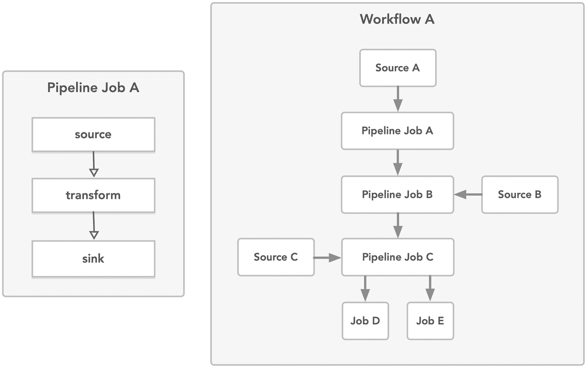

# 8. 使用 Apache Airflow 进行工作流编排

总的来说，作为一名数据工程师，你会发现自己最常遇到两类问题。第一类源于背弃的承诺，也就是糟糕的上游数据源，以及关于数据在你的管道中流动的更普遍的“未知的未知”。你将要面对的第二类问题是*时间*。这里我不是要开始跟你谈论生命、死亡和决策，而是把时间作为一个界限或阈值。时间存在于作业的物理运行时间之间，也体现在与数据服务等级协议相关的非常现实的底线中。这些数据契约围绕着对数据格式（即*模式*）以及数据预期可用的约定时间的期望。时间让我们陷入困境的另一种方式是在这两个常见问题的交汇处，例如，上游问题与陈旧数据“幸福地”结合在一起，或者错过了服务等级协议。

如果你思考这两类问题（数据质量差和时间约束），你可能会开始理解进行工作流编排的必要性，因为缺失或陈旧数据问题会引发蝴蝶效应。管道中糟糕的上游数据会导致管道堵塞，进而影响整个数据管道。这可能是由于直接接入你数据管道的任何 API 和服务宕机，以及数据管道中任何环节导致服务等级协议被违反的作业故障或配置错误造成的。

我倾向于将数据管道想象成地图上的路径、道路、路标点和目的地。*作业*可以被视为路标点以及最终目的地，而数据流本身可以比作在地图上移动的实体，无论是自行车、火车、汽车还是介于两者之间的任何东西。当出现问题时，事情往往会积压起来（在不那么极端的情况下则会从裂缝中掉落）。你可能自己在一天中的特定通勤时间遇到过这种情况，例如在高峰时段，也可能在某些随机时间点，当你发现自己受困于意外的道路施工，或者汽车意外爆胎时。解决这些问题的办法是清除道路上的障碍，随着时间的推移，正常的交通流量就会恢复。当一切再次顺畅运行时，你就可以放松下来（呼吸），享受旅程了。

工作流编排不仅仅用于摆脱困境。它还用于构建可靠完成一组任务的蓝图，例如通过数据管道移动和转换数据。让我们简要地谈谈工作流编排，然后看看 Airflow 如何帮助我们解决这些司空见惯的问题。

## 工作流编排

`工作流`是一组常见的可执行任务，需要以特定顺序执行才能达到预期效果。换句话说，`工作流`关注的是全局视野。它以结果为导向，也就是说，只要每个任务按时完成且不影响最终结果，它就不会纠结于每个任务如何完成的具体细节。

就数据而言，`工作流`传统上由`管道作业`封装，这些作业本身作为任务运行，并赋予各个操作员职责，这些操作员在一个连续、分布式的数据处理网络中协同工作。`图 8-1` 显示了左侧`管道作业 (A)` 的放大视图，右侧则是完整的`工作流 (作业 A-E)`。

`图 8-1` 从管道到工作流。工作流封装了构成跨数据管道网络运行的分布式作业网络的输入和输出链

理解工作流编排的另一种方式是将其与大多数公司和组织中心常见的典型层级结构联系起来。一位主管与一位或多位经理合作，这些经理又管理一组员工，员工完成分配给他们所需的工作。工作如何作为一个有凝聚力的单元按时完成，这属于工作流编排中“编排”的范畴。你可以将这个组件想象成从主管到经理，再到完成工作的团队，在整个网络中传递的截止日期和需求。

当你将所有这些整合在一起时，你就拥有了一个协同运作的单元，它根据优化了可用资源总量的时间表，完成一个分布式目标。现在请记住这个概念，我们将把注意力转向 Apache Airflow，从理论转向实践。