# 以分离模式运行 Airflow

以分离模式运行允许你将每个容器作为后台进程运行，该进程会持续运行，直到你显式地停止容器进程（或关闭机器）。在分离模式下运行时，需要考虑两件事。首先是用于启动和关闭容器的方法。例如，你是偏好使用命令行别名还是脚本文件？第二件要考虑的事情是你想如何管理使用多服务 Docker Compose 定义创建的复合运行时环境，以及你希望共享卷和目录位于何处以及如何引用。让我们先了解如何以分离模式运行 Airflow，然后提供一个解决方案，用于创建更精简的本地 Docker 环境。

## 启动服务

Docker Compose 进程接受显式的文件指针 `-f`，可用于传递绝对路径，同时还有 `-d` 标志，它会将进程更改为在后台而不是前台运行。这两种模式的区别在于，在前台你会看到由你的 `docker-compose.yaml` 定义控制的所有容器的所有日志。而在后台，如果你想要重新连接到容器的输出并查看输出，则必须引用实际的容器标识符：`docker logs -f container_ID`。

以下命令显示了更长的 `docker compose` 命令。你可以从 Airflow 工作目录运行此命令（清单 8-5）。

```bash
docker compose \
  -f docker-compose.yaml \
  up -d
```

## 关闭服务

当你准备好关闭 Airflow 集群时，可以再次使用 `docker compose` 来停止所有容器。执行清单 8-6 中的命令来关闭你的 Airflow 集群。

```bash
docker compose \
  -f docker-compose.yaml \
  down --remove-orphans
```

从本地目录（例如 `/ch-08/airflow/`）中启动和关闭 Airflow（或任何由 Docker Compose 控制的服务）的过程足够简单。然而，从长远来看，除非你努力组织好自己的本地环境，否则这个过程会比实际需要的更困难。例如，如果你有许多由多个 `docker-compose.yaml` 定义控制的环境，以支持许多不同的本地数据工程用例，那么容器命名冲突或其他环境问题可能会出现。从长远来看，创建一个服务层次结构，整齐地嵌套在根目录下，会容易得多。现在我们来看看如何优化你的本地环境，以降低后续流程的复杂性。

### 优化本地数据工程环境

随着你为本地数据工程环境添加越来越多的技术，你可能会发现创建一个统一的位置（父目录）很有用，该目录可用于创建一个有序的本地数据平台，按服务划分，并结合特定的服务卷挂载、`docker-compose.yaml` 定义和 `.env` 规范来组织，从而为 Docker 运行特定技术创建一致的环境。

现在让我们来优化你的环境。将本章迄今为止完成的所有工作复制到 `dataengineering` 父目录中。执行清单 8-7 中的命令，将 `dataengineering` 目录添加到你的主目录中。

```bash
mkdir ~/dataengineering && \
cp -R /path/to/ch-08/airflow ~/dataengineering
```

Airflow 已顺利安置在新家，下一步是添加一个简单的别名来启动和停止 Airflow。别名可以添加到你的本地 Bash 或 shell 环境设置文件（`.bashprofile`、`.bashrc` 或 `.zshrc`）中，具体取决于你运行的命令行。清单 8-8 展示了如何为 UNIX 风格系统添加 `airflow2_start` 和 `airflow2_stop` 别名。

```bash
# 适用于 Apache Spark 的 MDE 辅助工具
export DATA_ENGINEERING_BASEDIR="~/dataengineering"

alias airflow2_start="docker compose -f ${DATA_ENGINEERING_BASEDIR}/airflow/docker-compose.yaml up -d"
alias airflow2_stop="docker compose -f ${DATA_ENGINEERING_BASEDIR}/airflow/docker-compose.yaml down --remove-orphans"
```

对配置文件进行更改后，请确保运行`source`命令将更改加载到当前会话中。例如，执行`source ~/.zshrc`命令会将这两个 Airflow 别名添加到当前终端会话中。现在，无论何时需要启动本地 Airflow 集群，你只需记住`airflow2_start`；同样，当你完成工作或想释放一些系统资源时，只需调用`airflow2_stop`即可。你已经让启动和停止 Airflow 变得更加容易。你可能也迫不及待想查看效果了。让我们回到正题。

## 健康检查：Airflow 在运行吗？

假设你已经使用`airflow2_start`别名或清单 8-4 与清单 8-5 中的任一命令启动了 Airflow，那么检查程序是否运行的最简单方法是打开你常用的浏览器，访问`http://localhost:8088`。你会看到一个登录界面，如图 8-2 所示。

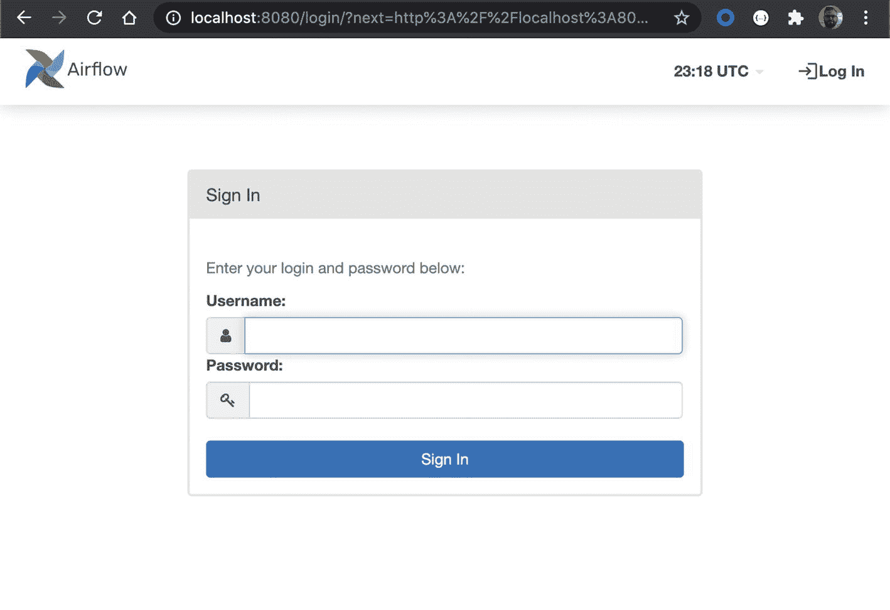

图 8-2

Airflow 登录界面

登录界面确认至少 Airflow 的 Web 服务器进程已启动并正在运行。你可以使用用户名（`airflow`）和密码（`airflow`）登录。登录后应会进入 Airflow 的主用户界面（见图 8-3）。

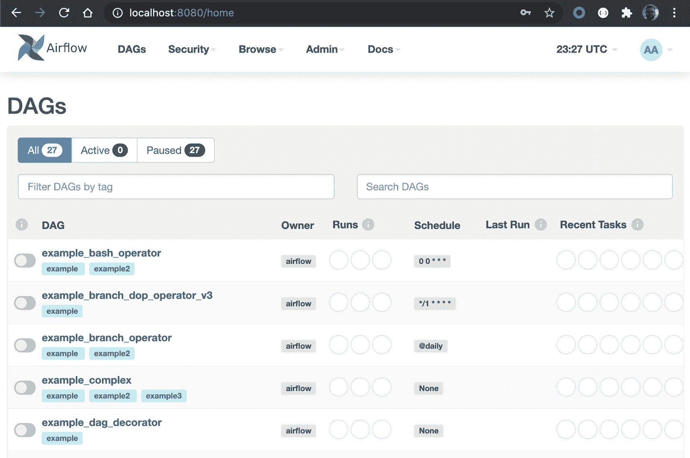

图 8-3

Airflow 的默认用户界面

> **注意**
> 你的浏览器可能会提示用户名和密码已泄露。这是因为`airflow:airflow`这个用户名:密码组合是 Airflow 的默认值，除了本地测试外，绝不应在其他任何场合使用。

在 Airflow 主屏幕上，你将看到所有作业定义、作业元数据以及每个作业先前运行（如果有）的统计信息。这也是进行常规安全管理和常见管理任务的出发点。在本章中，我们将花一些时间了解用户/角色控制，并探讨如何添加安全配置（如密码）。

首先，你的作业定义官方称为 *DAG*（有向无环图）。这是因为每个作业都被定义为一个或多个操作的有向无环图，本质上每个 DAG 本身就是一个管道操作或一个完整的复杂工作流。

> **注意**
> 你可以选择保留或删除这些默认作业。我建议保留它们，以便你可以浏览示例，了解 Airflow 能实现哪些功能。

## 运行 Airflow DAG

在 Airflow 运行且你已处于 DAG 屏幕的情况下，让我们运行其中一个示例作业。点击`example_bash_operator`（位于示例列表顶部）进入 DAG 概览屏幕（见图 8-4）。

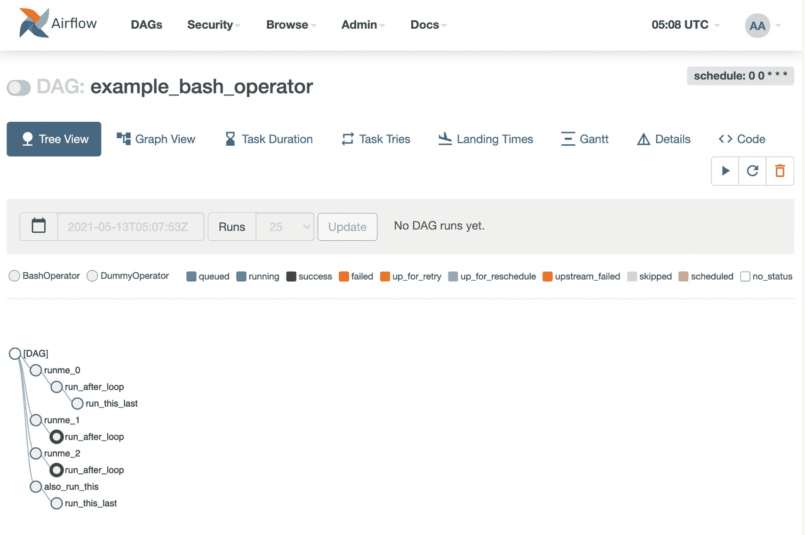

图 8-4

Airflow 的 DAG 详情用户界面是你完成大部分工作的地方

图 8-4 中的 DAG 用户界面为你提供了一个多步骤管道作业的总体概览。要运行此示例作业，你需要执行以下两步：

1.  将开关图标（图 8-4 中“DAG”字样左上角）切换至启用状态。默认情况下 DAG 处于禁用状态以节省集群资源。你需要选择启用以运行每个计划或单次执行。

2.  点击播放图标（右侧，刷新和删除按钮旁边）开始运行管道。

当你按下“触发”按钮后（确认可选的 JSON 配置后），作业将启动，随后你会看到作业过渡到“运行中”状态。图 8-5 中的用户界面显示了实时的 Airflow 作业视图。

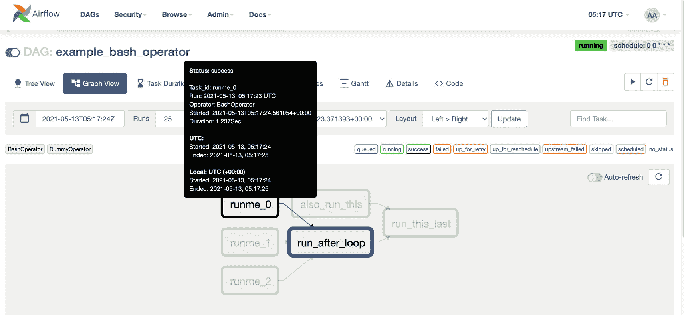

图 8-5

实时 Airflow 作业的运行视图

值得一提的是，该作业几乎会立即完成；但更新后的 Airflow 2 用户界面的一个不错功能是自动刷新选项（如图 8-5 右侧所示）。如果启用此选项，你可以在管道在操作阶段之间主动切换时观察其进度，这有助于在 DAG 中任务完成或失败时监控/观察进度或故障。

## 练习 8-1：总结

现在，无论何时你想要启动 Apache Airflow，它都已准备就绪。但是，要从 Airflow 启动 Spark 批处理作业，你还需要完成更多工作。下一节将向你介绍 Airflow 的组件，然后我们将安装 Spark 运算符。

## Apache Airflow 的核心组件

在运行了第一个 Airflow DAG 之后，现在是时候讨论最初让 DAG 得以运行的组件了。主要是 Airflow 的任务、运算符、调度器和执行器。

### 任务

在每个 DAG 内部，都存在一系列一个或多个*任务*，这些任务被执行以完成特定 DAG 所规定的要求。任务是 Airflow 中的基本执行单元，对于 Spark 应用程序也是如此。这里的重叠之处在于，对于 Spark，你有作业，每个作业由分配任务的任务阶段组成。对于 Airflow，你的 DAG 由任务组成，这些任务按特定预定义顺序运行，工作是在管理特定 DAG 的 Airflow 执行器上下文中完成的。任务可以使用运算符执行任意代码，因此每个 DAG 可以处理许多任务。每个任务可以根据所使用的运算符在本地或远程执行。

### 运算符

Airflow 运算符是模板化的任务。你可以将其视为一个可复用的蓝图，用于封装通用用例，使得通用的 Python 代码能够被复用以完成特定操作。在示例 DAG（`example_bash_operator`）中，你已经接触了两个核心的 Airflow 运算符——`BashOperator` 和 `DummyOperator`。

`BashOperator` 的功能正如其名：它用于执行 bash（或命令行）操作。`DummyOperator` 用于确保 DAG 在任务图中有一个最终的公共节点。在构建更复杂的 DAG 时，`DummyOperator` 也可用作占位符。清单 8-9 展示了`example_bash_operator` DAG 的 Python 代码。

```python
from datetime import datetime, timedelta

from airflow import DAG
from airflow.operators.bash import BashOperator
from airflow.operators.dummy import DummyOperator

with DAG(
    dag_id='example_bash_operator',
    schedule_interval='0 0 * * *',
    start_date=datetime(2021, 12, 28),
    dagrun_timeout=timedelta(minutes=60),
    tags=['example', 'example2'],
    params={"example_key": "example_value"},
) as dag:
    run_this_last = DummyOperator(task_id='run_this_last',)

    run_this = BashOperator(
        task_id='run_after_loop',
        bash_command='echo 1',
    )
    run_this >> run_this_last

    for i in range(3):
        task = BashOperator(
            task_id='runme_' + str(i),
            bash_command='echo "{{ task_instance_key_str }}" && sleep   1',
        )
        task >> run_this

    also_run_this = BashOperator(
        task_id='also_run_this',
        bash_command='echo "run_id={{ run_id }} | dag_run={{ dag_run }}"',
    )
    also_run_this >> run_this_last

    this_will_skip = BashOperator(
        task_id='this_will_skip',
        bash_command='echo "hello world"; exit 99;',
        dag=dag,
    )
    this_will_skip >> run_this_last

if __name__ == "__main__":
    dag.cli()
```

清单 8-9

创建包含同步和异步任务的 DAG

在清单 8-9 中，每个任务都被定义为 `DummyOperator` 或 `BashOperator` 的一个实例。你定义的每个任务都作为图中的一个节点，而作为设计管道的工程师，你需要通过将任务（节点）相互设置为子节点或父节点来建立处理顺序。

在图模式（如图 8-6 所示）下查看你的 DAG，有助于你规划更复杂的工作流。本质上，每个任务可以复杂也可以简单。`SparkOperator` 就是一个可以添加到工作流中的复杂任务示例。


我们将在本章后面更详细地介绍专门的 `SparkSubmitOperator` 和 `SparkSQLOperator`。为了让你全面掌握 Airflow 的各种功能，我的建议是你在新的本地沙盒环境中尽情探索和实验。接下来，我们将探讨 Airflow 如何在 DAG 中运行每个任务背后的过程。

## 调度器与执行器

执行器是 Airflow 中的进程，负责根据计划启动 DAG 中的任务。例如，假设你有一个需要在每天结束时运行的作业。调度此 DAG 的属性如清单 8-10 所示。

```python
DAG(
    dag_id="daily_active_users_reporting_job",
    start_date=days_ago(2),
    default_args=args,
    tags=["coffee_co","core"],
    schedule_interval="@daily",
)
```
*清单 8-10：配置每日 Cron 作业的 DAG 示例*

Airflow 在启动时会解析 DAG 定义，并定期解析以支持在运行时添加 DAG。当遇到新的 `dag_id` 时，DAG 元数据会被写入关系数据库管理系统（RDBMS），并且一旦超过 `start_date` 的阈值，调度器执行器进程将触发 DAG 运行（如果作业未被禁用）。

清单 8-10 中配置的计划将 `start_date` 设置为 `days_ago(2)`，并将 `schedule_interval` 设置为 `@daily`。这是一个回填作业的示例。它会查看当前日期（在 Airflow 服务器上）并回溯，以便在按每日计划（每天开始时或午夜）运行之前，先补跑前两天。更多信息可参考 Airflow 官方文档中 DAG 运行下的 Cron 预设部分。

Airflow 执行器会等待调度器通知它某个 DAG 已准备好运行。实际上，执行器本身运行在调度器进程内部。由于这种关系，考虑到调度与执行之间的紧密耦合，对于给定的 Airflow 集群，你只能指定一种执行模式。

Airflow 自带了几个有用的执行器，提供本地或远程的执行模式。

### 本地执行

如果你运行的是小型集群，可以使用 `SequentialExecutor` 或 `LocalExecutor`。本地执行意味着任务执行将与执行器进程位于同一位置，而执行器进程本身运行在调度器进程内部。这种进程嵌套方式可能适合测试，但这种模式无法扩展以并行运行多个 DAG。

### 远程执行

对于拥有必须运行的关键工作流的**生产环境**，你**别无选择**，只能使用远程执行。这使得多个 DAG 的工作负载能够跨 Airflow 工作节点网络并行执行。要查看你的 Airflow 集群正在运行哪种执行模式，请执行清单 8-11 中的命令。

```bash
docker exec \
  -it airflow_airflow-webserver_1 \
  airflow config get-value core executor
```
*清单 8-11：查看 Airflow 执行器配置*

输出将显示 `CeleryExecutor`，这是 Airflow 中较流行的远程执行器选项之一。`CeleryExecutor` 使用 Redis 进行调度，并将其工作分发到 Airflow 工作进程上。现在，让我们将注意力转向如何将 Apache Spark 与 Airflow 集成。

## 使用 Airflow 调度 Spark 批处理作业

Airflow 是一个强大的外部调度器，你可以依靠它来运行关键的 Apache Spark 批处理作业。此外，工作流编排正成为数据平台的重要组成部分，用于自动化日益复杂的数据管道，并满足众多内部和外部数据客户的需求。正如你在练习 8-1 中学到的，在 Airflow 上运行一个 DAG 非常容易（一旦你掌握了基础知识）。要开始使用 Airflow 和 Spark，你所需要的只是 *Spark Airflow Provider*，它允许你使用几种不同的 Spark 运算符。

### 练习 8-2：安装 Spark Airflow Provider 并运行 Spark DAG

本练习将重点教你安装 Apache Spark provider。你将学习如何手动安装，然后我们将注意力转向使用一个预构建的、已打包好所需组件的 Airflow 容器。接着，你将学习如何使用 Admin UI 在 Airflow 中配置一些运行时配置，最后通过 Airflow 运行上一章中的批处理应用程序。

让我们先从你在练习 8-1 中设置的 Airflow 版本开始。你将直接在 webserver 和 worker Airflow 容器上执行 `pip install` 命令，因为 Spark Python 模块必须在本地可用。

#### 定位 Airflow 容器

要运行安装命令，你需要列出 Airflow 容器的完整名称。执行清单 8-12 中的命令来查看容器名称。

```bash
docker ps | grep airflow_airflow-w*
```
*清单 8-12：使用 Docker 查找 Airflow 容器元数据*

获得容器名称后，你可以使用 Docker CLI 运行安装脚本（使用 pip/Python）。

### 手动安装 Spark 提供商

以下流程演示了如何以 `airflow` 用户身份进行身份验证并安装 Spark 提供商。请以代码清单 8-13 和 8-14 作为安装指南。

> **注意**
> 该示例演示如何在 Web 服务器上安装提供商。你还需要在工作节点上重复此过程，或者继续阅读以使用预构建的容器。

```
docker exec \
  --user airflow \
  -it airflow_airflow-webserver_1 \
  bash
```
*代码清单 8-13：以 Airflow（管理）用户身份打开 Bash 会话以获取安装新提供商的正确权限*

在 Docker 容器中，执行代码清单 8-14 中所示的 `pip install` 命令。

```
pip install \
  --no-cache-dir \
  --user \
  apache-airflow-providers-apache-spark
```

```
代码清单 8-14：使用 Pip 安装 Spark 提供商

你已完成 Web 服务器上的操作。不幸的是，现在需要为每个工作节点实例重新开始整个过程。这将确保提供商在 Airflow 集群中一致地安装。一致性至关重要，因为 Airflow 作为分布式服务运行，并且你无法总是保证 DAG 将在何处被调度。

> **注意**
> 你可以将命名队列与 `CeleryExecutor` 结合使用，以协助在 worker 之间分配工作，你也可以将任务分配到预配置的处理池中，但队列和池不在本书的讨论范围内。

当 DAG 被触发时，对于每个独立的 DAG 运行，封装该 DAG 的所有任务将一直运行，直到全部成功或关键任务失败，从而阻止其余任务的完成。在实际使用中，你会看到工作节点轻松扩展到数十到数百个实例，而在企业集群中规模甚至更大。现在想象一下，你的任务是确保整个系统保持同步，同时记住必须为每次部署重复此步骤以确保一致性。你愿意承担让一切保持同步的任务吗？

当然不。这显然是一种反模式，尤其考虑到我们最初是使用容器来运行事物的。诚然，你可以添加一些容器启动时运行的脚本，但这意味着你会因为依赖关系失败而面临潜在的运行时错误。当中央软件包仓库（如 Pypi 或 Maven）发生故障，或者软件包位置发生更改时（归档的制品版本经常如此），你可能已经遇到过此类问题。

### 使用容器实现运行时一致性

基于一致容器的运行时环境在故障排除时消除了环境方面的猜测，因此你可以集中精力并快速让系统恢复运行。对我们来说，这意味着我们不必手动安装 DAG 操作所需的任何东西。

> **注意**
> `ch-08/airflow/README.md` 中的“高级操作”一节包含了构建自定义 Airflow Docker 镜像的说明，该镜像预装了 Apache Spark 提供商和 Java 11（JRE）。

为了使用预先构建的 Docker 容器（`newfrontdocker/apache-airflow-spark:2.1.0`），你需要对位于 `~/dataengineering/airflow/.env` 的环境文件进行快速调整。然后，为了使更改生效，你还需要重启你的 Airflow 集群。首先，使用 `airflow_stop` 别名关闭你现有的集群。

> **注意**
> 如果你尚未设置本地环境，请返回代码清单 8-7 获取说明。

现在，编辑 `.env` 文件（使用编辑器或命令行），取消注释代码清单 8-15 中所示的这一行。

```
AIRFLOW_IMAGE_NAME=newfrontdocker/apache-airflow-spark:2.1.0
```

代码清单 8-15：将自定义 Airflow 镜像添加到 Docker 环境文件

完成后，保存更改，并使用 `airflow_start` 别名重新启动集群。你无需重新初始化任何内容，因为您只是切换了运行时容器（而不是切换到不同的 RDBMS 或执行器后端）。

现在我们可以继续运行一个 Spark DAG。

### 使用 Apache Airflow 运行 Spark 作业

你已经处理了所有必需的依赖项，Airflow 现在已准备好运行你的 Spark 批处理作业。在接下来的部分，你将使用 Airflow UI 添加一些额外的配置和辅助工具来运行 Spark 作业。

#### 添加 Airflow 变量

Airflow 变量类似于环境变量，但它们在元数据数据库中配置，并可通过 `airflow.models` Python 包访问。变量可以直接在 Airflow 中使用 Admin UI（管理 ➤ 变量）管理，或直接使用 Airflow 命令行管理。此服务允许你在 DAG 中配置可重用的键/值对。

代码清单 8-16 将 `SPARK_HOME` 变量添加到可通过 Airflow DAG 访问的运行时变量集合中。变量可以增强你的 DAG，更重要的是，变量由管理员控制，并且需要基于角色的用户权限才能添加或删除。

```
docker exec \
-it airflow_airflow-webserver_1 \
airflow variables set SPARK_HOME /opt/spark
```

代码清单 8-16：Airflow 变量使你能够将配置直接注入到你的 DAG 中

现在打开 Airflow UI（`http://localhost:8088`），然后点击 Variables 控件（在 Admin 菜单中）以在列表中看到新变量（如图 8-7 所示）。

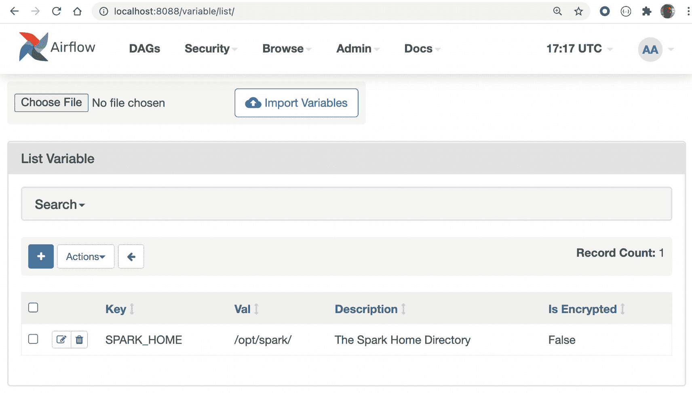

图 8-7：列表中可见 `SPARK_HOME` 变量

你还可以为你添加到 Airflow 中的任何变量编辑元数据以添加描述。这个简单的操作有助于记录给定变量的用法并清晰地传达你的意图。

> **注意**
> `admin` 菜单仅对具有 Admin 角色的用户可用，因此并非任何人都可以编辑这些变量。本章的“继续探索”部分向你展示了如何创建普通用户并介绍了 Airflow 角色（基于角色的访问控制）的概念。

#### 添加 Airflow 连接

连接使 Airflow 能够与外部服务（如 Apache Spark）进行通信，并且可以直接使用 Admin UI（管理 ➤ 连接）或命令行（`airflow connections list`）设置新的连接。

鉴于 Spark Airflow 提供商是一个扩展 Airflow 的模块，因此有简单的方法连接到给定的 Spark 集群（或进程）是合理的。打开 Airflow UI 并转到 Admin ➤ Connections 页面。点击 + 按钮（在左侧）为 Spark 创建一个新连接。此操作将带你进入一个带有空白表单的新页面。

使用该表单，从 Conn Type 菜单中选择 Spark 类型来创建 `local_spark_connection`。完成的表单如图 8-8 所示。

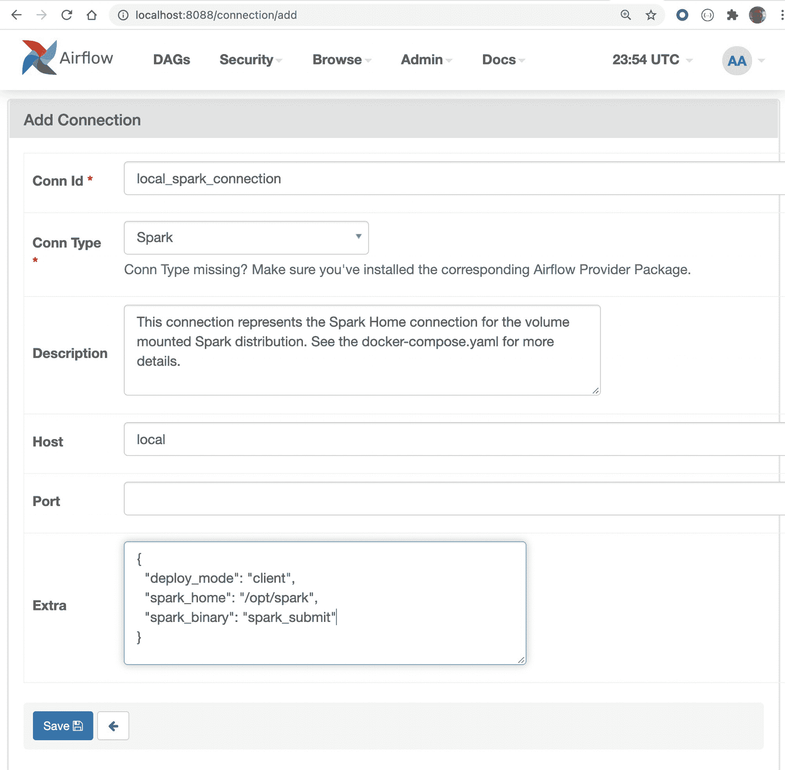

图 8-8：使用 Airflow UI 添加 Apache Spark 连接

连接创建完成后，让我们继续编写你的第一个 Spark DAG。你将要使用 `SparkSubmitOperator`，它包含在你安装到 Airflow 集群中的 Spark 提供商里。

### 编写你的首个 Spark DAG

Spark 附带了一些示例应用。其中之一名为 `SparkPI`。我们将使用这个 Spark 示例应用来熟悉如何编写一个新的 DAG。让我们从“每日 Pi”这个想法开始。

首先，在 Airflow DAGs 目录下创建一个名为 `daily_spark_pi.py` 的文件（路径为 `~/dataengineering/airflow/dags/daily_spark_pi.py`）。然后输入（或复制）代码清单 8-17 中的代码并保存你的更改。

```python
from airflow.providers.apache.spark.operators.spark_submit import SparkSubmitOperator
from airflow.models import DAG, Variable
from airflow.utils.dates import days_ago

args = {
    'owner': 'airflow',
}

spark_home = Variable.get("SPARK_HOME")

with DAG(
    dag_id='daily_spark_pi',
    default_args=args,
    schedule_interval='@daily',
    start_date=days_ago(1),
    tags=['coffeeco', 'core'],
) as dag:
    spark_pi_job = SparkSubmitOperator(
        application=f'{spark_home}/examples/jars/spark-examples_2.12-3.1.1.jar',
        conn_id="local_spark_connection",
        java_class="org.apache.spark.examples.SparkPi",
        task_id="spark_pi_job"
    )
```

代码清单 8-17 中的 DAG 首先导入了 `SparkSubmitOperator` 和一些辅助库，这些库使你能够访问 Airflow 变量，以及一些用于调度的其他实用程序。然后，我们创建了一个字典，用于存储 DAG 的所有者元数据。接下来，我们获取 `spark_home` 变量，以便在创建 `spark_pi_job` 时使用。最后，我们指定了 DAG 的元数据和调度计划。

```python
with DAG(
    dag_id='daily_spark_pi',
    default_args=args,
    schedule_interval='@daily',
    start_date=days_ago(1),
    tags=['coffeeco', 'core'],
) as dag:
```

# 在 Airflow 中运行 Spark 作业

## 编写一个简单的 Spark DAG

然后，我们使用 `SparkSubmitOperator` 向 DAG 块添加了一个任务。

```python
spark_pi_job = SparkSubmitOperator(
    application=f'{spark_home}/examples/jars/spark-examples_2.12-3.1.1.jar',
    conn_id="local_spark_connection",
    java_class="org.apache.spark.examples.SparkPi",
    task_id="spark_pi_job"
)
```

现在你已经写好了 DAG，让我们运行它。

### 运行 Spark DAG

所有新 DAG 默认均处于暂停状态。这可以进行不同的配置，但通常来说这是个好主意，因为这种行为用于保护你的 Airflow 集群资源，避免被多个同时启动的 DAG 所淹没。让我们通过命令行取消暂停此 DAG。

```bash
docker exec \
    -it airflow_airflow-webserver_1 \
    airflow dags unpause daily_spark_pi
Dag: daily_spark_pi, paused: False
```

DAG 取消暂停后，你可以手动触发它。

```bash
docker exec \
    -it airflow_airflow-webserver_1 \
    airflow dags trigger daily_spark_pi
```

假设一切按预期工作，你应该能够列出此 DAG 的成功运行记录。

```bash
docker exec \
    -it airflow_airflow-webserver_1 \
    airflow dags list-runs \
    -d daily_spark_pi \
    --state success
```

你还可以使用 Airflow UI 查看 DAG 运行期间生成的日志。为此，请按以下步骤操作：
1.  进入 Airflow DAGs 主页，使用 `coffeeco` 标签过滤出活动任务（`/home?status=active&tags=coffeeco`）。
2.  点击 `daily_spark_pi` DAG，切换到图表视图（`/graph?dag_id=daily_spark_pi`）。
3.  点击 `spark_pi_job`。你会在顶部看到一个名为“日志”的按钮；点击它以查看此次任务运行的日志。参见图 8-9。

日志将显示任务的输出，包括运行 Spark DAG 的结果。如果向下滚动页面，你会看到以下内容：

```
{spark_submit.py:526} INFO - Pi is roughly 3.1411757058785295
```

这确认了你能够从 Apache Airflow 运行 Spark 工作流。尽管这令人兴奋，但你接下来要做的是创建一个 DAG，用于运行你在第 7 章中创建的 Spark 应用程序。

### 练习 8-2：总结

本练习教你如何安装 Apache Spark 提供商、配置变量和连接，以及使用 `SparkSubmitOperator` 编写并运行一个简单的 Spark DAG。在本章的最后一个练习中，你将学习运用前两个练习中掌握的技能，运行第 7 章中的 `SparkEventExtractorApp`。

## 使用 Airflow 运行 SparkEventExtractorApp

在上一章中，你编写并编译了你的第一个 Spark 应用程序。你学会了如何创建一个由配置驱动的应用程序，该应用程序仅将来自本地数据仓库的两个表中的数据连接起来。这个类似简单 ETL 的过程合并了来自 `customers` 表和 `customerRatings` 表的数据。

在本章的剩余部分，你将设置一个 Airflow DAG，以便使用 Airflow 配置并运行此应用程序。

### 从可运行的 Spark Submit 开始

鉴于我们的目标是创建一个 DAG 来运行 `SparkEventExtractorApp`，那么首先要做的就是查看运行该应用程序需要什么。回顾一下，我们必须提供大量的配置、JAR 文件位置以及用于启动应用程序的驱动程序配置。

```bash
$SPARK_HOME/bin/spark-submit \
    --class "com.coffeeco.data.SparkEventExtractorApp" \
    --packages=org.mariadb.jdbc:mariadb-java-client:2.7.2 \
    --conf "spark.event.extractor.source.table=..." \
    --conf "spark.event.extractor.destination.table=... " \
    --conf "spark.event.extractor.save.mode=..." \
    --conf "spark.sql.warehouse.dir=..." \
    --driver-java-options "-Dconfig.file=conf/local.conf" \
    target/scala-2.12/spark-event-extractor...jar
```

当我们在 Airflow 中使用 `SparkSubmitOperator` 时，它本质上是在 Airflow 集群上下文中生成一个类似的 `spark-submit` 命令。这要求我们稍微修改 Spark 提交代码，以便它可以作为 DAG 运行。让我们从后往前看，先看一下最终的 DAG，然后将所需的配置和 JAR 文件移到正确的位置，以便一切都能正常运行。

### 练习 8-3：编写并运行客户评分 Airflow DAG

在 `~/dataengineering/airflow/dags` 目录下创建一个新文件，命名为 `customer_ratings_etl_dag.py`。然后复制（或粘贴）以下 Python 代码片段，以组装最终的 DAG。

```python
from airflow.providers.apache.spark.operators.spark_submit import SparkSubmitOperator
from airflow.models import DAG, Variable
from airflow.utils.dates import days_ago
```

接下来，我们将添加用户归属信息，并复用上一个 DAG 中的 Spark 主目录变量。

```python
args = {
    'owner': 'scotteng',
}

spark_home = Variable.get("SPARK_HOME")
```

到目前为止一切顺利。接下来，我们将创建一个新的字典，用于存储作业的完整 Spark 配置。

```python
customer_ratings_conf = {
    "spark.sql.warehouse.dir": "s3a://com.coffeeco.data/warehouse",
    "spark.hadoop.fs.s3a.impl": "org.apache.hadoop.fs.s3a.S3AFileSystem",
    "spark.hadoop.fs.s3a.endpoint": "http://minio:9000",
    "spark.hadoop.fs.s3a.access.key": "minio",
    "spark.hadoop.fs.s3a.secret.key": "minio_admin",
    "spark.hadoop.fs.s3a.path.style.access": "true",
    "spark.sql.catalogImplementation": "hive",
    "spark.sql.hive.metastore.version": "2.3.7",
    "spark.sql.hive.metastore.jars": "builtin",
    "spark.sql.hive.metastore.sharedPrefixes": "org.mariadb.jdbc,com.mysql.cj.jdbc",
    "spark.sql.hive.metastore.schema.verification": "true",
    "spark.sql.hive.metastore.schema.verification.record.version": "true",
    "spark.sql.parquet.compression.codec": "snappy",
    "spark.sql.parquet.mergeSchema": "false",
    "spark.sql.parquet.filterPushdown": "true",
    "spark.hadoop.parquet.enable.summary-metadata": "false",
}
```

"spark.hadoop.mapreduce.fileoutputcommitter.algorithm.version": "2",

"spark.sql.hive.javax.jdo.option.ConnectionUserName": "dataeng",

"spark.event.extractor.source.table": "bronze.customerRatings",

"spark.event.extractor.destination.table": "silver.customerRatings",

"spark.event.extractor.save.mode": "ErrorIfExists"

}
```

这个字典可以直接在 `SparkSubmitOperator` 中使用，从而减少了在 DAG 内部扫描配置的麻烦。在编写实际的 DAG 之前，你需要添加以下变量（`app_jars` 和 `driver_class_path`），以提高最终 DAG 的可读性。

```python
app_jars=f'{spark_home}/user_jars/hadoop-aws-3.2.0.jar,{spark_home}/user_jars/hadoop-cloud-storage-3.2.0.jar,{spark_home}/user_jars/mariadb-java-client-2.7.2.jar,{spark_home}/user_jars/mysql-connector-java-8.0.23.jar,{spark_home}/user_jars/aws-java-sdk-bundle-1.11.375.jar'
driver_class_path=f'{spark_home}/user_jars/mariadb-java-client-2.7.2.jar:{spark_home}/user_jars/mysql-connector-java-8.0.23.jar:{spark_home}/user_jars/hadoop-aws-3.2.0.jar:{spark_home}/user_jars/hadoop-cloud-storage-3.2.0.jar:{spark_home}/user_jars/aws-java-sdk-bundle-1.11.375.jar'
```

最后，我们现在可以使用这些变量和属性来创建我们的 ETL DAG。

```python
with DAG(
    dag_id='customer_ratings_etl_dag',
    default_args=args,
    schedule_interval='@daily',
    start_date=days_ago(1),
    tags=['coffeeco', 'core'],
) as dag:
    customer_ratings_etl_job = SparkSubmitOperator(
        application=f'{spark_home}/user_jars/spark-event-extractor.jar',
        jars=app_jars,
        driver_class_path=driver_class_path,
        conf=customer_ratings_conf,
        conn_id="local_spark_connection",
        name='daily-customer_ratings',
        verbose=True,
        java_class="com.coffeeco.data.SparkEventExtractorApp",
        status_poll_interval='20',
        task_id="customer_ratings_etl_job"
    )
```

就是这样。保存文件，然后轻轻拍拍自己的肩膀，给自己一点鼓励。

设置工作中最繁重的部分就是所有的配置。你可能已经注意到，为了连接这个作业，我们使用了许多新的 Spark 设置。让我们首先看看 Spark SQL 仓库的配置。

#### Spark 配置

作业配置声明了我们 Spark SQL 仓库的设置。

```json
"spark.sql.warehouse.dir": "s3a://com.coffeeco.data/warehouse",
"spark.hadoop.fs.s3a.impl": "org.apache.hadoop.fs.s3a.S3AFileSystem",
"spark.hadoop.fs.s3a.endpoint": "http://minio:9000",
"spark.hadoop.fs.s3a.access.key": "minio",
"spark.hadoop.fs.s3a.secret.key": "minio_admin",
"spark.hadoop.fs.s3a.path.style.access": "true"
```

`spark.sql.warehouse.dir` 属性在上一章中使用过。复习一下，这是当你的应用程序启动时，为 `SparkContext` 提供的单个不可变仓库路径。我们将其配置为通过另一个名为 MinIO 的服务指向 Amazon S3。MinIO 的工作方式类似于 Amazon S3，可以作为即插即用的替代方案在本地或云端运行。在本节完成后，我们将更详细地介绍其工作原理。然而，通过从本地挂载的目录迁移到 S3 克隆，我们通过引入一个完全可互操作的本地服务，简化了未来的工作（在我们将要使用 S3 的情况下）。这使得在本地环境和其他环境（包括生产环境）之间切换变得轻松，而无需过多改变我们的思维模型。

##### 本地作业配置

我们还提供了三个必需的配置，用于告知我们的 Spark 批处理作业在哪里查找我们打算进行连接的数据。这些配置在第 7 章中介绍过，允许你修改数据库表和名称。

```json
"spark.event.extractor.source.table": "bronze.customerRatings",
"spark.event.extractor.destination.table": "silver.customerRatings",
"spark.event.extractor.save.mode": "ErrorIfExists"
```

##### Spark 提交属性

`SparkSubmitOperator` 的属性使我们能够配置如何启动 Spark 应用程序，其约定与实际的 `spark-submit` 命令几乎相同。

```python
SparkSubmitOperator(
    application=f'{spark_home}/user_jars/spark-event-extractor.jar',
    jars=app_jars,
    driver_class_path=driver_class_path,
    conf=customer_ratings_conf,
    conn_id="local_spark_connection",
    name='daily-customer_ratings',
    verbose=True,
    java_class="com.coffeeco.data.SparkEventExtractorApp",
    status_poll_interval='20',
    task_id="customer_ratings_etl_job"
)
```

在运行此 Spark 应用程序的情况下，我们需要向运行时提供一些额外的 JAR。我们添加了 `jars` 和 `driver_class_path` 配置，以告知 Spark 加载一些特定于驱动程序的 JAR（主要是 Hive JDBC JAR），以及 Amazon S3 JAR，以便我们能够与 MinIO S3 客户端通信。

我们还开启了详细日志记录（`verbose=True`），以便从 Airflow 方面监控作业。最后，我们将作业完成轮询设置为每 20 秒一次（`status_poll_interval='20'`）。这允许我们持续从作业获取更新，并每 20 秒获取一次新的日志更新，而不是在作业等待失败或完成时看不到任何信息。

#### Docker 嵌套

由于 Airflow 在 Docker 内部运行，我们必须确保 Spark JAR 和配置对 Airflow 工作进程都是可用的。回顾一下，这是因为我们正在运行 `CeleryExecutor`，这意味着我们在 Airflow 工作进程上远程运行。可以通过为你的 Docker 实例提供一个共享文件系统，甚至使用云对象存储（如 Amazon S3）来简化此过程。然后，Airflow 可以按需获取你的依赖项（JAR）和其他应用程序配置。

##### 将 Spark 应用程序 JAR 复制到共享的 Spark JAR 位置

由于你正在复用你在第 7 章中创建的 Spark 应用程序，你需要将 JAR 复制到 `~/dataengineering/airflow/docker-compose.yaml` 中引用的 `spark/jars` 目录中。

```bash
```

cp `/path/to/ch-07/app/target/scala-2.12/spark-event-extractor-assembly-0.1-SNAPSHOT.jar` `~/dataengineering/airflow/spark/jars/spark-event-extractor.jar`

现在，让我们运行这个 DAG。

### 运行客户评价 ETL DAG

要运行该 DAG，您需要完成扩展环境搭建。相关说明位于章节材料中的主`README`文件中。该搭建过程将为您提供运行新 DAG 所需的一切。请注意，若需多次运行该任务，您必须将`spark.event.extractor.save.mode`切换为`Overwrite`。或者，您也可以直接从 Spark SQL 数据仓库位置删除`silver.customerratings`目录。

使用 Airflow UI，进入主 DAG 页面，点击`customer_ratings_etl_dag` DAG。在 UI 中，点击“立即触发”按钮。您将看到一个成功状态，如图 8-10 示例所示。

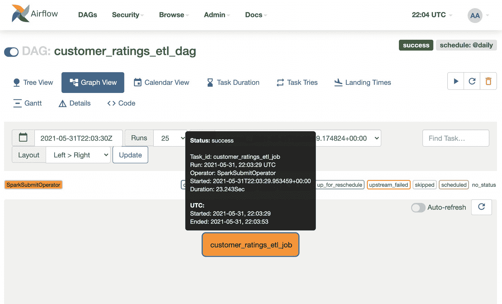

图 8-10 在 Airflow 中成功运行`SparkEventExtractorApp`

您可以查看 Spark 日志，了解所有动态组件如何协同工作。但本质上，您在本书所学内容值得获得掌声。

#### 练习 8-3：总结

本章最后一个练习展示了如何使用 Airflow DAG 启动更复杂的 Spark 批处理作业。为了能够使用最终的`docker-compose-chapter-end.yaml`替换练习 8-2 中使用的`docker-compose.yaml`，需要进行大量准备工作。在结束本章之前，让我们探讨一下使 DAG 能够运行所需的基础架构和组件。

### 审视混合架构

现在，运行此 DAG 时需要记住许多动态组件。首先，您需要管理本地 MySQL 支持的（`Hive Metastore`）以及 Airflow Docker 容器，并以某种方式为 Spark SQL 数据仓库提供额外的共享卷。所有这些中央数据平台组件共同构成了您基础设施的关键部分，并使 Airflow 能够运行 Spark DAG。

图 8-11 是您本地数据平台当前简化状态的示例。您已经运行了使 Airflow 工作所需的一切。您拥有由 MySQL 支持的 `Hive Metastore`，负责存储分布式数据表的元数据；同时还有新的 `MinIO` S3 数据湖。您现在可以重用本地 Spark 安装中的共享配置，并在 Zeppelin 和 Airflow 之间重用配置和 JAR 包。这为您提供了 Spark UI，用于交互查看从 Airflow 生成的数据。另一方面，您拥有 Airflow，它可以运行作业，将数据存储到您的数据湖中，或作为 JDBC 表存储到 MySQL 中。

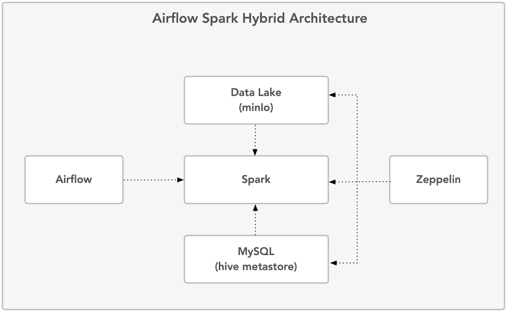

图 8-11 客户评价 ETL DAG 背后的组件架构

#### 设置扩展环境

章节材料中的主`README`提供了扩展本地环境启动和运行的分步说明。关于 `MinIO` 以及迁移 `Hive Metastore`，还有一些额外的要点值得说明。

扩展环境将此实践环境的所有关键组件移至您笔记本电脑上的一个单一位置。这将使您能够从今以后重用所有这些通用架构组件，而无需记住我们在哪个章节练习中添加了哪些内容。该路径设置为您主目录下的一个名为`dataengineering`的文件夹。

```
~/dataengineering
-/airflow
-/minio
-/mysql
-/spark
-/zeppelin
```

#### 从本地文件系统迁移到 `MinIO`

为简化后续操作，章节材料中提供了使用 `MinIO` 分布式文件系统的说明。简而言之，`MinIO` 是 Amazon S3 的克隆，并与 S3 API 完全兼容。这将在未来章节中降低一些复杂性。需要注意的一点是，首次运行 `MinIO` 时，您必须在文件系统上设置一些权限。幸运的是，您可以通过 UI 完成此操作。参见图 8-12。

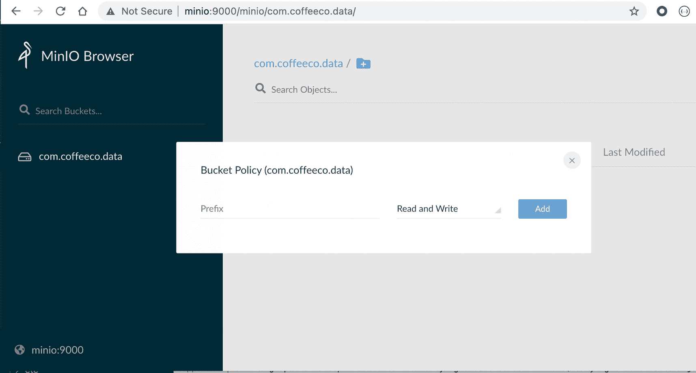

图 8-12 将文件系统从默认的“只读”切换为“读写”

您需要打开 `MinIO` UI（`http://localhost:9001`）。您也可以在`/etc/hosts`文件中添加一条记录，以便更容易地找到它。我的记录是`http://minio:9001`。进入主页后，系统将提示您进行身份验证（用户和密码存储在 `MinIO` 的`docker-compose.yaml`文件中）。或者，如果您未做任何更改，则用户名为`minio`，密码为`minio_admin`。这将允许您应用前缀权限。

#### 应用存储桶前缀权限

在屏幕左侧（如图 8-13 所示），您将看到`com.coffeeco.data`。这是默认存储桶名称，您只需将鼠标悬停在该名称上，点击出现的小圆点，即可打开权限菜单。

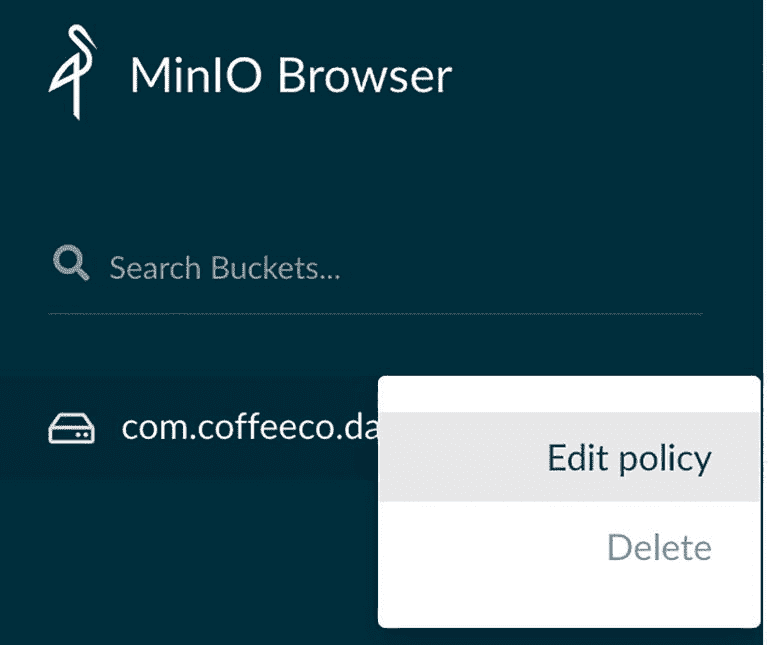

图 8-13 在 `MinIO` 浏览器中编辑

只需添加前缀`/warehouse/*`并将其设置为“读写”，即可大功告成。

接下来您可能想要做的是将 `Hive Metastore` 表迁移到一个更好的公共位置。

#### 在公共位置引导 MySQL

您的 `Hive Metastore` 很可能位于`ch-06`目录中。您可以从当前 metastore 中导出 SQL 数据库和表，并将现有内容移动到`~/dataengineering/mysql`；或者您可以从头开始，在`~/dataengineering/mysql`目录中进行引导。章节材料中的`mysql`目录包含一个`README.md`文件，提供了从头开始全新 Hive 安装的分步说明。

从现在开始，我们将在探索数据领域时重复使用此通用设置。

### 持续探索

本章全面介绍了如何使用 Airflow 调度 Apache Spark 应用程序。如您所知，总有更多可以学习的内容（但并非所有内容都适合放入书中）。作为持续探索，我建议如下：

- 在运行 DAG 时，您可以添加 DAG 覆盖变量。这使得您能够对底层 DAG 进行额外更改，而无需返回并修改底层 Python 代码。尝试添加一个变量来更改以下变量：

    `spark.event.extractor.save.mode`

    可用选项为`ErrorIfExists`、`Overwrite`、`Ignore`和`Append`。

- 使用第 7 章的通用特性创建另一个 Spark 应用程序，并使用 Airflow 运行它。
- 尝试生成一个新的数据集，或思考一个可以利用本地数据仓库中的数据解决的新问题。

除了持续探索之外，下一节将介绍创建单个用户和分配角色的过程。

### 创建用户

使用 Airflow 命令行创建新用户非常简单。本质上，所有用户命令都嵌套在 `users` 子命令中。

```
docker exec \
    -it airflow_airflow_webserver-1 \
    airflow users [子命令]
```

例如，假设你需要创建一个新用户，并为其授予 Airflow 内的有限权限。你可以使用 `User` 角色来分配常规权限。例如，执行清单 8-18 中的命令来生成 `scotteng` 用户。

```
docker exec \
    -it airflow_airflow_webserver-1 \
    airflow users create \
    --username scotteng \
    --firstname Scott \
    --lastname Haines \
    --role User \
    --email scott@coffeeco.com
```

清单 8-18 通过 Airflow 命令行生成新用户

该命令会要求你输入密码，因此只需按照提示完成新用户的创建即可。创建完成后，退出 Airflow，然后以 `scotteng` 用户身份重新登录。你会注意到 `Admin` 或 `Security` 菜单已经消失，但你仍然可以运行 DAG（见图 8-14）。

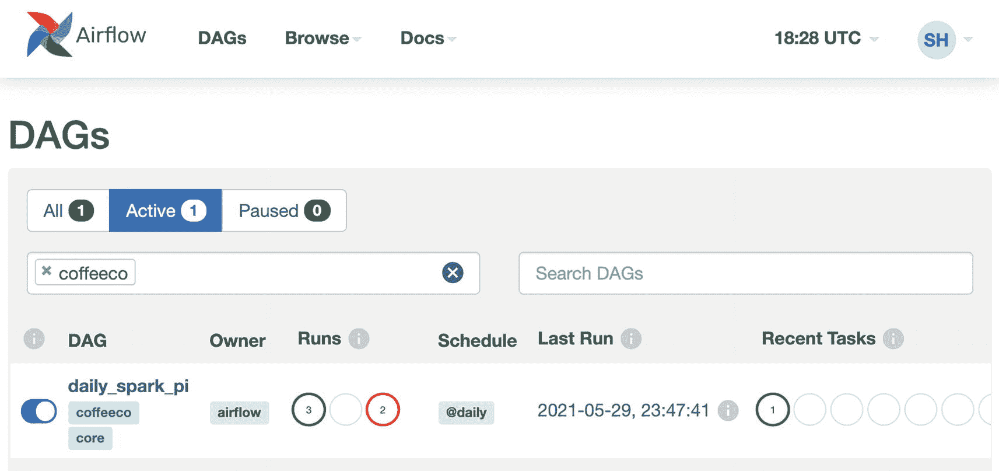

图 8-14 以普通用户身份查看 Airflow 界面

这就是目前的内容。

## 小结

本章从较高层次介绍了工作流自动化的概念，并向你介绍了 Apache Airflow。虽然我们可以轻松地用本书剩余部分讨论如何创建越来越复杂的 Airflow DAG，并深入探究 Airflow 的更多细微之处，但这项工作将留给你自己完成。在继续我们的旅程时，我们还会再次提到 Airflow，但下一站我们将进入一个激动人心的主题：使用 Apache Spark 编写 Structured Streaming 应用。系好安全带，事情即将加速发展！

# 流处理入门

由于每个数据工程问题可能涉及多个维度，学习解决和优化这些问题颇具挑战性。在每个新问题开始时，你必须考虑数据发现、数据整理、数据摄入、数据转换以及数据责任——这是一个涵盖数据契约（严格定义的数据定义）的范畴，同时还需要优化数据摄入足迹（因为大规模数据很容易侵蚀运营成本）。此外，数据访问、数据谱系和数据治理等问题也需要时刻放在心上。理解如何运用你的综合知识来制定快速的数据行动计划，是一项能让你作为现代数据工程师走得更远的技能。

回顾你在本书中学到的处理数据的各种方式：无论是从使用 `spark-shell` 探索初步想法的小规模起步，还是使用笔记本（Apache Zeppelin）进一步深入这些想法，最后将学到的经验整合到 Spark 应用中。通过这个过程，你学会了创建可复用、经过测试的 Spark 应用，也掌握了通过探索来解决问题的重要技能。你学会了如何经历问题识别与分解的阶段——理解问题、制定行动计划、测试和验证结果，最后将解决方案封装成一个完整的应用。更重要的是，你通过实践学会了如何分解这些端到端的数据问题：使用 Spark SQL 编写转换查询，学习测试这些微应用（通过查询）的行为，甚至学会了如何安排它们的定期运行（使用 Apache Airflow）。

所有这些步骤都是为了现在这一刻。正如上一章结尾所承诺的，事情即将开始加速。为什么会这样？因为现在我们正从批处理迈向流处理，即处理无界数据集。

对于许多用例来说，在数据可用时立即进行流式处理，有助于将一个非常庞大的数据问题（由于事件数据的规模）转化为一个更易于管理的问题。只需更频繁地处理更少的数据点，你就可以分而治之地解决一个可能成本高昂的数据问题。然而，如何从批处理思维过渡到流处理思维也颇具挑战性。

例如，假设你的任务是创建一个每天必须处理约 10 亿个事件的应用。虽然由于数据规模庞大，这听起来可能有些牵强，但后退一步思考应用/流程的意图通常会有所帮助。如果数据可以被分解（分区）并作为流式操作并行处理，你只需创建一个能够每秒摄入和处理区区 11.5 千个事件的应用（如果事件流是恒定的，每分钟约 69.5 万个事件）。

尽管这些数字可能看起来遥不可及，但这也是分布式流处理真正大放异彩之处。本质上，你是在缩小问题的视角或范围，以便在分区数据集上以更分布式的方式，随时间推移达成目标。虽然并非所有问题都能通过流式处理解决，但相当多的问题确实适用于这种处理模式。

本章是对流处理的温和介绍，为你直接进入第 10 章构建自己的端到端 Structured Streaming 应用铺平道路，而无需回过头来讨论大量决策过程背后的理论。

到本章结束时，你应该理解以下内容（高层次概述）：

-   如何思考流数据及流数据处理问题
-   为什么数据责任始于生产者
-   在 API 边界处理数据质量的方法
-   为什么二进制可序列化的结构化数据至关重要

## 流处理

流数据并非静止不动。事实上，你可以将其视为“活着的”（即使只是短暂的）。这是因为流数据是封装了当下的数据——它记录事件和动作在传输过程中的发生情况。让我们看一个实用但理论性的例子，从一个简单的传感器数据事件流开始。在你的脑海中，想象你最后去过的那个停车场（或停车库）。

### 用例：实时停车位可用性

想象一下，你刚刚找到停车位，全靠那些指引你前往空位的指示牌。现在，假设这一切都源于本地停车传感器互联网络发出的数据。这些传感器的唯一用途，就是识别当下时刻可用停车位的数量。

这是一个实时数据问题，其中实时准确度是可衡量的，并且停车结构的用户可以实际感受到。要实现这些功能，首先要声明系统场景。

> “我们希望创建一个系统，能追踪所有可用停车位，识别车辆何时停放，并知道车辆在某个位置停留了多久。这个过程应尽可能自动化。”

优化这样的系统，可以从每个停车位安装一个简单传感器开始（关联 `sensor.id`/`spot.id` 引用）。该传感器负责以位置标识符、时间戳和简单比特位（0 或 1）的形式发出数据，以表示车位是空置还是被占用。这些数据可以编码成一种紧凑的消息格式，如代码清单 9-1 所示，该格式将被高效编码，并由每个设备定期发送。

```protobuf
message ParkingSensorStatus {
  uint32 sensor_id = 1;
  uint32 space_id  = 2;
  uint64 timestamp = 3;
  bool   available = 4;
}
```

`代码清单 9-1` 传感器事件示例（封装于 Google Protocol Buffer 消息格式中）


在一天正常的车流过程中，由于个体驾驶员的动态时间安排，每个传感器的状态会以不可预测的方式在开或关（二元状态）之间切换。这些传感器数据可以实时告知驾驶员，车库里现在总共有 `X` 个可用车位。这些数据有助于自动化人类的决策过程，甚至可以通过一个简单的 `Web` 服务在线提供，用于实时状态追踪。此外，这些数据还可用于追踪每个传感器的上次签到时间，这可用于诊断故障传感器，甚至追踪传感器离线和故障的频率。如今，技术更先进的停车场甚至能通过方向标志和提示，引导驾驶员前往结构中的可用车位。这减少了停车场内的交通和拥堵，进而提高了客户满意度，而这一切仅仅通过捕获传感器数据的实时流并对其进行近实时处理就能实现。

考虑到从这些传感器事件流中收集到的时间信息，聪明的停车场运营者可以根据过往趋势，基于对停车位的实时需求和当前可用性，来降低或提高每日或每小时的定价。通过在合理范围内优化定价，运营者可以找到完美的临界点，即每小时/每日的价格能使停车场满员。换句话说，“在什么价格下，大多数人会选择停车，且车位不会被闲置？”

这是一个源于实时传感器数据收集的优化问题示例。越来越多的组织开始研究如何重用数据来同时解决多个问题。物联网（`IoT`）用例只是你在编写流式应用程序时可能处理的众多数据流之一。在本书的前面部分，我们讨论了创建一个系统，该系统可以获取咖啡店上座率信息，从而告知人们附近哪家店有能容纳他们聚会规模人数的座位。在那个故事中，我们只是创建了一个可用于连接展示此示例的合成表。然而，这是另一个可以通过传感器解决的问题，或者通过像签到系统这样简单的东西来解决，该系统会发出相关的事件数据，并通过流式数据管道可靠地传递到下游。这两个例子都采用了基础分析，并且都可以从简单的机器学习中受益，以发现新的行为模式，从而实现更优化的运营。在过深入之前，我们先稍作停留，深入探讨流式数据网络所提供的能力。

### 时间序列数据与事件流

从静态数据的思维模式，转变为随着时间推移来解释数据的思维模式，即从跨越多个视角和时刻的无界数据流的角度来看待数据，这既是一种视角上的练习，也可能是一种难以适应的挑战。通常，当你考虑流式系统时，连续事件流的概念会浮出水面。这是最常见的用例之一，可以作为理解流式数据概念的温和入门。例如，图 9-1 中所示的抽象时间序列。

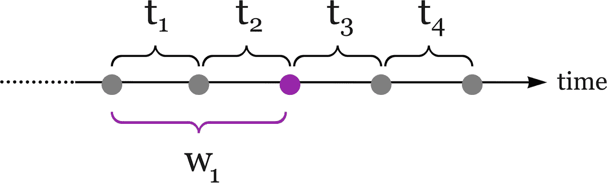

图 9-1 事件发生在精确的时间点，可以单独收集和处理（`t1->t4`），也可以跨时间窗口聚合（`w1`）

如你所见，数据本身根据给定系统（或应用程序）所采用的视角，存在于各种状态中。每个事件（`T1->T4`）在其狭窄的参考框架内只了解*发生了什么*，换句话说，事件捕获了一个有限的（相对的）*时间*视角。当一系列事件在一个有界集合（窗口）中被一起处理时，你获得了一系列数据点（事件），这些事件封装了完全实现或部分实现的想法。当你缩小范围查看整个时间线时，你可以描绘出一个从第一个事件到最后一个事件更准确的故事。让我们进一步阐述这个想法。

#### 事件是孤立的吗？

考虑一个简单的事实。你的事件数据要么作为一个完整的想法存在，要么作为部分的想法或念头存在。我发现，将数据视为随时间展开的故事，有助于赋予这些数据字节以生命力。因此，每个数据点都有助于构成一个完整的故事，就像一系列随时间交织、组合或实现的想法和念头。

在你尝试采用分布式数据视角看待事物时，这个数据构成概念可以作为一个透镜。我还发现，在构建和定义新的分布式数据模型，以及处理大规模现实世界数据网络时，这个概念也非常有用。如果将这些事件视为一个整体，它们共同讲述一个特定的故事，事件留下的线索可以告知事物发生的顺序，而每个事件的时间戳则极大地增强了这种叙述能力。没有时间的事件会呈现事物发生的扁平化视图，而时间的加入则赋予你动量或速度的概念，或者是事件之间或整个数据点系列在时间上的减慢和拉伸。理解流经众多管道和数据通道的数据行为，对于数据运营至关重要，并且需要可靠的监控来保持数据以最佳速度流动。让我们看一个用例，其中时间维度有助于更清晰地描绘真实世界的场景。

#### 用例：追踪客户满意度

如果我告诉你，两位顾客走进咖啡店，点了饮料，然后带着饮料离开，你可能会问我为什么费心告诉你这些——毕竟这就是咖啡店里常发生的事。但如果我告诉你，这两杯咖啡几乎是同时制作的，而故事中的第一位顾客在五分钟内就进出咖啡店了呢？如果我告诉你那是一个工作日，且故事发生在早高峰时段呢？如果我告诉你第二位顾客（恰好排在队伍中下一位）在咖啡店里待了 30 分钟呢？你可能会问，这位顾客是不是留下来看报纸或使用洗手间了——这些都是合理的疑问。

如果我告诉你，这位顾客之所以等待，是因为在四步咖啡制作流程的第 3 步和第 4 步之间出现了错误，那么我们就更能理解未来如何优化顾客体验了。这四步分别是：

1.  顾客点单：`{customer.order:initialized}`
2.  完成支付：`{customer.order:payment:processed}`
3.  订单排队：`{customer.order:queued}`
4.  订单完成：`{customer.order:fulfilled}`

无论错误是发生在自动化环节，还是源于现实系统的故障（如打印机卡纸、咖啡师漏单，或其他任何原因），结果都是顾客需要主动介入，告知运营流程（咖啡制作流水线）似乎有人忘了他们的饮料。

此时，讨论可以转向如何处理顾客的情绪反应——这种反应可能在积极与消极之间剧烈波动：从乐于助人的高兴（1 分），到轻微受挫（4 分），再到因拖延和流程故障而爆发的愤怒（10 分）。但通过这个假设的用例推演，我们现在都更清楚地了解了如何利用优秀的数据采集技术来服务于各种场景。

#### 事件时间、事件记录顺序及事件间延迟，皆蕴含信息

如果不了解从第一个事件（`customer.order:initialized`）到最终事件（`customer.order:fulfilled`）之间经过了多少时间，或者每个步骤通常需要多长时间完成，我们就无法对体验进行评分，也无法真正理解发生了什么——这实际上为系统中的异常延迟或故障制造了盲区。了解顾客在不同规模订单中通常等待时间的统计数据（平均值、中位数和 99 百分位）是很有价值的，因为这些历史数据点可以通过自动化方式用于预防性解决问题——例如，当订单耗时超出预期时。这直接决定了顾客是感到不满还是成为终身客户。

这也是企业向客户征求反馈的重要原因之一——无论是针对体验给出“赞/踩”，还是奖励性的应用内参与（用积分兑换免费商品和服务）。这些通过现实互动收集并捕获的数据，编码为事件，并按你的需求进行处理——如果它能对公司的运营和声誉产生积极影响，那将非常有用。只需确保遵守数据隐私法规，最终不要让你的客户感到不适。

这个小小的思维实验旨在揭示一个事实：你在事件数据中捕获的细节（以及数据故事随时间演变的脉络）可能带来颠覆性的改变。时间是赋予这些旅程动力的维度。但时间本身也存在一个问题。

### 时间的问题

虽然事件在精确的时间点发生，但时间的问题在于，它也受制于时间和空间（位置）的难题。爱因斯坦用相对论从宇宙尺度解释了这一问题，但在更局部的尺度上，这也是一个问题。例如，我的家人居住在美国的不同地区。协调大家的时间表让每个人的日程同步就很困难。即使是像通过视频通话叙旧或现实世界中的家庭聚会这样简单的事件也会遇到这种情况。即使一切都协调好了，人们也习惯性地会迟到一点。

将视角从我家人或一般人身上拉远——从事件集中协调的角度来看——你会发现问题不仅仅关乎跨时区（东部/中部/西部海岸）的同步。如果仔细观察，你会发现，相对于我们本地/物理空间的时间，也存在一定程度的时间漂移或时钟偏差。

以现代数字时钟为例。它在你的智能手机、手表或众多“智能”联网设备上作为一个进程运行。保持不变的是时间保持显著的同步性（即使漂移只有几毫秒）。许多人仍然有模拟（非数字）时钟。这些设备的精度差异很大，从高端手表（“精密时计”）的难以置信的精确，到有时需要每隔几天重新校准一次的廉价时钟。

这里的要点是，两个系统对精确时间达成一致的情况很少见，就像人们也难在时间和空间上进行协调一样。因此，必须使用一个中央参考（或视角）来同步跨多个时区运行的系统的时间。

#### 时间校正

在任何现代云基础设施中运行的服务器都采用一种称为[网络时间协议](https://en.wikipedia.org/wiki/Network_Time_Protocol)（`NTP`）的进程来纠正时间漂移问题。`NTP` 进程负责使用可靠的中央时间服务器同步本地服务器时钟。此进程将本地时间校正到与协调世界时（`UTC`）相差几毫秒以内。这是一个需要牢记的重要概念，因为运行在大型网络中并产生事件数据的应用程序将负责创建时间戳，而这些时间戳必须精确，才能使分布式事件对齐。此外，还有一个棘手的夏令时问题，因此，要协调来自不同时区以及不同本地日期时间语义的系统数据，就需要从这个中央同步的视角来审视时间。

我们已经从理论上探讨了时间与基于事件的数据的关系，但为了完善背景知识，我们还应该从时间与系统中数据需要被捕获和处理的优先级（无论是流式处理还是其他方式）的关系来审视它。

### 按优先级排序的事件处理模式

你可能熟悉这句话：“时间至关重要。”这是说某件事很重要且是最高优先级的。解决速度至关重要。这种优先级意识可以用作一种工具或定义性指标，在处理关键数据时，为实时、近实时、批量或最终（按需）处理提供依据。这四种处理模式对时间有不同的处理方式，从而对当前的数据问题产生特定的关注点。其范围基于进程必须完成的速度，这反过来又限制了任务的复杂度（作为时间的一个因素）。将这些处理风格视为由截止日期驱动的。完成某个动作只有一定的时间限制。

## 实时处理

实时系统的预期是，从上游系统发出事件，到该事件被处理并可供分析和洞察使用，端到端延迟在毫秒到几秒之间。这些事件会直接发送到事件流处理服务（如 `Apache Kafka`），在正常情况下，该服务能让监听器/消费者在事件写入后立即使用。真正的实时系统有许多典型用例，包括物流（例如停车位示例以及在咖啡店找空桌）。对业务产生全新影响的流程，例如欺诈检测、主动网络入侵检测或其他恶意行为检测，在这些场景中，较长的平均检测时间（平均毫秒/秒级检测时间）可能导致灾难性的声誉或财务损失。

对于其他系统，以近实时方式运行是完全可接受的。由于解决棘手问题需要时间，实时决策需要对其要提出的问题提供高性能、预计算或低延迟的答案。这就是纯粹的内存式流处理。

## 近实时处理

大多数人想到“实时”时，实际想到的是近实时。它与实时拥有一组类似的时间约束，唯一的区别在于端到端延迟的预期从数秒放宽到了几分钟。对于大多数系统来说，并没有真正的理由需要对每个到达的事件立即做出反应，因此，虽然时间仍然至关重要，但数据可用性的 `SLA` 优先级被放宽了。

保持更新的运营仪表盘和指标系统（每 30 秒到五分钟刷新图表和检查监控）通常足以快速发现问题并提供对现实状况的近似呈现。对于所有其他数据系统，则存在批处理或按需处理的概念。

## 批处理

我们在前两章中介绍了批处理和周期性调度，但为了清晰起见，需要说明的是，通过定期作业将数据从可靠的数据源（数据湖或数据库）推送到其他关联系统，过去是，并且现在仍然是现实世界中处理大量数据的方式。其原因在于成本。这归结为运营成本和维护大型流式系统的人力成本。

流式系统需要全天候访问可变数量的资源，从 `CPU`、`GPU` 到网络 `IO` 和 `RAM`，并且期望这些资源不会稀缺，因为流处理中的延迟（阻塞）可能会迅速累积。另一方面，从长远来看，批处理可能更易于维护，前提是数据的使用者理解从数据首次在上游发出，到数据可用于下游使用之间总是存在时间差。

最后需要考虑的是按需处理（或即时处理）。

## 按需处理或即时处理

面对现实吧。有些问题（即查询）很少被提出，或者其提出方式根本不适合任何预定义的模式。

例如，自定义报表作业和探索性数据分析是两种非常适合这些范式的数据访问方式。大多数情况下，回答这些查询所需的后备数据会直接从数据湖加载，然后使用共享计算资源或隔离的计算集群进行处理。这些查询所提供的数据，可能是其他实时或近实时系统处理并存储后用于批处理或历史分析的副产品。

使用这种模式，数据可以通过从较慢的商品对象存储（如 `Amazon S3`）导入记录到内存中，或快速访问的固态硬盘（`SSD`）上，来解冻并按需加载。根据数据的大小、格式和布局，可以直接从云对象存储中查询。这种模式可以轻松地通过 `Spark SQL` 委托给 `Apache Spark`。这使得可以通过 `Apache Zeppelin` 等工具进行临时分析，或者通过使用 [Apache Spark thrift-server](https://spark.apache.org/docs/latest/sql-distributed-sql-engine.html) 和 `Apache Hive Metastore` 的 `JDBC` 绑定在应用程序内直接进行分析。

这四种处理方式的区别在于时间。

回到视图和视角的概念，每种方法或模式都有其适用的*时机和场景*。流处理处理的是在特定时间点捕获的事件，正如我们在本章前半部分所讨论的，我们如何关联时间、如何捕获和测量一系列事件（作为数据），共同描绘出当前正在发生什么或过去发生了什么。同样重要的是要讨论流处理的基础。在下一节中，我们将介绍处理连续、无界数据流时的一些常见问题和解决方案。因此，将数据作为核心支柱并由此向外扩展是合情合理的。

### 流处理基础

基础是结构赖以建立的不可动摇、坚不可摧的根基。在构建成功的数据架构时，数据是整个系统的核心租户，也是该基础的主要组成部分。目前，数据进入数据平台的最流行方式是通过像 `Apache Kafka` 这样的流处理平台。这意味着围绕数据模式、可用性和有效性制定的数据契约，成为了该数据基础的关键支撑（考虑到 `Apache Kafka` 所提供的去中心化、分布式流处理能力）。

## 构建可靠的流式数据系统

作为数据工程师，构建可靠的数据系统实际上就是我们的工作，这意味着数据停机时间应该像业务的其他任何组成部分一样被衡量。你可能在某个时候听说过 `SLA`（服务水平协议）、`SLO`（服务水平目标）和 `SLI`（服务水平指标）这些术语。简而言之，这些缩略词与用于评估系统的契约、承诺和度量相关联，它们最终使服务所有者为其成功和失败负责。例如，你的团队或组织与客户之间的服务水平协议（`SLA`）用于就你提供的服务创建具有约束力的合同。对于数据团队来说，这意味着基于你的服务水平目标（`SLO`）来识别和捕获指标（`KPMs`：关键绩效指标）。`SLO` 是你承诺根据 `SLA` 需要履行的约定，它们可以是从承诺近乎完美（`99.999%`）的服务可用性，到像承诺特定数据集保留 `90` 天这样简单的事情。最后，你的服务水平指标（`SLI`）是你按照服务水平契约运作的证据，通常以运营分析（仪表盘）或报告的形式呈现。

明确目标有助于制定实现目标的计划。这段旅程始于数据接入点（即数据摄取点）。具体来说，始于每个数据点的正式结构和身份标识。考虑到“越来越多的数据通过像 `Apache Kafka` 这样的流处理平台进入数据平台”这一观察，对发射到这些数据流的数据进行编译时保证、向后兼容性和快速二进制序列化会很有帮助。数据问责制本身就是一个挑战。让我们看看原因。

## 管理流式数据问责制

流式系统每周 `7` 天、每天 `24` 小时、每年 `365` 天运行。如果不在前期对这个问题投入精力，这可能会使事情复杂化；而其中一个时不时冒出来的问题就是损坏的数据，即传输中的数据问题。

## 处理飞行中的数据问题

在飞行中减少数据问题有两种常见方法。首先，你可以在数据网络边缘引入看门人，通过传统应用程序编程接口（`API`）来协商和验证数据；其次，你可以创建并编译辅助库（即软件开发工具包，`SDK`），以强制执行数据协议，并使分布式写入者能够接入你的流式数据基础设施。你甚至可以同时采用这两种策略。

### 数据看门人

在数据网络边缘添加网关 `API` 的好处在于，你可以在数据生产点强制执行*身份验证*（该系统能否访问此 `API`？）、*授权*（该系统能否向特定数据流发布数据？）和*验证*（此数据是否可接受或有效？）。图 9-2 展示了数据网关的流程。

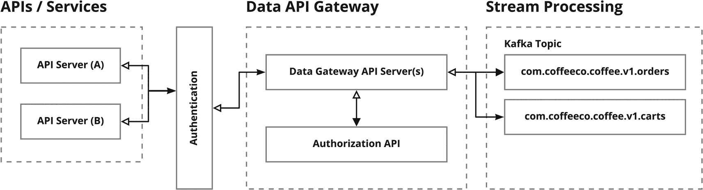

图 9-2 数据网关服务可以充当数据网络的看门人。它们提供了用于认证 `API` 访问的机制，授权哪些上游服务（`API`/服务）可以发布数据，并且还可以在损坏或错误数据进入数据网络（流处理）之前，对来自发布者的数据进行验证。

这意味着上游数据生产系统可以在生产数据时*快速失败*。这能阻止损坏数据在数据网络边缘进入流式或静态数据管道。它是一种通过错误代码和有用的消息，以更自动化的方式与生产者就问题发生的具体原因和方式建立对话的手段。

```json
```

{
    "error": {
        "code": 400,
        "message": "The event data is missing the userId, and the timestamp is invalid (expected a string with ISO8601 formatting). Please view the docs at http://coffeeco.com/docs/apis/customer/order#required-fields to adjust the payload."
    }
}
```

这种方法有其利弊。优点在于，大多数编程语言都原生支持 `HTTP`（或 `HTTP/2`）传输协议（或只需添加一个小型库），而 `JSON` 数据是目前几乎最通用的数据交换格式。另一方面（缺点），有人可能会认为这又多了一个需要管理的服务，而且如果没有某种形式的 `API` 自动化或遵循像 [OpenAPI](https://spec.openapis.org/oas/latest.html%2523format) 这样的开放规范，每个新的 `API` 路由都可能开始耗费过多时间。`API` 会成为一个集中的故障点，而且更多的变更并不一定意味着更好的功能！要扭转这个问题，这正是单元测试和功能测试如此重要的原因。理想情况下，数据本身（模式/格式）可以通过启用字段级验证（谓词）、生成有用的错误消息并采取自我保护行动，来决定其自身数据级契约的规则。嘿，只需一点路由级或数据级的元数据和一些创造性思维，`API` 就可以自动生成自我定义的路由和行为。

最后，网关 `API` 可被视为集中的麻烦制造者，因为上游系统未能生成有效数据（例如被看门人阻止）的每一次失败，都意味着有价值的信息（事件数据或指标）被丢弃。这里的责任归属问题也往往是双向的，因为看门人的一次糟糕部署可能会使一个未设置好在网关宕机（即使是几秒钟）时处理重试的上游系统陷入盲目。

撇开所有利弊不谈，使用网关 `API` 在损坏数据进入数据平台之前阻止其传播，意味着需要排查问题原因的地点更少了。这肯定比调试一个由数据管道、服务和无数最终数据目的地组成的分布式网络要好得多。那么 `SDK` 呢？

## 软件开发工具包

`SDK` 是导入到代码库中的库（或微框架），用于简化一个操作、活动或其他复杂流程。它们还有另一个名字：客户端。以之前关于使用良好错误消息和错误代码的例子来说，这个流程对于告知客户端其先前的操作无效是必要的。然而，直接在 `SDK` 中添加适当的安全护栏以减少潜在问题的范围可能更有优势。例如，假设我们设置了一个 `API`，用于通过事件追踪来跟踪客户与咖啡相关的行为。一个客户端 `SDK` 理论上可以包含所有必要的工具来管理与 `API` 服务器的交互，包括身份验证、授权和验证。事实上，如果 `SDK` 能发挥其作用，验证问题就会不复存在。清单 9-2 展示了一个可用于可靠跟踪客户事件的 `SDK` 示例。

```scala
import com.coffeeco.data.sdks.client._
import com.coffeeco.data.sdks.client.protocol._

Customer.fromToken(token)
  .track(
    eventType = Events.Customer.Order,
    status = Status.Order.Initalized,
    data = Order.toByteArray
  )
```

清单 9-2  
`SDK` 使应用程序能够以一致的方式可靠地发出事件数据

通过一些额外的努力（即客户端 `SDK`），数据验证或事件损坏的问题几乎可以消失。其他问题可以在 `SDK` 本身中处理，例如当服务器离线时如何重试发送请求。与其让所有请求立即重试，或陷入一个无限冲击网关负载均衡器的循环中，`SDK` 可以采取更智能的行动，例如使用指数退避。

### 惊群问题

假设你有一台网关 `API` 服务器。你编写了一个出色的 `API`，公司内许多团队都在向此 `API` 发送事件数据。一切顺利，直到有一天，一个新的内部团队开始向服务器发送无效数据。（他们没有遵守你的 `HTTP` 状态码，而是将所有非 200 的 `HTTP` 码视为重试的原因。他们忘了添加任何重试启发式算法，比如指数退避，所以所有请求都在一个不断增长的重试队列中无限重试。）请注意，在这个新团队加入之前，从来没有理由运行 `API` 服务器的多个实例，也从未需要使用任何形式的服务级速率限制器，因为一切都在约定的 `SLA` 内平稳运行。

好吧，那是今天之前的事了。现在你的服务离线了。数据在积压，上游服务正在填满它们的队列，人们很沮丧，因为他们的服务因为你这个单点故障而开始遇到问题。

这些问题都源于一种资源匮乏形式，被称为“惊群问题”。当许多进程在等待一个事件（例如系统资源变得可用，或者在这个例子中 `API` 服务器重新上线）时，就会发生这个问题。然后所有进程都会争相尝试获取资源，在许多情况下，单个进程（`API` 服务器）上的负载足以使服务再次离线。不幸的是，这又开始了新一轮的资源匮乏循环。当然，除非你能安抚这群“惊马”，或者将负载分散到更多的工作进程中，从而降低整个网络的负载，让资源有喘息的空间。

虽然这个最初的例子更像是一次无意的分布式拒绝服务攻击（`DDoS`），但这类问题可以在客户端（使用指数退避或自我节流）和 `API` 边缘（通过负载均衡和速率限制）得到解决。

最终，如果没有由运营指标、监控器和系统级（`SLA`/`SLO`）告警所构建的恰当洞察渠道，数据可能会消失无踪，而这将成为一个难以解决的挑战。

无论你决定在数据网络边缘添加数据网关 `API`，采用自定义 `SDK` 来实现上游一致性和可问责性，还是决定采用其他方法来处理数据进入数据平台的问题，了解你有哪些可选方案总是好的。无论数据以何种路径进入你的数据流，如果不深入探讨数据格式、协议以及二进制可序列化数据的话题，那么这篇关于流式数据的入门介绍便不算完整。谁知道呢，你或许会发现一种更好的方法来处理数据可问责性问题！

## 为任务选择正确的数据协议

当你想到结构化数据时，脑海中首先浮现的可能是 `JSON` 数据。`JSON` 数据具有结构，是一种基于 Web 的标准数据协议，而且最重要的是，它非常易于使用。这些都是快速上手的好处，但随着时间的推移，如果没有适当的防护措施，在为流式系统标准化使用 `JSON` 时，你可能会面临问题。第一个问题是 `JSON` 数据是可变的。这意味着作为一种数据结构，它很灵活，因此也很脆弱。数据必须保持一致才能实现可问责，并且在网络间传输数据（在线传输）时，序列化格式（二进制表示）应该具有高度可压缩性。对于 `JSON` 数据，你必须为载荷中表示的每个对象发送其（所有字段的）键。这不可避免地意味着，在一系列对象中，每增加一条记录（除了第一条），你通常都要发送大量额外的数据负担。

幸运的是，这并不是一个新问题，而且恰好存在处理这类事情的最佳实践，以及关于什么才是最佳数据序列化策略的多种学派思想。这并不是说 `JSON` 没有优点。只是当涉及到奠定坚实的数据基础时，结构越多越好，压缩程度越高越好，只要这不会消耗大量 `CPU` 周期即可。

### 可序列化的结构化数据

在高效编码和传输二进制数据方面，通常会提到两种序列化框架：[Apache Avro](https://avro.apache.org/) 和 Google [Protocol Buffers](https://developers.google.com/protocol-buffers)（`protobuf`）。这两个库都提供了高效的 `CPU` 技术用于序列化基于行的数据结构，并且两者也都提供了它们自己的远程过程调用（`RPC`）框架和功能。我们先来看 Avro，然后是 `protobuf`，最后我们会简要介绍远程过程调用。

#### Avro 消息格式

使用 Avro，你可以通过记录（record）的概念为结构化数据定义声明式模式。这些记录只是 `JSON` 格式的数据定义文件（模式），以 `avsc` 文件类型存储。列表 9-3 展示了一个咖啡模式的例子。

```json
{
  "namespace": "com.coffeeco.data",
  "type": "record",
  "name": "Coffee",
  "fields": [
    {"name": "id", "type": "string"},
    {"name": "name", "type": "string"},
    {"name": "boldness", "type": "int", "doc": "从轻度到深度烘焙。1 到 10"},
    {"name": "available", "type": "boolean"}
  ]
}
```

列表 9-3  
`coffee.avsc`: 定义咖啡模式可以相当容易地完成

处理 Avro 数据可以根据你希望在运行时的工作方式，分为两条不同的路径。你可以采用编译时方法，也可以在运行时按需动态处理。这带来了一种灵活性，可以增强交互式数据发现会话。例如，Avro 最初被创建为一种高效的数据序列化协议，用于在 Hadoop 文件系统中长期存储大型数据集合为分区文件。鉴于数据通常在`HDFS`内部从一个位置读取并写入另一个位置，Avro 可以为每个文件存储一次（在写入时使用的）模式。

#### Avro 二进制格式

当你将一组 Avro 记录写入磁盘时，该过程会将 Avro 数据的模式直接编码到文件本身中（一次）。`Parquet`文件编码也有类似的过程，其中模式被压缩并作为二进制文件页脚写入。我们在第 4 章末尾亲身经历了这个过程，当时我们为`StructType`添加了`StructField`级别的文档。这个模式被用来编码我们的`DataFrame`，当我们写入磁盘时，它在下一次读取时保留了我们内联的文档。

##### 启用向后兼容性并防止数据损坏

在将多个文件作为单个集合读取的情况下，如果记录之间的模式发生变化，可能会出现问题。Avro 将二进制记录编码为字节数组，并在反序列化时将模式应用于数据。

这意味着你必须采取额外的预防措施来保持向后兼容性，否则你将发现自己遇到`ArrayIndexOutOfBounds`异常的问题。

这可能会以微妙的方式发生在模式上。例如，假设你需要将模式中某个特定字段的整数值更改为长整数值。不要这样做。这会因为从`int`到`long`的字节大小增加而破坏向后兼容性。这是因为模式定义被用来确定记录中每个字段在字节数组中的起始和结束位置。为了保持向后兼容性，你需要弃用该整数字段的后续使用（同时在你的 Avro 定义中保留它），并在模式中添加（追加）一个新字段供后续使用。

#### Avro 流式数据的最佳实践

从带有有用内嵌模式的静态 Avro 文件，转向无界的高质量二进制数据流，主要的区别在于你需要自带模式。这意味着你需要支持向后兼容性（以防你需要回退并重新处理模式变更前后的数据），以及正向兼容性，以防已有消费者正在从流中读取数据。

这里的挑战是同时支持这两种兼容性，因为 Avro 不具备忽略未知字段的能力，而这正是支持正向兼容性的一个要求。为了应对 Avro 的这些挑战，Confluence 公司开源了他们的[模式注册表](https://docs.confluent.io/platform/current/schema-registry/index.html)（用于与 Kafka 配合使用），这使得可以在`Kafka`主题（数据流）级别进行模式版本管理。

在不使用模式注册表支持 Avro 时，你必须确保在更新编写者上的模式库版本之前，已经更新了所有活跃的读取者（Spark 应用程序或其他）以使用新模式版本。在你切换的那一刻，你可能会发现自己正站在一次事故的起点。

#### Protobuf 消息格式

使用 protobuf，你可以通过“消息（messages）”这一概念来定义结构化数据。消息的编写格式类似于在 C 语言中定义结构体。这些消息被写入带有 `.proto` 扩展名的文件中。协议缓冲区的一个重要优势是支持 *导入（imports）*。这意味着你可以定义通用的消息类型和枚举，这些类型和枚举可以在大型项目中使用，甚至可以导入到外部项目中，从而实现大规模的复用。使用 protobuf 创建 `Coffee` 记录（消息类型）的简单示例如清单 9-4 所示。

```
syntax = "proto3";

option java_package="com.coffeeco.protocol";

option java_outer_classname="Common";

message Coffee {

string id       = 1;

string name     = 2;

uint32 boldness = 3;

bool available  = 4;

}
```

*清单 9-4 coffee.proto：使用 Protobuf 定义 Coffee 数据类型*

使用 protobuf，你只需定义一次消息，然后就可以为你选择的编程语言进行编译。例如，我们可以使用 [ScalaPB](https://scalapb.github.io/) 项目（由 [Nadav Samet](https://www.linkedin.com/in/nadav-samet/) 创建和维护）中的独立编译器，通过 `coffee.proto` 文件为 Scala 生成代码。

##### 代码生成

编译 protobuf 可以实现简单的代码生成。下面的示例取自 `/ch-09/data/protobuf` 目录。本章的 `README` 中说明了如何安装 ScalaPB，并包含了设置正确环境变量以执行清单 9-5 中命令的步骤。

```
$SCALAPBC/bin/scalapbc -v3.11.1 \
--scala_out=/Users/`whoami`/Desktop/coffee_protos \
--proto_path=$SPARK_MDE_HOME/ch-09/data/protobuf/ \
coffee.proto
```

# 清单 9-5 为 Scala 编译 Protobuf 消息

从长远来看，这个过程可以节省时间，因为你无需再编写额外的代码来序列化和反序列化数据对象（无论是在不同语言之间，还是在不同代码库中）。

## Protobuf 二进制格式

序列化后的格式（二进制线路格式）是使用“二进制字段级分隔符”的概念进行[编码](https://developers.google.com/protocol-buffers/docs/encoding)的。这些分隔符作为标记，用于识别序列化后的 protobuf 消息中封装的数据类型。在示例 `coffee.proto` 中，你可能已经注意到每个字段类型旁边都有一个索引标记（`string id = 1;`）。这用于辅助消息在网络上传输时的编码/解码。这意味着与 avro 二进制格式相比，它会增加一点点额外开销，但如果你仔细阅读过[编码规范](https://developers.google.com/protocol-buffers/docs/encoding)，你会发现其他方面的效率（如位打包、对数值数据类型的高效处理、以及对每条消息的前 15 个索引进行特殊编码）完全弥补了这些额外的字节开销。关于将 protobuf 作为流式数据的首选二进制协议，从全局来看，其优点远远多于缺点。它能弥补自身不足的方式之一，就是对向后和向前兼容性的支持。

## 启用向后兼容性并防止数据损坏

在修改 protobuf 模式时，有一些与我们在讨论 avro 时类似的规则需要牢记。根据经验法则，你可以更改字段的名称，但**绝不能**更改字段的类型或位置（索引），除非你想破坏向后兼容性。在需要长期支持任何类型数据时，这些规则不容忽视，尤其是当团队对 protobuf 的使用越来越熟练时，情况会变得特别棘手。如果不够小心，那种想要重新排列和优化的需求，最终可能会给你带来麻烦。（更多背景信息，请参见“随时间推移维护数据质量”。）

## 流式 Protobuf 数据的最佳实践

Protobuf 同时支持向后和向前兼容性，这意味着你可以部署新的写入器，而无需担心先更新读取器，反之亦然。你可以用更新版本的 protobuf 定义来更新读取器，而无需担心对所有写入器进行复杂的部署。Protobuf 通过“未知字段”的概念来支持向前兼容。这是一个在 avro 规范中不存在的额外概念，它用于追踪那些由于本地 protobuf 版本与当前正在读取的版本之间存在差异而无法解析的索引和关联字节。这样做的好处是，你可以在任何时候选择采用 protobuf 定义中的新变更。

例如，假设你有两个流式应用程序 (a) 和 (b)。应用程序 (a) 正在处理来自上游 Kafka 主题 (x) 的流式数据，为每条记录增加额外的信息，然后将其写入一个新的 Kafka 主题 (y)。应用程序 (b) 从主题 (y) 读取数据并进行处理。假设 protobuf 定义有了一个新版本，而应用程序 (a) 尚未更新到最新版本。上游的 Kafka 主题 (x) 和应用程序 (b) 已经更新，并期望使用升级后提供的一些新字段。令人惊叹的是，即使应用程序 (a) 并不知道这些未知字段的存在，也仍然可以将它们传递给应用程序 (b)。

**提示**

*随时间推移维护数据质量*：在使用 avro 或 protobuf 时，你应该像对待要推送到生产环境的代码一样对待模式。这意味着要创建一个可以提交到公司 GitHub（或你使用的任何版本控制系统）的项目，也意味着你应该为模式编写单元测试。这不仅提供了如何使用每种消息类型的实际示例，而且测试数据格式的重要原因在于确保对模式的修改不会破坏向后兼容性。锦上添花的是，为了对模式进行单元测试，你首先需要编译 (`.avsc` 或 `.proto`) 文件，并使用相应的库进行代码生成。这使得创建可发布的库代码变得更加容易，你还可以使用发布版本（例如 `1.0.0`）来对模式的每次变更进行编目。

实现此过程的一个简单方法是，在项目生命周期中，将所有模式变更对应的每条消息的二进制副本序列化并存储起来。我发现直接在单元测试中添加这个步骤非常成功，即使用测试套件创建、读取这些记录，并将其直接写入项目的测试资源目录。这样，所有模式变更对应的每个二进制版本都可以在代码库中找到。

只要前期多花一点功夫，从全局来看，你就可以为自己省去很多麻烦，并且可以高枕无忧，因为你知道数据是安全的（至少在数据生产和消费这一端是如此）。

现在你已经知道，在实施长期数据问责策略时，使用 avro 或 protobuf 是有好处的。通过使用这些与语言无关、基于行的结构化数据格式，你可以减少长期被特定语言锁定的问题，为将来可能使用的任何主流编程语言留有选择余地。支持遗留的库和代码库可能是一件吃力不讨好的工作。此外，序列化格式还有助于降低与发送和接收大量数据相关的网络带宽成本和拥塞。这也有助于降低长期保存数据的存储开销。

最后，让我们来看看这些结构化数据协议如何在通过远程过程调用（RPC）发送和接收数据时，进一步提高效率。

## 远程过程调用

简而言之，RPC 框架使客户端应用能够通过来回传递序列化消息，以本地函数调用的方式透明地调用远程（服务端）方法。客户端和服务端的实现使用相同的公共接口定义来定义可用的功能性 RPC 方法和服务。接口定义语言（`IDL`）定义了协议和消息定义，并作为客户端和服务端之间的契约。让我们通过查看流行的开源 RPC 框架 [gRPC](https://grpc.io/) 来实际了解这一点。

### gRPC

`gRPC` 最初由 Google 构思和创建，代表“通用型”远程过程调用，是一个强大的开源框架，用于高性能服务，从分布式数据库协调（如 [CockroachDB](https://www.cockroachlabs.com/docs/stable/architecture/distribution-layer.html) 所示）到实时分析（如 [Microsoft 的 Azure 视频分析](https://docs.microsoft.com/en-us/azure/media-services/live-video-analytics-edge/grpc-extension-protocol) 所示）。

通过使用协议缓冲区（protocol buffers）进行消息定义、序列化以及服务的声明和定义，`gRPC` 可以简化您捕获数据和构建服务的方式。例如，假设我们希望继续创建一个用于追踪客户咖啡订单的 API。API 契约可以在一个简单的服务文件中定义，然后服务端实现以及任意数量的客户端实现都可以使用相同的服务定义和消息类型来构建。

#### 定义一个 gRPC 服务

您可以轻松地定义一个服务接口，包括其请求和响应对象，以及需要在客户端和服务端之间传递的消息类型，如清单 9-6 中的示例所示。

```protobuf
syntax = "proto3";

service CustomerService {
  rpc TrackOrder (Order) returns (Response) {}
  rpc TrackOrderStatus (OrderStatusTracker) returns (Response) {}
}

message Order {
  uint64 timestamp    = 1;
  string orderId      = 2;
  string userId       = 3;
  Status status       = 4;
}

enum Status {
  unknown_status = 0;
  initalized     = 1;
  started        = 2;
  progress       = 3;
  completed      = 4;
  failed         = 5;
  canceled       = 6;
}

message OrderStatusTracker {
  uint64 timestamp = 1;
  Status status    = 2;
  string orderId   = 3;
}

message Response {
  uint32 statusCode = 1;
  string message    = 2;
}
```

清单 9-6 `services.proto`：定义 gRPC 服务和消息

# 10. 编写结构化流式处理应用的模式

在上一章中，我们为处理传输中的数据建立了一个流式处理参考框架。通过介绍那些常常阻碍流式处理成功之路的常见问题和陷阱，您发现了本地协调时间与全局协调时间之间的细微差别，也就是时间带来的麻烦。您还了解了当损坏或无效数据进入您的数据网络时所产生的复杂问题，即传输中的数据问题。在一个完美的世界里，每个事件或数据点都会神奇地以正确的时间对齐（同步）顺序出现，但在一个不完美的世界里，有一些工具可以帮助您。

在本章中，您将发现用于在使用 Spark Structured Streaming 时解决流式数据问题的有效设计模式。首先，您将了解封装 Spark Structured Streaming 的核心编程模型和概念。从简单入手，逐步深入，您将编写一系列 Structured Streaming 应用，这些应用将应对读取和写入无界数据流所必需的核心语义。

本章将教您：

- 使用 `Redis Streams` 处理结构化流式数据。这将强化上一章中关于严格模式对于构建可问责数据系统必要性的课程。
- 了解什么是检查点，以及它们如何为有状态的结构化流式处理应用提供动力。
- 通过触发器与 Spark 配置的结合，使用速率限制来控制您的应用。
- 理解如何设计 Structured Streaming 应用。

让我们从学习 Spark Structured Streaming 的核心原则开始，奠定基础。

## 什么是 Apache Spark Structured Streaming？

简而言之，Apache Spark Structured Streaming 让你能够以一种易于理解的方式利用实时流式数据的强大功能。借助结构化的 Spark API 所提供的基础，它使你（工程师）能够将流式数据视为跨无限系列微批次（数据集）的时间点视图，或视为单个事件（数据点）的连续流。

Spark Structured Streaming 编程模型的核心是我们的老朋友 SparkSQL。作为一个统一的处理过程，SparkSQL 使你在编写处理流式数据、静态数据（批处理数据）或两者混合的应用程序时，能够应用相同的思维模型。通过模糊*表*和*视图*之间的界限，Structured Streaming 有效消除了在这两种数据访问模型之间处理数据所带来的认知负担。在下一节中，你将了解这种处理模式的工作原理，从*无界表*的概念开始。

## 无界表与 Spark Structured Streaming 编程模型

无界表是一种结构，它使得在你的应用程序上下文中，更容易概念化用于转换和查询流式数据的处理模式。如果你真的存储一张无界表，应用程序最终将因所有这些数据的重量（数据点数量）和压力（内存和 CPU）而崩溃。在大多数现实世界的 Structured Streaming 应用程序中，被摄入到你流式应用程序中的数据流，在每个数据点对于实时处理变得不必要、无趣或无用之前，都有一个处理截止日期，或数据存活时间（TTL）。更稳妥的说法可能是，当你编写一个 Structured Streaming 应用程序时，实际上是在创建一个应用程序，它在内存中处理和存储一组有界数据，跨越一个随时间变化的、无限或无界的最终数据流。图 10-1 展示了无界表的概念。

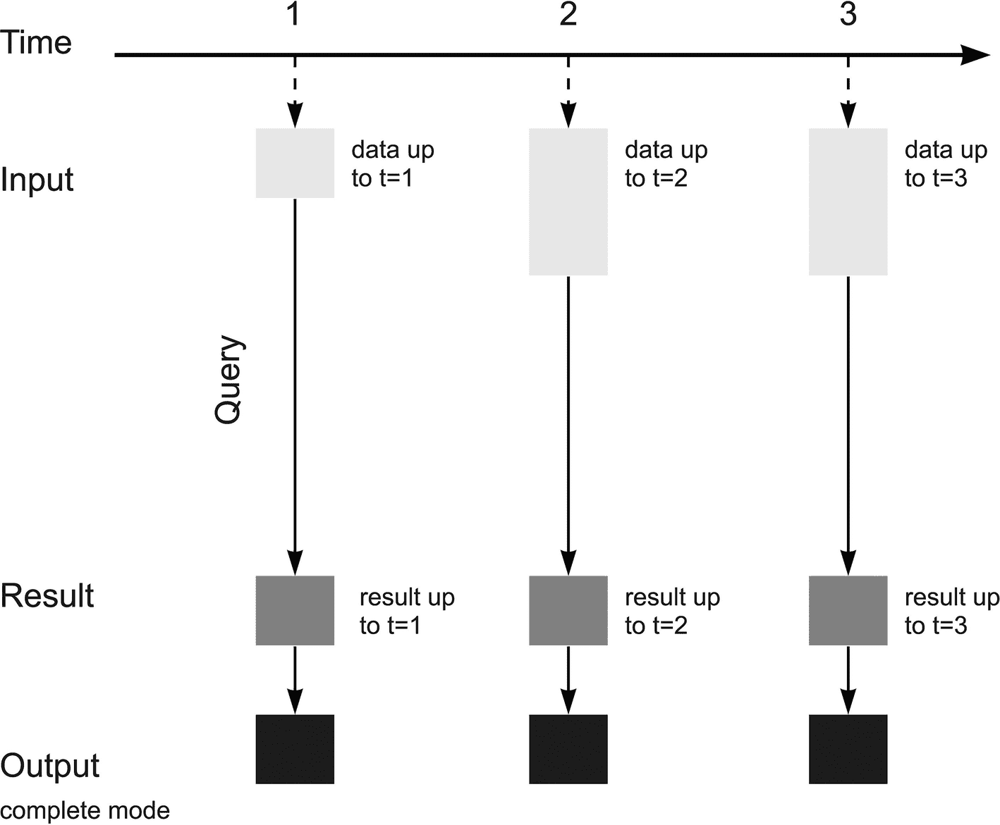

**图 10-1** — Spark Structured Streaming 编程模型

图 10-1 是一个高层级的序列图，展示了在 Spark 中随时间推移，能够可靠地摄取结构化无界流式数据的过程。在示例中，随着新数据被摄入到应用程序中，一个确定性的周期随着系统的每次“滴答”（即微批次）而开始。在每个批次中，Spark 在处理下一组数据之前，会执行一系列有向步骤（输入 --> 查询 --> 结果 --> 输出）。这一系列确定性的步骤（称为 DAG）代表了 Spark Structured Streaming 的四个基本处理范式：

*   执行/处理模式（微批次或连续模式）
*   触发器（有效的处理窗口/边界）
*   增量查询（随时间推移的渐进式数据处理）
*   流式输出模式（完整、更新和追加）

接下来你将探索这些范式，并理解它们在 Spark Structured Streaming 中所扮演的角色。

### 处理模式

最初，微批次处理是 Structured Streaming 唯一引入的执行模式，并且至今仍是默认模式。流式微批次的调度和执行使应用程序开发者能够转向一个可靠、结构化的流处理模型，而远离由 Spark 第一个流式编程模型引入的自定义方法。

**Apache Spark Streaming 与*离散化流（DStreams）***

使用 DStreams 时，工程师必须深入了解 `RDD` API（*Apache Spark 的核心数据结构和编程模型*）。这意味着工程师必须学会有效地使用较低级别的 `RDD` API。这包括理解如何从故障中恢复、实现接收器、高效地序列化/反序列化他们的代码和数据，以及扩展和性能调优他们的应用程序。这些仍然是需要学习的内容，只是通过 `DataFrames` 和 `Datasets` API 以及 SparkSQL 提供的抽象，学习层次更高了。你可以将这视为通往 Structured Streaming 道路上一个更自然的垫脚石，它展示了社区为克服障碍所采用的设计模式中的优点、缺点和丑陋之处。

幸运的是，本书不介绍 Apache Spark Streaming，而是介绍更易于理解、性能更高且能自我优化的 *Apache Spark Structured Streaming*。我建议你回顾一下 Spark 的发展历程，以理解过去的状况，并欣赏其演进的成果。现在，回到 Structured Streaming 的处理模式。

连续执行模式被引入，用于实现极低端到端延迟的真正实时处理。两种执行模式都能使应用程序管理流处理的复杂性，同时仅改变应用程序中数据处理方式的语义。图 10-2 显示了数据在输入源和输出端之间的一般流程如何保持一致，而主要的区别在于触发机制。

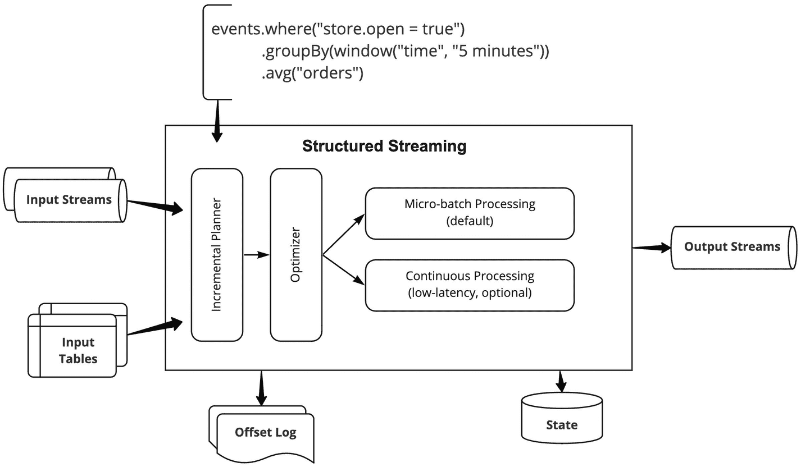

**图 10-2** — Structured Streaming 的处理流程

理解何时使用每种处理模式，是你在编写任何初始代码之前必须做出的关键决策。我们来看看原因。

#### 微批处理

如前所述，微批处理在结构化流式处理诞生之初便被引入。这种处理范式使应用程序开发者能够使用结构化的 Spark API（`DataFrame`/`Dataset`）编写流式应用。微批执行的机制依赖于周期性轮询新数据的概念。这使得 Spark 结构化流式引擎能够生成新一批数据进行处理。值得指出的是，这些应用不仅体现在数据层面的结构化（数据严格绑定到真实的结构化模式 `StructType`），还体现在每个微批处理前后的规划与执行的有序性上。

每个批次都以执行计划为起点，该计划是 Spark 引擎进行规划、分析和优化等一系列预处理步骤的结果，如图 10-3 所示。

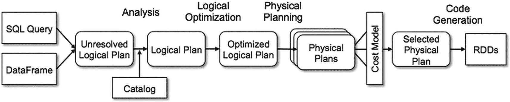

**图 10-3** — Spark 处理的每个批次（或微批）数据的优化过程

生成物理计划（如图 10-3 所示，详情参见第 6 章）后，输入数据源及其相关元数据会被预写（预写日志），为每个微批创建一个称为检查点的参考点。这使得应用在运行过程中可以安然失效，并以确定性的方式从最后一个完整保存点回滚并恢复。

在每个微批处理的另一端，输出写入器会确认其操作成功，这一过程被称为*提交*。同样值得指出的是，每个微批必须成功处理完成后，下一个微批才能开始处理。这种确认机制通过完全提交微批内所有已完成的工作来实现，或者在发生终态不可恢复故障时中止所有后续执行。

综合这些原则，你的应用将能够从可靠的数据源处理结构化数据，以一系列确定性的微批形式，为整个应用生命周期内的所有输入和输出提供清晰一致的模式，从而应对看似无限的流式数据。我们将在下一节的章节练习中实际演示这一过程。

#### 连续处理

结构化流式处理发布后不久，低延迟（亚秒级）的连续处理执行框架也随之推出。Spark 执行框架不再依赖对数据源的周期性轮询，而是依靠长期运行的任务来处理从数据源到数据接收器的端到端连续数据处理。这意味着数据会以最快的速度逐事件处理，无需等待每个批次的所有事件数据完全提交而带来的开销。图 10-4 提供了一个高层级示意图，以帮助理解这一模型。

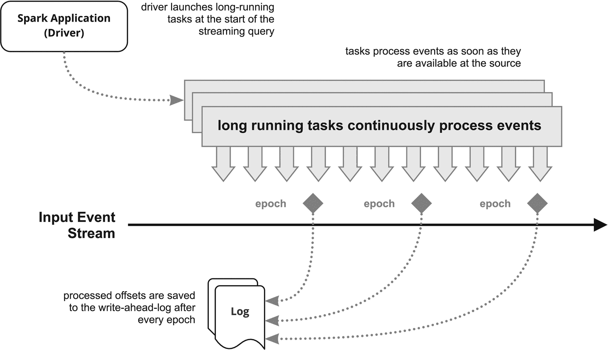

**图 10-4** — 连续处理执行模式

虽然这种执行模式可以实现极低的延迟（约 100ms 端到端），但它最适合处理单个事件的流，而非那些可以分组、分析或整体处理的微批事件集合。例如，如果你要构建一个系统，用于通知顾客他们点的咖啡已准备好取餐（类似苹果的推送通知服务），从技术上讲，你可以将此负载分布到 Spark 集群上，确保每条消息精确发送一次。你肯定不想惹恼顾客，导致他们选择退出通知。

你将在第三个和第四个练习中学习如何使用检查点和触发器。这也将是一次尝试连续处理和微批处理的机会。

### 练习材料

第 10 章的练习材料位于 [`https://github.com/newfront/spark-moderndataengineering/tree/main/ch-10`](https://github.com/newfront/spark-moderndataengineering/tree/main/ch-10)。材料中的 `README` 文件将为你提供有关其他安装步骤或注意事项的更多背景信息。这些练习依赖于第 8 章中扩展的 `~/dataengineering/` 环境设置，该设置提供了通用的 MySQL（Hive Metastore）和 MinIO（S3）。

## 练习概述

以下练习旨在教你使用 Apache Spark 结构化流式处理的核心功能。你在完成一系列练习时，将采用不同的方法模式。这些练习都围绕同一个核心挑战展开并延伸。

### 挑战

你需要创建一个系统，用于摄取 CoffeeCo 旗下所有咖啡店的实时事件数据。该系统将用于追踪整个网络中的顾客使用模式，从订单追踪开始。对于每个订单，可以预期一个可靠的上游网关（如第 9 章所述示例）会生成可靠事件，供你的 Spark 应用摄取。

图 10-5 展示了为流式应用提供必要数据的高层级系统工作流程。为简化起见，本章练习将重点放在事件流平台之后的数据处理上。因此，我们需要先定义一个事件格式。

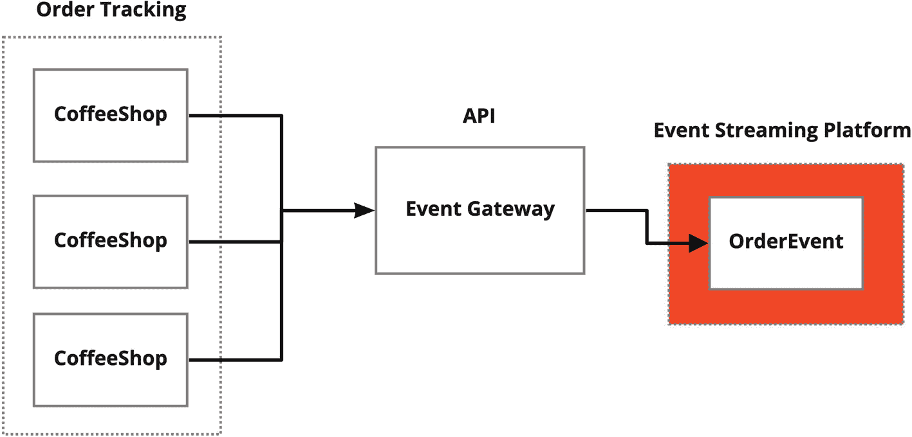

**图 10-5** — 订单追踪的入口路径。每个订单通过事件网关 API 发送一个事件，并排入事件流平台

### OrderEvent 格式

虽然在没有约定数据格式的情况下编写基于事件的应用程序并非不可能，但这样做难度更大，并且长期来看会使事情复杂化。在本例中，假设每个事件的格式需要提供订单 ID、关联客户 ID、交易门店 ID、订购商品数量以及交易总价。这些信息将被封装在一个我们称之为 `OrderEvent` 的结构中。我们清楚最终需要摄取的内容，只需将实际事件形式化即可。

**注意：** 在现实世界中，数据工程师常常需要负责创建结构化数据格式，甚至编写上游系统来生成数据并输入到他们自己的数据域中。这样他们便拥有自己域的数据合约，从而理解网络中其他上游数据提供者/生产者之间的数据血缘关系。

正如上一章所述，事件应保持一致且可靠；否则你的流式应用可能会突然停止运行，给你带来一团乱麻（以及停机故障）。这并不意味着在测试某个想法之前，你需要花费大量时间将上游数据梳理得井井有条。事实上，通常正确的做法是从粗略的概念/想法入手，然后分阶段逐步完善。

现在我们就采用这种方法。我们将首先在 Spark 引擎内部构建将要处理的数据。

### 深入理解 Spark Struct

鉴于您使用 Spark SQL 进行的结构化数据转换依赖于 `StructType`，您可以先通过简单的 DataFrame 概念来构思应用程序。这使您能够在正式确定特定应用的数据契约之前快速行动。请记住，始终从小处着手，逐步构建。

```scala

```

new StructType()
  .add(StructField("timestamp", LongType, false))
  .add(StructField("orderId", StringType, false))
  .add(StructField("storeId", StringType, false))
  .add(StructField("customerId", StringType, false))
  .add(StructField("numItems", IntegerType, false))
  .add(StructField("price", FloatType, nullable false))
```

现在，我们对应用程序中将要使用的数据结构有了一个概括性的表示，可以开始第一个练习了。

## 练习 10-1：使用 Redis Streams 驱动 Spark Structured Streaming

[Redis Streams](https://redis.io/topics/streams-intro) 可用于快速构建和测试完整的端到端流式应用程序。正如您将在本练习中看到的，这有助于发现构建应用程序的流程。

Redis Streams 运行开销很小，这得益于它是 [Redis](https://redis.io/) 的一个原生数据结构。Redis 是一个高度优化的数据结构存储系统，在社区中非常知名且受欢迎。如果您从未使用过 Redis，您仍然可以从本练习中学习。

**练习 10-1**

练习材料位于 `/ch-10` 目录下的 `/applications/redis-streams` 文件夹，具体路径为 `/exercises/01_redis-streams`。

## 启动本地环境

使用 `exercises/01_redis-streams` 目录下提供的 `docker-compose` 文件开始。您将再次使用 Docker Compose 启动环境，这意味着您也需要启动 Docker。

```bash
docker compose -f docker-compose.yaml up -d --remove-orphans
```

这将启动练习的外部依赖项：Redis、MinIO 和 MySQL。然后，是时候连接到新的 Redis 容器了。

## 连接到 Redis

打开终端或创建一个新的会话。您将使用连接到 Redis Docker 容器的终端，并通过 `redis-cli` 提供到 Redis 的命令行连接。此连接将用于将新的事件数据推送到您的流中。这也是读取、写入和管理事件流（或其他 Redis 需求）数据的完整生命周期的便捷方式。额外的好处是，您无需编写任何应用程序代码即可开始。

### 连接到 Redis CLI

借助 Redis 容器，您现在可以通过执行清单 10-1 中的命令来连接到 `redis-cli`。

```bash
docker exec -it redis redis-cli
```

*清单 10-1：连接到 Redis 容器并使用 `redis-cli`（命令行）*

在提示符下执行 `ping` 命令。您将看到返回了 `PONG`，这意味着一切正常。

```bash
127.0.0.1:6379> ping
PONG
```

接下来，您将学习监控流入 Redis 的命令流。这是观察系统中不同点之间发生了什么的好方法。

### 启用 Redis 命令监控

打开另一个终端窗口并执行清单 10-2 中的命令。连接成功后，您应该会看到一条 `OK` 消息。

```bash
docker exec -it redis redis-cli monitor
```

*清单 10-2：使用 Redis 容器中的 `redis-cli` 监控发送到 Redis（本地或远程）的命令*

监控进程是一个有用的视图，可以实时查看哪些命令正在被发送到 Redis。如果等待几秒钟，您将看到来自 Redis 容器健康检查的 ping 消息通过监控器。

```bash
1626138124.541908 [0 127.0.0.1:59704] "ping"
```

**容器健康检查**

`docker-compose` 文件（`ch-10/exercises/01_redis-streams/`）中提供的 `healthcheck` 块使服务能够使用简单的命令自我监控。对于 Redis，健康检查只是通过 `redis-cli` 发送一个 ping 并确保其不会超时。这意味着容器运行正常。

```yaml
healthcheck:
  test: ["CMD", "redis-cli", "ping"]
  interval: 5s
  timeout: 30s
  retries: 50
```

现在是时候使用 Redis 创建您的第一个流了。

## 创建 Redis Stream

*Redis Stream* 是自动生成的，并且在您添加数据时会立即可用。由于 Redis 是一个内存数据库，流生成的开销很小，因为没有需要立即创建的文件、新的磁盘空间分配或与流生成相关的昂贵锁定。您只需发布第一个事件，流就会神奇地出现。在后台，Redis 会定期将整个数据库持久化到 RDB（这是您整个 Redis 数据库的一个时间点快照）。如果您熟悉 Redis，那么流类型在概念上是列表、有序集合和哈希映射[数据结构](https://redis.io/topics/data-types)的混合体。

### 流的保证

Redis *保证* 流中每个事件的字段顺序，以及插入顺序的一致性。每个事件标识符将始终大于在其之前插入的任何事件。

**为什么字段级顺序很重要**

字段级顺序的重要性不仅仅是为了安心。作为由 Redis Stream 封装的事件存储的每个编码负载，都是指向一个哈希映射的指针。根据设计，哈希映射可以通过其键随机访问，但它们开箱即用不会保留任何特定顺序。例如，Java 中的 `HashMap` 和 `LinkedHashMap` 有很大的区别。当您想要维护 `EntrySet` 中键的顺序时，会使用链接变体。为了 Redis Stream 内部的可靠性和一致性，Redis 负责处理字段级顺序，但您仍然必须提供一个可靠的事件。我们将在练习后面部分查看这是如何处理的。

**事件标识符**

您使用 `XADD` 命令添加新事件。该命令包括使用自动生成的 ID 而不是提供您自己的标识符的选项。有效的事件 ID 格式是 `<number>-<number>`。对于自动生成的 ID，Redis 将事件被摄取到 Redis 时的 UNIX 纪元毫秒数（时间戳）和在同一毫秒内接收到的事件的单调递增 ID 连接起来。

```
1625766684875-0
```

这种模式确保了每个事件的标识大于其之前的任何事件。如果您决定使用自己的标识符，则必须记住这一点。否则，由于事件 ID 的预期被打破，您将看到错误消息 `ERR Invalid stream ID specified as stream command argument`。

#### Redis Streams 是仅追加的

理解 Redis 的流是一种仅追加的流式数据结构非常重要。仅追加意味着您无法更改插入顺序。这迫使希望重新组织事件（排序、添加缺失数据）的上游系统读取流、重新组织它，然后将事件推送到新的流中，或者将这些结果推送到另一个可靠的存储中。当您拥有一个不可变的、仅追加的流式数据源时，您可以保持一致性。这降低了使用这些数据的复杂性，并为您提供了流式处理的理想可靠数据源。

让我们发布一个事件并生成您的第一个流。

### 向 Redis Stream 发布事件

你可以通过发布事件来创建 Redis Stream。复制清单 10-3 中从 `xadd` 开始的命令，并将其粘贴到 `redis-cli` 中。

```
127.0.0.1:6379> xadd com:coffeeco:coffee:v1:orders * timestamp 1625766472513 orderId ord126 storeId st1 customerId ca183 numItems 6 price 48.00
```

*清单 10-3：向 Redis Stream 发布事件*

Redis 将通过返回已发布事件的事件 ID 来确认你的命令。例如，返回 `"1625766684875-0"`。

### 从 Redis Stream 消费事件

现在你已经发布了一个事件并生成了一个流。你可以使用 `redis-cli` 读取（消费）所有可用的已发布事件。为此，你将使用 `xrange` 或 `xrevrange` 命令，这些命令允许你读取流中的项目。使用 `redis-cli` 执行清单 10-4 中的命令。

```
127.0.0.1:6379> xrange com:coffeeco:coffee:v1:orders - + COUNT 1
```

*清单 10-4：使用 `xrange` 从 Redis Stream 读取事件*

### Redis Stream 数据获取

这将按照插入顺序（升序）获取添加到流中的第一个项目，该顺序基于流的尾部（可以思考一下链表如何使用头指针或尾指针）。从概念上讲，这个过程相当于 SQL 中的 `order by asc limit 1`。

```sql
select * from v1.orders

order by timestamp asc limit 1
```

与此相反的是 `xrevrange` 选项。它使用降序插入顺序，从流的头部（最新的项目优先）读取数据。现在你已经对 Redis Stream 的工作原理有了基本了解，是时候进入 Spark 应用程序本身了。

### SparkRedisStreamsApp

打开 `SparkRedisStreamsApp`，它位于本章材料中 `applications` 目录的 `/ch-10/applications/redis-streams` 路径下。此应用程序可追溯到第 7 章，当时你在 Scala 中创建了第一个编译好的 Spark 应用程序。应用程序的整体结构相同，但增加了一个 Dockerfile 和一个非托管库项（`lib/spark-redis`）。在撰写本文时，`spark-redis` 库尚不普遍适用于 Spark 3.x。

```text
redis-streams/

conf/

lib/

project/

src/

Dockerfile

build.sbt
```

该项目提供了构建端到端应用程序所需的所有基础模块。我们不妨先不浏览代码，而是换个策略，先编译，再提问。

让我们先使用 `sbt` 编译应用程序。

#### 编译应用程序

从项目根目录（`redis-streams`）开始，编译应用程序。

```bash
sbt clean assembly
```

**注意**

编译应用程序需要 Redis 在 Docker 中运行。返回练习的开始位置，在练习目录中执行 `docker compose` 命令。

应用程序编译完成后，你的 JAR 文件将位于 `target/scala-2.12/spark-redis-streams-assembly-0.1-SNAPSHOT.jar`。下一步我们将应用程序包装到自己的 Docker 容器中，届时会用到这个资源。

#### 构建 Docker 容器

编译好应用程序后，你现在可以构建 Docker 容器了。打开项目根目录中的 `Dockerfile`（如清单 10-5 所示）。

```dockerfile
FROM newfrontdocker/apache-spark-base:spark-3.1.2-jre-11-scala-2.12

COPY target/scala-2.12/spark-redis-streams-assembly-0.1-SNAPSHOT.jar /opt/spark/app/spark-redis-streams.jar

EXPOSE 4040
```

清单 10-5

用于创建我们的统一 Redis Streams 应用程序的 Dockerfile

容器定义文件（`Dockerfile`）只是在 `apache-spark-base` 基础容器之上添加了一个新层，该层将你的应用程序 JAR 复制到 `/opt/spark/app` 目录（由 `spark-base` 容器创建）。它还暴露了端口 4040，这是 Spark UI 运行的端口。从项目根目录执行清单 10-6 中的 `docker build` 命令。

```bash
docker build . \

-t `whoami`/spark-redis-streams:latest
```

清单 10-6

构建 spark-redis-streams Docker 容器

你会看到容器构建几乎不需要时间（假设 `apache-spark-base` 容器已缓存在本地 Docker 中）。

```text
[+] Building 0.4s (7/7) FINISHED

=> [internal] load build definition from Dockerfile                                                                                                       0.0s

=> => transferring dockerfile: 37B                                                                                                                        0.0s

=> [internal] load .dockerignore                                                                                                                          0.0s

=> => transferring context: 34B                                                                                                                           0.0s

=> [internal] load metadata for docker.io/newfrontdocker/apache-spark-base:spark-3.1.2-jre-11-scala-2.12                                                  0.0s

=> CACHED [1/2] FROM docker.io/newfrontdocker/apache-spark-base:spark-3.1.2-jre-11-scala-2.12                                                             0.0s

=> [internal] load build context                                                                                                                          0.2s

=> => transferring context: 11.90MB                                                                                                                       0.2s

=> [2/2] COPY target/scala-2.12/spark-redis-streams-assembly-0.1-SNAPSHOT.jar /opt/spark/app/spark-redis-streams.jar                                      0.1s

=> exporting to image                                                                                                                                     0.1s

=> => exporting layers                                                                                                                                    0.1s

=> => writing image sha256:2e542656e6e8c5e165fac6e308c68252f2396152a00785c7094c15f55a702939                                                               0.0s

=> => naming to .../spark-redis-streams:latest                                                                                              0.0s
```

构建过程很快完成，因为本质上你只是添加一个 `JAR` 文件（已在本地编译）并定义一个要暴露的端口。

提示

思考一下如何通过复用容器来创建可堆叠的环境。在清单 10-5 的示例中，堆栈从 `apache-spark-base` 开始，然后通过添加应用程序 `JAR` 来扩展堆栈。

现在，你已经准备好运行应用程序并消费 `Redis Stream`。

### 运行应用

该应用的功能类似于一个简单的回声服务器。当您向 `Redis Stream` 添加新事件时，应用将（几乎）立即处理该事件并输出格式化后的 `DataFrame` 和批处理标识符（微批次）。这个应用代表了我们进行的初次尝试，目的是确保所有组件正确连接。请务必牢记：始终从简单的部分开始，然后逐步构建。

此时，`redis-cli` 监视器（来自代码清单 10-2）开始变得有趣。如果您的屏幕空间足够，请同时打开 `redis-cli` 窗口和 `redis-cli` 监视器窗口（来自代码清单 10-1 和 10-2），然后再打开第三个终端窗口来运行应用。

执行代码清单 10-7 中的命令来启动容器并触发 `Spark` 应用运行。

```
docker run \
  -p 4040:4040 \
  --hostname spark-redis-test \
  --network mde \
  -v ~/dataengineering/spark/conf:/opt/spark/conf \
  -v ~/dataengineering/spark/jars:/opt/spark/user_jars \
  -it `whoami`/spark-redis-streams:latest \
  /opt/spark/bin/spark-submit \
  --master "local[*]" \
  --class "com.coffeeco.data.SparkRedisStreamsApp" \
  --deploy-mode "client" \
  --jars /opt/spark/user_jars/mariadb-java-client-2.7.2.jar \
  --driver-class-path /opt/spark/user_jars/mariadb-java-client-2.7.2.jar \
  --conf "spark.sql.warehouse.dir=s3a://com.coffeeco.data/warehouse" \
  --conf "spark.app.source.stream=com:coffeeco:coffee:v1:orders" \
  /opt/spark/app/spark-redis-streams.jar
```

代码清单 10-7：用于启动运行于本地数据平台的 `Spark Redis Streams` 应用（容器内）的 `docker run` 命令

`Docker` 容器将使用您之前编译并封装进容器的 `SparkRedisStreamApp` `JAR` 包启动。检查日志时，您会注意到许多来自 `Spark` 的信息级别（`info-level`）日志。您始终可以通过 `log4j`（将根级别日志记录更改为 `WARN` 或 `ERROR`，或仅选择应用日志）来减少这些无关信息。目前，这些日志可以帮助您更深入地了解其运行机制。

### Redis Streams 消费者组与偏移量

应用启动时，它将连接到 `spark.app.source.stream` 配置值中指定的 `Redis Stream` 标识符。您可以在输出日志中看到此过程。只需查找以下输出。

```
INFO RedisSource: Getting batch...
start: None
end: {"offsets":{"com:coffeeco:coffee:v1:orders":{"groupName":"spark-source","offset":"1626552490734-0"}}}
```

在此过程中，`Spark` 与 `Redis` 之间会发生一次快速握手，您可以使用 `redis-cli` 监视器来观察。您将在监视器中看到以下输出。

```
"XGROUP" "create" "com:coffeeco:coffee:v1:orders" "spark-source" "$" "mkstream"
"XINFO" "STREAM" "com:coffeeco:coffee:v1:orders"
"XREADGROUP" "group" "spark-source" "consumer-1" "count" "100" "block" "500" "noack" "streams" "com:coffeeco:coffee:v1:orders" ">"
"XINFO" "STREAM" "com:coffeeco:coffee:v1:orders"
```

这些命令是应用在无先前状态启动时的握手过程的一部分。（您将在练习 10-3 中学习如何通过检查点来存储应用状态。）这个信息收集流程会查询流并为应用创建新的消费者组。

### 消费者组

为了追踪流的位置并将 `Spark` 应用与特定组关联，使用了 `XGROUP` 命令。鉴于该应用之前从未运行过，首先会创建一个新组，然后查询流（`XINFO`）以获取与流相关的所有元数据，以便 `Spark` 能够开始接收新事件。

您可以在 `redis-cli` 中运行 `xinfo` 命令来查看返回的数据。

```
xinfo STREAM com:coffeeco:coffee:v1:orders
```

然后，使用 `XREADGROUP` 命令，应用会创建一个初始位置来阻塞并等待新事件。

现在，应用已经了解了其初始状态，便可以继续执行并开始工作。这是任何 `Structured Streaming` 应用的关键第一步。实际上，您会发现这个过程也会创建第一个批次。

```
Batch: 0
+---------+-------+-------+----------+--------+-----+
|timestamp|orderId|storeId|customerId|numItems|price|
+---------+-------+-------+----------+--------+-----+
+---------+-------+-------+----------+--------+-----+
```

此过程现在仅在有新数据从 `Redis Stream` 到来时才会重复执行。让我们添加另一个事件。

### 创建下一个批次

您可以从步骤 3 复制 `XADD` 命令并将其粘贴到 `redis-cli` 中，以触发一个新批次。

```
xadd com:coffeeco:coffee:v1:orders  * timestamp 1625766472513 orderId ord126 storeId st1 customerId ca183 numItems 6 price 48.00
```

在 `Spark` 应用容器中，您将看到应用对事件做出响应并进行处理。从日志中，重要的输出部分是批次的确认以及批次格式化后的输出。

```
Batch: 1
+-------------+-------+-------+----------+--------+-----+
|    timestamp|orderId|storeId|customerId|numItems|price|
+-------------+-------+-------+----------+--------+-----+
|1625766472513| ord126|    st1|     ca183|       6| 48.0|
+-------------+-------+-------+----------+--------+-----+
```

尝试将以下事件粘贴到 `redis-cli` 中。您会注意到应用的运行行为有何特点？

```
> xadd com:coffeeco:coffee:v1:orders  * timestamp 1625766472503 orderId ord124 storeId st1 customerId ca153 numItems 1 price 10.00
> xadd com:coffeeco:coffee:v1:orders  * timestamp 1625766472513 orderId ord125 storeId st1 customerId ca173 numItems 2 price 7.00
> xadd com:coffeeco:coffee:v1:orders  * timestamp 1625766472513 orderId ord126 storeId st1 customerId ca183 numItems 6 price 48.00
```

> `xadd com:coffeeco:coffee:v1:orders * timestamp 1625766472613 orderId ord127 storeId st1 customerId ca184 numItems 1 price 3.80`

您会注意到应用会将每个事件放在其自己的批次中处理。好吧，您可能会问，这是为什么呢？这似乎与我们预期的微批次行为不太一致，我们期望其更具连续性。确实如此，这种行为可以通过在应用的控制路径中添加触发器来控制。

现在，您可以停止 docker 进程（`^+C`）或直接退出其运行的窗口。

我们将在练习 10-2 中深入探讨应用代码本身，以了解构成此应用运行机制的各个组件。在此过程中，您将学到一些有助于简化应用编写的技巧。

### 练习 10-1：总结

第一个练习从宏观层面教您了解了 Redis Streams 的工作原理。您学会了使用 `redis-cli`，弄清楚了 `redis-cli` 监视器的用途，并掌握了如何驾驭这些新的流处理方式。最后，您预览了 Spark Redis Streams 应用，接下来将学习其具体内容。

### 练习 10-2：解析 Redis 流应用

你在练习 10-1 中运行的应用是一个不完整的结构化流应用。这是因为该应用尚未跟踪自身状态（因此它是无状态的），也没有对消费的事件进行任何有效处理。不过这都是有意为之；该应用的当前状态如图 10-6 所示。

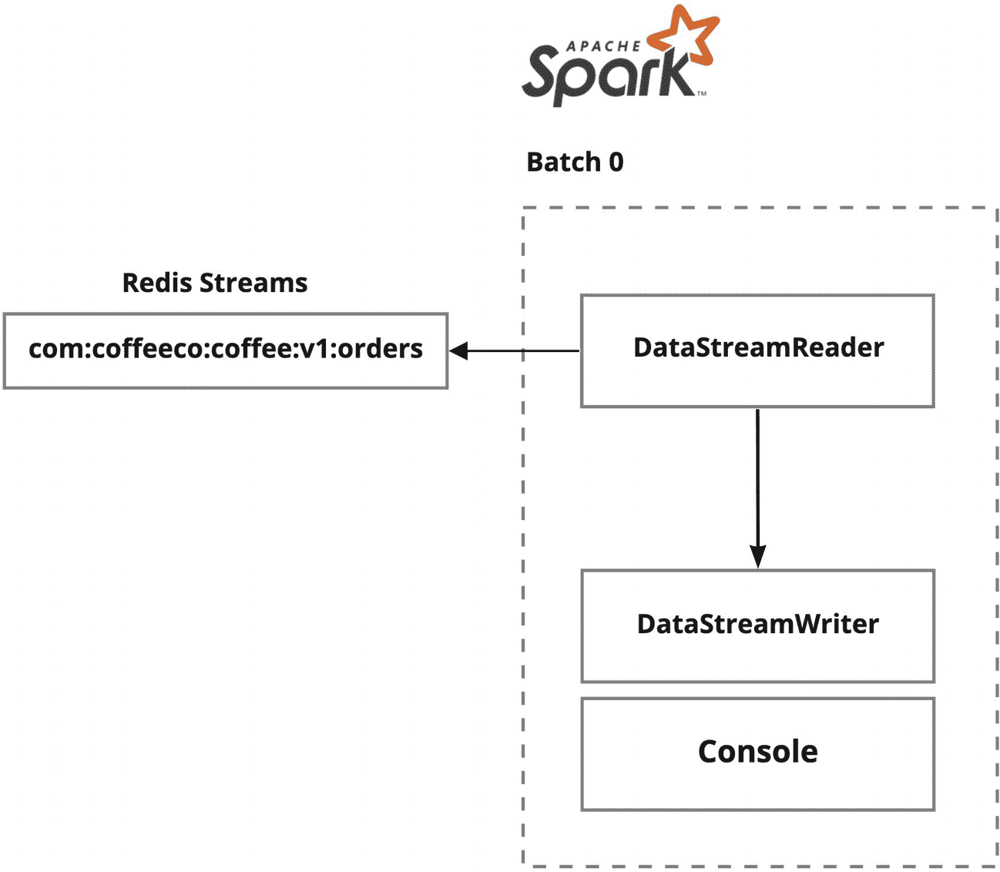

图 10-6：结构化流的起点。它连接到 Redis 并持续轮询新事件

图 10-6 展示了你刚在练习 10-1 中运行的应用。以此逻辑模型为基础，在你喜欢的 IDE 中打开 `redis-streams` 项目，并导航到位于 `/ch-10/applications/redis-streams/SparkRedisStreamsApp.scala` 的文件。

你会注意到我们再次使用了在第 7 章介绍的 `SparkApplication` 特质。

```scala
object SparkRedisStreamsApp extends SparkApplication
```

作为回顾，这个特质的用途是为应用提供 `SparkSession`、应用名称句柄以及不可变的 `SparkConf`，这样在设置每个新应用时能大幅减少模板代码。

### DataStreamReader

参考上图，我们从 `DataStreamReader` 开始。这是核心的结构化流接口之一，它提供了一种通用方式来将流式数据集加载到 Spark 中。在应用中，你会找到以下代码块。

```scala
lazy val inputStream: DataStreamReader = {
  sparkSession.readStream
    .format("redis")
    .option("stream.keys", inputStreamName)
    .schema(streamStruct)
}
```

与批处理应用类似，我们使用 `SparkSession` 作为接口来配置数据源并生成新的读取器（即入口）。唯一区别在于，这里我们通过使用 `readStream` 而非 `read` 来将数据源指定为流式数据源。

**扩展 Spark**

你可能也是第一次见到自定义数据源格式。Spark 是一个可插拔平台，它明白 `format("redis")` 将通过 `spark-redis` 库（借助 `DataSourceRegister` 和 `StreamSourceProvider` 接口）提供。你可以创建自己的源和接收器格式，为 Spark 添加新功能，而无需重复造轮子。

然后我们填充数据源所需的配置。在本例中，只需提供流的名称（流的键名）以及该数据源期望的 schema。

#### Schema 是必需的吗？

对于大多数流式数据源，*schema* 是必需的。JSON 数据源可以推断 schema，但它是通过采样来完成的，这可能导致不一致性。这意味着在事件数据稀疏（例如可选字段）的情况下，你无法获得确定的 schema。为了省心，最好基于上游数据契约提供 schema。这样，你的应用就能建立在明确的预期之上。

在练习的介绍部分，你已经了解了订单事件格式。以下 `struct` 是该应用的正式结构化数据契约。

**OrderEvent 的 Schema**

```scala
lazy val streamStruct = new StructType()
  .add(StructField("timestamp", LongType, false))
  .add(StructField("orderId", StringType, false))
  .add(StructField("storeId", StringType, false))
  .add(StructField("customerId", StringType, false))
  .add(StructField("numItems", IntegerType, false))
  .add(StructField("price", FloatType, false))
```

值得一提的是，`DataStreamReader` 的 `schema` 构建方法既可以接受完全格式化的 `StructType`（如上所示），也可以接受 DDL 字符串。Spark 会解析 DDL 字符串并为你组装好相应结构。

**通过 DDL 字符串生成 StructType。这等价于调用 `StructType.fromDDL(streamStruct.toDDL)`**

```scala
StructType.fromDDL("""
  `timestamp` BIGINT,
  `orderId` STRING,
  `storeId` STRING,
  `customerId` STRING,
  `numItems` INT,
  `price` FLOAT""")
```

这种灵活性使你能够编写丰富的、可配置驱动的流式应用，同时仍遵循严格的数据契约。

以上就是应用如何知道连接到哪里以及期望上游提供什么 schema 的方式。鉴于第一个流式应用较为简单，我们将直接进入 `DataStreamWriter`。

### DataStreamWriter

`DataStreamWriter` 是用于将流式数据集写入 Spark 外部存储的核心接口。该接口提供的方法集比其批处理模式的对等体 `DataFrameWriter` 更少。我们将在练习 10-3 中介绍 `outputMode`、`partitionBy` 和 `trigger` 的使用。查看 `run` 方法将向你展示实际用法。

**来自 `SparkApplication` 特质的 `run` 方法的流式实现**

```scala
override def run(): Unit = {
  ...
  val writer: DataStreamWriter[Row] = SparkRedisStreams(sparkSession)
    .transform(inputStream.load())
    .writeStream
    .queryName("orders")
    .format("console")
  startAndAwaitApp(writer.start())
}
```

`run` 方法利用了一些可能不易察觉的简单应用设计模式。接下来我们将介绍懒加载调用和依赖注入的精妙用法。这些技术与第 7 章介绍的 Spark 委派模式协同工作。

#### 懒加载调用

`run` 方法依赖 Scala 伴生类构造和懒加载依赖注入，以降低 Spark 读取此应用意图并生成执行计划的复杂度。

```scala
SparkRedisStreams(sparkSession)
  .transform(...)
```

传递给 `transform` 方法的 DataFrame 是对我们的 `DataStreamReader` 调用 `load` 方法的结果。

```scala
.transform(inputStream.load())
```

## 依赖注入

这种模式让你能利用依赖注入为 `transform` 方法提供 `DataFrame`。这使测试更简单，并为上游数据源提供了灵活性。目前应用连接的是 Redis，但你同样可以轻松接入 Kafka，且除了上游配置外，应用本身无需更改。由于接口绑定的是 `DataFrame` 而非 `DataStreamReader`，这种模式还允许你针对批处理或流式数据源复用同一个应用。

至此，我们已接近拼图的最后一块。要构建一个结构化流应用，你需要同时具备数据源和数据接收端。我们已经介绍了上游数据源 Redis。快速回顾一下：这个流式数据源是通过 Spark Session 的 `readStream` 方法生成的，该方法返回一个 `DataStreamReader`。现在，要满足最后一个需求，我们只需要一个接收端。

## 写入流式数据

`writeStream` 方法是 `Dataset` 类的成员。`DataFrame` 本质上就是一个 `Dataset[Row]`，而应用的 `transform` 方法返回一个 `DataFrame`。因此，当我们调用 `writeStream` 时，实际上是将我们的 `DataFrame` 转换为 `DataStreamWriter`。

在应用中，使用的输出格式是 `"console"`。这是一个特殊的接收端，可用于观察应用的输出，因为它不会将任何数据写入可靠的数据存储。

```
.writeStream
.queryName("orders")
.format("console")
```

当完整的应用链路（数据源 → 转换 → 接收端）搭建完毕后，剩下的就是启动应用。`DataStreamWriter` 的 `start` 方法会创建一个 `StreamingQuery`。

```
startAndAwaitApp(writer.start())
```

### 流式查询

[`StreamingQuery`](https://spark.apache.org/docs/latest/api/java/org/apache/spark/sql/streaming/StreamingQuery.html) 接口封装了端到端的结构化流。它提供了在 Spark 应用中运行时对查询进行内省的方法。该接口还是线程安全的，因此你可以从驱动器的任何位置观察流。在本应用通过第 11 章的测试进行扩展和强化时，你将直接使用这个接口。

目前，你只需关注一个方法：`awaitTermination`。

```
def startAndAwaitApp(query: StreamingQuery): Unit = {
  streamingQuery.awaitTermination()
}
```

当你在流式查询上调用 `awaitTermination` 时，应用将持续运行，直到抛出无法恢复的异常，或进程被退出（例如停止 Docker 容器或发送终止信号）。

这个端到端过程全部由应用入口点内的 `run()` 调用启动。

## 应用入口点

应用入口点是提供 `main` 方法的类。该应用扩展了 `SparkApplication` 特质，而后者又扩展了 Scala 的 `App` 特质。因此，当你之前运行此应用时，本质上是在调用 `SparkRedisStreamsApp` 的 `main` 方法，该方法会调用 `run()`。

```
/opt/spark/bin/spark-submit \
--master "local[*]" \
--class "com.coffeeco.data.SparkRedisStreamsApp" \
...
/opt/spark/app/spark-redis-streams.jar
```

现在你已经了解了初始应用的工作原理，我们可以更进一步，对应用进行二次迭代。在练习 10-3 中，你将学习使用检查点使应用具备状态管理能力。

## 练习 10-2：总结

在练习 10-2 中，你学习了练习 10-1 中介绍的应用如何工作。你逐步了解了如何将流式数据源连接到流式数据写入器，并学习了接收的事件（跨每个批次）如何从源头流向接收端。这个简单的练习向你介绍了 Structured Streaming 的核心 Spark 接口：`DataStreamReader`、`DataStreamWriter` 和 `StreamingQuery` 接口。最后，你学习了如何分层使用懒调用和依赖注入来创建易于理解和维护的 Spark 应用。

在下一个练习中，你将学习为此应用添加检查点。

## 练习 10-3：使用检查点进行可靠的有状态流处理

在练习 10-1 中，应用启动时 Spark 和 Redis 之间发生了一次握手。这个过程为我们有状态的应用生成了初始状态。不幸的是，当你终止进程时，所有这些临时状态基本上都被清除了。这意味着应用在离线期间会跳过处理所有添加到 Redis Stream 的数据。

你可能已经猜到我要说什么了。是的，这并非理想情况，而且确实无助于建立对应用的信心。

### 为什么检查点很重要

检查点为你提供了一个保存点。就像任何经典电子游戏一样，这为你提供了一个安全的地方，在失败时可以回到这里。现在，对于我们的应用来说，如果它失败了，我们需要能够从精确的断点处重新开始。

### 可靠的检查点

可靠的检查点始于一致性和持久性的概念。这应该会让你想到容错性，而且将其与原子性联系起来也并不困难。Apache Spark 通过依赖分布式文件系统（即 HDFS）的基础，将应用检查点（状态）存储在外部，从而实现了可靠的检查点功能。这样，即使应用运行的机器宕机，应用也能被重新启动。

### 启用可靠的检查点

打开 `StatefulSparkRedisStreamsApp`。此应用在引入可靠检查点时几乎无需改动。实际上，只有两个明显的变更。

第一个变更体现在 `run` 方法中。

*向 DataStreamWriter 添加 checkpointLocation*

```
SparkRedisStreams(sparkSession)
.transform(inputStream.load())
.writeStream
.queryName("orders")
.option("checkpointLocation", appCheckpointLocation)
.format("console")
```

传入此参数的值通过 `SparkConf` 传递给应用。

```
lazy val appCheckpointLocation: String = sparkConf.get("spark.app.checkpoint.location")
```

现在让我们运行这个应用。

### 运行有状态应用

你可以通过在练习 10-1 中使用的 Docker `run` 脚本上进行轻微修改来测试此应用。

```
docker run \
...
--class "com.coffeeco.data.StatefulSparkRedisStreamsApp" \
--conf "spark.sql.warehouse.dir=s3a://com.coffeeco.data/warehouse" \
--conf "spark.app.source.stream=com:coffeeco:coffee:v1:orders" \
--conf "spark.app.checkpoint.location=s3a://com.coffeeco.data/apps/spark-redis-streams-app/1.0.0/simple" \
/opt/spark/app/spark-redis-streams.jar
```

两处高亮显示的变更分别对应应用入口点以及提供应用检查点位置所需的新增配置。

### 观察有状态行为

在应用运行状态下，打开你的 `redis-cli`（如果已关闭），并粘贴一个练习 10-1 中的 `OrderEvents` 示例。

```
> xadd com:coffeeco:coffee:v1:orders  * timestamp 1625766472503 orderId ord124 storeId st1 customerId ca153 numItems 1 price 10.00
```

这将触发批次处理，其行为与之前相同。接下来是激动人心的部分：停止 Spark 应用（按 Control+C）。在重新启动应用之前，向 Redis 流中再添加三个事件。

```
> xadd com:coffeeco:coffee:v1:orders  * timestamp 1625766472503 orderId ord124 storeId st1 customerId ca153 numItems 1 price 10.00
```

```markdown
> xadd com:coffeeco:coffee:v1:orders * timestamp 1625766472613 orderId ord127 storeId st1 customerId ca184 numItems 1 price 3.80
>
> xadd com:coffeeco:coffee:v1:orders * timestamp 1625766472513 orderId ord125 storeId st1 customerId ca173 numItems 2 price 7.00

重新启动 Spark 应用。你可能首先观察到的（如果扫描日志）是，Redis Source 输出现在包含一个起始参数。

```
INFO RedisSource: 正在获取批次...

start: Some({"offsets":{"com:coffeeco:coffee:v1:orders":{"groupName":"spark-source","offset":"1626658307940-0"}}})

end: {"offsets":{"com:coffeeco:coffee:v1:orders":{"groupName":"spark-source","offset":"1626658362223-0"}}}
```

你还会发现应用能无缝衔接，仿佛从未离线过。与重新从批次 `0` 开始不同，你会看到下一个批次是非零的。例如：

```
批次: 2

+-------------+-------+-------+----------+--------+-----+

|    timestamp|orderId|storeId|customerId|numItems|price|

+-------------+-------+-------+----------+--------+-----+

|1625766472503| ord124|    st1|     ca153|       1| 10.0|

|1625766472613| ord127|    st1|     ca184|       1|  3.8|

|1625766472513| ord125|    st1|     ca173|       2|  7.0|

+-------------+-------+-------+----------+--------+-----+
```

这意味着你现在可以在应用宕机后无缝恢复，不会遗漏任何数据处理。

#### 检查点的工作原理

对于每个批次，流数据源会将用于该批次的显式偏移量写入可靠存储（即分布式文件系统），这被称为`预写式日志`。在每个成功批次完成后，会以提交的形式将确认信息写入可靠存储。你可以从图 10-7 中了解此过程。

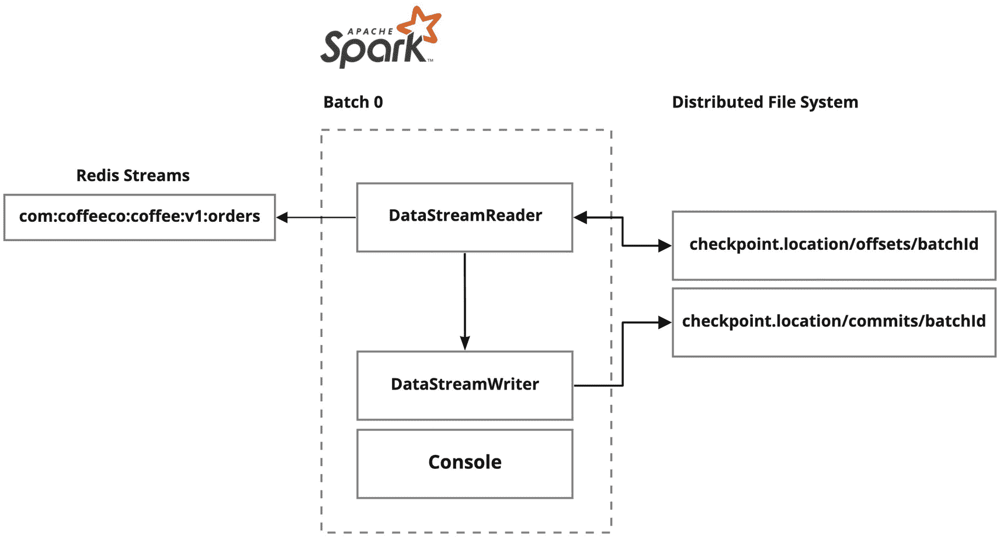
图 10-7

检查点处理流程

每个批次都会重复此过程。这意味着批次中的故障不会“移动”游标，你的应用将从上一个成功的保存点重新启动。

你可以通过 MinIO 浏览器 `http://127.0.0.1:9000/minio/com.coffeeco.data/apps/spark-redis-streams-app/1.0.0/simple/` 或文件系统下的 `~/dataengineering/minio/` 路径检查应用检查点。

#### 删除检查点

仅当应用生命周期结束，或应用正在更新且底层 DAG 发生变化时，才需要删除检查点。当你更改数据源或数据接收器，或向表中添加更多数据源（例如来自多个上游的流式连接）时，DAG 会发生更改。

### 练习 10-3：总结

第三个练习向你介绍了使 Structured Streaming 可靠的关键机制——检查点。你了解到每个批次都通过预写式日志（WAL）进行控制，每个成功批次都通过提交标记为完成。即使运行应用的物理服务器或机器发生致命故障，这个简单的过程也能跟踪你的应用状态。

在本章的最后一个练习中，你将学习如何通过添加处理触发器来控制应用的运行时行为。

### 练习 10-4：使用触发器控制应用运行时行为

触发器可用于控制 Structured Streaming 应用的行为。在本练习中，你将学习在增强应用的同时应用三种不同类型的触发器。更改内容如图 10-8 所示。

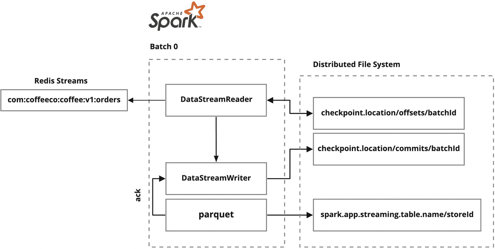
图 10-8

对 Redis Streams 应用进行的最终更新。此更改将写入通过 Redis Streams 读取的数据内容，然后将这些事件写出到持久的分布式表中。

打开名为 `TriggeredStatefulSparkRedisStreamsApp` 的文件。你将在此文件中找到几个新方法、新配置以及对 `run` 方法的更新。直接跳转到 `outputStream` 方法，因为我们将从这里开始。此方法负责构建一个部分的 `DataStreamWriter`。

```scala
lazy val outputStream: DataStreamWriter[Row] = {
  SparkRedisStreams(sparkSession)
    .transform(inputStream.load())
    .writeStream
    .queryName("orders")
    .format("parquet")
    .partitionBy("storeId")
    .option("path", streamingSinkLocation)
    .outputMode(OutputMode.Append())
}
```

流式接收器的输出格式是 *parquet*。这意味着应用正在将从 Redis 流中读取的数据转换为 parquet 格式，然后将这些事件按 `storeId` 分区写出到由 `streamingSinkLocation` 定义的路径中。当你使用 `partitionBy` 写入时，本质上是在创建键/值命名的目录。

```
/tables/coffee.order.events/storeId={storeId}/
```

**提示**：根据经验法则，你应该在低基数列上对表进行分区。通常的做法是使用日期（`date=YYYY-mm-dd`）和年份部分（`year=YYYY/month=mm/day=dd`）。为了增加多样性，你可以包含与你将要执行的查询相关的列。在本练习中，该列是 `storeId`。

最后，我们将输出格式更改为仅追加模式：`OutputMode.Append()`。这只会让流式 DataFrame/dataset 中的新行写入接收器。当我们下一章研究使用聚合时，输出模式会更有意义，因为它们有助于减少有状态聚合和其他分析处理的输出量。我们现在来看看触发器。

### 更新后的触发式运行方法

`run` 方法现在会利用提供的触发器配置，对 `outputStream` 方法生成的 `DataStreamWriter` 进行进一步定制。让我们来看看这两个配置值。

```scala
lazy val triggerEnabled: Boolean = sparkConf.getBoolean(
  "spark.app.stream.trigger.enabled", true)
```

为什么你需要启用或禁用触发功能？在应用恢复或重放场景中，触发器可能会阻碍应用达到最大吞吐量。例如，`ProcessingTime` 触发器能让 Spark 应用基于一个时间间隔（如 30 秒、5 分钟或 1 小时）来执行。每次应用触发时，它会运行至完成所需的时间，然后计时器开始倒计时，直到下一次可以触发下一个批次。如果你希望应用快速处理，能够为这类特殊用例切换开关并短路触发机制就非常有用。

```scala
lazy val triggerType: String = sparkConf.get(
  "spark.app.stream.trigger.type", "processing")
```

触发器类型与 `processing`、`once` 或 `continuous` 这些值相关联。这三种类型的触发器在 Spark Structured Streaming 中均可使用。

让我们看看这两个配置如何协同工作，以控制用于在 `run` 方法中生成最终 `StreamingQuery` 的配置项。

```scala
override def run(): Unit = {
  super.run()
  val writer: DataStreamWriter[Row] = triggerType match {
    case "continuous" if triggerEnabled =>
      val checkpointInterval = "30 seconds"
      outputStream
```


.option("checkpointLocation", s"$appCheckpointLocation/trigger/continuously/")
.trigger(Trigger.Continuous(checkpointInterval))

case "once" if triggerEnabled =>
    outputStream
        .option("checkpointLocation", s"$appCheckpointLocation/trigger/once/")
        .trigger(Trigger.Once())

case "processing" if triggerEnabled =>
    outputStream
        .option("checkpointLocation", s"$appCheckpointLocation/trigger/processing/")
        .trigger(Trigger.ProcessingTime("10 seconds"))

case _ =>
    outputStream
        .option("checkpointLocation", s"$appCheckpointLocation/trigger/none/")

startAndAwaitApp(writer.toTable(streamingTableName))
```

我们已经介绍过 `DataStreamWriter` 接口的作用。这里我们只是使用了一种更函数式的方法，通过 `triggerType` 的模式匹配来生成最终的 writer。

```
triggerType match {
    case "continuous" if triggerEnabled =>
    case "once" if triggerEnabled =>
    case "processing" if triggerEnabled =>
    case _ =>
}
```

模式匹配使得检查 `triggerType` 是否等于 `continuous`、`once` 或 `processing` 变得更容易。否则，应用将回退到默认的无触发器的微批处理模式。在每个代码块内部，都发生着一些有趣的事情。现在让我们来逐一分析。

### 持续处理模式

本章前面部分我们介绍了什么是持续处理模式。本质上，它会对来自数据源的每个事件进行处理直到完成，并异步提交，而不关心其他任何事件的状态（因为没有批次这个概念）。

```
Trigger.Continuous(checkpointInterval)
```

不幸的是，我们只能在使用 Kafka 作为数据源时使用这种执行模式，因此我们必须等到下一章再介绍。（你可以使用第 11 章中的环境进行测试，作为后续探索。）

### 周期处理

有时候，你会发现需要控制应用触发每个微批次的频率。例如，你需要每分钟运行一次作业，但又不想使用 Airflow 来实现。

你可以使用这个触发器来替代 Airflow 调度器，每五分钟运行一个新批次：`Trigger.ProcessingTime("5 minute")`。

```
case "processing" if triggerEnabled =>
    outputStream
        .option("checkpointLocation", s"$appCheckpointLocation/trigger/processing/")
        .trigger(Trigger.ProcessingTime("10 seconds"))
```

在这个应用中，该时间间隔被固定为十秒。你可以轻松地添加一个配置参数，以更动态的方式控制触发器。

### 有状态批处理作业

回到第 7 章，你了解了有状态批处理作业。好的，现在我们就在这里，你正在查看用于将应用从持续有状态 Structured Streaming 应用转变为有状态批处理应用的控制器。虽然从技术上讲，这仍然是一个 Structured Streaming 应用，但它在首次运行后不会继续执行，这一事实给了我们将其称之为有状态批处理应用的空间。

```
case "once" if triggerEnabled =>
    outputStream
        .option("checkpointLocation", s"$appCheckpointLocation/trigger/once/")
        .trigger(Trigger.Once())
```

### 流式表写入器

在测试应用之前的最后一项任务，是简要讨论一下对 `run` 方法末尾所做的更改。

```
startAndAwaitApp(
    writer.toTable(streamingTableName)
)
```

`DataStreamWriter` 有一个名为 `toTable` 的方法。这个方法，就像你之前看到的 `start` 方法一样，会生成一个 `StreamingQuery`。其背后的原理是，表的元数据现在被写入 Hive Metastore（正如你在第 6 章中所学的），而物理分区的 parquet 文件的其余部分则被写入分布式文件系统。

`streamingTableName` 存储在 `sparkConf` 中，具体配置项为 `spark.app.streaming.table.name`。在本例中，它被命名为 `coffee_orders`。

#### 使用触发器运行有状态应用

接下来只需运行应用即可。你需要打开 `redis-cli`，并准备好订单事件，以便在应用启动后立即开始输入。

##### 使用一次性触发器运行

必要的配置如下所示。你可以直接从应用目录中的 `README` 获取完整命令，或者对练习 10-1 中展示的原始完整`docker run`命令进行必要的调整。

```
docker run \
    ...
    --class "com.coffeeco.data.TriggeredStatefulSparkRedisStreamsApp" \
    --conf "spark.sql.warehouse.dir=s3a://com.coffeeco.data/warehouse" \
    --conf "spark.app.source.stream=com:coffeeco:coffee:v1:orders" \
    --conf "spark.app.stream.trigger.enabled=true" \
    --conf "spark.app.stream.trigger.type=once" \
    --conf "spark.app.checkpoint.location=s3a://com.coffeeco.data/apps/spark-redis-streams-app/canary/" \
    --conf "spark.app.streaming.sink.path=s3a://com.coffeeco.data/tables/coffee.order.events/" \
    --conf "spark.app.streaming.table.name=coffee_orders" \
    /opt/spark/app/spark-redis-streams.jar
```

应用将启动。如果没有检查点，它将创建初始的批次 0，然后应用完成。然而，就像练习 10-3 中的有状态应用示例一样，你可以向 Redis 流中添加任意数量的事件，然后重新启动应用。它会处理所有事件，然后再次停止运行。其美妙之处在于，你可以使用 Docker 操作符从 Airflow 运行此应用，从而执行完全一致、可靠的、有状态的批处理作业。很简洁。

##### 使用处理时间触发器运行

这将启动应用，并为其提供全新的检查点。然后，你可以自由添加任意数量的新事件，并观察应用的行为。它会在每次运行之间暂停十秒钟。

```
docker run \
    ...
    --class "com.coffeeco.data.TriggeredStatefulSparkRedisStreamsApp" \
    --conf "spark.sql.warehouse.dir=s3a://com.coffeeco.data/warehouse" \
    --conf "spark.app.source.stream=com:coffeeco:coffee:v1:orders" \
    --conf "spark.app.stream.trigger.enabled=true" \
    --conf "spark.app.stream.trigger.type=processing" \
    --conf "spark.app.checkpoint.location=s3a://com.coffeeco.data/apps/spark-redis-streams-app/canary/" \
    --conf "spark.app.streaming.sink.path=s3a://com.coffeeco.data/tables/other.coffee.order.events/" \
```

#### 持续运行

目前我们还无法以持续模式运行。我们需要将 Kafka 引入其中，这将在下一章进行。

#### 查看结果

你可以通过跳转到运行 MySQL 的 Docker 实例并直接查询 Hive Metastore 来检查其中存储的值。

```bash
docker exec -it mysql bash
mysql -u dataeng -p
use metastore;
select * from TABLE_PARAMS
where TBL_ID =(
  select TBL_ID from TBLS
  where TBL_NAME = "coffee_orders"
);
```

该输出将是与 `coffee_orders` 表相关的元数据。

*使用 DataStreamWriter 上的 toTable 方法生成的 Hive Metastore 记录*

```
+------------------------------------------------------------+
| TBL_ID | PARAM_KEY                            | PARAM_VALUE|
+--------+--------------------------------------+------------+
|     16 | EXTERNAL                             | TRUE       |
|     16 | spark.sql.create.version             | 3.1.2      |
|     16 | spark.sql.partitionProvider          | catalog    |
|     16 | spark.sql.sources.provider           | parquet    |
|     16 | spark.sql.sources.schema.numPartCols | 1          |
|     16 | spark.sql.sources.schema.numParts    | 1          |
|     16 | spark.sql.sources.schema.part.0      | {schema}   |
|     16 | spark.sql.sources.schema.partCol.0   | storeId    |
|     16 | transient_lastDdlTime                | 1626675149 |
+--------+--------------------------------------+------------+
```

你会看到该表是一个外部表。这意味着你可以从 Spark 目录中删除该表，但仍保留位于分布式文件系统中的物理表。

### 练习 10-4：总结

这个最后的练习教你如何在应用程序中连接多种执行模式，并使用由配置驱动的特性标志来改变应用程序的行为。虽然你可以将这些示例进一步扩展，但这已经是使用 Apache Spark Structured Streaming 的一个很好的入门介绍了。

## 本章总结

本章我们涵盖了很多内容。你了解了 Spark Structured Streaming 的核心处理原则。

-   执行/处理模式（微批处理或持续处理模式）
-   触发器（有效的处理窗口/边界）
-   增量查询（跨时间的渐进式数据处理）
-   流式输出模式（完整模式、更新模式和追加模式）

你学习了如何使用触发器在微批处理执行模式和持续执行模式之间切换。虽然当前没有可用的正确组件（即 Kafka），但你仍然有一个可插入的应用程序以应对该用例（这即将到来）。你使用了仅追加输出模式，这意味着只有 Spark 之前未见过的数据才会通过接收器写入。你将在下一章学习如何使用其他模式。最后，你拥有一整套可用的工具，包括在将 Apache Spark 应用容器化方面的新技能。

在下一章中，我们将继续 Structured Streaming 的学习，重点放在更高级的数据处理上，从流式连接到聚合以及其他分析处理。你还将亲自使用 Kafka，将其纳入你庞大的数据工程工具集。我们开始吧。

# 11. Apache Kafka 与 Spark Structured Streaming

上一章介绍了如何使用 Apache Spark Structured Streaming。你了解了如何使用流行的 Redis 数据库来创建结构化的内存事件流，并探讨了如何编写有状态的流式应用程序。

本章将扩展上一章学到的技能，包括：如何使用核心的 Structured Streaming API——`DataStreamReader` 和 `DataStreamWriter`；如何利用应用程序检查点创建能够处理容错和重启的有状态流式应用；如何使用触发器控制应用处理频率和运行风格；以及最后，有状态流和有状态批处理中应用的流程如何工作。你将通过重点学习如何使用 Apache Kafka 作为 Spark 与其余数据生态系统之间的管道，继续探索 Structured Streaming 的工作原理。

## Apache Kafka 简介

Apache Kafka 在第 1 章中介绍过，它是当今应用最广泛的事件和数据流处理框架。Kafka 在数据工程生态系统中的主导地位与其提供的稳定功能有关。它介入并解决了与分布式系统和服务间通信相关的常见问题。

### 异步通信

API 及其他 HTTP 服务要求所有依赖的系统和服务均处于运行状态，才能以同步方式处理请求。后端服务通常会实现不同级别的重试机制，以便在遇到无响应的系统或服务时进行退避，并在多次尝试后放弃并向调用方返回错误。第 9 章介绍了“惊群效应”问题以及资源稀缺如何在进程争相弥补损失时间时引发麻烦。Kafka 能够使（可处理异步请求的）系统摆脱传统的请求/响应周期，转变为一种新的模式：可以查询请求标识符以获取完成状态，或者通过使用 webhook 或回调来通知该 API 请求所封装操作的最终成功或失败状态。

### 水平可扩展性

Kafka 能够高效处理因主题（用于存储一组相关事件/类型的持久化存储机制）的消费者（读取者）、生产者（写入者）或两者数量增加而给系统带来的常见负载问题。其实现方式是支持集群中服务器数量向外扩展（水平扩展），而非单纯扩展服务器本身的规模（CPU/内存/磁盘）。

与可能因单台服务器资源有限而饱受过多连接困扰的传统数据库不同，Kafka 的代理节点可以横向扩展，从而整体提升整个集群的吞吐能力。

代理节点是一种服务器端（集群成员）服务，负责处理集群中所有分布式请求的一部分。每个代理节点都被分配并负责一个或多个分布式主题分区（数据文件）的一部分，其角色可以是分区领导者（分区的主要所有者），也可以是副本（当前领导者分区的冗余备份）。通过增加代理节点数量，可以在集群中更均匀地分担读取、写入或冗余恢复等更高负载。这使得平台能够扩展以满足主题的数据需求，同时也能管理分布式系统在可用性和一致性方面带来的各种问题。

### 高服务可用性与一致性

你在第 1 章中了解了 CAP 定理，鉴于 Kafka 是一个分布式、网络连接的服务，一致性、可用性和网络分区容错性问题至关重要。该定理指出，为了维持分布式一致性，服务在处理网络分区（集群中的盲点）时无法保持完全可用。因此，Kafka 在主题内部使用分区复制来实现高可用性和一致性。为确保在担任分区领导者的代理节点（服务器）离线（或服务器关机/宕机）时，有不止一个完整的同步副本（ISR）可用于冗余，每次写入都会持久化地写入预写日志并向写入者（生产者）确认。Kafka 集群可以利用 ISR 协议来可靠地选择丢失分区的下一个可用 ISR（冗余副本），并将该代理节点提升为新的主题分区领导者。每当代理节点离线时，此循环就会重复，以在最大程度上减少对给定主题的消费者和生产者的影响，恢复主题的一致性和可用性。

与 Kafka 将主题内容分布到多个分区的方式相同，代理节点本身也可用于在节点之间传播主题级别的命令。例如，为了以零停机方式增加主题的分区数量，可以使用任何代理节点来进行消息传播（类似流言协议）。主题级别的配置也可以在实时、零停机的情况下进行调整，以应对因生成的有效负载（事件）规模增大而导致的数据需求增加，或因生产和消费的记录数量增长而带来的需求变化。为何要进行横向扩展？这个概念让我们回到大数定律。所有系统在单进程内需要处理的负载越大，速度就会越慢。因此，拆分主题的分区（例如，增加封装整个主题的分区数量）是应对大数据系统规模需求的一种方式。

### 灾难恢复

通过允许应用程序从更早的时间点重放事件（数据），系统和服务可以应对一定的停机或服务中断情况，并从原本可能导致数据丢失的场景中恢复过来。这对于数据管道尤为重要，因为丢失一个事件就等于数据丢失，而具有恢复选项的降级服务最终仍能达到最终一致性。

### 事件流与数据管道生态系统

Apache Kafka 解决了一个类似于*数据湖*（在第 1 章中介绍）的问题。请记住，数据湖为来自整个组织的原始、未处理数据提供了一个统一、弹性可扩展的单一真实来源，它充当一个中心化暂存区域，以便数据可以在稍后时间点被可靠地重新读取、重新处理和转换为可用数据。这个中心化数据暂存区域解决了一个与数据管道以及过早进行有损数据转换有关的问题。如果你无法追溯到事件的原始真实来源，那么损坏的数据就会简单地向下游流动。

另一方面，Apache Kafka 提供了一个统一的事件流解决方案，它将事件数据组织成*主题*，其作用类似于支撑数据湖的分区式分布式文件系统。主题支持构建由编码二进制数据组成的数据管道，这些管道可以被接入以生成丰富的数据网络。数据湖与 Kafka 之间的关键区别在于时间，特别是最小化数据生成（写入主题）与数据可被下游消费（读取）之间的时间差。

Kafka 使连接的客户端能够在分配给某个主题的服务器端代理节点组（仲裁）提交并确认收到来自已连接数据生产者发布的事件（记录）后，立即（近实时地）消费数据。连接的客户端只需按预定时间间隔轮询一个主题，以记录（事件）集合的形式获取任何新数据。Kafka 有意最小化事件创建与事件可被处理之间的时间差（增量），这对于实时事件流处理以及实时数据处理至关重要。

在本章中，你将会学习以下内容：

- 使用 Docker 配置并运行一个 Kafka 集群
- 创建和修改 Kafka 主题
- 连接并配置 Spark Kafka 库
- 使用 Kafka 数据源
- 将来自 Kafka 的二进制数据转换为 DataFrame 和数据集
- 使用 Kafka 数据接收器

`练习材料`

第 11 章的练习材料位于 `https://github.com/newfront/spark-moderndataengineering/tree/main/ch-11`。每个练习中的 `README` 文件将为你提供有关任何额外安装或注意事项的更多背景信息。

## 章节练习

以下练习将帮助你继续探索 Spark 结构化流框架的特性与功能。首先，你将使用 `docker-compose` 在本地启动 Kafka。在深入探讨如何充分利用 Kafka 丰富流生态系统的模式之前，这也是一个熟悉 Kafka 各种架构组件运行原理的机会。

## 练习 11-1：启动并运行 Apache Kafka

打开章节材料，导航至名为 `ch-11` 的目录，开始进行练习。

### 练习 11-1：材料

练习材料位于 `ch-11` 目录下。

```
ch-11

├── docker

│   └── kafka

│       ├── README.md

│       └── docker-compose.yaml

└── exercises

    └── 01_kafka_up_and_running
```

### 启动本地环境

使用 `docker/kafka` 目录下提供的 `docker-compose` 文件开始操作。按照 `README.md` 文件中的步骤，将 Kafka 纳入你的数据工程工具箱。现在，你可以使用 `docker compose` 命令启动一个完整的 Kafka 集群，运行 Zookeeper（有状态元数据存储）和三个 Kafka 代理。

```bash
docker compose \
  -f ~/dataengineering/kafka/docker-compose.yaml \
  up -d --remove-orphans
```

`docker-compose` 文件配置了一个功能完整的 Kafka 集群（使用前几章的 `mde` Docker 网络），从而允许从你的笔记本电脑和 Docker 运行时内部进行访问。现在，你可以从你的 Spark 应用程序连接到该 Kafka 集群。

运行 Kafka 集群的容器可以使用以下 `docker ps` 命令查看。这将过滤出名字匹配 `kafka_` 前缀的运行中容器。

```bash
docker ps \
  --filter "name=kafka_*" \
  --filter "network=mde" \
  --format "table {{.Names}}\t{{.Mounts}}\t{{.Networks}}" \
  -s
```

输出将显示运行你全新 Kafka 集群的四个容器。

```
NAMES               MOUNTS              NETWORKS
kafka_kafka-2_1     kafka_kafka_2_...   mde
kafka_kafka-1_1     kafka_kafka_1_...   mde
kafka_kafka-0_1     kafka_kafka_0_...   mde
kafka_zookeeper_1   kafka_zookeepe...   mde
```

三个容器代表集群代理，第四个容器是 Apache Zookeeper。Zookeeper 负责存储 Kafka 集群元数据（状态），包括代理标识符、分区领导者以及每个主题在集群中的副本位置。接下来你将了解更多关于主题如何工作的信息，并创建你的第一个主题。

### 创建你的第一个Kafka主题

现在你的 Kafka 集群已经启动并运行，你可以创建你的第一个主题了，但在创建之前，让我们先了解一些与 Kafka 主题相关的更多特性或行为。然后你就可以开始创建你的第一个主题了。

#### 主题的行为方式

从高层次来看，主题的行为类似于数据库中的表，但更像是一个分布式提交日志，用于存储结构化的键/值对记录。

从 Spark 的角度来看，基于键/值的 Kafka 记录的一般结构如列表 11-1 所示。Kafka 记录（`StructType`）的格式至少包含一个名为 `value` 的列，该列在静态存储时被编码为字节数组（二进制），以及数据被读取的 `topic`、记录静态所在的分区 `partition`，以及单个记录的 `offset`（可以将其视为指向主题分区内行位置的指针）。

```
root
 |-- key 
 |-- value 
 |-- topic 
 |-- partition 
 |-- offset 
 |-- timestamp 
 |-- timestampType 
 |-- headers >

列表 11-1
Kafka 记录结构数据格式
```

Kafka 记录被分片（或简单地分布）在关联主题的总分区数上。由于记录键列对每条 Kafka 记录是可选的，对于空键的默认分区机制是以轮询方式插入记录，这意味着每条生产记录的最终分区分配是非确定性的。这最终意味着在相同数据集上重复运行时，数据无法保证落在相同的分区上。然而，通过为每个记录键提供一个非空值，Kafka 将使用提供的键作为分区机制（哈希分区），使得每条记录能够确定性地路由到给定主题的特定分区。

**提示**

对于事件流，事件数据要么依赖于流中的其他事件来讲述发生了什么（或正在发生什么），要么每个事件可以独立存在，自行讲述完整的故事。第 9 章介绍了相互依赖和独立事件数据的概念，你可以利用 Kafka 来优化事件在每个主题分区内的发出方式，从而针对相互依赖或独立事件的用例进行优化。

我们已经确定主题是一种集合机制，它像导管或通道一样用于事件流，但我们尚未涵盖是什么让 Kafka 如此出色。每条已发布的记录在插入时都会被打上代理端的时间戳（以毫秒为单位），并且仅在成功写入（提交）后才得到确认。伴随确认而来的保证是，主题将在逐个分区的基础上维护时间同步的插入顺序，本质上是为你提供一组按插入时间排序的记录。

由于插入顺序的保证仅在分区级别上，这使得 Kafka 能够在一个非分布式的、隔离的主题子集上管理其他情况下复杂的分布式插入排序任务。基于分区的主题架构，在较低层面上，实际上更像是一个分布式文件系统，并且像任何文件系统一样，独立的 Kafka 不会强制为记录中的每个值应用显式的记录模式。

通过移除模式强制，Kafka 主题可以变得非常灵活，但灵活性也带来了可能意外将损坏或错误的数据流向下游的风险。因此，一种常见的做法是为每个主题关联一个特定的、二进制编码的事件类型（或多个类型）。

#### 创建 Kafka 主题

可以使用 Kafka 附带的 admin shell 脚本来创建主题。执行列表 11-2 中的命令来创建你的第一个主题。

```bash
docker exec \
  -it kafka_kafka-0_1 \
  /opt/bitnami/kafka/bin/kafka-topics.sh \
  --create \
  --if-not-exists \
  --topic com.coffeeco.coffee.v1.orders \
  --bootstrap-server kafka_0:9092,kafka_1:9092,kafka_2:9092 \
  --partitions 4 \
  --replication-factor 2

列表 11-2
使用 Kafka 开箱即用的命令行工具创建 Kafka 主题
```

运行该命令的结果是创建一个名为 `com.coffeeco.coffee.v1.orders` 的新 Kafka 主题。该主题将在集群中有条件地创建（`if-not-exists`），并配置有四个分区。为了提高可用性，每个主题分区都被复制两次。你将在下一节中了解有关修改主题的更多信息。

**可选**

既然你已经创建了第一个主题，我猜你一定想继续对它进行更多操作。你可以随意跳到练习 11-2。你随时可以回到这里，了解更多关于 Kafka 如何处理主题管理和安全性的信息。

### Kafka 主题管理

管理 Kafka 主题归根结底就是理解系统行为以及学会使用 Kafka 附带的 admin 工具。本节将向你介绍一些操作 Kafka 所需的常用命令和必要技能。

#### 列出 Kafka 主题

列出集群中可用的主题是发现主题的关键。您可以通过在 `kafka-topics.sh` 脚本上使用 `--list` 操作来实现，如清单 11-3 所示。

```bash
docker exec \
  -it kafka_kafka-0_1 \
  /opt/bitnami/kafka/bin/kafka-topics.sh \
  --list \
  --bootstrap-server kafka_0:9092,kafka_1:9092,kafka_2:9092

清单 11-3
列出 Kafka 主题返回一个简单的主题列表
```

`list` 操作将打印集群中所有可用主题的名称。

#### 描述一个主题

不时检查与给定主题相关的元数据是很有帮助的。这有助于调试您在将 Kafka 作为日常职责的一部分进行运维时，不可避免地会遇到的问题。执行清单 11-4 中的命令将返回与分区相关的元数据以及每个代理所扮演的角色，从而维护主题的一致性和可用性。

```bash
docker exec \
  -it kafka_kafka-0_1 \
  /opt/bitnami/kafka/bin/kafka-topics.sh \
  --describe \
  --topic com.coffeeco.coffee.v1.orders \
  --bootstrap-server kafka_0:9092,kafka_1:9092,kafka_2:9092

清单 11-4
描述一个主题
```

`describe` 命令的输出与下面显示的输出会略有不同，因为您的集群会有不同的指定主题领导者和分区副本位置。以下是我环境中的修改后的输出：

```
Topic: com.coffeeco.coffee.v1.orders
TopicId: eENgTy01QUWOAe2gJzi_rw
PartitionCount: 4
ReplicationFactor: 2
Configs: segment.bytes=1073741824
```

## Topic: com.coffeeco.coffee.v1.orders

Partition: 0    Leader: 2    Replicas: 2,1    Isr: 1,2

Partition: 1    Leader: 1    Replicas: 1,0    Isr: 1,0

Partition: 2    Leader: 0    Replicas: 0,2    Isr: 0,2

Partition: 3    Leader: 2    Replicas: 2,0    Isr: 0,2

`describe` 命令的元数据揭示了每个分区是如何分布在这三个代理上的。代理 ID 分别为 0、1 和 2。您可以看到，对于每个分区，都有一个领导者负责存储该分区的一份副本，以及一个与领导者同步的副本。这种能力允许分区领导者丢失，而由同步中的副本无缝地接管成为新的领导者。

## 修改一个主题

Kafka 主题的配置并非一次性设置后就置之不理。在大多数情况下，初始配置仅是对给定主题所需总分区数和条件配置需求的预估。幸运的是，动态修改（或更改）主题是可行的，而不会中断连接到该主题的客户端。

您可以通过增加被视为健康所需的最小主题副本数来修改之前创建的主题，以提高其一致性和可用性或整体容错能力。`min.insync.replicas` 的默认值是 `1`，我们将把它增加到 `2`。

## 更改主题配置

要在初始创建后修改主题，您可以使用 `kafka-configs.sh` 脚本来添加或删除（移除）主题的配置属性。执行清单 11-5 中的命令来更改最小同步主题副本数。

```bash
docker exec \
-it kafka_kafka-0_1 \
/opt/bitnami/kafka/bin/kafka-configs.sh \
--alter \
--bootstrap-server kafka_0:9092,kafka_1:9092,kafka_2:9092 \
--entity-type topics \
--entity-name com.coffeeco.coffee.v1.orders \
--add-config min.insync.replicas=2
```

清单 11-5 修改现有主题的配置

重新配置您的主题后，每个分区现在需要两个同步副本。您能看到这里可能存在的问题吗？也许与主题复制因子有关？如果一个代理丢失（离线/无法访问/宕机），集群将承受额外的压力，因为可用的代理需要为分配给丢失代理的任何主题的分区恢复丢失的分区。二级代理需要复制丢失的主题分区，以恢复到与这些分区的领导者同步（一致）的状态。这可能导致大量的文件传输，从而增加整个集群的网络 IO 和 CPU 负载，并降低受影响主题的可用性。这进而可能导致写入该主题的生产者在恢复一致、可用状态时进行客户端退避。

为了确保您的集群能够处理代理丢失，您可以将主题的复制因子从 `2` 改为 `3`。这样，您就可以处理单个代理丢失的情况，而无需手忙脚乱。在创建主题时，通过添加 `--replication-factor 3` 来执行此操作更容易，而不是像您接下来要做的那样使用手动副本分配。

## 增加主题分区副本

为了确保在丢失一个代理时，您的集群仍能保持健康，并且至少拥有两个同步副本，您需要创建一个副本重新分配 JSON 文件。可以使用 `describe topic` 命令中的信息来生成此文件。只需获取当前分配，并在 `replicas` 数组中添加另一个代理 ID。这将作为 Kafka 的模板，用于将主题的复制因子从 `2` 增加到 `3`。清单 11-6 中的示例展示了副本重新分配的 JSON 格式。

```json
{
    "version": 1,
    "partitions": [
        {
            "topic": "com.coffeeco.coffee.v1.orders",
            "partition": 0,
            "replicas": [2,1,0]
        },
        {
            "topic": "com.coffeeco.coffee.v1.orders",
            "partition": 1,
            "replicas": [1,0,2]
        },
        {
            "topic": "com.coffeeco.coffee.v1.orders",
            "partition": 2,
            "replicas": [0,2,1]
        },
        {
            "topic": "com.coffeeco.coffee.v1.orders",
            "partition": 3,
            "replicas": [2, 0, 1]
        }
    ]
}
```

清单 11-6 Kafka 主题副本重分配（`replication-reassignments.json`）文件格式

有了这个副本文件，您需要将其复制到您的某个 Kafka 代理中，以便能够从该代理运行 `kafka-reassign-partitions.sh` 脚本。复制命令如清单 11-7 所示。

```bash
docker cp \
./exercises/01_kafka_up_and_running/replication-reassignments.json \
kafka_kafka-0_1:/opt/replication-reassignments.json
```

清单 11-7 用于将 `replication-reassignments.json` 上传到 Kafka 代理的 Docker 复制命令

现在代理上有了 `replication-reassignments.json` 文件，您就可以运行重新分配分区的脚本了。使用您上传 `replication-reassignments.json` 文件的同一个代理，并执行清单 11-8 中的命令。

```bash
docker exec \
-it kafka_kafka-0_1 \
/opt/bitnami/kafka/bin/kafka-reassign-partitions.sh \
--bootstrap-server kafka_0:9092,kafka_1:9092,kafka_2:9092 \
--reassignment-json-file /opt/replication-reassignments.json \
--execute
```

清单 11-8 运行 `kafka-reassign-partitions.sh` 脚本以增加主题复制

作为运行副本重新分配的结果，您现在可以处理 Kafka 集群中丢失一个代理的情况，而不会对集群的行为造成重大中断。在非生产场景中，有时简单地删除主题并从头开始更容易，但理解如何修改主题的行为可以帮助您学会务实地解决问题。

> **提示**：分区重新分配的另一个用例是 Kafka 代理倾斜的情况。这种情况出现在一个或多个代理因承载了某个主题的过多分区而过载时。这可能会减慢连接到该代理（作为其主题分区的领导者）的生产者和消费者，因为更多的数据和更多的连接不均衡地分布在代理之间。