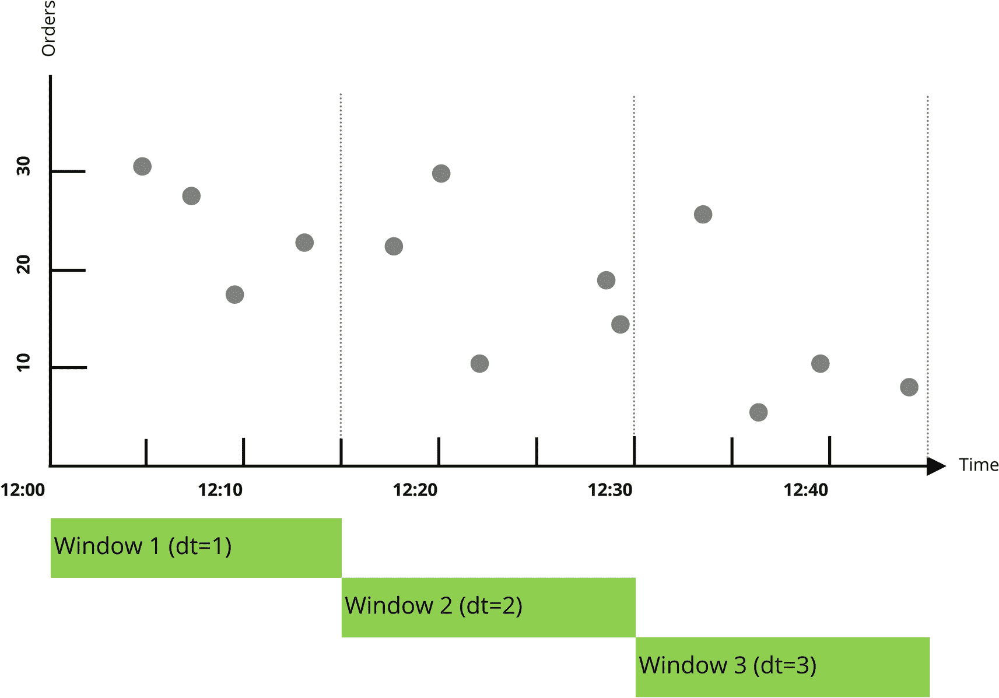
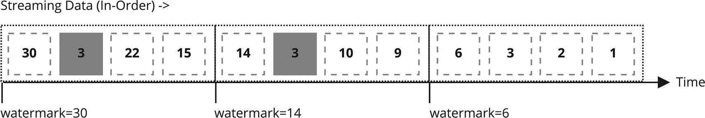

# 创建基于时间窗口的聚合

假设你有一个无限数据流的数据源，例如 Redis Stream 或 Kafka 主题，并且希望使用 Spark Structured Streaming 来可靠地获取并持续分析该数据源中流经的数据。你清楚无法将所有数据永远储存在内存中，同时你也希望能够获得一定的处理能力与准确性保障。那么，你该如何应对呢？

首先，你可以将一种名为*窗口计算*的技术与 Spark Structured Streaming 结合使用。窗口计算允许你根据基于时间的间隔（例如每 15 分钟），自动将静态或流式数据集切分成多个数据桶。简单来说，数据会被自动分组到由起始时间和结束时间定义的时间桶内。窗口计算，或称基于时间的分组，与我们上一章讨论的分析窗口函数不同。最大的区别在于，分析窗口函数会保留数据集中的所有行，并根据聚合函数新增一列；而窗口聚合则是基于时间窗口定义的分组集，逐步合并指定列的聚合结果。图 13-1 展示了关于随时间变化的咖啡订单总数的有界数据（窗口 1-3）。请注意，这些窗口是不重叠的，这意味着在每个 15 分钟窗口内产生的订单对于该窗口来说是互斥的。这样一来，每个订单都只被计算一次。



图 13-1

使用窗口来表示咖啡订单随时间变化的动态 `groupBy` 函数

让我们通过一个具体例子来进一步探讨这个想法。

## 窗口函数与窗口计算

在上一章中，你了解了如何使用分析窗口函数来处理列式数据。你学会了创造性地使用行号、计算累计运行平均值，甚至根据分析表达式的结果进行聚合运算。为了便于参考，清单 13-1 来自第 12 章。回顾一下，窗口函数通过为所有行添加一个新列来转换输入数据集，该列代表特定分析函数的结果。例如，你曾使用这些函数计算累计运行总和。

```
df.withColumn("running_total"),
sum($"num_items").over(Window
.partitionBy("store_id","date","hour")
.orderBy(asc("timestamp"))))
清单 13-1
第 12 章清单 12-32 中的列式窗口函数
```

窗口计算是一种列式分组技术，它与分析窗口函数有一些共通之处，但在底层实现上有所不同。虽然两者名称相同（窗口），并且都致力于根据条件边界对数据集进行分区，但它们有一个核心区别。主要区别在于，窗口表达式是作为参数传递给 `groupBy` 操作符，以增强分组操作符的能力。现在，数据将根据数据集中的一个通用时间戳列（`TimestampType`）自动划分到基于时间的桶中。

让我们来看看实际运行中的窗口计算。清单 13-2 创建了一个*滚动*窗口聚合。每个窗口都有一个包含性起始时间和一个排他性结束时间。这意味着数据将根据特定的时间边界进行分割，就像传送带上移动的盒子一样，在向传送带末端移动的过程中被填满。清单 13-2 中的示例可以直接在 `spark-shell` 或 Zeppelin 笔记本中运行。

```
import spark.implicits._
import org.apache.spark.sql.functions.{col, window}
spark
.sql("SELECT timestamp('2021-09-25 10:00:00' as ts, 200 as total, 'storeA' as storeId")
.groupBy($"storeId", window($"ts","30 minutes"))
.sum("total")
.select(
$"storeId", $"window.start".as("start"),
$"window.end".as("end"), $"sum(total)".as("total"))
.show(truncate=false)
清单 13-2
使用窗口函数作为分组列来自动创建窗口聚合
```

清单 13-2 中的聚合按 `storeId` 分组，并借助事件数据的时间戳列 (`ts`) 和*窗口表达式*自动聚合到 30 分钟的窗口中。

下面展示了窗口聚合的参考输出结果。对于每个互斥的 30 分钟窗口，订单总额会根据不同 `storeId` 的总数进行累加。

```
+-------+-------------------+-------------------+-----+
|storeId|start              |end                |total|
+-------+-------------------+-------------------+-----+
|storeA |2021-09-25 10:00:00|2021-09-25 10:30:00|200  |
|storeB |2021-09-25 10:00:00|2021-09-25 10:30:00|120  |
|storeA |2021-09-25 10:30:00|2021-09-25 11:00:00|350  |
|storeB |2021-09-25 10:30:00|2021-09-25 11:00:00|220  |
+-------+-------------------+-------------------+-----+
```

清单 13-2 中使用的 `window` 函数是一个列式表达式，它将一个时间戳列转换成一个派生列，用于 `groupBy` 操作中。这使我们能够自动将数据落入特定的基于时间的数据桶中进行聚合。

## 使用 `window` 函数

`window` 函数增强了 `RelationalGroupedDataset` 操作符的工作方式，支持通过使用*滚动*、*滑动*和*延迟*窗口功能，自动进行基于时间聚合的数据分桶。

*来自 `org.apache.spark.sql.functions` 包的 `window` 函数*


```scala
def window(
  timeColumn: Column,
  windowDuration: String,
  slideDuration: String,
  startTime: String): Column = {
  withExpr {
    TimeWindow(timeColumn.expr, windowDuration, slideDuration, startTime)
  }
}.as("window")
```

该函数接受四个参数（`timeColumn`、`windowDuration`、`slideDuration` 和 `startTime`），为你提供了在时间维度上滑动和切分数据的新方法。之前你已经了解了滚动窗口，现在让我们来看一下滑动窗口和延迟窗口。

## 滑动窗口

`window` 函数的 `slideDuration` 参数支持创建滑动窗口。滑动窗口本质上是按特定增量（例如每 15 分钟评估一次 30 分钟窗口）计算的、相互重叠的基于时间的窗口。与滚动窗口不同，每一行数据可以同时属于多个重叠的窗口。

例如，将示例 13-2 中的 `groupBy` 窗口表达式改为包含 15 分钟的滑动间隔，你将创建两个基于时间的桶，而非一个。

```scala
groupBy($"storeId", window($"ts","30 minutes", "15 minutes"))
```

现在，单个输入行将产生两行聚合结果，而非一行。

```
+-------+-------------------+-------------------+-----+
|storeId|start              |end                |total|
+-------+-------------------+-------------------+-----+
|storeA |2021-09-25 09:45:00|2021-09-25 10:15:00|200  |
|storeA |2021-09-25 10:00:00|2021-09-25 10:30:00|200  |
+-------+-------------------+-------------------+-----+
```

由于输入行的时间戳是 `10:00:00`，该数据落入了两个重叠的 30 分钟滑动窗口中。第一个窗口从 `09:45` 开始，到 `10:15` 结束。第二个窗口从 `10:00` 开始，到 `10:30` 结束。这也被称为*交错*窗口。

## 延迟窗口

窗口的 `startTime` 参数允许你延迟计算派生窗口。将示例 13-2 中的 `groupBy` 改为以下形式。

```scala
.groupBy($"storeId",
  window($"ts","30 minutes", "15 minutes", "5 minutes"))
```

这将每次聚合的起始偏移量推迟了五分钟，然后每 15 分钟创建一个滑动窗口。

```
+-------+-------------------+-------------------+-----+
|storeId|start              |end                |total|
+-------+-------------------+-------------------+-----+
|storeA |2021-09-25 09:35:00|2021-09-25 10:05:00|200  |
|storeA |2021-09-25 09:50:00|2021-09-25 10:20:00|200  |
+-------+-------------------+-------------------+-----+
```

现在你已经理解了*窗口化*的机制，接下来我们看一个更完整的示例。

## 窗口化与输出控制

既然你已经了解了窗口化过程的工作原理，合乎逻辑的下一步就是考察如何将此技术应用于流式数据集。考虑到流式数据的无界特性，了解那些告知 Apache Spark 聚合操作何时完成的控制过程也同样明智。

例如，假设你需要创建一个流式应用程序，该程序持续摄取 `CoffeeOrder` 数据，每 30 分钟计算一次滚动店铺性能指标。示例 13-3 建立了 `StreamingQuery` 的基本模块。你创建了一个 `DataStreamReader`（Redis），它通过 `groupBy` + `agg` 聚合店铺（`storeId`）的性能，聚合指标包括订单总数（`count`）、售出商品总数（`sum`）、总收入（基于订单成本的 `sum`）以及窗口内平均售出商品数（`average`）。

```scala
spark
  .readStream
  .format("redis")
  ...
  .groupBy($"storeId", window($"timestamp", "30 minutes"))
  .agg(
    count($"orderId") as "totalOrders",
    sum($"numItems") as "totalItems",
    sum($"price") as "totalRevenue",
    avg($"numItems") as "averageNumItems"
  )
  .writeStream
  ...
  .start()
// 示例 13-3
// 创建有状态的流式聚合
```

将这个示例视为有状态聚合应用的蓝图。数据从 Redis（第 10 章）流入，然后你将输入流数据转换为分组聚合（第 12 章）。分组集现在也通过本章所学的窗口化技术得到了增强。

基本上，创建这个流式应用所需的大部分要素都已就绪，除了*两个至关重要的缺失部分*——它们控制着 Spark 如何输出这些窗口聚合结果。首先，`DataStreamWriter`（`writeStream`）上缺少一个输出模式（output mode），该模式定义了聚合后的窗口数据将如何向下游发送；其次，没有告知 Spark 何时停止聚合数据的处理的方法（即水印）。没有输出模式和水印，Spark 无法定义传送带的终点，你的滚动窗口将一直在内存中运行，直到内存耗尽。

现在，我们来看这两个重要的过程。

## 流式输出模式

结构化流应用的输出行为由流式 sink（`DataStreamWriter`）上的输出模式设置控制。有三种可用的值：`complete`、`update` 和 `append`。

### Complete

每次有更新时，流式 DataFrame/dataset 中的所有行都会被写入 sink。此模式通常用于本地运行测试，配合 `ConsoleSink`（在第 10 章中介绍）或 `MemorySink` 使用，你将在本章末尾了解更多关于 `MemorySink` 的信息。

### Update

只有被更新的行才会被写入 sink。如果查询不包含任何聚合，`update` 模式的行为类似于 append。当编写新的流式聚合时，能够看到每个批次在与先前状态合并（更新）后的最终结果会很有帮助。或者对于需要将每个重大更新（对数据集）向下游发送的系统，你可以使用此操作模式，在记录发生变更时发送其多个版本。

### Append

只有新行会被写入 sink。此模式与结构化流基于状态的检查点、预写日志以及阶段级提交协同工作。具体到有状态聚合，`append` 模式控制着关于流式聚合何时被认为完成、并可以有效地向下游发送的精确一次语义（当数据从基于状态的传送带上滚落到下游 sink 时）。


#### 追加输出模式

修改清单 13-3 中的示例代码，我们可以增强 `writeStream` 以使用仅追加模式。

```
.writeStream
.format("parquet")
.options(...)
.outputMode(OutputMode.Append)
.start()
```

现在，流聚合仅在每次聚合完成后才输出数据。但 Spark 如何判断聚合何时完成？如果你使用输出模式 `Append` 运行这段代码，将会看到以下异常抛出。

```
org.apache.spark.sql.AnalysisException: Append output mode not supported when there are streaming aggregations on streaming DataFrames/DataSets without watermark;
```

水印到底是什么？

#### 结账与水印

数据行业中有一个概念叫做“结账”。鉴于流式数据只有在有限的时间窗口内才被视为*新鲜*并可被处理，因此存在一个阈值（水印）。在该阈值内，处理事件流的应用程序（Spark Structured Streaming 或其他）可以接收并处理新数据，之后则停止处理并丢弃（或忽略）任何延迟到达的数据。水印处理过程也被称为“关账”，因为它是系统输出最终处理状态（针对窗口聚合）并发送聚合结果以供下游进一步处理、写入可靠存储、分布式表或其他位置的时间点。

水印过程如图 13-2 所示。从概念上讲，如果你考虑到正在接收和处理无界数据流，那么对于每个微批次，Spark 引擎将根据时间戳列计算最小值、最大值、平均值和水印值。在生成统计信息时，会考虑聚合的整个状态的汇总统计信息，并且每个新的微批次会在决定丢弃被视为延迟的数据之前，先考虑水印阈值。



图 13-2

水印过程可以被视为创建一种基于时间的统计边界的方法。接收到的新事件数据如果小于当前水印（延迟数据），则会根据窗口间隔加上水印间隔被丢弃。

例如，用于近实时监控分布式系统的现有进程不能等待延迟数据，而必须依据可用数据所定义的*可用视图*来采取行动。由于流系统处理来自许多分布式上游进程的数据，数据可能会像人们在排队点单或取咖啡时被拦住一样，或者在日常通勤中因随机交通模式而受阻。

指标数据通常在几秒内（在源系统/物理服务器等上）聚合，并以 5-10 秒的间隔发出以供处理。然后，每个单独的聚合与其他数据合并和连接，以计算分布式系统的统计视图。鉴于告警系统使用规则来确定何时以及如何向团队告警或向另一个自治系统发送事件，水印使这些系统能够忽略那些不再相关且可能触发误报的数据（例如，由于网络故障或其他问题而导致数据延迟 30 分钟才出现的情况）。

### 流式数据的水印

你刚刚了解了结账和水印。我们生活在一个充满规则和法规的世界中，Spark 亦是如此。为了使我们的流聚合能够正确地发出新的*翻滚窗口*聚合结果，我们需要使用与数据集中物理时间戳直接关联的水印（清单 13-4）来标记我们自己的结账点。

Spark 将忽略延迟数据（基于预定义的时间戳列），自动将其丢弃。在许多使用案例中，丢弃延迟数据是可用的最佳选择，而不是创建一个新的桶来聚合可能只有少量延迟记录的数据，但更糟糕的是，延迟数据可能会破坏 Spark 的 `append` 输出模式的*精确一次语义*。

让我们看看如何将水印添加到清单 13-3 的示例中。我们将水印添加到输入流中，清单 13-4 展示了如何向 Redis 输入流添加一个 30 分钟的水印。

```scala
spark
.readStream
.format("redis")
...
.withWatermark("timestamp", "30 minutes")
.groupBy($"storeId", window($"timestamp", "30 minutes"))
...
```

清单 13-4 将有状态聚合示例应用水印

Spark 利用水印（30 分钟）和翻滚窗口（30 分钟）之间的关系，以精确一次语义控制 `append` 输出模式过程。本质上，结账将在第一个事件到达后的一小时（30 分钟窗口 + 30 分钟水印）发生，从而建立聚合桶。

接下来，让我们将刚刚涵盖的理论概念与窗口技术相结合，在练习 13-1 中完成一个完整的端到端有状态流聚合应用程序。

## 章节练习概览

本章的练习重用了前面章节中的 `CoffeeOrder` 事件。你将学习读取订单流并生成店铺收入聚合结果，这些聚合结果本质上是跨可变长度窗口（示例中为五分钟）的店铺绩效数据。

将无界的 `CoffeeOrders` 流读入应用程序后，你将学习将此输入数据集转换为可以随时间聚合的格式。这将产生一个表示翻滚窗口聚合结果的新数据集。

### 输入数据格式 (CoffeeOrder)

```
+-------------+-------+-------+----------+--------+-----+
|    timestamp|orderId|storeId|customerId|numItems|price|
+-------------+-------+-------+----------+--------+-----+
|1632549600000| order1| storeA|     custA|       2| 9.99|
|1632549660000| order2| storeA|     custB|       1| 4.99|
|1632549720000| order3| storeA|     custC|       3|14.99|
|1632549730000| order4| storeB|     custD|       1| 3.99|
|1632549740000| order5| storeA|     custE|       2| 6.99|
+-------------+-------+-------+----------+--------+-----+
```

### 输出的窗口化店铺收入聚合结果

```
+--------+---------------+------+---+-------+-------+-------+
|store_id|         window|orders|its|revenue|p95_its|avg_its|
+--------+---------------+------+---+-------+-------+-------+
|  storeA|{2021-... 06:00|     4|  8|  36.96|      3|    2.0|
|  storeB|{2021-... 06:00|     4|  7|  29.96|      3|   1.75|
|  storeA|{2021-... 06:05|     2|  4|   9.98|      2|    2.0|
|  storeB|{2021-... 06:05|     1|  1|   3.99|      1|    1.0|
+--------+---------------+------+---+-------+-------+-------+
```

让我们开始吧。

## 练习 13-1：店铺收入聚合

在你喜欢的 IDE 中打开位于 `/ch-13/applications/stateful-stream-aggs/` 的应用程序。第一个涉及的应用程序是一个有状态 Structured Streaming 应用程序的示例，它自动在基于时间的窗口中聚合 `CoffeeOrder` 事件，以生成店铺绩效指标桶。

首先打开 `SparkStatefulAggregationsApp`，查看 `object` 签名。

```scala
object SparkStatefulAggregationsApp extends SparkStructuredStreamingApplication[DataFrame, Row]
```

你会注意到本章引入了一个新的应用程序特质，名为 `SparkStructuredStreamingApplication`。该特质提供了在构建 Structured Streaming 应用程序时使用的额外方法。让我们先看看这个新特质，然后再回到应用程序。


### Structured Streaming 应用特质

这一新特质如下所示，它扩展了第 7 章介绍的 `SparkApplication` 特质。该特质新增了几个值得关注的便捷方法，旨在加速构建流式应用，如代码清单 13-5 所示。该接口提供了一个可复用的框架，以简化使用核心 Spark 类 `DataStreamReader`、`DataStreamWriter` 和 `StreamingQuery` 编写 Structured Streaming 应用程序的过程。

```
trait SparkStructuredStreamingApplication[T, U]
extends SparkApplication {
def streamReader: DataStreamReader
lazy val inputStream: DataStreamReader = streamReader
def outputStream(writer: DataStreamWriter[U])(implicit sparkSession: SparkSession): DataStreamWriter[U]
def runApp(): StreamingQuery
def awaitTermination(query: StreamingQuery): Unit
def awaitAnyTermination(): Unit
}
```

**代码清单 13-5** `SparkStructuredStreamingApplication` 特质接口方法

作为回顾，Structured Streaming 应用通过组装一个查询计划来构建，该计划始于流式数据源，终于流式数据接收器。在每个有状态处理周期中，应用持续读取新的流式数据批次，对每个批次进行转换和处理，并将结果发送到下游或可靠的存储中（用于聚合操作）。

新特质将流读取器和写入器（`DataStreamReader`、`DataStreamWriter`）封装成可复用的函数，从而提供了额外的机制来采用配置驱动的方法，这种方法非常有利于测试端到端的应用程序（你将在本章后面看到）。

接下来，让我们更仔细地研究一下 `streamReader` 和 `outputStream` 函数，因为它们是对前几章中使用的 `inputStream` 和 `outputStream` 概念的演进式阶跃变化。

#### 流读取器

`streamReader` 方法使用 Spark 配置中前缀为 `spark.app.source.*` 的设置，在动态构建新的 `DataStreamReader` 实例时使用这些配置。

```
def streamReader: DataStreamReader = sparkSession
.readStream
.format(sparkConf.get(sourceFormat, sourceFormatDefault))
.options(sparkConf.getAllWithPrefix(
sparkConf.get(sourceStreamOptions)).toMap)
```

这种技术使你的应用能够轻松切换由 `DataStreamReader` 使用的上游数据源。例如，用于重新生成最终数据集的恢复或重播任务，可能会使用与实时应用不同的上游数据源，比如选择 S3 而不是 Kafka 进行恢复。此外，此策略可作为强制函数，防止在应用程序源代码中硬编码值。但要注意不要让应用的灵活性过度降低。这就是为什么该特质提供了可由扩展类使用并进一步装饰的方法。

#### 输出流装饰器

`outputStream` 方法如代码清单 13-6 所示，用于为 `DataStreamWriter` 装饰常见行为，如触发和分区。它简化了 Structured Streaming 应用在配置 `outputStreams` 时涉及 `outputMode`、列式分区和触发的方式。

```
def outputStream(writer: DataStreamWriter[U])(implicit sparkSession: SparkSession): DataStreamWriter[U] = {
import appConfig._
val conf = sparkSession.conf
...
Seq(OutputModeOption, PartitionByOption, TriggerOption)
.foldLeft[DataStreamWriter[U]](writer)((w, config) => {
...
})
.format(SinkFormat)
.queryName(QueryName)
}
```

**代码清单 13-6** `outputStream` `DataStreamWriter` 装饰器

简而言之，代码清单 13-6 中的 `outputStream` 方法使用 Spark 运行时配置来装饰输入的 `DataStreamWriter`。通过选择使用 `DataStreamWriter` 接口，`outputStream` 方法无需关心数据血缘问题，因为那是应用程序的职责。该方法需要做的所有事情就是在提供的写入器之上添加格式、`queryName`、`outputMode`，以及可选的触发器和输出分区。

#### 条件对象装饰

像 Scala 这样的函数式编程语言本质上是不可变的，旨在减少按引用传递语言常见的意外副作用。因此，我们使用 `foldLeft` 操作来有条件地装饰 `DataStreamWriter` 接口。`foldLeft` 操作会遍历配置项列表，以可靠地生成写入器配置。

查看代码清单 13-7 中 `outputStream` 方法的内联函数，你会看到来自初始序列的每个配置值（`outputMode`、`partitionBy` 和 trigger）都用于有条件地装饰输入写入器对象（`w`），然后传递到下一个值并进行下一轮检查。

```
(w, config) => {  config match {
case OutputModeOption => w.outputMode(sinkOutputMode)
case PartitionByOption if sinkPartitionBy.nonEmpty =>
val partitionColumns = SinkPartitionBy
.split(SinkPartitionBySeparator).map(_.trim)
if (partitionColumns.nonEmpty)   w.partitionBy(partitionColumns:_*) else w
case TriggerOption if triggerEnabled => triggerType match {
case TriggerProcessingTime =>          w.trigger(Trigger.ProcessingTime(ProcessTimeInterval))
case TriggerOnce => w.trigger(Trigger.Once())
case TriggerContinuous if sinkFormat.equals("kafka") =>
w.trigger(
Trigger.Continuous(processTimeInterval))
case _ => w
}
}}
```

**代码清单 13-7** `outputStream` 的 `foldLeft` 内联函数

代码清单 13-6 和 13-7 中的代码块共同创建了一个可扩展的 `DataStreamWriter` 装饰器。

现在，让我们回到应用代码，看看这个特质是如何实际运用的。


### Spark 状态聚合应用

现在你已经了解了该特质的运作方式，接下来可以看看应用如何利用该特质的新功能。切换回 `SparkStatefulAggregationsApp` 源代码，观察底层架构如何简化应用结构。

让我们从代码清单 13-8 中的 `runApp` 方法开始，逐步深入应用内部。

```
override def runApp(): StreamingQuery = {
val conf = sparkSession.conf
val processor = StoreRevenueAggregates(sparkSession)
val pipeline: Dataset[Row] = processor
.transform(inputStream.load())
.transform(processor.process)
val w = outputStream(pipeline.writeStream)
conf.get(sinkToTableName, "") match {
case tableName if tableName.nonEmpty =>
w.toTable(tableName)
case _ => w.start()
}
}
代码清单 13-8
runApp 方法返回一个 StreamingQuery
```

代码清单 13-8 中的 `runApp` 方法使用 `StoreRevenueAggregates` 类的实例作为代理类，负责转换和处理输入数据流。

```
val pipeline: Dataset[Row] = processor
.transform(inputStream.load()) // DataFrame
.transform(processor.process) // Dataset[Row]
```

我们来拆解聚合管道的步骤：

1.  `processor.transform(inputStream.load)`。第一个转换接收一个 `DataFrame` 并返回一个 `DataFrame`。在底层，此转换将时间戳列从 UNIX 纪元毫秒转换为 `TimestampType`。

2.  `DataFrame.transform(processor.process)`。第二个 `transform` 方法将步骤 1 转换后的 `DataFrame` 通过函数式 DataFrame 转换传入 `StoreRevenueAggregates` 类的 `process` 方法。这是我们添加 `watermark`、`groupBy`、`window` 和 `agg` 操作以实现聚合流的地方。

管道的结果是一个 `DataFrame`（即 `Dataset[Row]`），可与 `outputStream` 装饰器函数配合使用。然后根据应用配置，通过 `toTable` 或直接使用 `DataStreamWriter` 条件性地启动输出流。

接下来，我们拆解 `StoreRevenueAggregates` 类，看看这个应用到底做了什么。

### 流式聚合

打开位于 `processors` 包中的 `StoreRevenueAggregates` 类。代码清单 13-9 中的类仅包含 `transform` 和 `process` 方法，这是 `DataFrameTransformer` 和 `WindowedDataFrameProcessor` 特质所要求的。

```
class StoreRevenueAggregates(val spark: SparkSession) extends DataFrameTransformer with WindowedDataFrameProcessor with Serializable {
override def transform(df: DataFrame): DataFrame = df
.withColumn(timestampColumn, to_timestamp(
col(timestampColumn).divide(lit(1000))
.cast(TimestampType)))
override def process(df: DataFrame): DataFrame = {
import spark.implicits._
df
.dropDuplicates("orderId")
.withWatermark(timestampColumn, watermarkDuration)
.groupBy($"storeId", groupingWindow())
.agg(
count($"orderId") as "totalOrders",
sum($"numItems") as "totalItems",
sum($"price") as "totalRevenue",
percentile_approx($"numItems", lit(0.95), lit(95))
as "numItemsP95",
avg($"numItems") as "averageNumItems"
)
}
}
代码清单 13-9
StoreRevenueAggregates 类
```

代码清单 13-9 中的类实现简单明了。我们先从 `transform` 方法开始，然后介绍 `process` 方法。

#### Transform 方法

`transform` 方法接收一个表示 `CoffeeOrder` 的输入 `DataFrame`，并将输入时间戳列的值从 `BigInteger` 转换为 `TimestampType`。此操作是必要的，可以在将值转换为 Spark 窗口和水印可用的时间戳之前，移除多余的精度（`divide(1000)`）。如果不进行除法操作，时间戳将会翻转，变得不可用。

#### Process 方法

`process` 方法承载了应用的大部分核心逻辑。

我们首先使用 `dropDuplicates` 方法在 `orderId` 列上删除任何重复行。此过程确保每个唯 `orderId` 仅第一行被纳入最终聚合结果。需要指出的是，`dropDuplicates` 方法仅在聚合数据驻留内存时有效。

接下来，我们添加一个*水印*，确保流查询会忽略 `timestampColumn` 定义的延迟数据。*请记住，水印列必须与窗口时间戳列一致，水印才能生效*。基于此，我们应用上一章熟悉的 `groupBy` 运算符，并结合本章前面介绍的新窗口函数，生成一个流式分组集。随后，我们将第 12 章介绍的聚合函数应用于流数据集。

就是这样。现在可以配置应用，使用窗口创建任意基于时间的聚合。在练习 13-2 中，我们将使用 `KeyValueGroupedDataset` 提供的强大类型安全 `FlatMapGroupsWithState` 功能重新创建聚合，从而解析 Spark 在后台的运作方式。

### 练习 13-1：总结

第一个练习带你完成了构建端到端应用的过程，该应用用于可靠处理流数据并生成有状态的窗口聚合。接下来，我们将探讨如何使用任意状态计算编写应用，这是一组低级运算符，用于将分组数据的状态处理扩展为类型化的用户自定义函数（UDF）。

## 类型化任意状态计算

Apache Spark 为流数据集提供了一组丰富的低级功能。这些功能旨在解决比单独使用 Spark SQL 操作和 DataFrame DSL 更复杂的问题。

回想一下上一章创建的*用户自定义函数（UDF）*。这些函数按行工作，使用一个或多个列作为 `DataFrame` UDF 的输入来创建新列。任意状态计算通过增加托管状态和分组特定超时的额外功能，将基本 UDF 功能提升到新水平。所有这些行为都隐藏在 `KeyValueGroupedDataset` 背后。

### KeyValueGroupedDataset

回想一下，只有在 `DataFrame` 上调用 `groupBy` 后，才能使用 `RelationalGroupedDataset` 的 `agg` 运算符。数据集也有额外的运算符，只有在 `KeyValueGroupedDataset` 上调用 `groupByKey` 后才能使用。

例如，代码清单 13-10 将 `inputStream` 转换为一个按订单的 `storeId` 分组的 `KeyValueGroupedDataset`。

```
import spark.implicits._
val encoder = Encoders.product[CoffeeOrder]
val groupedDS: KeyValueGroupedDataset[
String, CoffeeOrder] = inputStream.load().as[CoffeeOrder].groupByKey(_.storeId)
代码清单 13-10
将数据集转换为 KeyValueGroupedDataset 以暴露任意状态计算运算符
```

上面的示例使用 `as[CoffeeOrder]` 将 `DataFrame` 转换为特定的数据集，为任意状态处理做好准备。下一步是使用 `mapGroupsWithState` 或 `flatMapGroupsWithState` 运算符。我们现在来了解一下这两个运算符。


### 使用 `mapGroupsWithState` 进行迭代计算

`mapGroupsWithState` 和 `flatMapGroupsWithState` 方法接受一个 UDF 函数，并定义一个键和输入值的类型。它们还需定义所存储状态的数据类型，以及任意计算得出的最终输出数据类型。同时，它们也接收用于管理状态的数据类型编码器和最终输出类型的参数。最后一个参数 `timeoutConf` 描述了 Spark 应如何管理这些迭代计算的内部状态。

```
def [flat]mapGroupsWithStateS, U: [Dataset[U]|U]
```

接下来是您传递给这些操作符的函数的签名。

#### MapGroupsWithState 函数

```
def func(key: K, values: Iterator[V], state: GroupState[S]): U
```

`mapGroupsWithState` 的 UDF 函数为您提供一个 `key` 和一个值的迭代器（`Iterator[V]`），可以用来创建初始状态记录，或者更新状态存储中先前保存的某一行。该函数的输出是将一个或多个输入行（`V`）缩减为一个单独的输出行（`U`）。

#### FlatMapGroupsWithState 函数

`flatMapGroupsWithState` 函数与 `mapGroupsWithState` 几乎相同。唯一的区别在于输出类型，从单个 `U` 实例变成了 `Iterator[U]`。

```
def func(key: K, values: Iterator[V], state: GroupState[S]): Iterator[U]
```

您的状态函数提供给 `*mapGroupsWithState` 操作符的 UDF 函数会在每个微批次中被调用。可以保证所有可用的行都会根据分组键拆分后提供给您的函数。这使得您能够使用提供的匹配行值（`V`）的迭代器来创建新的状态存储记录，或者以迭代方式将新值合并到先前状态中。

练习 13-2 将展示一个实际示例。

## 练习 13-2：对类型化数据集进行任意有状态计算

打开 `SparkTypedStatefulAggregationsApp`。此应用程序的实现使用了与练习 13-1 中 `SparkStatefulAggregationsApp` 应用程序相同的特质。

### SparkTypedStatefulAggregationsApp

本章的第二个应用程序产生了与第一个相似的结果。您将随时间推移生成门店收入聚合。这一次的不同之处在于，您将使用 `flatMapGroupsWithState` 操作符，并定义自己的分组键，以取代第一个练习中的 `groupBy(col, window(...))` 功能。完整的包装应用程序如代码清单 13-11 所示。

```
object SparkTypedStatefulAggregationsApp
extends SparkStructuredStreamingApplication[
Dataset[CoffeeOrderForAnalysis], CoffeeOrderStats] {
...
override def runApp(): StreamingQuery = {
import sparkSession.implicits._
val conf = sparkSession.conf
val processor = TypedRevenueAggregates(sparkSession)
val pipeline = processor
.transform(inputStream.load().as[CoffeeOrder])
.transform(processor.process)
conf.get(sinkToTableName, "") match {
case tableName if tableName.nonEmpty =>
outputStream(pipeline.writeStream)
.toTable(tableName)
case _ => outputStream(pipeline.writeStream).start()
}
}
run()
}
代码清单 13-11
SparkTypedStatefulAggregationsApp
```

再次从 `runApp` 方法开始，您会发现除了代理类 `TypedRevenueAggregates` 以及 transform 方法接受类型化的 `CoffeeOrder`（而非 `DataFrame`）之外，该应用程序与练习 13-1 中的应用程序没有太大区别。主要区别在于聚合行为本身的运作机制，因此让我们打开 `processors` 包中的 `TypedRevenueAggregates` 类，并开始逐步浏览代码。

### TypedRevenueAggregates

应用程序中有相当多的样板代码，但让我们先来看一下 `transform` 方法，该方法在代码清单 13-12 中呈现。该方法接受一个 `CoffeeOrder` 数据集，并将其转换为 `CoffeeOrderForAnalysis` 数据集。

```
override def transform(ds: Dataset[CoffeeOrder]): Dataset[CoffeeOrderForAnalysis] = {
ds
.withColumn(timestampColumn,
to_timestamp(
col(timestampColumn).divide(lit(1000)).cast(TimestampType)))
.withColumn("window", groupingWindow())
.withColumn("key", sha1(bin(hash(col("storeId"),col("window.start"), col("window.end")))))
.as[CoffeeOrderForAnalysis]
}
代码清单 13-12
为任意有状态计算作准备，将一个数据集转换为另一个数据集
```

这个函数中包含了许多操作。首先，我们复用了练习 13-1 中的时间戳转换技术，以及同练习中首次出现的 `groupingWindow` 方法。不过，我们并没有将窗口函数添加到 `groupBy` 中，而是直接将窗口添加到数据集上。最后，我们对当前已变为 `DataFrame` 中的数据集的 `storeId`、`window.start` 和 `window.end` 列计算了一个强哈希函数。这为我们提供了一个强组合键，我们可以将其与 `groupByKey` 一起使用来处理流式数据集。

用于编码转换后数据集的样例类如下所示。


#### `CoffeeOrderForAnalysis`

```
case class CoffeeOrderForAnalysis(
timestamp: java.sql.Timestamp ,
window: Window,
key: String,
orderId: String,
storeId: String,
customerId: String,
numItems: Int,
price: Float
) extends Serializable
```

由于 `transform` 方法添加了时间戳、窗口和键列，我们可以使用 `.as[CoffeeOrderForAnalysis]` 转换更新后的数据集。

清单 13-13 展示了 `process` 方法并解读了它的作用。

```
override def process(ds: Dataset[CoffeeOrderForAnalysis]): Dataset[CoffeeOrderStats] = {
ds
.dropDuplicates("orderId")
.withWatermark(timestampColumn, watermarkDuration)
.groupByKey(_.key)
.flatMapGroupsWithStateCoffeeOrderStats, CoffeeOrderStats, GroupStateTimeout.EventTimeTimeout)(stateFunc)
}
```

`process` 方法是我们为任意有状态计算设置逻辑计划的地方。我们首先基于咖啡订单的 `orderId` 进行去重。这样一来，我们就不必担心上游为同一订单（这种情况确实存在）发出第二个或第三个事件而导致错误聚合。我们将水印应用于在类的 `transform` 方法中添加的时间戳列，与练习 13-1 不同的是，我们无需将水印中使用的时间戳列与窗口中使用的列保持一致。

这是因为 Spark 允许我们的应用程序通过状态超时配置 `GroupStateTimeout.EventTimeTimeout` 接管状态管理。由于水印与 `flatMapGroupsWithState` 配合使用的方式，我们只能选择使用 `Append` 模式（这并不一定阻止我们的应用程序在 `update` 模式下运行；稍后你会明白原因）。

### 使用 `GroupStateTimeout` 配置状态存储

Spark 提供了三种可靠管理分组状态的选项。这些选项包括 `ProcessingTimeTimeout`、`EventTimeTimeout` 和 `NoTimeout`。

#### `ProcessingTimeTimeout`

`ProcessingTimeTimeout` 基于 Spark 自身的内部时钟设置状态超时。你的 UDF 函数必须在每次状态更新时设置 `GroupedState` 的超时时间，以进行初始设置或延长超时时间。

```
state.update(storedValue)
state.setTimeoutDuration("5 minutes")
```

此示例将基于 Spark 内部时钟时间，为更新后的状态添加五分钟的超时时间。

#### `EventTimeTimeout`

`EventTimeTimeout` 基于相对于 `StateStore` 当前全局水印的 `eventTime` 设置状态超时。此选项需要 `withWatermark` 算子才能工作，并且要求 `StreamingQuery` 使用追加模式。

```
state.update(storedValue)
state.setTimeoutTimestamp(state.getCurrentWatermarkMs(), "30 minutes")
```

此示例将给予存储在该特定分组状态中的所有数据额外的 30 分钟时间，之后才会超时。

#### `NoTimeout`

此配置不设置超时。此选项可用于持续更新状态。需要注意的是，随着每个新的唯一键添加到状态存储中，托管状态将持续增长。在某个时刻，由于支持状态的大小，你的应用程序可能会停止正常运行。

现在，让我们看看传递给 `flatMapGroupsWithState` 算子的状态函数（`stateFunc`）。

### 类型化商店收入聚合状态函数

`stateFunc` 方法如清单 13-14 所示。这是在 Spark 应用程序中实现对数据任意处理的核心例程。我们现在就来看一下状态函数的主要部分，然后深入探讨细节。

```
def stateFunc(
key: String,
orders: Iterator[CoffeeOrderForAnalysis],
state: GroupState[CoffeeOrderStats]): Iterator[CoffeeOrderStats] = {
if (state.hasTimedOut) {
val result = state.getOption
state.remove()
if (result.isDefined) Iterator(result.get)
else Iterator.empty
} else {
val stats = ordersStats(orders)
val stateHolder = state.getOption match {
case Some(prior: CoffeeOrderStats) =>
val avgNumItems = prior.averageNumItems/priorState.totalItems + stats.averageNumItems/stats.totalItems
CoffeeOrderStats(stats.storeId, stats.window,
stats.totalItems+prior.totalItems,
stats.totalOrders+prior.totalOrders,
stats.totalRevenue+prior.totalRevenue,
avgNumItems)
case None => stats }
state.update(stateHolder)
val timeout = stateHolder.window.end
.toInstant.toEpochMilli
state.setTimeoutTimestamp(timeout, "30 seconds")
Iterator.empty
}
}
```

从清单 13-14 所示函数的顶部开始，我们检查状态的状态，看它是否已经超时。每当一个微批次处理周期完成时，`StateStore` 会标记那些在下一个处理周期中即将超时的记录。下一个周期开始时，任何标记为 `timedOut` 的状态行将最后一次通过 `flatMapGroupsWithState` 函数。让我们在清单 13-15 中更详细地查看超时操作。

```
if (state.hasTimedOut) {
val result = state.getOption
state.remove()
Iterator(result.isDefined) Iterator(result.get)
else Iterator.empty
}
```

需要注意的重要一点是，如果你跳过从 `StateStore` 中移除状态，Spark 不会替你移除。这会导致孤立的状态行堆积，造成严重的内存泄漏。永远记得检查你的状态是否确实已经超时。接下来，当你的状态尚未超时的情况下，你需要决定如何处理当前的订单。这就是 `ordersStats` 方法的用武之地。

```
val stats = ordersStats(orders)
```

`orderStats` 方法将一个 `Iterator[CoffeeOrderForAnalysis]` 缩减为单个 `CoffeeOrderStats` 对象。我们来分解一下清单 13-16 所示方法中发生的事情。

```
def orderStats(orders: Iterator[CoffeeOrderForAnalysis]): CoffeeOrderStats = {
val head = orders.next()
val first = (head.storeId, head.window, 1, head.numItems, head.price, head.numItems.toFloat)
val reduced =  orders.map(o => (o.numItems, o.price))
.foldLeft(String,Window,Int,Int,Float,Float)(
(orderStats, order) => {
val totalOrders = orderStats._3 + 1
val totalItems = orderStats._4 + order._1
(orderStats._1, // storeId
orderStats._2, // window
totalOrders, // totalOrders
totalItems, // totalItems
orderStats._5+order._2, //totalRevenue
(orderStats._6+order._1.toFloat)/2) // averageNumItems
})
CoffeeOrderStats(reduced._1, reduced._2, reduced._3, reduced._4, reduced._5, reduced._6)
}
```


`reduce`操作使用`foldLeft`过程，将任意数量的订单缩减为单个合并记录，并使用订单迭代器中的第一个项作为迭代的基础对象。在每次增量通过折叠功能时，先前的统计数据会与每组新统计数据合并。最终，当折叠操作返回时，我们得到一个元组（`String, Window, Int, Int, Float, Float`），该元组封装了`CoffeeOrderStats`对象。

> *折叠可能不是你进行迭代处理的首选，但我强烈推荐它们，因为它们在解决各种问题时具有灵活性。*

**注意**

在`orderStats`方法中，函数式`foldLeft`操作的迭代处理是一个很好的思维模型，可用于思考 Spark 如何跨有状态批次处理聚合。你基本上会获取多个迭代器（每个有状态批次对应一个），并将这些值折叠在一起，为每个批次创建单个记录。根据所使用的聚合策略，会保留足够多的数据，以便在聚合生命周期内合并每次`reduce`操作的值。

这就引出了最后一部分：跨现有状态的合并功能，如清单 13-17 所示。`stateHolder`变量负责测试`GroupState`对象并查找之前的状态。如果之前没有状态（`None`），我们只需返回由`orderStats`调用生成的`stats`对象。然而，如果存在之前的状态，则需要将其合并到我们的最新状态中。

```
val stats = orderStats(orders)
val stateHolder = state.getOption match {
case Some(currentState: CoffeeOrderStats) =>
CoffeeOrderStats(stats.storeId, stats.window,
stats.totalItems + currentState.totalItems,
stats.totalOrders + currentState.totalOrders,
stats.totalRevenue + currentState.totalRevenue,
currentState.averageNumItems/currentState.totalItems +
stats.averageNumItems/stats.totalItems
)
case None => stats
}
```
*清单 13-17 将聚合的先前状态与当前批次更新合并*

与`orderStats`方法将订单迭代器缩减为单个合并的`CoffeeOrderStats`对象的方式类似，合并过程本质上是通过加法创建总数，并计算平均值的平均值，以确保每个订单售出项的平均数量保持有效。

#### 平均值的平均值

这里唯一棘手的问题是跨合并批次保持平均项数量的准确性。但利用一些基础数学知识，我们可以计算平均值的平均值，并在多次合并后保持相当准确的平均值。

```
currentState.averageNumItems/currentState.totalItems +
stats.averageNumItems/stats.totalItems
```

技巧在于将两侧平均值的平均值相加。

现在你已经了解了`TypedStoreRevenueAggregates`如何处理跨任意有状态计算的窗口聚合，让我们来看一下练习 13-2 的示例输出。

*最终聚合：窗口值已隐去以适配屏幕*

```
+-------+-----------+-----------+----------+----------------+
|storeId|totalOrders|totalItems|totalRevenue|averageNumItems|
+-------+-----------+----------+------------+---------------+
|storeA |4          |8         |36.96       |2.25           |
|storeB |6          |3         |23.97       |1.5            |
|storeC |1          |1         |2.99        |1.0            |
|storeA |4          |2         |9.98        |2.0            |
|storeB |2          |2         |9.98        |2.0            |
|storeC |7          |2         |35.55       |2.0            |
|storeB |1          |2         |3.99        |2.0            |
|storeD |1          |9         |39.99       |9.0            |
|storeA |1          |1         |2.99        |1.0            |
|storeF |2          |12        |115.979996  |6.0            |
+-------+-----------+----------+------------+---------------+
```

### 练习 13-2：总结

你了解了 Spark Structured Streaming 的任意有状态计算。你学会了如何使用`flatMapGroupsWithState`为存储在状态存储中的数据集提供底层增量处理。你学会了如何使用`GroupStateTimeout.EventTimeout`，并了解了其他选项：`GroupStateTimeout.ProcessingTimeTimeout`和`GroupStateTimeout.NoTimeout`。同时，你还了解了水印如何影响状态存储基于事件时间和`OutputMode.Append`记录超时的方式。

虽然在过去两章中你已经学到了很多关于如何处理分析数据的知识，但你还未学习如何对这些复杂操作进行单元测试。这最后一次简要介绍将为你提供一个功能完整的测试配置。

## 练习 13-3：测试结构化流式应用

与任何软件一样，你的结构化流式应用只有在能够证明逻辑按预期工作后才算完成。这可能是一个棘手的情况，尤其是在确保代码质量和性能的同时运行本地化单元测试时。我现在将向你介绍`MemoryStream`和`MemorySink`的概念，这将在测试查询如何运行时为你带来巨大优势。


### MemoryStream

`MemoryStream`来自`org.apache.spark.sql.execution.streaming`包，旨在用于本地测试。

```
case class MemoryStreamA : Encoder
```

使用内存流而非连接传统测试容器或本地环境的好处在于，可以在应用程序逻辑开始的地方测试代码。如果你使用`Kafka DataSource`，通常无需确保`Kafka`工作正常，而应更关注`Kafka`为`Apache Spark`应用程序处理所发出的数据。清单 13-18 展示了练习 13-1 的端到端单元测试。

```
class SparkStatefulAggregationsAppSpec extends StreamingAggregateTestBase {
"StoreRevenueAggregates" should " produce windowed statistics" in {
implicit val testSession: SparkSession = SparkStatefulAggregationsApp
.sparkSession.newSession()
import testSession.implicits._
import org.apache.spark.sql.functions._
implicit val sqlContext: SQLContext = testSession.sqlContext
testSession.conf.set(AppConfig.sinkQueryName, outputQueryName)
val outputQueryName = "order_aggs"
// Group the iterator into groups every 6 events
val coffeeOrders = TestHelper
.coffeeOrderData()
.grouped(6)
val coffeeOrderStream = MemoryStream[CoffeeOrder]
coffeeOrderStream.addData(coffeeOrders.next())
val processor = StoreRevenueAggregates(testSession)
val pipeline = processor
.transform(coffeeOrderStream.toDF())
.transform(processor.process)
val streamingQuery = SparkStatefulAggregationsApp
.outputStream(pipeline.writeStream)
.start()
// queue up all the data for processing
coffeeOrders.foreach(orders =>
coffeeOrderStream.addData(orders))
// tell Spark to trigger everything available
streamingQuery.processAllAvailable()
val row = result
.where($"store_id".equalTo("storeA"))
.sort(desc("orders"))
.collect().head
row.getDouble(row.fieldIndex("avg_items")) shouldBe 2.0d
row.getInt(row.fieldIndex("p95_items")) shouldBe 4d
row.getDouble(row.fieldIndex("revenue")) shouldBe 36.96d
streamingQuery.stop()
}
}
清单 13-18
使用 MemoryStream 测试端到端结构化流式应用程序
```

分解该单元测试，我们从读取测试包中`TestHelper`对象添加的一些`CoffeeOrders`开始。这是一系列为测试而调整的订单，用于通过练习 13-1 的传统`groupBy/window`聚合以及练习 13-2 的`flatMapGroupsWithState`聚合运行相同数据。这样，我们可以并排测试两者的行为。下面来看内存流：

```
val coffeeOrderStream = MemoryStream[CoffeeOrder]
coffeeOrderStream.addData(coffeeOrders.next())
val processor = StoreRevenueAggregates(testSession)
val pipeline = processor
.transform(coffeeOrderStream.toDF())
.transform(processor.process)
```

关于`MemoryStream`，你会注意到的巧妙之处在于，可以使用`addData`方法向流中添加另一批数据。这是控制每个伪`Structured Streaming`测试处理记录数的方式。你还可以通过调用`coffeeOrderStream`上的`toDF()`轻松生成正确的“流式”数据帧。这省去了仅为了单元测试而设置和集成诸如`Redis`或`Kafka`等工具的麻烦。接着，我们添加更多批次数据并强制`Spark`处理所有可用数据。

```
coffeeOrders.foreach(orders =>
coffeeOrderStream.addData(orders))
streamingQuery.processAllAvailable()
```

这将强制完成完整的处理周期、预写日志记录以及最终状态的提交。现在来看测试部分：

```
val row = result
.where($"store_id".equalTo("storeA"))
.sort(desc("orders"))
.collect().head
row.getDouble(row.fieldIndex("avg_items")) shouldBe 2.0d
row.getInt(row.fieldIndex("p95_items")) shouldBe 4
row.getDouble(row.fieldIndex("revenue")) shouldBe 36.96d
```

测试本身很简单。我在测试`storeA`特定记录聚合结果中，`avg_items`、`p95_items`和`revenue`列的值分别为`2.0d`、`4d`和`36.96d`。测试`Spark`应用程序时还可以做更多事情，从测试运行时配置的预期，到确保应用程序经得起考验的复杂事件场景。最后，我们停止流式查询并让测试完成。

```
streamingQuery.stop()
```

欢迎运行单元测试，观察应用程序如何处理数据并计算你在本章中设置的聚合。

### 练习 13-3：总结

编写能够 99.9% 捕获错误的单元测试是一门艺术。在按下按钮将应用程序部署到生产环境前，对应用程序能力充满信心总是令人愉悦的。我发现比编写优秀单元测试更令人满足的是，能够调试并了解`Spark`引擎中驱动转换和聚合的众多工作类。最后，单元测试是使用`MemoryStreams`测试端到端想法的好方法，并且可以在深入探索某个遥远概念之前快速组合一个粗略的测试应用。记住，你编写单元测试是为了自己、为了应用程序，也是为了未来的你或任何在你离开后必须维护你代码的人。请编写能够紧密覆盖和包装应用程序的测试，以便快速捕获错误，这样在你转向新项目后，你的应用程序仍能持续运行。

## 总结

本章涵盖了广泛的内容，涉及分析和流式状态聚合的许多有趣领域。你学习了`RelationalGroupedDatasets`的魔法窗口表达式，它与水印配合，为复杂流式聚合提供了恰好一次语义。你还研究了使用任意状态处理来创建类似练习 13-1 中带窗口表达式能力的分组集合系统。主要区别在于，你手动实现了状态函数中与`sum(col)`和`avg(col)`方法等效的功能。

尽管`mapGroupsWithState`和`flatMapGroupsWithState`可以处理任何类型的数据，并用于跟踪人员进出咖啡店或判断哪个店铺更拥挤（基于订单下单与接收之间的差值，以及进入但未离开咖啡店的人数），但我认为展示如何以困难的方式创建窗口聚合会很有趣。你可以利用新知识创建以下任一系统：

-   跟踪人员进出咖啡店，以计算任意时刻店内总人数。
-   根据当前店内人数以及订单下单与接收之间的平均差值，跟踪店铺拥挤程度。

这些项目可以使用本章构建的框架完成。接下来两章将探讨部署、监控以及一些调优过程。让我们准备好将应用程序发布到生产环境中。


