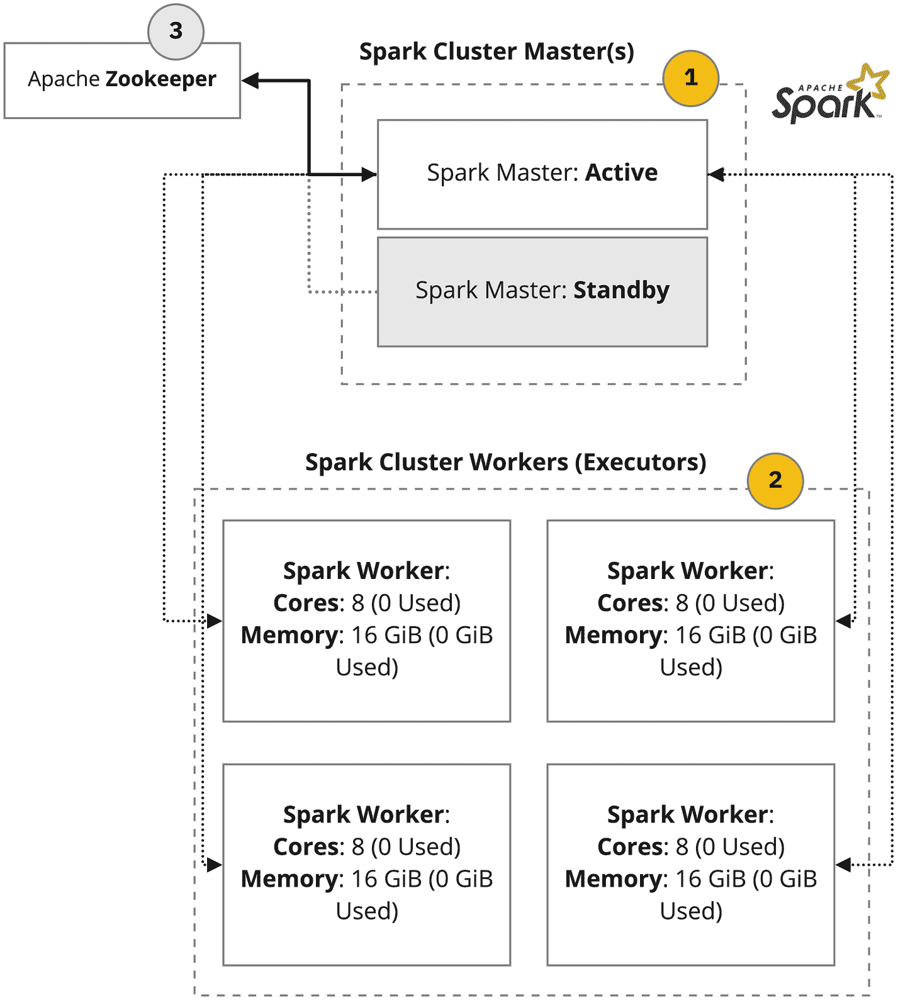

# 14. 在 Spark Standalone 上部署关键任务型 Spark 应用

这是*第一天*。你可能听过人们以复杂的情感谈论*第一天*，从真切兴奋与喜悦，到轻微沮丧，甚至因高压和焦虑而产生的愤怒。任何软件的首次正式发布都注定会引发各种情绪，因为这是*首个*主要发布里程碑。但除了击掌庆贺与祝贺之词外，人们称之为“第一天”的原因在于：这是持续开发与支持周期的起点，是众多版本中的第一个发布。第一天，正是艰苦工作真正开始的地方。

本章致力于确保你的*第一天*顺利进行。你将学习 Spark 应用的各种部署策略，以及一些额外的技巧、窍门和技术，确保你无论潮汐将你带向何方都能做好准备。

## 部署模式

让我们从基础开始。严格来说，在本书中你并未*运行*过很多 Spark 应用。但这并不意味着你之前所做的工作毫无意义，而是迈向应用部署准备过程中的另一个自然步骤。要达到能够部署 Spark 应用的程度，你首先需要理解如何*构建* Spark 应用、使用哪些库，以及如何融合设计模式与最佳实践。

最终，我们必须就哪些流程在起作用（以及工作中）达成共识，例如，要通过配置控制应用的运行时行为，你需要学习 Spark 配置如何被组装、合并和覆盖，从而无需重新编译即可增强应用行为。这项技术使你能够控制应用的诸如处理速率、触发器间隔、检查点目录等属性，并且通过一种元方式（上一章介绍过），你甚至能够接入不同的源和接收器，以利用对替代位置的读写功能。

> **提示**
>
> 出于调试和重放（即数据恢复）的目的，通常会运行结构化流应用的第二个副本，并覆盖其检查点位置和替代的接收器配置。这项技术使你能够在分析并解决问题时，不损坏任何已存储的状态，也不会写入可能最终进入下游系统的重复记录。

能够从外部（由配置驱动）控制应用的行为，为你提供了更多运营关键任务型应用的方式，并能缩短平均恢复时间（MTTR）。尤其是在问题可以通过配置和调优来解决，而无需修复源代码中的错误时。

让我们将注意力转回部署流程。要成功部署应用，我们需要审视核心框架并在其之上构建新层级。本质上，这让我们能够先爬再走，先走再跑，最后先跑再*部署*。那么，*运行应用*和*部署应用*之间有什么区别呢？

### 运行 Spark 应用

在整本书中，你使用 `spark-shell` 和 Apache Zeppelin 构建了大量的纳米级和微型应用。这些执行模式封装了*动态*运行 Spark 应用的模式。通过从一系列代码块（代码）开始构建，并编排基于步骤的例程（程序），你能够通过组合方式即时创建 Spark 应用。这些输出（学习成果）可以转化为完全编译的应用（并包含测试！）。到第 7 章时，我们已经编写了完整应用，并使用容器与托管本地卷挂载（覆盖层）的混合方式，通过 `docker exec` 和 `spark-submit` 在单台机器上（或集群外）*运行* Apache Spark。

*运行*和*部署*之间的区别在于是否存在*物理集群*，或者说，是否缺乏单一故障点来保障关键任务型 Spark 应用的连续性。让我们看看集群模式选项，并学习如何部署 Spark 应用。

### 部署 Spark 应用

*一致性。可靠性。可信赖性。* 如果你依赖某物或某人，失望会令人受伤。类似地，部署你的 Spark 应用（即提交你的驱动程序应用）到外部计算集群上运行，能为你的应用提供容错能力以及其他关键功能，以应对流经你应用的数据洪流（流式或涓流式）中自然的起伏。需要扩展应用以应对增长流量？很好，你可以分配更多机器资源（动态调整，或在静态配置中增加核心数）。缩减资源也是如此。当你的应用处于空闲状态时，你可以释放机器资源并将其归还给集群。

即使在决定在何处、如何以及何时部署你的应用之前，就有许多因素在起作用。让我们先从了解 Apache Spark *资源管理器*以及它们在结构化流应用生命周期中扮演的角色开始这个过程。

### Spark 集群模式与资源管理器

Apache Spark 自带多种开箱即用的资源管理器，其中（在撰写本文时）最流行的是*独立模式*、*Kubernetes* 和 *Yarn* 集群资源管理器。那么，什么是集群资源管理器呢？

集群资源管理器负责许多事项——其中最重要的是维护和管理集群状态，以及提供通用的能力（API）来通信、调度、跟踪、分配和分发计算资源，以供在集群中运行的 Spark Driver 应用程序使用。

从高层次来看，资源管理器监控和观察集群（一个或多个网络连接的计算节点），跟踪物理计算节点的最新统计数据，检查工作节点（或执行器）的状态和健康情况，并本质性地询问节点（或进程）是否仍然存活。此外，资源管理器还会维护一个关于总可调度资源（物理节点、CPU 核心和内存）的状态账本，记录哪些资源尚未被调度，从而使集群资源管理器能够控制或委托批准或拒绝 Driver 应用程序请求额外计算资源的决策。由于集群是动态的，新节点（能够运行 Spark 进程的服务器）可以被添加到集群中，而节点如果失去响应、未通过健康检查或出于任何其他原因离线，也可以被移除。通过确保存在一个通用通道供 Spark 应用程序传达其需求，资源管理器已准备好处理新的资源分配请求——当现有资源丢失，或应用程序负载超出当前计算资源（在不进行横向扩展的情况下）的承受能力并发出求助信号时。

这一切可能让你联想到 CAP 定理以及第 9 章中描述的“惊群效应”问题和多租户问题。像 Kubernetes、Yarn（Hadoop）和 Spark Standalone 这样的分布式系统提供了委托控制系统和服务的机制，而 Spark 的资源管理器都是容错的，能够在各种故障场景下维持一致性并保证可靠性。这一切归根结底，集群资源管理器是基础，它使您的结构化流应用程序能够承受故障（例如服务器离线），并在大多数情况下无需人工干预就能恢复。

我们将在此章讨论 Spark Standalone，并在下一章以 Spark on Kubernetes 作为结尾。如果您对 Yarn 或 Mesos 资源管理器感兴趣，网上有很多很好的资料可以帮助您快速上手，但它们不在本书的讨论范围之内。

## Spark 独立模式

运行一个 Spark 独立集群，对于一个简单的测试集群来说，最少需要三个节点。一个集群协调节点（主节点），以及两个工作节点，它们可以分担一个或多个 Spark 应用程序的工作。独立模式允许您提交 Spark Driver 应用程序（以客户端或集群模式），在底层 Spark 集群的计算资源子集上运行分布式工作负载。

虽然您可以使用最少三个节点来运行，但这样集群不具备容错能力，因为协调器（主节点）可能会离线，导致集群状态消失。对于生产环境用例，以高可用模式运行 Spark Standalone 至关重要。

### Spark Standalone：高可用模式

要实现高可用，就必须具备容错能力，这本质上意味着在故障情况下需要保持可靠和一致。Spark 采用了一种与您之前看到的针对集群状态进行检查点（在第 10、11 和 13 章中）类似的过程。活跃的主节点只需将集群状态写入一个可靠（持久）的原子文件系统（Apache ZooKeeper），而第一个上线并连接到 ZooKeeper 的 Spark 主节点将赢得活跃状态。图 14-1 展示了 Spark Standalone 的高可用（HA）设置，包括 (1) Spark 主节点、(2) Spark 工作节点和 (3) Apache ZooKeeper。

图 14-1 Spark Standalone 集群模式

图 14-1 中的集群图展示了一个六节点集群（不包括 ZooKeeper (`zk`) 集群，由于 Apache ZooKeeper 基于仲裁的架构，该集群需要至少三个节点来实现高可用，因此完全高可用大约需要九台服务器）。从 (1) 开始，两个 Spark 主节点正在监督（监视）集群。一个处于活动状态（视为主节点），而另一个则在备用模式（辅助节点）下等待，准备在当前活动（主）主节点离线时投入行动。 (2) 工作节点（又名执行器）显示在图 14-1 的底部。当工作节点服务上线并向 Spark 主节点注册时，该过程有效地增加了集群的总可用计算资源。集群可以随着工作节点的加入和离开而动态增长和收缩，使 Spark 集群能够处理网络问题，优化性能和成本，并使集群在其他故障中保持连续性。常见的操作，如推送更新、推出新服务或在集群中替换主机（服务器），对任何正在运行的应用程序都影响极小。

#### 故障转移过程

一旦当前活跃的主节点断开与 (3) ZooKeeper 的连接，备用主节点将接过接力棒，从被动状态切换到活动状态，以保持集群存活（故障转移到备用主节点通常需要 1-5 分钟，具体取决于您的网络和集群规模）。

> **警告**
>
> 值得指出的是，只有在故障转移事件发生后，集群才能保持高可用（`HA`），例如，当前活跃的主节点离线，Spark 将被动备用主节点提升为活跃节点。监控节点故障并自动化部署替换节点的过程，对于您所运维的集群的健康至关重要。

如果您确实丢失了集群状态，请不要惊慌。Spark 应用程序将继续运行，无需与集群协调器（主节点）通信，直到某个 Spark 应用程序需要获取新的执行器（在独立模式下，这些执行器运行在工作节点上）为止。这为您恢复集群赢得了时间。因此，如果您自己运行 Spark（并且没有为托管服务付费），请确保您和您的团队针对一个或两个主节点丢失的情况进行实验，并自动化保持集群在故障下持续运行的过程。

默认情况下，在独立集群模式下部署应用程序将允许第一个部署的应用程序消耗集群中的所有资源，除非配置了限制其使用的 CPU 核心和内存。正如您可能想象到的，单个应用程序独占所有集群资源可能会引发问题，但有一些现成的流程可以利用，以确保应用程序之间能够良好协作。这一切都始于应用程序的部署。

应用程序部署从将 Driver 应用程序提交到集群开始，在我们进一步深入之前，理解 Driver 应用程序如何以分布式方式运行非常重要。对于 Driver 应用程序，有两种主要的部署风格，由 `spark.submit.deployMode` 应用程序设置控制。