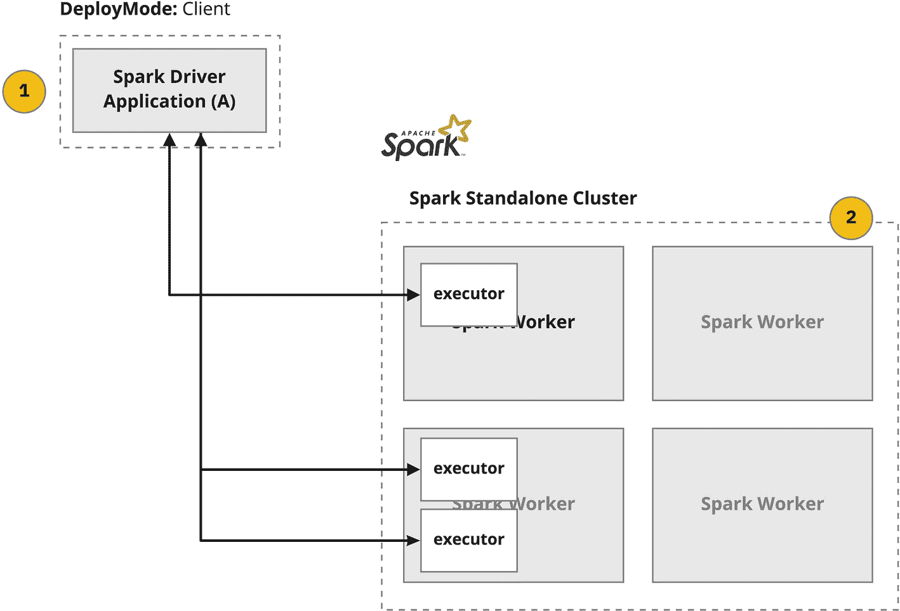
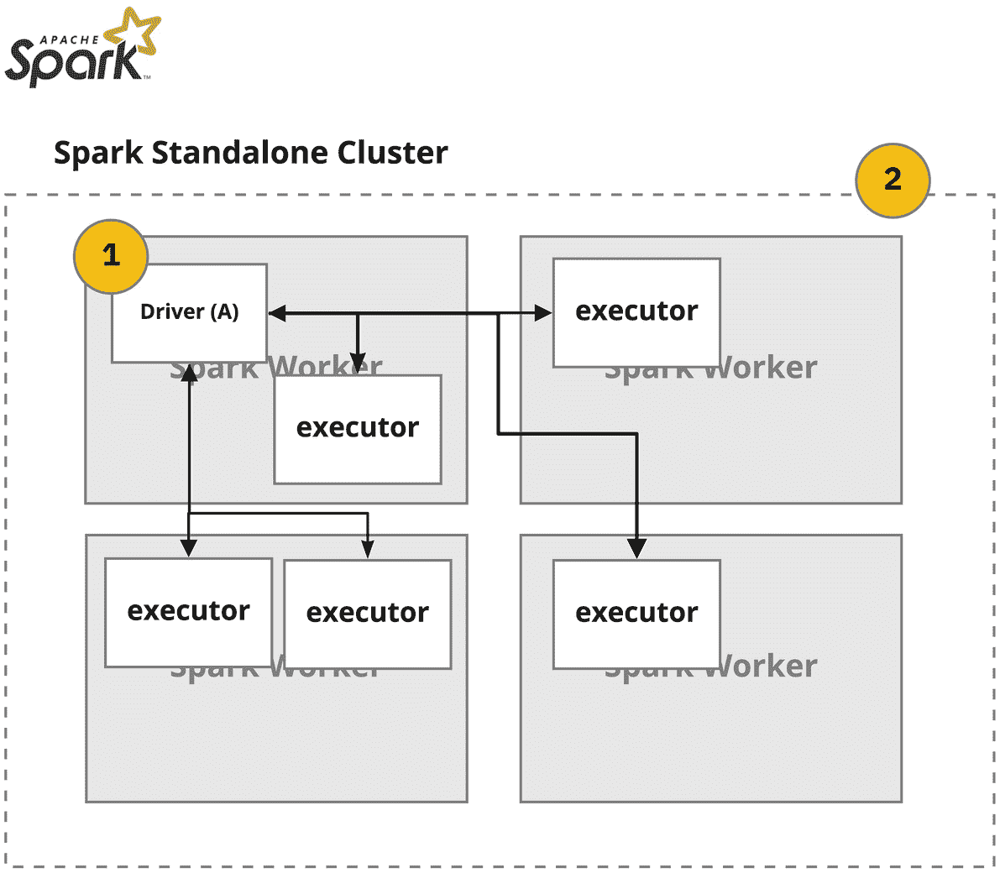
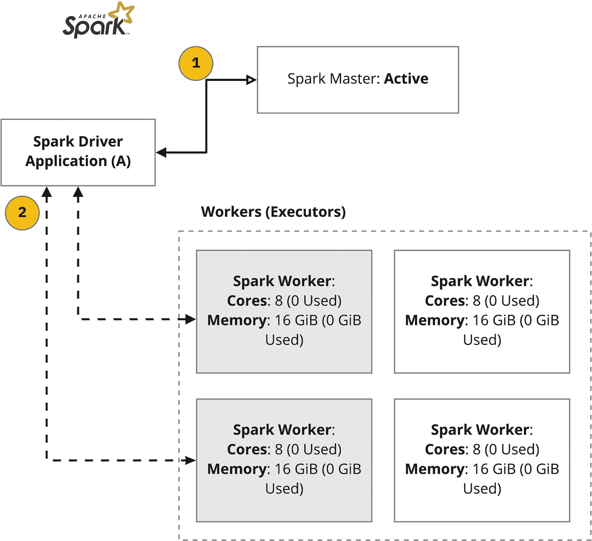
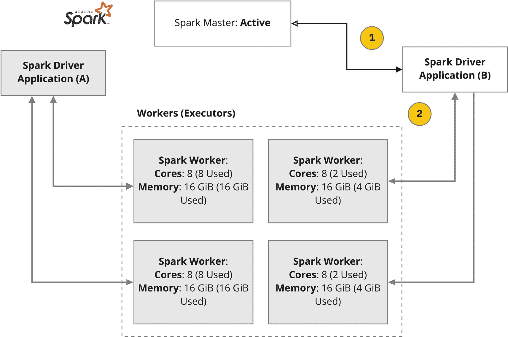

# 部署模式：客户端模式与集群模式

当部署 Spark Driver 应用时，`spark-submit` 配置提供了两种部署方式供选择。我们首先探讨*客户端*模式，然后再了解*集群*模式。

## 客户端模式

在客户端模式下部署 driver，本质上意味着 Driver 程序将在本地机器上*本地运行*，并向 Spark 主节点发出 `spark-submit` 命令。例如，清单 14-1 中的配置来自第 11 章，如果我们更改配置以指向一个活动的独立集群（`--master "spark://{master-hostname}:7077"`），实际上我们是向集群资源管理器声明：我们只希望分配执行器来分担应用工作负载，而 Driver 程序的资源分配我们已经自行处理好了。

```
docker run \
...
-it `whoami`/spark-kafka-coffee-orders:latest \
/opt/spark/bin/spark-submit \
--master "..." \
--class "com.coffeeco.data.SparkKafkaCoffeeOrdersApp" \
--deploy-mode "client" \
...
/opt/spark/app/spark-kafka-coffee-orders.jar
清单 14-1
以客户端模式部署 Spark 应用
```

图 14-2 展示了在客户端模式下，Driver 程序运行在集群外部，而执行器则被分配给该远程应用。



图 14-2

以客户端模式运行的 Spark Driver 应用

将 Driver 运行在 Spark 集群之外有许多原因。其中最主要的三点原因是：

- 保护您的 Spark 应用并将其与集群内“吵闹的邻居”或其他不良行为造成的干扰隔离开来。
- 通过限制对集群外部 driver 的访问，保护机密和凭证不被整个集群访问，这对于运行由众多不同团队生成、具有各种管道需求的工作负载的多租户共享集群至关重要。
- 提供一个已知的主机（端点），用于连接 driver 应用以查看 Spark UI 或生成监控指标。

## 集群模式

在集群模式下部署 Driver 程序，本质上意味着该应用将在 Spark 集群内部远程运行，并接受接收了传入 `spark-submit` 命令的 Spark 主节点的监管。例如，清单 14-2 中的配置是对清单 14-1 的修订。它替换了部署模式的值，同时指定了运行时资源（driver 和执行器）以及特殊的 `supervise` 标志。

```
docker run \
...
-it `whoami`/spark-kafka-coffee-orders:latest \
/opt/spark/bin/spark-submit \
--master "..." \
--class "com.coffeeco.data.SparkKafkaCoffeeOrdersApp" \
--deploy-mode "cluster" \
--driver-memory "2g" \
--executor-memory "4g" \
--total-executor-cores 4 \
--supervise \
...
/opt/spark/app/spark-kafka-coffee-orders.jar
清单 14-2
部署由集群管理的 Spark Driver 应用
```

如前所述，当向集群部署应用时，Driver 程序会*共同部署*在集群内部的某个 worker 上。图 14-3 展示了 Driver 应用如何与集群内其他程序共存，并占用所分配 worker 上可用总资源的一部分。



图 14-3

以集群模式运行的 Spark Driver 应用

考虑到在集群内运行的 Driver 应用的服务等级协议，了解每个共存应用在多租户集群中运行的开销是一个需要牢记的重要事实。如果没有资源来运行 Driver 程序（在发生故障后或因首次部署），那么 Driver 将处于 `Queued` 状态。

正如将 driver 程序运行在集群之外有好处一样，将 driver 运行在 Spark 集群内部也有其优势。本质上，通过消除在集群外部运行外部主机或额外进程的需求，您可以减少运营流式应用或管道基础设施所需的资源面积。此外，对于经过测试且成熟的 Spark 应用，使用 `--supervise` 标志的基于集群的监管，使得应用在崩溃后能够重新启动。

另一方面，如果 Spark 独立集群专用于一个共同的总体任务，例如处理 CoffeeCo 客户订单或合并商店交易和客户事件数据以创建窗口化分析流，那么可以启动集群来解决类似问题，复用已批准的访问权限（遵守数据治理规则和法规）、身份验证、授权以及共享数据访问。

两种部署策略（客户端模式和集群模式）各有利弊。它们允许您使用适合相应应用的 SLI、SLO 和 SLA 的策略。因此，理解如何在一个多租户环境中共享资源至关重要。现在，我们将探讨 Spark Driver 应用如何在独立集群中部署和分发。

## 多租户的分布式共享资源与资源调度

请将 Spark 独立集群视作一个分布式操作系统。您拥有总计的*核心数*（CPU）、总计的*内存量*（RAM），以及每个*节点*、worker（执行器）和 driver 上的磁盘空间，这些资源都在 Spark 进程（*pid*）、操作系统进程（也是 pid！）以及分布式集群中每台服务器上运行的任何其他服务之间共享。

> **提示**
> 使用 Linux 的 `top` 命令可以查看每个服务器上正在运行的进程及其消耗的资源。对于 Docker 的资源开销，可以使用 `docker stats` 命令查看运行中容器的 CPU、内存和网络消耗。

为什么这很重要？很高兴您问这个问题。本质上，您不能现实地期望使用集群中任何*节点*（*主节点、worker、driver*）上 100% 的资源，而不落得两手空空或在操作系统层或应用层面临资源受限的困境。*一条经验法则是至少为操作系统保留 1 个 CPU 核心和 1GB 内存*。您还必须权衡在 Apache Spark 范围之外运行的任何其他进程的成本，例如指标收集器、网络分析器等。一旦您了解了非 Spark 进程所需的开销，就可以配置 worker 的行为，使其友好共存，避免对特定服务器的资源过度贪婪。


### 控制资源分配、应用行为与调度

在多租户（共享）Apache Spark 集群中，可以通过表 14-1 中的 Spark 设置在部署时控制分配给每个运行中 Spark 应用的资源数量。

**表 14-1** 控制 Spark 应用的资源分配与调度方式

| 属性名称 | 默认值 | 功能说明 |
| --- | --- | --- |
| `spark.cores.max` | （未设置） | 限制应用在运行时最多可调度的总核数。若不设置，应用将占用所有可用核心。 |
| `spark.task.cpus` | `1` | 告知调度器 Spark 应用的真正需求。如果存在需要线程池或其他 I/O 的额外 CPU 密集型任务，可考虑将此值提升至 `2` 或更高（取决于每个任务的实际 CPU 消耗）。 |
| `spark.driver.cores` | `1` | 定义运行驱动程序所需的核心（物理 CPU）数量。如果应用通过调用 `collect()` 对 DataFrame/Dataset/RDD 进行最终加工，应设置更高的数值。 |
| `spark.executor.memory` | `1g` | 定义运行 Spark Executor 的 JVM 进程所分配内存的软限制。该值为执行器进程的分配量，在 Standalone 模式下并非硬性限制，即 JVM 可以动态分配更多内存。 |
| `spark.executor.cores` | `ALL` | 此设置需要重点关注，除非另行指定，否则 Spark 应用将占用所有可用核心。对于多租户场景，可以通过将该值设为 `1`、`2` 或 `N` 个核心来共享资源。 |

表 14-1 仅列出了在将应用部署到 Standalone 共享（多租户）Spark 集群时，需要仔细关注的部分重要配置项。

请记住，结构化流式应用是 7x24 小时不间断运行的，因此为每个应用设置资源限制变得至关重要，因为每个应用在其驱动程序启动时就会分配并持有所声明的资源。这意味着，如果应用以静态分配模式运行，总核心数（物理 CPU）和内存（JVM 分配的堆空间）将在启动时一次性被占用。

例如，图 14-4 展示了一个新的 Spark 驱动程序向集群请求资源的流程。这里有四个节点，每个节点都运行着一个 Spark Worker 进程。每个 Worker 拥有 8 个核心和 16 GB 内存，这意味着整个集群共有 32 个核心和 64 GB 内存可供一个或多个 Spark 驱动程序分配。假设 Spark 应用 (A) 的配置如下：



**图 14-4** 新 Spark 应用部署到集群时的协商流程图

```
spark.cores.max: 16
spark.executor.cores: 8
spark.executor.memory: 16gb
```

那么驱动程序将被分配两个执行器实例（JVM），这两个实例将完全占用四个可用 Worker 节点中的两个。换言之，该配置的意思是：“我想要占用整整两个 Worker。”

图 14-4 中的事件序列展示了 Spark 应用部署到集群的过程。它首先与 (1) *活动主节点* 协商，根据应用设置（或集群默认设置）中关于运行分布式工作负载所需的总资源（核心/内存）来 (2) *分配执行器*。在此示例中，我们设置了 16 个总核心的限制，指示集群资源管理器（Standalone 模式下的活动主节点）为该应用分配四个 Worker 中的两个。至此，Spark 集群的 50% 被分配出去，另外 50% 为空闲。一旦执行器通过 `SparkContext` 分配给 Spark 驱动程序，驱动程序就不再需要与主节点通信，除非有执行器丢失（服务器宕机或 JVM 因内存不足而退出），或者启用了 `spark.dynamic.allocation` 并且应用向集群请求或归还资源。

这也意味着，当前集群设置可以轻松处理已分配执行器中断（例如两个 Worker 同时离线）的故障场景。驱动程序 (A) 只需向资源管理器（Spark 活动主节点）请求新的执行器即可——鉴于集群中还有两个完全空闲的 Worker，这个请求是可以被处理的。

我们再看图 14-5 中的例子，该图展示了第二个 Spark 应用加入共享集群的过程。为举例说明，第二个应用将采用以下部署设置。



**图 14-5** 共享集群上的 Spark 驱动程序多租户部署

```
spark.cores.max: 4
spark.executor.cores: 2
spark.executor.memory: 4gb
```

第二个驱动程序将向集群中剩余的两个 Worker（它们还有可供调度的资源）请求资源。至此，所有 Worker 都被安排了执行器。好处是资源浪费更少（因为没有核心或内存被闲置），且集群中运行着不止一个应用；但另一方面，如果此时丢失一个 Worker，会发生什么呢？

在图 14-5 的场景中，如果集群丢失一个 Worker，结果取决于丢失的是哪一个。这里有两种情况。第一种，驱动程序 (B) 会完全运行在一个 Worker 上，因为每个执行器配置了 2 个核心和 4GB 内存。为了继续运行，新的分配将被执行，工作负载转移到另一个有空闲资源的 Worker 上，也就是应用 (B) 已有执行器正在运行的那个 Worker。

第二种情况，如果驱动程序 (A) 丢失了一个 Worker，那么其配置文件所需的所有核心或内存（8 核心 x 16GB 内存）就无法在集群中得到满足。这将导致应用 (A) 以降级状态运行，但至少它仍在运行。

谈到计算资源的调度，一个很好的经验法则是为集群预留一些扩展空间。你可以通过以下方式实现：当集群资源调度超过 75% 时添加新节点；采用自动扩缩组或基于云的规则（如 Amazon Elastic Kubernetes Service 中的托管节点组）；或者更改执行器设置，使每个执行器能够适应不同的配置。例如，将配置改为 4 核 x 8GB，同时保持 16 个最大核心数不变，这样驱动程序 (A) 就会分布在更多 JVM 上，从而在丢失一个 Worker 时仍能正常运行，而不会进入降级状态。

只要有足够的资源来应对故障或扩展，动态分配过程就能实现更具弹性的伸缩。接下来，你将学习如何控制这个过程。

**注意**

下一章将介绍 Kubernetes (k8s) 资源管理器，并学习如何以弹性可伸缩的方式启动 Spark 应用，这同样会用到动态分配。动态分配过程为 Spark 应用程序提供了一种协议，用于根据当前处理的数据量的起伏来请求或归还额外的资源。


### 使用动态资源分配弹性伸缩 Spark 应用

Spark 应用的处理需求会动态变化，这些需求由执行器级别的资源（`cores`/`memory`/*`GPUs`）组成，并会随应用生命周期而改变。为了管理并行运行的众多应用的不同需求，动态分配允许每个 Spark 应用选择启用该功能，并定义适当的设置来控制如何释放和重新分配额外资源。表 14-2 列出了常见的 Spark 配置。

**表 14-2.** 使用动态分配为 Spark 应用启用弹性伸缩

| 属性名称 | 默认值 | 功能说明 |
| --- | --- | --- |
| `spark.dynamicAllocation.enabled` | `false` | 按条件选择是否启用动态资源分配。 |
| `spark.shuffle.service.enabled` | `false` | 要将执行器释放回 Spark 集群，Spark Worker 必须运行*外部 shuffle 服务*，这是动态分配的前提条件。即使执行器仍持有 Spark 应用所需的部分 shuffle（数据），此服务也允许将其释放。 |
| `spark.dynamicAllocation.minExecutors` | `0` | 建议将此值设置为 `1` 或更高，以确保您的应用在等待可用 Worker 分配资源时不会因资源匮乏而停滞。 |
| `spark.dynamicAllocation.maxExecutors` | `INF` | 设置此值可以阻止应用请求集群中所有（可用的）执行器。 |
| `spark.dynamicAllocation.schedulerBacklogTimeout` | `1s` | 当有任务挂起时，驱动程序将等待此时间长度，之后才向主节点请求新的执行器。 |

动态分配实现了对弹性伸缩工作负载的自动化管理，能够根据需求按需从集群请求和归还资源。根据作业（或应用）的优先级或预期表现，动态分配可以有效地管理跨共享计算集群运行多个共置（多租户）工作负载的成本。然而，在启用动态分配时，需要考虑每个应用的不同（动态）需求以及工作负载的优先级，因为很容易出现许多应用处于空闲等待状态，等待集群资源变得可用的情况。

对于 Spark Structured Streaming 应用，每个微批次往往以更频繁的方式处理更少量的数据，这与典型的基于大批次、一次性读取并处理大量数据的应用行为不同。是的，您也可以运行使用 `Trigger.Once` 的有状态批处理作业，但这需要仔细考虑应用的语义以及与应用性质相关的服务等级协议或优先级。

鉴于 Structured Streaming 应用始终在线的特性，动态分配和外部 shuffle 服务有时会干扰并损害您关键任务型流式应用的性能。有时，唯一阻碍应用以最高速度运行的是内部应用调度器，它控制着 Spark Driver 应用内运行的内部（作业）的并行度和处理模式。

### 调度模式：FIFO 对比 FAIR

默认情况下，Spark 应用以 *FIFO*（先进先出）调度模式运行。由于 Spark Structured Streaming 应用采用分而治之的策略处理一个或多个数据源的连续（无界）流，这些流通过微批处理范式（产生确定性、容错的数据集）被分块和分解，因此 Spark Driver 应用会努力确保每个微批次内的每个转换阶段，即由 `StreamingQuery`（例如 `spark.readStream...writeStream.start()`）定义的阶段，能够基于定义流式应用任务的 `QueryPlan` 获得优先级。

那么，如果一个应用有多个 `StreamingQuery` 呢？在上一章中，您了解了 `SparkStructuedStreamingApplication` trait，它包含了以下两个方法：`awaitTermination` 和 `awaitAnyTermination`。

```scala
def awaitTermination(query: StreamingQuery): Unit = {
  query.awaitTermination()
}
def awaitAnyTermination(): Unit = {
  sparkSession.streams.awaitAnyTermination()
}
```

在一个基本的 Spark Structured Streaming 应用中，通常只有一个上游源和一个下游汇。因此，对主 `StreamingQuery` 调用 `awaitTermination` 将使 Spark Driver 应用保持运行，直到该 `StreamingQuery` 终止。对于 `FIFO` 模式调度器来说，这种单一应用关注点是完全没问题的，因为只有一个主要关注点。

然而，一旦您决定在方程式中引入第二个流式查询，您在每个微批次中就需要排队等待资源，这似乎不太公平，不是吗？

幸运的是，Spark 内置了一个 `FAIR` 调度器。这种执行模式允许并行共享资源。这使得单个 Spark 应用内的总资源分配更加均衡。

#### `FAIR` 模式调度器

您可以通过在驱动程序应用配置中设置调度器模式来选择使用 `FAIR` 调度器。

```
spark.scheduler.mode=FAIR
```

除了设置调度器模式之外，Spark 还要求您的应用使用分配文件定义一个或多个调度器池。

```
spark.scheduler.allocation.file="s3a:///path/to/fair-scheduler.xml"
```

调度器分配文件是一个简单的 XML 文件，用于定义一个或多个命名池，并为相应的池定义 `schedulingMode`、`weight` 和 `minShare` 选项。

- **`schedulingMode`**: 此选项默认为 `FIFO`，但也可以设置为 `FAIR`。`FIFO` 会优先处理池中第一个被调度的工作负载，让额外的工作在队列中堆积。`FAIR` 会将工作均匀地分配到池资源中。

- **`weight`**: 池权重声明了在特定池上进行调度的优先级。此优先级默认为 `1`，可以设置得更高以创建用于调度的优先级池（类似于优先级队列）。

- **`minShare`**: 设置给定池的核心分配数量。调度器将首先尝试分配预定义数量的核心，以确保每个池在将任何额外的 CPU 核心资源分配到其余已定义的池之前，都拥有其应有的核心数量。

```xml
<allocations>
  <pool name="FAIR">
    <schedulingMode>FAIR</schedulingMode>
    <weight>2</weight>
    <minShare>2</minShare>
  </pool>
  <pool name="FIFO">
    <schedulingMode>FIFO</schedulingMode>
    <weight>1</weight>
    <minShare>1</minShare>
  </pool>
</allocations>
```

**代码清单 14-3.** `fair-scheduler.xml` 分配文件示例

代码清单 14-3 中的示例配置旨在进一步定义调度模式在各调度器池中的工作方式。由于驱动程序应用使用 `SparkContext` 调度工作，`FAIR` 调度器可用于修改每个 `SparkSession`（重用同一 Spark 上下文）的行为，以管理和共享为 Spark 应用分配的公共集群资源池。


