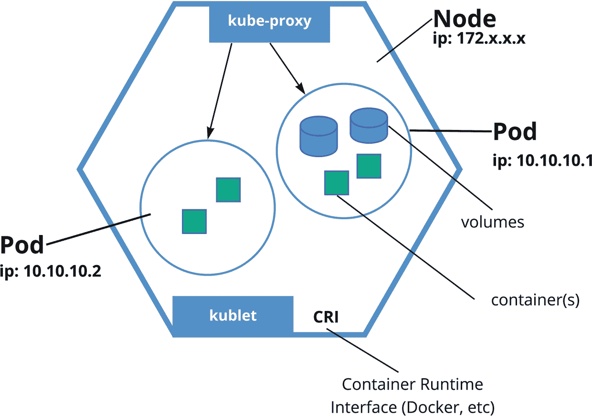

# 使用 Minikube 驱动本地 Kubernetes

Minikube 是一个易于使用的环境（及 Shell），能在虚拟机（Mac/Windows/Linux）中本地运行一个小型专用 Kubernetes 集群。安装说明可在线查阅[`https://minikube.sigs.k8s.io/docs/start/`](https://minikube.sigs.k8s.io/docs/start/)，若使用 macOS 系统，亦可运行`brew install minikube`进行安装。以下侧边栏提供了 minikube 基础命令的补充概览。若想深入了解，可稍后返回本节内容；否则，直接运行`minikube start`即可启动运行。

## Minikube 基础

安装完成后，仅需少量命令即可高效操作 minikube。以下命令可在您选择的终端中运行。

### `minikube start`

该命令会启动一个本地单节点 Kubernetes 集群，并自动下载安装所有额外依赖项。

```
minikube start
```

默认情况下，minikube 虚拟机配备两个（CPU）核心和 2GB（RAM）内存。您可通过多种选项自定义安装并指定 K8s 集群的运行方式。例如，可选择 K8s 版本、分配给虚拟机的总内存以及 CPU 核心数。

```
minikube start \
--kubernetes-version v1.21.2 \
--memory 16g \
--cpus 4 \
--disk-size 80g
```

准备停止工作时，您可以选择保持虚拟机运行，仅暂停 k8s 集群中的进程；也可以选择完全停止集群并回收系统资源。

### `minikube pause`

暂停（Pause）是 minikube 的一项创新功能。您不必完全关闭集群，而是可以选择暂停（冻结）特定资源（由命名空间管理）或暂停所有运行中的内容。暂停特定资源（如本地 Kafka 或 Redis）有助于观察应用程序在服务丢失时的行为表现。

```
minikube pause -A
minikube pause -n kafka,redis
```

### `minikube unpause`

此前暂停的所有容器均可取消暂停。

```
minikube unpause -n kafka, redis
```

若本地系统资源有限，使用`pause`和`unpause`可以成为救命稻草；此外，它们还提供了一种简单机制，可让您恢复至特定的环境配置。这与使用`docker compose`确保 Spark 应用运行所需系统服务可用的方式类似。

### `minikube stop`

当您决定完全停止所有内容并关闭物理虚拟机时，只需使用`stop`命令。

```
minikube stop
```

### `minikube status`

您将不时需要检查 minikube 虚拟机的状态。只需运行`status`命令即可查看环境状态。

```
minikube status
```

至此，minikube 基础速览结束。如需回顾任何基本命令，可返回本节查看。

拥有了本地（单节点）Kubernetes 集群，您即可开始搭建运行 Spark 应用所需的基础框架。

## Kubernetes API 实践之旅

使用任何新工具时，首要目标是理解或至少熟悉其核心运行部件。就 Kubernetes 而言，这意味着理解核心服务、概念和组件。在本节中，您将使用 minikube 安装的`kubectl`直接与 Kubernetes API 交互。

> **提示**

>

> 若需在笔记本电脑上支持多个版本的`kubectl`（用于测试或其他目的），可使用`minikube kubectl --`将命令转发至 minikube 虚拟机内部的`kubectl`。

让我们从核心概念——*节点*开始。

## 节点

[节点](https://kubernetes.io/docs/concepts/architecture/nodes/)是 Kubernetes 集群中可扩展性的核心单元。节点通过集群管理器（K8s 主节点）独立注册并加入集群。新加入的节点通过扩展总可调度资源（CPU 核心和内存）来提升集群的水平扩展能力。同样，退出集群的节点（关闭或故障）会减少集群的总资源，从而实现松耦合的弹性扩展。

## 常见节点服务与职责

集群中的每个节点至少包含三个组件：*kubelet*、*kube-proxy*和*容器运行时*。

### `kubelet`

`kubelet`是一个代理程序（运行在每个节点本地），负责确保节点能够执行其主要目标——保证所有容器在其各自的 Pod 中持续运行。

### `kube-proxy`

`kube-proxy`是一个代理进程，运行在集群的每个节点上。它负责维护网络规则，用于转发进出由`kubelet`管理的 Pod 的数据包。这一关键服务实现了节点级别应用程序与服务之间的集群范围通信，并参与服务层，使外部请求能够被转发至 Pod 中运行的容器。

### 容器运行时

*容器运行时*是一个可插拔接口，扩展了*Kubernetes 容器运行时接口*（CRI）。它支持 Docker 及其他流行的容器运行时。这三个组件——`kubelet`、`kube-proxy`和*容器运行时*——协同工作，支撑集群中的工作负载。它们通过确保每个节点与集群保持松耦合，并主要关注本地的隔离问题（而非集群范围的问题）来实现这一点。

## 查看所有集群节点

要列出集群中的所有可用节点（使用 minikube 时默认有一个节点），可通过`kubectl`对*节点资源*使用`get`动词。

```
% kubectl get nodes
NAME       STATUS   ROLES                  AGE   VERSION
minikube   Ready    control-plane,master   64m   v1.21.2
```

获取到指定节点的唯一节点*名称*后，使用`describe`*动词*查看该节点的元数据。

```
% kubectl describe node minikube
```

`describe node`命令的结果会提供该节点的所有可用信息，包括节点 IP 地址（主机名）、标签（可视为标签）、注解，以及可用和已使用的节点资源（核心/内存等）。我建议当集群中运行更多服务时，再次使用此命令。毕竟，集群中只有一个本地节点时，所有 Pod 和进程都将被调度到该节点上。接下来是*命名空间*。

## 命名空间

命名空间发挥着至关重要的作用：它能够保护并隔离服务组，防止用户误操作；在多团队（多人）于单个联邦 Kubernetes 集群中运行多种工作负载时，实现关注点分离；并可控制对受保护资源（如命名空间范围内的密钥、计算和存储分配）的访问，防止资源枯竭。

根据团队或公司的需求，您可以决定如何管理生产集群。不过，在运行本地开发集群时，我发现按上下文和所有权分离服务非常有用。例如，数据库和其他数据服务位于`data-services`命名空间，而 Spark 应用程序则位于另一个命名空间。通过这种方式，您可以有效隔离运行 Spark 应用程序所需的依赖服务，使其与 Spark 应用运行的命名空间分开。

> **提示**

>

> 在 minikube 中，命名空间还可用于暂停或取消暂停该命名空间中的所有 Pod：`minikube pause -n data-services`。使用此技术可观察 Spark 应用程序的容错能力。

接下来，您将创建`data-services`命名空间。

### 创建命名空间

在创建命名空间（以及 Kubernetes 中的大多数资源和服务）时，你有两种选择。你可以直接使用`kubectl`，也可以提供一个可应用的外部资源配置文件。

使用命令行，执行以下`create`命令。

```
% kubectl create namespace data-services
```

成功执行。你应该会看到`data-services`命名空间已被创建。你可以通过对`namespaces (ns)`资源使用`get`动词来检查可用的命名空间，以确认这一假设。

```
% kubectl get namespaces
```

结果将返回所有活跃命名空间的有序列表。现在，让我们删除刚刚创建的命名空间，以便稍后使用资源文件重新创建它。

### 删除命名空间

通过 Kubernetes API 创建的资源，可以使用相应资源上的`delete`动词来销毁。

```
% kubectl delete namespace data-services
```

接下来你将重新创建`data-services`命名空间，但这是一个重要的步骤，能让你学会以一种无压力的方式管理资源，因为一切都可以重新构建。

### 使用 Apply 创建 Kubernetes 资源

打开你喜欢的文本编辑器（或 IDE），创建一个名为`namespace.yaml`的文件，如列表 15-1 所示。

```
# 使用 kubectl apply 和 delete 管理资源

现在，可以一致地使用 `kubectl` 的 `apply` 动词来创建该命名空间。

```
% kubectl apply -f namespace.yaml
```

## 删除基于文件的资源

任何使用 `apply -f {file}` 创建的资源，都可以使用同一个文件来删除。

```
kubectl delete -f namespace.yaml
```

现在你已经看到了使用 `kubectl` 创建和删除资源的两种不同方式。

> **注意**
>
> 你可能会想，既然命令行更快（也更简单），为什么有人会选择使用文件呢？这个决定可以归结为一致性。如果你希望在实现系统和服务的良好可移植性的同时，维护一个既能在本地轻松运行，也能在云端运行的生态系统，那么你需要一种`简单`的方法来重建（搭建）一个完整的工作环境，而这个过程始于一个持久的蓝图。

接下来，你将学习如何使用新创建的 `data-services` 命名空间，将 Redis 部署到你的 `minikube` 集群中。

## Pod、容器和部署

我们将从一个关于 Pod 的快速介绍开始，然后进行练习。你将亲身体验 Pod 部署是如何工作的，并且作为副产品，你将了解什么是 Pod，以及容器是如何融入其中的。在此过程中，你将学会在容器级别管理集群资源。更棒的是，你还将了解如何使用持久卷来实现有状态（持久）存储。

在你着手将第一个 `Spark Structured Streaming` 应用部署到 `Kubernetes` 的过程中，所有这些步骤都是必要的。正如你将在本章第 2 部分中发现的，Spark 为你做了很多神奇的事情，但如果不了解其组成部分，这种简单性可能会反过来困扰你。

## 什么是 Pod？

Pod 的名称源于自然。比如豆荚中的一颗豌豆，或者一群鲸鱼。在 `Kubernetes` 中，`Pod` 是最小的可部署计算单元。将 Pod 视为一个结构，它为一组一个或多个容器封装了一个隔离的环境，这组容器为底层组的共享资源提供运行时保护（可以想象成保护豌豆的豆荚壳）。这些共享资源包括本地网络（Pod 内部网络，即 `localhost/127.0.0.1`）的共享，以及对共享存储（卷/磁盘空间）的本地访问。所有这些都有一个运行时保证：只有当所有资源请求（CPU/内存/存储）和其他特殊需求在所有容器上都完全满足时，Pod 才会被成功调度。这是 Pod 被认为处于健康状态的必要条件。Pod 与节点的关系如图 15-1 所示。通用组件（本章前面已介绍）包括节点、`kubelet`、容器运行时和 `kube-proxy`，它们协同工作，运行 Pod，并将流量路由到 Pod 内的容器以及从这些容器路由出来。



**图 15-1** Pod 被调度到一个或多个节点上运行，并在物理节点上分配资源，由 `kubelet` 进程控制。

由于每个 Pod 都有自己的本地范围，因此许多 Pod 可以被调度到同一个底层节点上运行，而无需担心在可寻址网络空间内发生冲突。此外，对全局用户空间中共享密钥或受限文件的节点级访问问题，可以在 Pod 级别进行管理，从而使安全性和关注点分离变得更加容易。Pod 通过分离跨共享集群以及同一物理节点上运行的工作负载，引入了一种很好的范式。

根据设计，在 Pod 中运行的容器不能打破隔离，也不能触及在同一节点上运行的其他 Pod。这从安全角度来看会引发担忧，而且也会破坏松耦合的概念，因为 Pod 首先需要知道其他 Pod 的存在。好的，这听起来很棒，但为了真正理解 Pod，我们将创建一个 Pod 规范来运行 Redis。

## 创建 Redis Pod 规范

在第 10 章中，你了解了通过 `docker compose` 运行 Redis。让我们重新回顾一下该章练习中 `docker-compose.yaml` 文件的 Redis 服务，然后将该配置转换为 Kubernetes Pod 规范。列表 15-2 提供了第 10 章中的 Redis 服务。

```
services:
  redis:
    image: redis:6.2
    container_name: redis
    hostname: redis
    ports:
      - 6379:6379
    healthcheck:
      test: ["CMD", "redis-cli", "ping"]
      interval: 5s
      timeout: 30s
      retries: 50
    restart: always
```

**Listing 15-2** 基于 Docker Compose 的 Redis 服务

以 `docker compose` 服务配置为思维模型，让我们创建一个简单的 Redis `PodSpec`，然后启动该 Redis Pod。列表 15-3 提供了所需的配置。打开你喜欢的编辑器，创建一个名为 `redis-pod-basic.yaml` 的新文件，并添加列表 15-3 中的内容。

```
apiVersion: v1
kind: Pod
metadata:
  name: redis-basic
  namespace: data-services
  labels:
    app: redis
    type: basic
spec:
  restartPolicy: OnFailure
  containers:
    - name: redis
      image: redis:6.2
      imagePullPolicy: Always
      ports:
        - containerPort: 6379
          protocol: TCP
      resources:
        limits:
          memory: "1G"
          cpu: "2000m"
        requests:
          memory: "500Mi"
          cpu: "1000m"
```

**Listing 15-3** 用于配置和启动 Redis 的基本 `PodSpec` (`redis-pod-basic.yaml`)

列表 15-3 中的 Redis `PodSpec` 创建了一个具有唯一名称的 Pod 模板。我们之所以称之为 `PodTemplate`，是因为它可以用来启动一个或多个 Pod。从顶部开始，我们首先为我们的 *Pod 资源*（`kind: Pod`）指定 `K8s apiVersion`。通过声明 API，`Kubernetes` 可以自由地支持或弃用旧版 API，而无需强制收敛。

### 元数据

接下来，使用 `metadata` 属性为我们的 Pod 分配一个唯一名称（`redis-basic`），并添加可用于调度和定位我们 Pod 的配置。在本例中，我们分配了 `data-services` 命名空间，并添加了一些标签，我们以后可以使用这些标签来定位特定的 Pod 子集，或者在命名空间内隔离单个 Pod。
```