# 6. 数据发现与 Spark SQL 目录

能够连接并处理大多数公司现代技术栈中包含的数据系统和服务，是数据工程师的一项关键技能。幸运的是，Spark 提供了处理和转换数据的机制，使您能够采取行动并解决问题，而无需编写和维护另一套自定义基础设施代码。通过依赖 Spark 的核心能力，您学会了利用 `JDBC` 的强大功能与传统数据库中存储的数据进行互操作。访问任何兼容 `JDBC` 的 `RDBMS`，使您能够一次性编写 `SQL` 查询，这意味着您无需为支持具有不同业务逻辑的独立应用程序而烦恼。

本章延续了第 5 章的学习内容。这将是我们首次探讨如何结合使用数据湖和关系数据库来填充 `Spark SQL` 目录的内容。此过程使您能够为数据源添加丰富的元数据注释，这些元数据描述了 `Spark` 应用程序生成的表。这些上下文信息详细说明了数据管道的输入和输出格式，还可以扩展用于自动生成数据血缘图，或用作内部乃至外部数据目录的通用数据可发现性服务。这不仅对您和您的团队至关重要，对数据组织中任何希望重用或分析 `Spark` 作业输出数据的其他成员也同样宝贵。

在本章的最后，我们将通过扩展之前的练习，使用 `Spark` 的强类型数据集，来了解 `Spark` 如何优化您的转换流程。这个最终练习将向您介绍 `Spark` 如何编码应用程序代码的意图，并通过内部的 `Catalyst` 优化器，神奇地生成并优化从开始到结束运行应用程序所需的逻辑执行阶段。

本章分为以下几个部分：

- `Hive Metastore` 与 `Spark SQL` 目录
- `Catalyst` 优化器
- `Spark` 数据集

## 练习内容

您可以在本书 `GitHub` 仓库的 `ch-06/` 文件夹中找到本章所需的材料，地址为 [`https://github.com/newfront/spark-moderndataengineering`](https://github.com/newfront/spark-moderndataengineering)。只需使用运行脚本启动环境，然后访问 `http://localhost:8080` 即可。

```
cd ch-06/docker && ./run.sh start
```

## 数据发现与数据目录

在上一章中，我们探讨了在 `Apache Spark` 中通过 `JDBC` 连接数据库（`RDBMS`）是多么容易。虽然我们能够连接到为练习而启动的数据库，但有一个主要问题可能会在日后造成麻烦。这个障碍具体是：如果事先不了解数据库的位置、数据库中物理表所代表的数据类型，以及这些数据在底层表模式中的表示方式，那么简单的数据发现行为几乎就不存在。然而，数据发现实际上是数据驱动型企业成功的关键，作为数据工程师，这确实应该引起您的重视。

### 数据目录为何重要

数据发现可能看起来不是我们当前需要立即关注的问题，因为本书上下文中我们正在处理的数据，仅代表一家虚构公司初始客户数据库中的少量客户、少量咖啡品牌及一些基本元数据（以浓度表示的烘焙程度）、少量门店以及白天每家门店客流量的部分信息。然而，在现实世界中，数据发现问题是一个更为重大的关切。让我为您描绘一下这个场景。

### 数据的一厢情愿

随着任何公司的发展，新员工的加入自然会导致小团队扩张。随着团队持续壮大，在某个节点上，团队自然会发生分叉，再次拆分成更小的团队，并拥有更具体的职责范围和关注领域。由原团队成员组成的新团队，会随着公司的有机增长而继续这种成长与分裂的循环。在一段时间内，团队可以依赖部落知识，或者依赖在公司长期积累但文档记录不足的流程，而跨团队沟通使得团队能够直接分享部落知识、数据位置、表结构和原始数据格式。

出于某种原因，许多初创公司，甚至一些非常成熟的公司，都陷入了这样一种想法：在云时代，团队能够更加敏捷、快速行动，甚至打破常规，以跟上令人目眩的创新步伐。这样一来，工程师和产品经理很容易跳过或忽视详尽文档和软件测试这一步骤。这种做法不言而喻的副作用是，技术债务很容易堆积，成为难以启齿的隐患。这是为了公司持续向前发展而必须承担的风险！不幸的是，历史往往会重演，这种高额的技术债务可能导致流程和模式迅速变得不可持续。

随着公司发展壮大、收购新公司、工程师更替、部门重组，以及其他跨团队/跨项目数据平台的出现，过去依赖部落知识，或者期望团队等待核心团队成员回复 `Slack` 消息、加入视频会议，甚至亲自到场，来引导新团队了解过时流程的做法，会变得对公司及其员工的福祉有害。在处理数据时，清晰的文档和已建立的跨职能工作方式显得尤为重要。

对于数据团队而言，依赖手动沟通数据模式变更，或者玩那种古老的“传话游戏”（你知道的，鲍勃告诉爱丽丝，爱丽丝又告诉我，`X` 团队正在更改他们的数据格式），会带来巨大的成本和进展阻碍。不可靠的流程在压力下会迅速崩溃，其副作用是，将原本核心、可靠的数据变成了不可靠、不可信的数据。对某个数据库表的模式，或数据湖中记录的原始格式的变更沟通不足，将导致生产中断，因为团队可能甚至不知道谁依赖于他们的数据，或者谁会受到上游破坏性变更的影响。中断意味着人们会生气，然后开始互相指责。这是一个转折点，一个分岔路口，也是当公司达到一定规模时，数据平台、集中化流程和其他“做事方式”出现的原因之一。

### 数据目录来救场

幸运的是，在公司内部环境之外，存在着标准的做事方式。就像大多数设计模式一样，人们遵循它们是因为它们可以节省时间，并避免在事情崩溃时遭受打击带来的潜在痛苦。我之前描绘的画面，是当公司内部核心数据层的信任崩溃时可能发生的最坏情况。事实是，数据文档与任何 `API` 文档同等重要。这些基于元数据的数据定义代表并充当了一个集中式契约，规定了如何、何时以及为何消费和使用表中存储的数据。而实现这一目标最广泛使用的标准方法之一，就是使用 `Apache Hive Metastore`。

## Apache Hive Metastore

`Hive Metastore` 最初是为了提供重要的元数据而构建的，这些元数据可用于简化不同团队处理其数据湖中分布式数据的方式。这些伪表定义映射了关键缺失的信息，包括与存储在这些分布式 `SQL` 表中的数据进行互操作所需的模式、分区、编码器和解码器。

这些元数据在运行时被用作粘合剂，使 [Apache Hive](https://cwiki.apache.org/confluence/display/Hive/Home) 能够对存储在 `HDFS` 中的数据运行类似 `SQL` 的分布式查询。回顾第 1 章，我们讨论了分布式文件系统、数据管道和 `ETL` 的出现。曾几何时，对于使用 `MapReduce` 编写和维护 `ETL` 作业的数据工程师来说，`Apache Hive` 简直是天赐之物。

大数据实际上只是一种用于存储、处理和查询大规模分区且完全分布式数据的技术，这些数据无法放入传统的 `SQL` 数据库中。`Hive` 提供了一种机制，让人们可以像对待传统数据库那样对待这些分布式文件系统，即将其视为带有模式的表。这使得数据工程师能够专注于将数据摄入 `HDFS` 的管道、将数据表示为具有代表性数据结构和模式的表，以及将所有这些信息汇总到每个分布式 `Hive` 表的表定义中的数据血缘信息。

这些表元数据存在于 `Hive Metastore` 中，并提供了描述每个 `Hive` 表的谁、什么、哪里和为什么的关键信息。此外，元数据存储使有权限访问它的团队能够发现新表，并找到重用此分布式数据仓库中可用数据的新途径。所有这一切都无需依赖大量的跨团队沟通、冗长的会议和分享部落知识，就能开始高效工作。

### 具有现代风格的元数据

如今，`Hive Metastore` 依然健在且运行良好，但其用途已与最初设计有所不同。现在，典型的做法是运行元数据存储，却从未打算使用 `Hive` 本身。这种变化可以被视为一种演进，它与现代数据技术栈中的其他变化同步发生。基于云的分布式对象存储（如 `Amazon S3` 和 `Azure Blob Storage`）的日益普及，使得行业焦点从 `Hadoop` 和 `HDFS` 转移开来。

类似的迁移也发生在公司身上，它们正在远离许多较老的 `Hadoop` 技术，比如 `Hive` 本身。在第 2 章中，你了解到 `Spark` 是如何从 `MapReduce` 成功的精华中诞生的。它改变了核心执行模型，以在内存中重用计算，并允许对同一数据进行多次迭代，而无需显式返回数据源，这本身就是一次自然的技术演进。

类似于回收利用的概念，生态系统只是重用了 `MapReduce` 的组件，但做了一些改变。`Spark SQL` 和 `Hive` 之间的关系也是如此。`Spark SQL` 完全有能力作为一个功能完备的 `SQL` 引擎运行，并且正如你即将亲身体验的那样，它也可以利用 `Hive Metastore`。虽然它可以与 `Hive` 互操作，但它自己也能运行得很好。

## 练习 6-1：使用 Hive Metastore 增强 Spark SQL

`Hive Metastore` 为描述表的位置、数据编码（例如 `Parquet`、`ORC`）、列式模式以及统计信息提供了单一可信源，旨在实现数据民主化，供数据工程师、分析师、机器学习工程师和数据科学家等人员使用。借助 `Metastore`，人们无需四处询问或大海捞针就能找到数据集！

下一节将引导您完成启动并运行 `Hive Metastore` 所需的五个简单步骤。与上一章的练习类似，您可以使用章节源材料实时运行所有内容。

### 引导选项

`run.sh` 提供了一个引导选项。如果您只想引导此环境而不关心所有曲折细节，我保证我不会介意。标题为“6_1_HiveMetaStore”的 Apache Zeppelin 笔记以 `Bootstrap the Environment` 开头，它将引导您完成命令和设置。您可以跳到 Spark SQL Catalog 部分，稍后再回到本节以获取有关初始化数据库表、用户权限和 Spark 配置的更多信息。

## 配置 Hive Metastore

配置 Hive Metastore 需要几个步骤，让我们从让它在 Spark 上下文中工作开始。幸运的是，这些步骤相当简单：

1.  创建 `metastore` 数据库。
2.  授予您的 MySQL 用户对该数据库的访问权限。
3.  创建数据库表。
4.  配置 Spark 环境以访问 `metastore`。
5.  为 Spark 环境提供 Hive 依赖项。

这些步骤应该不会太多。实际上，Spark 能够运行 Hive Metastore，而无需运行任何额外的服务（或容器）。唯一真正的要求是您已初始化数据库和表，并已授予您的 Spark `dataeng` 用户对数据库的访问权限。

## 创建 Metastore 数据库

为了简化在完成实际 `metastore` 数据库创建后初始化 Hive Metastore 表的过程，表定义 SQL 文件已提供在章节的 `exercise` 目录中。`docker file copy` 命令已包含在 `run.sh` 中。命令行参数 `hiveInit` 将代表您将必要的文件复制到正在运行的 `mysql` 容器中。只需执行清单 6-1 中的命令即可。

```
cd /path/to/ch-06/docker &&
./run.sh start &&
./run.sh hiveInit
```

启动章节练习环境并初始化 Apache Hive Metastore。

`hiveInit` 命令将运行以下两个 Docker `copy` 命令。

```
docker cp hive/install/hive-schema-2.3.0.mysql.sql mysql:/
docker cp hive/install/hive-txn-schema-2.3.0.mysql.sql mysql:/
```

### 连接到 MySQL Docker 容器

使用以下 `docker exec` 命令登录到容器上下文。

```
docker exec -it mysql bash
```

### 以 root 用户身份认证 MySQL 用户

登录到本地 MySQL 容器后，使用 `mysql` shell 以 MySQL root 用户身份进行认证。

```
mysql -u root -p
```

`MYSQL_ROOT_PASSWORD` 值可以在 `ch-06/docker/docker-compose-all.yaml` 中找到。

### 创建 Hive Metastore 数据库

进入 `mysql` shell 后，继续创建 `metastore` 数据库。

```
mysql> CREATE DATABASE `metastore`;
```

现在数据库已创建，是时候授予您的 Spark `mysql` 用户访问权限了。

### 授予对 Metastore 的访问权限

授予 `dataeng` 用户对 `metastore` 数据库的访问权限。

```
REVOKE ALL PRIVILEGES, GRANT OPTION FROM 'dataeng'@'%';
GRANT ALL PRIVILEGES ON `default`.* TO 'dataeng'@'%';
GRANT ALL PRIVILEGES ON `metastore`.* TO 'dataeng'@'%';
FLUSH PRIVILEGES;
```

**提示**：通常的做法是创建特定于用例的用户来管理对 Hive Metastore 数据库的访问。应根据应用程序的访问模式，授予用户对 `metastore` 的读/写或只读访问权限。许多应用程序仅消费数据，并将表数据复制到 Hive Metastore 上下文之外的不同位置。请记住，数据访问是一种特权！

您现在已完成 `root` 用户会话。您应该退出此会话，并以 `dataeng` MySQL 用户身份重新登录。

```
mysql> exit
```

## 创建 Metastore 表

我们即将完成 `metastore` 的设置。接下来要做的是创建底层的 Hive Metastore 表本身。配置 `metastore` 数据库表需要一次性设置成本。幸运的是，我们可以直接将表定义导入到 `mysql` 控制台中。

### 以 dataeng 用户身份认证

在 MySQL 容器上下文中，将您的认证 MySQL 用户更改为 `dataeng`。

```
mysql -u dataeng -p
```

### 切换到 Metastore 数据库

```
mysql> use metastore;
```

### 导入 Hive Metastore 表

`SOURCE` 命令可用于轻松读取和应用适用于我们 Hive 版本（v2.3.0）的 SQL 表配置命令。此文件在 `mysql` Docker 容器中可用，因为您在设置过程的早期使用了 `hiveInit` 命令。

```
mysql> SOURCE /hive-schema-2.3.0.mysql.sql;
```

就是这样。您现在是一个全新安装的 Hive Metastore 的快乐拥有者。如果您想查看在此过程中初始化了哪些表，可以从当前的 MySQL 会话运行以下命令。

```
use metastore;
show tables;
```

运行 `show tables` 命令将产生一长串表名（超过 50 个）。您可以随意使用 `DESCRIBE` 命令查看任何表以获取更多上下文，或者直接退出控制台。现在，您的 `metastore` 已准备好投入使用。接下来，我们将添加 Spark 访问 Hive Metastore 所需的配置。

## 配置 Spark 以使用 Hive Metastore

Hive Metastore 传统上通过 `hive-site.xml` 进行配置。Spark 会自动在 `$SPARK_HOME` 目录下的 `conf` 目录中查找此配置文件。此文件及其他文件已为您预先配置好，并可在 `ch-06/docker/spark/conf/` 目录下的 `exercise` 文件中找到。

如果您现在不想查看配置，可以跳过本节，直接转到 Spark SQL Catalog。

### 配置 Hive Site XML

`hive-site.xml` 文件仅包含四个属性。它们为 Spark 提供了将在您的应用程序中使用的 Hive Metastore 数据库的默认连接属性。这些属性如表 6-1 所示。

**表 6-1** Hive Metastore 配置选项

| 属性 | 描述 |
| --- | --- |
| `javax.jdo.option.ConnectionURL` | 定义到您的 `metastore` 的 JDBC 连接 URL。 |
| `javax.jdo.option.ConnectionDriverName` | 定义用于连接到 `metastore` 的 JDBC 驱动 `ClassName`。 |
| `javax.jdo.option.ConnectionUserName` | 定义 `metastore` 数据库用户名。 |
| `javax.jdo.option.ConnectionPassword` | 定义 `metastore` 用户的密码。 |

官方 Hive 文档中提供了更多配置选项，包括对共享 Hive Metastore 的不同访问模式。这些包括运行完全独立的 Hive Metastore 服务器（v3.x 及以上版本）以及 *Hive Thriftserver*，以及如何为域分片提供多个 thrift URL，这有助于减少因过多连接到单个 Hive Metastore 实例而导致的拥塞。由于 `metastore` 是无状态的，这意味着服务本身不存储物理状态，您可以简单地创建多个前端服务，以便对 thrift 服务器的连接进行负载均衡，然后连接到底层的 `metastore` 数据库。

### 配置 Apache Spark 以连接到外部 Hive Metastore

您刚刚了解到 Apache Spark 使用 `hive-site.xml` 文件连接到 Hive Metastore。练习开始时我们没有提到的是，所有必需的配置都已为您提供在练习的 `conf` 目录中。然后，该目录通过 `docker-compose-all.yaml` 文件挂载到 Docker 环境中。

这意味着您无需将任何文件复制到`$SPARK_HOME`位置。打开 Docker Compose 文件`/ch-06/docker/docker-compose-all.yaml`，查看`services:zeppelin:volumes`部分以了解更多详情。

在`ch-06/docker`目录的上下文中，以下三个目录被挂载为卷：

- `/spark/conf` – 此目录包含`spark-defaults.conf`和`hive-site.xml`。
- `/spark/jars` – 此目录包含我们启动 Spark 时希望在本地包含的所有 MySQL JDBC 驱动程序 JAR 包。
- `/spark/sql` – 此目录被挂载，以便我们可以将其用作 Spark SQL Warehouse 的根目录。

`spark-defaults.conf`文件是一个可选文件，可用于覆盖在该 Spark 安装上下文中运行的所有 Spark 作业的默认 Spark 配置值。对于当前的用例，我们只关心表 6-2 中详述的七个属性。

**表 6-2** Hive Metastore 配置属性

| Spark 属性名称 | 描述 | 示例 |
| --- | --- | --- |
| `spark.sql.warehouse.dir` | 读取和写入分布式 SQL 表的默认位置。此位置可以位于本地文件系统或任何兼容 HDFS 的文件系统上。 | `hdfs://metastores/hive/` `file:///spark/warehouse/` `s3a://your-bucket/hive/` |
| `spark.sql.catalogImplementation` | 定义 Spark 会话的后端 SQL 目录。 | `hive` |
| `spark.sql.hive.metastore.version` | 定义 Metastore 的 Hive 版本。 | 2.3.7 |
| `spark.sql.hive.metastore.jars` | 定义要加载到 Spark 类路径中的 Hive JAR 包的位置。Spark 默认使用内置的 JAR 包。 | `builtin`、`maven` 或 `/path/to/the/jars` |
| `spark.sql.hive.metastore.sharedPrefixs` | 用于搜索和加载特定版本 Hive Metastore 的逗号分隔的类名前缀。 | `com.mysql.cj.jdbc`、`com.mysql.jdbc`、`org.postgresql` |
| `spark.sql.hive.metastore.schema.verification` | 如果设置为`true`，则 Spark Metastore 版本必须与 Hive Metastore 中`VERSION`的值匹配。 | `true` |
| `spark.sql.hive.metastore.schema.verification.record.version` | 如果设置为`true`，Spark 将针对 Hive Metastore 中发布的内容强制执行记录级模式验证。 | `true` |

表 6-2 中描述的配置已在章节练习的`spark-defaults.conf`文件中预先配置。为简单起见，我们使用标准的 Hive 内置 JAR 包（撰写本文时为 v2.3.7）。

### 使用 Hive Metastore 进行模式强制

值得指出的是，Hive Metastore 可以作为写入分布式表的应用程序之间任何模式争议的可靠仲裁者。这意味着不良数据不会污染您的数据湖。这是使用 Hive Metastore 的众多原因之一。此选项通过`spark.sql.hive.metastore.schema.verification.record.version`设置进行配置（如表 6-2 所述）。

> **注意：** 您可以使用表 6-2 中的配置升级与 Spark 一起使用的 Hive Metastore 版本。具体来说，使用`spark.sql.hive.metastore.jars`和`spark.sql.hive.metastore.version`属性。您可以从官方 [Apache Hive 网站](https://hive.apache.org/downloads.html) 下载所需的 Hive Metastore JAR 包，以运行替代版本的 Hive Metastore。

### Spark 默认配置

`spark-defaults.conf`文件中定义的默认值使我们能够“一次定义”特定的集群范围设置，这些设置将自动应用于在默认值上下文中启动的任何 Spark 应用程序。在我们的案例中，这意味着在 Zeppelin 环境中启动的任何应用程序。可以使用应用程序级覆盖或在应用程序启动时提供显式配置`--conf`值来显式覆盖默认值。

#### 使用 Spark 默认值保护集群

您可以将默认配置值视为重要的通用设置，这些设置提供给您的 Spark 应用程序，以利于应用程序运行时并保护集群中运行的其他应用程序。

例如，如果您正在管理或运行自己的 Spark 集群，您很可能需要平衡运营成本，并且通常会部署一个固定大小的集群，该集群考虑了将按日或按小时运行的应用程序的需求。此外，您还需要考虑这些是批处理应用程序还是流式应用程序，以及应用程序是 IO 密集型还是 CPU 密集型。然后，启动到集群中的每个应用程序都可以从集群总资源中获取固定或动态数量的资源（最小/最大份额）。如果所有应用程序都尊重其他应用程序资源的边界，那么这种策略可以很好地发挥作用。

#### 提供默认限制

鉴于每个应用程序可以从共享集群资源中请求非固定数量的资源，至少可以说，集群管理可能很困难。尤其是当您期望数据管道中的每个作业都能运行时。因此，在设置应用程序可以消耗的资源总数的预定义限制时，采取高度防御性的措施变得非常重要，因为并非每个应用程序都需要相同数量的计算核心或 RAM 才能成功运行。这就是默认值发挥作用的地方。这里的妙处在于，应用程序所有者实际上需要了解某些配置的工作原理才能覆盖它们，根据我的经验，许多应用程序可以在默认的少量核心和 RAM 上正常运行。

例如，如果您考虑常见的 T 恤尺码方法（S、M、L、XL），一个小型应用程序可能包含以下内容：

```
spark.cores.max 8
spark.executor.cores 1
spark.executor.memory 1g
```

此配置会将一个应用程序固定到八个计算核心和八个运行 1GB JVM 大小的执行器上。

通过让其他应用程序所有者更容易地声明共享集群的一部分，或者在像 Kubernetes 这样更动态的环境中，有许多配置选项可以简单地抽象到默认值中。第 14 章介绍了使用 Spark Standalone 部署应用程序，第 15 章介绍了使用 Kubernetes 部署应用程序。

### 生产环境 Hive Metastore 注意事项

使用外部 Hive Metastore 的好处在于，你的表定义将在 Spark SQL 会话之间持久保存。如果没有为`SparkSession`提供`hive-site.xml`，则会使用 Derby 创建一个本地 Metastore。基于 Derby 的 Metastore 不适用于生产环境，且只能与单个`SparkContext`配合使用，你可以将其理解为“单一位置”。

同样值得指出的是，Hive Metastore 并非直接与 MySQL 绑定。大多数常见的关系型数据库（MS SQL Server、MariaDB、Oracle 和 Postgres）也受支持。有关配置和使用其他外部关系型数据库的更多信息，你可以在线查看管理手册。

最后，为了运行生产级、高可用的 Metastore，必须防范任何单点故障，包括底层数据库本身。运行兼容 SQL/JDBC 的托管式云数据库，例如 [Amazon Aurora DB](https://aws.amazon.com/rds/aurora/%253Faurora-whats-new.sort-by%253Ditem.additionalFields.postDateTime%2526aurora-whats-new.sort-order%253Ddesc) 或 [Google Cloud Spanner](https://cloud.google.com/spanner)，为减少在没有资深 DBA 的情况下运营数据库时可能出现的故障提供了良好选择。如果你不具备自行运维的条件，建议使用任何具备监控、备份和自动故障转移功能的完全托管型关系型数据库，而不是自行搭建。

### 练习 6-1：总结

这个初始练习引导你完成了引导 Hive Metastore 以创建外部、可靠的 Hive Metastore 的过程。现在你已经完成了 Hive Metastore 的引导、`hive-site.xml` 文件的配置以及 `spark-defaults.conf` 文件的准备，接下来可以专注于 Spark SQL Catalog，并学习如何使用外部 Hive Metastore 来驱动更可靠的 SQL 体验。

## Spark SQL Catalog

`Spark SQL Catalog` 是 Spark 内部的 SQL 元数据管理器。Spark SQL Catalog 提供的功能为处理数据库、临时表或托管表、视图、函数等提供了资源。你刚刚了解了 Hive Metastore；Spark SQL Catalog 提供了简单的抽象，使你能够轻松地与 Hive Metastore 进行互操作。如前所述，确保你生成的数据以自文档化的方式呈现，以便其他团队能够按需获取数据，而无需再安排会议来理解 `wU35` 或 `l2W` 这些列的含义（当然，它们分别代表 35 岁以下女性和最近两周），这对于数据平台和组织目标的成功至关重要。显然，代号并不会让数据团队的工作变得简单。如果每个表定义都有模式支持，并且每个列不仅存储数据类型，还存储简短的注释，那么使用你表的其他工程师就可以通过 Spark SQL Catalog 以自助方式了解你的数据。

### 练习 6-2：使用 Spark SQL Catalog

Spark SQL Catalog 可直接通过 `SparkSession` 访问，并提供了许多有用的方法来检查数据仓库和数据湖中可用的数据。

**注意**

请使用标题为`6_2_SparkSQLCatalog`的 Zeppelin 笔记跟随本练习。与之前的章节一样，在笔记中创建一个新段落，并使用 `%spark` 代码块来构建工作笔记。

#### 创建 Spark Session

让我们学习从头开始创建 `SparkSession`。使用代码清单 6-2 中的代码片段，在你的 Zeppelin 笔记中创建一个新段落并运行它以生成 `SparkSession`。

```
%spark
import org.apache.spark.sql._
val sparkSessionHive = SparkSession.builder
.master(spark.conf.get("spark.master"))
.config(spark.sparkContext.getConf)
.appName("hive-support")
.enableHiveSupport()
.getOrCreate()
代码清单 6-2
创建支持 Apache Hive 的新 SparkSession
```

我们刚刚创建的 `SparkSession` 可用于进一步探索 Spark SQL API。接下来，我们将通过一个有趣的探索过程来使用 `SparkSession`。鉴于我们在数据库（本地 MySQL 数据库）中有数据，第一个探索领域将是列出并查看可用的内容。

#### Spark SQL 数据库

刚开始时，我们知道希望能够查找并找到可用的数据库。这个过程可以利用我们熟悉的老朋友 SQL，帮助我们站稳脚跟并理解 SQL Catalog 的功能。

##### 列出可用数据库

```
%spark
sparkSessionHive
.sql("show databases;")
.show
```

此方法允许我们查看可用的数据库。在我们的例子中，只有 `default` 数据库。你可能注意到了一条明显缺失的信息。你能发现它吗？也许问问自己 `default` 到底是什么意思？这是指上一章中我们命名为 `default` 的 MySQL 数据库，还是其他含义？

要了解更多信息，你需要深入 Spark SQL Catalog，如代码清单 6-3 所示。

```
%spark
sparkSessionHive
.catalog
.listDatabases
.show(truncate=false)
代码清单 6-3
使用 Spark SQL Catalog 列出数据库
```

运行代码清单 6-3 中 `listDatabases` 代码块的结果如表 6-3 所示。

**表 6-3**  

默认的 Spark SQL 数据库，即仓库

| 名称 | 描述 | locationUri |
| --- | --- | --- |
| `default` | 默认 Hive 数据库 | `file:/spark/sql/warehouse` |

这说得通。当我们在本章前面配置 Hive Metastore 时，我们只提供了连接到 Metastore 的 JDBC 信息，而没有提供连接到实际 MySQL 数据库的信息，而该数据库恰好也被命名为 `default`。

# 查找当前数据库

当前数据库相当于使用 SQL 的 `use` 命令。这仅用于告知你 Spark 会话中当前激活的是哪个数据库。

```
%spark
sparkSessionHive
.catalog
.currentDatabase
```

我们已经了解了如何列出和查看本地数据湖中存储的数据库。如果我们想创建一个新数据库，以便按团队名称或业务部门等维度来组织其下的表，该怎么做呢？

使用数据库作为对单个团队所拥有的表进行分类的一种手段，是一种高效查看元存储中所有权归属的好方法。这种模式之所以重要，原因有很多，但主要归结为常见的文件系统最佳实践和设计模式。

在 Hive 元存储中，数据库是与分布式“仓库”中某个物理目录相关联的路径前缀。数据库结构是一种限制对表集合的访问、识别一组表或单个表所有权的机制，它并不表示一个独立的物理数据库。

如果所有团队都将其表共享在同一个 `default` 数据库位置，那么随着时间的推移，表名发生冲突的可能性会很高。更糟糕的是，你可能会因为用户错误和命名冲突而意外删除自己的表。因此，按数据库名称来区分团队或业务部门非常重要。此外，数据库前缀化也有助于缓解因读写容量问题而产生的故障。

无论你是在 HDFS 上运行，还是使用像 S3 这样的云对象存储作为数据湖的分布式文件系统，为了横向扩展以支持更高的读写能力需求，最终都意味着文件系统应该能够使用路径前缀进行组合。对于 HDFS，你可以设置一个 `NameNode`（可以将其视为协调节点，因为它了解分布式文件系统的路由工作原理）来使用[联合路由](https://hadoop.apache.org/docs/current/hadoop-project-dist/hadoop-hdfs-rbf/HDFSRouterFederation.html)，根据文件系统的路径前缀将入站请求路由到不同的 HDFS 集群。你可以利用这种技术为大型和小型工作负载实现智能扩展（如果你正在运行自己的 Hadoop 集群）。对于 S3 和其他云对象存储，通常使用 base64 编码的前缀，这可以在 S3 文件系统中实现动态分片（或分区），其中每个路径前缀都可以通过元存储或解析数据库进行查找和解析。

现在，假设元存储的性能问题已经得到处理。你将学习如何创建一个数据库，该数据库将在分布式文件系统中映射为一个前缀绑定的目录。

# 创建数据库

在元存储中创建数据库可以按照清单 6-4 中的示例进行操作。

```
%spark
val dbName = "coffee_co_common"
val dbDescription = "此数据库存储关于库存、门店和客户的通用信息"
val defaultWarehouse = spark.catalog.getDatabase("default").locationUri
val warehousePrefix = s"$defaultWarehouse/common"
spark.sql(s"""
CREATE DATABASE IF NOT EXISTS $dbName
COMMENT '$dbDescription'
LOCATION '$warehousePrefix'
WITH DBPROPERTIES(TEAM='core',LEAD='scott',TEAM_SLACK='#help_coffee_common');
""")
清单 6-4
使用 Spark SQL 在 Hive 元存储中创建数据库
```

清单 6-4 中 SQL 查询的 `LOCATION` 属性将数据库与用于驱动 SQL 表的分布式文件系统中的目录或路径前缀绑定在一起。能够使用 Spark SQL 目录和 Hive 元存储定义基于团队或组织的数据库，其美妙之处在于，你可以提供所有必要的工具，让团队能够跟踪特定数据库及其底层表的所有权。这个简单的步骤非常有用，能使团队成为负责任的数据管理者。

# 使用 JDBC 加载外部表

现在你已经了解了如何创建新数据库，接下来让我们看看如何将外部数据库表`bettercustomers`加载到我们新的`coffee_co_common`数据库中。第一步是向 Spark 提供连接信息，以验证我们的 MySQL 数据库。然后，我们可以读取该表并将其写入我们的数据湖。使用清单 6-5 中的代码连接到`bettercustomers`表（该表是在第 5 章的持续探索中创建的）。

```
%spark
val jdbcDriver = spark.conf.get("org.mariadb.jdbc.Driver")
val dbHost     = spark.conf.get("mysql")
val dbPort     = spark.conf.get("3306")
val defaultDb  = spark.conf.get("default")
val dbTable    = spark.conf.get("bettercustomers")
val dbUser     = spark.conf.get("dataeng")
val dbPass     = spark.conf.get("dataengineering_user")
val connectionUrl = s"jdbc:mysql://$dbHost:$dbPort/$defaultDb"
val betterCustomers = sparkSessionHive.read
.format("jdbc")
.option("url", connectionUrl)
.option("driver", jdbcDriver)
.option("dbtable", "bettercustomers")
.option("user", dbUser)
.option("password", dbPass)
.load()
betterCustomers.createOrReplaceTempView("customers")
清单 6-5
使用 JDBC 读取外部 Bettercustomers 表以在 Spark 中创建临时视图
```

这个初始步骤仅仅是为最终加载客户表做准备。鉴于 Spark 不会立即加载临时视图，你可以确保该表对 Spark 会话是可访问的。这是一种与你的会话进行交互并确保所有预期加载的数据确实可用的好方法。

# 列出表

Spark SQL 目录使你能够列出和查看特定 Spark 会话可用的所有表。

```
%spark
sparkSessionHive
.catalog
.listTables
.show(truncate=false)
```

这将显示 Spark 会话目录中存储的当前状态。

```
+---------+--------+-----------+---------+-----------+
|     name|database|description|tableType|isTemporary|
+---------+--------+-----------+---------+-----------+
|customers|    null|       null|TEMPORARY|       true|
+---------+--------+-----------+---------+-----------+
```

`customers` 表的 `tableType` 为 `TEMPORARY`，这仅意味着它只在内存中可用。如果我们停止 Spark 上下文（关闭 Zeppelin），该表将不再存在于 Spark SQL 目录元数据中。我们希望这些数据在我们的数据湖中可用，并且可以通过 Hive 元存储访问。因此，我们需要将这些数据加载到我们的数据湖（仓库）中。

如果你回想一下本书前面提到的 ETL 流程示例，这仅仅是另一种类型的 ETL。在这种情况下，我们只是将数据加载到数据湖中，以便其他数据团队，甚至你自己的数据团队，能够更轻松地处理这些数据。

## 创建持久化表

在上一章中，我们探讨了在 `DataFrameWriter` 上使用 `saveAsTable` 方法。我们将再次使用此方法，将表写入 `coffee_co_common` 数据库，并全部存储在数据仓库中。

```
%spark
val coffeeCoDatabaseName = "coffee_co_common"
sparkSessionHive.catalog
.setCurrentDatabase(coffeeCoDatabaseName)
betterCustomers
.write
.mode("errorIfExists")
.saveAsTable("customers")
```

就像我们使用传统 SQL 切换数据库上下文一样，我们必须告诉 Spark 要使用哪个数据库，除非我们希望默认回到 `default` 数据库。这可以通过在 Spark SQL Catalog 上使用 `setCurrentDatabase` 方法轻松完成。一旦 Spark Session 的上下文切换到使用 `coffee_co_common` 数据库，我们就可以自由地将表保存到 SQL Catalog 中。

如果你继续列出 SQL Catalog 上下文中可用的表，你会看到这个新表现在出现了。

```
%spark
sparkSessionHive
.catalog
.listTables.show
+---------+----------------+-----------+---------+-----------+
|     name|        database|description|tableType|isTemporary|
+---------+----------------+-----------+---------+-----------+
|customers|coffee_co_common|       null|  MANAGED|      false|
|customers|            null|       null|TEMPORARY|       true|
+---------+----------------+-----------+---------+-----------+
```

在 `customers` 行的 `database` 列下，你会看到该表确实存储在我们的新 `coffee_co_common` 数据库中，并且该表现在完全由 Spark 管理。这意味着不仅元数据被管理（在此例中，数据存储在 Hive Metastore 中），而且数据湖中的底层分布式表也被管理。

## 查找表是否存在

最后一项可能派上用场的功能是在 Spark 应用程序中检查特定数据库上下文中是否存在表。

```
%spark
val dbName = "coffee_co_common"
val tableName = "customers"
sparkSessionHive
.catalog
.tableExists(dbName, tableName)
```

这可以用作一个简单的布尔值，来检查你需要操作的表是否存在。如果你的应用程序期望首次写入特定位置，此检查也可以用作合理性检查。最终，在 `DataFrameWriter` 上使用默认保存模式（`errorIfExists`）比担心应用程序是否会覆盖共享位置中的数据更安全。

好了，继续往下。我们将了解 Metastore 数据库的布局，并做一些练习，旨在帮助你充分了解 Hive Metastore，以便你能自信地自行探索。在暂时离开 Zeppelin 练习之后，我们将回到 Zeppelin 笔记本，并学习如何从这些受管理的 Spark 表中读取（加载）数据。你将看到如何为你的表和表列启用数据发现选项，最后，你将通过了解如何在 Spark 应用程序中管理表缓存，以及如何在不再需要时最终删除表，来结束本节内容。

## Hive Metastore 中的数据库和表

要理解数据库和表的元数据是如何管理的，了解元数据存储在哪里以及如何找到通往 Hive Metastore 数据库的路径会很有帮助。你可以按照以下步骤查看此记录：

1. 打开一个新的终端会话，或在当前上下文中添加一个新标签页。
2. 然后，在 MySQL Docker 容器上创建一个新的 Bash 会话，并使用容器上的 `secrets` 文件登录到 MySQL CLI。
3. 切换到 `metastore` 数据库并查询 `TBLS` 表。

```
docker exec -it mysql bash
mysql --defaults-file=./secrets
mysql> use metastore;
```

接下来，我们将查看新数据库和受管理表的元数据。

### 查看 Hive Metastore 数据库

存储在 Hive Metastore 中的数据库位于 `DBS` 表中。该表的可用模式只需一个简单的 `describe` 命令即可查看，这有助于高效地查询它。在此例中，你只有一个条目，但在实际环境中，可能有成百上千个数据库条目，找到你的目标可能会有点复杂。

```
mysql> describe DBS;
+-----------------+---------------+------+-----+---------+-------+
| Field           | Type          | Null | Key | Default | Extra |
+-----------------+---------------+------+-----+---------+-------+
| DB_ID           | bigint        | NO   | PRI | NULL    |       |
| DESC            | varchar(4000) | YES  |     | NULL    |       |
| DB_LOCATION_URI | varchar(4000) | NO   |     | NULL    |       |
| NAME            | varchar(128)  | YES  | UNI | NULL    |       |
| OWNER_NAME      | varchar(128)  | YES  |     | NULL    |       |
| OWNER_TYPE      | varchar(10)   | YES  |     | NULL    |       |
+-----------------+---------------+------+-----+---------+-------+
```

鉴于我们在 Spark 中创建了一个名为 `coffee_co_common` 的数据库，我们可以使用一个简单的按 `NAME` 的等值查询来找到该数据库。

## Hive Metastore 深入探查

```
mysql> select * from DBS where NAME = 'coffee_co_common';
+-------+--------------------------------------------------+-------------+
| DB_ID | DESC   | DB_LOCATION_URI   | NAME   | OWNER_NAME | OWNER_TYPE |
+-------+--------------------------------------------------+-------------+
|     1 | This database stores ... | file:...warehouse/common | coffee_co_common | zeppelin   | USER       |
+-------+--------------------------------------------------+-------------+
```

目前你真正需要关心的唯一一行是`DB_ID`行，因为它是主键。这将在下一节中用于查找受管理的`customers`表。

### 查看 Hive Metastore 表

Hive Metastore 将表元数据存储在`TBLS`表中。这句话听起来很“元”！和之前一样，我们先描述一下`TBLS`表的模式，以便了解查询时可以使用哪些列。

```
mysql> describe TBLS;
+--------------------+--------------+------+-----+---------+-------+
| Field              | Type         | Null | Key | Default | Extra |
+--------------------+--------------+------+-----+---------+-------+
| TBL_ID             | bigint       | NO   | PRI | NULL    |       |
| CREATE_TIME        | int          | NO   |     | NULL    |       |
| DB_ID              | bigint       | YES  | MUL | NULL    |       |
| LAST_ACCESS_TIME   | int          | NO   |     | NULL    |       |
| OWNER              | varchar(767) | YES  |     | NULL    |       |
| RETENTION          | int          | NO   |     | NULL    |       |
| SD_ID              | bigint       | YES  | MUL | NULL    |       |
| TBL_NAME           | varchar(256) | YES  | MUL | NULL    |       |
| TBL_TYPE           | varchar(128) | YES  |     | NULL    |       |
| VIEW_EXPANDED_TEXT | mediumtext   | YES  |     | NULL    |       |
| VIEW_ORIGINAL_TEXT | mediumtext   | YES  |     | NULL    |       |
| IS_REWRITE_ENABLED | bit(1)       | NO   |     | b'0'    |       |
+--------------------+--------------+------+-----+---------+-------+
```

现在，我们可以使用 Spark 查询刚刚创建的表，看看`TBLS`级别存储了哪些信息。

```
select TBL_ID,TBL_TYPE,TBL_NAME,SD_ID
from TBLS where DB_ID = 1;
+--------+---------------+-----------+-------+
| TBL_ID | TBL_TYPE      | TBL_NAME  | SD_ID |
+--------+---------------+-----------+-------+
|      4 | MANAGED_TABLE | customers |     4 |
+--------+---------------+-----------+-------+
```

经过这些操作，我们基本上只检索到了已经知道的`TBL_NAME`和`TBL_TYPE`信息，但这确实给了我们另一个线索，即`TBL_ID`。Metastore中的`TABLE_PARAMS`表将是我们开始看到 Spark 运行所需信息的地方。

随着我们继续深入这个“兔子洞”，你可能想知道这到底什么时候是个头。这段旅程还将连接另外两个点，之后你就可以选择自己的探索路径了，因为 Metastore 拥有大量额外的表，它们协同工作，为你的数据提供了一个强大的发现层。

### Hive 表参数

接下来值得提及的表是核心参数表，它类似于`spark-defaults.conf`文件或其他属性或配置文件。不同之处在于，它存储在数据库中，而不是分布式文件系统中的平面文件中。

```
mysql> describe TABLE_PARAMS;
+-------------+--------------+------+-----+---------+-------+
| Field       | Type         | Null | Key | Default | Extra |
+-------------+--------------+------+-----+---------+-------+
| TBL_ID      | bigint       | NO   | PRI | NULL    |       |
| PARAM_KEY   | varchar(256) | NO   | PRI | NULL    |       |
| PARAM_VALUE | mediumtext   | YES  |     | NULL    |       |
+-------------+--------------+------+-----+---------+-------+
```

使用之前的`TBL_ID`，我们可以查看`customers`表的表属性。

```
mysql> select * from TABLE_PARAMS where TBL_ID = 4;
+--------+-----------------------------------+----------------------+
| TBL_ID | PARAM_KEY                         | PARAM_VALUE          |
+--------+-----------------------------------+----------------------+
|      4 | comment                           | Loyal patrons of...  |
|      4 | numFiles                          | 1                    |
|      4 | spark.sql.create.version          | 3.1.1                |
|      4 | spark.sql.partitionProvider       | filesystem           |
|      4 | spark.sql.sources.provider        | parquet              |
|      4 | spark.sql.sources.schema.numParts | 1                    |
|      4 | spark.sql.sources.schema.part.0   | {"type":"struct"...} |
|      4 | totalSize                         | 1896                 |
|      4 | transient_lastDdlTime             | 1615756742           |
+--------+-----------------------------------+----------------------+
```

这最后一张表使我们能够查看 Spark "自动"应用于托管表的重要配置。这包括指导 Spark 读取我们表所需的所有信息。它还简化了我们使用数据的方式，包括简化了将表加载或读取到 Spark 中的过程。

换个话题，让我们回到 Zeppelin 环境，以便将保存的数据加载到我们的托管表中。

## 使用 Spark SQL 目录中的表

一旦元数据在 `SparkSession` 的 `catalog` 对象中可用，你就可以使用 `table` 方法加载数据以供应用程序使用。

```scala
%spark
val dbName = "coffee_co_common"
sparkSessionHive
.catalog
.setCurrentDatabase(dbName)
sparkSessionHive
.table("customers")
.show()
```

嗯，这真是让人耳目一新，不是吗？除了在会话目录上下文中设置当前数据库之外，访问表时不需要任何特殊的指导或指引。Spark SQL 目录抽象了所有关于查询 Hive Metastore 的业务逻辑。正如我们在手动查询 Hive Metastore 时所看到的，内省、加载和转换这些分布式表所需的所有元数据几乎都触手可及。

## 通过表和列级注释进行数据发现

本节主要介绍如何使用 Spark SQL 目录来帮助您、您的团队或任何数据团队高效地发现数据。您已经了解了 `Hive Metastore` 在帮助团队发现存储在这些混合数据湖/数据仓库中的数据方面所起的关键作用。我们研究了如何使用命名空间模式来组织数据，该模式本质上创建了一个物理目录，其中记录了表的所有权，以及特定上下文中的所有表所有者。您还学习了如何直接查询 Hive Metastore 中的众多表，因为掌握您或您的团队所使用的底层技术对于任何数据系统的健康都至关重要。

最后，我们将通过手动修改表和列级注释来结束对 Hive Metastore 的深入探讨，这样任何使用我们生成数据的人都能完全理解我们的意图。他们无需在单独的 wiki 或文档档案中查找信息，而是可以使用他们最熟悉的工具。

### 添加表级描述与列出表

表级描述有助于记录表的用途。想象一下，如果新团队想要理解 `customers` 表，却看到以下内容，会发生什么。

```scala
%spark
sparkSessionHive
.catalog
.listTables
.where($"database".equalTo("coffee_co_common"))
.select($"name", $"description", $"tableType")
.show()
+---------+-----------+---------+
|     name|description|tableType|
+---------+-----------+---------+
|customers|      null |  MANAGED|
+---------+-----------+---------+
```

这个表可能代表任何东西。如果存在多个可能被使用的表，例如 `customers_current`、`customers_a` 和 `customers_test`，该怎么办？现在需要查看很多地方，这意味着有两种选择。团队或个人可以安排会议询问你或你的团队该用哪个表，或者同样可能的是，特别是当他们急于生成报告时，团队可能会抛硬币决定，使用看起来更新一些的表。他们甚至可能花费数小时、数天或数周梳理数据来搞清楚问题，最后在截止日期临近时才来求助。

我们可以通过一个简单的 `ALTER TABLE` 命令来预防这个问题，添加 `TBLPROPERTIES` 来描述 `customers` 表。

```scala
%spark
sparkSessionHive.sql(
"""
ALTER TABLE customers
SET TBLPROPERTIES (
'comment' = 'Production Customers Data',
'active' = 'true'
)
""")
```

现在，当列出表时，团队将看到 *Production Customers Data* 描述符，这可以帮助他们确定这是要使用的正确表。

```
+---------+-------------------------+---------+
|name     |description              |tableType|
+---------+-------------------------+---------+
|customers|Production Customers Data|MANAGED  |
+---------+-------------------------+---------+
```

### 添加列级描述与列出列

现在你已经为表本身添加了描述，你可以重复此过程，应用列级描述符。此过程类似于使用 `TBLPROPERTIES` 添加表级注释，但这里我们针对的是表上使用 `ALTER COLUMN` 的 `comment` 字段。

```sql
%sql
use coffee_co_common;
ALTER TABLE customers ALTER COLUMN id
COMMENT "Unique identifier for our Customer.";
ALTER TABLE customers ALTER COLUMN created
COMMENT "timestamp when the account became active";
ALTER TABLE customers ALTER COLUMN updated
COMMENT "timestamp when this record last changed";
ALTER TABLE customers ALTER COLUMN first_name
COMMENT "The first name on the account";
ALTER TABLE customers ALTER COLUMN last_name
COMMENT "The last name on the account";
ALTER TABLE customers ALTER COLUMN email
COMMENT "customers email on file. Unique Constraint. Not to be used for Marketing";
```

更新 Hive Metastore 中的列后，现在很容易理解每一列。如果任何团队现在需要列出表的列，他们可以轻松做到。

```scala
%spark
val dbName = "coffee_co_common"
val tableName = "customers"
sparkSessionHive
.catalog
.listColumns(dbName, tableName)
.select($"name", $"description", $"dataType")
.show(truncate=false)
```

[Spark SQL Catalog](https://github.com/apache/spark/blob/master/sql/core/src/main/scala/org/apache/spark/sql/catalog/Catalog.scala) 的 `listColumns` 方法有两个变体。对于我们的用例，由于我们在 `catalog` 上下文中加载了两个表（一个非托管表和一个名为 `customers` 的托管表），存在一些歧义，即使我们将当前数据库上下文指向 `coffee_co_common` 数据库，Spark 在列出列时也可能提供错误信息。根据我的经验，这类用例通常不会发生，因为你的作业通常会根据特定的关注点分离进行拆分，一个批处理作业（或流处理作业）将数据写入托管表，而另一个作业从托管表中读取数据并继续转换数据以解决数据用例。无论如何，最好先进行测试；记住那句老话："三思而后行。"

输出现在为任何人提供了理解每列用途的必要信息。注意：此输出已被截断以适应页面。

```
+----------+--------------------+---------+
|      name|         description| dataType|
+----------+--------------------+---------+
|        id|Unique identifier...|      int|
|   created|timestamp when th...|timestamp|
|   updated|timestamp when th...|timestamp|
|first_name|The first name on...|   string|
| last_name|The last name on ...|   string|
|     email|customers email o...|   string|
+----------+--------------------+---------+
```

我们已经探索了 Spark SQL Catalog 的大部分功能，但还没有结束。还有一些内容可以很好地完善这次深入探讨。首先，我们还没有讨论表缓存、缓存表意味着什么、如何清除缓存（以释放内存）、以及当另一个进程修改了你正在处理的表时如何更新缓存。然后是更有趣的部分，即如何删除或丢弃表。考虑到数据只应在需要存在的时间内保留，保持工作区整洁比以往任何时候都更重要。

## 缓存表

缓存你正在处理的表有很多原因。这有助于减少分布式文件系统（例如 S3 或 HDFS）的负担，因为处理复杂查询时无需多次往返数据湖。复杂查询是指任何需要多次处理和转换同一数据集的查询。在报表或任何分析查询的情况下，例如，通常使用自连接来处理去重。或者，对于复杂的子集，使用半连接可能更容易，就像你在本书前面学习使用连接时看到的那样。

### 删除临时视图

为了简化事情，我们可以删除临时的 `customers` 视图，这样我们只需要关注托管表 `customers`。

```
%spark
sparkSessionHive
.catalog
.dropTempView("customers")
```

现在进入 catalog 中的缓存管理。

### 在 Spark 内存中缓存表

仅使用 Spark Session 上的 catalog，我们可以使用 `cacheTable` 方法将表数据存储在内存中（或者如果表太大，我们也可以处理）。

```
%spark
val tableName = "customers"
spark.catalog.cacheTable(tableName)
```

就是这样。嗯，差不多。在本书中，我们还没有查看 Spark UI。现在我们将只看它的一个功能，即 Storage 选项卡。

#### Spark UI 的 Storage 视图

你可以在 `http://localhost:4040/storage/` 打开 Spark UI 的 Storage 选项卡。如果你没有在笔记本中跳过前面的内容，你会看到一个漂亮的空白屏幕，如图 6-1 所示。

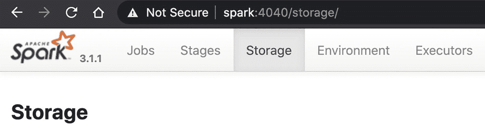

图 6-1 Spark UI 的 Storage 选项卡

鉴于我们还没有触发任何操作，`customers` 表中的数据虽然被标记为缓存，但实际上并不存在于 Spark 的存储中。这是因为没有理由急切地对表进行完整加载，因为你正在编写的应用程序可能只需要对数据执行一次遍历。在这种情况下，Spark 喜欢懒惰，这样做是为了保护你的应用程序，避免在开始任何工作之前就遇到内存问题。

**提示**

如果你已将映射 `127.0.0.1 spark` 应用到你的 `/etc/hosts` 文件中，那么你也可以使用 `http://spark:4040/storage/` 来查看此选项卡。此过程在章节材料中有所介绍，示例可以在 `/ch-06/docker/etc` 中找到。

### 强制 Spark 缓存

要强制 Spark 缓存来自 `customers` 表的数据，你需要调用 Spark 执行操作。在这种情况下，你可以简单地调用 `head` 来返回表中的第一行。

```
%spark
val tableName = "customers"
sparkSessionHive.table(tableName).head
```

这样就完成了。现在，如果你刷新存储界面，你将看到内存中的表。参考界面如图 6-2 所示。

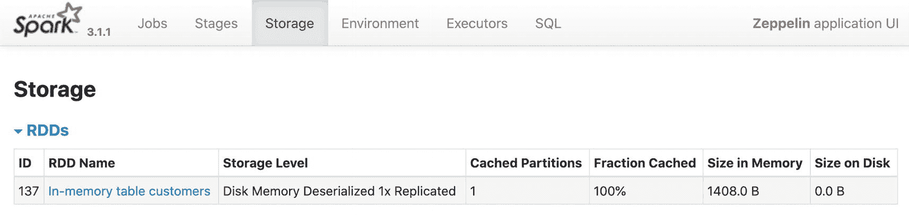

图 6-2 显示已缓存 RDD 列表的 Spark 存储界面

这很有趣，不是吗？现在你有了另一种方法来确保你编写的应用程序确实按照你期望的方式运行。由于 `customers` 表存在于缓存中，当你想要从该缓存中移除一个表时，检查其行为就变得很简单了。

### 取消缓存表

当我们在 Spark 应用程序的内存中缓存数据时，这意味着你正在减少为 Spark 应用程序中对象存储分配的可用总内存。我们不会深入探讨内存管理的细节，但每个 Spark 应用程序都会将分配的可用内存分成两个空间——一个空间专用于运行应用程序所需的内存（来自 JVM 开销、IO 连接等），另一个空间专用于应用程序中的对象存储（就像我们缓存内存表时看到的那样）。这由 `spark.memory.fraction` 控制，默认情况下是 60/40 的分割。

现在，让我们看看取消缓存我们之前缓存的表的过程。

```
%spark
val tableName = "customers"
sparkSessionHive.catalog.uncacheTable(tableName)
```

### 清除所有表缓存

在 Spark 应用程序的不同位置可能缓存了许多表。如果你想从头开始，可以使用简单的 `clearCache` 目录方法。

```
%spark
sparkSessionHive.catalog.clearCache
```

这比追踪所有已缓存的表要容易得多。是的，你可以遍历目录中所有可用的表，检查它们是否存在缓存，然后选择性地移除每个缓存，但有时直接清除所有内容更好。

### 刷新表

在清除所有缓存的兴奋中，我们跳过一个重要的概念。当你将表缓存到内存中，并且上游数据存储在你无法控制的情况下被更新时（例如，另一个应用程序正在写入表的位置，从而使你的缓存失效），为了确保你拥有最新的数据，你可以在 Spark 目录上使用 `refreshTable` 方法。这会刷新关于表的元数据以及构成表的底层文件。

```
%spark
sparkSessionHive
.catalog
.refreshTable("customers")
```

这里有一个有趣的事实。如果你的 Spark 应用程序有意覆盖了你已缓存的表，它也会使你的本地缓存失效，从而无需在你自己的应用程序逻辑中包含任何表刷新操作。

## 使用 Spark 托管表测试自动缓存刷新

这是一个有趣的部分。要完整展示这个用例，需要几个步骤：

1.  将 `customers` 表的内容复制到一个名为 `customers_temp` 的新托管表中。
2.  从这个新的托管表 `customers_temp` 中读取数据到一个名为 `tableCopy` 的引用变量中，然后缓存该表。
3.  调用 `tableCopy.head` 以在本地 Spark 内存中缓存该表。
4.  将 `tableCopy` 与自身进行 `Union` 操作以复制数据。
5.  写入另一个名为 `union` 的托管表。
6.  现在，你可以自由地覆盖初始的 `customers_temp` 表，而 Spark 不会通知你正在尝试覆盖当前正在读取的表（顺便说一句，它通常会这样做）。
7.  你已经绕过了安全检查，现在 `customers_temp` 中加载了 `duplicates`。
8.  有趣的是，如果你查看 Spark UI 中的存储选项卡（`http://localhost:4040/storage/`），你会看到 Spark 已经清除了无效的缓存表视图。

你可以在“6_2_SparkSQLCatalog”笔记本中“Testing Automatic Cache Refresh in Spark”标题下跟随此示例，或者不看示例，尝试利用你在本章中学到的关于 Spark SQL 目录的知识。最后，你必须创建两个额外的托管表来欺骗 Spark，使其覆盖另一个托管表。完成此练习后，你可以继续清理刚刚创建的表。

## 移除表

删除表可以使用 `DROP TABLE` 命令完成。或者，稍微费点功夫，你也可以直接使用底层的 Spark SQL 目录 Catalyst 操作。这些操作都属于传统的数据操作语言（DML）类别。

### 数据操作语言

*DML* 代表数据操作语言。这是由 `INSERT`、`UPDATE` 和 `DELETE` 命令封装的一类 SQL 操作。在本章前面设置 Hive Metastore 时，曾简要提到 Spark 应用程序对 Hive Metastore 的只读、只写和读写访问。

## 授权

通过 DCL 授权管理传统关系型数据库的授权（权限）同样适用于管理连接到 Hive Metastore 的 Spark 应用程序的访问。为了数据安全最佳实践，你必须控制对数据的访问。应该只设置最小权限集，例如为用户启用只读操作的权限，如 `SELECT`。根据应用程序的实际需求添加功能。

例如，如果我们的 `dataeng` 用户需要读取基本的 Hive Metastore 表元数据以读取上游表数据，然后进行转换，最后使用 `saveAsTable` 将数据写入一个新的托管表，我们可以安全地使用该用户权限的子集。

```
# 权限配置

读写访问
```sql
REVOKE ALL PRIVILEGES ON `metastore`.* TO `dataeng`@`%`;
GRANT CREATE, SELECT, INSERT ON `metastore`.* TO 'dataeng'@'%';
FLUSH PRIVILEGES;
```

只读访问
```sql
REVOKE ALL PRIVILEGES ON `metastore`.* TO `dataeng`@`%`;
GRANT SELECT ON `metastore`.* TO 'dataeng'@'%';
FLUSH PRIVILEGES;
```

完全访问
```sql
REVOKE ALL PRIVILEGES ON `metastore`.* FROM `dataeng`@`%`;
GRANT ALL PRIVILEGES ON `metastore`.* TO 'dataeng'@'%';
FLUSH PRIVILEGES;
```

#### 角色

本书不会涵盖安全和数据访问管理的所有细节。不过，值得思考的一点是，研究一下是否支持基于角色的用户数据访问授权。这个强大的功能可以根据常见的角色名称实现高效的访问治理。以下是一个对 Hive Metastore 进行读写访问的示例。

```sql
-- 创建角色
CREATE ROLE readwrite;
GRANT CREATE, SELECT, INSERT, UPDATE, ALTER ON `metastore`.* TO readwrite;

-- 应用角色
REVOKE ALL PRIVILEGES ON `metastore`.* FROM `dataeng`@`%`;
GRANT readwrite TO `dataeng`@`%`;
FLUSH PRIVILEGES;

-- 查看授权
mysql> SHOW GRANTS FOR `dataeng`@`%`;
+------------------------------------------------------+
| Grants for dataeng@%                                 |
+------------------------------------------------------+
| GRANT USAGE ON *.* TO `dataeng`@`%`                  |
| GRANT ALL PRIVILEGES ON `default`.* TO `dataeng`@`%` |
| GRANT `readwrite`@`%` TO `dataeng`@`%`               |
+------------------------------------------------------+
```

这可以大大减少授予和撤销对 Hive Metastore 的通用访问权限所需的工作量。

### Drop Table

使用`DROP TABLE`会根据表是托管表还是外部表执行不同的操作。如果表由 Spark 管理，该命令将完全删除分布式表所有分区中的所有文件，以及所有元数据和表上提供的任何注释。如果表被定义为外部表，`DROP TABLE`命令将仅从 Hive Metastore 中移除表元数据，外部表将不受影响。

请记住像现在这样通过 Docker 在本地尝试操作，这样你可以在对真实数据存储执行命令之前测试不同的命令。

```sql
%sql
DROP TABLE customers_temp;
DROP TABLE unioned;
```

正如你刚刚体验到的，使用 SparkSession 上的 SQL 解释器删除表非常简单。如果你的应用程序尝试两次删除同一个表，该操作将抛出异常。如 DML 侧边栏中所述，基于角色的访问或显式用户权限有助于保护这些共享数据存储免遭意外删除。

### 条件删除表

为了保护你的应用程序，明智的做法是使用条件。`IF EXISTS`条件是一个布尔操作，`false`条件将短路或停止命令的处理。

```sql
%sql
DROP TABLE IF EXISTS customers_temp;
DROP TABLE IF EXISTS unioned;
```

最后但同样重要的是，让我们看看如何直接使用 Spark SQL 的 Catalyst 类来删除表。这是你刚刚运行的条件删除分布式`customers`表的解释型 SQL DML 查询的功能等价物。

### 使用 Spark SQL Catalyst 删除表

这将是我们第一次直接使用 Spark Catalyst 类；在下一节中，我们将更深入地研究 Catalyst 优化器。

```scala
%spark
import org.apache.spark.sql.catalyst.TableIdentifier
val catalog = sparkSessionHive.sessionState.catalog
val tableName = "customers_temp"
val tableId = TableIdentifier(tableName)
catalog.dropTable(tableId, ignoreIfNotExists = true, purge = true)
```

你可能会问，我们为什么要费这么大劲？事实证明，使用 Spark SQL Catalog 中的方法并没有一个简单的方法来删除表。

这实际上是一件好事，因为这种高级技术要求你，应用程序的作者，非常坚定地使用 DSL 来删除表。毕竟，Spark SQL Catalog 中没有`dropTable`方法是有原因的。或者，是的，你可以使用 Spark SQL 解释器中的简单`DROP TABLE`，但让我们想象一个不可能做到的世界。如果人们开始行为不端，你可以使用 DML 侧边栏中提到的基于角色或用户授权的方法，限制在你的数据平台内运行的 Spark 应用程序可用的操作。特殊权限应授予数据管理员，或仓库中特定表或数据库的负责任维护者。

### 练习 6-2：总结

Spark SQL 和 Hive Metastore 更好地协同工作，作为一个团队，为你的所有 Spark 应用程序提供一个集中的元数据服务，用于组织中通常可用的数据。正如你在上一节中学到的，要全面了解这种强大的数据发现形式，需要掌握许多细微差别。我们研究了基于用户的访问，如何使用 SparkSession 上的简单方法将数据从传统 RDBMS（在我们的例子中是 MySQL）移动到分布式数据仓库。我们研究了通过注释 Hive Metastore 数据库所有权、表列描述和表名称属性来为未来做铺垫。

继续。现在是时候参观 Spark Catalyst 优化器了。这是贯穿本书向你介绍的已解释 SQL 查询和 DataFrame 功能之间的粘合剂。

## Spark Catalyst 优化器

在本书中我们遇到的功能转换和强大 DataFrame 操作的幕后，存在一个强大但看似透明的引擎。它默默地工作，以优化和编排应用程序执行所需的每一个作业、阶段和任务。本质上，Catalyst 优化器解析你的应用程序代码，并将其高效地转换为一系列优化的步骤，称为*执行计划*。见图 6-3。

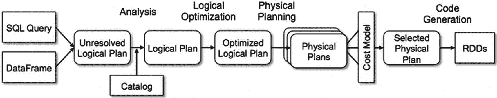

图 6-3：Catalyst 优化器解析 Spark 应用程序的高级意图，并将每个步骤通过一系列转换转换为高度优化、可分发、可执行的作战计划

此过程分为四个不同的阶段：

*   分析

*   逻辑优化

*   物理规划

*   代码生成

为了充分理解 Catalyst 引擎所做的工作，让我们使用 Spark 内置的内省层来查看每个不同的阶段。以下示例针对存储在我们数据仓库中的 parquet 数据分析了一个简单查询。

注意：请使用标题为“6_3_CatalystOptimizer”的 Zeppelin 笔记进行跟随。此最终笔记要求你已完成整章练习，以生成该部分所需的数据。

### 使用 Explain 内省 Spark 的 Catalyst 优化器

你可以在 DataFrame 上调用操作之前的任何时间点使用`explain`方法，或者在 Spark SQL 解释器中使用`EXPLAIN`子句。

```scala
%spark
sparkSessionHive
.table("customers")
.where(
col("email").like("scott%")
)
.select($"id", $"email", $"last_name")
.explain("extended")
```

此 DataFrame 查询在功能上等同于以下 SQL 查询。

```sql
%sql
select id, email, last_name from customers
where email like 'scott%'
```

无论你决定如何构建查询，Spark Catalyst 优化器都将从同一起点开始，即查询解析。这第一个操作标志着 Catalyst 从解析到优化和规划之旅的开始。

### 逻辑计划解析

执行的初始阶段负责将查询的意图转换为层次树。
```

# Spark查询计划解析

```
== Parsed Logical Plan ==
'Project [unresolvedalias('id, None), unresolvedalias('email, None), unresolvedalias('last_name, None)]
+- Filter email#5 LIKE scott%
+- SubqueryAlias spark_catalog.coffee_co_common.customers
+- Relation[id#0,created#1,updated#2,first_name#3,last_name#4,email#5] parquet
```

此步骤负责将每个查询转换并构建为关系以及这些关系上的表达式的树。第一步是识别未知列（`UnresolvedAlias`）的工作，并且在解释型 Spark SQL 的情况下，你会看到`coffee_co_common.customers`表，即`relation`，被标记为`UnresolvedRelation`。

```
|== Parsed Logical Plan ==
'Project ['id, 'email, 'last_name]
+- 'Filter 'email LIKE scott%
+- 'UnresolvedRelation [coffee_co_common, customers], [], false
```

这就是逻辑分析器发挥作用的地方。

## 逻辑计划分析

分析后的逻辑计划负责实体解析（`UnresolvedAlias`、`UnresolvedRelation`等），以便可以根据已知的模式和数据源或接收器位置验证列和表。

```
== Analyzed Logical Plan ==
id: int, email: string, last_name: string
Project [id#0, email#5, last_name#4]
+- Filter email#5 LIKE scott%
+- SubqueryAlias spark_catalog.coffee_co_common.customers
+- Relation[id#0,created#1,updated#2,first_name#3,last_name#4,email#5] parquet
```

在优化器旅程的每一步，都会完成一组特定的子任务。在上面的例子中，这就像解析列和验证数据源可以提供查询请求的数据一样简单。

## 不可解析的错误

不可解析的列可能由多种因素导致，例如在自由格式 SQL 查询中列名拼写错误。Spark 会快速失败，并通过`AnalysisException`告诉你分析阶段失败的原因。

你可以通过向`select`中添加一个新的、不可解析的字段，来让查询抛出异常。

```
%spark
customersTable
.where(col("email").like("scott%"))
.select($"id", $"email", $"last_name", $"unknown")
.show()
```

这会在实际执行物理计划之前触发异常，快速失败。

```
org.apache.spark.sql.AnalysisException: cannot resolve '`unknown`' given input columns: [spark_catalog.coffee_co_common.customers.created, spark_catalog.coffee_co_common.customers.email, spark_catalog.coffee_co_common.customers.first_name, spark_catalog.coffee_co_common.customers.id, spark_catalog.coffee_co_common.customers.last_name, spark_catalog.coffee_co_common.customers.updated];
'Project [id#0, email#5, last_name#4, 'unknown]
+- Filter email#5 LIKE scott%
+- SubqueryAlias spark_catalog.coffee_co_common.customers
+- Relation[id#0,created#1,updated#2,first_name#3,last_name#4,email#5] parquet
```

分析器阶段的这种短路机制非常有用，尤其是在尝试调试与数据相关的问题时。接下来，在解析了计划中的所有未解析实体后，Spark 将进入查询优化阶段。

## 逻辑计划优化

在此规划阶段，Spark 会在你的查询之上引入优化，例如添加空值检查，并将已知的静态表达式（如下面优化计划中的`StartsWith`）进行转换。

```
== Optimized Logical Plan ==
Project [id#0, email#5, last_name#4]
+- Filter (isnotnull(email#5) AND StartsWith(email#5, scott))
+- Relation[id#0,created#1,updated#2,first_name#3,last_name#4,email#5] parquet
```

此优化阶段转换了以下内容：

```
Filter email#5 LIKE scott% 变为
Filter (isnotnull(email#5) AND StartsWith(email#5, scott))
```

现在进入最终的规划阶段：物理计划。

## 物理计划

物理计划是 Spark 将你的查询转换为生成的 Java 字节码之前的最后一步。

```
== Physical Plan ==
*(1) Project [id#0, email#5, last_name#4]
+- *(1) Filter (isnotnull(email#5) AND StartsWith(email#5, scott))
+- *(1) ColumnarToRow
+- FileScan parquet coffee_co_common.customers[id#0,last_name#4,email#5] Batched: true, DataFilters: [isnotnull(email#5), StartsWith(email#5, scott)], Format: Parquet, Location: InMemoryFileIndex[file:/spark/sql/warehouse/common/customers], PartitionFilters: [], PushedFilters: [IsNotNull(email), StringStartsWith(email,scott)], ReadSchema: struct
```

该计划为 Spark 提供了所有必要的信息，以生成一个真实的执行计划，用于读取、过滤和加载投影字段（`ID`、`email`和`last_name`）到 Spark 中作为 DataFrame。拼图的最后一块是代码生成组件。

## Java 字节码生成

这最后一步将物理计划编译并转换为实际的 Java 字节码。这个过程被称为*全阶段代码生成*，它通过将所有 Java 方法调用内联到一个针对 JVM 优化的单一函数中来优化你的查询，而不是为了人类可读（尽管有些人以能够阅读并完全理解生成的代码为傲）。

```
%spark
customersTable
.select($"id", $"email", $"last_name")
.where(col("email").like("scott%"))
.explain("codegen")
```

这将输出部分人类可读的详细信息以供分析。

```
```
Found 1 WholeStageCodegen subtrees.
== Subtree 1 / 1 (maxMethodCodeSize:369; maxConstantPoolSize:142(0.22% used); numInnerClasses:0) ==
*(1) Project [id#0, email#5, last_name#4]
+- *(1) Filter (isnotnull(email#5) AND StartsWith(email#5, scott))
+- *(1) ColumnarToRow
+- FileScan parquet coffee_co_common.customers[id#0,last_name#4,email#5] Batched: true, DataFilters: [isnotnull(email#5), StartsWith(email#5, scott)], Format: Parquet, Location: InMemoryFileIndex[file:/spark/sql/warehouse/common/customers], PartitionFilters: [], PushedFilters: [IsNotNull(email), StringStartsWith(email,scott)], ReadSchema: struct
Generated code:
/* 001 */ public Object generate(Object[] references) {
/* 002 */   return new GeneratedIteratorForCodegenStage1(references);
/* 003 */ }
/* 004 */
/* 005 */ // codegenStageId=1
/* 006 */ final class GeneratedIteratorForCodegenStage1 extends org.apache.spark.sql.execution.BufferedRowIterator {
/* 007 */   private Object[] references;
/* 008 */   private scala.collection.Iterator[] inputs;
/* 009 */   private int columnartorow_batchIdx_0;
...
```

对于大多数 Spark 工程师来说，了解这些高级特性并非必需，但对于理解 Spark 的运行方式至关重要。此外，利用 Catalyst 对于创建 Spark 引擎的扩展非常有价值，例如当你想要读取和写入 Spark 核心编码器未知/不支持的数据格式时。

现在你已经了解了 Spark 优化应用程序流程所经历的步骤，我们将通过查看数据集来结束这一内容丰富的章节。

## 数据集

简而言之，数据集是一个强类型、高效编码的对象集合，驻留在系统原生内存中，由 Spark 引擎访问和编排。虽然概念上与 DataFrame 类似，但 Dataset API 暴露了类型化能力，包括创建自定义有状态聚合（用于流式应用程序）和其他强类型聚合，以便与更传统的基于批处理的分析一起使用。

当谈到类型化与非类型化时，这仅仅意味着 Spark 预先明确知道数据的格式和结构，即其模式。另一件值得一提的事情是，数据集具有不可变的固定模式。

### RDD

回想一下，我们在本书前面讨论 Spark 编程模型时，讨论过 RDD（弹性分布式数据集）对象。作为复习，RDD 是 DataFrame 和 Dataset 的智能骨干。它们存储了关于应用程序中数据血统的分布式（分区）元数据的逻辑映射——从最初从可靠数据源或内存数据结构加载数据开始，经过每个转换（变更）阶段，直到 Spark 应用程序中的终端操作（触发点）。每次我们调用 `write`、`show` 或 `collect` 时，我们都见证了操作的实际执行。

虽然 RDD 本身不存储任何物理对象数据。Spark 驱动程序应用程序的 `SparkContext` 明确知道数据在分配给应用程序实时运行时的 Spark 执行器的内存和磁盘空间中的位置。在每个完整的执行阶段，生成的输出数据存储在不可变的数据缓冲区中，并记录转换数据血统的新步骤。尽管这个过程或多或少是透明的，但我们将在本书中更仔细地研究这个过程。

我们刚才说到哪了？数据集是强类型、不可变的数据集合，它们是从 JVM 对象（Scala 或 Java 类）编码而来的。它们与 Spark 生态系统的其他部分配合良好，因为它们只是 RDD 之上的一层。由于数据集具有不可变或固定的模式，这意味着 Spark 在应用程序的上下文中处理数据时可以采取某些自由。同样值得一提的是，Python 和 R API 不能使用数据集，这是使用 Scala API 的一大优势。

### 练习 6-3：将 DataFrame 转换为 Dataset

让我们从一个实际示例开始。假设你能够访问之前管理过的客户数据，我们可以将这些数据复用于当前场景。现在需要做的就是生成一个简单的 Case 类来充当客户数据的中介。回想一下上一章中，我们在创建要插入到关系型数据库管理系统（RDBMS）的额外行时，研究了 Java 类型的互操作性。同样的技术可以应用于 Case 类，它可以与 Catalyst 行进行隐式互操作。

#### 创建客户 Case 类

```scala
%spark
import java.sql.Timestamp
import org.apache.spark.sql.Dataset
case class Customer(
  id: Integer,
  created: Timestamp,
  updated: Timestamp,
  first_name: String,
  last_name: String,
  email: String)
```

定义好类之后，我们现在可以将 DataFrame 转换为 Dataset。

### Dataset 别名

有一个名为 `as` 的简单辅助方法，它使用编码器将 DataFrame 转换为 Dataset。

```scala
%spark
import org.apache.spark.sql._
implicit val customerEnc = Encoders.product[Customer]
val customerData: Dataset[Customer] = customersTable
  .as[Customer]
```

Dataset 使你能够使用 Scala 的标准函数式编程，或者根据你的用例使用 Catalyst 表达式。这种范式为你的数据工程任务提供了最大的灵活性，因为有时复杂的任务无法转换为有意义的 SQL 操作。在这些情况下，回归到核心的工程技能会非常有用。例如，你可以混合使用 Catalyst 和 Scala 操作。

### 混合使用 Catalyst 和 Scala 功能

我们可以创建自己的 Lambda 函数，这些函数可以被内联，并用于过滤以特定模式开头的电子邮件字符串，例如我的名字。

```scala
customerData
  .filter(_.email.startsWith("scott"))
  .explain("formatted")
```

这种过滤方法允许你编写专门的 Scala 过滤器，这些过滤器可以直接使用 Scala `Customer` 类进行操作，而不是使用纯 Catalyst 表达式（正如我们在本章前面看到的那样）。此函数将在每一行上被调用，因为 Spark 在遍历内部 Spark 行时，会封装每个批次。对于每个过滤操作，该行将从内部 Spark 格式（一种称为 Tungsten 的优化的原生内存格式）转换为可与 Scala Lambda 函数一起使用的 Java 对象。

**注意**

这种从原生内存到 JVM 内存的转换可能会导致垃圾回收周期，从而降低应用程序的性能，因此请注意这一点，并记住尽可能不要忽视 Catalyst 原生函数。`org.apache.spark.sql.functions` 是经过效率优化的，并且随 Apache Spark 免费提供。根据经验法则，过多的垃圾回收（更不用说对 Lambda 函数的支持）会拖慢你的 Spark 应用程序。例如，我曾见过从使用 Lambda 表达式切换到使用原生 SQL 函数时，性能提升了 50-60%。

同样的过滤操作也可以使用类型化的 Catalyst 表达式轻松调用。

#### 使用类型化的 Catalyst 表达式

以下示例在功能上与前一个示例等效，不同之处在于我们使用类型化的 Catalyst 列表达式来执行 `startsWith` 过滤。

```scala
%spark
customerData
  .filter($"email".startsWith("scott"))
  .explain("formatted")
```

这使我们能够使用谓词下推（优化功能），而不是先将所有 Parquet 数据读入内存，然后进行过滤。在你后续的 Spark 学习旅程中，将会了解到更多优化技术，但使用 `Dataset` 能够实现两全其美，你可以在混合执行模型中利用 Spark 或传统的 Scala。

### 练习 6-3：总结

在构建 Spark Structured Streaming 应用程序时，通常更倾向于使用 `Dataset`，因为其固定的结构在编译时提供了明确的数据契约，避免了在运行时出现问题。此外，随着时间的推移，我更喜欢使用 `Dataset` 来定义我所编写应用程序的入口和出口（输入和输出）。这确保了我为生成的数据提供了一个坚实的 API 边界。由于从 `Dataset` 转换为 `DataFrame` 非常简单（`ds.toDF`），应用程序可以选择它们需要如何操作。然而，能够在整个组织中共享这些格式（通过 `Hive Metastore` 或在一个包含通用数据格式的共享库中）有助于你复用数据，而无需担心数据在应用程序之下发生变化。

我还发现 `Dataset` 能够极大地加速并改进编写单元测试的过程。只需投入一点前期努力，就可以使用更具测试驱动的方法来编写 Spark 应用程序。这可以节省漫长的编译和部署周期，而且良好的测试使工程师能够轻松调试任何类型的 Spark 应用程序，从标准批处理到流处理。我们将在第 7 章中探讨编写和测试完整端到端管道应用程序的过程。

## 总结

在本章中，你学习了如何将 `Hive Metastore` 与 `Spark SQL Catalog` 结合使用。你发现了为 Hive 数据库的所有权添加重要富元数据、为生成的表添加简单描述和定义、以及如何提供丰富的列级信息是多么容易，以便通过你的操作实现轻松的数据发现。这种改善数据发现的简单行为，有助于在数据平台环境中进行前瞻性投入。现在，其他团队可以有能力去寻找他们今天所需的数据，以解决未来的数据问题。

然后，我们更深入地探讨了幕后机制，并查看了 Spark 在 `Catalyst` 优化器中使用的优化管道。我们看到了它如何规划并将你的查询从解析计划转换为分析计划，再到优化计划，最后到物理计划。这一系列事件极大地改善了在代码生成阶段生成的 Java 字节码，最终，你的应用程序会直接受益于这种精心编译。

本章最后，我们探讨了使用显式编码将 Case 类转换为 `Dataset` 的过程。在接下来的几章中，当你着手构建和运行批处理及流处理的管道作业时，你将依赖前六章中的这些信息，以务实的方法构建现代数据工程环境的核心组件。

# 7. 数据管道与结构化 Spark 应用

幕后存在一种核心处理范式，它可以帮助连接你作为数据工程师构建的几乎所有内容。这种处理范式既是有效移动和处理数据的物理模型，也是心智模型，被称为`数据管道`。我们最初在介绍驱动现代数据栈的历史和通用组件时，曾在第 1 章中简要提及数据管道。本章将教你如何编写、测试和编译可靠的 Spark 应用程序，这些应用程序可以直接融入数据管道中。

# 数据管道

在第一章中，你了解了数据管道的起源，以及管道工作如何从著名的`抽取-转换-加载（ETL）`设计模式演变而来。从概念上讲，ETL 使得像 `MapReduce` 这样的框架日益流行，因为复杂的问题可以被定义为工作流或一系列任务，从而将困难的分布式数据处理分而治之，分解为可消化的小型计算。数据管道建立了用于处理批处理或流处理的一致处理范式。由于数据管道仅仅是在系统间可靠移动数据的通道，开始思考数据在使用 ETL 处理时，如何在更大的数据拓扑中的各点之间流动，有助于建立一个清晰的思维模型。当你越来越熟悉那些数据流扇出、分叉或汇入一个或多个数据处理管道的复杂数据处理时，你的思维模型就可以开始转变为一个通过工作流编排（我们将在下一章讨论）来协调的相互依赖任务图。

打个比方，可以将数据管道视为一个由软件驱动的汽车或制造装配线。装配线上的每个工位都只专注于做好一项工作，这在同步数据处理中很有意义，因为每个任务都依赖上游任务的成功来完成其预定目标。图 7-1 展示了一个更复杂的数据管道的例子，其中一些任务需要按照装配线式的处理方式同步运行，而其他任务则可以完全异步运行。

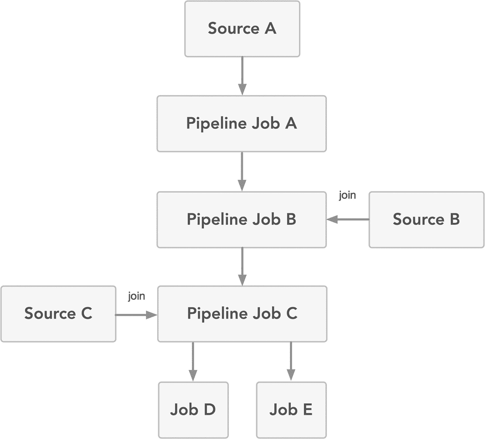

图 7-1 – 混合同步/异步数据管道

图 7-1 显示，管道任务 A 到 C 相互依赖，需要按特定的同步顺序完成。这通常是组合式数据处理的典型情况。你将新的数据对象作为其他可用数据的复合体或组合来进行组合。这在数据源 A、B 和 C 的组合中可以看到。然而，在前三个上游管道任务完成后，下游任务 D 和 E 是独立的，可以异步运行。

鉴于数据管道的动态特性，只要数据流的变更不破坏任何依赖任务的下游数据需求，就可以在数据处理网络中新增、插入或移除数据处理任务。虽然这种灵活性提供了一种高效机制来重用上游工作产生的数据，但数据血缘问题或数据处理盲点可能会悄然出现，导致孤立的问题。这可能导致数据陈旧，主要原因在于管道破损（糟糕的上游任务），或数据网络中任何关键点的数据损坏所引发的系统范围问题。

随着数据管道复杂度的增长，你将看到对自动化的需求日益增加。起初，像 `crontab` 以及由 `webhooks` 和 `API` 触发的简单工作流之类的简单解决方案就能维持运行。然而，随着规模随时间扩大和增长，通常会迁移到更专业的工作流编排框架来管理更大的数据处理规模。你将在第八章学习如何使用 `Apache Airflow` 搭配 `Spark`，届时我们将探讨工作流编排。本章则提供了构建可靠的基于批处理的 `Spark` 应用程序的蓝图，使其准备好接入 `Airflow`。

## 管道基础

在之前的六章中，你一直在为数据管道之旅做准备，学习了现代数据工程师所需的重要历史、概念、组件和基础。作为回顾，前两章介绍并讲解了过去的状况和发展趋势，并让你在本地上手运行了 `Apache Spark`。第三章和第四章探讨了数据的读取、解析、转换和写入，并讨论了数据文档、强类型以及为他人铺路的重要性。

随着第五章中 JDBC 数据源的引入，你学会了使用 `Apache Spark` 与现有数据存储进行互操作，以便处理外部数据库。第六章介绍了 Spark SQL Catalog。你学会了使用外部的 `Apache Hive Metastore` 为 Spark SQL 提供支持，这可以简化处理外部表或托管表的过程，并能解决一些与数据发现、数据所有权和数据访问相关的常见问题。

在这个过程中，你一直在学习使用 `Spark` 来解决数据问题，而无需不必要地分心去思考如何编写能够按照标准软件开发最佳实践进行编译、单元测试、文档化和发布的应用程序。你将在本章中学习如何将常见的软件工程最佳实践应用于你作为数据工程师所做的工作中。

## Spark 应用程序：形式与功能

在本书的这一部分之前，你一直依赖 `Apache Zeppelin` 或手动使用 `spark-shell` 来交互式地输入命令和处理数据。这些`交互式应用程序`只是 `Spark` 应用程序可以采用的众多形式之一。`Spark` 应用程序可以采用的另外两种形式是`基于批处理的应用程序`和`流式应用程序`。了解这三种风格之间的异同可以帮助你决定编写哪种风格的 `Spark` 应用程序。这个过程也是从构思到生产过程中的一个关键决策点。

### 交互式应用程序

顾名思义，交互式应用程序在某种意义上是有生命力的，因为它们等待读取、评估和处理来自用户的输入。这种机制为许多不同的用例提供了良好的即时反馈循环，包括数据发现和探索性数据分析，以及在学习和尝试新事物时可以依赖的工具。`Spark Shell` 和 `Apache Zeppelin`（笔记本环境）提供了使用 `Spark` 的温和入门方式，无需编译代码或设置任何 IDE。不过，这些方法也存在局限性。

## Spark Shell

`Spark` 自带的 `REPL`（也就是 `spark-shell`）在第五章中有详细介绍，当时我们探讨了如何在 `Spark` 运行时环境之上创建快速的动态应用程序。尽管你可以通过动态文件加载和 `Spark` 配置的组合来构建相当复杂的例程，但其限制因素在于，这些 Shell 应用程序并非为满足生产系统黄金时段所需的完全一致性和可靠性而设计。充其量，这种操作模式就像一个强大的交互式脚本环境。

### Notebook 环境

在本书中，我们全程使用了 `Apache Zeppelin`，以便通过 Notebook 简化与 `Apache Spark` 和 `Scala` 的协作方式。Notebook 环境是一个强大的工具。它将 `spark-shell` 的简洁性与一致的运行时环境融为一体，并且可以通过传递笔记或实时协作（托管版 Zeppelin）在同事之间共享。Zeppelin 让想法（启发式方法和代码流程）能够在一系列段落中得以充分实现，这些段落既可以作为同步流程（整体上）运行，也可以单独运行，这在调试某个段落时通常是常见情况。

锦上添花的是（至少在我看来），它能将内联文档与交互式图表和表格混合在一起，并与每个笔记中处理的数据并行展示。我们将在第 12 章中再次使用 Zeppelin 进行分析处理和洞察生成。

在工作中使用 Notebook 环境也是利弊参半。虽然编写一系列相对复杂的数据处理操作来访问内部和外部数据源可能很简单，但这种易用性也带来了损害生产系统的潜在风险。设想一个笔记，它对非生产数据系统（在非生产环境中）执行了大量相对昂贵的查询。虽然编写该笔记的工程师无意造成损害，但这些昂贵的查询有可能导致某个服务或数据库宕机——如果同一个笔记被迁移到生产环境或意外保存，就可能引发事故。

> **提示：** 了解你的数据规模：要清楚你正在处理的数据的规模，不仅仅是总记录数/行数，还包括所需的内存和 `IO`（带宽）开销。理解你正在处理的数据规模，对于运行健康的数据应用至关重要。这就是为什么许多应用在规划阶段使用 Notebook，而最终却以编译后的流处理或批处理应用形式进入生产环境的原因。

## 批处理应用

批处理应用不一定比你在 Zeppelin 中编写的一些简单段落更复杂。主要区别在于创建编译后的批处理应用的过程，而不是在 Zeppelin 中编写一个快速笔记或段落。我们将在本章下一节中介绍为批处理应用构建蓝图的过程，但在那之前，请记住以下几点。

与传统软件开发的最佳实践一样，编写健壮、可靠的数据应用需要你编写包含测试（单元测试和自动化测试）、符合团队或公司的卓越标准、经过代码审查、并采用分阶段方法发布的代码。它还必须确保下游系统以及其他依赖系统得到保护。最后，它必须确保每个作业都以高性能方式运行，并配备适当的指标和应用级监控，以确保每个作业都能履行并满足约定的 `SLA`。

在编写 `Spark` 批处理应用时，有两种方法可以帮助你设计接口和配置。应用可以是`无状态`的或`有状态`的。

### 无状态批处理应用

无状态批处理应用不需要状态管理。这种编写批处理应用的方法旨在处理非常特定的任务，所有必要的配置都在运行时提供给应用。这类应用非常适合传统的数据管道作业。例如，管道作业可以配置为在开始和结束日期之间从外部表中导入所有行。由于职责划分清晰，且没有长期状态管理，每次运行批处理应用都可以自行设定其边界。例如，如果需要回填数据，可以创建一个或多个作业，并触发这些作业并行运行，而无需担心交叉污染（只要边界明确，例如按天加载分区数据）。`回填`是将缺失数据加载到数据源的过程。

> **提示：** 为复用而设计：虽然你可以创建一次性应用，但更好的做法是考虑如何让应用通过外部配置驱动以实现复用。否则，你将不得不反复对内部配置进行微小修改、发布、运行，然后重复这一过程。

无状态批处理应用的一个例子是每日报表作业。报表作业通常针对特定的数据子集运行，例如每日或每小时的指标或事件汇总。清单 7-1 中显示的批处理作业配置展示了一个示例应用如何被配置为从外部运行。

```
清单 7-1 外部配置让您的批处理应用可以一次编写，多种方式使用

```
$SPARK_HOME/bin/spark-submit \
--class "com.coffeeco.reporting.DailyReport" \
--master "spark://thehost:7077" \
--deploy-mode "client" \
--conf "spark.report.table.source=daily-summaries" \
--conf "spark.report.table.sink=daily-reports" \
--conf "spark.report.range.start=2021-03-01" \
--conf "spark.report.range.end=2021-03-02" \
...
```

与无状态批处理应用相对的是有状态批处理应用。

### 有状态批处理应用

有状态批处理应用可以被设计为使用任意数量的外部系统来可靠地管理其配置和应用状态，例如 `Apache ZooKeeper` 或 `HDFS`。然而，另一种技巧是使用 `Spark Structured Streaming`，并将其配置为每次触发仅执行一次。这种技术使你可以利用强大的 `Structured Streaming` 引擎的有状态语义，来跟踪和管理一切的有效状态，包括数据源、已处理并完全提交的数据，以及批处理作业的每次运行。所有这些都无需你手动捕获和管理数据管道中批次间的作业元数据。对于更复杂的数据处理作业（包括从多个外部数据源读取和关联数据，且这些数据源混合了批处理和流处理来源），手动管理外部状态很快就会变得难以应付。

> **提示：** 如果你的有状态批处理作业将作为周期性批处理作业运行，用于将数据从流处理源可靠地移动到 `HDFS` 或 `S3` 等可靠数据存储中，请确定作业中哪些方面可以复用，以构建通用的基础应用。通用应用可以是配置驱动的，也可以建立在抽象类（库）之上，并在通用接口之间共享。基础化应用使得常见的数据工程问题能够一次性解决，并将经验教训进行复用，而无需从想法到生产耗费漫长的前置时间。

#### 从有状态批处理到流式应用

有状态批处理应用的另一个常见用途是周期性处理来自流式数据源（如 `Apache Kafka`）的数据。在给定主题的所有分布式分区中，可靠地追踪应用在数据流中的位置需要大量元数据，而这对于无状态批处理任务来说并不太适用。

最后，你可以在将应用开启为全天候流式处理之前，利用有状态批处理应用帮助进行性能调优。通过将外部配置与内部有状态处理相结合，你可以增加每批处理的记录数，并测试应用在不同 `CPU/RAM` 分配组合下的表现。能够先在批处理模式下测试的应用，可以逐步增加负荷直至达到其极限点，或配置为获得最大数据吞吐量。当你对结果满意后，只需切换触发器，你的应用就可以作为流式任务运行，并从上一次批处理结束的位置继续处理。你可以在第 10 章学习如何编写可靠的有状态批处理任务，包括使用外部配置来控制每个微批次的处理频率和速率的详细细节。

## 流式应用

`Apache Spark` 使你能构建处理无界数据源的应用，而无需过多改变你从批处理中形成的思维模式。鉴于 `Spark Structured Streaming` 应用默认会作为一系列持续处理的微批次数据来运行，因此按批次逐一处理问题是非常直观的。`Spark` 使你能通过两种主要的处理模式来处理流式数据：微批次处理和持续处理。

### 微批次处理

这种处理模式会定期检查流式数据源（如 `Apache Kafka`），并触发一个新的批次进行处理。这意味着你可以将你的应用视为在无限数据流中，周期性处理有限数据集。

微批次处理更适合常见的分析处理需求，例如在时间窗口内汇总指标。回顾第 4 章，当时我们通过关联每家咖啡店的当前店内顾客数据，来构建一种判断是否有足够座位容纳不同规模聚会的方法。这种事件处理非常适合实时场景，因为这些数据流如果不及时处理，很快就会失去意义。例如，这些数据可用于驱动一个移动应用，帮助顾客找到离他们最近且有可用座位的门店。

然而，考虑到之前的有状态批处理用例，这些数据从历史角度来看也很有意义，只是精度要求不同。你可能需要将这些数据按 15 到 30 分钟的间隔进行汇总，以便让其他团队能够生成每家门店的日/周/月绩效报告。

### 持续处理

与基于微批次处理不同，持续处理支持对每条记录进行单独处理，确保每个数据点都以有状态的方式被精确处理一次。这种处理方式可用于实现实时计费场景，即你需要单独（且持久地）处理每笔交易。对于计费来说，每个操作在事件级别上要么成功要么失败尤为重要，这与“至少一次”的处理方式相反，因为后者可能导致对客户重复计费。在微批次内发生部分故障的情况下，`Spark` 会回滚并重新处理该部分数据集，这是微批次流处理和计费时常见的一个陷阱。

> **注意**
>
> 本书不涉及持续处理，但如果你感兴趣，可以使用第 11 章（`Apache Kafka`）的环境自行测试。（在撰写本文时，唯一支持持续处理的数据源是 `Apache Kafka`。）

了解 `Spark` 应用可以采用的多种运行模式，是设计可靠数据应用的第一步。第二步，当然就是实际编写应用。接下来我们将进行一项练习，为你编写本章后续部分的内容做好准备。

## 设计 Spark 应用

如你所知，数据工程本质上是高效、可靠地移动和转换数据的艺术。为了做好我们的工作，每个任务，或者我们在数据管道中运行的系列任务，都应该是特定数据需求的结果，并编码为经过传统软件开发周期的已发布数据应用。软件开发周期如图 7-2 所示。它总结了成功构建和运行软件所需的七个常见概念执行阶段。同样的流程可以（也应该）应用于任何数据工程团队或数据组织的规划和成功运营。

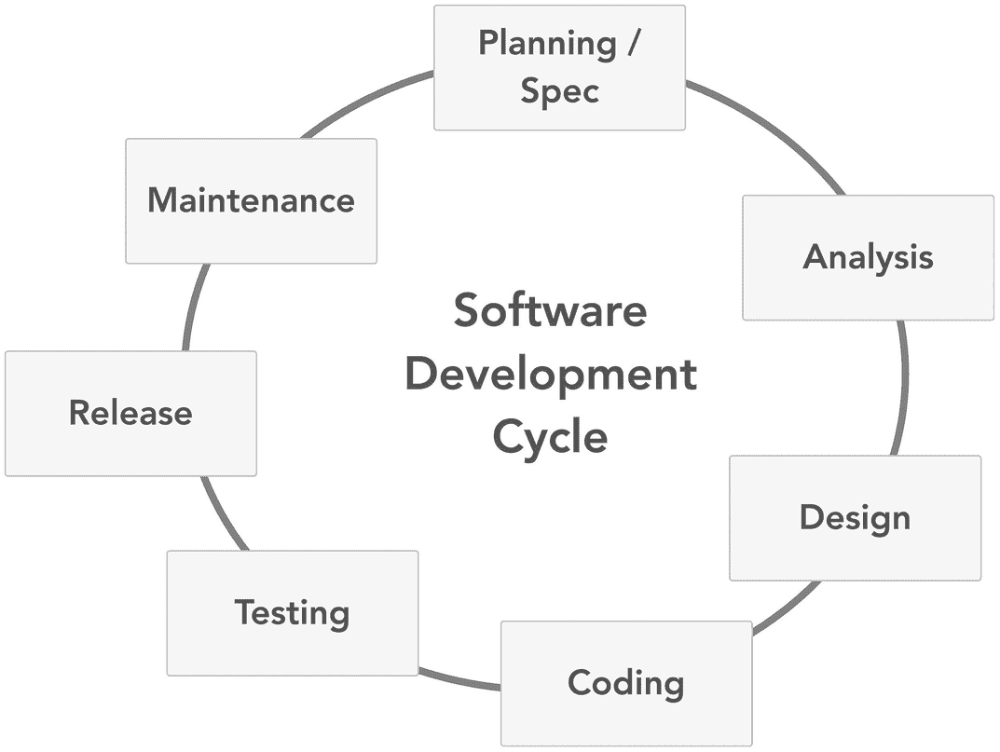

图 7-2 软件开发周期

可靠的数据应用遵循传统的软件开发周期。你计划编写什么、为什么需要编写它、目标受众是谁、以及需要在何时完成——所有这些问题都源于传统的基于规范的规划和构思。这些计划会引出需要快速且仔细分析的工作，然后才能开始设计和编写完成任务的代码。在项目的规划、分析和设计阶段，你可能会在像 `Apache Zeppelin` 这样的笔记本环境中工作。你也可能会回到这些交互式环境中去调试生产中的问题，或者快速调出一个图表与同事分享。

> **提示**
>
> 交互式环境因多种原因而格外宝贵，但对于快速进行调研尝试尤其不可替代。它们帮助你在软件生命周期早期就发现缺口，避免在之后花费时间规范化代码、编写单元测试、进行代码审查以及准备生产发布。

我们将在下一节中通过一个扩展用例来展开工作。此练习的目的是帮助你思考如何用数据解决问题。鉴于数据工程师专注于数据，学习抽象地思考数据和数据建模是核心技能。数据建模对所有数据从业者来说都是一项基本技能，虽然关于分类法、命名约定和通用理论的讨论不在本书范围内，但下一个用例将向你介绍如何构建基础数据问题的框架。
```

# 用例：CoffeeCo 与咖啡仪式

并非每个人都喜欢咖啡或茶。然而，说到仪式感和社群文化，咖啡产业背后蕴藏着巨大的成功。在本书的开篇，我们已经简要提及了在名为 CoffeeCo 的公司担任新数据工程师所需应对的一些琐碎事务。你可以将其视为你日常光顾的任何一家主流咖啡品牌。或者，如果你对咖啡有强烈的抵触情绪，你也可以运用相关工具处理并转化这些数据，使其更符合你的喜好（希望我们还能做朋友）。

贯穿本章及本书后续内容，你将专注于编写 Spark 应用程序，以促进并协调 CoffeeCo 的数据需求。你将扩展之前章节的基础原语，例如我们为咖啡店、库存、顾客以及顾客购买行为建立的模型。你将使用这些数据编写目标驱动的应用程序，像在实际工作中一样推动 CoffeeCo 的业务发展。这些经验几乎可以应用于你作为数据工程师横向处理数据平台、或纵向专注于特定功能或业务单元时所遇到的所有工作。所学到的技能可用于解决大多数企业面临的常见问题。

恭喜你升职了。你现在是 CoffeeCo 的创始数据工程师。你的首要任务是构建能够代表 CoffeeCo 业务多个方面的核心数据模型。要做到这一点，你需要更深入地了解业务。

## 思考数据

如果你从一个足够高的视角来看，会发现大多数面向客户的企业都存在一条共通的主线。即，企业都有待售的某种产品、销售产品的场所（线上或实体店），以及购买产品的顾客。这类似于名词的概念：业务围绕着人、地点和事物展开。

思考一家公司的数据需求时，需要考虑哪些业务方面需要被捕捉，以便做出明智的决策，以及我们如何从数据中提取意义？对于所有新的数据运营来说，这些可能是艰巨的任务。策略因地而异，但你可以使用一种非常有帮助的机制，它直接借鉴自产品管理和用户故事流程。简化来说，我们将采用一个颇具创意的名称：数据故事。

## 数据故事讲述与数据建模

无论你在何处工作、以何种方式工作，所有工作都围绕着任务的概念展开。这是一个分解的过程：你将庞大的想法或琐事分解成可以在不必一次性考虑所有问题的情况下完成的较小任务。这是一项需要时间积累的技能。许多工程师经过多年磨练，学会了如何思考问题，将其拆解为功能性子组件、可复用的类和接口。由于数据工程与传统软件工程紧密相关，这些技能可以很容易地迁移到我们思考数据问题的方式上。这只需要一点练习。幸运的是，你现在将逐步了解高层次的数据建模过程。

## 练习 7-1：数据建模

故事讲述的过程可以成为一个有用的工具，用于理解数据关系，这些关系对于分解像公司这样复杂的想法是必要的。在我们的案例中，公司是 CoffeeCo。我们将把它分解为一个由想法、实体、类别和关系构成的层级结构，用于构建数据模型。在决定捕获和集成哪些数据时，这个过程甚至对战略规划和决策也很有用。取决于你在公司的角色，你可能需要推动许多超出你数据工程师职责范围的工作。理解全局图景或事物（与数据相关的）如何各得其所，是一项宝贵的技能。与许多事情一样，数据建模始于一个故事。

### 故事

CoffeeCo 致力于为人们提供独特的咖啡饮用体验，并根据个人需求和口味进行定制。我们从最优质的咖啡豆开始，通过一个视我们如家人的全球种植者网络进行采购。这些关键的关系确保我们能够获得稳定的季节性产品，这些产品天然有机地生长。额外的好处是，它确保了每一种咖啡都来自一个知名的产区，该产区能够满足我们追求的生长条件和自然风味特征。利用最先进的个性化系统，我们让顾客能够对咖啡体验的方方面面进行评分，从咖啡的烘焙方式、咖啡豆品种、最喜爱的农场和生产商，甚至到他们最喜欢的门店。每一杯咖啡、每一次光顾、每一次个人体验，都增进了顾客对咖啡的热爱，以及他们围绕咖啡所建立的社群。

### 分解故事

你可能已经发现，你的大脑已经开始对 CoffeeCo 的故事进行分解和消化。你可能已经开始分离特定的关系，并思考可以用来传达特定高层次概念（如供应商、地点和顾客）的名称和总体实体。你可能完全跳过了数据建模，而是专注于数据可以用来做什么以及如何做。这一切都很好，因为这意味着故事吸引了你的注意力。首先，我们来看看如何分解出具体的实体，然后我们再讨论数据如何被使用。

### 提取数据模型

在高层次上，你可以使用故事来指导支持业务的核心实体之间的关系。本质上，CoffeeCo 为每位顾客提供产品。产品从供应商处采购。每个供应商在一个或多个特定的位置运营。产品在多家门店销售，每种产品在一个或多个位置有库存。顾客体验可以通过每位顾客消费实体产品的评分来追踪。每家门店的体验可以通过顾客评分来评定。评分作为一种结构，可用于生成个性化的体验，该体验会随着时间的推移为每位顾客进行适应和学习。

一旦提取出高层次实体，你可以通过讲述它们的子故事来进一步分解每种类型。正如你将看到的，这个过程可以直接从故事中产生一个良好的数据模型。

#### 顾客

顾客与一个账户标识符相关联。每个账户基于一个随机分配的 `UUID` 进行唯一标识，该 `UUID` 可以在账户创建时在线生成，也可以在门店购买时通过二维码提供给顾客。当顾客完成注册并将他们的账户身份与友好的移动应用程序关联后，顾客账户即变为激活状态。这需要顾客的姓氏、名字以及电子邮件地址。

```scala
case class Customer(
active: Boolean,
created: Timestamp,
customerId: String,
firstName: String,
lastName: String,
email: String,
nickname: String,
membership: Membership,
preferences: Preferences
)
```

此客户数据模型用于规划基线信息以及关系，例如 `Membership` 和 `Preferences` 的情况。这些是对客户的占位关系，可以在数据建模之旅的后续阶段进行组合。

##### 门店

顾客在各门店购买咖啡产品。每个门店都关联一个唯一标识符，每个地点还包含开业日期、物理位置（如地址、经度和纬度）以及营业时间等附加信息。此外，每家门店都有最大客容量和额外设施，例如户外座位、得来速服务等。在考量门店之间的差异时，每日菜单是一个重要因素。菜单包含可供选择的咖啡、价格等等内容。

```scala
case class Store(
alias: String,
storeId: String,
capacity: Int,
openSince: Timestamp,
openNow: Boolean,
opensAt: Int,
closesAt: Int,
storeInfo: StoreInfo,
location: Location
)
```

与客户数据模型类似，关于 `StoreInfo`、`Location` 和 `Menu` 数据模型，我们也留下了一些线索供后续练习。我们将在下一节中进一步探讨这些内容。

##### 商品、货物与单品

每个产品都是一个待售货物单元。在这种情况下，可供出售的品类远不止咖啡。每种在售产品类型都有唯一的标识符、一个可作为人类可识别名称的友好名称或别名，以及单位成本。考虑到你可以出售一杯、一壶、速溶咖啡、新鲜烘焙咖啡以及其他散装商品，你需要在此进行抽象思考。鉴于每种在售产品都列在菜单上，并且 Scala 有一个核心 `Product` 类，我们将此模型命名为 `Item`。

```scala
case class Item(
itemId: String,
availability: Availability,
cost: Int,
name: String,
points: Int,
vendor: Vendor
)
```

鉴于产品具有通用可用性、季节性可用性，甚至地理可用性，我们可以将产品的可用性建模为 `Item` 案例类的一个子资源。`Vendor` 信息也是如此。这使我们能够处理数据，并允许数据模型随时间演变。

##### 供应商

CoffeeCo 与来自世界各地的各种供应商合作。供应商提供商品和服务，从种植和生产季节性咖啡品种的农场，到为每家门店销售杯子和小饰品的制造商，不一而足。本书中我们只处理与咖啡相关的数据，但值得思考未来如何扩展数据模型，这样你就不必费力处理大量最终大同小异的各种数据模型。

```scala
case class Vendor(
active: Boolean,
name: String,
location: Location,
vendorId: String
)
```

你可能已经注意到，每个供应商有一种或多种产品，而每种产品只有一个供应商。这让你可以决定在处理特定管道时如何关联数据。考虑到每个供应商也可能在多个地点运营，将供应商绑定到单个地点可能会引发问题。你可能需要引入运营点的概念。供应商可以在不同地点拥有多个运营点，生产不同的产品。这个问题供你思考。

##### 位置

位置是一个抽象概念，涉及一个起点。考虑到企业是在特定地点运营的，无论是在线上还是现实世界中，`Location` 数据模型也是如此。该数据模型包含许多位置需求所通用的信息。

# Location 数据模型

```scala
case class Location(
  locationId: String,
  city: String,
  state: String,
  country: String,
  zipcode: String,
  timezone: String,
  longitude: String,
  latitude: String
)
```

`Location`数据有助于关联系统内客户行为的趋势和模式。以 CoffeeCo 为例，这些位置数据可用于了解哪些供应商生产某位顾客特别喜欢的某种风格的咖啡。这些数据也可用于了解哪些门店为大多数顾客提供了最佳体验，以及物理位置是否起着关键作用。有时，只需将户外座位、晴朗天气和良好的过往人流结合起来，就能照亮某人的一天。

## 评分

CoffeeCo 故事中的最后一个数据模型是`评分`。鉴于评分是由顾客针对特定门店或产品给出的，我们可以使用一个评分系统来大体上跟踪这些信息。为简单起见，我们可以像许多系统一样，从基础开始。请记住，你随时可以在日后增加复杂性。

```scala
case class Rating(
  created: Timestamp,
  customerId: String,
  score: Int,
  item: Option[String],
  store: Option[String]
)
```

评分数据模型被分解为灵活的格式，为评分系统提供了一个框架。这包括支持基于产品或门店的评分，这些评分被记录为单个顾客的评分。

### 练习 7-1：总结

将故事转化为数据的过程，其历史几乎与人类在洞穴中绘画一样悠久。想想看，一图胜千言（好吧，不总是这样，但你明白我的意思），定义良好的数据模型可以用类似的方式来捕获数据，无论是高分辨率的细节，还是仅仅作为对过去情况的概要。本练习旨在帮助你概念化数据建模过程，并思考数据的组成方式。

## 从数据模型到数据应用

现在，你们期待已久的时刻到了。是时候开始编写你们的第一个主要 Spark 应用了。这个过程将教会你如何架构和编写可测试的应用代码，你可以将其作为今后编写无数应用的蓝图。本练习的源代码可在章节材料中找到。

练习材料

你可以在本书 GitHub 资源（位于[`https://github.com/newfront/spark-moderndataengineering`](https://github.com/newfront/spark-moderndataengineering)）的`ch-07/`文件夹中找到本章的材料。

### 每个应用都始于一个想法

你需要构建一个新的数据管道，该管道将摄取顾客评分，并将每条评分与客户表进行关联，本质上执行的是一个美其名曰的 ETL 操作。然后，这些数据可以在下游进一步处理，以创建更复杂的数据集，例如每位顾客的偏好（或口味画像，或门店画像）。

## 想法

经过一点头脑风暴，你为这些评分事件想出了一个简单的数据模型，并决定利用手头现有的工具快速测试一下。你问这些工具有哪些？好吧，你有你的 IDE（我偏爱[IntelliJ](https://www.jetbrains.com/idea/)），并且能够重用本地的 Docker 环境来快速行动并测试你的想法。

然而，你需要一个行动计划。你需要它，这样你才能为验证你的想法设定一个时间范围。这就是应用蓝图的用武之地。如果你想一想直到现在你在 Zeppelin 环境中完成的工作，那么你可以将下一步视为将你的笔记本或工作流固化为一个编译后的应用的一种方式。

### 练习 7-2：Spark 应用蓝图

Spark 应用蓝图是创建应用所需的框架或样板代码。这包括编译和组装一个功能完整的 Spark 应用所需的一般布局、配置和构建设置。

作为一般经验法则，你的每个 Spark 应用每次都应以相同的方式布局。这创建了一种一致的工作方式，并为你和所有编写应用的人提供了一个类似的参考框架，用于查找配置文件的位置，以及关于如何构建和运行应用的预期。

#### 默认应用程序布局

打开项目代码（位于`ch-07/app`），您将看到清单 7-2 所示的目录结构和配置文件。

> **注意**：如果您已经编写 Java 和 Scala 应用程序一段时间，可以直接跳到“通用 Spark 应用程序组件”部分。接下来的内容是应用程序目录结构的概述。

```
app/
  conf/
    local.conf
  project/
    build.properties
    plugins.sbt
  src/
    main/
      resources/
        application.conf
        log4j.properties
      scala/
    test/
      resources/
        application-test.conf
      scala/
  build.sbt
  README.md
```

*清单 7-2 —— Spark 应用程序目录结构*

清单 7-2 中展示的嵌套目录和文件是任何使用 Scala 编写的应用程序的典型结构，对于编写过 Java 应用程序的人来说应该很熟悉。让我们从根级别开始，逐一介绍这些结构。

##### README.md

这是一个让您能够告知并指导其他工程师的机会——他们将来不可避免地会接手您曾开发过的应用程序。记录构建和运行应用程序的要求，以及任何对未来工程师有用的附加信息至关重要。如果您使用[GitHub](https://github.com/)，当有人查看您的代码时，项目会自动渲染此文件。

##### build.sbt

这是您应用程序的[构建定义](https://www.scala-sbt.org/1.x/docs/Basic-Def.html)。`build.sbt`文件指导构建过程，提供变量和规则，包括要编译的 Scala 和 Spark 版本。它还负责组装一个 fat JAR（将所有依赖项打包到一个 JAR 中，从而简化应用程序的部署方式）。这依赖于项目根目录下`project`目录中的额外配置文件。它们共同为您提供了构建和发布应用程序所需的工具。

##### conf

`conf`目录用于存储应用程序的外部配置覆盖。这是一种常见模式，用于为多环境覆盖提供正确的配置，例如开发、预发布、性能和生产环境，以及区域配置覆盖。此外，提供本地测试配置也很实用，可以在本地开发环境中运行应用程序时使用。

*多环境配置*

```
conf/
  local.conf
  dev.conf
  stage.conf
  prod.conf
```

##### project

如果您是`sbt`新手，`project`目录是您进行配置的一站式商店。`build.properties`跟踪您要使用的`sbt`版本，以及任何声明的插件和解析器。插件为您的`sbt`构建增加功能，而解析器则告诉`sbt`在哪里找到依赖项，例如 Apache Spark 等。

##### src

源代码（`src`）目录是应用程序代码所在的位置。这是您的应用程序根目录。清单 7-3 中的目录结构显示了应用程序源代码和资源。

```
src/
  main/
    resources/
      application.conf
      log4j.properties
    scala/
      com.coffeeco.data/
        config/
          Configuration.scala
          SparkApplication.scala
          SparkBatchApplication.scala
          ...
  test/
    resources/
      application-test.conf
    scala/
      ...
```

*清单 7-3 —— Spark 应用程序源代码和运行时资源*

现在您已对应用程序布局有了大致了解，接下来让我们看看可以在应用程序中使用的通用组件。

#### 通用 Spark 应用程序组件

您编写的每个应用程序都包含可以抽象出来以供重用的通用组件。这确保了有一个用于初始化和设置（引导）应用程序运行时的简单框架。在本章中，您将了解以下三个通用组件：

- `Configuration.scala`：此组件旨在跨多个 Spark 应用程序重用，是一种为应用程序提供分层配置的通用方法。除非需要在运行时覆盖配置值，否则建议通过`application.conf`或任何环境/区域覆盖配置提供应用程序配置的大部分内容。这样，所有必需的配置都可以通过您的 CI/CD 管道随应用程序一起分发。

- `SparkApplication.scala`：此组件旨在与`Configuration.scala`结合使用。在为 Spark 应用程序生成`SparkSession`时，可能存在一些您希望所有 Spark 应用程序继承的默认行为。例如，监控应用程序性能、操作指标以及导致任务失败的问题。对您的应用程序保持关注可以确保您知道每个应用程序何时不再处于健康运行状态。我们将在第 12 章“通往生产环境之路”中再次讨论监控和`SparkApplication`特质。

- `SparkBatchApplication.scala`：此特质扩展了`SparkApplication`特质，专门用于批处理应用程序。

让我们从查看`Configuration`对象开始。

#### 应用程序配置

`Configuration`对象为 Spark 应用程序提供了一种可定制的方式，用于生成显式设置，在应用程序初始化时提供给核心的`SparkConf`。您的应用程序可以有几种不同的方式达到其当前配置状态。在第 5 章中，您了解了如何使用`spark-shell`的`conf`参数访问和修改`SparkConf`；在第 6 章中，您进一步了解了处理集群范围 Spark 配置的`spark-defaults.conf`文件。现在，我们引入另一种方式，并将详细讨论。

让我们从查看`Configuration.scala`源代码开始（如清单 7-4 所示，可在在线章节内容中找到）。

```
object Configuration {
private lazy val defaultConfig = ConfigFactory.load("application.conf")
private val config = ConfigFactory.load().withFallback(defaultConfig)
config.checkValid(ConfigFactory.defaultReference(), "default")
private lazy val appConfig = config.getConfig("default")
lazy val appName: String = appConfig.getString("appName")
object Spark {
private val spark = appConfig.getConfig("spark")
private val _settings = spark.getObject("settings")
lazy val settings: Map[String, String] = _settings.map({ case (k,v) =>
(k, v.unwrapped().toString)
}).toMap
}
}
```

*清单 7-4 —— 通用配置助手*

清单 7-4 中展示的`Configuration`代码构建在流行的 [Typesafe Config](https://github.com/lightbend/config) 库之上。该库与 Apache Spark 配合良好，使您的应用程序能够创建配置层，这些配置层可以被延迟加载、评估，并混合到任何 Apache Spark 应用程序的运行时配置中。让我们看一下`application.conf`的格式，以了解配置是如何生成的。

### 应用默认配置

默认应用配置在应用组装过程中与 Spark 应用程序一起编译。它为应用程序的*任何*实例提供了一个有保障的通用配置基础。你可以将其视为配置基础的第一层具体结构。默认配置会与你的应用程序一起编译，并可在`ch-07/app/src/main/resources/application.conf`下的应用源代码中找到。请参见代码清单 7-5。

```
default {
appName = "spark-event-extractor"
spark {
settings {
"spark.sql.session.timeZone" = "UTC"
"spark.sql.catalogImplementation" = "hive"
"spark.sql.hive.metastore.version" = "2.3.7"
"spark.sql.hive.metastore.jars" = "builtin"
"spark.sql.hive.metastore.sharedPrefixes" = "..."
...
}
}
}
代码清单 7-5
应用默认配置（显示部分配置）
```

`application.conf`由代码清单 7-4 中的`ConfigFactory`对象加载并解析。它被加载到名为`default`的`config`中。来自代码清单 7-4 的流程还会检查配置的存在性和有效性，确保在`default`路径下不存在损坏的对象。如果配置损坏，则解析配置将失败并抛出`ConfigException`，你的应用程序也会随之失败。*请记住，尽早失败总比在运行时晚些失败要好*。

配置解析完成后，你的自定义配置就可以在指定的默认配置中使用了。

```
private lazy val appConfig = config.getConfig("default")
```

至此，在代码清单 7-4 中，你可以访问应用程序名称`appName`以及`default.spark.settings`下包含的配置项。此时这些就是你所需要的全部内容，因为你希望有一种通用的方式将应用配置与应用代码一起发布。

这组基础配置值也可以在运行时通过外部配置文件进行修改。这将会从编译后的应用程序资源中加载`application.conf`，然后在应用启动时覆盖（或重写）应用默认值。当你需要根据开发、预发布和生产环境等运行时环境，指定特定于区域的配置或设置时，就会看到这种模式。

### 运行时配置覆盖

能够使用额外的外部配置来增强你的应用程序，提供了许多能力，从简单地添加区域或环境覆盖，到更高级的自动化（如自动增强应用程序的 CPU 核心和 RAM 配置）。无论使用场景是简单还是前沿，使用显式覆盖都能让你轻松更改应用程序，而无需重新编译和重新发布。请考虑以下用例。

假设你需要在两个不同的时区运行一个报表作业。如果应用默认配置指定了`"spark.sql.session.timeZone"="UTC"`，那么你可以简单地通过一个名为`timezone-pst.conf`的简单覆盖文件来覆盖默认的`application.conf`，从而无缝地处理这个用例。现在你可能有额外的需求，但在最简单的用例中，你可以在特定时区运行一个一致的作业。

```
default {
spark {
settings {
"spark.sql.session.timeZone" = "America/Los_Angeles"
}
}
}
```

此外，你也可以通过在 Spark 提交中使用运行时配置覆盖来实现相同的效果（就像你在第 5 章中学到的那样）。

```
--conf "spark.sql.session.timeZone= America/Los_Angeles"
```

**注意**

在第 8 章中，你将学习如何使用 Airflow 为诸如时区切换报表作业之类的用例增加更多控制。每个 DAG 代表 Airflow 中的一个工作流，并确保运行时覆盖可以被确定下来。这意味着你的下游依赖项永远不会找不到你本应生成的数据。作为数据工程师，一致性和可靠性是你的首要任务。

介绍完`Configuration`对象后，现在是时候看看如何将其与`SparkApplication` trait 结合使用，以提供无缝的 Spark 初始化了。

## 通用 Spark 应用程序初始化

`SparkApplication` trait 是一个简单的模块，它提供了一种通用方式来初始化你的 Spark 应用程序。它依赖于上一节中的`Configuration`对象来简化不可变`SparkConf`的生成，然后将其输入到`SparkSession`的构建中，而`SparkSession`是进入 Spark 运行时的入口点。

那么这究竟是如何实现的呢？请看代码清单 7-6 中显示的 trait。

```
trait SparkApplication extends App {
val appName = Configuration.appName
lazy val sparkConf: SparkConf = {
val coreConf = new SparkConf()
.setAppName(appName)
// 如果缺失则合并
Configuration.Spark.settings.foreach(tuple =>
coreConf.setIfMissing(tuple._1, tuple._2))
coreConf
}
lazy implicit val sparkSession: SparkSession = {
SparkSession.builder()
.config(sparkConf)
.enableHiveSupport()
.getOrCreate()
}
lazy val validationRules: Map[()=>Boolean, String] = Map.empty
def validateConfig()
(implicit sparkSession: SparkSession): Boolean = {
if (validationRules.nonEmpty) {
val results = validationRules.foldLeft(List.empty[String])(
(errs: List[String], rule: (()=>Boolean, String)) => {
if (rule._1()) {
// 继续处理下一个规则
errs
} else {
// 如果谓词不为真，则存在问题
errs :+ rule._2
}
})
if (results.nonEmpty)
throw new RuntimeException(s"配置遇到问题：\n ${results.mkString("\n")}")
else true
} else true
}
def run(): Unit = {
validateConfig()
}
}
```

代码清单 7-6 展示了 `SparkApplication` trait 的源代码。这个 trait（或混入）扩展了 Scala 核心库中包含的 Scala `App` trait。`App` trait 提供了将任何对象快速转换为可执行文件的功能，这恰好是初始化 Spark 应用程序的一个无缝起点（因为可执行文件意味着我们也有一个主类）。我们扩展 `App` trait 的另一个原因是它会延迟 Spark 应用程序的初始化。这意味着我们可以保证 Spark 应用程序会在所有其他静态类和对象初始化之后才被评估。

在 `SparkApplication` trait 的这个初次实现中，你可能会注意到并没有发生什么太复杂的事情。我们所做的是确保任何混入了这个 trait 的应用程序都能够访问用于配置验证、生成 `SparkSession` 和 `SparkConf` 的通用命令接口，并且所有应用程序都有一个 `run` 方法。理论很简单，对吧？

构建运行每个 Spark 应用程序的入口点现在只需要一点点设置即可开始。你基本上可以开始编写每个新应用程序，而无需担心常见的样板代码以及支持许多做类似事情的不同方式。相反，你现在有了一个用于整体运行应用程序的通用框架。后台执行的脚手架操作类似于 `spark-shell` 和 Apache Zeppelin 的初始化方式。

最后要查看的通用组件是 `SparkBatchApplication` trait，它是 `SparkApplication` trait 的一个小型扩展。它为你提供了一组一致的方法来创建批处理应用程序。

### 可靠的批处理应用程序

构建通用组件的诀窍在于从小处着手并巧干。此外，值得指出的是，通用组件应该是多个应用程序执行完全相同的操作所得到的最终成果。许多优秀的库都是通过解决常见问题而构建的，所以顺其自然，并从你的团队、社区或线上获取反馈和意见吧。然后观察一切如何演变。最后，确保你的库能简化问题，并且仅在必要时引入防护措施。

基于此，代码清单 7-7 给出了一个从小处着手并确保所有批处理应用程序都具备一些防护措施的示例。

```
trait SparkBatchApplication extends SparkApplication {
lazy val saveMode: SaveMode = SaveMode.ErrorIfExists
def runBatch(saveMode: SaveMode = saveMode): Unit
final override def run(): Unit = {
super.run() // 将会调用 validate config
runBatch()
}
}
```

任何继承自 `SparkBatchApplication` 特质的应用程序都需要定义 `runBatch` 方法并添加相应的配置验证才能开始运行。该特质还有助于引导继承它的应用程序默认采用防御性编程。虽然 `saveMode` 并未在特质层面强制执行，但实现 `runBatch` 方法会要求应用程序工程师（即使他们之前没有考虑过）思考 `saveMode`。这并非是强制批处理作业做正确的事情，而是为每个应用程序需要考虑的重点提供指导。

换一种方式思考，从 `SparkApplication` 特质重写的 `run` 方法在 `SparkBatchApplication` 特质中被标记为 `final`。这限制了任何实现类再次重写 `run` 方法，换句话说，工程师只需要关注 `runBatch` 方法的上下文。试图绕过这个接口将会失败。这个强制功能使作为库作者的你能够做一些有趣的事情，包括驱动通用应用程序启动器，这些启动器只需要一个 `run` 方法。通过这种方式，无论启动的是批处理作业还是流处理作业，你只需关注一个方法。你还应该提供适当的防护措施，以便留有足够的灵活性，让人们继续使用你的库！

### 跟进练习

将这些辅助库作为公共库提供是很自然的事情。这样，你团队/公司的所有应用程序都可以使用同一套通用工具来构建，而不是让每个新应用程序都重新发明轮子。后者很快就会让人感到疲倦。如果你有干劲，在读完本章之后，尝试将这些通用的 Spark 组件抽取到一个单独的项目中。

### 练习 7-2：总结

第二个练习带你了解了 Spark 应用程序的布局（目录结构）以及使得编写 Spark 应用程序更简单的三个通用特质。现在已经介绍了通用的 Spark 应用程序组件，是时候编写实际的 Spark 应用程序了。

## 连接各个节点

掌握了如何布局 Spark 应用程序、通用的应用程序初始化组件以及接口（特质）之后，下一步就是编写应用程序。作为编写第一个流式 Spark 应用程序的前奏，此应用程序将基于一个简单的批处理作业。这个过程会巩固之前的练习，例如使用容器化数据库表和基于分布式文件系统的表所做的工作。它将构建一个能够处理两个数据源之间连接的批处理作业。

`说明`：这个过程将帮助你过渡到处理激动人心的概念——*无界表* 和结构化数据的*无界流*，这些内容将在第 10 章中介绍（在第 9 章关于流式数据处理系统的思维模型构建章节之后）。

## 应用程序目标

此应用程序的目标很简单：从一个受管理的 Spark 表中读取所有客户评分，然后根据 `customerId` 将每条评分与存储在分布式客户表中的客户数据进行连接。最后，将连接后的数据结果写入一个新的表位置。

此外，由于本章也向着工作流编排的方向发展，我们希望将此应用程序作为管道作业来运行。这意味着在提交应用程序运行时，驱动程序应用程序需要以运行时配置的形式接收输入（或源表）和输出（或目标表）。这是一个*无状态的基于批处理的 Spark 应用程序*的示例，因为它需要外部影响来完成手头的任务。

让我们从外到内进行，首先建模我们的事件，设计运行时配置，确定启动应用程序的 `spark-submit` 命令的样子，然后从主应用程序类一直向下深入到栈底。如果你准备好了，让我们开始构建 `spark-event-extractor` 应用程序。

## 练习 7-3：SparkEventExtractor 应用程序

首先要明确一点。这个应用程序旨在处理一个客户评分事件。所以我们需要为此类事件提出一个方案。

### 评分事件

客户评分事件需要为我们的应用程序提供事件发生的时间（这对于后续的流式应用程序将变得更加重要）、客户的唯一标识符、评分以及我们可以用来在应用程序中进一步增强评分事件的任何其他元数据。

`头脑风暴客户评分事件的结果`
```

```markdown
最初的客户评分事件被定义为一个简单的 JSON 对象。JSON 数据易于序列化，并且可以成为测试想法的好方法，而无需大量前期开销。定义好初始事件定义后，我们可以建模一个简单的 `Scala` `case class` 来协助序列化和反序列化。

```json
{
  "created": "2021-04-18 16:28:13.198",
  "eventType": "CustomerRatingEventType",
  "label": "customer.rating",
  "customerId": "CUST124",
  "rating": 4,
  "ratingType": "rating.store",
  "storeId": "STOR123"
}
```

## CustomerRatingEventType

客户评分事件允许我们定义一个包装类，可以支持跨商店和商品的客户评分，如代码清单 7-8 所示。

```scala
case class CustomerRatingEventType(
  override val created: Timestamp,
  override val eventType: String = "CustomerRatingEventType",
  override val label: String,
  override val customerId: String,
  override val rating: Int,
  override val ratingType: String,
  override val storeId: Option[String] = None,
  override val itemId: Option[String] = None
) extends CustomerEvent with RatingEvent
// 代码清单 7-8
// 使用 Case 类进行数据建模可以节省时间
```

使用 `case class` 来建模结构化数据定义的美妙之处在于，这是一种编写单元测试以及使用 `Spark` 的 `DataFrame` 和 `Dataset` `API` 的灵活方式。

**提示**：你可以在应用程序根目录 `ch-07/app/src/main/scala/com.coffeeco.data.models` 下的 `models` 目录中查看本章的所有数据模型。

现在你已经定义了这个客户评分事件的数据模型，是时候继续配置应用程序了。

## 设计运行时配置

接下来，我们需要为可在运行时提供给应用程序的配置命名。遵循 `Spark` 配置命名空间的约定`spark.{app.name}.{key.name}`，我们将使用以下名称：

- `spark.event.extractor.source.table`：提供源数据表或上游数据表的名称。
- `spark.event.extractor.destination.table`：提供目标表或最终输出表的名称。
- `spark.event.extractor.save.mode`：提供一种可选方式，用于在目标表位置已存在数据时覆盖数据。

请记住，随着项目推进，我们总能为应用程序添加更多的覆盖配置，但最好从满足每个 `Spark` 应用程序功能需求的最低配置入手。在此规划阶段，思考当应用准备启动时一切将如何运作，我个人认为也很有帮助。

## 规划启动

先编写`spark-submit`命令有助于你预想应用最终启动时的行为方式。这能帮助你“直觉检验”配置名称，并就你的意图征求意见。包含新运行时配置设置的`spark-submit`命令如清单 7-9 所示。（完整的`spark-submit`命令见`ch-07/app/`目录下的`README.md`文件。）

```bash
$SPARK_HOME/bin/spark-submit \
--master "local[*]" \
--class "com.coffeeco.data.SparkEventExtractorApp" \
--conf "spark.event.extractor.source.table=bronze.customerRatings" \
--conf "spark.event.extractor.destination.table=silver.customerRatings" \
--conf "spark.event.extractor.save.mode=Overwrite" \
--driver-java-options "-Dconfig.file=conf/local.conf" \
target/scala-2.12/spark-event-extractor-assembly-0.1-SNAPSHOT.jar
# 代码清单 7-9
# 无状态批处理应用的 spark-submit 命令
```

从`spark-submit`命令入手可能看似有违直觉，但在实践中，从外向内推进是有帮助的。这有点像测试驱动开发（`TDD`）的思路，因为要编写应用的测试，必须先了解应用需要做什么。那么，我们目前进展如何？

## 应用回顾

你已经了解了组装 `Spark` 应用程序所需的内容，包括通用的应用布局与结构，以及构建指令。你接触了可复用通用组件辅助工具的概念，所有这些经验现在可以整合到一个通用的 `Spark` 应用蓝图中。此外，你了解了这个应用背后的理念，并对其必须实现的功能、运行时配置的样子，以及用于启动应用的`spark-submit`命令有了初步的目标。

这就是我所指的构建和运行应用所需的所有外部关注点，不包括性能调优、仪表化、部署和监控步骤，这些将在本书末尾详细讨论。现在，下一步是进入下一层，开始编写并连接实际的类。

## 组装 SparkEventExtractor

我们知道，每个 `Spark` 应用都包含一个主类，它初始化`SparkSession`以及一个或多个作为一系列阶段和任务运行的作业。这些作业在运行时通过`SparkSession`进行编排。按照惯例，我们将以完全相同的方式构建应用。从主类开始，它被命名为`SparkEventExtractorApp`，然后逐层深入应用架构。

> 提示：在阅读过程中，请在你喜欢的 `IDE` 中打开`ch-07/app/main/scala/com.coffeeco.data/SparkEventExtractorApp`。

## SparkEventExtractorApp

主类采用基于`spark-event-extractor`名称的命名约定。此模式在我们之前定义将输入应用的运行时配置（`spark.event.extractor.source.table`）时已使用过。无论你是否喜欢基于约定的命名方式，这都有助于减轻命名的负担。

虽然技术上你可以在一个应用中包含多个主方法，但每次部署应用时只能选择一个主类。

```bash
$SPARK_HOME/bin/spark-submit \
--class "com.coffeeco.data.SparkEventExtractorApp"
...
```

因此，我们从头开始构建应用，并利用我们的`SparkBatchApplication`特质。首先，实现该特质所需的方法。

```scala
object SparkEventExtractorApp extends SparkBatchApplication {
  override def runBatch(saveMode: SaveMode): Unit = {}
}
```

这个起点将指引我们前进。让我们自上而下地推进。这意味着我们可以从验证正确运行应用所需的 `Spark` 配置开始。

### 验证 Spark 配置

此过程分为两步。首先，我们创建一些常量来封装三个预期的运行时配置值。其次，我们需要验证这些值的有效性，以确保我们的应用程序已准备好执行。

在 `app` 内部添加一个名为 `Conf` 的子对象，并向该对象添加一些常量。

```scala
object SparkEventExtractorApp extends SparkBatchApplication {
  object Conf {
    final val SourceTableName: String = "spark.event.extractor.source.table"
    final val DestinationTableName: String = "spark.event.extractor.destination.table"
    final val SaveModeName: String = "spark.event.extractor.save.mode"
  }
  ...
}
```

这里并没有什么特别之处。我们只是确保将这些配置常量标记为 `final`。这将允许你在整个源代码或单元测试中复用这些应用程序常量。接下来，让我们添加变量来存储这三个运行时值。

# 第七章 配置与验证

现在，我们为重要的应用程序配置提供了可靠的常量和确定性的回退值。下一步是识别那些能在应用程序启动时验证其配置的配置规则。清单 7-10 包含了 `validationRules`，它是一个由函数（谓词）和针对格式错误配置的有用错误消息组成的不可变映射表。

```scala
lazy val sourceTable: String = sparkSession
  .conf
  .get(Conf.SourceTableName, "").trim
lazy val destinationTable: String = sparkSession
  .conf
  .get(Conf.DestinationTableName, "").trim
override lazy val saveMode: SaveMode = {
  sparkSession.conf.get(Conf.SaveModeName, "ErrorIfExists") match {
    case "Append" => SaveMode.Append
    case "Ignore" => SaveMode.Ignore
    case "Overwrite" => SaveMode.Overwrite
    case _ => SaveMode.ErrorIfExists
  }
}
```

```scala
override lazy val validationRules = Map(
  (() => sourceTable.nonEmpty) -> s"${Conf.SourceTableName} 不能为空值",
  (() => destinationTable.nonEmpty) -> s"${Conf.DestinationTableName} 不能为空值",
  (() => sourceTable != destinationTable) -> s"源表 ${Conf.SourceTableName}:$sourceTable 不能与目标表 ${Conf.DestinationTableName}:$destinationTable 相同。",
  (() => sparkSession.catalog.tableExists(sourceTable)) -> s"源表 ${Conf.SourceTableName}:$sourceTable 不存在"
)
清单 7-10
使用验证规则验证应用程序配置
```

来自 `SparkApplication` 特质（见清单 7-6）的 `validateConfig` 方法提供了在应用程序初始化时处理 `validationRules` 的机制。封装这些规则的对象是一个简单的映射表，它将一个 lambda 函数（作为谓词）与一条异常信息相关联，如果某个规则被违反，应用程序将初始化失败。

验证逻辑（见清单 7-10）非常明确。它执行以下操作：

*   检查 `sourceTable` 和 `destinationTable` 的值是否为空。鉴于配置默认会回退为空字符串，这是测试变量是否已被真实配置值初始化的有效方法。

*   检查 `sourceTable` 和 `destinationTable` 是否指向同一张表。因为对同一张表进行读写很可能不是我们此处要解决的用例。

*   检查 `spark.sql.catalog` 中是否存在 `sourceTable`。

如果这些验证中的任何一项失败，我们将抛出一个运行时异常，并停止应用程序的执行。输出信息会提供任何人运行该批处理应用所需的内容，以便他们修正错误并继续工作。当其他工程师需要重新部署应用程序却不清楚操作手册的状态时，这种有用的自助式故障排除功能会大放异彩。因为应用本身提供了他们所需的一切。

我们需要做的最后一件事是实现 `runBatch` 方法。

## 编写批处理作业

`runBatch` 方法是实际应用程序的核心。鉴于本应用的目标是将客户评分与他们的客户记录进行关联，然后将这些记录写入到第二个表中，你所要做的就是串联起这个请求。

我们先来看最终的实现（如清单 7-11 所示），然后再逆向分析。

```scala
override def runBatch(saveMode: SaveMode): Unit = {
  SparkEventExtractor(sparkSession)
    .transform(sparkSession.table(sourceTable))
    .write
    .mode(saveMode)
    .saveAsTable(destinationTable)
}
清单 7-11
实现 runBatch 以运行 SparkEventExtractor
```

`runBatch` 方法被用作运行时委托。你可能会问，这具体意味着什么？在实践中，当你能够将应用程序初始化的关注点与底层应用程序逻辑分离开来时，测试应用程序逻辑会容易得多。这样，你就可以使用传统的软件测试框架、模拟框架以及你最喜欢的集成开发环境（IDE）来辅助调试和单步执行代码。分离关注点的另一个原因是处理应用程序的序列化。让我们来看看 Spark 的委托模式。

## Spark 委托模式

鉴于 Spark 是一个分布式处理引擎，这最终要求应用程序代码是可序列化的，以便能够高效地在集群中传输。但这并不意味着所有东西都需要无谓地可序列化。

我们可以依赖这一事实：你的核心应用程序（`SparkEventExctratorApp`）充当着 Spark 驱动器的角色。回顾一下，这意味着它专门负责提供不可变的 `SparkConf`、初始化 `SparkContext`、分配执行器实例、解析和生成逻辑应用程序的执行计划，以及最后在多个执行器之间调度需要完成的工作。整个过程都委托给了 Spark 框架，并且也被很好地抽象进了 `SparkApplication` 特质中。

这意味着只有 `SparkEventExtractor` 需要是可序列化的。这正是 Spark 委托模式的核心所在。现在让我们看看它是如何工作的。

图 7-3 中 `SparkEventExtractorApp` 的高级架构可视化了应用程序的运行时操作。那么，这个类本身长什么样呢？

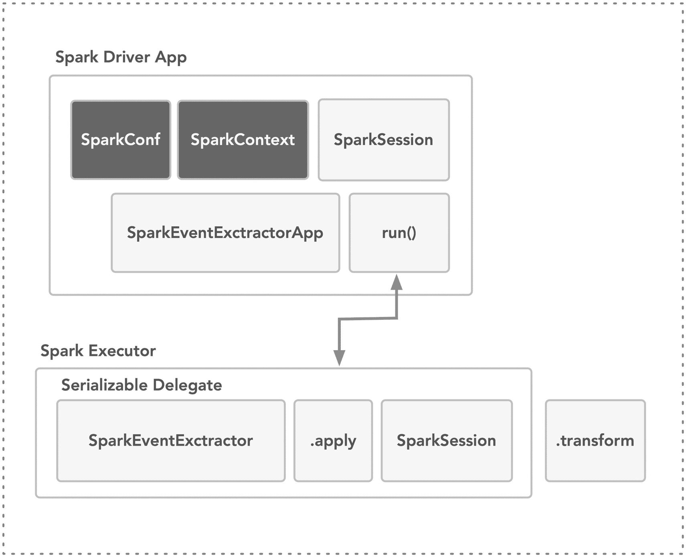

图 7-3

`SparkEventExctractorApp`（驱动器）与委托给 `SparkEventExctractor` 类的工作之间的关注点分离

# `SparkEventExtractor`

首先，让我们来看一下类定义，然后我们会深入探讨。清单 7-12 中的类签名展示了 Spark 委托类。

```
case class SparkEventExtractor(spark: SparkSession)
extends DataFrameTransformer {}
清单 7-12
Spark 委托模式：SparkEventExtractor 委托类
```

该类被设计为一个 `case class`。这种不可变的构造提供了固有的序列化能力，以及自动生成的伴生对象。伴生对象恰好有一个延迟生成的实例，其精妙之处在于，这意味着 Spark 可以依赖一个惰性的委托链。鉴于 `SparkSession` 是我们构造该类本身的唯一先决条件，这些细节可以再次卸载给 Spark。该类还扩展了一个名为 `DataFrameTransformer` 的特质。这个简单的特质旨在为你的应用程序提供额外的结构，主要是一个 `transform` 方法。

```
trait DataFrameTransformer {
def transform(df: DataFrame): DataFrame
}
```

`DataFrameTransformer` 有助于强制你实现该方法，从而要求我们的类实现 `transform` 方法。那么，现在让我们利用对应用程序需求的了解，来实现这个 `transform` 方法。

```
import spark.implicits._
override def transform(df: DataFrame): DataFrame =
df
.filter($"eventType".equalTo("CustomerRatingEventType"))
.transform(withCustomerData)
```

这段 `transform` 代码基于简单的字符串比较，过滤掉任何不受支持的事件，并将可能的事件范围缩小到 `CustomerRatingEventType`。我们现在可以安全地将事件传递给我们的 `withCustomerData` 转换方法。接下来，让我们实现它。

```
def withCustomerData(df: DataFrame): DataFrame = {
if (spark.catalog.tableExists("customers")) {
spark.table("customers")
.select(
$"customerId",
$"firstName",
$"lastName",
$"email",
$"created".as("joined")
)
.join(df, usingColumn = "customerId")
} else throw new RuntimeException("缺少表：customers")
}
```

现在，我们基本上有了一个功能完整的应用程序。当然，还有很多机会可以改进代码，例如添加模式强制执行层，或者扩展运行时配置以包含 customers 表的表名（因为硬编码可能会带来问题）。但重要的是，我们有了一个可以运行的概念验证，并且离交付这个应用程序又近了一步。

## 编译 Spark 应用

现在，你可以使用 `sbt` 来编译这个闪亮的新应用了。

```
> sbt clean assembly
```

假设你使用了本章提供的源代码，你会看到，除了应用程序构建成功之外，你还针对 Spark 应用运行了一整套单元测试。

```
[info] ScalaTest
[info] 运行完成，用时 12 秒 279 毫秒。
[info] 运行测试总数：4
[info] 套件：完成 1，中止 0
[info] 测试：成功 4，失败 0，取消 0，忽略 0，挂起 0
[info] 所有测试通过。
```

## 练习 7-3：总结

这第一个批处理应用是许多层次微妙之处以及多年编写 Apache Spark 应用经验教训的入门。虽然目前这个应用做的事情不多，但它做得非常好的一点是为你将来的成功打下了基础。随着我们在后续章节中进入有状态批处理和 Spark Structured Streaming，我们将继续依赖在构建这个第一个批处理应用中学到的经验教训。

接下来你将学到的，很可能是 Spark 应用开发生命周期中最重要的一步。就像传统软件开发一样，测试你的代码不仅仅是“锦上添花”，而是工作的要求。此外，对于 Spark 应用来说，测试你的代码可以确保你不会在运行时浪费宝贵的时间和金钱来调试代码。我还发现，像你在练习 7-4 中将要进行的那样编写测试是极其宝贵的，因为你将在测试环境中运行 Apache Spark 来驱动你的单元测试，这将为快速应用开发、更好的可调试性以及最终构建值得信赖且运行稳定的应用打开大门。

# 测试 Apache Spark 应用

学会正确地测试软件是一门艺术。我相信你听过这样的说法：编写单元测试所花的时间可能比编写应用程序本身要长得多。这并非在所有情况下都成立，但当你刚开始时，确实可能会有这种感觉。我在实践中发现，正确的框架、库和设计模式会带来天壤之别。现在，让我们来看看如何添加正确的依赖。

## 添加测试依赖

位于应用程序根目录下的 `build.sbt` 描述了应用的所有库依赖，包括仅用于测试的库。打开 `build.sbt` 文件并滚动到以 `libraryDependencies` 开头的部分，查看所有依赖。

```scala
libraryDependencies ++= Seq(
  ...
  "org.apache.spark" %% "spark-sql" % sparkVersion % Test classifier "tests",
  "org.apache.spark" %% "spark-sql" % sparkVersion % Test classifier "test-sources",
  "org.scalatest" %% "scalatest" % "3.2.2" % Test,
  "org.scalamock" %% "scalamock-scalatest-support" % "3.4.2" % Test,
  "com.holdenkarau" %% "spark-testing-base" % "3.0.1_1.0.0" % Test
)
```

特殊的语法 `Test` 告知构建过程，仅在评估测试时加载以下库。这样，我们就不会将额外的库与应用程序一同发布，因为在测试执行后我们不会再使用它们。

### Spark 测试基础库

我想特别提一下 Holden Karau 的 [`spark-testing-base`](https://github.com/holdenk/spark-testing-base) 库。Holden 是 Apache Spark 项目的 PMC 成员。她对 Spark 基础以及这个测试库的贡献，意味着你可以将时间集中在编写出色的应用程序上。

接下来，让我们看看如何编写你的第一个单元测试。

### 练习 7-4：编写你的首个 Spark 测试套件

打开应用程序的测试目录，它位于应用程序的根目录下。

```
app/src/test/scala/
com.coffeeco.data/
```

你会看到 `test` 目录下有以下文件。

```
com.coffee.data/
SharedSparkSql.scala
SparkEventExtractorSpec.scala
TestHelper.scala
```

首先我们来查看 `SparkEventExtractorSpec`。打开这个文件，你会立刻注意到，这个类的构造函数继承了 `AnyFlatSpec`（由 `scalatest` 框架提供），并混入了 `scalatest Matchers` 以及 `SharedSparkSql` trait。

```scala
class SparkEventExtractorSpec extends AnyFlatSpec
  with Matchers with SharedSparkSql
```

`SharedSparkSql` trait 让你能够在单元测试中运行一个嵌入式的、可配置的 Apache Spark 版本。它可以轻松地混入到任何单元测试中，而无需尝试模拟所有操作。`SharedSparkSql` trait 如清单 7-13 所示。

```scala
trait SharedSparkSql extends BeforeAndAfterAll with SparkContextProvider {
  self: Suite =>
  @transient var _sparkSql: SparkSession = _
  @transient private var _sc: SparkContext = _
  override val sc: SparkContext = _sc
  def conf: SparkConf
  val sparkSql: SparkSession = _sparkSql
  override def beforeAll() {
    _sparkSql = SparkSession.builder()
      .config(conf).getOrCreate()
    _sc = _sparkSql.sparkContext
    setup(_sc)
    super.beforeAll()
  }
  override def afterAll() {
    try {
      _sparkSql.close()
      _sparkSql = null
      LocalSparkContext.stop(_sc)
      _sc = null
    } finally {
      super.afterAll()
    }
  }
}
// 清单 7-13
// SharedSparkSql Trait 混入了来自 com.holdenkarau.spark.testing 的 SparkContextProvider
```

清单 7-13 中的 `SharedSparkSql` trait 要求每个测试套件都提供自己的 `SparkConf`。这一点很重要，因为每个测试套件（例如 `SparkEventExtractorSpec`）可能需要一组特定的配置，而这些配置在其他测试套件中可能不必要或不准确。这保证了每个测试套件恰好会创建一个 `SparkContext`，从而确保测试能够快速运行，而无需等待每个测试都启动和关闭一个本地 Spark 运行时。现在回到 `SparkEventExtractorSpec`。

### 在 SparkEventExtractorSpec 中配置 Spark

你会看到，这个测试套件首先实现了 `SharedSparkSql` trait 的 `conf` 方法，如清单 7-14 所示。

```scala
override def conf: SparkConf = {
  val sparkWarehouseDir = fullPath("src/test/resources/spark-warehouse")
  val testConfigPath = fullPath("src/test/resources/application-test.conf")
  // 覆盖配置的位置，指向我们的测试配置文件
  sys.props += ( ("config.file", testConfigPath ))
  // 返回 SparkConf 对象
  SparkEventExtractorApp.sparkConf
    .setMaster("local[*]")
    .set("spark.app.id", appID)
    .set("spark.sql.warehouse.dir", sparkWarehouseDir)
}
// 清单 7-14
// 为 Spark 应用程序单元测试设置自定义的 SparkConf
```

清单 7-14 中的 `conf` 方法里发生了一些有趣的事情。这是覆盖基础 `application.conf` 的第一个具体例子。鉴于每个 `SparkSession` 只会创建一个 `SparkContext`，并且 `BeforeAndAfterAll` trait 强制执行了这种行为，这意味着你只有一次机会来提供这些覆盖配置。幸运的是，你之前创建的 `SparkApplication` trait *懒加载*了 `SparkConf` 和 `SparkSession`，将它们作为两个独立的函数，有效地推迟了初始化，直到应用程序需要每个对象为止。

当执行下面的代码块时（来自清单 7-14）：

```scala
SparkEventExtractorApp.sparkConf
  .setMaster("local[*]")
  .set("spark.app.id", appID)
  .set("spark.sql.warehouse.dir", sparkWarehouseDir)
```

这是在 `SparkSession` 初始化时完成的，并且对于测试套件中的每个独立测试，它都会被调用一次。你可以从 `SharedSparkSql` trait 的 `beforeAll` 方法中看到它是如何被调用的。

```scala
_sparkSql = SparkSession.builder()
  .config(conf).getOrCreate()
```

同样重要的一点是，这是如何工作的。鉴于 `SparkContext` 只创建一次，并且 `SparkConf` 是不可变的，这意味着当 `SparkSession` 构建器第二次被调用时，只有最初的配置会生效。这对于我们的测试用例来说非常完美。

### 测试成功场景

清单 7-15 中展示的测试用例是测试 `SparkEventExtractor` 转换方法行为的一个示例。

### 测试 SparkEventExtractor 应用程序代理

清单 7-15 中的测试用例首先获取了 `SparkEventExtractorApp` 的 `SparkSession`。由于 `SparkSession` 是一个懒加载的单例对象，我们可以保证所有测试都会引用同一个会话（对象）。这就是在清单 7-16 的 `SparkSession` 构建器中看到的 `getOrCreate` 条件分支。

```scala
lazy implicit val sparkSession: SparkSession = {
SparkSession.builder()
.config(sparkConf)
.enableHiveSupport()
.getOrCreate()
}
```
清单 7-16：来自 SparkApplication Trait 的 SparkSession 懒初始化

随后，我们使用 `TestHelper` 上的一个方法为测试创建了一些数据，该方法返回一个代表少量客户评级的 DataFrame。这些数据使我们能够测试 `SparkEventExtractor` 转换方法的行为，而无需搭建一个完整的端到端应用测试。要对转换后的输出运行一个简单的相等性测试，我们可以执行一个简单的 `select`，然后检查结果行是否符合我们的预期。

这个技术对于断言成功和失败场景的预期都非常有效。鉴于 `SparkEventExtractor` 上的 `transform` 方法要求 `customers` 表存在于 `SparkSession` 中，我们可以简单地删除当前活跃的 `SparkSession` 中的该表，并确保抛出了适当的异常。

### 测试失败场景

测试失败场景与测试成功场景同样重要，甚至更重要。清单 7-17 中的代码块向你展示了如何测试不顺利的路径！

```scala
"SparkEventExtractor" should
"fails to join customerRating events when customer table is missing" in {
val testSession = SparkEventExtractorApp.sparkSession
testSession.sql("drop table customers")
val ratingEvents = TestHelper.customerRatingsDataFrame(testSession)
assertThrowsRuntimeException
.transform(ratingEvents))
}
```
清单 7-17：测试失败场景

这个简单的单元测试确保了应用程序逻辑中没有隐藏的问题。假设你以后改变了 `transform` 方法的行为，这将捕获你未来的自己或其他未来的工程师，避免他们不得不调试来确定生产环境中哪里出了问题。

### 全面测试端到端 Spark 应用

没有经过完整、无人工干预的端到端测试，任何应用程序都不能算作真正完成。这意味着你需要测试应用程序的全部预期行为。清单 7-18 展示了一个完整的端到端测试，它使用了主应用程序，而非前两个示例中使用的应用程序委托。

```scala
"SparkEventExtractor" should
"handle end to end processing" in {
val testSession = SparkEventExtractorApp.sparkSession
TestHelper.customersTable(testSession)
TestHelper.customerRatingsTable(testSession)
val destinationTable = "silver.customerRatings"
testSession.conf
.set(SourceTableName, "bronze.customerRatings")
testSession.conf
.set(DestinationTableName, destinationTable)
testSession.conf
.set(SaveModeName, "Overwrite")
testSession.sql(s"drop table if exists $destinationTable")
SparkEventExtractorApp.run()
testSession.catalog
.tableExists("silver", "customerRatings") shouldBe true
testSession.table(destinationTable).count shouldEqual 1
}
```
清单 7-18：测试 Spark 应用的端到端行为

完整的端到端测试确保 `bronze.customerRatings` 和 `customers` 表都已在 SparkSQL 目录中初始化，因为这是应用程序运行的前提条件。它还确保我们在调用 `SparkEventExtractorApp` 上的 `run` 方法之前，如果 `destination` 表已存在，则将其删除。这样，我们必须执行某些操作才能让该表存在。我们更进一步，测试该表确实存在，并且我们提供的那个评级数据已经显示出来。

#### 练习 7-4：总结

运行单元测试对于任何 Spark 应用程序都至关重要，对于更大、更复杂的 Spark 应用程序尤其重要。利用 Apache Spark 来编写测试以测试 Apache Spark 应用程序的美妙之处在于，你可以测试应用程序的方方面面，从损坏的输入数据到缺失的表，以及你能想到的所有问题。此外，丰富的应用程序测试还能帮助你提升 Apache Spark 技能。就像使用 Apache Zeppelin 进行测试一样，你也可以采用测试驱动的方式来编写单元测试，逐步构建你的应用程序，同时确保你的测试能够捕捉到应用程序的端到端意图。

## 总结

我们在本章中涵盖了大量内容。你了解了不同类型 Spark 应用程序的“风味”，从动态的交互式应用程序（`spark-shell` 和 Apache Zeppelin），到简朴的批处理模式应用（包括无状态和有状态批处理）。我们以对结构化流处理的两种常见模式（微批处理和连续处理）的介绍结束了本次巡览，这两种模式用于处理你所有的有状态流处理需求。

随后，我们的旅程转换了方向，你将注意力从 Spark 应用程序转移开，转而思考如何解决常见的数据建模和需求建模用例。通过这个过程，你认识了 CoffeeCo，了解了这家虚构公司的使命陈述，并经历了一些专注于数据建模过程的思维练习。鉴于软件工程拥有既定的规则和设计模式，并且数据工程是软件工程的一个子集，那么顺理成章地，我们可以遵循那些已经诞生了大型、可靠、经过测试且容错性强的应用程序的相同模式。

借助传统软件工程的视角，你经历了一个完整的端到端用例，从一个想法开始，最终得到一个功能完备、经过良好测试的 Spark 应用程序。这里学到的重要经验是，你可以像习惯测试任何传统软件一样轻松地测试你的 Spark 应用程序，而接下来能构建什么，只取决于你的想象力。

这个简单的 Spark 应用程序已经准备好被快速部署，作为一个数据管道作业来运行。这非常棒，因为这是下一章的重点。你准备好了吗？是时候转换方向，学习如何使用流行的工作流编排框架 Airflow 来驱动你的数据管道了。

# 第二部分 流式管道生态系统

# 8. 使用 Apache Airflow 进行工作流编排

总的来说，作为一名数据工程师，你会发现自己最常遇到两类问题。第一类源于背弃的承诺，也就是糟糕的上游数据源，以及关于数据在你的管道中流动的更普遍的“未知的未知”。你将要面对的第二类问题是*时间*。这里我不是要开始跟你谈论生命、死亡和决策，而是把时间作为一个界限或阈值。时间存在于作业的物理运行时间之间，也体现在与数据服务等级协议相关的非常现实的底线中。这些数据契约围绕着对数据格式（即*模式*）以及数据预期可用的约定时间的期望。时间让我们陷入困境的另一种方式是在这两个常见问题的交汇处，例如，上游问题与陈旧数据“幸福地”结合在一起，或者错过了服务等级协议。

如果你思考这两类问题（数据质量差和时间约束），你可能会开始理解进行工作流编排的必要性，因为缺失或陈旧数据问题会引发蝴蝶效应。管道中糟糕的上游数据会导致管道堵塞，进而影响整个数据管道。这可能是由于直接接入你数据管道的任何 API 和服务宕机，以及数据管道中任何环节导致服务等级协议被违反的作业故障或配置错误造成的。

我倾向于将数据管道想象成地图上的路径、道路、路标点和目的地。*作业*可以被视为路标点以及最终目的地，而数据流本身可以比作在地图上移动的实体，无论是自行车、火车、汽车还是介于两者之间的任何东西。当出现问题时，事情往往会积压起来（在不那么极端的情况下则会从裂缝中掉落）。你可能自己在一天中的特定通勤时间遇到过这种情况，例如在高峰时段，也可能在某些随机时间点，当你发现自己受困于意外的道路施工，或者汽车意外爆胎时。解决这些问题的办法是清除道路上的障碍，随着时间的推移，正常的交通流量就会恢复。当一切再次顺畅运行时，你就可以放松下来（呼吸），享受旅程了。

工作流编排不仅仅用于摆脱困境。它还用于构建可靠完成一组任务的蓝图，例如通过数据管道移动和转换数据。让我们简要地谈谈工作流编排，然后看看 Airflow 如何帮助我们解决这些司空见惯的问题。

## 工作流编排

`工作流`是一组常见的可执行任务，需要以特定顺序执行才能达到预期效果。换句话说，`工作流`关注的是全局视野。它以结果为导向，也就是说，只要每个任务按时完成且不影响最终结果，它就不会纠结于每个任务如何完成的具体细节。

就数据而言，`工作流`传统上由`管道作业`封装，这些作业本身作为任务运行，并赋予各个操作员职责，这些操作员在一个连续、分布式的数据处理网络中协同工作。`图 8-1` 显示了左侧`管道作业 (A)` 的放大视图，右侧则是完整的`工作流 (作业 A-E)`。

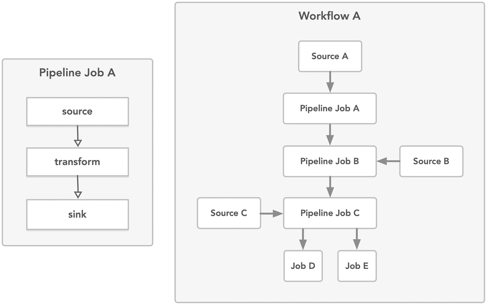

`图 8-1` 从管道到工作流。工作流封装了构成跨数据管道网络运行的分布式作业网络的输入和输出链

理解工作流编排的另一种方式是将其与大多数公司和组织中心常见的典型层级结构联系起来。一位主管与一位或多位经理合作，这些经理又管理一组员工，员工完成分配给他们所需的工作。工作如何作为一个有凝聚力的单元按时完成，这属于工作流编排中“编排”的范畴。你可以将这个组件想象成从主管到经理，再到完成工作的团队，在整个网络中传递的截止日期和需求。

当你将所有这些整合在一起时，你就拥有了一个协同运作的单元，它根据优化了可用资源总量的时间表，完成一个分布式目标。现在请记住这个概念，我们将把注意力转向 Apache Airflow，从理论转向实践。

# Apache Airflow
Apache Airflow 是目前（在撰写本文时）最流行的开源工作流编排平台。该项目始于 2014 年底 Airbnb 的内部项目。它源于一个普遍需求：以集中化方式解决日益复杂的工作流这一常见问题，从而通过简单的 UI 实现对作业的程序化编写和调度。本质上，一个作业在简单的 Python 脚本中定义了自己的计划和配置。这种由代码驱动的作业调度方法提供了丰富的定制化能力，这是仅靠静态配置难以实现的。你可能会想，这对于 Airbnb 这样规模的公司来说很棒，但为什么你需要使用 Airflow 或任何类型的自动工作流编排器呢？

## 何时编排至关重要
考虑以下情况：你和你的团队可以管理不断增加的工作量，直到达到一个临界点，此时每个新任务都意味着要放弃或自动化另一个任务，以便为更多任务腾出空间。如果你的团队规模较小，你至少可以在一段时间内手动管理任务负载。例如，启动每日批处理作业或为公司内不同团队运行手动报告。然而，从长远来看，自动化几乎总是团队成功的关键因素。通过移除那些容易自动化的工作，团队可以转向新任务，实现新目标，收获新成果，并扩展他们的集体能力和影响范围，而无需随着工作量不必要地线性扩张团队。

你如何知道从哪里开始？如果你发现自己或团队中的其他人在冗余工作上花费了更多时间，并且无意义地重复着单调的任务，这就是你开始自动化的催化剂。制定一个行动计划，将那些不令人满意或重复性的工作自动化，以释放开发周期，为接下来出现的任何任务腾出空间。有趣的是，到了某个节点，你会发现即使是这些自动化任务也需要通过自动化来管理，而这就是 Apache Airflow 和其他编排框架发挥作用的地方。

## 协同工作
回顾上一章，你学习了无状态和有状态批处理作业的区别，Airflow 可以被用作这两种操作模式的交汇点。它允许你定义健壮的工作流，这些工作流通过 Python 辅助库、额外的 Airflow 插件以及我们的老朋友 Apache Spark 的支持，引入了更动态的配置。让我们从上一章继续，使用 Airflow 来自动化运行我们的 Spark 应用程序。

## 练习 8-1：启动并运行 Airflow
当你能够使用 Docker Compose 管理事情时，启动并运行 Apache Airflow 可能是一个简单的过程。前往你的 IDE，打开第 8 章的练习内容。

### 练习材料
你可以在本书 GitHub 资源中的 `ch-08/` 文件夹中找到本章的材料，地址为 [`github.com/newfront/spark-moderndataengineering`](https://github.com/newfront/spark-moderndataengineering)。

我们将从简单地启动 Airflow 开始。打开你的终端，将工作目录更改为 `ch-08` 目录以开始。

# 安装 Airflow

在命令行中，将当前工作目录切换到 `airflow` 目录。运行 `cd ch-08/airflow`。在 `airflow` 目录中，你需要执行一些常规维护任务，以确保流程顺畅。

## 添加目录

以下 Airflow 目录将被卷挂载到 Airflow 容器运行时中，从而让你能够将所有作业定义和运行时日志保留在简单的本地位置。在 `airflow` 目录中运行清单 8-1 中的命令。

```
mkdir ./dags ./logs ./plugins
```

清单 8-1：在 `airflow` 目录下添加 Dags、Logs 和 Plugins 目录。

现在进入下一项任务。

## 为 Docker Compose 添加环境变量

你是否知道可以将环境变量导出到 `.env` 文件中，该文件将在 Docker Compose 过程中被使用？`.env` 文件可用于将可配置的路径、用户、Docker 镜像、密码等内容注入到 Docker Compose 中。这使你能够复用 `docker-compose.yaml` 定义，而无需硬编码用户名、密码或任何可能最终成为安全隐患的内容。

例如，本章练习中的 `.env` 文件（位于 `/ch-08/airflow/.env`）已被预填充。如果你想要更新运行时与 Airflow 关联的用户 ID 和组 ID，或者甚至更改 Airflow UI 端口，你可以直接编辑该文件，或使用追加运算符 `>>` 来添加新变量，如清单 8-2 所示。

```
echo -e "AIRFLOW_UID=$(id -u)\nAIRFLOW_GID=0\n _AIRFLOW_WEB_SERVER_PORT=8088" >> .env
```

清单 8-2：使用 Shell（命令行）、`Echo` 和追加运算符修改 Airflow 的 `.env` 文件。

**端口冲突**
Airflow 默认会绑定到端口 `8080`，这与你的内部 Zeppelin 主机使用的端口相同。清单 8-2 中显示的更新通过将 Airflow 端口切换为 `8088`，使得这两个服务可以协同运行。如果你不想记住服务运行的端口，可以运行 `nginx` 并根据主机名进行路由。

## 初始化 Airflow

是时候下载、设置并初始化 Airflow 了。从 `ch-08/airflow` 工作目录，在命令行中执行清单 8-3 中的命令。这将准备好环境并引导数据库表，但你暂时还不会启动 Airflow 容器。

```
docker compose up airflow-init
```

清单 8-3：使用 Docker Compose 初始化 Airflow。

清单 8-3 中的 Docker Compose 初始化命令可能需要一些时间来下载所有依赖的 Docker 容器。接着，`airflow-init` 命令将激活并引导 Airflow 元数据数据库，该数据库存储了你所有的 Airflow 作业配置，然后设置 Redis 数据库。该数据库与作业调度器一起使用。Redis 是一种极快、高性能且流行的键值对和数据结构存储，Airflow 用它来管理调度和缓存。你将在第 10 章学习如何使用 Redis 来驱动你的第一个结构化流应用程序。

在初始化过程中，你会注意到大量日志输出。这个过程将运行数据库迁移、引导以及所有其他的初始化脚本和程序。如果你感兴趣（或者想从中获得编写自己初始化程序的灵感），可以滚动查看输出；否则，你就可以准备运行 Airflow 了。

# 运行 Airflow

初始化完成后，你可以执行清单 8-4 中的命令。
```
docker compose up
```
清单 8-4：从 Airflow 工作目录运行 `docker compose up` 命令以启动本地 Airflow 集群。

Docker Compose 过程将总共启动七个 Docker 容器。这是在本地环境中启动并运行一个功能完备的 Airflow 集群所需的全部组件。需要指出的一点是，与之前章节中我们使用 `run.sh` 脚本来启动或停止 Zeppelin 环境不同，`docker compose up` 命令只会在终端窗口的生命周期内运行。如果你想将其作为长期运行的进程，接下来你将学习如何以分离模式运行 Airflow。

# 以分离模式运行 Airflow

以分离模式运行允许你将每个容器作为后台进程运行，该进程会持续运行，直到你显式地停止容器进程（或关闭机器）。在分离模式下运行时，需要考虑两件事。首先是用于启动和关闭容器的方法。例如，你是偏好使用命令行别名还是脚本文件？第二件要考虑的事情是你想如何管理使用多服务 Docker Compose 定义创建的复合运行时环境，以及你希望共享卷和目录位于何处以及如何引用。让我们先了解如何以分离模式运行 Airflow，然后提供一个解决方案，用于创建更精简的本地 Docker 环境。

## 启动服务

Docker Compose 进程接受显式的文件指针 `-f`，可用于传递绝对路径，同时还有 `-d` 标志，它会将进程更改为在后台而不是前台运行。这两种模式的区别在于，在前台你会看到由你的 `docker-compose.yaml` 定义控制的所有容器的所有日志。而在后台，如果你想要重新连接到容器的输出并查看输出，则必须引用实际的容器标识符：`docker logs -f container_ID`。

以下命令显示了更长的 `docker compose` 命令。你可以从 Airflow 工作目录运行此命令（清单 8-5）。

```bash
docker compose \
  -f docker-compose.yaml \
  up -d
```

## 关闭服务

当你准备好关闭 Airflow 集群时，可以再次使用 `docker compose` 来停止所有容器。执行清单 8-6 中的命令来关闭你的 Airflow 集群。

```bash
docker compose \
  -f docker-compose.yaml \
  down --remove-orphans
```

从本地目录（例如 `/ch-08/airflow/`）中启动和关闭 Airflow（或任何由 Docker Compose 控制的服务）的过程足够简单。然而，从长远来看，除非你努力组织好自己的本地环境，否则这个过程会比实际需要的更困难。例如，如果你有许多由多个 `docker-compose.yaml` 定义控制的环境，以支持许多不同的本地数据工程用例，那么容器命名冲突或其他环境问题可能会出现。从长远来看，创建一个服务层次结构，整齐地嵌套在根目录下，会容易得多。现在我们来看看如何优化你的本地环境，以降低后续流程的复杂性。

### 优化本地数据工程环境

随着你为本地数据工程环境添加越来越多的技术，你可能会发现创建一个统一的位置（父目录）很有用，该目录可用于创建一个有序的本地数据平台，按服务划分，并结合特定的服务卷挂载、`docker-compose.yaml` 定义和 `.env` 规范来组织，从而为 Docker 运行特定技术创建一致的环境。

现在让我们来优化你的环境。将本章迄今为止完成的所有工作复制到 `dataengineering` 父目录中。执行清单 8-7 中的命令，将 `dataengineering` 目录添加到你的主目录中。

```bash
mkdir ~/dataengineering && \
cp -R /path/to/ch-08/airflow ~/dataengineering
```

Airflow 已顺利安置在新家，下一步是添加一个简单的别名来启动和停止 Airflow。别名可以添加到你的本地 Bash 或 shell 环境设置文件（`.bashprofile`、`.bashrc` 或 `.zshrc`）中，具体取决于你运行的命令行。清单 8-8 展示了如何为 UNIX 风格系统添加 `airflow2_start` 和 `airflow2_stop` 别名。

```bash
# 适用于 Apache Spark 的 MDE 辅助工具
export DATA_ENGINEERING_BASEDIR="~/dataengineering"

alias airflow2_start="docker compose -f ${DATA_ENGINEERING_BASEDIR}/airflow/docker-compose.yaml up -d"
alias airflow2_stop="docker compose -f ${DATA_ENGINEERING_BASEDIR}/airflow/docker-compose.yaml down --remove-orphans"
```

对配置文件进行更改后，请确保运行`source`命令将更改加载到当前会话中。例如，执行`source ~/.zshrc`命令会将这两个 Airflow 别名添加到当前终端会话中。现在，无论何时需要启动本地 Airflow 集群，你只需记住`airflow2_start`；同样，当你完成工作或想释放一些系统资源时，只需调用`airflow2_stop`即可。你已经让启动和停止 Airflow 变得更加容易。你可能也迫不及待想查看效果了。让我们回到正题。

## 健康检查：Airflow 在运行吗？

假设你已经使用`airflow2_start`别名或清单 8-4 与清单 8-5 中的任一命令启动了 Airflow，那么检查程序是否运行的最简单方法是打开你常用的浏览器，访问`http://localhost:8088`。你会看到一个登录界面，如图 8-2 所示。

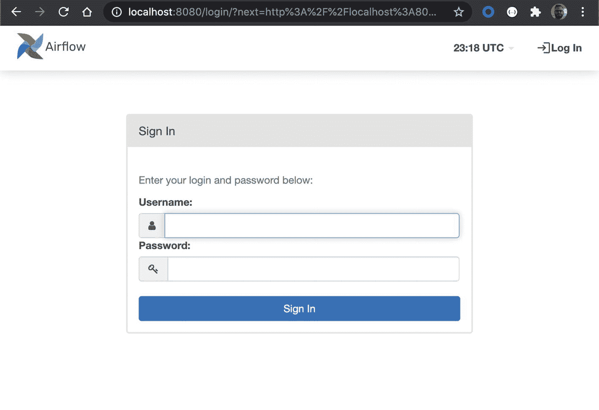

图 8-2

Airflow 登录界面

登录界面确认至少 Airflow 的 Web 服务器进程已启动并正在运行。你可以使用用户名（`airflow`）和密码（`airflow`）登录。登录后应会进入 Airflow 的主用户界面（见图 8-3）。

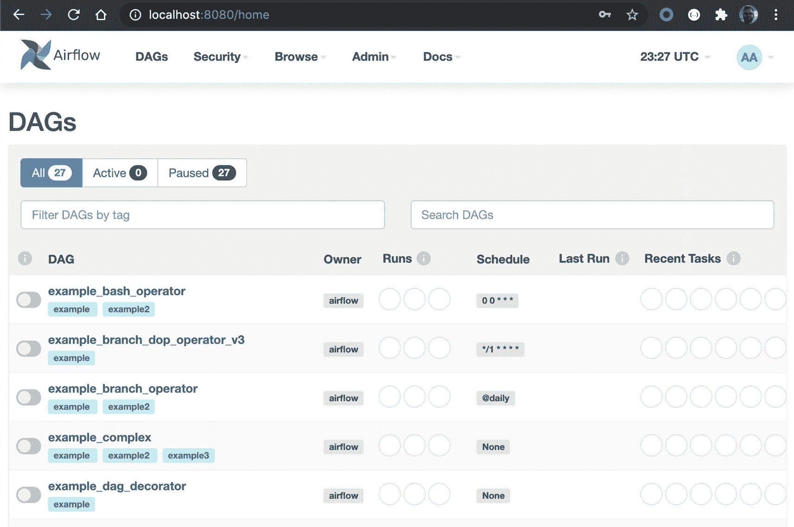

图 8-3

Airflow 的默认用户界面

> **注意**
> 你的浏览器可能会提示用户名和密码已泄露。这是因为`airflow:airflow`这个用户名:密码组合是 Airflow 的默认值，除了本地测试外，绝不应在其他任何场合使用。

在 Airflow 主屏幕上，你将看到所有作业定义、作业元数据以及每个作业先前运行（如果有）的统计信息。这也是进行常规安全管理和常见管理任务的出发点。在本章中，我们将花一些时间了解用户/角色控制，并探讨如何添加安全配置（如密码）。

首先，你的作业定义官方称为 *DAG*（有向无环图）。这是因为每个作业都被定义为一个或多个操作的有向无环图，本质上每个 DAG 本身就是一个管道操作或一个完整的复杂工作流。

> **注意**
> 你可以选择保留或删除这些默认作业。我建议保留它们，以便你可以浏览示例，了解 Airflow 能实现哪些功能。

## 运行 Airflow DAG

在 Airflow 运行且你已处于 DAG 屏幕的情况下，让我们运行其中一个示例作业。点击`example_bash_operator`（位于示例列表顶部）进入 DAG 概览屏幕（见图 8-4）。

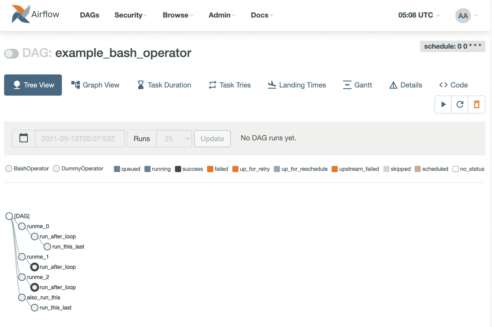

图 8-4

Airflow 的 DAG 详情用户界面是你完成大部分工作的地方

图 8-4 中的 DAG 用户界面为你提供了一个多步骤管道作业的总体概览。要运行此示例作业，你需要执行以下两步：

1.  将开关图标（图 8-4 中“DAG”字样左上角）切换至启用状态。默认情况下 DAG 处于禁用状态以节省集群资源。你需要选择启用以运行每个计划或单次执行。

2.  点击播放图标（右侧，刷新和删除按钮旁边）开始运行管道。

当你按下“触发”按钮后（确认可选的 JSON 配置后），作业将启动，随后你会看到作业过渡到“运行中”状态。图 8-5 中的用户界面显示了实时的 Airflow 作业视图。

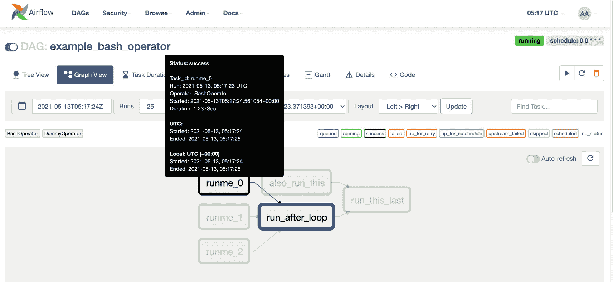

图 8-5

实时 Airflow 作业的运行视图

值得一提的是，该作业几乎会立即完成；但更新后的 Airflow 2 用户界面的一个不错功能是自动刷新选项（如图 8-5 右侧所示）。如果启用此选项，你可以在管道在操作阶段之间主动切换时观察其进度，这有助于在 DAG 中任务完成或失败时监控/观察进度或故障。

## 练习 8-1：总结

现在，无论何时你想要启动 Apache Airflow，它都已准备就绪。但是，要从 Airflow 启动 Spark 批处理作业，你还需要完成更多工作。下一节将向你介绍 Airflow 的组件，然后我们将安装 Spark 运算符。

## Apache Airflow 的核心组件

在运行了第一个 Airflow DAG 之后，现在是时候讨论最初让 DAG 得以运行的组件了。主要是 Airflow 的任务、运算符、调度器和执行器。

### 任务

在每个 DAG 内部，都存在一系列一个或多个*任务*，这些任务被执行以完成特定 DAG 所规定的要求。任务是 Airflow 中的基本执行单元，对于 Spark 应用程序也是如此。这里的重叠之处在于，对于 Spark，你有作业，每个作业由分配任务的任务阶段组成。对于 Airflow，你的 DAG 由任务组成，这些任务按特定预定义顺序运行，工作是在管理特定 DAG 的 Airflow 执行器上下文中完成的。任务可以使用运算符执行任意代码，因此每个 DAG 可以处理许多任务。每个任务可以根据所使用的运算符在本地或远程执行。

### 运算符

Airflow 运算符是模板化的任务。你可以将其视为一个可复用的蓝图，用于封装通用用例，使得通用的 Python 代码能够被复用以完成特定操作。在示例 DAG（`example_bash_operator`）中，你已经接触了两个核心的 Airflow 运算符——`BashOperator` 和 `DummyOperator`。

`BashOperator` 的功能正如其名：它用于执行 bash（或命令行）操作。`DummyOperator` 用于确保 DAG 在任务图中有一个最终的公共节点。在构建更复杂的 DAG 时，`DummyOperator` 也可用作占位符。清单 8-9 展示了`example_bash_operator` DAG 的 Python 代码。

```python
from datetime import datetime, timedelta

from airflow import DAG
from airflow.operators.bash import BashOperator
from airflow.operators.dummy import DummyOperator

with DAG(
    dag_id='example_bash_operator',
    schedule_interval='0 0 * * *',
    start_date=datetime(2021, 12, 28),
    dagrun_timeout=timedelta(minutes=60),
    tags=['example', 'example2'],
    params={"example_key": "example_value"},
) as dag:
    run_this_last = DummyOperator(task_id='run_this_last',)

    run_this = BashOperator(
        task_id='run_after_loop',
        bash_command='echo 1',
    )
    run_this >> run_this_last

    for i in range(3):
        task = BashOperator(
            task_id='runme_' + str(i),
            bash_command='echo "{{ task_instance_key_str }}" && sleep   1',
        )
        task >> run_this

    also_run_this = BashOperator(
        task_id='also_run_this',
        bash_command='echo "run_id={{ run_id }} | dag_run={{ dag_run }}"',
    )
    also_run_this >> run_this_last

    this_will_skip = BashOperator(
        task_id='this_will_skip',
        bash_command='echo "hello world"; exit 99;',
        dag=dag,
    )
    this_will_skip >> run_this_last

if __name__ == "__main__":
    dag.cli()
```

清单 8-9

创建包含同步和异步任务的 DAG

在清单 8-9 中，每个任务都被定义为 `DummyOperator` 或 `BashOperator` 的一个实例。你定义的每个任务都作为图中的一个节点，而作为设计管道的工程师，你需要通过将任务（节点）相互设置为子节点或父节点来建立处理顺序。

在图模式（如图 8-6 所示）下查看你的 DAG，有助于你规划更复杂的工作流。本质上，每个任务可以复杂也可以简单。`SparkOperator` 就是一个可以添加到工作流中的复杂任务示例。


我们将在本章后面更详细地介绍专门的 `SparkSubmitOperator` 和 `SparkSQLOperator`。为了让你全面掌握 Airflow 的各种功能，我的建议是你在新的本地沙盒环境中尽情探索和实验。接下来，我们将探讨 Airflow 如何在 DAG 中运行每个任务背后的过程。

## 调度器与执行器

执行器是 Airflow 中的进程，负责根据计划启动 DAG 中的任务。例如，假设你有一个需要在每天结束时运行的作业。调度此 DAG 的属性如清单 8-10 所示。

```python
DAG(
    dag_id="daily_active_users_reporting_job",
    start_date=days_ago(2),
    default_args=args,
    tags=["coffee_co","core"],
    schedule_interval="@daily",
)
```
*清单 8-10：配置每日 Cron 作业的 DAG 示例*

Airflow 在启动时会解析 DAG 定义，并定期解析以支持在运行时添加 DAG。当遇到新的 `dag_id` 时，DAG 元数据会被写入关系数据库管理系统（RDBMS），并且一旦超过 `start_date` 的阈值，调度器执行器进程将触发 DAG 运行（如果作业未被禁用）。

清单 8-10 中配置的计划将 `start_date` 设置为 `days_ago(2)`，并将 `schedule_interval` 设置为 `@daily`。这是一个回填作业的示例。它会查看当前日期（在 Airflow 服务器上）并回溯，以便在按每日计划（每天开始时或午夜）运行之前，先补跑前两天。更多信息可参考 Airflow 官方文档中 DAG 运行下的 Cron 预设部分。

Airflow 执行器会等待调度器通知它某个 DAG 已准备好运行。实际上，执行器本身运行在调度器进程内部。由于这种关系，考虑到调度与执行之间的紧密耦合，对于给定的 Airflow 集群，你只能指定一种执行模式。

Airflow 自带了几个有用的执行器，提供本地或远程的执行模式。

### 本地执行

如果你运行的是小型集群，可以使用 `SequentialExecutor` 或 `LocalExecutor`。本地执行意味着任务执行将与执行器进程位于同一位置，而执行器进程本身运行在调度器进程内部。这种进程嵌套方式可能适合测试，但这种模式无法扩展以并行运行多个 DAG。

### 远程执行

对于拥有必须运行的关键工作流的**生产环境**，你**别无选择**，只能使用远程执行。这使得多个 DAG 的工作负载能够跨 Airflow 工作节点网络并行执行。要查看你的 Airflow 集群正在运行哪种执行模式，请执行清单 8-11 中的命令。

```bash
docker exec \
  -it airflow_airflow-webserver_1 \
  airflow config get-value core executor
```
*清单 8-11：查看 Airflow 执行器配置*

输出将显示 `CeleryExecutor`，这是 Airflow 中较流行的远程执行器选项之一。`CeleryExecutor` 使用 Redis 进行调度，并将其工作分发到 Airflow 工作进程上。现在，让我们将注意力转向如何将 Apache Spark 与 Airflow 集成。

## 使用 Airflow 调度 Spark 批处理作业

Airflow 是一个强大的外部调度器，你可以依靠它来运行关键的 Apache Spark 批处理作业。此外，工作流编排正成为数据平台的重要组成部分，用于自动化日益复杂的数据管道，并满足众多内部和外部数据客户的需求。正如你在练习 8-1 中学到的，在 Airflow 上运行一个 DAG 非常容易（一旦你掌握了基础知识）。要开始使用 Airflow 和 Spark，你所需要的只是 *Spark Airflow Provider*，它允许你使用几种不同的 Spark 运算符。

### 练习 8-2：安装 Spark Airflow Provider 并运行 Spark DAG

本练习将重点教你安装 Apache Spark provider。你将学习如何手动安装，然后我们将注意力转向使用一个预构建的、已打包好所需组件的 Airflow 容器。接着，你将学习如何使用 Admin UI 在 Airflow 中配置一些运行时配置，最后通过 Airflow 运行上一章中的批处理应用程序。

让我们先从你在练习 8-1 中设置的 Airflow 版本开始。你将直接在 webserver 和 worker Airflow 容器上执行 `pip install` 命令，因为 Spark Python 模块必须在本地可用。

#### 定位 Airflow 容器

要运行安装命令，你需要列出 Airflow 容器的完整名称。执行清单 8-12 中的命令来查看容器名称。

```bash
docker ps | grep airflow_airflow-w*
```
*清单 8-12：使用 Docker 查找 Airflow 容器元数据*

获得容器名称后，你可以使用 Docker CLI 运行安装脚本（使用 pip/Python）。

### 手动安装 Spark 提供商

以下流程演示了如何以 `airflow` 用户身份进行身份验证并安装 Spark 提供商。请以代码清单 8-13 和 8-14 作为安装指南。

> **注意**
> 该示例演示如何在 Web 服务器上安装提供商。你还需要在工作节点上重复此过程，或者继续阅读以使用预构建的容器。

```
docker exec \
  --user airflow \
  -it airflow_airflow-webserver_1 \
  bash
```
*代码清单 8-13：以 Airflow（管理）用户身份打开 Bash 会话以获取安装新提供商的正确权限*

在 Docker 容器中，执行代码清单 8-14 中所示的 `pip install` 命令。

```
pip install \
  --no-cache-dir \
  --user \
  apache-airflow-providers-apache-spark
```

```
代码清单 8-14：使用 Pip 安装 Spark 提供商

你已完成 Web 服务器上的操作。不幸的是，现在需要为每个工作节点实例重新开始整个过程。这将确保提供商在 Airflow 集群中一致地安装。一致性至关重要，因为 Airflow 作为分布式服务运行，并且你无法总是保证 DAG 将在何处被调度。

> **注意**
> 你可以将命名队列与 `CeleryExecutor` 结合使用，以协助在 worker 之间分配工作，你也可以将任务分配到预配置的处理池中，但队列和池不在本书的讨论范围内。

当 DAG 被触发时，对于每个独立的 DAG 运行，封装该 DAG 的所有任务将一直运行，直到全部成功或关键任务失败，从而阻止其余任务的完成。在实际使用中，你会看到工作节点轻松扩展到数十到数百个实例，而在企业集群中规模甚至更大。现在想象一下，你的任务是确保整个系统保持同步，同时记住必须为每次部署重复此步骤以确保一致性。你愿意承担让一切保持同步的任务吗？

当然不。这显然是一种反模式，尤其考虑到我们最初是使用容器来运行事物的。诚然，你可以添加一些容器启动时运行的脚本，但这意味着你会因为依赖关系失败而面临潜在的运行时错误。当中央软件包仓库（如 Pypi 或 Maven）发生故障，或者软件包位置发生更改时（归档的制品版本经常如此），你可能已经遇到过此类问题。

### 使用容器实现运行时一致性

基于一致容器的运行时环境在故障排除时消除了环境方面的猜测，因此你可以集中精力并快速让系统恢复运行。对我们来说，这意味着我们不必手动安装 DAG 操作所需的任何东西。

> **注意**
> `ch-08/airflow/README.md` 中的“高级操作”一节包含了构建自定义 Airflow Docker 镜像的说明，该镜像预装了 Apache Spark 提供商和 Java 11（JRE）。

为了使用预先构建的 Docker 容器（`newfrontdocker/apache-airflow-spark:2.1.0`），你需要对位于 `~/dataengineering/airflow/.env` 的环境文件进行快速调整。然后，为了使更改生效，你还需要重启你的 Airflow 集群。首先，使用 `airflow_stop` 别名关闭你现有的集群。

> **注意**
> 如果你尚未设置本地环境，请返回代码清单 8-7 获取说明。

现在，编辑 `.env` 文件（使用编辑器或命令行），取消注释代码清单 8-15 中所示的这一行。

```
AIRFLOW_IMAGE_NAME=newfrontdocker/apache-airflow-spark:2.1.0
```

代码清单 8-15：将自定义 Airflow 镜像添加到 Docker 环境文件

完成后，保存更改，并使用 `airflow_start` 别名重新启动集群。你无需重新初始化任何内容，因为您只是切换了运行时容器（而不是切换到不同的 RDBMS 或执行器后端）。

现在我们可以继续运行一个 Spark DAG。

### 使用 Apache Airflow 运行 Spark 作业

你已经处理了所有必需的依赖项，Airflow 现在已准备好运行你的 Spark 批处理作业。在接下来的部分，你将使用 Airflow UI 添加一些额外的配置和辅助工具来运行 Spark 作业。

#### 添加 Airflow 变量

Airflow 变量类似于环境变量，但它们在元数据数据库中配置，并可通过 `airflow.models` Python 包访问。变量可以直接在 Airflow 中使用 Admin UI（管理 ➤ 变量）管理，或直接使用 Airflow 命令行管理。此服务允许你在 DAG 中配置可重用的键/值对。

代码清单 8-16 将 `SPARK_HOME` 变量添加到可通过 Airflow DAG 访问的运行时变量集合中。变量可以增强你的 DAG，更重要的是，变量由管理员控制，并且需要基于角色的用户权限才能添加或删除。

```
docker exec \
-it airflow_airflow-webserver_1 \
airflow variables set SPARK_HOME /opt/spark
```

代码清单 8-16：Airflow 变量使你能够将配置直接注入到你的 DAG 中

现在打开 Airflow UI（`http://localhost:8088`），然后点击 Variables 控件（在 Admin 菜单中）以在列表中看到新变量（如图 8-7 所示）。

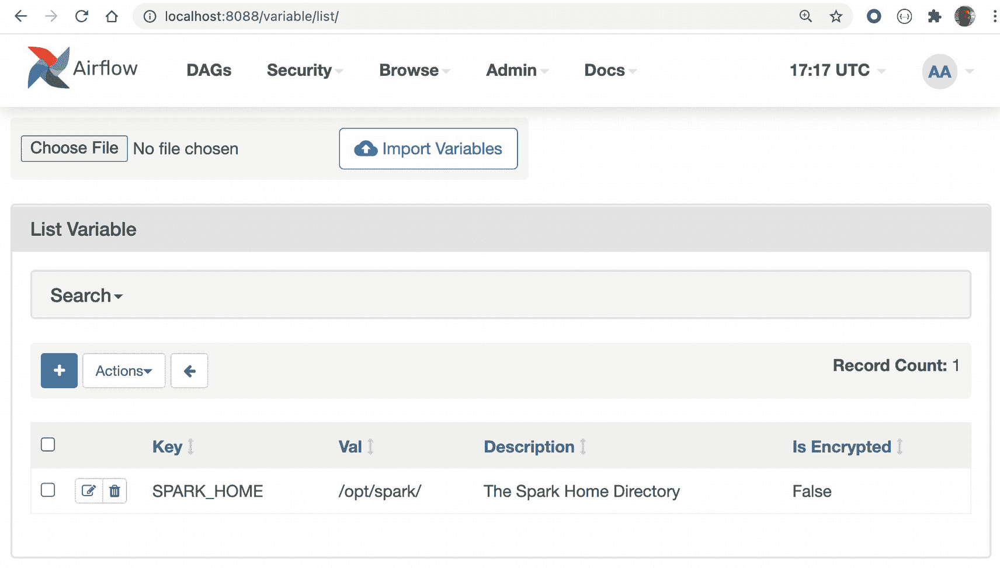

图 8-7：列表中可见 `SPARK_HOME` 变量

你还可以为你添加到 Airflow 中的任何变量编辑元数据以添加描述。这个简单的操作有助于记录给定变量的用法并清晰地传达你的意图。

> **注意**
> `admin` 菜单仅对具有 Admin 角色的用户可用，因此并非任何人都可以编辑这些变量。本章的“继续探索”部分向你展示了如何创建普通用户并介绍了 Airflow 角色（基于角色的访问控制）的概念。

#### 添加 Airflow 连接

连接使 Airflow 能够与外部服务（如 Apache Spark）进行通信，并且可以直接使用 Admin UI（管理 ➤ 连接）或命令行（`airflow connections list`）设置新的连接。

鉴于 Spark Airflow 提供商是一个扩展 Airflow 的模块，因此有简单的方法连接到给定的 Spark 集群（或进程）是合理的。打开 Airflow UI 并转到 Admin ➤ Connections 页面。点击 + 按钮（在左侧）为 Spark 创建一个新连接。此操作将带你进入一个带有空白表单的新页面。

使用该表单，从 Conn Type 菜单中选择 Spark 类型来创建 `local_spark_connection`。完成的表单如图 8-8 所示。

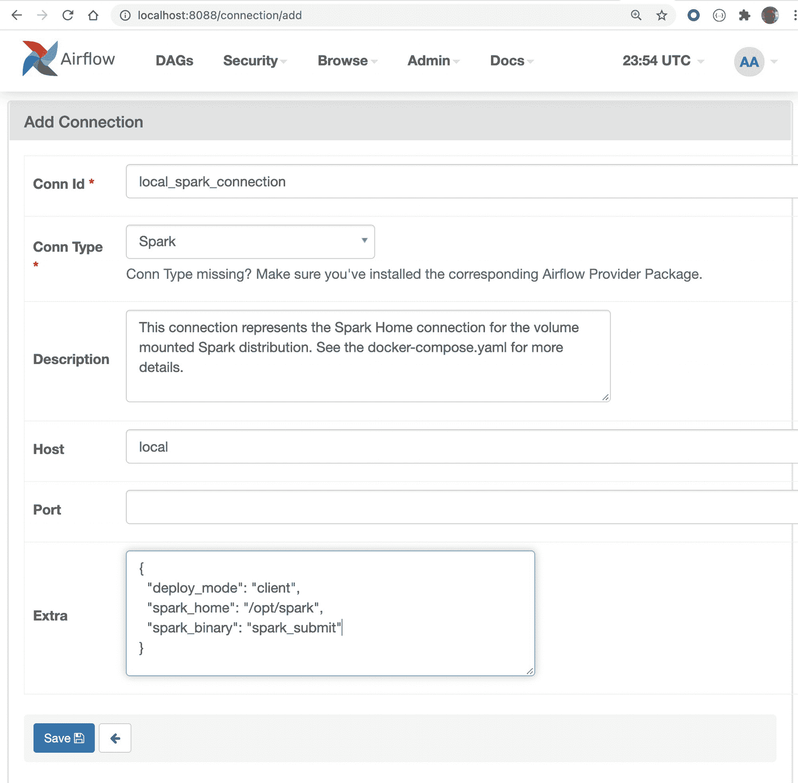

图 8-8：使用 Airflow UI 添加 Apache Spark 连接

连接创建完成后，让我们继续编写你的第一个 Spark DAG。你将要使用 `SparkSubmitOperator`，它包含在你安装到 Airflow 集群中的 Spark 提供商里。

### 编写你的首个 Spark DAG

Spark 附带了一些示例应用。其中之一名为 `SparkPI`。我们将使用这个 Spark 示例应用来熟悉如何编写一个新的 DAG。让我们从“每日 Pi”这个想法开始。

首先，在 Airflow DAGs 目录下创建一个名为 `daily_spark_pi.py` 的文件（路径为 `~/dataengineering/airflow/dags/daily_spark_pi.py`）。然后输入（或复制）代码清单 8-17 中的代码并保存你的更改。

```python
from airflow.providers.apache.spark.operators.spark_submit import SparkSubmitOperator
from airflow.models import DAG, Variable
from airflow.utils.dates import days_ago

args = {
    'owner': 'airflow',
}

spark_home = Variable.get("SPARK_HOME")

with DAG(
    dag_id='daily_spark_pi',
    default_args=args,
    schedule_interval='@daily',
    start_date=days_ago(1),
    tags=['coffeeco', 'core'],
) as dag:
    spark_pi_job = SparkSubmitOperator(
        application=f'{spark_home}/examples/jars/spark-examples_2.12-3.1.1.jar',
        conn_id="local_spark_connection",
        java_class="org.apache.spark.examples.SparkPi",
        task_id="spark_pi_job"
    )
```

代码清单 8-17 中的 DAG 首先导入了 `SparkSubmitOperator` 和一些辅助库，这些库使你能够访问 Airflow 变量，以及一些用于调度的其他实用程序。然后，我们创建了一个字典，用于存储 DAG 的所有者元数据。接下来，我们获取 `spark_home` 变量，以便在创建 `spark_pi_job` 时使用。最后，我们指定了 DAG 的元数据和调度计划。

```python
with DAG(
    dag_id='daily_spark_pi',
    default_args=args,
    schedule_interval='@daily',
    start_date=days_ago(1),
    tags=['coffeeco', 'core'],
) as dag:
```

# 在 Airflow 中运行 Spark 作业

## 编写一个简单的 Spark DAG

然后，我们使用 `SparkSubmitOperator` 向 DAG 块添加了一个任务。

```python
spark_pi_job = SparkSubmitOperator(
    application=f'{spark_home}/examples/jars/spark-examples_2.12-3.1.1.jar',
    conn_id="local_spark_connection",
    java_class="org.apache.spark.examples.SparkPi",
    task_id="spark_pi_job"
)
```

现在你已经写好了 DAG，让我们运行它。

### 运行 Spark DAG

所有新 DAG 默认均处于暂停状态。这可以进行不同的配置，但通常来说这是个好主意，因为这种行为用于保护你的 Airflow 集群资源，避免被多个同时启动的 DAG 所淹没。让我们通过命令行取消暂停此 DAG。

```bash
docker exec \
    -it airflow_airflow-webserver_1 \
    airflow dags unpause daily_spark_pi
Dag: daily_spark_pi, paused: False
```

DAG 取消暂停后，你可以手动触发它。

```bash
docker exec \
    -it airflow_airflow-webserver_1 \
    airflow dags trigger daily_spark_pi
```

假设一切按预期工作，你应该能够列出此 DAG 的成功运行记录。

```bash
docker exec \
    -it airflow_airflow-webserver_1 \
    airflow dags list-runs \
    -d daily_spark_pi \
    --state success
```

你还可以使用 Airflow UI 查看 DAG 运行期间生成的日志。为此，请按以下步骤操作：
1.  进入 Airflow DAGs 主页，使用 `coffeeco` 标签过滤出活动任务（`/home?status=active&tags=coffeeco`）。
2.  点击 `daily_spark_pi` DAG，切换到图表视图（`/graph?dag_id=daily_spark_pi`）。
3.  点击 `spark_pi_job`。你会在顶部看到一个名为“日志”的按钮；点击它以查看此次任务运行的日志。参见图 8-9。

日志将显示任务的输出，包括运行 Spark DAG 的结果。如果向下滚动页面，你会看到以下内容：

```
{spark_submit.py:526} INFO - Pi is roughly 3.1411757058785295
```

这确认了你能够从 Apache Airflow 运行 Spark 工作流。尽管这令人兴奋，但你接下来要做的是创建一个 DAG，用于运行你在第 7 章中创建的 Spark 应用程序。

### 练习 8-2：总结

本练习教你如何安装 Apache Spark 提供商、配置变量和连接，以及使用 `SparkSubmitOperator` 编写并运行一个简单的 Spark DAG。在本章的最后一个练习中，你将学习运用前两个练习中掌握的技能，运行第 7 章中的 `SparkEventExtractorApp`。

## 使用 Airflow 运行 SparkEventExtractorApp

在上一章中，你编写并编译了你的第一个 Spark 应用程序。你学会了如何创建一个由配置驱动的应用程序，该应用程序仅将来自本地数据仓库的两个表中的数据连接起来。这个类似简单 ETL 的过程合并了来自 `customers` 表和 `customerRatings` 表的数据。

在本章的剩余部分，你将设置一个 Airflow DAG，以便使用 Airflow 配置并运行此应用程序。

### 从可运行的 Spark Submit 开始

鉴于我们的目标是创建一个 DAG 来运行 `SparkEventExtractorApp`，那么首先要做的就是查看运行该应用程序需要什么。回顾一下，我们必须提供大量的配置、JAR 文件位置以及用于启动应用程序的驱动程序配置。

```bash
$SPARK_HOME/bin/spark-submit \
    --class "com.coffeeco.data.SparkEventExtractorApp" \
    --packages=org.mariadb.jdbc:mariadb-java-client:2.7.2 \
    --conf "spark.event.extractor.source.table=..." \
    --conf "spark.event.extractor.destination.table=... " \
    --conf "spark.event.extractor.save.mode=..." \
    --conf "spark.sql.warehouse.dir=..." \
    --driver-java-options "-Dconfig.file=conf/local.conf" \
    target/scala-2.12/spark-event-extractor...jar
```

当我们在 Airflow 中使用 `SparkSubmitOperator` 时，它本质上是在 Airflow 集群上下文中生成一个类似的 `spark-submit` 命令。这要求我们稍微修改 Spark 提交代码，以便它可以作为 DAG 运行。让我们从后往前看，先看一下最终的 DAG，然后将所需的配置和 JAR 文件移到正确的位置，以便一切都能正常运行。

### 练习 8-3：编写并运行客户评分 Airflow DAG

在 `~/dataengineering/airflow/dags` 目录下创建一个新文件，命名为 `customer_ratings_etl_dag.py`。然后复制（或粘贴）以下 Python 代码片段，以组装最终的 DAG。

```python
from airflow.providers.apache.spark.operators.spark_submit import SparkSubmitOperator
from airflow.models import DAG, Variable
from airflow.utils.dates import days_ago
```

接下来，我们将添加用户归属信息，并复用上一个 DAG 中的 Spark 主目录变量。

```python
args = {
    'owner': 'scotteng',
}

spark_home = Variable.get("SPARK_HOME")
```

到目前为止一切顺利。接下来，我们将创建一个新的字典，用于存储作业的完整 Spark 配置。

```python
customer_ratings_conf = {
    "spark.sql.warehouse.dir": "s3a://com.coffeeco.data/warehouse",
    "spark.hadoop.fs.s3a.impl": "org.apache.hadoop.fs.s3a.S3AFileSystem",
    "spark.hadoop.fs.s3a.endpoint": "http://minio:9000",
    "spark.hadoop.fs.s3a.access.key": "minio",
    "spark.hadoop.fs.s3a.secret.key": "minio_admin",
    "spark.hadoop.fs.s3a.path.style.access": "true",
    "spark.sql.catalogImplementation": "hive",
    "spark.sql.hive.metastore.version": "2.3.7",
    "spark.sql.hive.metastore.jars": "builtin",
    "spark.sql.hive.metastore.sharedPrefixes": "org.mariadb.jdbc,com.mysql.cj.jdbc",
    "spark.sql.hive.metastore.schema.verification": "true",
    "spark.sql.hive.metastore.schema.verification.record.version": "true",
    "spark.sql.parquet.compression.codec": "snappy",
    "spark.sql.parquet.mergeSchema": "false",
    "spark.sql.parquet.filterPushdown": "true",
    "spark.hadoop.parquet.enable.summary-metadata": "false",
}
```

"spark.hadoop.mapreduce.fileoutputcommitter.algorithm.version": "2",

"spark.sql.hive.javax.jdo.option.ConnectionUserName": "dataeng",

"spark.event.extractor.source.table": "bronze.customerRatings",

"spark.event.extractor.destination.table": "silver.customerRatings",

"spark.event.extractor.save.mode": "ErrorIfExists"

}
```

这个字典可以直接在 `SparkSubmitOperator` 中使用，从而减少了在 DAG 内部扫描配置的麻烦。在编写实际的 DAG 之前，你需要添加以下变量（`app_jars` 和 `driver_class_path`），以提高最终 DAG 的可读性。

```python
app_jars=f'{spark_home}/user_jars/hadoop-aws-3.2.0.jar,{spark_home}/user_jars/hadoop-cloud-storage-3.2.0.jar,{spark_home}/user_jars/mariadb-java-client-2.7.2.jar,{spark_home}/user_jars/mysql-connector-java-8.0.23.jar,{spark_home}/user_jars/aws-java-sdk-bundle-1.11.375.jar'
driver_class_path=f'{spark_home}/user_jars/mariadb-java-client-2.7.2.jar:{spark_home}/user_jars/mysql-connector-java-8.0.23.jar:{spark_home}/user_jars/hadoop-aws-3.2.0.jar:{spark_home}/user_jars/hadoop-cloud-storage-3.2.0.jar:{spark_home}/user_jars/aws-java-sdk-bundle-1.11.375.jar'
```

最后，我们现在可以使用这些变量和属性来创建我们的 ETL DAG。

```python
with DAG(
    dag_id='customer_ratings_etl_dag',
    default_args=args,
    schedule_interval='@daily',
    start_date=days_ago(1),
    tags=['coffeeco', 'core'],
) as dag:
    customer_ratings_etl_job = SparkSubmitOperator(
        application=f'{spark_home}/user_jars/spark-event-extractor.jar',
        jars=app_jars,
        driver_class_path=driver_class_path,
        conf=customer_ratings_conf,
        conn_id="local_spark_connection",
        name='daily-customer_ratings',
        verbose=True,
        java_class="com.coffeeco.data.SparkEventExtractorApp",
        status_poll_interval='20',
        task_id="customer_ratings_etl_job"
    )
```

就是这样。保存文件，然后轻轻拍拍自己的肩膀，给自己一点鼓励。

设置工作中最繁重的部分就是所有的配置。你可能已经注意到，为了连接这个作业，我们使用了许多新的 Spark 设置。让我们首先看看 Spark SQL 仓库的配置。

#### Spark 配置

作业配置声明了我们 Spark SQL 仓库的设置。

```json
"spark.sql.warehouse.dir": "s3a://com.coffeeco.data/warehouse",
"spark.hadoop.fs.s3a.impl": "org.apache.hadoop.fs.s3a.S3AFileSystem",
"spark.hadoop.fs.s3a.endpoint": "http://minio:9000",
"spark.hadoop.fs.s3a.access.key": "minio",
"spark.hadoop.fs.s3a.secret.key": "minio_admin",
"spark.hadoop.fs.s3a.path.style.access": "true"
```

`spark.sql.warehouse.dir` 属性在上一章中使用过。复习一下，这是当你的应用程序启动时，为 `SparkContext` 提供的单个不可变仓库路径。我们将其配置为通过另一个名为 MinIO 的服务指向 Amazon S3。MinIO 的工作方式类似于 Amazon S3，可以作为即插即用的替代方案在本地或云端运行。在本节完成后，我们将更详细地介绍其工作原理。然而，通过从本地挂载的目录迁移到 S3 克隆，我们通过引入一个完全可互操作的本地服务，简化了未来的工作（在我们将要使用 S3 的情况下）。这使得在本地环境和其他环境（包括生产环境）之间切换变得轻松，而无需过多改变我们的思维模型。

##### 本地作业配置

我们还提供了三个必需的配置，用于告知我们的 Spark 批处理作业在哪里查找我们打算进行连接的数据。这些配置在第 7 章中介绍过，允许你修改数据库表和名称。

```json
"spark.event.extractor.source.table": "bronze.customerRatings",
"spark.event.extractor.destination.table": "silver.customerRatings",
"spark.event.extractor.save.mode": "ErrorIfExists"
```

##### Spark 提交属性

`SparkSubmitOperator` 的属性使我们能够配置如何启动 Spark 应用程序，其约定与实际的 `spark-submit` 命令几乎相同。

```python
SparkSubmitOperator(
    application=f'{spark_home}/user_jars/spark-event-extractor.jar',
    jars=app_jars,
    driver_class_path=driver_class_path,
    conf=customer_ratings_conf,
    conn_id="local_spark_connection",
    name='daily-customer_ratings',
    verbose=True,
    java_class="com.coffeeco.data.SparkEventExtractorApp",
    status_poll_interval='20',
    task_id="customer_ratings_etl_job"
)
```

在运行此 Spark 应用程序的情况下，我们需要向运行时提供一些额外的 JAR。我们添加了 `jars` 和 `driver_class_path` 配置，以告知 Spark 加载一些特定于驱动程序的 JAR（主要是 Hive JDBC JAR），以及 Amazon S3 JAR，以便我们能够与 MinIO S3 客户端通信。

我们还开启了详细日志记录（`verbose=True`），以便从 Airflow 方面监控作业。最后，我们将作业完成轮询设置为每 20 秒一次（`status_poll_interval='20'`）。这允许我们持续从作业获取更新，并每 20 秒获取一次新的日志更新，而不是在作业等待失败或完成时看不到任何信息。

#### Docker 嵌套

由于 Airflow 在 Docker 内部运行，我们必须确保 Spark JAR 和配置对 Airflow 工作进程都是可用的。回顾一下，这是因为我们正在运行 `CeleryExecutor`，这意味着我们在 Airflow 工作进程上远程运行。可以通过为你的 Docker 实例提供一个共享文件系统，甚至使用云对象存储（如 Amazon S3）来简化此过程。然后，Airflow 可以按需获取你的依赖项（JAR）和其他应用程序配置。

##### 将 Spark 应用程序 JAR 复制到共享的 Spark JAR 位置

由于你正在复用你在第 7 章中创建的 Spark 应用程序，你需要将 JAR 复制到 `~/dataengineering/airflow/docker-compose.yaml` 中引用的 `spark/jars` 目录中。

```bash
```

cp `/path/to/ch-07/app/target/scala-2.12/spark-event-extractor-assembly-0.1-SNAPSHOT.jar` `~/dataengineering/airflow/spark/jars/spark-event-extractor.jar`

现在，让我们运行这个 DAG。

### 运行客户评价 ETL DAG

要运行该 DAG，您需要完成扩展环境搭建。相关说明位于章节材料中的主`README`文件中。该搭建过程将为您提供运行新 DAG 所需的一切。请注意，若需多次运行该任务，您必须将`spark.event.extractor.save.mode`切换为`Overwrite`。或者，您也可以直接从 Spark SQL 数据仓库位置删除`silver.customerratings`目录。

使用 Airflow UI，进入主 DAG 页面，点击`customer_ratings_etl_dag` DAG。在 UI 中，点击“立即触发”按钮。您将看到一个成功状态，如图 8-10 示例所示。

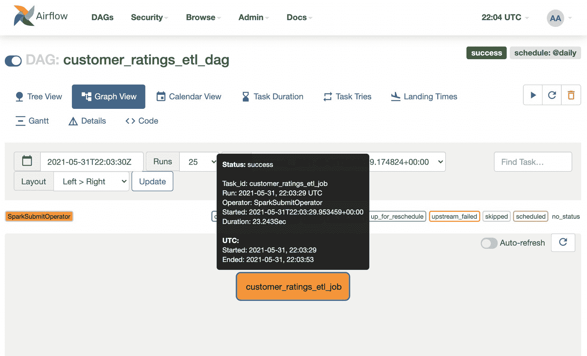

图 8-10 在 Airflow 中成功运行`SparkEventExtractorApp`

您可以查看 Spark 日志，了解所有动态组件如何协同工作。但本质上，您在本书所学内容值得获得掌声。

#### 练习 8-3：总结

本章最后一个练习展示了如何使用 Airflow DAG 启动更复杂的 Spark 批处理作业。为了能够使用最终的`docker-compose-chapter-end.yaml`替换练习 8-2 中使用的`docker-compose.yaml`，需要进行大量准备工作。在结束本章之前，让我们探讨一下使 DAG 能够运行所需的基础架构和组件。

### 审视混合架构

现在，运行此 DAG 时需要记住许多动态组件。首先，您需要管理本地 MySQL 支持的（`Hive Metastore`）以及 Airflow Docker 容器，并以某种方式为 Spark SQL 数据仓库提供额外的共享卷。所有这些中央数据平台组件共同构成了您基础设施的关键部分，并使 Airflow 能够运行 Spark DAG。

图 8-11 是您本地数据平台当前简化状态的示例。您已经运行了使 Airflow 工作所需的一切。您拥有由 MySQL 支持的 `Hive Metastore`，负责存储分布式数据表的元数据；同时还有新的 `MinIO` S3 数据湖。您现在可以重用本地 Spark 安装中的共享配置，并在 Zeppelin 和 Airflow 之间重用配置和 JAR 包。这为您提供了 Spark UI，用于交互查看从 Airflow 生成的数据。另一方面，您拥有 Airflow，它可以运行作业，将数据存储到您的数据湖中，或作为 JDBC 表存储到 MySQL 中。

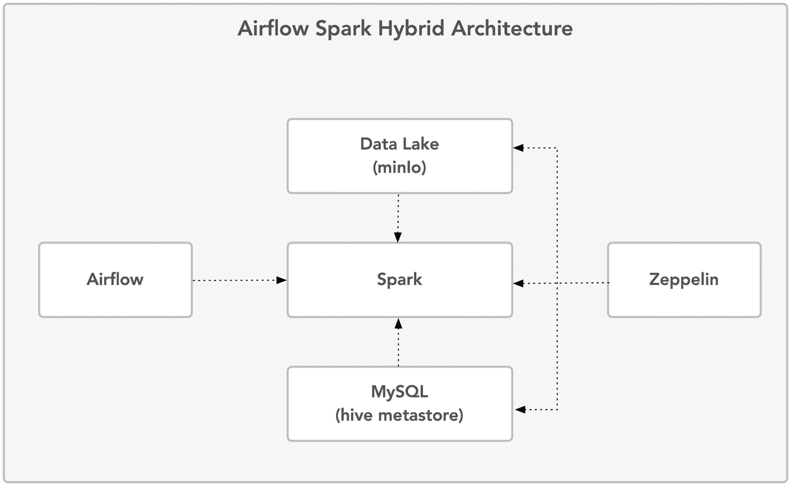

图 8-11 客户评价 ETL DAG 背后的组件架构

#### 设置扩展环境

章节材料中的主`README`提供了扩展本地环境启动和运行的分步说明。关于 `MinIO` 以及迁移 `Hive Metastore`，还有一些额外的要点值得说明。

扩展环境将此实践环境的所有关键组件移至您笔记本电脑上的一个单一位置。这将使您能够从今以后重用所有这些通用架构组件，而无需记住我们在哪个章节练习中添加了哪些内容。该路径设置为您主目录下的一个名为`dataengineering`的文件夹。

```
~/dataengineering
-/airflow
-/minio
-/mysql
-/spark
-/zeppelin
```

#### 从本地文件系统迁移到 `MinIO`

为简化后续操作，章节材料中提供了使用 `MinIO` 分布式文件系统的说明。简而言之，`MinIO` 是 Amazon S3 的克隆，并与 S3 API 完全兼容。这将在未来章节中降低一些复杂性。需要注意的一点是，首次运行 `MinIO` 时，您必须在文件系统上设置一些权限。幸运的是，您可以通过 UI 完成此操作。参见图 8-12。

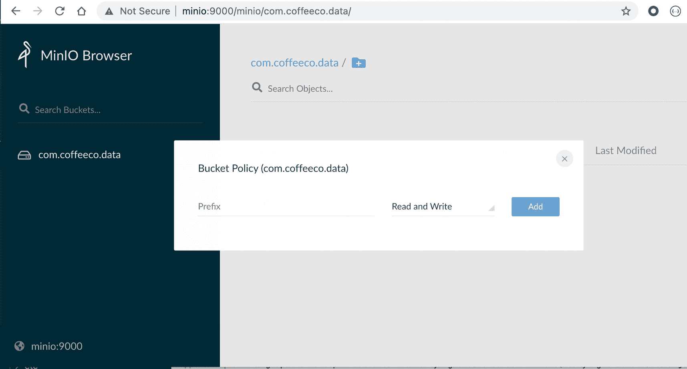

图 8-12 将文件系统从默认的“只读”切换为“读写”

您需要打开 `MinIO` UI（`http://localhost:9001`）。您也可以在`/etc/hosts`文件中添加一条记录，以便更容易地找到它。我的记录是`http://minio:9001`。进入主页后，系统将提示您进行身份验证（用户和密码存储在 `MinIO` 的`docker-compose.yaml`文件中）。或者，如果您未做任何更改，则用户名为`minio`，密码为`minio_admin`。这将允许您应用前缀权限。

#### 应用存储桶前缀权限

在屏幕左侧（如图 8-13 所示），您将看到`com.coffeeco.data`。这是默认存储桶名称，您只需将鼠标悬停在该名称上，点击出现的小圆点，即可打开权限菜单。

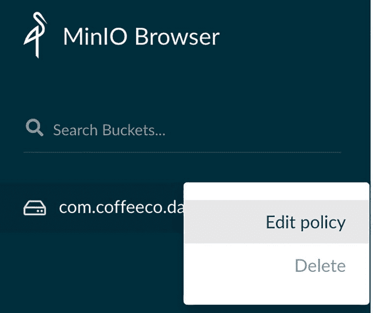

图 8-13 在 `MinIO` 浏览器中编辑

只需添加前缀`/warehouse/*`并将其设置为“读写”，即可大功告成。

接下来您可能想要做的是将 `Hive Metastore` 表迁移到一个更好的公共位置。

#### 在公共位置引导 MySQL

您的 `Hive Metastore` 很可能位于`ch-06`目录中。您可以从当前 metastore 中导出 SQL 数据库和表，并将现有内容移动到`~/dataengineering/mysql`；或者您可以从头开始，在`~/dataengineering/mysql`目录中进行引导。章节材料中的`mysql`目录包含一个`README.md`文件，提供了从头开始全新 Hive 安装的分步说明。

从现在开始，我们将在探索数据领域时重复使用此通用设置。

### 持续探索

本章全面介绍了如何使用 Airflow 调度 Apache Spark 应用程序。如您所知，总有更多可以学习的内容（但并非所有内容都适合放入书中）。作为持续探索，我建议如下：

- 在运行 DAG 时，您可以添加 DAG 覆盖变量。这使得您能够对底层 DAG 进行额外更改，而无需返回并修改底层 Python 代码。尝试添加一个变量来更改以下变量：

    `spark.event.extractor.save.mode`

    可用选项为`ErrorIfExists`、`Overwrite`、`Ignore`和`Append`。

- 使用第 7 章的通用特性创建另一个 Spark 应用程序，并使用 Airflow 运行它。
- 尝试生成一个新的数据集，或思考一个可以利用本地数据仓库中的数据解决的新问题。

除了持续探索之外，下一节将介绍创建单个用户和分配角色的过程。

### 创建用户

使用 Airflow 命令行创建新用户非常简单。本质上，所有用户命令都嵌套在 `users` 子命令中。

```
docker exec \
    -it airflow_airflow_webserver-1 \
    airflow users [子命令]
```

例如，假设你需要创建一个新用户，并为其授予 Airflow 内的有限权限。你可以使用 `User` 角色来分配常规权限。例如，执行清单 8-18 中的命令来生成 `scotteng` 用户。

```
docker exec \
    -it airflow_airflow_webserver-1 \
    airflow users create \
    --username scotteng \
    --firstname Scott \
    --lastname Haines \
    --role User \
    --email scott@coffeeco.com
```

清单 8-18 通过 Airflow 命令行生成新用户

该命令会要求你输入密码，因此只需按照提示完成新用户的创建即可。创建完成后，退出 Airflow，然后以 `scotteng` 用户身份重新登录。你会注意到 `Admin` 或 `Security` 菜单已经消失，但你仍然可以运行 DAG（见图 8-14）。

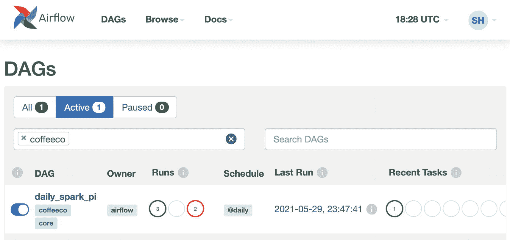

图 8-14 以普通用户身份查看 Airflow 界面

这就是目前的内容。

## 小结

本章从较高层次介绍了工作流自动化的概念，并向你介绍了 Apache Airflow。虽然我们可以轻松地用本书剩余部分讨论如何创建越来越复杂的 Airflow DAG，并深入探究 Airflow 的更多细微之处，但这项工作将留给你自己完成。在继续我们的旅程时，我们还会再次提到 Airflow，但下一站我们将进入一个激动人心的主题：使用 Apache Spark 编写 Structured Streaming 应用。系好安全带，事情即将加速发展！

# 流处理入门

由于每个数据工程问题可能涉及多个维度，学习解决和优化这些问题颇具挑战性。在每个新问题开始时，你必须考虑数据发现、数据整理、数据摄入、数据转换以及数据责任——这是一个涵盖数据契约（严格定义的数据定义）的范畴，同时还需要优化数据摄入足迹（因为大规模数据很容易侵蚀运营成本）。此外，数据访问、数据谱系和数据治理等问题也需要时刻放在心上。理解如何运用你的综合知识来制定快速的数据行动计划，是一项能让你作为现代数据工程师走得更远的技能。

回顾你在本书中学到的处理数据的各种方式：无论是从使用 `spark-shell` 探索初步想法的小规模起步，还是使用笔记本（Apache Zeppelin）进一步深入这些想法，最后将学到的经验整合到 Spark 应用中。通过这个过程，你学会了创建可复用、经过测试的 Spark 应用，也掌握了通过探索来解决问题的重要技能。你学会了如何经历问题识别与分解的阶段——理解问题、制定行动计划、测试和验证结果，最后将解决方案封装成一个完整的应用。更重要的是，你通过实践学会了如何分解这些端到端的数据问题：使用 Spark SQL 编写转换查询，学习测试这些微应用（通过查询）的行为，甚至学会了如何安排它们的定期运行（使用 Apache Airflow）。

所有这些步骤都是为了现在这一刻。正如上一章结尾所承诺的，事情即将开始加速。为什么会这样？因为现在我们正从批处理迈向流处理，即处理无界数据集。

对于许多用例来说，在数据可用时立即进行流式处理，有助于将一个非常庞大的数据问题（由于事件数据的规模）转化为一个更易于管理的问题。只需更频繁地处理更少的数据点，你就可以分而治之地解决一个可能成本高昂的数据问题。然而，如何从批处理思维过渡到流处理思维也颇具挑战性。

例如，假设你的任务是创建一个每天必须处理约 10 亿个事件的应用。虽然由于数据规模庞大，这听起来可能有些牵强，但后退一步思考应用/流程的意图通常会有所帮助。如果数据可以被分解（分区）并作为流式操作并行处理，你只需创建一个能够每秒摄入和处理区区 11.5 千个事件的应用（如果事件流是恒定的，每分钟约 69.5 万个事件）。

尽管这些数字可能看起来遥不可及，但这也是分布式流处理真正大放异彩之处。本质上，你是在缩小问题的视角或范围，以便在分区数据集上以更分布式的方式，随时间推移达成目标。虽然并非所有问题都能通过流式处理解决，但相当多的问题确实适用于这种处理模式。

本章是对流处理的温和介绍，为你直接进入第 10 章构建自己的端到端 Structured Streaming 应用铺平道路，而无需回过头来讨论大量决策过程背后的理论。

到本章结束时，你应该理解以下内容（高层次概述）：

-   如何思考流数据及流数据处理问题
-   为什么数据责任始于生产者
-   在 API 边界处理数据质量的方法
-   为什么二进制可序列化的结构化数据至关重要

## 流处理

流数据并非静止不动。事实上，你可以将其视为“活着的”（即使只是短暂的）。这是因为流数据是封装了当下的数据——它记录事件和动作在传输过程中的发生情况。让我们看一个实用但理论性的例子，从一个简单的传感器数据事件流开始。在你的脑海中，想象你最后去过的那个停车场（或停车库）。

### 用例：实时停车位可用性

想象一下，你刚刚找到停车位，全靠那些指引你前往空位的指示牌。现在，假设这一切都源于本地停车传感器互联网络发出的数据。这些传感器的唯一用途，就是识别当下时刻可用停车位的数量。

这是一个实时数据问题，其中实时准确度是可衡量的，并且停车结构的用户可以实际感受到。要实现这些功能，首先要声明系统场景。

> “我们希望创建一个系统，能追踪所有可用停车位，识别车辆何时停放，并知道车辆在某个位置停留了多久。这个过程应尽可能自动化。”

优化这样的系统，可以从每个停车位安装一个简单传感器开始（关联 `sensor.id`/`spot.id` 引用）。该传感器负责以位置标识符、时间戳和简单比特位（0 或 1）的形式发出数据，以表示车位是空置还是被占用。这些数据可以编码成一种紧凑的消息格式，如代码清单 9-1 所示，该格式将被高效编码，并由每个设备定期发送。

```protobuf
message ParkingSensorStatus {
  uint32 sensor_id = 1;
  uint32 space_id  = 2;
  uint64 timestamp = 3;
  bool   available = 4;
}
```

`代码清单 9-1` 传感器事件示例（封装于 Google Protocol Buffer 消息格式中）


在一天正常的车流过程中，由于个体驾驶员的动态时间安排，每个传感器的状态会以不可预测的方式在开或关（二元状态）之间切换。这些传感器数据可以实时告知驾驶员，车库里现在总共有 `X` 个可用车位。这些数据有助于自动化人类的决策过程，甚至可以通过一个简单的 `Web` 服务在线提供，用于实时状态追踪。此外，这些数据还可用于追踪每个传感器的上次签到时间，这可用于诊断故障传感器，甚至追踪传感器离线和故障的频率。如今，技术更先进的停车场甚至能通过方向标志和提示，引导驾驶员前往结构中的可用车位。这减少了停车场内的交通和拥堵，进而提高了客户满意度，而这一切仅仅通过捕获传感器数据的实时流并对其进行近实时处理就能实现。

考虑到从这些传感器事件流中收集到的时间信息，聪明的停车场运营者可以根据过往趋势，基于对停车位的实时需求和当前可用性，来降低或提高每日或每小时的定价。通过在合理范围内优化定价，运营者可以找到完美的临界点，即每小时/每日的价格能使停车场满员。换句话说，“在什么价格下，大多数人会选择停车，且车位不会被闲置？”

这是一个源于实时传感器数据收集的优化问题示例。越来越多的组织开始研究如何重用数据来同时解决多个问题。物联网（`IoT`）用例只是你在编写流式应用程序时可能处理的众多数据流之一。在本书的前面部分，我们讨论了创建一个系统，该系统可以获取咖啡店上座率信息，从而告知人们附近哪家店有能容纳他们聚会规模人数的座位。在那个故事中，我们只是创建了一个可用于连接展示此示例的合成表。然而，这是另一个可以通过传感器解决的问题，或者通过像签到系统这样简单的东西来解决，该系统会发出相关的事件数据，并通过流式数据管道可靠地传递到下游。这两个例子都采用了基础分析，并且都可以从简单的机器学习中受益，以发现新的行为模式，从而实现更优化的运营。在过深入之前，我们先稍作停留，深入探讨流式数据网络所提供的能力。

### 时间序列数据与事件流

从静态数据的思维模式，转变为随着时间推移来解释数据的思维模式，即从跨越多个视角和时刻的无界数据流的角度来看待数据，这既是一种视角上的练习，也可能是一种难以适应的挑战。通常，当你考虑流式系统时，连续事件流的概念会浮出水面。这是最常见的用例之一，可以作为理解流式数据概念的温和入门。例如，图 9-1 中所示的抽象时间序列。

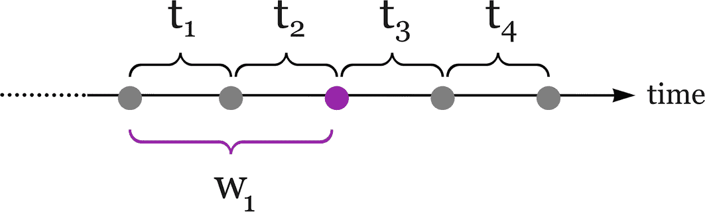

图 9-1 事件发生在精确的时间点，可以单独收集和处理（`t1->t4`），也可以跨时间窗口聚合（`w1`）

如你所见，数据本身根据给定系统（或应用程序）所采用的视角，存在于各种状态中。每个事件（`T1->T4`）在其狭窄的参考框架内只了解*发生了什么*，换句话说，事件捕获了一个有限的（相对的）*时间*视角。当一系列事件在一个有界集合（窗口）中被一起处理时，你获得了一系列数据点（事件），这些事件封装了完全实现或部分实现的想法。当你缩小范围查看整个时间线时，你可以描绘出一个从第一个事件到最后一个事件更准确的故事。让我们进一步阐述这个想法。

#### 事件是孤立的吗？

考虑一个简单的事实。你的事件数据要么作为一个完整的想法存在，要么作为部分的想法或念头存在。我发现，将数据视为随时间展开的故事，有助于赋予这些数据字节以生命力。因此，每个数据点都有助于构成一个完整的故事，就像一系列随时间交织、组合或实现的想法和念头。

在你尝试采用分布式数据视角看待事物时，这个数据构成概念可以作为一个透镜。我还发现，在构建和定义新的分布式数据模型，以及处理大规模现实世界数据网络时，这个概念也非常有用。如果将这些事件视为一个整体，它们共同讲述一个特定的故事，事件留下的线索可以告知事物发生的顺序，而每个事件的时间戳则极大地增强了这种叙述能力。没有时间的事件会呈现事物发生的扁平化视图，而时间的加入则赋予你动量或速度的概念，或者是事件之间或整个数据点系列在时间上的减慢和拉伸。理解流经众多管道和数据通道的数据行为，对于数据运营至关重要，并且需要可靠的监控来保持数据以最佳速度流动。让我们看一个用例，其中时间维度有助于更清晰地描绘真实世界的场景。

#### 用例：追踪客户满意度

如果我告诉你，两位顾客走进咖啡店，点了饮料，然后带着饮料离开，你可能会问我为什么费心告诉你这些——毕竟这就是咖啡店里常发生的事。但如果我告诉你，这两杯咖啡几乎是同时制作的，而故事中的第一位顾客在五分钟内就进出咖啡店了呢？如果我告诉你那是一个工作日，且故事发生在早高峰时段呢？如果我告诉你第二位顾客（恰好排在队伍中下一位）在咖啡店里待了 30 分钟呢？你可能会问，这位顾客是不是留下来看报纸或使用洗手间了——这些都是合理的疑问。

如果我告诉你，这位顾客之所以等待，是因为在四步咖啡制作流程的第 3 步和第 4 步之间出现了错误，那么我们就更能理解未来如何优化顾客体验了。这四步分别是：

1.  顾客点单：`{customer.order:initialized}`
2.  完成支付：`{customer.order:payment:processed}`
3.  订单排队：`{customer.order:queued}`
4.  订单完成：`{customer.order:fulfilled}`

无论错误是发生在自动化环节，还是源于现实系统的故障（如打印机卡纸、咖啡师漏单，或其他任何原因），结果都是顾客需要主动介入，告知运营流程（咖啡制作流水线）似乎有人忘了他们的饮料。

此时，讨论可以转向如何处理顾客的情绪反应——这种反应可能在积极与消极之间剧烈波动：从乐于助人的高兴（1 分），到轻微受挫（4 分），再到因拖延和流程故障而爆发的愤怒（10 分）。但通过这个假设的用例推演，我们现在都更清楚地了解了如何利用优秀的数据采集技术来服务于各种场景。

#### 事件时间、事件记录顺序及事件间延迟，皆蕴含信息

如果不了解从第一个事件（`customer.order:initialized`）到最终事件（`customer.order:fulfilled`）之间经过了多少时间，或者每个步骤通常需要多长时间完成，我们就无法对体验进行评分，也无法真正理解发生了什么——这实际上为系统中的异常延迟或故障制造了盲区。了解顾客在不同规模订单中通常等待时间的统计数据（平均值、中位数和 99 百分位）是很有价值的，因为这些历史数据点可以通过自动化方式用于预防性解决问题——例如，当订单耗时超出预期时。这直接决定了顾客是感到不满还是成为终身客户。

这也是企业向客户征求反馈的重要原因之一——无论是针对体验给出“赞/踩”，还是奖励性的应用内参与（用积分兑换免费商品和服务）。这些通过现实互动收集并捕获的数据，编码为事件，并按你的需求进行处理——如果它能对公司的运营和声誉产生积极影响，那将非常有用。只需确保遵守数据隐私法规，最终不要让你的客户感到不适。

这个小小的思维实验旨在揭示一个事实：你在事件数据中捕获的细节（以及数据故事随时间演变的脉络）可能带来颠覆性的改变。时间是赋予这些旅程动力的维度。但时间本身也存在一个问题。

### 时间的问题

虽然事件在精确的时间点发生，但时间的问题在于，它也受制于时间和空间（位置）的难题。爱因斯坦用相对论从宇宙尺度解释了这一问题，但在更局部的尺度上，这也是一个问题。例如，我的家人居住在美国的不同地区。协调大家的时间表让每个人的日程同步就很困难。即使是像通过视频通话叙旧或现实世界中的家庭聚会这样简单的事件也会遇到这种情况。即使一切都协调好了，人们也习惯性地会迟到一点。

将视角从我家人或一般人身上拉远——从事件集中协调的角度来看——你会发现问题不仅仅关乎跨时区（东部/中部/西部海岸）的同步。如果仔细观察，你会发现，相对于我们本地/物理空间的时间，也存在一定程度的时间漂移或时钟偏差。

以现代数字时钟为例。它在你的智能手机、手表或众多“智能”联网设备上作为一个进程运行。保持不变的是时间保持显著的同步性（即使漂移只有几毫秒）。许多人仍然有模拟（非数字）时钟。这些设备的精度差异很大，从高端手表（“精密时计”）的难以置信的精确，到有时需要每隔几天重新校准一次的廉价时钟。

这里的要点是，两个系统对精确时间达成一致的情况很少见，就像人们也难在时间和空间上进行协调一样。因此，必须使用一个中央参考（或视角）来同步跨多个时区运行的系统的时间。

#### 时间校正

在任何现代云基础设施中运行的服务器都采用一种称为[网络时间协议](https://en.wikipedia.org/wiki/Network_Time_Protocol)（`NTP`）的进程来纠正时间漂移问题。`NTP` 进程负责使用可靠的中央时间服务器同步本地服务器时钟。此进程将本地时间校正到与协调世界时（`UTC`）相差几毫秒以内。这是一个需要牢记的重要概念，因为运行在大型网络中并产生事件数据的应用程序将负责创建时间戳，而这些时间戳必须精确，才能使分布式事件对齐。此外，还有一个棘手的夏令时问题，因此，要协调来自不同时区以及不同本地日期时间语义的系统数据，就需要从这个中央同步的视角来审视时间。

我们已经从理论上探讨了时间与基于事件的数据的关系，但为了完善背景知识，我们还应该从时间与系统中数据需要被捕获和处理的优先级（无论是流式处理还是其他方式）的关系来审视它。

### 按优先级排序的事件处理模式

你可能熟悉这句话：“时间至关重要。”这是说某件事很重要且是最高优先级的。解决速度至关重要。这种优先级意识可以用作一种工具或定义性指标，在处理关键数据时，为实时、近实时、批量或最终（按需）处理提供依据。这四种处理模式对时间有不同的处理方式，从而对当前的数据问题产生特定的关注点。其范围基于进程必须完成的速度，这反过来又限制了任务的复杂度（作为时间的一个因素）。将这些处理风格视为由截止日期驱动的。完成某个动作只有一定的时间限制。

## 实时处理

实时系统的预期是，从上游系统发出事件，到该事件被处理并可供分析和洞察使用，端到端延迟在毫秒到几秒之间。这些事件会直接发送到事件流处理服务（如 `Apache Kafka`），在正常情况下，该服务能让监听器/消费者在事件写入后立即使用。真正的实时系统有许多典型用例，包括物流（例如停车位示例以及在咖啡店找空桌）。对业务产生全新影响的流程，例如欺诈检测、主动网络入侵检测或其他恶意行为检测，在这些场景中，较长的平均检测时间（平均毫秒/秒级检测时间）可能导致灾难性的声誉或财务损失。

对于其他系统，以近实时方式运行是完全可接受的。由于解决棘手问题需要时间，实时决策需要对其要提出的问题提供高性能、预计算或低延迟的答案。这就是纯粹的内存式流处理。

## 近实时处理

大多数人想到“实时”时，实际想到的是近实时。它与实时拥有一组类似的时间约束，唯一的区别在于端到端延迟的预期从数秒放宽到了几分钟。对于大多数系统来说，并没有真正的理由需要对每个到达的事件立即做出反应，因此，虽然时间仍然至关重要，但数据可用性的 `SLA` 优先级被放宽了。

保持更新的运营仪表盘和指标系统（每 30 秒到五分钟刷新图表和检查监控）通常足以快速发现问题并提供对现实状况的近似呈现。对于所有其他数据系统，则存在批处理或按需处理的概念。

## 批处理

我们在前两章中介绍了批处理和周期性调度，但为了清晰起见，需要说明的是，通过定期作业将数据从可靠的数据源（数据湖或数据库）推送到其他关联系统，过去是，并且现在仍然是现实世界中处理大量数据的方式。其原因在于成本。这归结为运营成本和维护大型流式系统的人力成本。

流式系统需要全天候访问可变数量的资源，从 `CPU`、`GPU` 到网络 `IO` 和 `RAM`，并且期望这些资源不会稀缺，因为流处理中的延迟（阻塞）可能会迅速累积。另一方面，从长远来看，批处理可能更易于维护，前提是数据的使用者理解从数据首次在上游发出，到数据可用于下游使用之间总是存在时间差。

最后需要考虑的是按需处理（或即时处理）。

## 按需处理或即时处理

面对现实吧。有些问题（即查询）很少被提出，或者其提出方式根本不适合任何预定义的模式。

例如，自定义报表作业和探索性数据分析是两种非常适合这些范式的数据访问方式。大多数情况下，回答这些查询所需的后备数据会直接从数据湖加载，然后使用共享计算资源或隔离的计算集群进行处理。这些查询所提供的数据，可能是其他实时或近实时系统处理并存储后用于批处理或历史分析的副产品。

使用这种模式，数据可以通过从较慢的商品对象存储（如 `Amazon S3`）导入记录到内存中，或快速访问的固态硬盘（`SSD`）上，来解冻并按需加载。根据数据的大小、格式和布局，可以直接从云对象存储中查询。这种模式可以轻松地通过 `Spark SQL` 委托给 `Apache Spark`。这使得可以通过 `Apache Zeppelin` 等工具进行临时分析，或者通过使用 [Apache Spark thrift-server](https://spark.apache.org/docs/latest/sql-distributed-sql-engine.html) 和 `Apache Hive Metastore` 的 `JDBC` 绑定在应用程序内直接进行分析。

这四种处理方式的区别在于时间。

回到视图和视角的概念，每种方法或模式都有其适用的*时机和场景*。流处理处理的是在特定时间点捕获的事件，正如我们在本章前半部分所讨论的，我们如何关联时间、如何捕获和测量一系列事件（作为数据），共同描绘出当前正在发生什么或过去发生了什么。同样重要的是要讨论流处理的基础。在下一节中，我们将介绍处理连续、无界数据流时的一些常见问题和解决方案。因此，将数据作为核心支柱并由此向外扩展是合情合理的。

### 流处理基础

基础是结构赖以建立的不可动摇、坚不可摧的根基。在构建成功的数据架构时，数据是整个系统的核心租户，也是该基础的主要组成部分。目前，数据进入数据平台的最流行方式是通过像 `Apache Kafka` 这样的流处理平台。这意味着围绕数据模式、可用性和有效性制定的数据契约，成为了该数据基础的关键支撑（考虑到 `Apache Kafka` 所提供的去中心化、分布式流处理能力）。

## 构建可靠的流式数据系统

作为数据工程师，构建可靠的数据系统实际上就是我们的工作，这意味着数据停机时间应该像业务的其他任何组成部分一样被衡量。你可能在某个时候听说过 `SLA`（服务水平协议）、`SLO`（服务水平目标）和 `SLI`（服务水平指标）这些术语。简而言之，这些缩略词与用于评估系统的契约、承诺和度量相关联，它们最终使服务所有者为其成功和失败负责。例如，你的团队或组织与客户之间的服务水平协议（`SLA`）用于就你提供的服务创建具有约束力的合同。对于数据团队来说，这意味着基于你的服务水平目标（`SLO`）来识别和捕获指标（`KPMs`：关键绩效指标）。`SLO` 是你承诺根据 `SLA` 需要履行的约定，它们可以是从承诺近乎完美（`99.999%`）的服务可用性，到像承诺特定数据集保留 `90` 天这样简单的事情。最后，你的服务水平指标（`SLI`）是你按照服务水平契约运作的证据，通常以运营分析（仪表盘）或报告的形式呈现。

明确目标有助于制定实现目标的计划。这段旅程始于数据接入点（即数据摄取点）。具体来说，始于每个数据点的正式结构和身份标识。考虑到“越来越多的数据通过像 `Apache Kafka` 这样的流处理平台进入数据平台”这一观察，对发射到这些数据流的数据进行编译时保证、向后兼容性和快速二进制序列化会很有帮助。数据问责制本身就是一个挑战。让我们看看原因。

## 管理流式数据问责制

流式系统每周 `7` 天、每天 `24` 小时、每年 `365` 天运行。如果不在前期对这个问题投入精力，这可能会使事情复杂化；而其中一个时不时冒出来的问题就是损坏的数据，即传输中的数据问题。

## 处理飞行中的数据问题

在飞行中减少数据问题有两种常见方法。首先，你可以在数据网络边缘引入看门人，通过传统应用程序编程接口（`API`）来协商和验证数据；其次，你可以创建并编译辅助库（即软件开发工具包，`SDK`），以强制执行数据协议，并使分布式写入者能够接入你的流式数据基础设施。你甚至可以同时采用这两种策略。

### 数据看门人

在数据网络边缘添加网关 `API` 的好处在于，你可以在数据生产点强制执行*身份验证*（该系统能否访问此 `API`？）、*授权*（该系统能否向特定数据流发布数据？）和*验证*（此数据是否可接受或有效？）。图 9-2 展示了数据网关的流程。

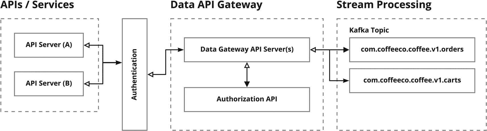

图 9-2 数据网关服务可以充当数据网络的看门人。它们提供了用于认证 `API` 访问的机制，授权哪些上游服务（`API`/服务）可以发布数据，并且还可以在损坏或错误数据进入数据网络（流处理）之前，对来自发布者的数据进行验证。

这意味着上游数据生产系统可以在生产数据时*快速失败*。这能阻止损坏数据在数据网络边缘进入流式或静态数据管道。它是一种通过错误代码和有用的消息，以更自动化的方式与生产者就问题发生的具体原因和方式建立对话的手段。

```json
```

{
    "error": {
        "code": 400,
        "message": "The event data is missing the userId, and the timestamp is invalid (expected a string with ISO8601 formatting). Please view the docs at http://coffeeco.com/docs/apis/customer/order#required-fields to adjust the payload."
    }
}
```

这种方法有其利弊。优点在于，大多数编程语言都原生支持 `HTTP`（或 `HTTP/2`）传输协议（或只需添加一个小型库），而 `JSON` 数据是目前几乎最通用的数据交换格式。另一方面（缺点），有人可能会认为这又多了一个需要管理的服务，而且如果没有某种形式的 `API` 自动化或遵循像 [OpenAPI](https://spec.openapis.org/oas/latest.html%2523format) 这样的开放规范，每个新的 `API` 路由都可能开始耗费过多时间。`API` 会成为一个集中的故障点，而且更多的变更并不一定意味着更好的功能！要扭转这个问题，这正是单元测试和功能测试如此重要的原因。理想情况下，数据本身（模式/格式）可以通过启用字段级验证（谓词）、生成有用的错误消息并采取自我保护行动，来决定其自身数据级契约的规则。嘿，只需一点路由级或数据级的元数据和一些创造性思维，`API` 就可以自动生成自我定义的路由和行为。

最后，网关 `API` 可被视为集中的麻烦制造者，因为上游系统未能生成有效数据（例如被看门人阻止）的每一次失败，都意味着有价值的信息（事件数据或指标）被丢弃。这里的责任归属问题也往往是双向的，因为看门人的一次糟糕部署可能会使一个未设置好在网关宕机（即使是几秒钟）时处理重试的上游系统陷入盲目。

撇开所有利弊不谈，使用网关 `API` 在损坏数据进入数据平台之前阻止其传播，意味着需要排查问题原因的地点更少了。这肯定比调试一个由数据管道、服务和无数最终数据目的地组成的分布式网络要好得多。那么 `SDK` 呢？

## 软件开发工具包

`SDK` 是导入到代码库中的库（或微框架），用于简化一个操作、活动或其他复杂流程。它们还有另一个名字：客户端。以之前关于使用良好错误消息和错误代码的例子来说，这个流程对于告知客户端其先前的操作无效是必要的。然而，直接在 `SDK` 中添加适当的安全护栏以减少潜在问题的范围可能更有优势。例如，假设我们设置了一个 `API`，用于通过事件追踪来跟踪客户与咖啡相关的行为。一个客户端 `SDK` 理论上可以包含所有必要的工具来管理与 `API` 服务器的交互，包括身份验证、授权和验证。事实上，如果 `SDK` 能发挥其作用，验证问题就会不复存在。清单 9-2 展示了一个可用于可靠跟踪客户事件的 `SDK` 示例。

```scala
import com.coffeeco.data.sdks.client._
import com.coffeeco.data.sdks.client.protocol._

Customer.fromToken(token)
  .track(
    eventType = Events.Customer.Order,
    status = Status.Order.Initalized,
    data = Order.toByteArray
  )
```

清单 9-2  
`SDK` 使应用程序能够以一致的方式可靠地发出事件数据

通过一些额外的努力（即客户端 `SDK`），数据验证或事件损坏的问题几乎可以消失。其他问题可以在 `SDK` 本身中处理，例如当服务器离线时如何重试发送请求。与其让所有请求立即重试，或陷入一个无限冲击网关负载均衡器的循环中，`SDK` 可以采取更智能的行动，例如使用指数退避。

### 惊群问题

假设你有一台网关 `API` 服务器。你编写了一个出色的 `API`，公司内许多团队都在向此 `API` 发送事件数据。一切顺利，直到有一天，一个新的内部团队开始向服务器发送无效数据。（他们没有遵守你的 `HTTP` 状态码，而是将所有非 200 的 `HTTP` 码视为重试的原因。他们忘了添加任何重试启发式算法，比如指数退避，所以所有请求都在一个不断增长的重试队列中无限重试。）请注意，在这个新团队加入之前，从来没有理由运行 `API` 服务器的多个实例，也从未需要使用任何形式的服务级速率限制器，因为一切都在约定的 `SLA` 内平稳运行。

好吧，那是今天之前的事了。现在你的服务离线了。数据在积压，上游服务正在填满它们的队列，人们很沮丧，因为他们的服务因为你这个单点故障而开始遇到问题。

这些问题都源于一种资源匮乏形式，被称为“惊群问题”。当许多进程在等待一个事件（例如系统资源变得可用，或者在这个例子中 `API` 服务器重新上线）时，就会发生这个问题。然后所有进程都会争相尝试获取资源，在许多情况下，单个进程（`API` 服务器）上的负载足以使服务再次离线。不幸的是，这又开始了新一轮的资源匮乏循环。当然，除非你能安抚这群“惊马”，或者将负载分散到更多的工作进程中，从而降低整个网络的负载，让资源有喘息的空间。

虽然这个最初的例子更像是一次无意的分布式拒绝服务攻击（`DDoS`），但这类问题可以在客户端（使用指数退避或自我节流）和 `API` 边缘（通过负载均衡和速率限制）得到解决。

最终，如果没有由运营指标、监控器和系统级（`SLA`/`SLO`）告警所构建的恰当洞察渠道，数据可能会消失无踪，而这将成为一个难以解决的挑战。

无论你决定在数据网络边缘添加数据网关 `API`，采用自定义 `SDK` 来实现上游一致性和可问责性，还是决定采用其他方法来处理数据进入数据平台的问题，了解你有哪些可选方案总是好的。无论数据以何种路径进入你的数据流，如果不深入探讨数据格式、协议以及二进制可序列化数据的话题，那么这篇关于流式数据的入门介绍便不算完整。谁知道呢，你或许会发现一种更好的方法来处理数据可问责性问题！

## 为任务选择正确的数据协议

当你想到结构化数据时，脑海中首先浮现的可能是 `JSON` 数据。`JSON` 数据具有结构，是一种基于 Web 的标准数据协议，而且最重要的是，它非常易于使用。这些都是快速上手的好处，但随着时间的推移，如果没有适当的防护措施，在为流式系统标准化使用 `JSON` 时，你可能会面临问题。第一个问题是 `JSON` 数据是可变的。这意味着作为一种数据结构，它很灵活，因此也很脆弱。数据必须保持一致才能实现可问责，并且在网络间传输数据（在线传输）时，序列化格式（二进制表示）应该具有高度可压缩性。对于 `JSON` 数据，你必须为载荷中表示的每个对象发送其（所有字段的）键。这不可避免地意味着，在一系列对象中，每增加一条记录（除了第一条），你通常都要发送大量额外的数据负担。

幸运的是，这并不是一个新问题，而且恰好存在处理这类事情的最佳实践，以及关于什么才是最佳数据序列化策略的多种学派思想。这并不是说 `JSON` 没有优点。只是当涉及到奠定坚实的数据基础时，结构越多越好，压缩程度越高越好，只要这不会消耗大量 `CPU` 周期即可。

### 可序列化的结构化数据

在高效编码和传输二进制数据方面，通常会提到两种序列化框架：[Apache Avro](https://avro.apache.org/) 和 Google [Protocol Buffers](https://developers.google.com/protocol-buffers)（`protobuf`）。这两个库都提供了高效的 `CPU` 技术用于序列化基于行的数据结构，并且两者也都提供了它们自己的远程过程调用（`RPC`）框架和功能。我们先来看 Avro，然后是 `protobuf`，最后我们会简要介绍远程过程调用。

#### Avro 消息格式

使用 Avro，你可以通过记录（record）的概念为结构化数据定义声明式模式。这些记录只是 `JSON` 格式的数据定义文件（模式），以 `avsc` 文件类型存储。列表 9-3 展示了一个咖啡模式的例子。

```json
{
  "namespace": "com.coffeeco.data",
  "type": "record",
  "name": "Coffee",
  "fields": [
    {"name": "id", "type": "string"},
    {"name": "name", "type": "string"},
    {"name": "boldness", "type": "int", "doc": "从轻度到深度烘焙。1 到 10"},
    {"name": "available", "type": "boolean"}
  ]
}
```

列表 9-3  
`coffee.avsc`: 定义咖啡模式可以相当容易地完成

处理 Avro 数据可以根据你希望在运行时的工作方式，分为两条不同的路径。你可以采用编译时方法，也可以在运行时按需动态处理。这带来了一种灵活性，可以增强交互式数据发现会话。例如，Avro 最初被创建为一种高效的数据序列化协议，用于在 Hadoop 文件系统中长期存储大型数据集合为分区文件。鉴于数据通常在`HDFS`内部从一个位置读取并写入另一个位置，Avro 可以为每个文件存储一次（在写入时使用的）模式。

#### Avro 二进制格式

当你将一组 Avro 记录写入磁盘时，该过程会将 Avro 数据的模式直接编码到文件本身中（一次）。`Parquet`文件编码也有类似的过程，其中模式被压缩并作为二进制文件页脚写入。我们在第 4 章末尾亲身经历了这个过程，当时我们为`StructType`添加了`StructField`级别的文档。这个模式被用来编码我们的`DataFrame`，当我们写入磁盘时，它在下一次读取时保留了我们内联的文档。

##### 启用向后兼容性并防止数据损坏

在将多个文件作为单个集合读取的情况下，如果记录之间的模式发生变化，可能会出现问题。Avro 将二进制记录编码为字节数组，并在反序列化时将模式应用于数据。

这意味着你必须采取额外的预防措施来保持向后兼容性，否则你将发现自己遇到`ArrayIndexOutOfBounds`异常的问题。

这可能会以微妙的方式发生在模式上。例如，假设你需要将模式中某个特定字段的整数值更改为长整数值。不要这样做。这会因为从`int`到`long`的字节大小增加而破坏向后兼容性。这是因为模式定义被用来确定记录中每个字段在字节数组中的起始和结束位置。为了保持向后兼容性，你需要弃用该整数字段的后续使用（同时在你的 Avro 定义中保留它），并在模式中添加（追加）一个新字段供后续使用。

#### Avro 流式数据的最佳实践

从带有有用内嵌模式的静态 Avro 文件，转向无界的高质量二进制数据流，主要的区别在于你需要自带模式。这意味着你需要支持向后兼容性（以防你需要回退并重新处理模式变更前后的数据），以及正向兼容性，以防已有消费者正在从流中读取数据。

这里的挑战是同时支持这两种兼容性，因为 Avro 不具备忽略未知字段的能力，而这正是支持正向兼容性的一个要求。为了应对 Avro 的这些挑战，Confluence 公司开源了他们的[模式注册表](https://docs.confluent.io/platform/current/schema-registry/index.html)（用于与 Kafka 配合使用），这使得可以在`Kafka`主题（数据流）级别进行模式版本管理。

在不使用模式注册表支持 Avro 时，你必须确保在更新编写者上的模式库版本之前，已经更新了所有活跃的读取者（Spark 应用程序或其他）以使用新模式版本。在你切换的那一刻，你可能会发现自己正站在一次事故的起点。

#### Protobuf 消息格式

使用 protobuf，你可以通过“消息（messages）”这一概念来定义结构化数据。消息的编写格式类似于在 C 语言中定义结构体。这些消息被写入带有 `.proto` 扩展名的文件中。协议缓冲区的一个重要优势是支持 *导入（imports）*。这意味着你可以定义通用的消息类型和枚举，这些类型和枚举可以在大型项目中使用，甚至可以导入到外部项目中，从而实现大规模的复用。使用 protobuf 创建 `Coffee` 记录（消息类型）的简单示例如清单 9-4 所示。

```
syntax = "proto3";

option java_package="com.coffeeco.protocol";

option java_outer_classname="Common";

message Coffee {

string id       = 1;

string name     = 2;

uint32 boldness = 3;

bool available  = 4;

}
```

*清单 9-4 coffee.proto：使用 Protobuf 定义 Coffee 数据类型*

使用 protobuf，你只需定义一次消息，然后就可以为你选择的编程语言进行编译。例如，我们可以使用 [ScalaPB](https://scalapb.github.io/) 项目（由 [Nadav Samet](https://www.linkedin.com/in/nadav-samet/) 创建和维护）中的独立编译器，通过 `coffee.proto` 文件为 Scala 生成代码。

##### 代码生成

编译 protobuf 可以实现简单的代码生成。下面的示例取自 `/ch-09/data/protobuf` 目录。本章的 `README` 中说明了如何安装 ScalaPB，并包含了设置正确环境变量以执行清单 9-5 中命令的步骤。

```
$SCALAPBC/bin/scalapbc -v3.11.1 \
--scala_out=/Users/`whoami`/Desktop/coffee_protos \
--proto_path=$SPARK_MDE_HOME/ch-09/data/protobuf/ \
coffee.proto
```

# 清单 9-5 为 Scala 编译 Protobuf 消息

从长远来看，这个过程可以节省时间，因为你无需再编写额外的代码来序列化和反序列化数据对象（无论是在不同语言之间，还是在不同代码库中）。

## Protobuf 二进制格式

序列化后的格式（二进制线路格式）是使用“二进制字段级分隔符”的概念进行[编码](https://developers.google.com/protocol-buffers/docs/encoding)的。这些分隔符作为标记，用于识别序列化后的 protobuf 消息中封装的数据类型。在示例 `coffee.proto` 中，你可能已经注意到每个字段类型旁边都有一个索引标记（`string id = 1;`）。这用于辅助消息在网络上传输时的编码/解码。这意味着与 avro 二进制格式相比，它会增加一点点额外开销，但如果你仔细阅读过[编码规范](https://developers.google.com/protocol-buffers/docs/encoding)，你会发现其他方面的效率（如位打包、对数值数据类型的高效处理、以及对每条消息的前 15 个索引进行特殊编码）完全弥补了这些额外的字节开销。关于将 protobuf 作为流式数据的首选二进制协议，从全局来看，其优点远远多于缺点。它能弥补自身不足的方式之一，就是对向后和向前兼容性的支持。

## 启用向后兼容性并防止数据损坏

在修改 protobuf 模式时，有一些与我们在讨论 avro 时类似的规则需要牢记。根据经验法则，你可以更改字段的名称，但**绝不能**更改字段的类型或位置（索引），除非你想破坏向后兼容性。在需要长期支持任何类型数据时，这些规则不容忽视，尤其是当团队对 protobuf 的使用越来越熟练时，情况会变得特别棘手。如果不够小心，那种想要重新排列和优化的需求，最终可能会给你带来麻烦。（更多背景信息，请参见“随时间推移维护数据质量”。）

## 流式 Protobuf 数据的最佳实践

Protobuf 同时支持向后和向前兼容性，这意味着你可以部署新的写入器，而无需担心先更新读取器，反之亦然。你可以用更新版本的 protobuf 定义来更新读取器，而无需担心对所有写入器进行复杂的部署。Protobuf 通过“未知字段”的概念来支持向前兼容。这是一个在 avro 规范中不存在的额外概念，它用于追踪那些由于本地 protobuf 版本与当前正在读取的版本之间存在差异而无法解析的索引和关联字节。这样做的好处是，你可以在任何时候选择采用 protobuf 定义中的新变更。

例如，假设你有两个流式应用程序 (a) 和 (b)。应用程序 (a) 正在处理来自上游 Kafka 主题 (x) 的流式数据，为每条记录增加额外的信息，然后将其写入一个新的 Kafka 主题 (y)。应用程序 (b) 从主题 (y) 读取数据并进行处理。假设 protobuf 定义有了一个新版本，而应用程序 (a) 尚未更新到最新版本。上游的 Kafka 主题 (x) 和应用程序 (b) 已经更新，并期望使用升级后提供的一些新字段。令人惊叹的是，即使应用程序 (a) 并不知道这些未知字段的存在，也仍然可以将它们传递给应用程序 (b)。

**提示**

*随时间推移维护数据质量*：在使用 avro 或 protobuf 时，你应该像对待要推送到生产环境的代码一样对待模式。这意味着要创建一个可以提交到公司 GitHub（或你使用的任何版本控制系统）的项目，也意味着你应该为模式编写单元测试。这不仅提供了如何使用每种消息类型的实际示例，而且测试数据格式的重要原因在于确保对模式的修改不会破坏向后兼容性。锦上添花的是，为了对模式进行单元测试，你首先需要编译 (`.avsc` 或 `.proto`) 文件，并使用相应的库进行代码生成。这使得创建可发布的库代码变得更加容易，你还可以使用发布版本（例如 `1.0.0`）来对模式的每次变更进行编目。

实现此过程的一个简单方法是，在项目生命周期中，将所有模式变更对应的每条消息的二进制副本序列化并存储起来。我发现直接在单元测试中添加这个步骤非常成功，即使用测试套件创建、读取这些记录，并将其直接写入项目的测试资源目录。这样，所有模式变更对应的每个二进制版本都可以在代码库中找到。

只要前期多花一点功夫，从全局来看，你就可以为自己省去很多麻烦，并且可以高枕无忧，因为你知道数据是安全的（至少在数据生产和消费这一端是如此）。

现在你已经知道，在实施长期数据问责策略时，使用 avro 或 protobuf 是有好处的。通过使用这些与语言无关、基于行的结构化数据格式，你可以减少长期被特定语言锁定的问题，为将来可能使用的任何主流编程语言留有选择余地。支持遗留的库和代码库可能是一件吃力不讨好的工作。此外，序列化格式还有助于降低与发送和接收大量数据相关的网络带宽成本和拥塞。这也有助于降低长期保存数据的存储开销。

最后，让我们来看看这些结构化数据协议如何在通过远程过程调用（RPC）发送和接收数据时，进一步提高效率。

## 远程过程调用

简而言之，RPC 框架使客户端应用能够通过来回传递序列化消息，以本地函数调用的方式透明地调用远程（服务端）方法。客户端和服务端的实现使用相同的公共接口定义来定义可用的功能性 RPC 方法和服务。接口定义语言（`IDL`）定义了协议和消息定义，并作为客户端和服务端之间的契约。让我们通过查看流行的开源 RPC 框架 [gRPC](https://grpc.io/) 来实际了解这一点。

### gRPC

`gRPC` 最初由 Google 构思和创建，代表“通用型”远程过程调用，是一个强大的开源框架，用于高性能服务，从分布式数据库协调（如 [CockroachDB](https://www.cockroachlabs.com/docs/stable/architecture/distribution-layer.html) 所示）到实时分析（如 [Microsoft 的 Azure 视频分析](https://docs.microsoft.com/en-us/azure/media-services/live-video-analytics-edge/grpc-extension-protocol) 所示）。

通过使用协议缓冲区（protocol buffers）进行消息定义、序列化以及服务的声明和定义，`gRPC` 可以简化您捕获数据和构建服务的方式。例如，假设我们希望继续创建一个用于追踪客户咖啡订单的 API。API 契约可以在一个简单的服务文件中定义，然后服务端实现以及任意数量的客户端实现都可以使用相同的服务定义和消息类型来构建。

#### 定义一个 gRPC 服务

您可以轻松地定义一个服务接口，包括其请求和响应对象，以及需要在客户端和服务端之间传递的消息类型，如清单 9-6 中的示例所示。

```protobuf
syntax = "proto3";

service CustomerService {
  rpc TrackOrder (Order) returns (Response) {}
  rpc TrackOrderStatus (OrderStatusTracker) returns (Response) {}
}

message Order {
  uint64 timestamp    = 1;
  string orderId      = 2;
  string userId       = 3;
  Status status       = 4;
}

enum Status {
  unknown_status = 0;
  initalized     = 1;
  started        = 2;
  progress       = 3;
  completed      = 4;
  failed         = 5;
  canceled       = 6;
}

message OrderStatusTracker {
  uint64 timestamp = 1;
  Status status    = 2;
  string orderId   = 3;
}

message Response {
  uint32 statusCode = 1;
  string message    = 2;
}
```

清单 9-6 `services.proto`：定义 gRPC 服务和消息

# 10. 编写结构化流式处理应用的模式

在上一章中，我们为处理传输中的数据建立了一个流式处理参考框架。通过介绍那些常常阻碍流式处理成功之路的常见问题和陷阱，您发现了本地协调时间与全局协调时间之间的细微差别，也就是时间带来的麻烦。您还了解了当损坏或无效数据进入您的数据网络时所产生的复杂问题，即传输中的数据问题。在一个完美的世界里，每个事件或数据点都会神奇地以正确的时间对齐（同步）顺序出现，但在一个不完美的世界里，有一些工具可以帮助您。

在本章中，您将发现用于在使用 Spark Structured Streaming 时解决流式数据问题的有效设计模式。首先，您将了解封装 Spark Structured Streaming 的核心编程模型和概念。从简单入手，逐步深入，您将编写一系列 Structured Streaming 应用，这些应用将应对读取和写入无界数据流所必需的核心语义。

本章将教您：

- 使用 `Redis Streams` 处理结构化流式数据。这将强化上一章中关于严格模式对于构建可问责数据系统必要性的课程。
- 了解什么是检查点，以及它们如何为有状态的结构化流式处理应用提供动力。
- 通过触发器与 Spark 配置的结合，使用速率限制来控制您的应用。
- 理解如何设计 Structured Streaming 应用。

让我们从学习 Spark Structured Streaming 的核心原则开始，奠定基础。

## 什么是 Apache Spark Structured Streaming？

简而言之，Apache Spark Structured Streaming 让你能够以一种易于理解的方式利用实时流式数据的强大功能。借助结构化的 Spark API 所提供的基础，它使你（工程师）能够将流式数据视为跨无限系列微批次（数据集）的时间点视图，或视为单个事件（数据点）的连续流。

Spark Structured Streaming 编程模型的核心是我们的老朋友 SparkSQL。作为一个统一的处理过程，SparkSQL 使你在编写处理流式数据、静态数据（批处理数据）或两者混合的应用程序时，能够应用相同的思维模型。通过模糊*表*和*视图*之间的界限，Structured Streaming 有效消除了在这两种数据访问模型之间处理数据所带来的认知负担。在下一节中，你将了解这种处理模式的工作原理，从*无界表*的概念开始。

## 无界表与 Spark Structured Streaming 编程模型

无界表是一种结构，它使得在你的应用程序上下文中，更容易概念化用于转换和查询流式数据的处理模式。如果你真的存储一张无界表，应用程序最终将因所有这些数据的重量（数据点数量）和压力（内存和 CPU）而崩溃。在大多数现实世界的 Structured Streaming 应用程序中，被摄入到你流式应用程序中的数据流，在每个数据点对于实时处理变得不必要、无趣或无用之前，都有一个处理截止日期，或数据存活时间（TTL）。更稳妥的说法可能是，当你编写一个 Structured Streaming 应用程序时，实际上是在创建一个应用程序，它在内存中处理和存储一组有界数据，跨越一个随时间变化的、无限或无界的最终数据流。图 10-1 展示了无界表的概念。

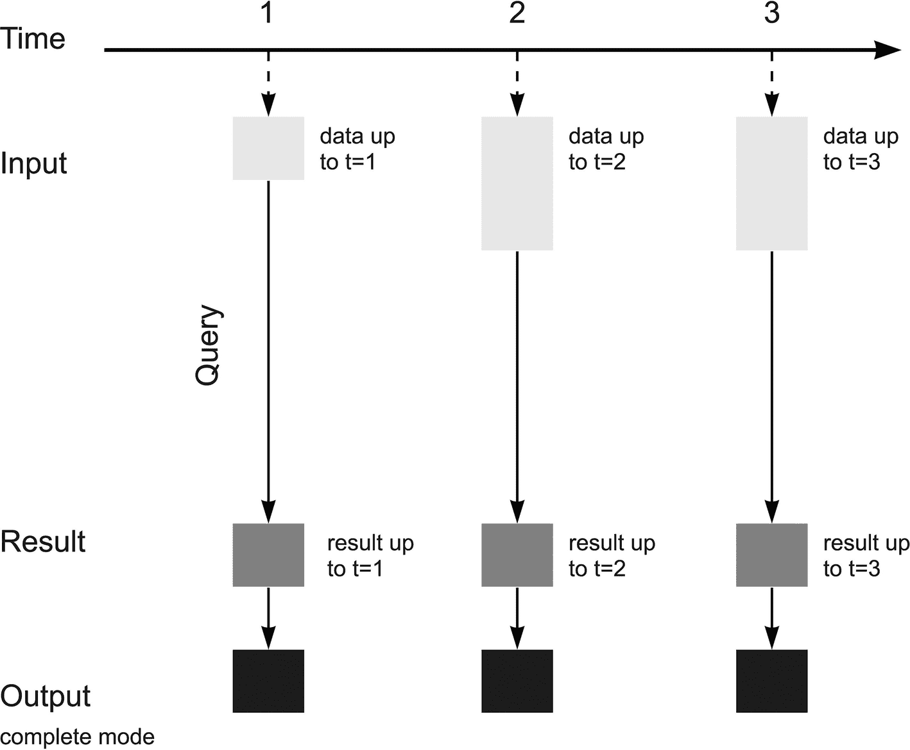

**图 10-1** — Spark Structured Streaming 编程模型

图 10-1 是一个高层级的序列图，展示了在 Spark 中随时间推移，能够可靠地摄取结构化无界流式数据的过程。在示例中，随着新数据被摄入到应用程序中，一个确定性的周期随着系统的每次“滴答”（即微批次）而开始。在每个批次中，Spark 在处理下一组数据之前，会执行一系列有向步骤（输入 --> 查询 --> 结果 --> 输出）。这一系列确定性的步骤（称为 DAG）代表了 Spark Structured Streaming 的四个基本处理范式：

*   执行/处理模式（微批次或连续模式）
*   触发器（有效的处理窗口/边界）
*   增量查询（随时间推移的渐进式数据处理）
*   流式输出模式（完整、更新和追加）

接下来你将探索这些范式，并理解它们在 Spark Structured Streaming 中所扮演的角色。

### 处理模式

最初，微批次处理是 Structured Streaming 唯一引入的执行模式，并且至今仍是默认模式。流式微批次的调度和执行使应用程序开发者能够转向一个可靠、结构化的流处理模型，而远离由 Spark 第一个流式编程模型引入的自定义方法。

**Apache Spark Streaming 与*离散化流（DStreams）***

使用 DStreams 时，工程师必须深入了解 `RDD` API（*Apache Spark 的核心数据结构和编程模型*）。这意味着工程师必须学会有效地使用较低级别的 `RDD` API。这包括理解如何从故障中恢复、实现接收器、高效地序列化/反序列化他们的代码和数据，以及扩展和性能调优他们的应用程序。这些仍然是需要学习的内容，只是通过 `DataFrames` 和 `Datasets` API 以及 SparkSQL 提供的抽象，学习层次更高了。你可以将这视为通往 Structured Streaming 道路上一个更自然的垫脚石，它展示了社区为克服障碍所采用的设计模式中的优点、缺点和丑陋之处。

幸运的是，本书不介绍 Apache Spark Streaming，而是介绍更易于理解、性能更高且能自我优化的 *Apache Spark Structured Streaming*。我建议你回顾一下 Spark 的发展历程，以理解过去的状况，并欣赏其演进的成果。现在，回到 Structured Streaming 的处理模式。

连续执行模式被引入，用于实现极低端到端延迟的真正实时处理。两种执行模式都能使应用程序管理流处理的复杂性，同时仅改变应用程序中数据处理方式的语义。图 10-2 显示了数据在输入源和输出端之间的一般流程如何保持一致，而主要的区别在于触发机制。

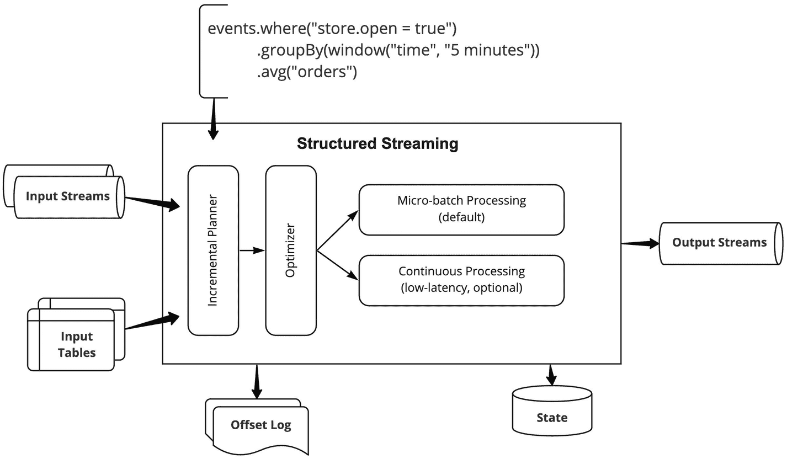

**图 10-2** — Structured Streaming 的处理流程

理解何时使用每种处理模式，是你在编写任何初始代码之前必须做出的关键决策。我们来看看原因。

#### 微批处理

如前所述，微批处理在结构化流式处理诞生之初便被引入。这种处理范式使应用程序开发者能够使用结构化的 Spark API（`DataFrame`/`Dataset`）编写流式应用。微批执行的机制依赖于周期性轮询新数据的概念。这使得 Spark 结构化流式引擎能够生成新一批数据进行处理。值得指出的是，这些应用不仅体现在数据层面的结构化（数据严格绑定到真实的结构化模式 `StructType`），还体现在每个微批处理前后的规划与执行的有序性上。

每个批次都以执行计划为起点，该计划是 Spark 引擎进行规划、分析和优化等一系列预处理步骤的结果，如图 10-3 所示。

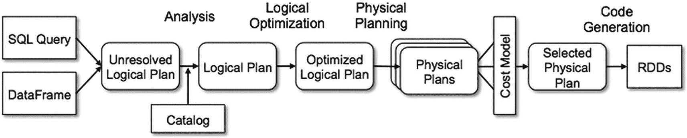

**图 10-3** — Spark 处理的每个批次（或微批）数据的优化过程

生成物理计划（如图 10-3 所示，详情参见第 6 章）后，输入数据源及其相关元数据会被预写（预写日志），为每个微批创建一个称为检查点的参考点。这使得应用在运行过程中可以安然失效，并以确定性的方式从最后一个完整保存点回滚并恢复。

在每个微批处理的另一端，输出写入器会确认其操作成功，这一过程被称为*提交*。同样值得指出的是，每个微批必须成功处理完成后，下一个微批才能开始处理。这种确认机制通过完全提交微批内所有已完成的工作来实现，或者在发生终态不可恢复故障时中止所有后续执行。

综合这些原则，你的应用将能够从可靠的数据源处理结构化数据，以一系列确定性的微批形式，为整个应用生命周期内的所有输入和输出提供清晰一致的模式，从而应对看似无限的流式数据。我们将在下一节的章节练习中实际演示这一过程。

#### 连续处理

结构化流式处理发布后不久，低延迟（亚秒级）的连续处理执行框架也随之推出。Spark 执行框架不再依赖对数据源的周期性轮询，而是依靠长期运行的任务来处理从数据源到数据接收器的端到端连续数据处理。这意味着数据会以最快的速度逐事件处理，无需等待每个批次的所有事件数据完全提交而带来的开销。图 10-4 提供了一个高层级示意图，以帮助理解这一模型。

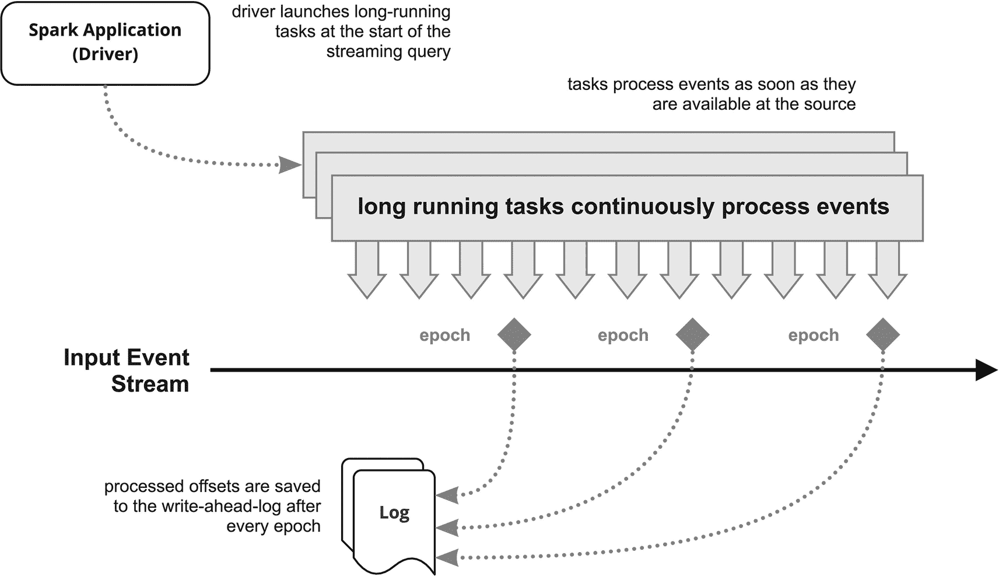

**图 10-4** — 连续处理执行模式

虽然这种执行模式可以实现极低的延迟（约 100ms 端到端），但它最适合处理单个事件的流，而非那些可以分组、分析或整体处理的微批事件集合。例如，如果你要构建一个系统，用于通知顾客他们点的咖啡已准备好取餐（类似苹果的推送通知服务），从技术上讲，你可以将此负载分布到 Spark 集群上，确保每条消息精确发送一次。你肯定不想惹恼顾客，导致他们选择退出通知。

你将在第三个和第四个练习中学习如何使用检查点和触发器。这也将是一次尝试连续处理和微批处理的机会。

### 练习材料

第 10 章的练习材料位于 [`https://github.com/newfront/spark-moderndataengineering/tree/main/ch-10`](https://github.com/newfront/spark-moderndataengineering/tree/main/ch-10)。材料中的 `README` 文件将为你提供有关其他安装步骤或注意事项的更多背景信息。这些练习依赖于第 8 章中扩展的 `~/dataengineering/` 环境设置，该设置提供了通用的 MySQL（Hive Metastore）和 MinIO（S3）。

## 练习概述

以下练习旨在教你使用 Apache Spark 结构化流式处理的核心功能。你在完成一系列练习时，将采用不同的方法模式。这些练习都围绕同一个核心挑战展开并延伸。

### 挑战

你需要创建一个系统，用于摄取 CoffeeCo 旗下所有咖啡店的实时事件数据。该系统将用于追踪整个网络中的顾客使用模式，从订单追踪开始。对于每个订单，可以预期一个可靠的上游网关（如第 9 章所述示例）会生成可靠事件，供你的 Spark 应用摄取。

图 10-5 展示了为流式应用提供必要数据的高层级系统工作流程。为简化起见，本章练习将重点放在事件流平台之后的数据处理上。因此，我们需要先定义一个事件格式。

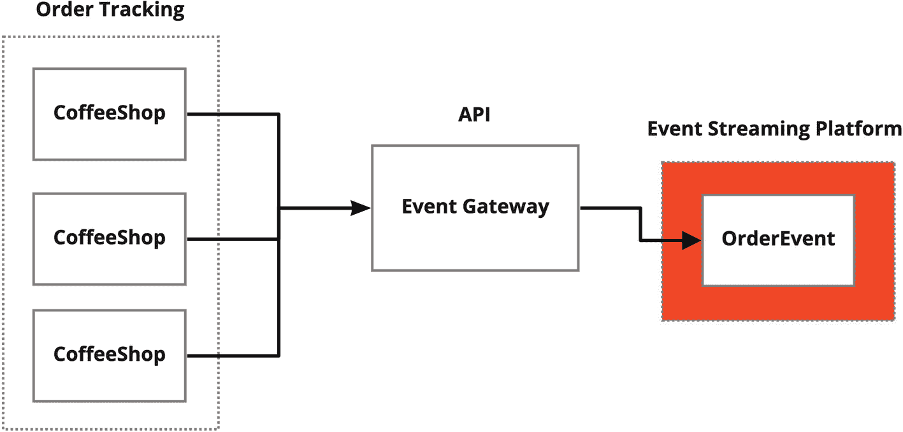

**图 10-5** — 订单追踪的入口路径。每个订单通过事件网关 API 发送一个事件，并排入事件流平台

### OrderEvent 格式

虽然在没有约定数据格式的情况下编写基于事件的应用程序并非不可能，但这样做难度更大，并且长期来看会使事情复杂化。在本例中，假设每个事件的格式需要提供订单 ID、关联客户 ID、交易门店 ID、订购商品数量以及交易总价。这些信息将被封装在一个我们称之为 `OrderEvent` 的结构中。我们清楚最终需要摄取的内容，只需将实际事件形式化即可。

**注意：** 在现实世界中，数据工程师常常需要负责创建结构化数据格式，甚至编写上游系统来生成数据并输入到他们自己的数据域中。这样他们便拥有自己域的数据合约，从而理解网络中其他上游数据提供者/生产者之间的数据血缘关系。

正如上一章所述，事件应保持一致且可靠；否则你的流式应用可能会突然停止运行，给你带来一团乱麻（以及停机故障）。这并不意味着在测试某个想法之前，你需要花费大量时间将上游数据梳理得井井有条。事实上，通常正确的做法是从粗略的概念/想法入手，然后分阶段逐步完善。

现在我们就采用这种方法。我们将首先在 Spark 引擎内部构建将要处理的数据。

### 深入理解 Spark Struct

鉴于您使用 Spark SQL 进行的结构化数据转换依赖于 `StructType`，您可以先通过简单的 DataFrame 概念来构思应用程序。这使您能够在正式确定特定应用的数据契约之前快速行动。请记住，始终从小处着手，逐步构建。

```scala

```

new StructType()
  .add(StructField("timestamp", LongType, false))
  .add(StructField("orderId", StringType, false))
  .add(StructField("storeId", StringType, false))
  .add(StructField("customerId", StringType, false))
  .add(StructField("numItems", IntegerType, false))
  .add(StructField("price", FloatType, nullable false))
```

现在，我们对应用程序中将要使用的数据结构有了一个概括性的表示，可以开始第一个练习了。

## 练习 10-1：使用 Redis Streams 驱动 Spark Structured Streaming

[Redis Streams](https://redis.io/topics/streams-intro) 可用于快速构建和测试完整的端到端流式应用程序。正如您将在本练习中看到的，这有助于发现构建应用程序的流程。

Redis Streams 运行开销很小，这得益于它是 [Redis](https://redis.io/) 的一个原生数据结构。Redis 是一个高度优化的数据结构存储系统，在社区中非常知名且受欢迎。如果您从未使用过 Redis，您仍然可以从本练习中学习。

**练习 10-1**

练习材料位于 `/ch-10` 目录下的 `/applications/redis-streams` 文件夹，具体路径为 `/exercises/01_redis-streams`。

## 启动本地环境

使用 `exercises/01_redis-streams` 目录下提供的 `docker-compose` 文件开始。您将再次使用 Docker Compose 启动环境，这意味着您也需要启动 Docker。

```bash
docker compose -f docker-compose.yaml up -d --remove-orphans
```

这将启动练习的外部依赖项：Redis、MinIO 和 MySQL。然后，是时候连接到新的 Redis 容器了。

## 连接到 Redis

打开终端或创建一个新的会话。您将使用连接到 Redis Docker 容器的终端，并通过 `redis-cli` 提供到 Redis 的命令行连接。此连接将用于将新的事件数据推送到您的流中。这也是读取、写入和管理事件流（或其他 Redis 需求）数据的完整生命周期的便捷方式。额外的好处是，您无需编写任何应用程序代码即可开始。

### 连接到 Redis CLI

借助 Redis 容器，您现在可以通过执行清单 10-1 中的命令来连接到 `redis-cli`。

```bash
docker exec -it redis redis-cli
```

*清单 10-1：连接到 Redis 容器并使用 `redis-cli`（命令行）*

在提示符下执行 `ping` 命令。您将看到返回了 `PONG`，这意味着一切正常。

```bash
127.0.0.1:6379> ping
PONG
```

接下来，您将学习监控流入 Redis 的命令流。这是观察系统中不同点之间发生了什么的好方法。

### 启用 Redis 命令监控

打开另一个终端窗口并执行清单 10-2 中的命令。连接成功后，您应该会看到一条 `OK` 消息。

```bash
docker exec -it redis redis-cli monitor
```

*清单 10-2：使用 Redis 容器中的 `redis-cli` 监控发送到 Redis（本地或远程）的命令*

监控进程是一个有用的视图，可以实时查看哪些命令正在被发送到 Redis。如果等待几秒钟，您将看到来自 Redis 容器健康检查的 ping 消息通过监控器。

```bash
1626138124.541908 [0 127.0.0.1:59704] "ping"
```

**容器健康检查**

`docker-compose` 文件（`ch-10/exercises/01_redis-streams/`）中提供的 `healthcheck` 块使服务能够使用简单的命令自我监控。对于 Redis，健康检查只是通过 `redis-cli` 发送一个 ping 并确保其不会超时。这意味着容器运行正常。

```yaml
healthcheck:
  test: ["CMD", "redis-cli", "ping"]
  interval: 5s
  timeout: 30s
  retries: 50
```

现在是时候使用 Redis 创建您的第一个流了。

## 创建 Redis Stream

*Redis Stream* 是自动生成的，并且在您添加数据时会立即可用。由于 Redis 是一个内存数据库，流生成的开销很小，因为没有需要立即创建的文件、新的磁盘空间分配或与流生成相关的昂贵锁定。您只需发布第一个事件，流就会神奇地出现。在后台，Redis 会定期将整个数据库持久化到 RDB（这是您整个 Redis 数据库的一个时间点快照）。如果您熟悉 Redis，那么流类型在概念上是列表、有序集合和哈希映射[数据结构](https://redis.io/topics/data-types)的混合体。

### 流的保证

Redis *保证* 流中每个事件的字段顺序，以及插入顺序的一致性。每个事件标识符将始终大于在其之前插入的任何事件。

**为什么字段级顺序很重要**

字段级顺序的重要性不仅仅是为了安心。作为由 Redis Stream 封装的事件存储的每个编码负载，都是指向一个哈希映射的指针。根据设计，哈希映射可以通过其键随机访问，但它们开箱即用不会保留任何特定顺序。例如，Java 中的 `HashMap` 和 `LinkedHashMap` 有很大的区别。当您想要维护 `EntrySet` 中键的顺序时，会使用链接变体。为了 Redis Stream 内部的可靠性和一致性，Redis 负责处理字段级顺序，但您仍然必须提供一个可靠的事件。我们将在练习后面部分查看这是如何处理的。

**事件标识符**

您使用 `XADD` 命令添加新事件。该命令包括使用自动生成的 ID 而不是提供您自己的标识符的选项。有效的事件 ID 格式是 `<number>-<number>`。对于自动生成的 ID，Redis 将事件被摄取到 Redis 时的 UNIX 纪元毫秒数（时间戳）和在同一毫秒内接收到的事件的单调递增 ID 连接起来。

```
1625766684875-0
```

这种模式确保了每个事件的标识大于其之前的任何事件。如果您决定使用自己的标识符，则必须记住这一点。否则，由于事件 ID 的预期被打破，您将看到错误消息 `ERR Invalid stream ID specified as stream command argument`。

#### Redis Streams 是仅追加的

理解 Redis 的流是一种仅追加的流式数据结构非常重要。仅追加意味着您无法更改插入顺序。这迫使希望重新组织事件（排序、添加缺失数据）的上游系统读取流、重新组织它，然后将事件推送到新的流中，或者将这些结果推送到另一个可靠的存储中。当您拥有一个不可变的、仅追加的流式数据源时，您可以保持一致性。这降低了使用这些数据的复杂性，并为您提供了流式处理的理想可靠数据源。

让我们发布一个事件并生成您的第一个流。

### 向 Redis Stream 发布事件

你可以通过发布事件来创建 Redis Stream。复制清单 10-3 中从 `xadd` 开始的命令，并将其粘贴到 `redis-cli` 中。

```
127.0.0.1:6379> xadd com:coffeeco:coffee:v1:orders * timestamp 1625766472513 orderId ord126 storeId st1 customerId ca183 numItems 6 price 48.00
```

*清单 10-3：向 Redis Stream 发布事件*

Redis 将通过返回已发布事件的事件 ID 来确认你的命令。例如，返回 `"1625766684875-0"`。

### 从 Redis Stream 消费事件

现在你已经发布了一个事件并生成了一个流。你可以使用 `redis-cli` 读取（消费）所有可用的已发布事件。为此，你将使用 `xrange` 或 `xrevrange` 命令，这些命令允许你读取流中的项目。使用 `redis-cli` 执行清单 10-4 中的命令。

```
127.0.0.1:6379> xrange com:coffeeco:coffee:v1:orders - + COUNT 1
```

*清单 10-4：使用 `xrange` 从 Redis Stream 读取事件*

### Redis Stream 数据获取

这将按照插入顺序（升序）获取添加到流中的第一个项目，该顺序基于流的尾部（可以思考一下链表如何使用头指针或尾指针）。从概念上讲，这个过程相当于 SQL 中的 `order by asc limit 1`。

```sql
select * from v1.orders

order by timestamp asc limit 1
```

与此相反的是 `xrevrange` 选项。它使用降序插入顺序，从流的头部（最新的项目优先）读取数据。现在你已经对 Redis Stream 的工作原理有了基本了解，是时候进入 Spark 应用程序本身了。

### SparkRedisStreamsApp

打开 `SparkRedisStreamsApp`，它位于本章材料中 `applications` 目录的 `/ch-10/applications/redis-streams` 路径下。此应用程序可追溯到第 7 章，当时你在 Scala 中创建了第一个编译好的 Spark 应用程序。应用程序的整体结构相同，但增加了一个 Dockerfile 和一个非托管库项（`lib/spark-redis`）。在撰写本文时，`spark-redis` 库尚不普遍适用于 Spark 3.x。

```text
redis-streams/

conf/

lib/

project/

src/

Dockerfile

build.sbt
```

该项目提供了构建端到端应用程序所需的所有基础模块。我们不妨先不浏览代码，而是换个策略，先编译，再提问。

让我们先使用 `sbt` 编译应用程序。

#### 编译应用程序

从项目根目录（`redis-streams`）开始，编译应用程序。

```bash
sbt clean assembly
```

**注意**

编译应用程序需要 Redis 在 Docker 中运行。返回练习的开始位置，在练习目录中执行 `docker compose` 命令。

应用程序编译完成后，你的 JAR 文件将位于 `target/scala-2.12/spark-redis-streams-assembly-0.1-SNAPSHOT.jar`。下一步我们将应用程序包装到自己的 Docker 容器中，届时会用到这个资源。

#### 构建 Docker 容器

编译好应用程序后，你现在可以构建 Docker 容器了。打开项目根目录中的 `Dockerfile`（如清单 10-5 所示）。

```dockerfile
FROM newfrontdocker/apache-spark-base:spark-3.1.2-jre-11-scala-2.12

COPY target/scala-2.12/spark-redis-streams-assembly-0.1-SNAPSHOT.jar /opt/spark/app/spark-redis-streams.jar

EXPOSE 4040
```

清单 10-5

用于创建我们的统一 Redis Streams 应用程序的 Dockerfile

容器定义文件（`Dockerfile`）只是在 `apache-spark-base` 基础容器之上添加了一个新层，该层将你的应用程序 JAR 复制到 `/opt/spark/app` 目录（由 `spark-base` 容器创建）。它还暴露了端口 4040，这是 Spark UI 运行的端口。从项目根目录执行清单 10-6 中的 `docker build` 命令。

```bash
docker build . \

-t `whoami`/spark-redis-streams:latest
```

清单 10-6

构建 spark-redis-streams Docker 容器

你会看到容器构建几乎不需要时间（假设 `apache-spark-base` 容器已缓存在本地 Docker 中）。

```text
[+] Building 0.4s (7/7) FINISHED

=> [internal] load build definition from Dockerfile                                                                                                       0.0s

=> => transferring dockerfile: 37B                                                                                                                        0.0s

=> [internal] load .dockerignore                                                                                                                          0.0s

=> => transferring context: 34B                                                                                                                           0.0s

=> [internal] load metadata for docker.io/newfrontdocker/apache-spark-base:spark-3.1.2-jre-11-scala-2.12                                                  0.0s

=> CACHED [1/2] FROM docker.io/newfrontdocker/apache-spark-base:spark-3.1.2-jre-11-scala-2.12                                                             0.0s

=> [internal] load build context                                                                                                                          0.2s

=> => transferring context: 11.90MB                                                                                                                       0.2s

=> [2/2] COPY target/scala-2.12/spark-redis-streams-assembly-0.1-SNAPSHOT.jar /opt/spark/app/spark-redis-streams.jar                                      0.1s

=> exporting to image                                                                                                                                     0.1s

=> => exporting layers                                                                                                                                    0.1s

=> => writing image sha256:2e542656e6e8c5e165fac6e308c68252f2396152a00785c7094c15f55a702939                                                               0.0s

=> => naming to .../spark-redis-streams:latest                                                                                              0.0s
```

构建过程很快完成，因为本质上你只是添加一个 `JAR` 文件（已在本地编译）并定义一个要暴露的端口。

提示

思考一下如何通过复用容器来创建可堆叠的环境。在清单 10-5 的示例中，堆栈从 `apache-spark-base` 开始，然后通过添加应用程序 `JAR` 来扩展堆栈。

现在，你已经准备好运行应用程序并消费 `Redis Stream`。

### 运行应用

该应用的功能类似于一个简单的回声服务器。当您向 `Redis Stream` 添加新事件时，应用将（几乎）立即处理该事件并输出格式化后的 `DataFrame` 和批处理标识符（微批次）。这个应用代表了我们进行的初次尝试，目的是确保所有组件正确连接。请务必牢记：始终从简单的部分开始，然后逐步构建。

此时，`redis-cli` 监视器（来自代码清单 10-2）开始变得有趣。如果您的屏幕空间足够，请同时打开 `redis-cli` 窗口和 `redis-cli` 监视器窗口（来自代码清单 10-1 和 10-2），然后再打开第三个终端窗口来运行应用。

执行代码清单 10-7 中的命令来启动容器并触发 `Spark` 应用运行。

```
docker run \
  -p 4040:4040 \
  --hostname spark-redis-test \
  --network mde \
  -v ~/dataengineering/spark/conf:/opt/spark/conf \
  -v ~/dataengineering/spark/jars:/opt/spark/user_jars \
  -it `whoami`/spark-redis-streams:latest \
  /opt/spark/bin/spark-submit \
  --master "local[*]" \
  --class "com.coffeeco.data.SparkRedisStreamsApp" \
  --deploy-mode "client" \
  --jars /opt/spark/user_jars/mariadb-java-client-2.7.2.jar \
  --driver-class-path /opt/spark/user_jars/mariadb-java-client-2.7.2.jar \
  --conf "spark.sql.warehouse.dir=s3a://com.coffeeco.data/warehouse" \
  --conf "spark.app.source.stream=com:coffeeco:coffee:v1:orders" \
  /opt/spark/app/spark-redis-streams.jar
```

代码清单 10-7：用于启动运行于本地数据平台的 `Spark Redis Streams` 应用（容器内）的 `docker run` 命令

`Docker` 容器将使用您之前编译并封装进容器的 `SparkRedisStreamApp` `JAR` 包启动。检查日志时，您会注意到许多来自 `Spark` 的信息级别（`info-level`）日志。您始终可以通过 `log4j`（将根级别日志记录更改为 `WARN` 或 `ERROR`，或仅选择应用日志）来减少这些无关信息。目前，这些日志可以帮助您更深入地了解其运行机制。

### Redis Streams 消费者组与偏移量

应用启动时，它将连接到 `spark.app.source.stream` 配置值中指定的 `Redis Stream` 标识符。您可以在输出日志中看到此过程。只需查找以下输出。

```
INFO RedisSource: Getting batch...
start: None
end: {"offsets":{"com:coffeeco:coffee:v1:orders":{"groupName":"spark-source","offset":"1626552490734-0"}}}
```

在此过程中，`Spark` 与 `Redis` 之间会发生一次快速握手，您可以使用 `redis-cli` 监视器来观察。您将在监视器中看到以下输出。

```
"XGROUP" "create" "com:coffeeco:coffee:v1:orders" "spark-source" "$" "mkstream"
"XINFO" "STREAM" "com:coffeeco:coffee:v1:orders"
"XREADGROUP" "group" "spark-source" "consumer-1" "count" "100" "block" "500" "noack" "streams" "com:coffeeco:coffee:v1:orders" ">"
"XINFO" "STREAM" "com:coffeeco:coffee:v1:orders"
```

这些命令是应用在无先前状态启动时的握手过程的一部分。（您将在练习 10-3 中学习如何通过检查点来存储应用状态。）这个信息收集流程会查询流并为应用创建新的消费者组。

### 消费者组

为了追踪流的位置并将 `Spark` 应用与特定组关联，使用了 `XGROUP` 命令。鉴于该应用之前从未运行过，首先会创建一个新组，然后查询流（`XINFO`）以获取与流相关的所有元数据，以便 `Spark` 能够开始接收新事件。

您可以在 `redis-cli` 中运行 `xinfo` 命令来查看返回的数据。

```
xinfo STREAM com:coffeeco:coffee:v1:orders
```

然后，使用 `XREADGROUP` 命令，应用会创建一个初始位置来阻塞并等待新事件。

现在，应用已经了解了其初始状态，便可以继续执行并开始工作。这是任何 `Structured Streaming` 应用的关键第一步。实际上，您会发现这个过程也会创建第一个批次。

```
Batch: 0
+---------+-------+-------+----------+--------+-----+
|timestamp|orderId|storeId|customerId|numItems|price|
+---------+-------+-------+----------+--------+-----+
+---------+-------+-------+----------+--------+-----+
```

此过程现在仅在有新数据从 `Redis Stream` 到来时才会重复执行。让我们添加另一个事件。

### 创建下一个批次

您可以从步骤 3 复制 `XADD` 命令并将其粘贴到 `redis-cli` 中，以触发一个新批次。

```
xadd com:coffeeco:coffee:v1:orders  * timestamp 1625766472513 orderId ord126 storeId st1 customerId ca183 numItems 6 price 48.00
```

在 `Spark` 应用容器中，您将看到应用对事件做出响应并进行处理。从日志中，重要的输出部分是批次的确认以及批次格式化后的输出。

```
Batch: 1
+-------------+-------+-------+----------+--------+-----+
|    timestamp|orderId|storeId|customerId|numItems|price|
+-------------+-------+-------+----------+--------+-----+
|1625766472513| ord126|    st1|     ca183|       6| 48.0|
+-------------+-------+-------+----------+--------+-----+
```

尝试将以下事件粘贴到 `redis-cli` 中。您会注意到应用的运行行为有何特点？

```
> xadd com:coffeeco:coffee:v1:orders  * timestamp 1625766472503 orderId ord124 storeId st1 customerId ca153 numItems 1 price 10.00
> xadd com:coffeeco:coffee:v1:orders  * timestamp 1625766472513 orderId ord125 storeId st1 customerId ca173 numItems 2 price 7.00
> xadd com:coffeeco:coffee:v1:orders  * timestamp 1625766472513 orderId ord126 storeId st1 customerId ca183 numItems 6 price 48.00
```

> `xadd com:coffeeco:coffee:v1:orders * timestamp 1625766472613 orderId ord127 storeId st1 customerId ca184 numItems 1 price 3.80`

您会注意到应用会将每个事件放在其自己的批次中处理。好吧，您可能会问，这是为什么呢？这似乎与我们预期的微批次行为不太一致，我们期望其更具连续性。确实如此，这种行为可以通过在应用的控制路径中添加触发器来控制。

现在，您可以停止 docker 进程（`^+C`）或直接退出其运行的窗口。

我们将在练习 10-2 中深入探讨应用代码本身，以了解构成此应用运行机制的各个组件。在此过程中，您将学到一些有助于简化应用编写的技巧。

### 练习 10-1：总结

第一个练习从宏观层面教您了解了 Redis Streams 的工作原理。您学会了使用 `redis-cli`，弄清楚了 `redis-cli` 监视器的用途，并掌握了如何驾驭这些新的流处理方式。最后，您预览了 Spark Redis Streams 应用，接下来将学习其具体内容。

### 练习 10-2：解析 Redis 流应用

你在练习 10-1 中运行的应用是一个不完整的结构化流应用。这是因为该应用尚未跟踪自身状态（因此它是无状态的），也没有对消费的事件进行任何有效处理。不过这都是有意为之；该应用的当前状态如图 10-6 所示。

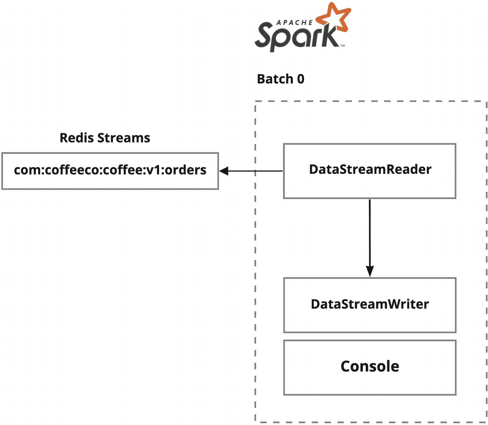

图 10-6：结构化流的起点。它连接到 Redis 并持续轮询新事件

图 10-6 展示了你刚在练习 10-1 中运行的应用。以此逻辑模型为基础，在你喜欢的 IDE 中打开 `redis-streams` 项目，并导航到位于 `/ch-10/applications/redis-streams/SparkRedisStreamsApp.scala` 的文件。

你会注意到我们再次使用了在第 7 章介绍的 `SparkApplication` 特质。

```scala
object SparkRedisStreamsApp extends SparkApplication
```

作为回顾，这个特质的用途是为应用提供 `SparkSession`、应用名称句柄以及不可变的 `SparkConf`，这样在设置每个新应用时能大幅减少模板代码。

### DataStreamReader

参考上图，我们从 `DataStreamReader` 开始。这是核心的结构化流接口之一，它提供了一种通用方式来将流式数据集加载到 Spark 中。在应用中，你会找到以下代码块。

```scala
lazy val inputStream: DataStreamReader = {
  sparkSession.readStream
    .format("redis")
    .option("stream.keys", inputStreamName)
    .schema(streamStruct)
}
```

与批处理应用类似，我们使用 `SparkSession` 作为接口来配置数据源并生成新的读取器（即入口）。唯一区别在于，这里我们通过使用 `readStream` 而非 `read` 来将数据源指定为流式数据源。

**扩展 Spark**

你可能也是第一次见到自定义数据源格式。Spark 是一个可插拔平台，它明白 `format("redis")` 将通过 `spark-redis` 库（借助 `DataSourceRegister` 和 `StreamSourceProvider` 接口）提供。你可以创建自己的源和接收器格式，为 Spark 添加新功能，而无需重复造轮子。

然后我们填充数据源所需的配置。在本例中，只需提供流的名称（流的键名）以及该数据源期望的 schema。

#### Schema 是必需的吗？

对于大多数流式数据源，*schema* 是必需的。JSON 数据源可以推断 schema，但它是通过采样来完成的，这可能导致不一致性。这意味着在事件数据稀疏（例如可选字段）的情况下，你无法获得确定的 schema。为了省心，最好基于上游数据契约提供 schema。这样，你的应用就能建立在明确的预期之上。

在练习的介绍部分，你已经了解了订单事件格式。以下 `struct` 是该应用的正式结构化数据契约。

**OrderEvent 的 Schema**

```scala
lazy val streamStruct = new StructType()
  .add(StructField("timestamp", LongType, false))
  .add(StructField("orderId", StringType, false))
  .add(StructField("storeId", StringType, false))
  .add(StructField("customerId", StringType, false))
  .add(StructField("numItems", IntegerType, false))
  .add(StructField("price", FloatType, false))
```

值得一提的是，`DataStreamReader` 的 `schema` 构建方法既可以接受完全格式化的 `StructType`（如上所示），也可以接受 DDL 字符串。Spark 会解析 DDL 字符串并为你组装好相应结构。

**通过 DDL 字符串生成 StructType。这等价于调用 `StructType.fromDDL(streamStruct.toDDL)`**

```scala
StructType.fromDDL("""
  `timestamp` BIGINT,
  `orderId` STRING,
  `storeId` STRING,
  `customerId` STRING,
  `numItems` INT,
  `price` FLOAT""")
```

这种灵活性使你能够编写丰富的、可配置驱动的流式应用，同时仍遵循严格的数据契约。

以上就是应用如何知道连接到哪里以及期望上游提供什么 schema 的方式。鉴于第一个流式应用较为简单，我们将直接进入 `DataStreamWriter`。

### DataStreamWriter

`DataStreamWriter` 是用于将流式数据集写入 Spark 外部存储的核心接口。该接口提供的方法集比其批处理模式的对等体 `DataFrameWriter` 更少。我们将在练习 10-3 中介绍 `outputMode`、`partitionBy` 和 `trigger` 的使用。查看 `run` 方法将向你展示实际用法。

**来自 `SparkApplication` 特质的 `run` 方法的流式实现**

```scala
override def run(): Unit = {
  ...
  val writer: DataStreamWriter[Row] = SparkRedisStreams(sparkSession)
    .transform(inputStream.load())
    .writeStream
    .queryName("orders")
    .format("console")
  startAndAwaitApp(writer.start())
}
```

`run` 方法利用了一些可能不易察觉的简单应用设计模式。接下来我们将介绍懒加载调用和依赖注入的精妙用法。这些技术与第 7 章介绍的 Spark 委派模式协同工作。

#### 懒加载调用

`run` 方法依赖 Scala 伴生类构造和懒加载依赖注入，以降低 Spark 读取此应用意图并生成执行计划的复杂度。

```scala
SparkRedisStreams(sparkSession)
  .transform(...)
```

传递给 `transform` 方法的 DataFrame 是对我们的 `DataStreamReader` 调用 `load` 方法的结果。

```scala
.transform(inputStream.load())
```

## 依赖注入

这种模式让你能利用依赖注入为 `transform` 方法提供 `DataFrame`。这使测试更简单，并为上游数据源提供了灵活性。目前应用连接的是 Redis，但你同样可以轻松接入 Kafka，且除了上游配置外，应用本身无需更改。由于接口绑定的是 `DataFrame` 而非 `DataStreamReader`，这种模式还允许你针对批处理或流式数据源复用同一个应用。

至此，我们已接近拼图的最后一块。要构建一个结构化流应用，你需要同时具备数据源和数据接收端。我们已经介绍了上游数据源 Redis。快速回顾一下：这个流式数据源是通过 Spark Session 的 `readStream` 方法生成的，该方法返回一个 `DataStreamReader`。现在，要满足最后一个需求，我们只需要一个接收端。

## 写入流式数据

`writeStream` 方法是 `Dataset` 类的成员。`DataFrame` 本质上就是一个 `Dataset[Row]`，而应用的 `transform` 方法返回一个 `DataFrame`。因此，当我们调用 `writeStream` 时，实际上是将我们的 `DataFrame` 转换为 `DataStreamWriter`。

在应用中，使用的输出格式是 `"console"`。这是一个特殊的接收端，可用于观察应用的输出，因为它不会将任何数据写入可靠的数据存储。

```
.writeStream
.queryName("orders")
.format("console")
```

当完整的应用链路（数据源 → 转换 → 接收端）搭建完毕后，剩下的就是启动应用。`DataStreamWriter` 的 `start` 方法会创建一个 `StreamingQuery`。

```
startAndAwaitApp(writer.start())
```

### 流式查询

[`StreamingQuery`](https://spark.apache.org/docs/latest/api/java/org/apache/spark/sql/streaming/StreamingQuery.html) 接口封装了端到端的结构化流。它提供了在 Spark 应用中运行时对查询进行内省的方法。该接口还是线程安全的，因此你可以从驱动器的任何位置观察流。在本应用通过第 11 章的测试进行扩展和强化时，你将直接使用这个接口。

目前，你只需关注一个方法：`awaitTermination`。

```
def startAndAwaitApp(query: StreamingQuery): Unit = {
  streamingQuery.awaitTermination()
}
```

当你在流式查询上调用 `awaitTermination` 时，应用将持续运行，直到抛出无法恢复的异常，或进程被退出（例如停止 Docker 容器或发送终止信号）。

这个端到端过程全部由应用入口点内的 `run()` 调用启动。

## 应用入口点

应用入口点是提供 `main` 方法的类。该应用扩展了 `SparkApplication` 特质，而后者又扩展了 Scala 的 `App` 特质。因此，当你之前运行此应用时，本质上是在调用 `SparkRedisStreamsApp` 的 `main` 方法，该方法会调用 `run()`。

```
/opt/spark/bin/spark-submit \
--master "local[*]" \
--class "com.coffeeco.data.SparkRedisStreamsApp" \
...
/opt/spark/app/spark-redis-streams.jar
```

现在你已经了解了初始应用的工作原理，我们可以更进一步，对应用进行二次迭代。在练习 10-3 中，你将学习使用检查点使应用具备状态管理能力。

## 练习 10-2：总结

在练习 10-2 中，你学习了练习 10-1 中介绍的应用如何工作。你逐步了解了如何将流式数据源连接到流式数据写入器，并学习了接收的事件（跨每个批次）如何从源头流向接收端。这个简单的练习向你介绍了 Structured Streaming 的核心 Spark 接口：`DataStreamReader`、`DataStreamWriter` 和 `StreamingQuery` 接口。最后，你学习了如何分层使用懒调用和依赖注入来创建易于理解和维护的 Spark 应用。

在下一个练习中，你将学习为此应用添加检查点。

## 练习 10-3：使用检查点进行可靠的有状态流处理

在练习 10-1 中，应用启动时 Spark 和 Redis 之间发生了一次握手。这个过程为我们有状态的应用生成了初始状态。不幸的是，当你终止进程时，所有这些临时状态基本上都被清除了。这意味着应用在离线期间会跳过处理所有添加到 Redis Stream 的数据。

你可能已经猜到我要说什么了。是的，这并非理想情况，而且确实无助于建立对应用的信心。

### 为什么检查点很重要

检查点为你提供了一个保存点。就像任何经典电子游戏一样，这为你提供了一个安全的地方，在失败时可以回到这里。现在，对于我们的应用来说，如果它失败了，我们需要能够从精确的断点处重新开始。

### 可靠的检查点

可靠的检查点始于一致性和持久性的概念。这应该会让你想到容错性，而且将其与原子性联系起来也并不困难。Apache Spark 通过依赖分布式文件系统（即 HDFS）的基础，将应用检查点（状态）存储在外部，从而实现了可靠的检查点功能。这样，即使应用运行的机器宕机，应用也能被重新启动。

### 启用可靠的检查点

打开 `StatefulSparkRedisStreamsApp`。此应用在引入可靠检查点时几乎无需改动。实际上，只有两个明显的变更。

第一个变更体现在 `run` 方法中。

*向 DataStreamWriter 添加 checkpointLocation*

```
SparkRedisStreams(sparkSession)
.transform(inputStream.load())
.writeStream
.queryName("orders")
.option("checkpointLocation", appCheckpointLocation)
.format("console")
```

传入此参数的值通过 `SparkConf` 传递给应用。

```
lazy val appCheckpointLocation: String = sparkConf.get("spark.app.checkpoint.location")
```

现在让我们运行这个应用。

### 运行有状态应用

你可以通过在练习 10-1 中使用的 Docker `run` 脚本上进行轻微修改来测试此应用。

```
docker run \
...
--class "com.coffeeco.data.StatefulSparkRedisStreamsApp" \
--conf "spark.sql.warehouse.dir=s3a://com.coffeeco.data/warehouse" \
--conf "spark.app.source.stream=com:coffeeco:coffee:v1:orders" \
--conf "spark.app.checkpoint.location=s3a://com.coffeeco.data/apps/spark-redis-streams-app/1.0.0/simple" \
/opt/spark/app/spark-redis-streams.jar
```

两处高亮显示的变更分别对应应用入口点以及提供应用检查点位置所需的新增配置。

### 观察有状态行为

在应用运行状态下，打开你的 `redis-cli`（如果已关闭），并粘贴一个练习 10-1 中的 `OrderEvents` 示例。

```
> xadd com:coffeeco:coffee:v1:orders  * timestamp 1625766472503 orderId ord124 storeId st1 customerId ca153 numItems 1 price 10.00
```

这将触发批次处理，其行为与之前相同。接下来是激动人心的部分：停止 Spark 应用（按 Control+C）。在重新启动应用之前，向 Redis 流中再添加三个事件。

```
> xadd com:coffeeco:coffee:v1:orders  * timestamp 1625766472503 orderId ord124 storeId st1 customerId ca153 numItems 1 price 10.00
```

```markdown
> xadd com:coffeeco:coffee:v1:orders * timestamp 1625766472613 orderId ord127 storeId st1 customerId ca184 numItems 1 price 3.80
>
> xadd com:coffeeco:coffee:v1:orders * timestamp 1625766472513 orderId ord125 storeId st1 customerId ca173 numItems 2 price 7.00

重新启动 Spark 应用。你可能首先观察到的（如果扫描日志）是，Redis Source 输出现在包含一个起始参数。

```
INFO RedisSource: 正在获取批次...

start: Some({"offsets":{"com:coffeeco:coffee:v1:orders":{"groupName":"spark-source","offset":"1626658307940-0"}}})

end: {"offsets":{"com:coffeeco:coffee:v1:orders":{"groupName":"spark-source","offset":"1626658362223-0"}}}
```

你还会发现应用能无缝衔接，仿佛从未离线过。与重新从批次 `0` 开始不同，你会看到下一个批次是非零的。例如：

```
批次: 2

+-------------+-------+-------+----------+--------+-----+

|    timestamp|orderId|storeId|customerId|numItems|price|

+-------------+-------+-------+----------+--------+-----+

|1625766472503| ord124|    st1|     ca153|       1| 10.0|

|1625766472613| ord127|    st1|     ca184|       1|  3.8|

|1625766472513| ord125|    st1|     ca173|       2|  7.0|

+-------------+-------+-------+----------+--------+-----+
```

这意味着你现在可以在应用宕机后无缝恢复，不会遗漏任何数据处理。

#### 检查点的工作原理

对于每个批次，流数据源会将用于该批次的显式偏移量写入可靠存储（即分布式文件系统），这被称为`预写式日志`。在每个成功批次完成后，会以提交的形式将确认信息写入可靠存储。你可以从图 10-7 中了解此过程。

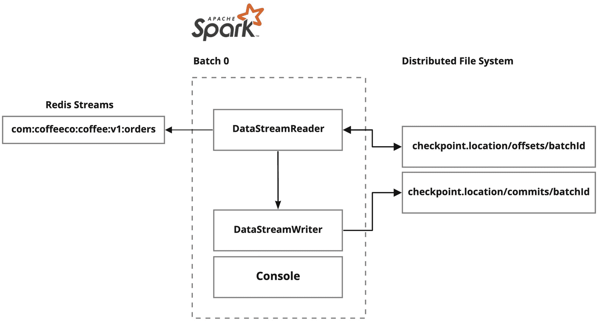
图 10-7

检查点处理流程

每个批次都会重复此过程。这意味着批次中的故障不会“移动”游标，你的应用将从上一个成功的保存点重新启动。

你可以通过 MinIO 浏览器 `http://127.0.0.1:9000/minio/com.coffeeco.data/apps/spark-redis-streams-app/1.0.0/simple/` 或文件系统下的 `~/dataengineering/minio/` 路径检查应用检查点。

#### 删除检查点

仅当应用生命周期结束，或应用正在更新且底层 DAG 发生变化时，才需要删除检查点。当你更改数据源或数据接收器，或向表中添加更多数据源（例如来自多个上游的流式连接）时，DAG 会发生更改。

### 练习 10-3：总结

第三个练习向你介绍了使 Structured Streaming 可靠的关键机制——检查点。你了解到每个批次都通过预写式日志（WAL）进行控制，每个成功批次都通过提交标记为完成。即使运行应用的物理服务器或机器发生致命故障，这个简单的过程也能跟踪你的应用状态。

在本章的最后一个练习中，你将学习如何通过添加处理触发器来控制应用的运行时行为。

### 练习 10-4：使用触发器控制应用运行时行为

触发器可用于控制 Structured Streaming 应用的行为。在本练习中，你将学习在增强应用的同时应用三种不同类型的触发器。更改内容如图 10-8 所示。

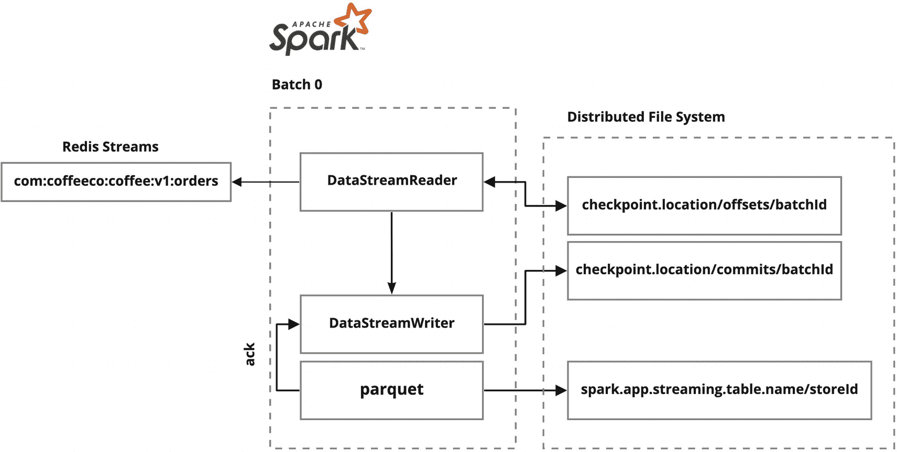
图 10-8

对 Redis Streams 应用进行的最终更新。此更改将写入通过 Redis Streams 读取的数据内容，然后将这些事件写出到持久的分布式表中。

打开名为 `TriggeredStatefulSparkRedisStreamsApp` 的文件。你将在此文件中找到几个新方法、新配置以及对 `run` 方法的更新。直接跳转到 `outputStream` 方法，因为我们将从这里开始。此方法负责构建一个部分的 `DataStreamWriter`。

```scala
lazy val outputStream: DataStreamWriter[Row] = {
  SparkRedisStreams(sparkSession)
    .transform(inputStream.load())
    .writeStream
    .queryName("orders")
    .format("parquet")
    .partitionBy("storeId")
    .option("path", streamingSinkLocation)
    .outputMode(OutputMode.Append())
}
```

流式接收器的输出格式是 *parquet*。这意味着应用正在将从 Redis 流中读取的数据转换为 parquet 格式，然后将这些事件按 `storeId` 分区写出到由 `streamingSinkLocation` 定义的路径中。当你使用 `partitionBy` 写入时，本质上是在创建键/值命名的目录。

```
/tables/coffee.order.events/storeId={storeId}/
```

**提示**：根据经验法则，你应该在低基数列上对表进行分区。通常的做法是使用日期（`date=YYYY-mm-dd`）和年份部分（`year=YYYY/month=mm/day=dd`）。为了增加多样性，你可以包含与你将要执行的查询相关的列。在本练习中，该列是 `storeId`。

最后，我们将输出格式更改为仅追加模式：`OutputMode.Append()`。这只会让流式 DataFrame/dataset 中的新行写入接收器。当我们下一章研究使用聚合时，输出模式会更有意义，因为它们有助于减少有状态聚合和其他分析处理的输出量。我们现在来看看触发器。

### 更新后的触发式运行方法

`run` 方法现在会利用提供的触发器配置，对 `outputStream` 方法生成的 `DataStreamWriter` 进行进一步定制。让我们来看看这两个配置值。

```scala
lazy val triggerEnabled: Boolean = sparkConf.getBoolean(
  "spark.app.stream.trigger.enabled", true)
```

为什么你需要启用或禁用触发功能？在应用恢复或重放场景中，触发器可能会阻碍应用达到最大吞吐量。例如，`ProcessingTime` 触发器能让 Spark 应用基于一个时间间隔（如 30 秒、5 分钟或 1 小时）来执行。每次应用触发时，它会运行至完成所需的时间，然后计时器开始倒计时，直到下一次可以触发下一个批次。如果你希望应用快速处理，能够为这类特殊用例切换开关并短路触发机制就非常有用。

```scala
lazy val triggerType: String = sparkConf.get(
  "spark.app.stream.trigger.type", "processing")
```

触发器类型与 `processing`、`once` 或 `continuous` 这些值相关联。这三种类型的触发器在 Spark Structured Streaming 中均可使用。

让我们看看这两个配置如何协同工作，以控制用于在 `run` 方法中生成最终 `StreamingQuery` 的配置项。

```scala
override def run(): Unit = {
  super.run()
  val writer: DataStreamWriter[Row] = triggerType match {
    case "continuous" if triggerEnabled =>
      val checkpointInterval = "30 seconds"
      outputStream
```


.option("checkpointLocation", s"$appCheckpointLocation/trigger/continuously/")
.trigger(Trigger.Continuous(checkpointInterval))

case "once" if triggerEnabled =>
    outputStream
        .option("checkpointLocation", s"$appCheckpointLocation/trigger/once/")
        .trigger(Trigger.Once())

case "processing" if triggerEnabled =>
    outputStream
        .option("checkpointLocation", s"$appCheckpointLocation/trigger/processing/")
        .trigger(Trigger.ProcessingTime("10 seconds"))

case _ =>
    outputStream
        .option("checkpointLocation", s"$appCheckpointLocation/trigger/none/")

startAndAwaitApp(writer.toTable(streamingTableName))
```

我们已经介绍过 `DataStreamWriter` 接口的作用。这里我们只是使用了一种更函数式的方法，通过 `triggerType` 的模式匹配来生成最终的 writer。

```
triggerType match {
    case "continuous" if triggerEnabled =>
    case "once" if triggerEnabled =>
    case "processing" if triggerEnabled =>
    case _ =>
}
```

模式匹配使得检查 `triggerType` 是否等于 `continuous`、`once` 或 `processing` 变得更容易。否则，应用将回退到默认的无触发器的微批处理模式。在每个代码块内部，都发生着一些有趣的事情。现在让我们来逐一分析。

### 持续处理模式

本章前面部分我们介绍了什么是持续处理模式。本质上，它会对来自数据源的每个事件进行处理直到完成，并异步提交，而不关心其他任何事件的状态（因为没有批次这个概念）。

```
Trigger.Continuous(checkpointInterval)
```

不幸的是，我们只能在使用 Kafka 作为数据源时使用这种执行模式，因此我们必须等到下一章再介绍。（你可以使用第 11 章中的环境进行测试，作为后续探索。）

### 周期处理

有时候，你会发现需要控制应用触发每个微批次的频率。例如，你需要每分钟运行一次作业，但又不想使用 Airflow 来实现。

你可以使用这个触发器来替代 Airflow 调度器，每五分钟运行一个新批次：`Trigger.ProcessingTime("5 minute")`。

```
case "processing" if triggerEnabled =>
    outputStream
        .option("checkpointLocation", s"$appCheckpointLocation/trigger/processing/")
        .trigger(Trigger.ProcessingTime("10 seconds"))
```

在这个应用中，该时间间隔被固定为十秒。你可以轻松地添加一个配置参数，以更动态的方式控制触发器。

### 有状态批处理作业

回到第 7 章，你了解了有状态批处理作业。好的，现在我们就在这里，你正在查看用于将应用从持续有状态 Structured Streaming 应用转变为有状态批处理应用的控制器。虽然从技术上讲，这仍然是一个 Structured Streaming 应用，但它在首次运行后不会继续执行，这一事实给了我们将其称之为有状态批处理应用的空间。

```
case "once" if triggerEnabled =>
    outputStream
        .option("checkpointLocation", s"$appCheckpointLocation/trigger/once/")
        .trigger(Trigger.Once())
```

### 流式表写入器

在测试应用之前的最后一项任务，是简要讨论一下对 `run` 方法末尾所做的更改。

```
startAndAwaitApp(
    writer.toTable(streamingTableName)
)
```

`DataStreamWriter` 有一个名为 `toTable` 的方法。这个方法，就像你之前看到的 `start` 方法一样，会生成一个 `StreamingQuery`。其背后的原理是，表的元数据现在被写入 Hive Metastore（正如你在第 6 章中所学的），而物理分区的 parquet 文件的其余部分则被写入分布式文件系统。

`streamingTableName` 存储在 `sparkConf` 中，具体配置项为 `spark.app.streaming.table.name`。在本例中，它被命名为 `coffee_orders`。

#### 使用触发器运行有状态应用

接下来只需运行应用即可。你需要打开 `redis-cli`，并准备好订单事件，以便在应用启动后立即开始输入。

##### 使用一次性触发器运行

必要的配置如下所示。你可以直接从应用目录中的 `README` 获取完整命令，或者对练习 10-1 中展示的原始完整`docker run`命令进行必要的调整。

```
docker run \
    ...
    --class "com.coffeeco.data.TriggeredStatefulSparkRedisStreamsApp" \
    --conf "spark.sql.warehouse.dir=s3a://com.coffeeco.data/warehouse" \
    --conf "spark.app.source.stream=com:coffeeco:coffee:v1:orders" \
    --conf "spark.app.stream.trigger.enabled=true" \
    --conf "spark.app.stream.trigger.type=once" \
    --conf "spark.app.checkpoint.location=s3a://com.coffeeco.data/apps/spark-redis-streams-app/canary/" \
    --conf "spark.app.streaming.sink.path=s3a://com.coffeeco.data/tables/coffee.order.events/" \
    --conf "spark.app.streaming.table.name=coffee_orders" \
    /opt/spark/app/spark-redis-streams.jar
```

应用将启动。如果没有检查点，它将创建初始的批次 0，然后应用完成。然而，就像练习 10-3 中的有状态应用示例一样，你可以向 Redis 流中添加任意数量的事件，然后重新启动应用。它会处理所有事件，然后再次停止运行。其美妙之处在于，你可以使用 Docker 操作符从 Airflow 运行此应用，从而执行完全一致、可靠的、有状态的批处理作业。很简洁。

##### 使用处理时间触发器运行

这将启动应用，并为其提供全新的检查点。然后，你可以自由添加任意数量的新事件，并观察应用的行为。它会在每次运行之间暂停十秒钟。

```
docker run \
    ...
    --class "com.coffeeco.data.TriggeredStatefulSparkRedisStreamsApp" \
    --conf "spark.sql.warehouse.dir=s3a://com.coffeeco.data/warehouse" \
    --conf "spark.app.source.stream=com:coffeeco:coffee:v1:orders" \
    --conf "spark.app.stream.trigger.enabled=true" \
    --conf "spark.app.stream.trigger.type=processing" \
    --conf "spark.app.checkpoint.location=s3a://com.coffeeco.data/apps/spark-redis-streams-app/canary/" \
    --conf "spark.app.streaming.sink.path=s3a://com.coffeeco.data/tables/other.coffee.order.events/" \
```

#### 持续运行

目前我们还无法以持续模式运行。我们需要将 Kafka 引入其中，这将在下一章进行。

#### 查看结果

你可以通过跳转到运行 MySQL 的 Docker 实例并直接查询 Hive Metastore 来检查其中存储的值。

```bash
docker exec -it mysql bash
mysql -u dataeng -p
use metastore;
select * from TABLE_PARAMS
where TBL_ID =(
  select TBL_ID from TBLS
  where TBL_NAME = "coffee_orders"
);
```

该输出将是与 `coffee_orders` 表相关的元数据。

*使用 DataStreamWriter 上的 toTable 方法生成的 Hive Metastore 记录*

```
+------------------------------------------------------------+
| TBL_ID | PARAM_KEY                            | PARAM_VALUE|
+--------+--------------------------------------+------------+
|     16 | EXTERNAL                             | TRUE       |
|     16 | spark.sql.create.version             | 3.1.2      |
|     16 | spark.sql.partitionProvider          | catalog    |
|     16 | spark.sql.sources.provider           | parquet    |
|     16 | spark.sql.sources.schema.numPartCols | 1          |
|     16 | spark.sql.sources.schema.numParts    | 1          |
|     16 | spark.sql.sources.schema.part.0      | {schema}   |
|     16 | spark.sql.sources.schema.partCol.0   | storeId    |
|     16 | transient_lastDdlTime                | 1626675149 |
+--------+--------------------------------------+------------+
```

你会看到该表是一个外部表。这意味着你可以从 Spark 目录中删除该表，但仍保留位于分布式文件系统中的物理表。

### 练习 10-4：总结

这个最后的练习教你如何在应用程序中连接多种执行模式，并使用由配置驱动的特性标志来改变应用程序的行为。虽然你可以将这些示例进一步扩展，但这已经是使用 Apache Spark Structured Streaming 的一个很好的入门介绍了。

## 本章总结

本章我们涵盖了很多内容。你了解了 Spark Structured Streaming 的核心处理原则。

-   执行/处理模式（微批处理或持续处理模式）
-   触发器（有效的处理窗口/边界）
-   增量查询（跨时间的渐进式数据处理）
-   流式输出模式（完整模式、更新模式和追加模式）

你学习了如何使用触发器在微批处理执行模式和持续执行模式之间切换。虽然当前没有可用的正确组件（即 Kafka），但你仍然有一个可插入的应用程序以应对该用例（这即将到来）。你使用了仅追加输出模式，这意味着只有 Spark 之前未见过的数据才会通过接收器写入。你将在下一章学习如何使用其他模式。最后，你拥有一整套可用的工具，包括在将 Apache Spark 应用容器化方面的新技能。

在下一章中，我们将继续 Structured Streaming 的学习，重点放在更高级的数据处理上，从流式连接到聚合以及其他分析处理。你还将亲自使用 Kafka，将其纳入你庞大的数据工程工具集。我们开始吧。

# 11. Apache Kafka 与 Spark Structured Streaming

上一章介绍了如何使用 Apache Spark Structured Streaming。你了解了如何使用流行的 Redis 数据库来创建结构化的内存事件流，并探讨了如何编写有状态的流式应用程序。

本章将扩展上一章学到的技能，包括：如何使用核心的 Structured Streaming API——`DataStreamReader` 和 `DataStreamWriter`；如何利用应用程序检查点创建能够处理容错和重启的有状态流式应用；如何使用触发器控制应用处理频率和运行风格；以及最后，有状态流和有状态批处理中应用的流程如何工作。你将通过重点学习如何使用 Apache Kafka 作为 Spark 与其余数据生态系统之间的管道，继续探索 Structured Streaming 的工作原理。

## Apache Kafka 简介

Apache Kafka 在第 1 章中介绍过，它是当今应用最广泛的事件和数据流处理框架。Kafka 在数据工程生态系统中的主导地位与其提供的稳定功能有关。它介入并解决了与分布式系统和服务间通信相关的常见问题。

### 异步通信

API 及其他 HTTP 服务要求所有依赖的系统和服务均处于运行状态，才能以同步方式处理请求。后端服务通常会实现不同级别的重试机制，以便在遇到无响应的系统或服务时进行退避，并在多次尝试后放弃并向调用方返回错误。第 9 章介绍了“惊群效应”问题以及资源稀缺如何在进程争相弥补损失时间时引发麻烦。Kafka 能够使（可处理异步请求的）系统摆脱传统的请求/响应周期，转变为一种新的模式：可以查询请求标识符以获取完成状态，或者通过使用 webhook 或回调来通知该 API 请求所封装操作的最终成功或失败状态。

### 水平可扩展性

Kafka 能够高效处理因主题（用于存储一组相关事件/类型的持久化存储机制）的消费者（读取者）、生产者（写入者）或两者数量增加而给系统带来的常见负载问题。其实现方式是支持集群中服务器数量向外扩展（水平扩展），而非单纯扩展服务器本身的规模（CPU/内存/磁盘）。

与可能因单台服务器资源有限而饱受过多连接困扰的传统数据库不同，Kafka 的代理节点可以横向扩展，从而整体提升整个集群的吞吐能力。

代理节点是一种服务器端（集群成员）服务，负责处理集群中所有分布式请求的一部分。每个代理节点都被分配并负责一个或多个分布式主题分区（数据文件）的一部分，其角色可以是分区领导者（分区的主要所有者），也可以是副本（当前领导者分区的冗余备份）。通过增加代理节点数量，可以在集群中更均匀地分担读取、写入或冗余恢复等更高负载。这使得平台能够扩展以满足主题的数据需求，同时也能管理分布式系统在可用性和一致性方面带来的各种问题。

### 高服务可用性与一致性

你在第 1 章中了解了 CAP 定理，鉴于 Kafka 是一个分布式、网络连接的服务，一致性、可用性和网络分区容错性问题至关重要。该定理指出，为了维持分布式一致性，服务在处理网络分区（集群中的盲点）时无法保持完全可用。因此，Kafka 在主题内部使用分区复制来实现高可用性和一致性。为确保在担任分区领导者的代理节点（服务器）离线（或服务器关机/宕机）时，有不止一个完整的同步副本（ISR）可用于冗余，每次写入都会持久化地写入预写日志并向写入者（生产者）确认。Kafka 集群可以利用 ISR 协议来可靠地选择丢失分区的下一个可用 ISR（冗余副本），并将该代理节点提升为新的主题分区领导者。每当代理节点离线时，此循环就会重复，以在最大程度上减少对给定主题的消费者和生产者的影响，恢复主题的一致性和可用性。

与 Kafka 将主题内容分布到多个分区的方式相同，代理节点本身也可用于在节点之间传播主题级别的命令。例如，为了以零停机方式增加主题的分区数量，可以使用任何代理节点来进行消息传播（类似流言协议）。主题级别的配置也可以在实时、零停机的情况下进行调整，以应对因生成的有效负载（事件）规模增大而导致的数据需求增加，或因生产和消费的记录数量增长而带来的需求变化。为何要进行横向扩展？这个概念让我们回到大数定律。所有系统在单进程内需要处理的负载越大，速度就会越慢。因此，拆分主题的分区（例如，增加封装整个主题的分区数量）是应对大数据系统规模需求的一种方式。

### 灾难恢复

通过允许应用程序从更早的时间点重放事件（数据），系统和服务可以应对一定的停机或服务中断情况，并从原本可能导致数据丢失的场景中恢复过来。这对于数据管道尤为重要，因为丢失一个事件就等于数据丢失，而具有恢复选项的降级服务最终仍能达到最终一致性。

### 事件流与数据管道生态系统

Apache Kafka 解决了一个类似于*数据湖*（在第 1 章中介绍）的问题。请记住，数据湖为来自整个组织的原始、未处理数据提供了一个统一、弹性可扩展的单一真实来源，它充当一个中心化暂存区域，以便数据可以在稍后时间点被可靠地重新读取、重新处理和转换为可用数据。这个中心化数据暂存区域解决了一个与数据管道以及过早进行有损数据转换有关的问题。如果你无法追溯到事件的原始真实来源，那么损坏的数据就会简单地向下游流动。

另一方面，Apache Kafka 提供了一个统一的事件流解决方案，它将事件数据组织成*主题*，其作用类似于支撑数据湖的分区式分布式文件系统。主题支持构建由编码二进制数据组成的数据管道，这些管道可以被接入以生成丰富的数据网络。数据湖与 Kafka 之间的关键区别在于时间，特别是最小化数据生成（写入主题）与数据可被下游消费（读取）之间的时间差。

Kafka 使连接的客户端能够在分配给某个主题的服务器端代理节点组（仲裁）提交并确认收到来自已连接数据生产者发布的事件（记录）后，立即（近实时地）消费数据。连接的客户端只需按预定时间间隔轮询一个主题，以记录（事件）集合的形式获取任何新数据。Kafka 有意最小化事件创建与事件可被处理之间的时间差（增量），这对于实时事件流处理以及实时数据处理至关重要。

在本章中，你将会学习以下内容：

- 使用 Docker 配置并运行一个 Kafka 集群
- 创建和修改 Kafka 主题
- 连接并配置 Spark Kafka 库
- 使用 Kafka 数据源
- 将来自 Kafka 的二进制数据转换为 DataFrame 和数据集
- 使用 Kafka 数据接收器

`练习材料`

第 11 章的练习材料位于 `https://github.com/newfront/spark-moderndataengineering/tree/main/ch-11`。每个练习中的 `README` 文件将为你提供有关任何额外安装或注意事项的更多背景信息。

## 章节练习

以下练习将帮助你继续探索 Spark 结构化流框架的特性与功能。首先，你将使用 `docker-compose` 在本地启动 Kafka。在深入探讨如何充分利用 Kafka 丰富流生态系统的模式之前，这也是一个熟悉 Kafka 各种架构组件运行原理的机会。

## 练习 11-1：启动并运行 Apache Kafka

打开章节材料，导航至名为 `ch-11` 的目录，开始进行练习。

### 练习 11-1：材料

练习材料位于 `ch-11` 目录下。

```
ch-11

├── docker

│   └── kafka

│       ├── README.md

│       └── docker-compose.yaml

└── exercises

    └── 01_kafka_up_and_running
```

### 启动本地环境

使用 `docker/kafka` 目录下提供的 `docker-compose` 文件开始操作。按照 `README.md` 文件中的步骤，将 Kafka 纳入你的数据工程工具箱。现在，你可以使用 `docker compose` 命令启动一个完整的 Kafka 集群，运行 Zookeeper（有状态元数据存储）和三个 Kafka 代理。

```bash
docker compose \
  -f ~/dataengineering/kafka/docker-compose.yaml \
  up -d --remove-orphans
```

`docker-compose` 文件配置了一个功能完整的 Kafka 集群（使用前几章的 `mde` Docker 网络），从而允许从你的笔记本电脑和 Docker 运行时内部进行访问。现在，你可以从你的 Spark 应用程序连接到该 Kafka 集群。

运行 Kafka 集群的容器可以使用以下 `docker ps` 命令查看。这将过滤出名字匹配 `kafka_` 前缀的运行中容器。

```bash
docker ps \
  --filter "name=kafka_*" \
  --filter "network=mde" \
  --format "table {{.Names}}\t{{.Mounts}}\t{{.Networks}}" \
  -s
```

输出将显示运行你全新 Kafka 集群的四个容器。

```
NAMES               MOUNTS              NETWORKS
kafka_kafka-2_1     kafka_kafka_2_...   mde
kafka_kafka-1_1     kafka_kafka_1_...   mde
kafka_kafka-0_1     kafka_kafka_0_...   mde
kafka_zookeeper_1   kafka_zookeepe...   mde
```

三个容器代表集群代理，第四个容器是 Apache Zookeeper。Zookeeper 负责存储 Kafka 集群元数据（状态），包括代理标识符、分区领导者以及每个主题在集群中的副本位置。接下来你将了解更多关于主题如何工作的信息，并创建你的第一个主题。

### 创建你的第一个Kafka主题

现在你的 Kafka 集群已经启动并运行，你可以创建你的第一个主题了，但在创建之前，让我们先了解一些与 Kafka 主题相关的更多特性或行为。然后你就可以开始创建你的第一个主题了。

#### 主题的行为方式

从高层次来看，主题的行为类似于数据库中的表，但更像是一个分布式提交日志，用于存储结构化的键/值对记录。

从 Spark 的角度来看，基于键/值的 Kafka 记录的一般结构如列表 11-1 所示。Kafka 记录（`StructType`）的格式至少包含一个名为 `value` 的列，该列在静态存储时被编码为字节数组（二进制），以及数据被读取的 `topic`、记录静态所在的分区 `partition`，以及单个记录的 `offset`（可以将其视为指向主题分区内行位置的指针）。

```
root
 |-- key 
 |-- value 
 |-- topic 
 |-- partition 
 |-- offset 
 |-- timestamp 
 |-- timestampType 
 |-- headers >

列表 11-1
Kafka 记录结构数据格式
```

Kafka 记录被分片（或简单地分布）在关联主题的总分区数上。由于记录键列对每条 Kafka 记录是可选的，对于空键的默认分区机制是以轮询方式插入记录，这意味着每条生产记录的最终分区分配是非确定性的。这最终意味着在相同数据集上重复运行时，数据无法保证落在相同的分区上。然而，通过为每个记录键提供一个非空值，Kafka 将使用提供的键作为分区机制（哈希分区），使得每条记录能够确定性地路由到给定主题的特定分区。

**提示**

对于事件流，事件数据要么依赖于流中的其他事件来讲述发生了什么（或正在发生什么），要么每个事件可以独立存在，自行讲述完整的故事。第 9 章介绍了相互依赖和独立事件数据的概念，你可以利用 Kafka 来优化事件在每个主题分区内的发出方式，从而针对相互依赖或独立事件的用例进行优化。

我们已经确定主题是一种集合机制，它像导管或通道一样用于事件流，但我们尚未涵盖是什么让 Kafka 如此出色。每条已发布的记录在插入时都会被打上代理端的时间戳（以毫秒为单位），并且仅在成功写入（提交）后才得到确认。伴随确认而来的保证是，主题将在逐个分区的基础上维护时间同步的插入顺序，本质上是为你提供一组按插入时间排序的记录。

由于插入顺序的保证仅在分区级别上，这使得 Kafka 能够在一个非分布式的、隔离的主题子集上管理其他情况下复杂的分布式插入排序任务。基于分区的主题架构，在较低层面上，实际上更像是一个分布式文件系统，并且像任何文件系统一样，独立的 Kafka 不会强制为记录中的每个值应用显式的记录模式。

通过移除模式强制，Kafka 主题可以变得非常灵活，但灵活性也带来了可能意外将损坏或错误的数据流向下游的风险。因此，一种常见的做法是为每个主题关联一个特定的、二进制编码的事件类型（或多个类型）。

#### 创建 Kafka 主题

可以使用 Kafka 附带的 admin shell 脚本来创建主题。执行列表 11-2 中的命令来创建你的第一个主题。

```bash
docker exec \
  -it kafka_kafka-0_1 \
  /opt/bitnami/kafka/bin/kafka-topics.sh \
  --create \
  --if-not-exists \
  --topic com.coffeeco.coffee.v1.orders \
  --bootstrap-server kafka_0:9092,kafka_1:9092,kafka_2:9092 \
  --partitions 4 \
  --replication-factor 2

列表 11-2
使用 Kafka 开箱即用的命令行工具创建 Kafka 主题
```

运行该命令的结果是创建一个名为 `com.coffeeco.coffee.v1.orders` 的新 Kafka 主题。该主题将在集群中有条件地创建（`if-not-exists`），并配置有四个分区。为了提高可用性，每个主题分区都被复制两次。你将在下一节中了解有关修改主题的更多信息。

**可选**

既然你已经创建了第一个主题，我猜你一定想继续对它进行更多操作。你可以随意跳到练习 11-2。你随时可以回到这里，了解更多关于 Kafka 如何处理主题管理和安全性的信息。

### Kafka 主题管理

管理 Kafka 主题归根结底就是理解系统行为以及学会使用 Kafka 附带的 admin 工具。本节将向你介绍一些操作 Kafka 所需的常用命令和必要技能。

#### 列出 Kafka 主题

列出集群中可用的主题是发现主题的关键。您可以通过在 `kafka-topics.sh` 脚本上使用 `--list` 操作来实现，如清单 11-3 所示。

```bash
docker exec \
  -it kafka_kafka-0_1 \
  /opt/bitnami/kafka/bin/kafka-topics.sh \
  --list \
  --bootstrap-server kafka_0:9092,kafka_1:9092,kafka_2:9092

清单 11-3
列出 Kafka 主题返回一个简单的主题列表
```

`list` 操作将打印集群中所有可用主题的名称。

#### 描述一个主题

不时检查与给定主题相关的元数据是很有帮助的。这有助于调试您在将 Kafka 作为日常职责的一部分进行运维时，不可避免地会遇到的问题。执行清单 11-4 中的命令将返回与分区相关的元数据以及每个代理所扮演的角色，从而维护主题的一致性和可用性。

```bash
docker exec \
  -it kafka_kafka-0_1 \
  /opt/bitnami/kafka/bin/kafka-topics.sh \
  --describe \
  --topic com.coffeeco.coffee.v1.orders \
  --bootstrap-server kafka_0:9092,kafka_1:9092,kafka_2:9092

清单 11-4
描述一个主题
```

`describe` 命令的输出与下面显示的输出会略有不同，因为您的集群会有不同的指定主题领导者和分区副本位置。以下是我环境中的修改后的输出：

```
Topic: com.coffeeco.coffee.v1.orders
TopicId: eENgTy01QUWOAe2gJzi_rw
PartitionCount: 4
ReplicationFactor: 2
Configs: segment.bytes=1073741824
```

## Topic: com.coffeeco.coffee.v1.orders

Partition: 0    Leader: 2    Replicas: 2,1    Isr: 1,2

Partition: 1    Leader: 1    Replicas: 1,0    Isr: 1,0

Partition: 2    Leader: 0    Replicas: 0,2    Isr: 0,2

Partition: 3    Leader: 2    Replicas: 2,0    Isr: 0,2

`describe` 命令的元数据揭示了每个分区是如何分布在这三个代理上的。代理 ID 分别为 0、1 和 2。您可以看到，对于每个分区，都有一个领导者负责存储该分区的一份副本，以及一个与领导者同步的副本。这种能力允许分区领导者丢失，而由同步中的副本无缝地接管成为新的领导者。

## 修改一个主题

Kafka 主题的配置并非一次性设置后就置之不理。在大多数情况下，初始配置仅是对给定主题所需总分区数和条件配置需求的预估。幸运的是，动态修改（或更改）主题是可行的，而不会中断连接到该主题的客户端。

您可以通过增加被视为健康所需的最小主题副本数来修改之前创建的主题，以提高其一致性和可用性或整体容错能力。`min.insync.replicas` 的默认值是 `1`，我们将把它增加到 `2`。

## 更改主题配置

要在初始创建后修改主题，您可以使用 `kafka-configs.sh` 脚本来添加或删除（移除）主题的配置属性。执行清单 11-5 中的命令来更改最小同步主题副本数。

```bash
docker exec \
-it kafka_kafka-0_1 \
/opt/bitnami/kafka/bin/kafka-configs.sh \
--alter \
--bootstrap-server kafka_0:9092,kafka_1:9092,kafka_2:9092 \
--entity-type topics \
--entity-name com.coffeeco.coffee.v1.orders \
--add-config min.insync.replicas=2
```

清单 11-5 修改现有主题的配置

重新配置您的主题后，每个分区现在需要两个同步副本。您能看到这里可能存在的问题吗？也许与主题复制因子有关？如果一个代理丢失（离线/无法访问/宕机），集群将承受额外的压力，因为可用的代理需要为分配给丢失代理的任何主题的分区恢复丢失的分区。二级代理需要复制丢失的主题分区，以恢复到与这些分区的领导者同步（一致）的状态。这可能导致大量的文件传输，从而增加整个集群的网络 IO 和 CPU 负载，并降低受影响主题的可用性。这进而可能导致写入该主题的生产者在恢复一致、可用状态时进行客户端退避。

为了确保您的集群能够处理代理丢失，您可以将主题的复制因子从 `2` 改为 `3`。这样，您就可以处理单个代理丢失的情况，而无需手忙脚乱。在创建主题时，通过添加 `--replication-factor 3` 来执行此操作更容易，而不是像您接下来要做的那样使用手动副本分配。

## 增加主题分区副本

为了确保在丢失一个代理时，您的集群仍能保持健康，并且至少拥有两个同步副本，您需要创建一个副本重新分配 JSON 文件。可以使用 `describe topic` 命令中的信息来生成此文件。只需获取当前分配，并在 `replicas` 数组中添加另一个代理 ID。这将作为 Kafka 的模板，用于将主题的复制因子从 `2` 增加到 `3`。清单 11-6 中的示例展示了副本重新分配的 JSON 格式。

```json
{
    "version": 1,
    "partitions": [
        {
            "topic": "com.coffeeco.coffee.v1.orders",
            "partition": 0,
            "replicas": [2,1,0]
        },
        {
            "topic": "com.coffeeco.coffee.v1.orders",
            "partition": 1,
            "replicas": [1,0,2]
        },
        {
            "topic": "com.coffeeco.coffee.v1.orders",
            "partition": 2,
            "replicas": [0,2,1]
        },
        {
            "topic": "com.coffeeco.coffee.v1.orders",
            "partition": 3,
            "replicas": [2, 0, 1]
        }
    ]
}
```

清单 11-6 Kafka 主题副本重分配（`replication-reassignments.json`）文件格式

有了这个副本文件，您需要将其复制到您的某个 Kafka 代理中，以便能够从该代理运行 `kafka-reassign-partitions.sh` 脚本。复制命令如清单 11-7 所示。

```bash
docker cp \
./exercises/01_kafka_up_and_running/replication-reassignments.json \
kafka_kafka-0_1:/opt/replication-reassignments.json
```

清单 11-7 用于将 `replication-reassignments.json` 上传到 Kafka 代理的 Docker 复制命令

现在代理上有了 `replication-reassignments.json` 文件，您就可以运行重新分配分区的脚本了。使用您上传 `replication-reassignments.json` 文件的同一个代理，并执行清单 11-8 中的命令。

```bash
docker exec \
-it kafka_kafka-0_1 \
/opt/bitnami/kafka/bin/kafka-reassign-partitions.sh \
--bootstrap-server kafka_0:9092,kafka_1:9092,kafka_2:9092 \
--reassignment-json-file /opt/replication-reassignments.json \
--execute
```

清单 11-8 运行 `kafka-reassign-partitions.sh` 脚本以增加主题复制

作为运行副本重新分配的结果，您现在可以处理 Kafka 集群中丢失一个代理的情况，而不会对集群的行为造成重大中断。在非生产场景中，有时简单地删除主题并从头开始更容易，但理解如何修改主题的行为可以帮助您学会务实地解决问题。

> **提示**：分区重新分配的另一个用例是 Kafka 代理倾斜的情况。这种情况出现在一个或多个代理因承载了某个主题的过多分区而过载时。这可能会减慢连接到该代理（作为其主题分区的领导者）的生产者和消费者，因为更多的数据和更多的连接不均衡地分布在代理之间。

# 截断主题

Kafka 中的主题（Topic）只会保留达到配置保留毫秒数的记录。了解这一点后，你可以通过修改主题配置来截断（清除所有记录）一个主题。你需要先缩短主题（记录）的保留期限，这样 Kafka 才会开始清理主题记录。等待一两分钟后，Kafka 不会立即删除这些记录，因此只需为你的主题重新添加一个合理的保留期限（常见为一天或七天）。

## 缩短主题保留期限

第一步使用 `--alter` 命令，将主题的 `retention.ms` 值设置为 1 秒（1000 毫秒）。执行`清单 11-9` 中的命令来修改主题保留期限。

```
docker exec -it kafka_kafka-0_1 \
/opt/bitnami/kafka/bin/kafka-configs.sh \
--bootstrap-server kafka_0:9092,kafka_1:9092,kafka_2:9092 \
--entity-type topics \
--alter \
--entity-name com.coffeeco.coffee.v1.orders \
--add-config retention.ms=1000
```
`清单 11-9` 截断 Kafka 主题以清除所有记录

现在主题正在被清理，等待一两分钟，然后恢复主题的保留期限。

## 增加主题保留期限

既然主题已经清理完毕（假设你已经等待了一段时间），现在你可以将主题保留配置改回一天的保留期限（参见`清单 11-10`）。

```
docker exec -it kafka_kafka-0_1 \
/opt/bitnami/kafka/bin/kafka-configs.sh \
--bootstrap-server kafka_0:9092,kafka_1:9092,kafka_2:9092 \
--entity-type topics \
--alter \
--entity-name com.coffeeco.coffee.v1.orders \
--add-config retention.ms=86400000
```
`清单 11-10` 为 Kafka 主题添加一天的保留期限

当你需要清除主题内的所有记录时，可以使用此技术。在练习 11-2 中创建 `CoffeeOrder` 生成器后，你可能想在测试完毕后清理该主题。这也可以用于测试 Kafka 的不同故障模式。

# 删除 Kafka 主题

Kafka 主题只应在两种情况下被删除。第一种原因是主题已终止生命周期，且没有生产者和消费者使用该主题。第二种原因是你在非生产环境中，并且没有其他团队（或服务）依赖此主题。事实上，Kafka 代理默认配置为不允许删除主题。这是因为意外删除主题可能对依赖流数据源访问的数据管道网络造成灾难性影响。

在强调完这些限制和警告之后，你可以通过执行清单 11-11 中的 `delete` 命令来测试删除你的主题。

```
docker exec \
-it kafka_kafka-0_1 \
/opt/bitnami/kafka/bin/kafka-topics.sh \
--delete \
--topic com.coffeeco.coffee.v1.orders \
--bootstrap-server kafka_0:9092,kafka_1:9092,kafka_2:9092
```

清单 11-11
可以使用 `kafka-topics.sh` 来删除 Kafka 主题

`delete` 命令会执行软删除（仅在 Zookeeper 中标记），除非 Kafka 代理配置了 `delete.topic.enable=true`。你可以通过更新用于启动集群的 `docker-compose.yaml` 文件，将你的 Kafka 集群修改为使用此危险配置。找到 Kafka 代理的环境配置部分，并添加清单 11-12 中的环境变量。

```yaml
services:
  kafka-0:
    environment:
      ...
      - KAFKA_CFG_DELETE_TOPIC_ENABLE=true
```

清单 11-12
在 Kafka 代理上使用 `delete.topic.enable=true` 标志启用主题删除功能

这个例子展示了如何为三个代理中的一个修改 `docker-compose.yaml` 文件中的代理配置。你可以修改其他两个代理配置，然后重启你的 Kafka 集群以使这些更改生效。现在你可以执行不可逆的删除操作，但这并不推荐。

# 保护对主题的访问

[保护对 Kafka 的访问](https://kafka.apache.org/documentation/%2523security)以及相关的集群元数据、主题和底层物理数据似乎是理所当然的事情。然而，就像生活中的许多事情一样，安全有时会被遗漏，成为待解决的问题。简而言之，有几种方法可以保护对 Kafka 集群的访问，从基本的防火墙规则开始，到访问控制列表（ACL），最后使用 SSL/TLS 实现全加密的端到端传输。

## 防火墙规则

防火墙规则使用 Linux 风格的 [iptables](https://en.wikipedia.org/wiki/Iptables) 或安全的基于云的访问，在托管中心或虚拟私有云（VPC）内的主机之间建立点对点连接。这包括 AWS 安全组，它管理跨 IP 地址和开放端口之间的入站和出站连接及数据传输。这相当于在夜间锁好你的门。它可以防止恶意行为者进入你的系统，除非他们找到撬锁的方法。

## 访问控制列表

Apache Kafka 自带了一个名为 [Authorizer](https://kafka.apache.org/documentation/%2523security_authz) 的、开箱即用的 ACL 实现。它可用于在防火墙规则之外，使用访问控制列表（ACL）进一步保护 Kafka。默认情况下，ACL 规则存储在 Zookeeper 中。ACL 用于授权和管理用户（称为主体）对一个或多个主题或集群本身的操作访问。Kafka 中的 ACL 类似于 SQL 数据控制语言（DCL），用于授予特定的基于集群的操作集合，限制读取、写入、更新和删除能力。

启用 ACL 需要在每个代理上进行操作，这可以通过 `docker-compose.yaml` 完成。就像启用主题删除一样，你可以从环境配置中打开 Authorizer（如清单 11-13 所示）。

```yaml
services:
  kafka-0:
    environment:
      ...
      - KAFKA_CFG_AUTHORIZER_CLASS_NAME=kafka.security.authorizer.AclAuthorizer
```

清单 11-13
启用代理 ACL

一旦 Authorizer 被打开（这需要重启每个代理），你就可以使用 Kafka 命令行添加 ACL。执行清单 11-14 中的命令，为你的主题添加基于用户的访问控制。

```
docker exec -it kafka_kafka-0_1 \
/opt/bitnami/kafka/bin/kafka-acls.sh \
--bootstrap-server :9092 \
--add \
--allow-principal User:dataengineering \
--operation read \
--operation write \
--topic com.coffeeco.coffee.v1.orders
```

清单 11-14
为 Kafka 主题级别的授权添加 ACL

防火墙规则配合维护良好的 ACL，可以大大加强你的 Kafka 集群的安全性。如果对系统范围的访问进行审查以保持规范性，并且不向不安全的客户端软件授予管理超级用户或“上帝模式”访问权限，那么你应该能够顺利运行。

## 使用双向 TLS 的端到端加密

Apache Kafka 支持端到端的 SSL/TLS 加密，以处理传输中的加密数据。这需要一个共享证书和私钥对，可以在 SSL/TLS 握手期间进行验证，以确保来自连接两端（客户端或服务器）的数据流免受恶意行为者的侵害。

### 练习 11-1：总结

在第一个练习中，你了解了运行本地 Kafka 集群的方方面面。本练习旨在介绍 Kafka 本身的术语和组件，并让你熟悉和掌握操作 Kafka 集群的方法。虽然我们仅仅触及了各种代理配置、管理/实用命令行操作以及常规安全加固的皮毛，但现在你已经拥有了一个可用的 Kafka 集群，可以与 Structured Streaming 结合使用。

在下一个练习中，你将学习如何在 Apache Spark 内部使用二进制结构化数据（protobuf）来生产和消费数据，这是对上一章从 Redis Streams 读取 `OrderEvent` 数据的后续练习。

## 练习 11-2：使用 Spark 生成二进制可序列化事件数据并发布到 Kafka

在本练习中，你将学习如何在 Apache Spark 内部生成二进制序列化的结构化数据。对于专注于与数据平台生态系统之外的系统进行互操作的数据工程师来说，这是一项基本技能。你在第 9 章中了解了如何设计更具弹性的数据系统，并了解到数据在通过各种 API 网关发出之前，通常会被编码为二进制 Avro 或 Protobuf 格式。这种技术有助于减少带宽开销（由于传输二进制数据），并且网关作为路由事件数据（负载）到各个 Kafka 主题的安全且受控的途径。这一简单的操作使得下游消费者能够在数据进入数据网络时可靠地获取原始事件数据，因为他们知道已经完成了一些检查与平衡（即初始授权和数据验证）。

### 练习 11-2：准备工作材料

本练习包含一个 Spark 应用程序以及用于运行该应用程序的 Docker 环境。

```
ch-11
├── applications
│   └── spark-kafka-coffee-orders
└── exercises
    └── 02_binary_serialization_in_spark
```

在本练习中，你将学习编写一个可以生成任意数量 `CoffeeOrders` 的事件生成器，这些订单将使用 Google 的 Protocol Buffers（protobuf）进行编码。我们首先查看 `CoffeeOrder` protobuf 定义，然后进入生成器部分。本练习的最后，你将运行生成器，同时使用 Kafka 的简单控制台消费者来观察数据到达情况。本练习展示了使用 Apache Spark 进行事件生产与事件消费之间的区别。

### CoffeeOrder 事件格式

`CoffeeOrder` protobuf 定义看起来可能很熟悉。它本质上是在第 10 章中用于从 `com:coffeeco:coffee:v1:orders` 读取数据的 `StructType`。

`CoffeeOrder` protobuf 定义如代码清单 11-15 所示。

```protobuf
message CoffeeOrder {
  uint64 timestamp  = 1;
  string order_id   = 2;
  string store_id   = 3;
  string customer_id = 4;
  uint32 num_items  = 5;
  float  price      = 6;
}
```

代码清单 11-15
CoffeeOrder Protobuf 数据定义

`CoffeeOrder` 消息提供了跟踪 CoffeeCo 咖啡订单所需的所有事件信息。这设置了 protobuf 记录所表示的底层二进制数据结构。Apache Spark DataSource API 与 Apache Kafka 之间的互操作需要三个步骤：

1.  你需要使用 `scalapbc` 编译器将 protobuf 数据定义编译成 Scala 样例类。
2.  你需要在 `build.sbt` 应用程序中包含 `scalapb-spark` ScalaPB Spark 库。该库提供了互操作类，用于处理 protobuf 原生二进制格式与 Spark 原生二进制格式（Catalyst Rows）之间的转换。
3.  你需要包含名为 `spark-sql-kafka-0-10` 的 Apache Kafka Spark SQL 库。

在构建 `CoffeeOrder` 事件生成器时，我们将逐步完成这三个步骤。

### 编译 Protobuf 消息

接下来，让我们编译 protobuf。这可以使用独立的 [ScalaPB](https://scalapb.github.io/docs/scalapbc/) 编译器来完成。编译器的位置可以添加到你的 `PATH` 环境变量中，或者作为一个简单的环境变量导出，例如命名为 `SCALAPBC`。

提示

在 protobuf 目录的 `README` 文件中有一组更详细的说明，包括如何下载和链接独立的 ScalaPB 编译器。请查看 `/ch-11/applications/spark-kafka-coffee-orders/data/protobuf/README.md` 目录。

编译命令如代码清单 11-16 所示。编译器使用输入路径 `--proto_path`（这是存放 protobuf 定义文件的目录）和输出路径 `--scala_out`（这是你希望放置编译后 Scala 代码的目录）。以 `/ch-11/applications/spark-kafka-coffee-orders` 作为工作目录，执行代码清单 11-16 中的命令。

```
$SCALAPBC/bin/scalapbc -v3.11.1 \

  --proto_path=./data/protobuf/ \

  --scala_out=./src/main/scala \

  coffee.common.proto
```

代码清单 11-16

编译 `CoffeeOrder` Protobuf

编译器将解析名为 `coffee.common.proto` 的文件，并生成 Scala 样例类，以及在每个类实例的内部 JVM 对象表示与二进制 protobuf（线格式）表示之间进行转换所需的反序列化器和序列化器。由于 protobuf 可以跨平台编译，相同的 `coffee.common.proto` 文件可以使用特定语言的编译器进行编译，以实现 Node.js、Python、C++、Go、Scala、Java 等众多语言之间的互操作性。

注意

在第 9 章中，你学习了 GRPC，以及该框架如何通过使用通用的二进制数据协议（即 Google Protocol Buffers (protobuf)）实现跨语言互操作性。这些二进制消息与所有 gRPC 组件原生互通。对于已经采用 gRPC 技术栈的公司来说，说服他们使用相同的技术支持数据传输系统和摄取服务并非难事。如果有丰富的结构化数据能够进入 Kafka 主题和其他数据流，那么每个人都将受益。

生成了 Scala 类之后，我们可以进入练习的核心部分，学习如何将 Kafka 用作 Apache Spark 的传输工具。你将使用 Spark 作为事件生成的通道，并使用 Kafka DataFrameWriter 写入这些记录。由于我们需要生产数据才能消费数据，我们将先完成这个过程，然后在练习 11-3 中再转向消费这些记录。

### Protobuf 消息与 Spark 和 Kafka 的互操作性

在上一章中，你学会了使用 Redis 命令行生成新的咖啡订单。你将构建一个 `CoffeeOrder` 生成器来处理生成随机订单并编码这些记录的过程，然后将它们发布到新的 Kafka 主题。你很可能没有多少手动编码二进制数据的经验。这不是大多数人需要做的事情，因此你可以借助一些简单的代码来完成这项工作。

生成器是数据工具箱中一个有用的工具，它可以用于多种目的，从生成压力测试和发现性能瓶颈，到生成好数据和坏数据以理解应用程序行为，甚至帮助复现事件或调查期间暴露的 bug。

#### 添加 `Protobuf` 和 `Kafka` Spark 依赖项

在你喜欢的 IDE 中打开名为 `spark-kafka-coffee-orders` 的应用。该应用的设置方式与第 7 章和第 10 章中的应用相同，因此在你学习旅程的这个阶段，其布局应该开始显得熟悉。

在本节前面，我提到使用 protobuf 需要三步流程。第一步是编译消息定义，第二步包含名为 `sparksql-scalapb` 的 Spark 扩展库，第三步包含 `spark-sql-kafka` 库依赖项。打开应用目录根目录下的 `build.sbt`，你还会看到这些 Spark 依赖项被包含在 `libraryDependencies` 中。

```
"org.apache.spark" %% "spark-sql-kafka-0-10" % sparkVersion
"com.thesamet.scalapb" %% "sparksql-scalapb" % scalaPbVersion
```

清单 11-17  
额外的应用库依赖项，用于实现 Protobuf 与 Apache Spark 的互操作性，并支持读写 Apache Kafka

在 `build.sbt` 的底部，你会看到应用 `sbt` 中的两个新代码块。这两个代码块是 `assemblyMergeStrategy` 和 `assemblyShadeRules`。

#### 逃离 JAR 地狱

在构建 Spark 应用时，你有时会发现自己陷入了所谓的 JAR 地狱。这实际上是一个试图弄清楚应用为何无法编译的循环过程。为了解决不同库依赖项之间的冲突，你可以借助合并策略（如清单 11-18 所示）来控制 JAR 的构建方式、添加哪些类文件，以及哪些文件会被去重、删除或重命名。

```
assembly / assemblyMergeStrategy := {
  ...
  case _ =>
    MergeStrategy.deduplicate
}
```

清单 11-18  
合并规则包括在构建胖 JAR 时选择如何解决冲突的能力。

合并几乎能让你完全脱离 JAR 地狱；然而，有时会出现你无法控制的问题，这时阴影化就派上了用场。

以 Apache Spark 为例。当运行 Spark 应用时，已经有一个正在运行的进程（其实就是 Spark），它包含自己的类依赖项。由于这些类在 Spark 启动时被加载，你的应用依赖项有可能被覆盖，因为你的应用是加载到 Spark 运行时中的。你可以使用阴影化过程（如清单 11-19 所示）通过重命名冲突类来解决类版本冲突的问题。这反过来将解决运行时问题。`NoClassDefFoundError` 问题是需要警惕的众多警告信号之一，它源于应用类路径中的冲突。

```
assembly / assemblyShadeRules := Seq(
  ShadeRule.rename("com.google.protobuf.**" -> "shadeproto.@1").inAll,
  ShadeRule.rename("scala.collection.compat.**" -> "scalacompat.@1").inAll
)
```

清单 11-19  
阴影化可用于重命名那些可能在运行时引入冲突的类。

当结合使用时，这两种技术共同确保你的 Spark 应用能够顺利部署，避免 JAR 地狱带来的麻烦。现在，你可以继续学习生成器。

#### 编写 `CoffeeOrderGenerator`

本章材料中生成器的包提供了一个可正常工作的 `CoffeeOrderGenerator` 实现。本质上，生成器需要完成三件事才算成功。生成器需要：

1.  生成一个或多个 `CoffeeOrder` 事件的序列。
2.  以 Spark 能理解的格式对序列事件进行编码。
3.  连接到 Kafka 并将事件写入一个主题。

打开名为 `CoffeeOrderGenerator.scala` 的文件。这个单例类扩展了本书前面介绍的 `SparkApplication` 特质，使我们能够为这个新的 Spark 应用创建一个入口点。事实上，我们将复用它的一些应用辅助功能，从而让应用也能生成 `SparkConf` 和 `SparkSession`。这意味着应用唯一需要做的就是遵循前面三个步骤。查看生成器的基本接口（如清单 11-20 所示），你会发现内容并不多。

```
object CoffeeOrderGenerator extends SparkApplication {
...
```

## CoffeeOrderGenerator 核心接口与功能

def generateCoffeeOrder(

from: Instant,

to: Instant,

totalRecords: Int = TotalRecords,

indexOffset: Int = IndexOffset): Seq[CoffeeOrder]

override def run(): Unit

}

清单 11-20  
`CoffeeOrderGenerator` 的核心接口

`generateCoffeeOrder` 方法是生成器的核心（见清单 11-21）。它负责生成实际的 `CoffeeOrder`。该方法参数提供了一种简单的方式来声明生成订单事件的时间窗口。使用 `from` 和 `to` 来指定窗口边界，生成的 `CoffeeOrders` 将分布在这个范围内。可以这样理解：“我想生成特定总数（`totalRecords`）的订单事件，这些事件分布在由 `from` 和 `to` 界定的时间范围内。”

```scala
def generateCoffeeOrder(...): Seq[CoffeeOrder] = {
  val random = new Random(totalRecords)
  val stepSize = (to.toEpochMilli - from.toEpochMilli)/1000
  (0 to totalRecords).map { index =>
    CoffeeOrder(
      from.plusMillis(index*stepSize).toEpochMilli,
      s"orderId${indexOffset+index+1}",
      s"store${random.nextInt(4)+1}",
      s"cust${random.nextInt(100)+1}",
      BoundRandom.nextInt(20)+1,
      BoundRandom.nextFloat()+1.0f
    )
  }
}
```

清单 11-21  
`CoffeeOrderGenerator` 的核心功能是创建任意数量的订单，并只需用户提供最少的可覆盖参数

清单 11-21 中的方法使用 `totalRecords` 的值作为随机数生成器的种子。这使得应用能够为特定的种子生成相同的伪随机数序列。这意味着如果 `totalRecords` 的值为 15，你可以两次生成相同的序列。

然后，该方法使用 `to` 和 `from` 值之间的秒数差作为 `stepSize`。`stepSize` 用于将生成的订单均匀分布在提供给该方法的时间范围内。你可以在 `Range` 迭代器（`0 to totalRecords`）内的 lambda 函数中看到这一点。每次迭代，都会使用循环索引、可选的索引偏移量以及随机数生成器（`random` 和 `BoundRandom`）生成一个新的 `CoffeeOrder`。

**注意：** 请注意，随机数也是限定范围的。例如，`random.nextInt(4)+1` 将选择一个介于 0（包含）和指定值（4，不包含）之间的随机数。

该方法返回一个 `Seq[CoffeeOrder]`。这满足了生成器的第一个要求（生成 `CoffeeOrder` 事件）。生成器本身在 `run` 方法中被调用。清单 11-22 展示了生成器是如何融入 `run` 方法的。

```scala
override def run(): Unit = {
  val until = LocalDateTime...
  val orders: Seq[CoffeeOrder] = CoffeeOrderGenerator
    .generateCoffeeOrder(
      from = until.minusHours(8).toInstant(ZoneOffset.UTC),
      to = until.toInstant(ZoneOffset.UTC))
  ...
}
```

代码清单 11-22  
`CoffeeOrderGenerator` 调用 `generateCoffeeOrder` 生成任意数量的 `CoffeeOrder`，这些订单可发送至 Kafka。

`run` 方法依赖 `TotalRecords` 配置来限制生成的订单数量。

```scala
lazy val TotalRecords = sparkConf.getInt("spark.data.generator.totalRecords", 10)
```

这个简单的配置让你能够控制应用运行时生成的咖啡订单数量。默认情况下，生成器设置为在八小时的时间窗口内创建记录，以当前时间（运行生成器时）的毫秒数作为结束时间。作为后续优化，你可以添加另一个值来修改时间窗口，甚至可以为特定时刻指定 `from` 和 `to` 的值。

生成订单序列后，`run` 方法使用 `SparkSession`（由 `SparkApplication` 特质提供）创建一个 `Dataset[CoffeeOrder]`（参见代码清单 11-23）。这正是 ScalaPB 库发挥魔力的地方。生成器顶部有一个特殊的 `import`，即 `import scalapb.spark.Implicits._`，这些 `implicit` 提供了在原生 protobuf 与 Spark 的 catalyst 行之间进行转换的互操作函数。

```scala
val orderEvents = sparkSession.createDataset[CoffeeOrder](orders)
  .map { order =>
    KafkaRecord(ByteString.copyFrom(order.orderId.getBytes),
      order.toByteString, KafkaTopic)
  }
```

代码清单 11-23  
在原生 protobuf 与 Spark 的 catalyst 引擎之间优雅地生成和转换 `CoffeeOrder`。

生成数据集后，立即执行 `map` 操作。`map` 函数用于遍历数据集中的每一行，并将每条记录转换为写入这些事件作为 Kafka 记录所需的二进制格式。`KafkaRecord` 是另一种 protobuf 消息类型，它与 `CoffeeOrder` 消息一起打包在 `coffee.common.proto` 中。

```protobuf
message KafkaRecord {
  bytes  key   = 1;
  bytes  value = 2;
  string topic = 3;
}
```

`KafkaRecord` 消息格式提供了 Kafka 生产流程的最后一块拼图，即必要的 API 契约，用于将序列化的 `CoffeeOrder` 导入 Kafka 生态系统。

> **注意**  
> 在幕后，Spark 正在执行一些繁重的工作。当在数据集上调用 `map` 时，每条记录的值会从本机内存（Tungsten）传输，每一行都会被转换回 JVM 对象。代码中的这一行会生成一个新的 protobuf 消息，名为 `KafkaRecord`。由于我们同时使用了 protobuf 和 Spark 的 Dataset API，因此我们只是将 `CoffeeOrder` protobuf 映射（转换）为另一个名为 `KafkaRecord` 的 protobuf。此功能会消耗更多内存，因为 Spark 引擎需要为值的序列化和反序列化分配内存。这是因为 Spark 无法直接优化从 `CoffeeOrder` 到 `KafkaRecord` 的转换。可以通过创建 Spark SQL UDF 来优化这一过程。这在第 13 章中有所介绍。

现在，我们已经生成了订单，并将其转换为从 Spark 向 Kafka 发布记录所需的二进制格式，剩下的工作就是写入这些记录。由于 `orderEvents` 封装的数据是类型化的数据集而非 DataFrame，我们需要对 `orderEvents` 调用 `select` 来提取 Kafka DataFrameWriter 所需的列。这一转换过程如代码清单 11-24 所示。

```scala
orderEvents
  .select($"key",$"value",$"topic")
  .write
  .format("kafka")
  .option("kafka.bootstrap.servers", KafkaBootstrapServers)
  .save()
```

`代码清单 11-24`
使用 Spark 结构化 API 中的 `DataFrameReader` 接口，即可将生成的 `CoffeeOrder` 写入 Kafka。

现在，生成器的所有要求都已满足，剩下的就是编译应用程序并运行生成器。

### 运行生成器

你可以先编译 Spark 应用程序，构建 Docker 容器，最后运行生成器。

> **注意**
> 要运行端到端示例，你需要启动 Kafka 集群。请按照`ch-11/exercises/02_binary_serialization_in_spark`下的`README`文件获取详细指引。

编译应用程序并创建一个名为`spark-kafka-coffee-orders`的新 Docker 容器，以便运行生成器。

```shell
sbt clean assembly &&
docker build . -t `whoami`/spark-kafka-coffee-orders:latest
```

要查看端到端示例，你需要打开两个终端窗口。第一个窗口将运行 Kafka 控制台消费者。这是一个随 Kafka 附带的命令行应用程序。它会等待新数据到达 Kafka 主题，并打印每条记录的值。你可以通过执行代码清单 11-25 中的命令来启动 Kafka 控制台消费者应用程序。

```shell
docker exec -it kafka_kafka-0_1 \
/opt/bitnami/kafka/bin/kafka-console-consumer.sh \
--bootstrap-server kafka_0:9092,kafka_1:9092,kafka_2:9092 \
--topic com.coffeeco.coffee.v1.orders
```

`代码清单 11-25`
运行 Kafka 控制台消费者应用程序。

在一个终端窗口中运行 Kafka 控制台消费者，然后打开另一个终端窗口，在其中运行 Spark `CoffeeOrder` 生成器。执行代码清单 11-26 中的 `docker run` 命令来运行生成器。

```shell
docker run \
-p 4040:4040 \
--hostname spark-kafka \
--network mde \
-v ~/dataengineering/spark/conf:/opt/spark/conf \
-v ~/dataengineering/spark/jars:/opt/spark/user_jars \
-it `whoami`/spark-kafka-coffee-orders:latest \
/opt/spark/bin/spark-submit \
--master "local[*]" \
--class "com.coffeeco.data.generators.CoffeeOrderGenerator" \
--deploy-mode "client" \
--jars /opt/spark/user_jars/mariadb-java-client-2.7.2.jar \
--driver-class-path /opt/spark/user_jars/mariadb-java-client-2.7.2.jar \
--conf "spark.sql.warehouse.dir=s3a://com.coffeeco.data/warehouse" \
--conf "spark.app.sink.option.kafka.bootstrap.servers=kafka_0:9092,kafka_1:9092,kafka_2:9092" \
--conf "spark.app.sink.kafka.topic=com.coffeeco.coffee.v1.orders" \
--conf "spark.data.generator.totalRecords=100" \
/opt/spark/app/spark-kafka-coffee-orders.jar
```

`代码清单 11-26`
运行生成器以生成基于 protobuf 的 `CoffeeOrder`，并将其写入 Kafka。

生成器将启动并生成新的咖啡订单。如果你正在运行 Kafka 控制台消费者，你会看到每个订单的二进制表示形式打印在终端窗口中。你将在 Kafka 控制台消费者应用程序中看到 `CoffeeOrder` 行的二进制表示形式（参见代码清单 11-27）。

```
???orderId5store4"cust15(5,!??
?????orderId8store3"cust815?H??
?????orderId11store1"cust10(5????
```

`代码清单 11-27`
使用`kafka-console-consumer`可以实时查看发布到 Kafka 的二进制序列化记录。

现在可以给自己一点掌声。你现在已经拥有一个使用 Apache Spark 编写未来事件生成器（当然也包括当前这个）的可行方案。剩下的就是串联各个部分，学习如何消费订单事件。

### 练习 11-2：总结

你刚刚学会了如何在 100 行代码内组装一个功能完备的事件生成器。虽然这是一个很酷的练习，但其目的是传授一个重要经验：使用 Spark 作为数据生产者，以互操作的方式编写严格类型化（强类型）的事件。在本章的最后一个练习中，你将学习如何复用在本练习中学到的所有知识，快速搭建一个事件消费者，用于将这些 `CoffeeOrder` 转换为 Parquet 数据，并存储到你的数据湖或数据仓库中。

### 练习 11-3：使用 Spark 消费可序列化结构化数据流

在对 Kafka 和 Spark 进行 360 度深入探讨的最后一块拼图，是读取（消费）练习 11-2 中生成的序列化 `CoffeeOrder`。你将重新进入熟悉的领域，使用 Spark 的 Structured Streaming 核心 API，并学习如何利用`spark-sql-kafka-0-10`库提供的 Kafka 支持来使用`DataStreamReader`。

#### 练习 11-3：材料

本练习接续练习 11-2。要运行端到端应用，你需要运行本地 Kafka 集群、MySQL（Hive Metastore）和 MinIO（分布式数据湖）。

本练习是第 10 章应用程序的修改版。还记得那个从 Redis 消费订单数据并写入 MinIO 数据湖中分布式表的应用程序吗？练习 11-3 的修改后应用流程如图 11-1 所示。

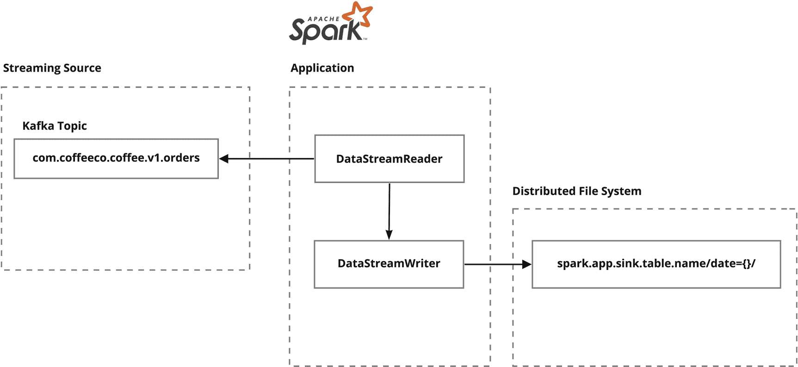

**图 11-1** Spark 应用程序（练习 11-3）用 Kafka 替换了 Redis；应用程序的其余部分与第 10 章中的相同

该应用程序通过订阅一个主题（在本例中为`com.coffeeco.coffee.v1.orders`）从 Kafka 流式消费源数据。源主题分布在四个物理分区上（我们在清单 11-2 中进行了配置）。这意味着支持 Kafka `DataFrame` 的 RDD 源中的默认分区数也将是四个。Spark 保留了来自源的分区信息，以便更容易地将数据沿袭追溯回特定的绝对分区。这对于恢复在 Spark 应用程序失败期间丢失的数据，在起始偏移量和结束偏移量之间读取的所有数据非常有用。当 Spark 集群中的执行器（节点）离线时，这种恢复是必要的。应用程序必须恢复封装分布式计算状态的所有数据。有状态应用程序使用 Kafka 操作的方式如图 11-2 所示。

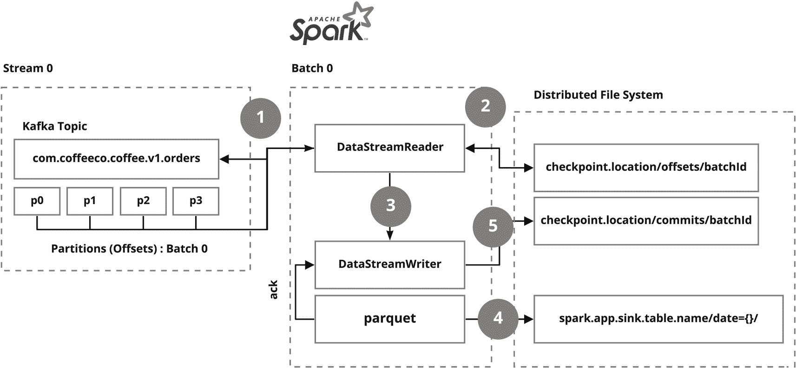

**图 11-2** Structured Streaming 应用程序中每个微批处理的流程

对于每个微批处理，Spark 应用程序驱动程序（1）查询 Kafka 以确定是否有任何新数据需要消费。如果有新数据，则预先将每个主题分区要分配的起始和结束偏移量写入（2）应用程序检查点目录。此过程使应用程序能够在发生处理故障时从 Kafka 主题的精确位置恢复。预写日志（WAL）对于确保所有数据都被处理并且以确定性方式完成恢复至关重要。然后，主题偏移量范围作为主题分配传递给应用程序执行器（3）。这使得执行器能够通过为 Spark 应用程序中的特定微批处理进行显式分配，以分布式方式获取数据。然后，应用程序将 Kafka 二进制数据转换为数据集并处理数据。处理完成后，结果被写入（4）分布式表，并将成功写入输出的结果提交回检查点目录（5）。这种使用 WAL、处理和提交的端到端过程构成了一个完整的微批处理。现在，让我们来看看构建此过程的方法。

#### 从 Apache Kafka 消费二进制数据

打开与 `CoffeeOrderGenerator` 位于同一项目中的`SparkKafkaCoffeeOrdersApp`。让我们从 Kafka `DataStreamReader` 开始，然后从那里反向推导。

与 Redis Streams 应用程序一样，我们使用`inputStream`块（如清单 11-28 所示）来配置和引导`DataStreamReader`实例。

# 配置驱动的流处理

```scala
lazy val inputStream: DataStreamReader = {
  sparkSession
    .readStream
    .format(inputStreamFormat)
    .options(sparkConf
      .getAllWithPrefix(
        s"$StreamConfigSourcePrefix.option.").toMap)
}
```

清单 11-28 创建通用的配置驱动型 `DataStreamReader`

调用 `inputStream` 的结果确实为我们的 Kafka 连接引导了一个 `DataStreamReader` 实例。这是一个使用纯配置驱动方法使用 Spark 核心 API 的示例。例如，清单 11-29 中的设置使应用程序能够从 Docker 网络内连接到 Kafka 集群（只要容器正在运行），并订阅 `com.coffeeco.coffee.v1.orders` 主题，从主题内每个分区可用的最早偏移量开始。

```
--conf "spark.app.source.format=kafka" \
--conf "spark.app.source.option.subscribe=com.coffeeco.coffee.v1.orders" \
--conf "spark.app.source.option.kafka.bootstrap.servers=kafka_0:9092" \
--conf "spark.app.source.option.startingOffsets=earliest"
```

清单 11-29 配置 Kafka `DataStreamReader` 的最小配置

一旦将配置应用于 `inputStream`，生成的对象（如清单 11-30 所示）就被设计为连接到 Kafka，但它足够灵活，可以处理任何额外的配置以自定义 Kafka 连接或行为。

```scala
sparkSession
  .readStream
  .format("kafka")
  .option("kafka.bootstrap.servers", "kafka_0:9092")
  .option("subscribe","com.coffeeco.coffee.v1.orders")
  .option("startingOffsets","earliest")
```

清单 11-30 通过读取外部应用配置创建的 `InputStream` 对象

其工作方式完全依赖于 `SparkConf` 上的一个特殊方法。使用 `sparkConf.getAllWithPrefix` 方法的美妙之处在于，你无需为了每个微小的更改而回到源代码，即可修改 `DataStreamReader` 的行为。我们将在第 13 章再次讨论这种模式。

接下来展示的是常见的 Kafka 主题属性。

### Kafka源配置

#### 主题订阅

例如，你可以同时订阅多个主题（使你的应用程序能够从多个位置读取数据）。这种技术可以用于处理多个事件流，而无需为每个流运行一个应用程序。只需在逗号分隔的列表中传入一个或多个主题名称即可。

```
.option("subscribe",
  "com.coffeeco.coffee.v1.orders,
  com.coffeeco.customers.v1.events")
```

或者，你可以订阅一个主题模式。这种技术使你的应用程序能够订阅所有匹配基于前缀的正则表达式的主题。例如：

```
.option("subscribePattern","com.coffeeco.coffee.v1.*")
```

你可以使用 `subscribe`、`subscribePattern` 或 `assign`，我们接下来将介绍 `assign`。

#### 主题分配

订阅为你的应用程序分担了大量繁重工作。这包括在 Spark 应用程序生命周期内的操作过程中，确定哪些分区可用，以及需要哪些偏移量来分配给任务。有时，你可能希望将特定主题分区分配给一个应用程序，而不是订阅所有主题分区。我们不会直接介绍这个用例，但值得了解它的存在。例如，某些主题分区可能成为热点，因为发布到 Kafka 的上游应用程序意外地使用空字符串作为记录键来发布记录。这将导致所有使用空字符串作为键的记录被路由到同一个分区，从而可能形成热点。你可以通过强制使用非空字符串来主动缓解此问题，但由于系统中的常见行为，你也可能会遇到热点。

#### Kafka 限流

我们在第 10 章使用了 `stream.read.batch.size` 配置来控制 Spark 应用程序从 Redis Stream 读取（消费）数据的速率。对于 Kafka 源，你可以通过为每个微批次提供要读取的最大记录数来限制速率。这是通过 `maxOffsetsPerTrigger` 选项完成的。

```
"spark.app.source.options.maxOffsetsPerTrigger=1000"
```

此数字针对整个批次（跨所有分区）。

#### 处理故障

故障总会发生。如何处理取决于应用程序。Kafka 源提供了一个选项来处理此问题。当应用程序期望从上一次成功的批次中继续处理，但数据（主题分区的偏移量）恰好丢失（超时或损坏）时，Spark 应用程序可以简单地失败，而不是在数据存在缺口的情况下继续处理。使用 `failOnDataLoss` 选项来控制此行为。

```
--conf "spark.app.source.options.failOnDataLoss=false"
```

#### 拆分分区

如果你有四个分区，例如 `com.coffeeco.coffee.v1.orders` 主题，但希望进一步划分 Spark 应用程序正在处理的数据集，则可以使用 `minPartitions` 设置。这意味着你可以分而治之，将工作负载分布到可变数量的执行器（或处理线程）上，并为你的 Spark 应用程序实现更高的吞吐率。

```
--conf "spark.app.source.options.minPartitions=8"
```

这将使默认分区数加倍（针对我们的四个分区主题）。

在完成后续练习后，你将有机会使用这些额外的配置。现在回到源代码。

### 从 Kafka 行到数据集

`KafkaOrderTransformer` 类负责反序列化来自 Kafka `DataFrame` 的字节数组（值），并将其转换为 `CoffeeOrder`。这与之前构建 `CoffeeOrderGenerator` 时所经历的过程相反。该类如代码清单 11-31 所示。

```scala
class KafkaOrderTransformer(spark: SparkSession)
    extends DatasetTransformer[CoffeeOrder]
    with Serializable {
  import scalapb.spark.Implicits._
  override val encoder = typedEncoderToEncoder[CoffeeOrder]
  override def transform(df: DataFrame): Dataset[CoffeeOrder] =  df
    .map(_.getAs[Array[Byte]]("value"))
    .map(CoffeeOrder.parseFrom)
    .as[CoffeeOrder]
}
```

代码清单 11-31 将 Kafka `DataFrame` 转换为类型化数据集

此转换器继承自第 7 章和第 10 章中 `DataFrameTransformer` 的类型化版本。

```scala
trait DatasetTransformer[T] {
  val encoder: Encoder[T]
  def transform(df: DataFrame): Dataset[T]
}
```

这随后提供了粘合剂，用于告知 Spark 如何处理来自转换器的数据，在本例中即为 `CoffeeOrder` 本身。

转到主应用程序代码清单 11-32 中的 `run` 方法，你将看到 `inputStream` 和 `KafkaOrderTransformer` 如何协同工作以生成 `streamingQuery` 的输入。

```scala
override def run(): Unit = {
  import scalapb.spark.Implicits._
  super.run()
  val inputSourceStream = KafkaOrderTransformer(sparkSession)
    .transform(inputStream.load())
  val writer = outputStream(inputSourceStream)
  startAndAwaitApp(writer.start())
}
```

# 使用 Apache Spark 消费来自 Kafka 的数据

这里剩下的唯一内容是查看 `outputStream` 方法。`startAndAwaitApp` 方法来自第 10 章。`outputStream` 方法使用了前面 `inputStream` 方法（代码清单 11-23）中展示的配置模式，并如代码清单 11-33 所示。

```scala
def outputStream(ds: Dataset[CoffeeOrder]): DataStreamWriter[Row] = {

...

val streamOptions = sparkConf
    .getAllWithPrefix("$StreamConfigSinkPrefix.option.")

val dataStream = ds
    .withColumn("date", to_date(
      to_timestamp($"timestamp".divide(1000).cast(LongType))))
    .writeStream
    .format(outputStreamFormat)
    .queryName(outputStreamQueryName)
    .outputMode(outputStreamMode)
    .partitionBy("date")
    .options(streamOptions)

triggerType match {
    case "continuous" if triggerEnabled =>
      dataStream.trigger(
        Trigger.Continuous(processingInterval))
    case "once" if triggerEnabled =>
      dataStream.trigger(Trigger.Once())
    case "processing" if triggerEnabled =>
      dataStream.trigger(
        Trigger.ProcessingTime(processingInterval))
    case _ =>
      dataStream
}
}
```

*代码清单 11-33: 将 `CoffeeOrders` 转换为按日期分区的 Parquet 数据*

这里的最后一块拼图是将 `Dataset[CoffeeOrder]` 转换为 `DataStreamWriter`，后者会将所有可用的数据行写入数据湖，实现与第 10 章应用程序类似的结果。现在只剩下运行应用程序了。

## 运行消费者应用程序

现在您已经有机会浏览了应用程序，如果做了任何修改，可以编译该应用程序。否则，构建应用程序和创建 Docker 容器的输出将与之前相同，因此如果您一直跟随练习操作，应该已经编译并容器化了消费者应用程序。

```shell
docker run \
-p 4040:4040 \
--hostname spark-kafka-coffee-consumer \
--network mde \
-v ~/dataengineering/spark/conf/hive-site.xml:/opt/spark/conf/hive-site.xml \
-v ~/dataengineering/spark/jars:/opt/spark/user_jars \
-it `whoami`/spark-kafka-coffee-orders:latest \
/opt/spark/bin/spark-submit \
--master "local[*]" \
--class "com.coffeeco.data.SparkKafkaCoffeeOrdersApp" \
--deploy-mode "client" \
--jars /opt/spark/user_jars/mariadb-java-client-2.7.2.jar \
--driver-class-path /opt/spark/user_jars/mariadb-java-client-2.7.2.jar \
--driver-java-options "-Dconfig.file=/opt/spark/app/conf/coffee_orders_consumer.conf" \
--conf "spark.sql.streaming.kafka.useDeprecatedOffsetFetching=false" \
--conf "spark.app.source.option.startingOffsets=earliest" \
--conf "spark.app.stream.trigger.type=once" \
/opt/spark/app/spark-kafka-coffee-orders.jar
```

*清单 11-34: 运行 `CoffeeOrder` 消费者应用程序*

`spark-kafka-coffee-orders` 应用程序根目录中提供的 `README.md` 文件提供了一个更完整的 `run` 命令版本，其中包含了所有配置覆盖项。命令（11-34）还使用了应用程序的替代配置，这是通过 Spark Submit 上的 `driver-java-options` 实现的。虽然 `Configuration` 助手一直能够读取替代配置（得益于 `TypeSafe` 配置库），但这是第一个在工作中使用我称之为`自带配置`模式的示例。

```
--driver-java-options "-Dconfig.file=/opt/spark/app/conf/coffee_orders_consumer.conf"
```

这种替代配置在容器内部的可用方式是通过对 Dockerfile 进行一个小的更改实现的。

```dockerfile
FROM newfrontdocker/apache-spark-base:spark-3.1.2-jre-11-scala-2.12

COPY target/scala-2.12/spark-kafka-coffee-orders-assembly-0.1-SNAPSHOT.jar /opt/spark/app/spark-kafka-coffee-orders.jar
```

# 复习应用程序配置

```
COPY conf /opt/spark/app/conf

EXPOSE 4040
```

`COPY` 指令只是在构建时将配置从应用程序根目录移动到容器中。这样，您可以将任何相关配置移动到一个更合适的最终位置，而不是依赖 `spark-submit` 的运行时配置。这样做的方式更不容易出错。

### 练习 11-3：总结

本练习是展示如何在 Apache Spark 生态系统中处理可序列化结构化数据的最后一步。您已经完成了处理可序列化结构化数据的完整流程：从消息（`protobuf`）定义、编译、随机记录生成，到以端到端模块化方式写入（生产）和读取（消费）消息。我希望这能激发您关于如何以可互操作方式处理数据的一些新思路，而不必退回到 `JSON` 或 `CSV`。

## 总结

Apache Kafka 是数据工程师的瑞士军刀。它为处理近实时的丰富数据流提供了一个可靠的平台。虽然在 Kafka 和 Spark 生态系统中有多种处理数据的方式，但值得一提的是，使用显式类型在这些独立系统之间提供了丰富的数据契约，可以为构建可靠且更重要的是可互操作的数据系统提供更坚实、更稳定的基础。

在下一章中，我们将继续使用结构化流式处理，重点放在更高级的聚合和分析处理上。如果您准备好了，让我们开始吧。

# 12. 分析处理与洞察

在整本书中，您一直专注于构建数据工程工具箱，并学习处理与转换数据（包括静态数据和流数据）的强大技术。在学习 Spark 的同时，您也一直在动手学习使用容器以及操作与 Apache Spark 生态系统良好互操作的其他技术。

鉴于现代数据工程师身兼多职，职责涵盖了数据生态系统的广泛范围——从数据生产和摄取、数据验证和清理、数据传输和加载、批处理和流处理，到更分析性的职责如简单和复杂聚合，甚至流式分析处理与洞察，本章专注于填补与分析数据预处理相关的知识空白，并学习使用强大的聚合运算符。

## 练习与资料

本章的练习将向您介绍 Apache Spark 丰富的分析处理能力。为了充分利用本章内容，所有练习都可以使用 Apache Zeppelin 交互式运行。

本章分为以下两个动手实践部分：

* 使用常见的 Spark 函数进行分析预处理
* 分析处理与洞察工程

学习如何交互式地使用 Spark 的高阶函数，将使您能够编写和操作第 13 章中有状态的结构化流式处理分析应用程序。

第 12 章的练习资料位于 [`https://github.com/newfront/spark-moderndataengineering/tree/main/ch-12`](https://github.com/newfront/spark-moderndataengineering/tree/main/ch-12)。位于 `ch-12/exercises` 目录中的 `README` 文件将为您提供一整套设置说明。

### 环境搭建

再次重申，我们将依赖老伙计 Apache Zeppelin，不过这次你将构建一个名为 `zeppelin-spark` 的 Zeppelin 容器。你可能会想，为什么需要创建一个不同的容器呢？很高兴你能这么问。

在整本书中，你一直需要使用*卷挂载*和*环境变量*，在运行时将本地 Apache Spark 接入 Zeppelin 容器。在第 10 章中，你应该还记得，我们迁移到了使用基础的 Spark 容器来构建一致的容器化 Spark 应用程序。鉴于本地数据平台的复杂性日益增加，并且要确保应用程序在运行时拥有一致的环境，这一步是必要的。到目前为止，Zeppelin 要求你自带 Spark，但这个新容器将把官方 Zeppelin 容器与你过去几章一直在使用的基础 Spark 容器结合起来。

*Zeppelin-Spark 目录布局和容器依赖*

```
ch-12

├── docker

│   ├── README.md

│   └── zeppelin-spark

│       ├── Dockerfile

│       ├── conf

│       │   ├── interpreter.json

│       │   └── zeppelin-env.sh

│       └── spark

│           ├── conf

│           └── jars
```

在终端中，切换到 `docker/zeppelin-spark` 目录。位于该目录下的 *Dockerfile* 展示了 Docker 多阶段构建模式，它实质上是从基础 Spark 容器中精选资源，同时也在核心的 `apache/zeppelin` 容器之上添加资源。该文件的内容如代码清单 12-1 所示。

```
ARG spark_image=spark-3.1.2-jre-11-scala-2.12

FROM newfrontdocker/apache-spark-base:${spark_image} as spark

FROM apache/zeppelin:0.9.0

COPY --from=spark /opt/spark /opt/spark

COPY --from=spark /usr/local/openjdk-11 /opt/openjdk-11

COPY ./spark/conf/hive-site.xml /opt/spark/conf/

COPY ./spark/conf/spark-defaults.conf /opt/spark/conf/

COPY ./spark/jars /opt/spark/user_jars/
```

# 1. 在 Spark 类路径中直接添加 MariaDB 驱动

```dockerfile
COPY ./spark/jars/mariadb-java-client-2.7.2.jar /opt/spark/jars/
COPY ./conf/interpreter.json /zeppelin/conf/
COPY ./conf/zeppelin-env.sh /zeppelin/conf/
```

代码清单 12-1：在官方 Apache Zeppelin Docker 容器之上添加新的文件系统层，引入 Java 11 和 Spark 3.1.2 以及自定义配置和 JAR 包。

多阶段 Docker 构建允许你创建常用容器的可靠实例，而无需处理更复杂的构建过程。就 `zeppelin-spark` 容器而言，我们可以直接从 `apache-spark-base` 容器中提取 Java 11（JRE）以及 Spark 发行版（见代码清单 12-2）。这与使用模块构建 Spark 应用程序的理念类似，你可以使用 `FROM` 来堆叠容器，或者将容器用作资源的提供者。

```dockerfile
FROM newfrontdocker/apache-spark-base:${spark_image} as spark
FROM apache/zeppelin:0.9.0
COPY --from=spark /opt/spark /opt/spark
COPY --from=spark /usr/local/openjdk-11 /opt/openjdk-11
```

代码清单 12-2：使用多阶段构建模式有助于减小容器的最终体积，也可以用来减少管理复杂容器的开销。

在本地构建容器是一个可选步骤。你可以使用公开的 `newfrontdocker/zeppelin-spark` 容器，但只需运行以下构建命令（从 `zeppelin-spark` 目录）即可轻松构建自己的容器。

```bash
docker build . -t `whoami`/zeppelin-spark:latest
```

接下来，你可以启动环境了。

### 启动本地环境

在 Docker 目录下，你会找到另一个名为 `zeppelin` 的目录。将该目录复制到 `~/dataengineering/zeppelin-spark`。与前面的章节一样，该目录下的 `docker-compose.yaml` 文件为你提供了启动环境所需的所有配置。

```bash
docker compose \
  -f ~/dataengineering/zeppelin-spark/docker-compose.yaml up \
  -d
```

这个 compose 进程将启动 Apache Zeppelin（`localhost:8080`）、MySQL（`:3306`）和 MinIO（`localhost:9000`）文件系统。

## 2. 使用通用 Spark 函数进行分析预处理

第一个练习将是实践性的导览，使用 `org.apache.spark.sql.functions` 包中更常见的`高阶函数`（列式表达式），重点关注那些有助于准备分析数据的函数。

### 练习 12-1：为分析预处理数据集

在浏览器中打开 Zeppelin（`localhost:8080`），创建一个新的笔记，并为其取一个容易记住的名称，例如 `01_common_dataframe_functions`。从这一点开始，你将学习使用那些有助于修改和准备数据进行分析处理的函数：

*   处理时间戳和日期
*   处理时区
*   处理并替换空列值
*   使用 Case 语句
*   使用用户自定义函数

### 处理时间戳和日期

处理时间可能是一件棘手的事情。你在第 9 章中了解到，时钟漂移和不正确的时区信息如何引发问题，以及如何通过统一使用 UTC 并在服务器上使用 NTP 同步时钟漂移来普遍解决这些问题。虽然标准化有助于未来的项目，但你可能会发现自己需要以不同的方式处理时间，或者需要修正和规范化时间戳。

#### 常用日期和时间戳函数

从空笔记（在 Zeppelin 中）开始，复制代码清单 12-3 中的代码块并运行该段落。这条 SQL 语句会生成一行数据，其列代表 Spark 在运行时捕获的日期和时间信息。

```sql
%spark
spark.sql("""
SELECT current_timestamp() as ts,
       current_timezone() as tz,
       current_date() as date,
       TIMESTAMP 'yesterday' as yesterday,
       TIMESTAMP 'today' as today,
       TIMESTAMP 'tomorrow' as tomorrow
""").show(6,0,true)
```

代码清单 12-3：使用 Spark SQL 获取时间概念。

结果行的输出将是代码被评估时捕获的标准系统日期和时间信息的快照。

```
-RECORD 0-------------------------------
ts        | 2021-09-12 00:54:03.691464
tz        | Etc/UTC
date      | 2021-09-12
yesterday | 2021-09-11 00:00:00
today     | 2021-09-12 00:00:00
tomorrow  | 2021-09-13 00:00:00
```

`current_timestamp`、`current_timezone`、`current_date` 以及 `TIMESTAMP` 常量 `yesterday`、`today` 和 `tomorrow` 都是 Spark SQL 中的高阶日期时间函数。接下来，我们将使用 Spark DSL 函数直接重新创建相同的输出。

#### 使用 `withColumn` 应用高阶函数

创建一个新的段落。在该段落中，我们将创建一个仅存储一个时间戳的 1x1（行/列）`DataFrame`。模拟 `current_timestamp` 表达式，清单 12-4 展示了如何包装一个简单的 Java `Instant` 来复制 `current_timestamp` 表达式。

```scala
%spark
val tsDf = Seq(Instant.now).toDF("ts")
```

清单 12-4：创建一个包含单行单列且存储时间戳的 `DataFrame`。

清单 12-4 中的简单技术利用了隐式转换，将 `Scala Seq[Instant]` 编码为带有 `TimestampType` 列的 Catalyst `Row`（`DataFrame`）。使用 `tsDf DataFrame`，我们现在可以通过 `DataFrame` 上的 `withColumn` 方法来添加列。

`DataFrame.withColumn(colName, col)`

`withColumn` 方法会在 `DataFrame` 的所有行上迭代地添加一个新列。`col`（`Column`）参数是一个强大的原语，它封装了一个列式 SQL 表达式，可用于将用户自定义函数应用到你的应用程序中。需要牢记的是，`withColumn` 只能引用一行中相邻列的数据。还有其他技术可以用于处理所有行或行子集，以使用窗口函数生成派生聚合结果。

清单 12-5 中的代码块添加了一个包含时区的列字面量（意思就是“该列的字面值就是你看到的这样”），以及通过列操作 `to_date` 派生出的日期。

```scala
import org.apache.spark.sql.functions._
import org.apache.spark.sql.types._

val dtInfoDf = tsDf
    .withColumn("tz",
        lit(spark.conf.get("spark.sql.session.timeZone"))
    )
    .withColumn("date", to_date($"ts"))
```

清单 12-5：使用 `withColumn` 添加列字面量和通过 `to_date` 派生出的日期列。

转换的结果是一个新的 `DataFrame`，它代表了在源 `DataFrame` 上添加两个新列的组合。请记住，由于 Spark 是惰性执行的，在到达某个特定的行动操作之前，不会执行任何实际工作。清单 12-5 中的操作添加了在最终系列执行时提供新日期列的承诺。第一列使用了一个名为 `lit` 的特殊列。`lit` 列使用隐式类型编码器（如果可用）将底层数据类型包装并编码为一个类型化列。第二列（`date`）被称为派生列。当你使用 `to_date` 函数并传入一个源列（`$"ts"`）时，Spark 会使用引用列（`ts`）来生成一个 `DateType`。

如果此时打印 `dtInfoDf` 的模式，你会看到以下内容：

```
root
 |-- ts: timestamp (nullable = true)
 |-- tz: string (nullable = false)
```

| -- date: date (nullable = true)

要处理从清单 12-3 重建 `DataFrame` 所需的其余缺失列，还需要处理 `yesterday`、`today` 和 `tomorrow` 这三列。

### 使用日期加法和减法

日期时间函数 `date_sub` 和 `date_add`，以及一个简单的 `cast` 表达式，可以组合起来派生 `yesterday`、`today` 和 `tomorrow`，如清单 12-6 所示。

```
tsDf

...

.withColumn("yesterday",

date_sub($"date", 1).cast(TimestampType))

.withColumn("today", $"date".cast(TimestampType))

.withColumn("tomorrow",

date_add($"date", 1).cast(TimestampType))
```

清单 12-6

使用日期减法、加法和数据类型转换来模拟清单 12-3 的输出

现在，你可以创建时间戳、从时间戳派生日期，以及对日期进行加减操作。作为日期时间函数巡览的收尾，我们将介绍 `year`、`month`、`dayofmonth`、`dayofweek` 和 `dayofyear` 这些日历函数。

### 日历函数

在分析和洞察中，通常使用日历比较显式的时间段（窗口）。趋势分析和时间序列预测是使用统计方法来测量数据点之间随时间变化率（增量）的技术。可以使用`固定`或`相对`窗口，通过 Spark SQL 对数据集进行分区（分桶）和分析，从而创建按秒、分钟、小时、天、周、月甚至年细分的聚合结果。

`固定窗口`与`相对窗口`

一个`固定窗口`由明确的开始和结束时间定义。例如，昨天是一个由 00:00:00 开始到 23:59:59 结束的 24 小时时间段定义的窗口。固定窗口通常用于计算两个或多个数据集之间的变化，常见的有逐小时、逐日、逐周和逐月计算。

一个`相对窗口`使用非固定的时间点来定义基于时间边界的一端。这个边界随后可用于计算开始或结束时间戳，从而产生一个任意窗口来观察统计数据。例如，你可以使用相对时间隔离出最近 30 分钟的数据集，而不是在固定的 30 分钟间隔内拆分一个小时（06:00:00 – 06:29:59 | 06:30:00 – 06:59:59）。

以清单 12-7 中的代码为参考，我们将向`tsDf DataFrame`添加五个列。

```
tsDf

...

.withColumn("year", year($"date"))

.withColumn("month", month($"date"))

.withColumn("day", dayofmonth($"date"))

.withColumn("day_of_week", dayofweek($"date"))

.withColumn("day_of_year", dayofyear($"date"))
```

清单 12-7

使用单个日期时间列派生年、月、日、当前周中的天以及当前年中的天

最终的`DataFrame`代表当前日期，其中的列表达了从初始时间戳列生成的不同观测值。

```
-RECORD 0--------------------------------
ts          | 2021-09-12 01:04:39.04086
tz          | Etc/UTC
date        | 2021-09-12
yesterday   | 2021-09-11 00:00:00
today       | 2021-09-12 00:00:00
tomorrow    | 2021-09-13 00:00:00
year        | 2021
month       | 9
day         | 12
day_of_week | 1
day_of_year | 255
```

现在，每当你需要快速复习日期和时间操作时，都有一个可靠的参考。但是，实际的时区呢？

## 时区与 Spark SQL 会话

处理基于时间的数据需要进行时区之间的转换，其原因不仅仅是遵守像 UTC 这样的通用时区。你还可以将时区视为一个透镜，从特定事件观察者的视角来查看数据集。当产生与特定地理位置和时区相关的洞察时，就会出现这种用例。

### 配置时区

Spark 默认使用其环境的本地系统时间（你的笔记本电脑或远程服务器）。在处理数据时，使用默认系统时间可能会导致不一致。为了确保无论应用程序在何处运行都能保持行为一致，你可以使用配置项`spark.sql.session.timeZone`来设置默认时区。

### 在运行时修改 Spark 时区

`SparkSession`会自动为您全局处理时间戳转换。不过，有时您可能希望显式更改特定查询所使用的时区。在 Zeppelin 中创建一个新段落，并添加清单 12-8 中的示例代码块，该代码块演示了如何动态设置时区。

```
%spark
import java.time._
val ts = Seq(Instant.now).toDF("ts")
spark.conf.set("spark.sql.session.timeZone", "UTC")
ts.show(truncate=false) // utc
spark.conf.set("spark.sql.session.timeZone", "America/Los_Angeles")
ts.show(truncate=false) // pst
```

清单 12-8

观察基于 `SparkSession` 时区配置的 Spark 时间输出中的时区变化

运行该段落，您将亲眼目睹 Spark 观测到的时间如何与时区配置值同步变化。输出分别捕捉到了通过 UTC 和 PST 时区视角观察到的同一不可变时间戳（`ts`）的引用。

```
UTC |2021-09-12 03:02:32.434387
PST |2021-09-11 20:02:32.434387
```

利用 Spark 运行时配置来切换时间观测视角的能力，使您能够使用单一且不可变更的真实来源（UTC 时间戳）作为底层数据，同时简化下游应用程序为特定时区构建查询的过程。这一切都无需忍受为处理时间戳时区转换而创建多个数据集副本的烦恼。

### 使用 SET TIME ZONE

您还可以使用`SET TIME ZONE`（如清单 12-9 所示）通过 Spark SQL 直接设置时区配置，从而动态切换时区。

```
%sql
SET TIME ZONE 'America/Los_Angeles';
SELECT TIMESTAMP 'now' as now_pst;
%sql
SET TIME ZONE 'UTC';
SELECT TIMESTAMP 'now' as now_utc;
```

清单 12-9

使用 `SET TIME ZONE` 配置 Spark 会话时区

现在，您可以通过`SparkSession`在 Spark 中以声明方式更改时区。这个简单的配置使得每个应用程序在查询和展示基于时间的数据时，能够选择如何观测时间。请记住为您的 Spark 应用程序设置一个默认时区，以确保获得可靠且可重复的结果。

### 季节性、时区与洞察

考虑以下示例。您的任务是设计一个系统，该系统能够自动追踪并比较 CoffeeCo 销售商品中观察到的客户购物行为的相对变化，从而得出购买趋势的洞察。在测试系统是否按预期运行时，您偶然发现了一个起初看似异常的商品销售数据。经过进一步调查，发现该商品是南瓜拿铁，其销售额从日均零销售，在短短几天内就飙升至与类别中所有其他商品相比创纪录的水平。这是异常吗？还需要哪些其他数据？

有些商品仅在特定时间段或一年中的特定时间才有供应。南瓜拿铁具有季节性，因为它被视为秋季饮品，但季节（节假日）是如何影响销售的呢？情绪因素又扮演了什么角色？

我在美国东北海岸长大，对我来说，十月总是标志着季节的明显变化。树叶从树上飘落，气温降低意味着要穿毛衣和夹克，以及新英格兰地区雪景带来的宁静与反思。伴随着这种变化，是对冬季假期的期盼，这意味着苹果酒（加香料的）和南瓜派，而作为成年人，南瓜拿铁唤起了美好的回忆。这是否仅对我个人而言？这是否与美国东海岸的更高销售额存在关联？销售额是由温度驱动，还是由暴风雪或降雨等其他天气模式驱动？

虽然您可能对新英格兰的秋天没有任何情感联系，也可能讨厌南瓜拿铁，但重要的是思考哪些类型的数据能够用于从分析观察中产生有意义的洞察。归根结底，要像数据侦探一样思考，或者与优秀的数据分析师合作，确保数据收集、聚合和分析工作能够产生新颖的洞察，从而推动创造让客户满意的体验。

### 时间戳与日期总结

思考从单个时间戳中能够衍生出的不同角度、视角或视图，为您开辟了一条通往基于事件洞察的道路。您可以计算一年中的时间信息（季节性）、判断某个日期是周末还是工作日（特定于事件的地理位置，甚至本地时区），或者检查事件是否发生在节假日，甚至该日期是否接近任何其他有意义的历史日期。将发生的事件与现实世界的行为关联起来并将数据与之关联，是许多成功分析和洞察计划的驱动因素。如果您需要更多证据，可以在线搜索“diapers beer correlations”（尿布与啤酒的关联），看看零售商如何从客户交易中获取洞察，将常共同购买的商品摆放得更近，从而增加看似不相关商品的销售额。接下来，我们将探讨一些为分析准备数据的技术。

## 准备分析数据

数据形态各异，规模不一。不幸的是，这也意味着数据可能因为数据损坏或用户错误之外的原因而缺失（为空）。例如，数据集中的空值并不一定需要在静态状态下用默认值填充，因为这可能只会增加给定数据集的整体存储占用。

此外，根据数据集存在的时间长短，以及数据是否仍在被积极收集并追加到该数据集中，数据的底层模式很有可能随着时间的推移缓慢变化。缓慢变化的模式是导致空值的常见原因之一，因为较旧的记录需要被强制转换为新的通用模式（`StructType`），才能与来自数据集（表）的较新数据项并行处理。

除了简单的缺失值之外，您还知道数据集经常被转换并与其他数据集连接，以实现更具体的视图，以满足不同数据域的需求，并帮助回答更专门化的问题（查询）。

我们将探讨条件填充空值的过程，以及使用 `case` 语句（列表达式）来生成派生列，这些派生列可用于条件标记（标签）、分桶（分区）以及解决常见的数据问题。

## 替换 DataFrame 中的空值

在 `DataFrame` 上使用 `na.fill` 可以有条件地填充缺失数据。在 Zeppelin 中新建一个段落，将代码清单 12-10 中的代码块复制进去，然后运行。该示例创建了一个简单的 `DataFrame`，代表 `CoffeeCo` 已注册和未注册客户下的四笔订单，每笔订单价格各异。这里我们选择使用 `null` 值来表示 `customer_id` 列中未注册的客户。

```
%spark
val nullOrdersDF = Seq(
(1, null, "decafe", 3.12),
(2, "cust123", "pour_over", 5.15),
(3, "cust234", "latte", 3.89),
(4, "cust345", "special_pour_over", 6.99)
)
.toDF("order_id", "customer_id", "item_name", "price")
nullOrdersDF.show()
Listing 12-10
创建一个包含空 customer_id 的 DataFrame 以使用 na.fill
```

运行该段落后，生成的 `DataFrame` 将如下所示：

```
+--------+-----------+-----------------+-----+
|order_id|customer_id|item_name        |price|
+--------+-----------+-----------------+-----+
|1       |null       |decafe           |3.12 |
|2       |cust123    |pour_over        |5.15 |
|3       |cust234    |latte            |3.89 |
|4       |cust345    |special_pour_over|6.99 |
+--------+-----------+-----------------+-----+
```

现在，你可以使用 `na.fill` 操作，用一个通用值替换一个或多个列中的空值，并返回一个新的干净 `DataFrame`。以代码清单 12-11 为参考，测试将 `customer_id` 列填充为值 `"unknown"`。

```
%spark
val nonNullOrdersDF = nullOrdersDF
.na.fill("unknown", Seq("customer_id"))
nonNullOrdersDF.createOrReplaceTempView("order_nonnull")
nonNullOrdersDF.show(truncate=false)
Listing 12-11
使用值 Unknown 替换列 customer_id 中的空值
```

通过调用代码清单 12-11 中的 `na.fill` 创建的非空（已清理）`DataFrame`，被保存到新的引用变量以及名为 `order_nonnull` 的临时视图中。操作结果如下所示：

```
+--------+-----------+-----------------+-----+
|order_id|customer_id|item_name        |price|
+--------+-----------+-----------------+-----+
|1       |unknown    |decafe           |3.12 |
|2       |cust123    |pour_over        |5.15 |
|3       |cust234    |latte            |3.89 |
|4       |cust345    |special_pour_over|6.99 |
+--------+-----------+-----------------+-----+
```

使用像 `unknown` 这样的特定常量填充空值，有助于声明列的含义，而不是让其他工程师去猜测该列的意图。

作为替代方案，如果该表在 Spark SQL `Catalog` 中管理，那么作为优秀的数据管理员，你可以更进一步，在 `Hive Metastore` 中描述空列的含义。这样，其他数据团队就可以一致地以相同方式处理这些空值。

在准备分析数据时，你很可能会发现自己需要使用一个或多个条件表达式来添加派生列。无需创建自定义用户定义函数（UDF），直接使用 SQL `case` 语句和 Spark SQL 的 `when`/`then`/`otherwise` 表达式即可。`case` 语句的工作方式类似于模式匹配块或传统的 `switch` 语句。

## 使用 Case 语句标记数据

`case` 语句提供了一种基于一个或多个链式布尔表达式（谓词）的结果来添加新列的机制。你可以在处理数据时，使用 `case` 语句来*打标签*、*分类*或*标记*数据。`case` 语句的语义会有所不同，具体取决于你是在 `DataFrame` 上使用 Spark SQL 函数，还是在表或视图上使用 SQL 表达式。

### Dataset 上的 Case 语句

在 Zeppelin 笔记本中新建一个段落。你将通过添加两个名为 `is_registered` 和 `order_label` 的列来转换目标 `DataFrame` `nonNullOrdersDF`（代码清单 12-11），从而创建一个带标签的订单。代码清单 12-12 中的代码块展示了如何使用 `when`, `otherwise` 表达式。第一个列 `is_registered` 测试订单是否有已知或未知的 `customer_id`，而 `order_label` 表达式则使用 `boolean` 和 `numeric` 条件判断，有条件地将订单标记为 `vip`、`rush` 或 `normal`。

```
%spark
nonNullOrdersDF
.withColumn("is_registered",
when(col("customer_id").notEqual("unknown"), true)
.otherwise(false)
)
.withColumn("order_label",
when(col("is_registered").equalTo(true).and(col("price") > 6.00), "vip")
.when(col("is_registered").equalTo(true).and(col("price") > 4.00), "rush").otherwise("normal")
)
.show(truncate=false)
Listing 12-12
使用 When, Then, Otherwise 在 DataFrame 上创建复杂的派生列
```

如前所述，第一个新列（`is_registered`）代表客户的注册状态。该列表达式是一个谓词，用于检查求值条件是否满足。*当*列的值不等于 `unknown` *时*，我们将列值设置为 *true*，*否则*回退到将该列值设置为 *false*。

第二个派生列使用 `is_registered` 的值，根据客户的注册状态及其订单价格，有条件地装饰客户的订单。结果是一个具有三个可能值的列：`normal`、`rush` 或 `vip`。该列表达式通过引入表达式*与*（也可以是或条件）的概念，使用了更复杂的分支条件。思考 `when-then-otherwise` 表达式最简单的方法，就是将其视为典型的分支条件。

```
if (row.is_registered) {
if (row.price > 6.00) "vip" else "rush"
} else "normal"
```

让我们看看如何使用 Spark SQL 实现相同目标。

### Spark SQL 表上的 Case 语句

可以使用 `order_nonnull` 临时视图以及嵌套的内联 select 语句来实现与代码清单 12-12 所示相同的效果。新建一个 Zeppelin 段落，复制代码清单 12-13 中的 SQL 语句并运行。你会发现输出结果与代码清单 12-12 相同。

```
%sql
SELECT *,
CASE
WHEN x.is_registered = TRUE and x.price > 6.00 THEN 'vip'
WHEN x.is_registered = TRUE and x.price > 4.00 THEN 'rush'
ELSE 'normal'
END as order_label
FROM (
SELECT *,
CASE
WHEN customer_id != 'unknown' THEN TRUE
ELSE FALSE
END as is_registered
FROM order_nonnull
) x
Listing 12-13
在 Spark SQL 表上使用解释型 SQL 创建复杂的派生列
```

代码清单 12-13 中的 Spark SQL case 语句为你提供了添加复杂条件表达式的通用框架，这些表达式有助于在数据集中进行打标签、分桶或查找其他模式。

> **提示**
>
> 当你只想让 Spark 完成工作，而不必提供在 DataFrame API 上执行相同操作所需的全部函数式转换时，Spark SQL 解释器是一个极好的支持工具。最终，在摸索时，如果你在批处理模式下（包括通过 Zeppelin）使用 DataFrame 和 Dataset API，可以轻松混合执行模式。

# Case 语句的价值

Case 语句提供了一种完美的机制，用于添加条件表达式，这些表达式可用于以声明方式为数据集打标签、分区或分桶，以便后续分析。例如，了解哪些客户每笔订单消费超过 20 美元，或者超过 100 美元，这可能会很有价值。又或者，您可能希望为购买非普通商品的客户打上标签，因为他们的行为模式可能与其他购买非普通商品的客户相似。通过在数据中添加 `order_type` 等标签，您可以为您组织内的数据科学家和机器学习工程师提供输入特征，以便他们能更好地利用数据。这种技术是一种轻量级的测试数据理论的方法，它有助于通过分离数据来探索数据集，从而发现模式和洞察。

## Spark 中的用户自定义函数

用户自定义函数（UDF）使您能够使用封装在 `Spark UDF` 中的传统 Scala 函数来编码复杂的过程。UDF 甚至可以注册到 `SparkSession` 中，以扩展 Spark SQL 目录中可用的函数。

我们将逐步介绍如何将清单 12-12 中引入的 `order_label` 表达式转换为一个名为 `coffee_order_label` 的 UDF。这个基础函数将接收一个 `String` 和一个 `Double` 参数，并返回一个 `String`。`Spark SQL` 的 `udf` 函数可以包装一个传统的 Scala 函数、函数字面量或内联函数字面量。

### 在 UDF 中使用 Scala 函数

清单 12-14 创建了一个传统的 Scala 函数（`labeler`），并使用 Spark 的 `udf` 函数来包装一个已应用的 `labeler` 函数调用。

```
%spark
import org.apache.spark.sql.functions.udf
def labeler(customerId: String, price: Double): String = {
  if (customerId != "unknown") {
    if (price > 6.0) "vip" else "rush"
  } else "normal"
}
val coffeeOrderLabeler = udf(labeler(_,_))
```

清单 12-14：编码一个用于结构化 Spark API 的传统 Scala 函数

使用传统函数可能是开始使用 UDF 最简单的方式。根据您偏好的工作方式，函数字面量提供了另一种表达 UDF 的方式。

### 在 UDF 中使用函数字面量

Scala 中的函数字面量提供了一种将函数作为参数传递给另一个函数的方式。在清单 12-14 的示例中，需要使用 `udf(label(_,_))` 表达式来应用该函数。清单 12-15 演示了如何使用函数字面量来简化 `udf` 操作，但这会略微降低代码块的可扫描性（对于非函数式编程者而言）。

```
%spark
import org.apache.spark.sql.functions.udf
// udf 可以使用函数字面量
val coffeeOrderLabelerFunc: ((String, Double) => String) =
  (customer_id: String, price: Double) => {
    if (customer_id != "unknown") {
      if (price > 6.0) "vip" else "rush"
    } else "normal"
  }
val coffeeOrderLabeler = udf(coffeeOrderLabelerFunc)
```

清单 12-15：将函数字面量传递给 UDF

由于函数字面量可以作为方法参数传递，`udf` 操作可以推断所需的函数参数类型（`String`、`Double`）并自动生成一个 lambda 表达式。最后，我们将探讨如何向 `udf` 操作提供一个内联函数。

### 在 UDF 中使用内联函数

`udf` 操作会包装您传递给 `udf` 方法的任何函数，因此您可以简单地提供一个内联函数（如清单 12-16 所示），Spark 将对该函数进行编码，无需在 Spark 作用域之外做任何额外操作。

```
val coffeeOrderLabeler = udf(
  (customer_id: String, price: Double) => {
    if (customer_id != "unknown") {
      if (price > 6.0) "vip" else "rush"
    } else "normal"
  })
```

清单 12-16：将内联函数（Lambda 表达式）与 `Spark SQL` 的 `udf` 方法一起使用

现在我们已经介绍了如何创建用户自定义函数，接下来应该了解它们是如何工作的，然后学习如何使用它们。

### 用户自定义函数的工作原理

`spark.sql.functions.udf` 方法返回的对象类型是抽象类 `UserDefinedFunction` 的一个实例。具体来说，它是具体类 `SparkUserDefinedFunction` 的一个实例。该对象负责使用隐式编码器在 JVM 数据类型和 Spark 数据类型之间进行转换。更有趣的是，在您的 `udf` 上调用 `apply` 的返回类型是 `Column`。这正是 UDF 能够与结构化 Spark API 在列级别进行互操作的魔力所在。UDF 本质上只是另一种列表达式。

### 将 UDF 与 Spark DSL 一起使用

现在，可以使用 `withColumn` 来调用新定义的 UDF。如果尚未执行，请在您的笔记本中创建一个段落，并运行清单 12-16 中的代码块以创建 `coffeeOrderLabeler`。然后创建另一个新段落，并复制清单 12-17 中的代码块，将清单 12-12 中的 `when/otherwise` 语句替换为新的 `coffeeOrderLabeler` UDF。

```
nonNullOrdersDF
  .withColumn("is_registered", ...)
  .withColumn("order_label", coffeeOrderLabeler(
    $"customer_id", $"price"))
```

清单 12-17：使用 UDF 和结构化 Spark DSL

如果您想将新的 UDF 与 `Spark SQL` 一起使用，则必须注册该 UDF，使其成为 `Spark SQL` 目录的一部分。之后，该函数就可以像任何其他 SQL 表达式一样使用了。

### 为 Spark SQL 注册 UDF

一旦您拥有了一个 UDF，就可以使用 `SparkSession.udf` 方法对其进行注册。这会将函数添加到 `Spark SQL` 目录中。

```
// 注册 udf 以用于 Spark SQL
spark.udf.register("coffee_order_label", coffeeOrderLabeler)
```

您可以通过 `SparkSession` 使用 `Spark SQL` 目录方法来检查您的 UDF 是否已注册。

### 内省 UDF 函数

搜索并测试您的 UDF 是否存在非常有用。注册一个新函数后，您可以通过调用 `Spark SQL` 目录（`catalog`）的 `listFunctions` 方法来列出 `SparkSession` 的所有可用函数。

```
spark.catalog.listFunctions.show()
```

因为 `listFunctions` 方法返回一个 `Dataset[Function]`，您还可以通过模式查询该数据集中的函数（以防您记不住全名）。

```
spark.catalog.listFunctions
  .where($"name".like("%coffee%"))
```

如果您已经知道了函数的名称，例如 `coffee_order_label` UDF，您可以检查该函数在当前 `SparkSession` 上是否存在。

```
spark.catalog
  .functionExists("coffee_order_label")
```

### UDF 的可见性与可用性

用户自定义函数会为每个 `SparkSession` 实例加载到 SQL 目录中。例如，如果您的 Spark 应用程序派生了 `SparkSession`，则不能保证 UDF 会自动可用。这是因为 UDF 与临时视图类似，默认情况下仅在其创建的 `SparkSession` 的生命周期内可用。在使用 UDF 之前检查其是否存在，有助于解决未来可能遇到的问题（参见清单 12-18）。

### 在 Spark SQL 目录中创建并注册永久 UDF

在 UDF 函数必须全局可用的场景下，也有一种在默认 Spark SQL 上下文中创建和注册永久 UDF 的模式。

在 Spark 应用程序之间共享一组通用的 UDF 是很常见的做法。为此，你需要额外执行创建、打包和分发通用 UDF 的步骤。例如，清单 12-19 展示了如何创建一个名为 `CoffeeOrderLabeler` 的具体类。该类继承了 Hive UDF 类，从而使实现类能够在 Hive Metastore 中注册。这一能力还允许从分布式文件系统（如 HDFS 或 S3）加载 UDF 函数，以按需提供功能。

```scala
import org.apache.hadoop.hive.ql.exec.UDF;
class CoffeeOrderLabeler extends UDF {
def evaluate(customerId: String, price: Double): String = {
if (customerId != null && customerId != "unknown") {
if (price > 6.0) "vip" else "rush"
} else "normal"
}
}
```

*清单 12-19: 扩展 Hive UDF 以创建可重用的 UDF 类*

创建类之后，你可以通过在 Spark SQL DDL 中使用 `CREATE FUNCTION` 语句来注册 Hive UDF 函数。参见清单 12-20。

```sql
%sql
CREATE FUNCTION native_coffee_order_label
AS 'CoffeeOrderLabeler'
USING JAR 's3a://.../udfs/orders/jars/udfs.jar'
```

*清单 12-20: 在 Spark SQL 目录中注册永久全局函数*

现在，UDF 不仅已在 Hive Metastore 中注册，而且在共享文件系统中也存储了指向该 JAR 位置的路径。接下来回到 Spark SQL 中使用 UDF 的话题。

### 在 Spark SQL 中使用 UDF

你已经了解了创建、注册和检查用户定义函数的来龙去脉，剩下的就是在 Spark SQL 语句中使用这些函数。清单 12-21 展示了清单 12-13 中 Spark SQL 语句的修改版本。

```sql
%sql
SELECT *,
coffee_order_label(customer_id, price) as order_label
FROM (
SELECT *,
CASE
WHEN customer_id != 'unknown' THEN TRUE
ELSE FALSE
END as is_registered
FROM order_nonnull
) x
```

*清单 12-21: 在 Spark SQL 中使用已注册的 UDF*

清单 12-21 中的 SQL 语句展示了 `coffee_order_label` UDF 的简单用法。UDF 使你能够扩展 Spark SQL 的功能，并添加可广泛重用的新词汇（表达式和运算符）。该技术对于重用非 Spark 原生库很有用，但其中也存在一个陷阱。

### 关于用户定义函数

正如你所见，用户定义函数允许你定义新的基于列的操作，这些操作表现为原生函数，可供 Spark SQL 和 Spark DSL 使用。UDF 可以填补那些难以表达，或者默认 Spark SQL 函数无法原生表达的操作空白。这里存在一个陷阱，它与 Spark 编码 UDF 的方式有关。简单来说，Spark 无法优化 UDF 中的代码块，因为它将内部操作视为一个黑盒。请留意你的 UDF 操作的复杂性，以免在不知不觉中拖慢你的 Spark 应用程序。当性能至关重要时，总是优先使用原生的 Spark SQL 函数，因为它们已经针对 Catalyst 引擎进行了优化。

### 练习 12-1：总结

第一个练习深入探讨了在准备聚合和分析处理数据时常用的 SQL 函数。从处理时间戳和日期函数，到声明处理数据集时使用的时区，再到填充空值和使用条件 case 语句，最后定义你自己的函数（UDF）来扩展 Spark SQL 生态系统中可用的通用功能。现在，我们将注意力转向在 Spark 中使用常见的聚合和分析函数。

## 分析处理与洞察工程

捕获和收集数据通常只有在数据能用来回答问题、揭示趋势、分析客户行为、协助决策自动化，或为复杂的流程和操作提供额外的视角时才有用。考虑一下运营一家咖啡初创公司（如虚构的 CoffeeCo）所需的运营数据。为了在竞争激烈的精品咖啡领域与更成熟的公司竞争，并维持同等水平的客户满意度，一切都必须管理得当。从每家门店的氛围，到提供的咖啡，再到合同物流和关于公平贸易及咖啡豆采购的供应商谈判，基本上，推动业务前进的所有流程都需要从众多数据点出发，通过多视角分析来确保平稳运营。这正是分析、洞察和机器学习相结合，构建智能系统之处。这个故事通常从数据聚合开始。

## 数据聚合

*数据聚合*是一种用于分析大量数据以生成报告或统计数据的技术，这些报告或统计数据与数据集中观察到的模式相关。数据聚合在探索性数据分析（EDA）、数据挖掘、洞察生成、机器学习和人工智能等领域扮演着重要角色。与许多其他事物一样，数据聚合始于一个数据集，而这个数据集是数据工程师可靠捕获并一致处理的结果。

### 练习 12-2：分组数据、聚合、分析和洞察

如果 Zeppelin 没有运行，请重新启动它并创建一个新笔记。给它取一个名字，比如 `02_grouping_aggregations_analytics`。在接下来的练习中，你将使用此笔记学习使用分组和聚合函数来创建报告，并试验复杂的分析函数。

**注意：** 本练习重用了第 11 章中使用随机 `CoffeeOrder` 生成器创建的数据。

### 关系分组数据集

分析处理通过 `groupBy`、`cube`、`rollup` 和 `pivot` 这些 DataFrame 方法实现。这些方法将 DataFrame 转换为 `RelationalGroupedDataset`，并暴露出广泛的分析处理功能。伴随这一新身份而来的是 Spark 处理范式的一个重要变化。Spark 将改变其处理数据的方式，从使用基于行的迭代器（主要关注对单个列执行行级转换）转向处理特定列中包含的数据点，这些数据点在由分组表达式或替代分区逻辑划分的数据集子集的所有行中进行处理。

### 使用分组进行列式聚合

在本节中，你将创建一个简单的报表，根据每笔交易的年份和月份，按门店（`store_id`）汇总已售商品的总数。首先，创建一个名为 `coffee_orders` 的临时视图，并引用来自 `silver.coffee_orders` 表（来自 `ch-11`）的日期分区数据。可以将清单 12-22 放入 Zeppelin 并运行以建立此关联。

```scala
%spark
val dbName = "silver"
spark.catalog.setCurrentDatabase(dbName)
val dbUri = spark.catalog.getDatabase(dbName).locationUri
val df = spark.read.parquet(s"$dbUri/coffee_orders/")
df.createOrReplaceTempView("coffee_orders")
```

*清单 12-22: 通过创建一个可在新 Zeppelin 笔记中使用的视图，准备读取和分析已分区的 `coffee_orders` 表*

以 `coffee_orders` 视图为起点，清单 12-23 中的 Spark SQL 查询将创建一个名为 `coffee_orders_datetime` 的新临时视图，该视图添加了 `year`、`month` 和 `day` 派生列。

```sql
%sql
CREATE OR REPLACE TEMP VIEW `coffee_orders_datetime`
AS SELECT *, year(date) as year, month(date) as month, day(date) as day
FROM coffee_orders
```

*清单 12-23: 创建一个新的临时视图 (`coffee_orders_datetime`)，该视图向 `coffee_orders` 视图添加派生列 `year` 和 `month`*

现在，使用新的 `year` 和 `month` 列，你可以计算与月度（甚至年度）销售总额相关的统计数据。清单 12-24 中的查询使用原生 Spark SQL 和 `SUM` 聚合运算符来计算已售商品的总数。此查询可以在没有分组子句的情况下运行，以计算全局已售商品的总数。通过添加*分组表达式*（`GROUP BY`），你可以轻松地基于分组列 `year`、`month` 和 `store_id` 创建多个不同的子集。

```sql
%sql
SELECT store_id, year, month, sum(num_items) AS total_items_sold
FROM coffee_orders_datetime
GROUP BY year, month, store_id
ORDER BY store_id asc
```

清单 12-24：按年份和月份分区报告每家门店的已售商品总数

此聚合的结果如下所示：

```
+--------+----+-----+----------------+
|store_id|year|month|total_items_sold|
+--------+----+-----+----------------+
|  store1|2021|   10|           61955|
|  store1|2021|    9|          197421|
|  store2|2021|    9|          199030|
|  store2|2021|   10|           63842|
|  store3|2021|    9|          202279|
|  store3|2021|   10|           62134|
|  store4|2021|    9|          200684|
|  store4|2021|   10|           62705|
+--------+----+-----+----------------+
```

接下来，我们将介绍如何使用 Spark DSL 创建相同的聚合。

### 使用 Spark DSL 进行聚合

我们刚刚介绍了如何使用 `GROUP BY` 和列聚合运算符 `SUM`。在下一个示例中，我们使用 DataFrame 来创建分组聚合。在 Zeppelin 中创建一个新段落，并复制清单 12-25 中的代码。此示例展示了 DataFrame 如何转换为 `RelationalGroupedDataset`，然后再在聚合后转回 DataFrame。

```scala
%spark
import org.apache.spark.sql.RelationalGroupedDataset
val coffeeOrdersDf = spark.sql("""
SELECT store_id, year, month, num_items
FROM coffee_orders_datetime
""")
val groupedRelation: RelationalGroupedDataset = coffeeOrdersDf
.groupBy($"year",$"month",$"store_id")
val aggDf = groupedRelation
.agg(sum($"num_items") as "total_items_sold")
.sort(asc("store_id"))
```

清单 12-25：使用 `RelationalGroupedDataset` 计算列式 `SUM` 聚合

清单 12-25 中的代码块创建了一个 `SUM` 聚合，以专门按年份和月份计算每家门店的总销售额。Spark SQL 与 Spark DSL 之间一个有趣的区别在于后者向工程师公开每个操作的方式。从逻辑上讲，你需要遵循以下步骤是有道理的：

1.  使用 `year`、`month` 和 `store_id` 列，将所有记录分成不相交的集合（`GROUP BY` / 分组集）。

2.  在每个不相交的集合内（`year-month-store_id`），将 `num_items` 列中的所有值相加（聚合）。

3.  最后，按 `store_id` 升序对结果进行重新排序。

这个简单的报表只观察每个不同组内的最终总数。那么表现最差或最好的日期呢？百分位数数据呢？通常需要提供额外的信息，这些信息有助于概括聚合中数据的形态。接下来，我们将介绍如何计算汇总统计信息，并将向你介绍额外的聚合运算符 `min`、`avg`、`percentile_approx` 和 `max` 字段，以表示最终数值总数背后的统计数据。

### 计算汇总统计信息以获取洞察

`分析`是指随着时间的推移捕获关键绩效指标（度量）的实践，例如我们在上一节中计算的总销售额数字。`洞察`是解释指标为何随时间变化的艺术。比较分析以观察变化的好坏，需要捕获（或推导）额外的数据以及随时间变化的关键绩效指标。

能够观察数据集的形态随时间的变化，需要为每个观察（窗口）计算更详细的统计数据。

### 使用 `Describe` 计算简单的汇总统计信息

由 `count`、`mean`（均值）、`stddev`（标准差）、`min` 和 `max` 构成的聚合函数集通常用于生成跨数值（甚至非数值）列的汇总统计信息。汇总统计信息有助于衡量底层数值分布的形态，或者让你了解基于字符的列的字典序最小/最大值。Spark 自带了一种使用 `describe` 函数快速计算列式汇总统计信息的简单方法。

```
coffeeOrdersDf.describe("num_items").show
+-------+-----------------+
|summary|        num_items|
+-------+-----------------+
|  count|           100102|
|   mean|10.48980040358834|
| stddev|5.772833965567237|
|    min|                1|
|    max|               20|
+-------+-----------------+
```

### 使用 `Agg` 计算复杂汇总统计量

在探索数据集时，可以使用 `describe` 快速且低成本地计算一些基本统计量。然而，如果你想获取更高级的统计量，例如中位数（第 50 百分位数）、四分位距（第 25 和第 75 百分位数之间的距离），或列中不同值数量的其他计数，则可以将这些计算移回 `aggs` 块。新建一个段落，并添加清单 12-26 中所示的代码块。

```scala
%spark
val summaryDf = coffeeOrdersDf
.groupBy($"year",$"month",$"store_id")
.agg(
count($"num_items") as "count",
sum($"num_items") as "total_items_sold",
stddev_pop($"num_items") as "sd", //sqrt(variance)
min($"num_items") as "daily_min_items",
ceil(avg($"num_items")) as "daily_avg_items",
max($"num_items") as "max_daily_items",
percentile_approx($"num_items",
array(lit(0.25),lit(0.50),lit(0.75),lit(0.99)), lit(95)
) as "percentiles"
)
.withColumn("daily_p25_items", $"percentiles"(0))
.withColumn("daily_median_items", $"percentiles"(1))
.withColumn("daily_p75_items", $"percentiles"(2))
.withColumn("daily_p99_items", $"percentiles"(3))
.withColumn("iqr",
floor($"daily_p75_items" - $"daily_p25_items")
)
.sort(asc("year"),asc("month"), asc("store_id"))
```

清单 12-26：计算汇总统计量可以让你了解数据集在给定度量（`num_items`）方面的整体形态

清单 12-26 示例中的统计聚合混合了 `describe` 方法中的所有列，并使用了 `percentile_approx` 聚合函数添加了第 25、第 50 和第 75 百分位数。

### 百分位数

百分位数用于观察一个离散数字，该数字代表一个边界，数据集中所有值（按从小到大排序）都落在此边界上或其下方。第 50 百分位数，也称为中位数，代表一组已排序数字的中点，其中 50%的所有值都等于或低于该数字。百分位数用于捕捉数据分布的形态，一种常见的分布是正态分布，如图 12-1 所示。

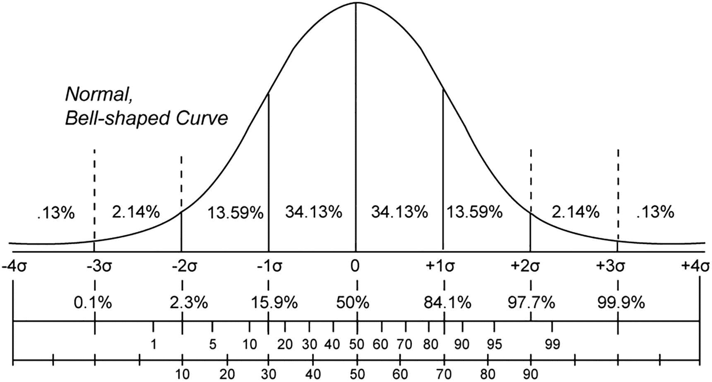

正态分布呈现为所谓的“钟形”曲线。

计算百分位数需要你先对给定列中的所有值按升序排序，然后利用数据集的大小（总记录数）来计算给定百分位数的值。在非常大的数据集中，这可能会耗费大量资源，而这正是`percentile_approx`方法发挥作用的地方。

```
percentile_approx(col, percentage, accuracy)
```

`percentile_approx`函数根据提供的百分比参数（可以是双精度浮点数数组或单个双精度浮点数），高效地计算已排序的连续数值数据序列的百分位数。精度参数让你可以定义生成百分位数时允许的误差（数字越低，内存开销越低，但误差范围越大）。

百分位数可用于创建常见的分箱（`bins`），以衡量连续数值度量的频率。例如，直方图是一种数据点落入特定分箱的频率（或趋势）的图形表示。时间序列直方图分析可用于观察特定分箱的质量（百分比）随时间的变化。

清单 12-26 中的聚合还引入了数值`ceil`（向上取整）函数，用于将平均`num_items`向上舍入到最接近的整数。如果你想向下舍入到最接近的整数，可以使用`floor`表达式。

在初始聚合之后，我们立即使用基础的列式表达式添加列，以提取百分位数数据并计算四分位距。

```
.withColumn("daily_p25_items", $"percentiles"(0))
.withColumn("daily_median_items", $"percentiles"(1))
.withColumn("daily_p75_items", $"percentiles"(2))
.withColumn("daily_p99_items", $"percentiles"(3))
.drop("percentiles")
.withColumn("iqr",
floor($"daily_p75_items" - $"daily_p25_items")
)
```

代表第 25、第 50、第 75 和第 95 百分位数的列使用了一种技术，该技术本质上是将数组值从 DataFrame 的百分位数列中提取出来，然后从最终的 DataFrame 中删除百分位数数组，因为它已不再有用（列已被提取）。最后，使用`p75-p25`计算四分位距，该范围有助于（在统计上）识别第 25 和第 75 百分位数之间的距离，在正态分布中，这个距离是相等的。能够观察数据集中的偏斜（左偏或右偏）有助于理解度量值如何随时间变化。清单 12-26 中聚合的输出将如下所示：

```
-RECORD 0------------------------------
year               | 2021
month              | 9
store_id           | store1
count              | 18951
total_items_sold   | 197421
sd                 | 5.777909019367008
daily_min_items    | 1
daily_avg_items    | 11
max_daily_items    | 20
daily_p25_items    | 5
daily_median_items | 10
daily_p75_items    | 15
daily_p99_items    | 20
iqr                | 10
```

接下来，我们将了解如何使用`rollup`和`pivot`，它们提供了分析分组数据的不同方式。

## 使用 Rollup 实现层次化聚合

`Rollup`提供了另一种创建聚合的方式，它是分组集（`groupBy`的扩展，被称为分组集）。`Rollup`与`groupBy`的区别在于数据分析的方式。为了生成层次化聚合，`rollup`会从左到右对`rollup`分组集中包含的所有列进行计算。`Rollup`使你能够生成以树状结构呈现的细粒度报告。最顶层的行代表所有数据的全局聚合，然后对于每一列（从左到右），会生成额外的行，表示按每个不同列值切片的数据子集。

清单 12-27 中的代码块展示了一个创建层次化聚合的具体示例。

```
%spark
val rollupReport = ordersDf
.rollup($"store_id", $"year", $"month")
.agg(
sum($"num_items") as "total",
min($"num_items") as "min_daily",
ceil(avg($"num_items")) as "avg_daily",
max($"num_items") as "max_daily"
)
.sort(asc("year"),asc("month"),asc("store_id"))
.limit(20)
```
清单 12-27：在分组集`store_id, year, month`上使用`Rollup`聚合数据集

`groupBy`与`rollup`之间的差异可以在输出`rollupReport`的结果时看出，如清单 12-28 所示。

```
+--------+----+-----+-------+---------+---------+---------+
|store_id|year|month|total  |min_daily|avg_daily|max_daily|
+--------+----+-----+-------+---------+---------+---------+
|null    |null|null |1050050|1        |11       |20       |
|store1  |null|null |259376 |1        |11       |20       |
|store2  |null|null |262872 |1        |11       |20       |
|store1  |2021|null |259376 |1        |11       |20       |
|store2  |2021|null |262872 |1        |11       |20       |
|store1  |2021|9    |197421 |1        |11       |20       |
|store2  |2021|9    |199030 |1        |11       |20       |
|store1  |2021|10   |61955  |1        |11       |20       |
|store2  |2021|10   |63842  |1        |11       |20       |
+--------+----+-----+-------+---------+---------+---------+
```
清单 12-28：`Rollup`从左到右计算分组集上的层次化聚合

在清单 12-28 的输出中，你会看到全局聚合之后是第一个分组列（`store_id`），然后是下一层级（`store_id`和`year`），接着是（`store_id`、`year`和`month`）。这种聚合风格适用于探索性报告。接下来，我们将讨论数据透视。

## 使用数据透视

数据透视是一种技术，它允许在众多行之间进行复杂的聚合，其方式类似于`rollup`和`groupBy`聚合。`pivot`操作的输出是一个新的数据集，该数据集已围绕特定列（例如`order_id`或月份或年份）进行了透视。这种技术可用于生成报告，也可用于在跨多行数据中寻找模式，从而产生新颖的洞察。

我们将探索创建一个数据集，该数据集表示顾客从咖啡店可用菜单中订购的每一件商品。这些菜单项随后将与`CoffeeOrder`上的`num_items`列关联。这个新数据集将存储在一个名为`coffee_order_items`的表中。这种细粒度的订单信息通常可以在数据库或数据湖中用于数据挖掘和分析目的，并可用于找出顾客通常会购买的品类或典型商品。

在这个例子中，我们将把订单商品分成两个简单的类别，名为`beverage`和`food`，并使用这些标识符，基于价格创建订单内所购商品的分类汇总，所有操作都通过数据透视完成。

让我们先从创建`menu_items`表开始。按照清单 12-29 中的代码创建`Item`样例类，并生成一些菜单项来完成这个数据透视教程。

## 创建与使用菜单项视图

我们将从创建一个名为 `menu_items` 的视图开始，该视图包含所有可用的菜单项（代码清单 12-29）。

```scala
%spark
import org.apache.spark.sql.types._
import org.apache.spark.sql._
case class Item(item_id: Int, name: String, category: String, price: Double)
val menuItems = Seq(
  Item(0, "拿铁", "beverage", 3.46),
  Item(1, "美式咖啡", "beverage", 2.59),
  Item(2, "卡布奇诺", "beverage", 3.89),
  Item(3, "手冲咖啡", "beverage", 5.26),
  Item(4, "茶", "beverage", 2.99),
  Item(5, "水", "beverage", 2.99),
  Item(6, "饼干", "food", 2.99),
  Item(7, "沙拉", "food", 4.99),
  Item(8, "三明治", "food", 6.99),
  Item(9, "爆米花", "food", 3.49)
)
val df = spark.createDataFrame(menuItems)
df.createOrReplaceTempView("menu_items")
```

菜单项可以通过使用 `saveAsTable` 保存以备将来重用（代码清单 12-30）。

```scala
%spark
df
  .repartition(1)
  .write
  .mode("overwrite")
  .saveAsTable("silver.menu_items")
```

现在你已经有了一些可用的菜单项，让我们使用这些项，并将它们与特定 `CoffeeOrder` 的一系列商品（作为整数数组形式的 `menu_item_ids`）关联起来。我们将创建 `OrderItems` 结构来存储这个数据集。

### 创建订单商品

我们需要创建一个名为 `OrderItems` 的新样例类，它存储一个 `orderId` 和一次订单中购买的商品序列（代码清单 12-31）。

```scala
%spark
case class OrderItems(orderId: String, items: Seq[Int])
spark.createDataFrame(Seq(
  OrderItems("orderId1314", Seq(3, 7, 5, 0, 1, 1, 1)),
  OrderItems("orderId1696", Seq(3, 7, 7, 5, 0, 1, 1, 1, 2, 2, 8))
)).createOrReplaceTempView("coffee_order_items")
```

### 使用数组展开从一行创建多行

处理数组数据并非总是那么直截了当。直接使用数组索引指针时，尤其是在没有保护措施的情况下，很容易在代码中引入错误。`explode` 功能是一种有用的技术，它可以从嵌套数组中提取所有数据，通过为每个项生成新行，从而展平嵌套结构。让我们看看如何利用它将一个订单的所有商品进行旋转。

作为参考，单行 `OrderItem` 如下所示。

```
Row("orderId1314", array(3, 7, 5, 0, 1, 1, 1))
```

当我们应用 `explode` 函数时，如下所示。

```scala
%spark
spark
  .sql("select * from coffee_order_items")
  .selectExpr("orderId", "explode(items)")
  .show
```

我们生成了一个新 `DataFrame`，其中每行对应一个菜单项。

```
+-----------+---+
|    orderId|col|
+-----------+---+
|orderId1314|  3|
|orderId1314|  7|
|orderId1314|  5|
|orderId1314|  0|
|orderId1314|  1|
|orderId1314|  1|
|orderId1314|  1|
+-----------+---+
```

使用 `explode` 允许你解包数据，从一行创建多行。该技术相当于在 Scala 中使用 `flatMap` 从一个项生成一系列项。那么，我们如何利用 `explode` 和连接来计算订单的总成本呢？

### 使用数组展开与连接来计算订单总额

现在您已经掌握了各个部分，可以将转换（`explode`）与连接（`order_items` 与 `menu_items`）混合使用，创建一个新的视图，将订单项与订单中每个菜单项的价格结合起来。请按照代码清单 12-32 中的代码块生成 `order_items_with_price` 视图。

```scala
%spark
val coffeeOrderItemsDf = spark.sql("""
  SELECT orderId, EXPLODE(items) as menu_item_id
  FROM coffee_order_items
""")
val menuItemsDf = spark.table("silver.menu_items")
val joinedDf = coffeeOrderItemsDf
  .join(
    menuItemsDf,
    coffeeOrderItemsDf("menu_item_id") === menuItemsDf("item_id"),
    "inner"
  )
  .sort(asc("orderId"))
  .select($"orderId".as("order_id"), $"name", $"category", $"price")
joinedDf.createOrReplaceTempView("order_items_with_price")
```

现在，您已经将订单项与订单中每个项的分类和价格连接起来，您将获得一个新的视图，如下所示：

```
+-----------+----------+--------+-----+
|   order_id|      name|category|price|
+-----------+----------+--------+-----+
|orderId1314| pour over|beverage| 5.26|
|orderId1314|     water|beverage| 2.99|
|orderId1314| americano|beverage| 2.59|
|orderId1314|     salad|    food| 4.99|
+-----------+----------+--------+-----+
```

您可以使用数据透视操作来计算订单中每个子分类的项目成本，这可以作为观察 CoffeeCo 客户购买行为趋势的有效策略。

### 使用数据透视表计算每个订单中菜单项类别的价格汇总

使用 `order_items_with_price` 视图（代码清单 12-32）中的数据，您现在可以运行代码清单 12-33 中的 SQL 语句，按 `order_id` 分组，并计算饮料和食品菜单类别的小计。

```sql
%sql
select * from order_items_with_price
pivot (
  cast(sum(price) as decimal(4,1)) as category_total,
  count(name) as items
  for category in (
    'beverage', 'food'
  )
)
```

生成的聚合围绕 `order_id` 对数据进行透视，然后在命名类别上计算子聚合。结果如下所示：

```
+-----------+-------------+-----------+---------+
|   order_id|beverage_total|beverage_items|food_total|food_items|
+-----------+-------------+-----------+---------+
|orderId1314|         11.8|          4|      5.0|         1|
|orderId1696|         18.8|          7|     15.0|         4|
+-----------+-------------+-----------+---------+
```

数据透视是一种强大的分析操作，它将分组提升到了一个新的水平，可用于在数据的复杂子集上创建细项报告。我们将要学习的最后一个操作是 Spark 对分析窗口函数的支持。

## 分析窗口函数

Spark 开箱即用地提供了多种分析支持和操作。本章已经涵盖了可用的分组聚合（`groupBy`，`rollup`），并解释了如何利用强大的 `agg` 运算符来支持并行聚合。您学会了生成基本求和、提取 `min` 和 `max` 值以及计算百分位数。上一节教会您使用强大的 `pivot` 操作来转置（旋转）多行数据以创建复杂的子聚合，但所有这些先前的聚合函数都有一个共同点：它们都创建了一个全新的数据集。窗口函数的工作方式略有不同。

窗口函数能够实现与纯聚合不同的分析模式。关键区别在于，分组聚合（`groupBy`，`rollup` 等）将多个值归约为（每个分组集）一个单一值，而窗口函数则向输入数据集的每一行添加一个分析值或聚合结果作为新列，从而保留所有行。

例如，假设我们想要创建一个按小时和跨商店的订单有序索引（运行计数）。为了构造查询，我们将使用 `partitionBy` 而不是 `groupBy`，因为我们不是在进行分组聚合。`partitionBy` 创建一个窗口规范，可用于最佳地分割数据集的一个子集并对其进行排序，以便进行分析处理。让我们看看如何使用窗口函数。代码清单 12-34 中的代码块生成了一个窗口，我们可以使用它为 `coffeeOrdersDf` 添加新列。

```scala
%spark
import org.apache.spark.sql.expressions.Window
val hourlyOrders = coffeeOrdersDf
.withColumn("timestamp",
to_timestamp($"timestamp"/1000)
)
.withColumn("hour", hour($"timestamp"))
val window = Window
.partitionBy("store_id","date","hour")
.orderBy(asc("timestamp"))
hourlyOrders
.withColumn("transaction_number", row_number.over(window))
.withColumn("running_total",sum($"num_items").over(window))
.limit(6)
.show
```
Listing 12-34：创建一个窗口规范，用于计算每小时的交易编号以及在窗口内累计售出的商品总数

该窗口表示数据集的一个视图，该视图按 `store_id`、`date` 和 `hour` 进行分区，然后将分区后的数据子集按时间戳升序排序。这将使我们能够计算从每小时第一笔交易到最后一笔交易售出的商品总数。请参见代码清单 12-35。对于每笔交易，我们看到后续每一行的商品总数（`num_items`）都会根据前一个 `num_items` 的值增加。

```
+--------+----------+----+-----------+---------+------+
|store_id|      date|hour|transaction|num_items|totals|
+--------+----------+----+-----------+---------+------+
|  store1|2021-09-06|   3|          1|       11|    11|
|  store1|2021-09-06|   3|          2|       19|    30|
|  store1|2021-09-06|   3|          3|        3|    33|
|  store1|2021-09-06|   3|          4|       20|    53|
|  store1|2021-09-06|   3|          5|        5|    58|
|  store1|2021-09-06|   3|          6|       17|    75|
+--------+----------+----+-----------+---------+------+
```
Listing 12-35：应用 `row_number` 和 `sum` 窗口聚合函数后的输出

能够向咖啡订单添加交易编号（`row_number`）和运行总计（`totals`）对于统计销售额非常有用。根据您想要分析的内容，还可以完成其他有趣的事情。

### 计算交易间累计平均购买商品数量的差值

例如，假设你想计算两笔交易之间售出商品数量的差值，并同时计算每小时交易量的累计滚动平均差值？

这可以通过使用窗口函数中的 `lag` 来实现。Lag 意为“滞后”，滞后操作利用“当前行”、提供的列以及前方行的值，向后查找以获取数据集中任意行的值。在代码清单 12-36 中，我们使用 `lag($"num_items",1)` 向后查找一行，从而计算出交易之间购买商品数量的绝对差值。最后，我们在窗口上使用 `avg($"diff_last_sale")` 来创建累计平均值。

```spark
hourlyOrders
.withColumn("transaction", row_number.over(window))
.withColumn("totals", sum($"num_items").over(window))
.withColumn("diff_last_sale",
abs($"num_items" - lag($"num_items", 1).over(window))
)
.withColumn("avg_diff",
bround(avg($"diff_last_sale").over(window),2)
)
```
清单 12-36：使用窗口函数 `lag(column,step)` 计算上次售出商品数量与本次交易售出商品数量之间的差值

计算窗口函数（代码清单 12-36）的结果如下所示。

```spark
+-----------+------+--------------+--------+
|transaction|totals|diff_last_sale|avg_diff|
+-----------+------+--------------+--------+
|          1|    11|          null|    null|
|          2|    30|             8|     8.0|
|          3|    33|            16|    12.0|
|          4|    53|            17|   13.67|
|          5|    58|            15|    14.0|
|          6|    75|            12|    13.6|
|          7|    87|             5|   12.17|
|          8|    99|             0|   10.43|
+-----------+------+--------------+--------+
```

虽然输出只截取了前八笔交易，但你已经明白了。通过从 `groupBy`（分组集）转向 `partitionBy`（窗口）操作，你可以实现很多功能。通过混合搭配窗口函数的分析功能和强大的聚合能力，你可以创建复杂的报告并生成真正新颖的见解。

如果最后一个例子让你觉得关联性不强，那么设想一下，你的任务是优化 CoffeeCo 咖啡店的订单流程，你处理的数据与发现（隔离）每家店铺运营中可能存在的问题和低效环节有关。利用捕获的数据，并测量从订单创建到订单完成的时间，你可以使用相同的 `lag` 技术，结合数据透视、连接和额外的汇总操作，来计算按类别和店铺细分的菜单项物流和时间的报告。最长排队时间的原因可能是某些商品制作困难（高级手冲咖啡或食品），从菜单中移除某一商品可能就能加快所有其他交易的速度。

### 练习 12-2：总结

本章的第二个练习让你接触了如何使用分组聚合方法，并解释了如何转换数据以创建复杂的报告，从而协助你进行数据侦探工作。

## 总结

理解如何可靠地捕获、验证、清理和存储数据是数据工程师工作的一部分。能够利用行业工具高效地完成工作是需要时间和实践积累的。本章深入探讨了如何使用分析数据，并学习如何处理这些数据以理解更高级的数据转换工作，从而服务于分析场景。本章前半部分重点介绍了如何清理数据、切换时区、替换空值、创建和使用用户自定义函数。最后，我们探讨了 Apache Spark 中可用的聚合和分析处理方法及操作。

下一章内容稍短，主要关注两个简单的结构化流式应用程序。第一个是咖啡订单指标应用程序，它能够生成可用于实时仪表盘和运营的实时报告。第二个应用程序更为高级，使用了 `flatMapGroupsWithState` 操作符。在探讨部署模式和监控之前，这是我们需要编写代码的最后一章。


# 第三部分：高级技术


# 13. 基于 Spark 有状态结构化流式处理的高级分析

在上一章中，你学习了如何使用 Apache Spark 强大的聚合和分析函数，从 `agg` 操作符（它能够基于分组数据集直接实现强大的列式聚合功能），到分析型窗口函数（它允许你使用这些独特的窗口功能对数据集进行分区和分析）。这使你能够在活动迭代中，从当前位置向前（`lag`）或向后（`lead`）查看多行数据。你学会了使用 `lag` over 创建逐行平均增量，以及类似的技术来创建运行累计总数。

本章将继续遵循上一章的思路，重点介绍如何使用结构化流式处理创建有状态聚合。它教你如何将分析处理和洞察生成迁移到流中。本章还将扩展前四章奠定的技术和基础，用于创建可靠的有状态应用程序，利用检查点、预写日志和进程触发。此外，本章还将介绍用于有状态流式聚合的 Spark `StateStore`。你将学习构建高级的流式分析应用程序。

## 练习与资料

本章的练习和内容将带你完成以下三个部分：

*   使用结构化流式处理进行有状态聚合

*   使用 `FlatMapGroupsWithState` 进行任意有状态操作

*   使用 `MemoryStream` 测试有状态流式应用程序

`练习资料`：第 13 章的练习资料位于 [`https://github.com/newfront/spark-moderndataengineering/tree/main/ch-13`](https://github.com/newfront/spark-moderndataengineering/tree/main/ch-13)。

让我们从延续上一章的学习内容开始，将状态聚合叠加到你已有的 Spark 结构化流式知识之上。

## 使用结构化流式处理进行有状态聚合

请先思考一下你目前对流式数据源的了解。你可能正在思考这样一个事实：流式数据源本质上是一个无限的数据源。就像河流一样，流式数据源会通过 `DataStreamReader` 源源不断地流入你的应用程序，直到人工或基于进程的干预减缓数据流，或完全中断数据源。

既然你正在思考一个永不枯竭的数据源，那么请再想想你在上一章学到的关于分组聚合（`groupBy`）的工作原理。你可能会认为，分组操作作用于单个 DataFrame/数据集，该数据集定义了全局数据集（在特定时间点的所有已知数据），这些数据被分组（条件分区）并聚合，以生成跨数据集子集的列式聚合分析行。这确实是正确的。但是，如果你想要在时间维度上跨条件组关联无界数据集，还缺少什么呢？我们如何按时间对数据进行分组？窗口（windowing）又是怎么回事？

# 创建基于时间窗口的聚合

假设你有一个无限数据流的数据源，例如 Redis Stream 或 Kafka 主题，并且希望使用 Spark Structured Streaming 来可靠地获取并持续分析该数据源中流经的数据。你清楚无法将所有数据永远储存在内存中，同时你也希望能够获得一定的处理能力与准确性保障。那么，你该如何应对呢？

首先，你可以将一种名为*窗口计算*的技术与 Spark Structured Streaming 结合使用。窗口计算允许你根据基于时间的间隔（例如每 15 分钟），自动将静态或流式数据集切分成多个数据桶。简单来说，数据会被自动分组到由起始时间和结束时间定义的时间桶内。窗口计算，或称基于时间的分组，与我们上一章讨论的分析窗口函数不同。最大的区别在于，分析窗口函数会保留数据集中的所有行，并根据聚合函数新增一列；而窗口聚合则是基于时间窗口定义的分组集，逐步合并指定列的聚合结果。图 13-1 展示了关于随时间变化的咖啡订单总数的有界数据（窗口 1-3）。请注意，这些窗口是不重叠的，这意味着在每个 15 分钟窗口内产生的订单对于该窗口来说是互斥的。这样一来，每个订单都只被计算一次。

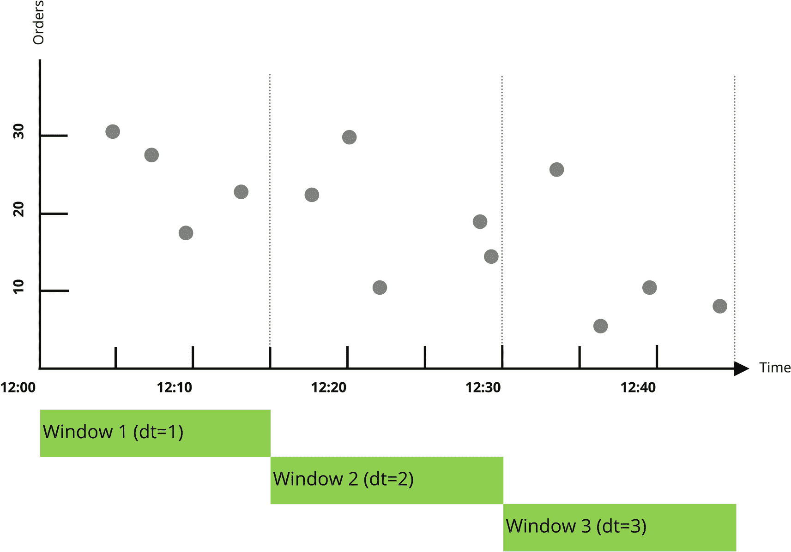

图 13-1

使用窗口来表示咖啡订单随时间变化的动态 `groupBy` 函数

让我们通过一个具体例子来进一步探讨这个想法。

## 窗口函数与窗口计算

在上一章中，你了解了如何使用分析窗口函数来处理列式数据。你学会了创造性地使用行号、计算累计运行平均值，甚至根据分析表达式的结果进行聚合运算。为了便于参考，清单 13-1 来自第 12 章。回顾一下，窗口函数通过为所有行添加一个新列来转换输入数据集，该列代表特定分析函数的结果。例如，你曾使用这些函数计算累计运行总和。

```scala
df.withColumn("running_total"),
sum($"num_items").over(Window
.partitionBy("store_id","date","hour")
.orderBy(asc("timestamp"))))
```

清单 13-1

第 12 章清单 12-32 中的列式窗口函数

窗口计算是一种列式分组技术，它与分析窗口函数有一些共通之处，但在底层实现上有所不同。虽然两者名称相同（窗口），并且都致力于根据条件边界对数据集进行分区，但它们有一个核心区别。主要区别在于，窗口表达式是作为参数传递给 `groupBy` 操作符，以增强分组操作符的能力。现在，数据将根据数据集中的一个通用时间戳列（`TimestampType`）自动划分到基于时间的桶中。

让我们来看看实际运行中的窗口计算。清单 13-2 创建了一个*滚动*窗口聚合。每个窗口都有一个包含性起始时间和一个排他性结束时间。这意味着数据将根据特定的时间边界进行分割，就像传送带上移动的盒子一样，在向传送带末端移动的过程中被填满。清单 13-2 中的示例可以直接在 `spark-shell` 或 `Zeppelin` 笔记本中运行。

```scala
import spark.implicits._
import org.apache.spark.sql.functions.{col, window}
spark
.sql("SELECT timestamp('2021-09-25 10:00:00' as ts, 200 as total, 'storeA' as storeId")
.groupBy($"storeId", window($"ts","30 minutes"))
.sum("total")
.select(
$"storeId", $"window.start".as("start"),
$"window.end".as("end"), $"sum(total)".as("total"))
.show(truncate=false)
```

清单 13-2

使用窗口函数作为分组列来自动创建窗口聚合

清单 13-2 中的聚合按 `storeId` 分组，并借助事件数据的时间戳列 (`ts`) 和*窗口表达式*自动聚合到 30 分钟的窗口中。

下面展示了窗口聚合的参考输出结果。对于每个互斥的 30 分钟窗口，订单总额会根据不同 `storeId` 的总数进行累加。

```
+-------+-------------------+-------------------+-----+
|storeId|start              |end                |total|
+-------+-------------------+-------------------+-----+
|storeA |2021-09-25 10:00:00|2021-09-25 10:30:00|200  |
|storeB |2021-09-25 10:00:00|2021-09-25 10:30:00|120  |
|storeA |2021-09-25 10:30:00|2021-09-25 11:00:00|350  |
|storeB |2021-09-25 10:30:00|2021-09-25 11:00:00|220  |
+-------+-------------------+-------------------+-----+
```

清单 13-2 中使用的 `window` 函数是一个列式表达式，它将一个时间戳列转换成一个派生列，用于 `groupBy` 操作中。这使我们能够自动将数据落入特定的基于时间的数据桶中进行聚合。

## 使用 `window` 函数

`window` 函数增强了 `RelationalGroupedDataset` 操作符的工作方式，支持通过使用*滚动*、*滑动*和*延迟*窗口功能，自动进行基于时间聚合的数据分桶。

*来自 `org.apache.spark.sql.functions` 包的 `window` 函数*

```scala
def window(
  timeColumn: Column,
  windowDuration: String,
  slideDuration: String,
  startTime: String): Column = {
  withExpr {
    TimeWindow(timeColumn.expr, windowDuration, slideDuration, startTime)
  }
}.as("window")
```

该函数接受四个参数（`timeColumn`、`windowDuration`、`slideDuration` 和 `startTime`），为你提供了在时间维度上滑动和切分数据的新方法。之前你已经了解了滚动窗口，现在让我们来看一下滑动窗口和延迟窗口。

## 滑动窗口

`window` 函数的 `slideDuration` 参数支持创建滑动窗口。滑动窗口本质上是按特定增量（例如每 15 分钟评估一次 30 分钟窗口）计算的、相互重叠的基于时间的窗口。与滚动窗口不同，每一行数据可以同时属于多个重叠的窗口。

例如，将示例 13-2 中的 `groupBy` 窗口表达式改为包含 15 分钟的滑动间隔，你将创建两个基于时间的桶，而非一个。

```scala
groupBy($"storeId", window($"ts","30 minutes", "15 minutes"))
```

现在，单个输入行将产生两行聚合结果，而非一行。

```
+-------+-------------------+-------------------+-----+
|storeId|start              |end                |total|
+-------+-------------------+-------------------+-----+
|storeA |2021-09-25 09:45:00|2021-09-25 10:15:00|200  |
|storeA |2021-09-25 10:00:00|2021-09-25 10:30:00|200  |
+-------+-------------------+-------------------+-----+
```

由于输入行的时间戳是 `10:00:00`，该数据落入了两个重叠的 30 分钟滑动窗口中。第一个窗口从 `09:45` 开始，到 `10:15` 结束。第二个窗口从 `10:00` 开始，到 `10:30` 结束。这也被称为*交错*窗口。

## 延迟窗口

窗口的 `startTime` 参数允许你延迟计算派生窗口。将示例 13-2 中的 `groupBy` 改为以下形式。

```scala
.groupBy($"storeId",
  window($"ts","30 minutes", "15 minutes", "5 minutes"))
```

这将每次聚合的起始偏移量推迟了五分钟，然后每 15 分钟创建一个滑动窗口。


```
+-------+-------------------+-------------------+-----+
|storeId|start              |end                |total|
+-------+-------------------+-------------------+-----+
|storeA |2021-09-25 09:35:00|2021-09-25 10:05:00|200  |
|storeA |2021-09-25 09:50:00|2021-09-25 10:20:00|200  |
+-------+-------------------+-------------------+-----+
```

现在你已经理解了`窗口化`的机制，接下来我们看一个更完整的示例。

# 窗口化与输出控制

既然你已经了解了窗口化过程的工作原理，合乎逻辑的下一步就是考察如何将此技术应用于流式数据集。考虑到流式数据的无界特性，了解那些告知 Apache Spark 聚合操作何时完成的控制过程也同样明智。

例如，假设你需要创建一个流式应用程序，该程序持续摄取 `CoffeeOrder` 数据，每 30 分钟计算一次滚动店铺性能指标。示例 13-3 建立了 `StreamingQuery` 的基本模块。你创建了一个 `DataStreamReader`（Redis），它通过 `groupBy` + `agg` 聚合店铺（`storeId`）的性能，聚合指标包括订单总数（`count`）、售出商品总数（`sum`）、总收入（基于订单成本的 `sum`）以及窗口内平均售出商品数（`average`）。

```scala
spark
  .readStream
  .format("redis")
  ...
  .groupBy($"storeId", window($"timestamp", "30 minutes"))
  .agg(
    count($"orderId") as "totalOrders",
    sum($"numItems") as "totalItems",
    sum($"price") as "totalRevenue",
    avg($"numItems") as "averageNumItems"
  )
  .writeStream
  ...
  .start()
// 示例 13-3
// 创建有状态的流式聚合
```

将这个示例视为有状态聚合应用的蓝图。数据从 Redis（第 10 章）流入，然后你将输入流数据转换为分组聚合（第 12 章）。分组集现在也通过本章所学的窗口化技术得到了增强。

基本上，创建这个流式应用所需的大部分要素都已就绪，除了`两个至关重要的缺失部分`——它们控制着 Spark 如何输出这些窗口聚合结果。首先，`DataStreamWriter`（`writeStream`）上缺少一个输出模式（output mode），该模式定义了聚合后的窗口数据将如何向下游发送；其次，没有告知 Spark 何时停止聚合数据的处理的方法（即水印）。没有输出模式和水印，Spark 无法定义传送带的终点，你的滚动窗口将一直在内存中运行，直到内存耗尽。

现在，我们来看这两个重要的过程。

## 流式输出模式

结构化流应用的输出行为由流式 sink（`DataStreamWriter`）上的输出模式设置控制。有三种可用的值：`complete`、`update` 和 `append`。

### Complete

每次有更新时，流式 DataFrame/dataset 中的所有行都会被写入 sink。此模式通常用于本地运行测试，配合 `ConsoleSink`（在第 10 章中介绍）或 `MemorySink` 使用，你将在本章末尾了解更多关于 `MemorySink` 的信息。

### Update

只有被更新的行才会被写入 sink。如果查询不包含任何聚合，`update` 模式的行为类似于 append。当编写新的流式聚合时，能够看到每个批次在与先前状态合并（更新）后的最终结果会很有帮助。或者对于需要将每个重大更新（对数据集）向下游发送的系统，你可以使用此操作模式，在记录发生变更时发送其多个版本。

### Append

只有新行会被写入 sink。此模式与结构化流基于状态的检查点、预写日志以及阶段级提交协同工作。具体到有状态聚合，`append` 模式控制着关于流式聚合何时被认为完成、并可以有效地向下游发送的精确一次语义（当数据从基于状态的传送带上滚落到下游 sink 时）。

#### 追加输出模式

修改清单 13-3 中的示例代码，我们可以增强 `writeStream` 以使用仅追加模式。

```
.writeStream
.format("parquet")
.options(...)
.outputMode(OutputMode.Append)
.start()
```

现在，流聚合仅在每次聚合完成后才输出数据。但 Spark 如何判断聚合何时完成？如果你使用输出模式 `Append` 运行这段代码，将会看到以下异常抛出。

```
org.apache.spark.sql.AnalysisException: Append output mode not supported when there are streaming aggregations on streaming DataFrames/DataSets without watermark;
```

水印到底是什么？

#### 结账与水印

数据行业中有一个概念叫做“结账”。鉴于流式数据只有在有限的时间窗口内才被视为`新鲜`并可被处理，因此存在一个阈值（水印）。在该阈值内，处理事件流的应用程序（Spark Structured Streaming 或其他）可以接收并处理新数据，之后则停止处理并丢弃（或忽略）任何延迟到达的数据。水印处理过程也被称为“关账”，因为它是系统输出最终处理状态（针对窗口聚合）并发送聚合结果以供下游进一步处理、写入可靠存储、分布式表或其他位置的时间点。

水印过程如图 13-2 所示。从概念上讲，如果你考虑到正在接收和处理无界数据流，那么对于每个微批次，Spark 引擎将根据时间戳列计算最小值、最大值、平均值和水印值。在生成统计信息时，会考虑聚合的整个状态的汇总统计信息，并且每个新的微批次会在决定丢弃被视为延迟的数据之前，先考虑水印阈值。

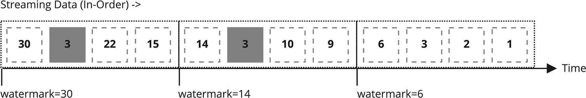

图 13-2

水印过程可以被视为创建一种基于时间的统计边界的方法。接收到的新事件数据如果小于当前水印（延迟数据），则会根据窗口间隔加上水印间隔被丢弃。

例如，用于近实时监控分布式系统的现有进程不能等待延迟数据，而必须依据可用数据所定义的`可用视图`来采取行动。由于流系统处理来自许多分布式上游进程的数据，数据可能会像人们在排队点单或取咖啡时被拦住一样，或者在日常通勤中因随机交通模式而受阻。

指标数据通常在几秒内（在源系统/物理服务器等上）聚合，并以 5-10 秒的间隔发出以供处理。然后，每个单独的聚合与其他数据合并和连接，以计算分布式系统的统计视图。鉴于告警系统使用规则来确定何时以及如何向团队告警或向另一个自治系统发送事件，水印使这些系统能够忽略那些不再相关且可能触发误报的数据（例如，由于网络故障或其他问题而导致数据延迟 30 分钟才出现的情况）。

## 流式数据的水印

你刚刚了解了结账和水印。我们生活在一个充满规则和法规的世界中，Spark 亦是如此。为了使我们的流聚合能够正确地发出新的`翻滚窗口`聚合结果，我们需要使用与数据集中物理时间戳直接关联的水印（清单 13-4）来标记我们自己的结账点。

Spark 将忽略延迟数据（基于预定义的时间戳列），自动将其丢弃。在许多使用案例中，丢弃延迟数据是可用的最佳选择，而不是创建一个新的桶来聚合可能只有少量延迟记录的数据，但更糟糕的是，延迟数据可能会破坏 Spark 的 `append` 输出模式的`精确一次语义`。

让我们看看如何将水印添加到清单 13-3 的示例中。我们将水印添加到输入流中，清单 13-4 展示了如何向 Redis 输入流添加一个 30 分钟的水印。

```scala
spark
.readStream
.format("redis")
...
.withWatermark("timestamp", "30 minutes")
.groupBy($"storeId", window($"timestamp", "30 minutes"))
...
```

清单 13-4 将有状态聚合示例应用水印

Spark 利用水印（30 分钟）和翻滚窗口（30 分钟）之间的关系，以精确一次语义控制 `append` 输出模式过程。本质上，结账将在第一个事件到达后的一小时（30 分钟窗口 + 30 分钟水印）发生，从而建立聚合桶。

接下来，让我们将刚刚涵盖的理论概念与窗口技术相结合，在练习 13-1 中完成一个完整的端到端有状态流聚合应用程序。

## 章节练习概览


# 本章的练习重用了前面章节中的 `CoffeeOrder` 事件。你将学习读取订单流并生成店铺收入聚合结果，这些聚合结果本质上是跨可变长度窗口（示例中为五分钟）的店铺绩效数据。

将无界的 `CoffeeOrders` 流读入应用程序后，你将学习将此输入数据集转换为可以随时间聚合的格式。这将产生一个表示翻滚窗口聚合结果的新数据集。

### 输入数据格式 (`CoffeeOrder`)

```
+-------------+-------+-------+----------+--------+-----+
|    timestamp|orderId|storeId|customerId|numItems|price|
+-------------+-------+-------+----------+--------+-----+
|1632549600000| order1| storeA|     custA|       2| 9.99|
|1632549660000| order2| storeA|     custB|       1| 4.99|
|1632549720000| order3| storeA|     custC|       3|14.99|
|1632549730000| order4| storeB|     custD|       1| 3.99|
|1632549740000| order5| storeA|     custE|       2| 6.99|
+-------------+-------+-------+----------+--------+-----+
```

### 输出的窗口化店铺收入聚合结果

```
+--------+---------------+------+---+-------+-------+-------+
|store_id|         window|orders|its|revenue|p95_its|avg_its|
+--------+---------------+------+---+-------+-------+-------+
|  storeA|{2021-... 06:00|     4|  8|  36.96|      3|    2.0|
|  storeB|{2021-... 06:00|     4|  7|  29.96|      3|   1.75|
|  storeA|{2021-... 06:05|     2|  4|   9.98|      2|    2.0|
|  storeB|{2021-... 06:05|     1|  1|   3.99|      1|    1.0|
+--------+---------------+------+---+-------+-------+-------+
```

让我们开始吧。

## 练习 13-1：店铺收入聚合

在你喜欢的 IDE 中打开位于 `/ch-13/applications/stateful-stream-aggs/` 的应用程序。第一个涉及的应用程序是一个有状态 Structured Streaming 应用程序的示例，它自动在基于时间的窗口中聚合 `CoffeeOrder` 事件，以生成店铺绩效指标桶。

首先打开 `SparkStatefulAggregationsApp`，查看 `object` 签名。

```scala
object SparkStatefulAggregationsApp extends SparkStructuredStreamingApplication[DataFrame, Row]
```

你会注意到本章引入了一个新的应用程序特质，名为 `SparkStructuredStreamingApplication`。该特质提供了在构建 Structured Streaming 应用程序时使用的额外方法。让我们先看看这个新特质，然后再回到应用程序。

### Structured Streaming 应用特质

这一新特质如下所示，它扩展了第 7 章介绍的 `SparkApplication` 特质。该特质新增了几个值得关注的便捷方法，旨在加速构建流式应用，如代码清单 13-5 所示。该接口提供了一个可复用的框架，以简化使用核心 Spark 类 `DataStreamReader`、`DataStreamWriter` 和 `StreamingQuery` 编写 Structured Streaming 应用程序的过程。

```
trait SparkStructuredStreamingApplication[T, U]
extends SparkApplication {
def streamReader: DataStreamReader
lazy val inputStream: DataStreamReader = streamReader
def outputStream(writer: DataStreamWriter[U])(implicit sparkSession: SparkSession): DataStreamWriter[U]
def runApp(): StreamingQuery
def awaitTermination(query: StreamingQuery): Unit
def awaitAnyTermination(): Unit
}
```

**代码清单 13-5** `SparkStructuredStreamingApplication` 特质接口方法

作为回顾，Structured Streaming 应用通过组装一个查询计划来构建，该计划始于流式数据源，终于流式数据接收器。在每个有状态处理周期中，应用持续读取新的流式数据批次，对每个批次进行转换和处理，并将结果发送到下游或可靠的存储中（用于聚合操作）。

新特质将流读取器和写入器（`DataStreamReader`、`DataStreamWriter`）封装成可复用的函数，从而提供了额外的机制来采用配置驱动的方法，这种方法非常有利于测试端到端的应用程序（你将在本章后面看到）。

接下来，让我们更仔细地研究一下 `streamReader` 和 `outputStream` 函数，因为它们是对前几章中使用的 `inputStream` 和 `outputStream` 概念的演进式阶跃变化。

#### 流读取器

`streamReader` 方法使用 Spark 配置中前缀为 `spark.app.source.*` 的设置，在动态构建新的 `DataStreamReader` 实例时使用这些配置。

```
def streamReader: DataStreamReader = sparkSession
.readStream
.format(sparkConf.get(sourceFormat, sourceFormatDefault))
.options(sparkConf.getAllWithPrefix(
sparkConf.get(sourceStreamOptions)).toMap)
```

这种技术使你的应用能够轻松切换由 `DataStreamReader` 使用的上游数据源。例如，用于重新生成最终数据集的恢复或重播任务，可能会使用与实时应用不同的上游数据源，比如选择 S3 而不是 Kafka 进行恢复。此外，此策略可作为强制函数，防止在应用程序源代码中硬编码值。但要注意不要让应用的灵活性过度降低。这就是为什么该特质提供了可由扩展类使用并进一步装饰的方法。

#### 输出流装饰器

`outputStream` 方法如代码清单 13-6 所示，用于为 `DataStreamWriter` 装饰常见行为，如触发和分区。它简化了 Structured Streaming 应用在配置 `outputStreams` 时涉及 `outputMode`、列式分区和触发的方式。

```
def outputStream(writer: DataStreamWriter[U])(implicit sparkSession: SparkSession): DataStreamWriter[U] = {
import appConfig._
val conf = sparkSession.conf
...
Seq(OutputModeOption, PartitionByOption, TriggerOption)
.foldLeft[DataStreamWriter[U]](writer)((w, config) => {
...
})
.format(SinkFormat)
.queryName(QueryName)
}
```

**代码清单 13-6** `outputStream` `DataStreamWriter` 装饰器

简而言之，代码清单 13-6 中的 `outputStream` 方法使用 Spark 运行时配置来装饰输入的 `DataStreamWriter`。通过选择使用 `DataStreamWriter` 接口，`outputStream` 方法无需关心数据血缘问题，因为那是应用程序的职责。该方法需要做的所有事情就是在提供的写入器之上添加格式、`queryName`、`outputMode`，以及可选的触发器和输出分区。

#### 条件对象装饰

像 Scala 这样的函数式编程语言本质上是不可变的，旨在减少按引用传递语言常见的意外副作用。因此，我们使用 `foldLeft` 操作来有条件地装饰 `DataStreamWriter` 接口。`foldLeft` 操作会遍历配置项列表，以可靠地生成写入器配置。

查看代码清单 13-7 中 `outputStream` 方法的内联函数，你会看到来自初始序列的每个配置值（`outputMode`、`partitionBy` 和 `trigger`）都用于有条件地装饰输入写入器对象（`w`），然后传递到下一个值并进行下一轮检查。

```
(w, config) => {  config match {
case OutputModeOption => w.outputMode(sinkOutputMode)
case PartitionByOption if sinkPartitionBy.nonEmpty =>
val partitionColumns = SinkPartitionBy
.split(SinkPartitionBySeparator).map(_.trim)
if (partitionColumns.nonEmpty)   w.partitionBy(partitionColumns:_*) else w
case TriggerOption if triggerEnabled => triggerType match {
case TriggerProcessingTime =>          w.trigger(Trigger.ProcessingTime(ProcessTimeInterval))
case TriggerOnce => w.trigger(Trigger.Once())
case TriggerContinuous if sinkFormat.equals("kafka") =>
w.trigger(
Trigger.Continuous(processTimeInterval))
case _ => w
}
}}
```

**代码清单 13-7** `outputStream` 的 `foldLeft` 内联函数

代码清单 13-6 和 13-7 中的代码块共同创建了一个可扩展的 `DataStreamWriter` 装饰器。

现在，让我们回到应用代码，看看这个特质是如何实际运用的。

### Spark 状态聚合应用

现在你已经了解了该特质的运作方式，接下来可以看看应用如何利用该特质的新功能。切换回 `SparkStatefulAggregationsApp` 源代码，观察底层架构如何简化应用结构。

让我们从代码清单 13-8 中的 `runApp` 方法开始，逐步深入应用内部。

```
override def runApp(): StreamingQuery = {
val conf = sparkSession.conf
val processor = StoreRevenueAggregates(sparkSession)
val pipeline: Dataset[Row] = processor
.transform(inputStream.load())
.transform(processor.process)
val w = outputStream(pipeline.writeStream)
conf.get(sinkToTableName, "") match {
case tableName if tableName.nonEmpty =>
w.toTable(tableName)
case _ => w.start()
}
}
```

代码清单 13-8 `runApp` 方法返回一个 `StreamingQuery`

代码清单 13-8 中的 `runApp` 方法使用 `StoreRevenueAggregates` 类的实例作为代理类，负责转换和处理输入数据流。

```
val pipeline: Dataset[Row] = processor
.transform(inputStream.load()) // DataFrame
.transform(processor.process) // Dataset[Row]
```

我们来拆解聚合管道的步骤：

1.  `processor.transform(inputStream.load)`。第一个转换接收一个 `DataFrame` 并返回一个 `DataFrame`。在底层，此转换将时间戳列从 UNIX 纪元毫秒转换为 `TimestampType`。

2.  `DataFrame.transform(processor.process)`。第二个 `transform` 方法将步骤 1 转换后的 `DataFrame` 通过函数式 DataFrame 转换传入 `StoreRevenueAggregates` 类的 `process` 方法。这是我们添加 `watermark`、`groupBy`、`window` 和 `agg` 操作以实现聚合流的地方。

管道的结果是一个 `DataFrame`（即 `Dataset[Row]`），可与 `outputStream` 装饰器函数配合使用。然后根据应用配置，通过 `toTable` 或直接使用 `DataStreamWriter` 条件性地启动输出流。

接下来，我们拆解 `StoreRevenueAggregates` 类，看看这个应用到底做了什么。

### 流式聚合

打开位于 `processors` 包中的 `StoreRevenueAggregates` 类。代码清单 13-9 中的类仅包含 `transform` 和 `process` 方法，这是 `DataFrameTransformer` 和 `WindowedDataFrameProcessor` 特质所要求的。

```
class StoreRevenueAggregates(val spark: SparkSession) extends DataFrameTransformer with WindowedDataFrameProcessor with Serializable {
override def transform(df: DataFrame): DataFrame = df
.withColumn(timestampColumn, to_timestamp(
col(timestampColumn).divide(lit(1000))
.cast(TimestampType)))
override def process(df: DataFrame): DataFrame = {
import spark.implicits._
df
.dropDuplicates("orderId")
.withWatermark(timestampColumn, watermarkDuration)
.groupBy($"storeId", groupingWindow())
.agg(
count($"orderId") as "totalOrders",
sum($"numItems") as "totalItems",
sum($"price") as "totalRevenue",
percentile_approx($"numItems", lit(0.95), lit(95))
as "numItemsP95",
avg($"numItems") as "averageNumItems"
)
}
}
```

代码清单 13-9 `StoreRevenueAggregates` 类

代码清单 13-9 中的类实现简单明了。我们先从 `transform` 方法开始，然后介绍 `process` 方法。

#### Transform 方法

`transform` 方法接收一个表示 `CoffeeOrder` 的输入 `DataFrame`，并将输入时间戳列的值从 `BigInteger` 转换为 `TimestampType`。此操作是必要的，可以在将值转换为 Spark 窗口和水印可用的时间戳之前，移除多余的精度（`divide(1000)`）。如果不进行除法操作，时间戳将会翻转，变得不可用。

#### Process 方法

`process` 方法承载了应用的大部分核心逻辑。

我们首先使用 `dropDuplicates` 方法在 `orderId` 列上删除任何重复行。此过程确保每个唯 `orderId` 仅第一行被纳入最终聚合结果。需要指出的是，`dropDuplicates` 方法仅在聚合数据驻留内存时有效。

接下来，我们添加一个*水印*，确保流查询会忽略`timestampColumn`定义的延迟数据。*请记住，水印列必须与窗口时间戳列一致，水印才能生效*。基于此，我们应用上一章熟悉的`groupBy`运算符，并结合本章前面介绍的新窗口函数，生成一个流式分组集。随后，我们将第12章介绍的聚合函数应用于流数据集。

就是这样。现在可以配置应用，使用窗口创建任意基于时间的聚合。在练习13-2中，我们将使用`KeyValueGroupedDataset`提供的强大类型安全`FlatMapGroupsWithState`功能重新创建聚合，从而解析Spark在后台的运作方式。

### 练习 13-1：总结

第一个练习带你完成了构建端到端应用的过程，该应用用于可靠处理流数据并生成有状态的窗口聚合。接下来，我们将探讨如何使用任意状态计算编写应用，这是一组低级运算符，用于将分组数据的状态处理扩展为类型化的用户自定义函数（UDF）。

## 类型化任意状态计算

Apache Spark为流数据集提供了一组丰富的低级功能。这些功能旨在解决比单独使用Spark SQL操作和DataFrame DSL更复杂的问题。

回想一下上一章创建的*用户自定义函数（UDF）*。这些函数按行工作，使用一个或多个列作为`DataFrame` UDF的输入来创建新列。任意状态计算通过增加托管状态和分组特定超时的额外功能，将基本UDF功能提升到新水平。所有这些行为都隐藏在`KeyValueGroupedDataset`背后。

### KeyValueGroupedDataset

回想一下，只有在`DataFrame`上调用`groupBy`后，才能使用`RelationalGroupedDataset`的`agg`运算符。数据集也有额外的运算符，只有在`KeyValueGroupedDataset`上调用`groupByKey`后才能使用。

例如，代码清单13-10将`inputStream`转换为一个按订单的`storeId`分组的`KeyValueGroupedDataset`。

```
import spark.implicits._
val encoder = Encoders.product[CoffeeOrder]
val groupedDS: KeyValueGroupedDataset[
String, CoffeeOrder] = inputStream.load().as[CoffeeOrder].groupByKey(_.storeId)
```
*代码清单 13-10 将数据集转换为 `KeyValueGroupedDataset` 以暴露任意状态计算运算符*

上面的示例使用`as[CoffeeOrder]`将`DataFrame`转换为特定的数据集，为任意状态处理做好准备。下一步是使用`mapGroupsWithState`或`flatMapGroupsWithState`运算符。我们现在来了解一下这两个运算符。

### 使用 `mapGroupsWithState` 进行迭代计算

`mapGroupsWithState`和`flatMapGroupsWithState`方法接受一个UDF函数，并定义一个键和输入值的类型。它们还需定义所存储状态的数据类型，以及任意计算得出的最终输出数据类型。同时，它们也接收用于管理状态的数据类型编码器和最终输出类型的参数。最后一个参数`timeoutConf`描述了Spark应如何管理这些迭代计算的内部状态。

```
def [flat]mapGroupsWithStateS, U: [Dataset[U]|U]
```

接下来是您传递给这些操作符的函数的签名。

#### MapGroupsWithState 函数

```
def func(key: K, values: Iterator[V], state: GroupState[S]): U
```

`mapGroupsWithState`的UDF函数为您提供一个`key`和一个值的迭代器（`Iterator[V]`），可以用来创建初始状态记录，或者更新状态存储中先前保存的某一行。该函数的输出是将一个或多个输入行（`V`）缩减为一个单独的输出行（`U`）。

#### FlatMapGroupsWithState 函数

`flatMapGroupsWithState`函数与`mapGroupsWithState`几乎相同。唯一的区别在于输出类型，从单个`U`实例变成了`Iterator[U]`。

```
def func(key: K, values: Iterator[V], state: GroupState[S]): Iterator[U]
```

您的状态函数提供给`mapGroupsWithState`操作符的UDF函数会在每个微批次中被调用。可以保证所有可用的行都会根据分组键拆分后提供给您的函数。这使得您能够使用提供的匹配行值（`V`）的迭代器来创建新的状态存储记录，或者以迭代方式将新值合并到先前状态中。

练习13-2将展示一个实际示例。

## 练习 13-2：对类型化数据集进行任意有状态计算

打开`SparkTypedStatefulAggregationsApp`。此应用程序的实现使用了与练习13-1中`SparkStatefulAggregationsApp`应用程序相同的特质。

### SparkTypedStatefulAggregationsApp

本章的第二个应用程序产生了与第一个相似的结果。您将随时间推移生成门店收入聚合。这一次的不同之处在于，您将使用`flatMapGroupsWithState`操作符，并定义自己的分组键，以取代第一个练习中的`groupBy(col, window(...))`功能。完整的包装应用程序如代码清单13-11所示。

```
object SparkTypedStatefulAggregationsApp
extends SparkStructuredStreamingApplication[
Dataset[CoffeeOrderForAnalysis], CoffeeOrderStats] {
...
override def runApp(): StreamingQuery = {
import sparkSession.implicits._
val conf = sparkSession.conf
val processor = TypedRevenueAggregates(sparkSession)
val pipeline = processor
.transform(inputStream.load().as[CoffeeOrder])
.transform(processor.process)
conf.get(sinkToTableName, "") match {
case tableName if tableName.nonEmpty =>
outputStream(pipeline.writeStream)
.toTable(tableName)
case _ => outputStream(pipeline.writeStream).start()
}
}
run()
}
```
*代码清单 13-11 `SparkTypedStatefulAggregationsApp`*

再次从`runApp`方法开始，您会发现除了代理类`TypedRevenueAggregates`以及transform方法接受类型化的`CoffeeOrder`（而非`DataFrame`）之外，该应用程序与练习13-1中的应用程序没有太大区别。主要区别在于聚合行为本身的运作机制，因此让我们打开`processors`包中的`TypedRevenueAggregates`类，并开始逐步浏览代码。

### TypedRevenueAggregates

应用程序中有相当多的样板代码，但让我们先来看一下`transform`方法，该方法在代码清单13-12中呈现。该方法接受一个`CoffeeOrder`数据集，并将其转换为`CoffeeOrderForAnalysis`数据集。

```
override def transform(ds: Dataset[CoffeeOrder]): Dataset[CoffeeOrderForAnalysis] = {
ds
.withColumn(timestampColumn,
to_timestamp(
col(timestampColumn).divide(lit(1000)).cast(TimestampType)))
.withColumn("window", groupingWindow())
.withColumn("key", sha1(bin(hash(col("storeId"),col("window.start"), col("window.end")))))
.as[CoffeeOrderForAnalysis]
}
```
*代码清单 13-12 为任意有状态计算作准备，将一个数据集转换为另一个数据集*

这个函数中包含了许多操作。首先，我们复用了练习 13-1 中的时间戳转换技术，以及同练习中首次出现的 `groupingWindow` 方法。不过，我们并没有将窗口函数添加到 `groupBy` 中，而是直接将窗口添加到数据集上。最后，我们对当前已变为 `DataFrame` 中的数据集的 `storeId`、`window.start` 和 `window.end` 列计算了一个强哈希函数。这为我们提供了一个强组合键，我们可以将其与 `groupByKey` 一起使用来处理流式数据集。

用于编码转换后数据集的样例类如下所示。

### `CoffeeOrderForAnalysis`

```scala
case class CoffeeOrderForAnalysis(
timestamp: java.sql.Timestamp ,
window: Window,
key: String,
orderId: String,
storeId: String,
customerId: String,
numItems: Int,
price: Float
) extends Serializable
```

由于 `transform` 方法添加了时间戳、窗口和键列，我们可以使用 `.as[CoffeeOrderForAnalysis]` 转换更新后的数据集。

清单 13-13 展示了 `process` 方法并解读了它的作用。

```scala
override def process(ds: Dataset[CoffeeOrderForAnalysis]): Dataset[CoffeeOrderStats] = {
ds
.dropDuplicates("orderId")
.withWatermark(timestampColumn, watermarkDuration)
.groupByKey(_.key)
.flatMapGroupsWithStateCoffeeOrderStats, CoffeeOrderStats, GroupStateTimeout.EventTimeTimeout)(stateFunc)
}
```

`process` 方法是我们为任意有状态计算设置逻辑计划的地方。我们首先基于咖啡订单的 `orderId` 进行去重。这样一来，我们就不必担心上游为同一订单（这种情况确实存在）发出第二个或第三个事件而导致错误聚合。我们将水印应用于在类的 `transform` 方法中添加的时间戳列，与练习 13-1 不同的是，我们无需将水印中使用的时间戳列与窗口中使用的列保持一致。

这是因为 Spark 允许我们的应用程序通过状态超时配置 `GroupStateTimeout.EventTimeTimeout` 接管状态管理。由于水印与 `flatMapGroupsWithState` 配合使用的方式，我们只能选择使用 `Append` 模式（这并不一定阻止我们的应用程序在 `update` 模式下运行；稍后你会明白原因）。

## 使用 `GroupStateTimeout` 配置状态存储

Spark 提供了三种可靠管理分组状态的选项。这些选项包括 `ProcessingTimeTimeout`、`EventTimeTimeout` 和 `NoTimeout`。

### `ProcessingTimeTimeout`

`ProcessingTimeTimeout` 基于 Spark 自身的内部时钟设置状态超时。你的 UDF 函数必须在每次状态更新时设置 `GroupedState` 的超时时间，以进行初始设置或延长超时时间。

```scala
state.update(storedValue)
state.setTimeoutDuration("5 minutes")
```

此示例将基于 Spark 内部时钟时间，为更新后的状态添加五分钟的超时时间。

### `EventTimeTimeout`

`EventTimeTimeout` 基于相对于 `StateStore` 当前全局水印的 `eventTime` 设置状态超时。此选项需要 `withWatermark` 算子才能工作，并且要求 `StreamingQuery` 使用追加模式。

```scala
state.update(storedValue)
state.setTimeoutTimestamp(state.getCurrentWatermarkMs(), "30 minutes")
```

此示例将给予存储在该特定分组状态中的所有数据额外的 30 分钟时间，之后才会超时。

### `NoTimeout`

此配置不设置超时。此选项可用于持续更新状态。需要注意的是，随着每个新的唯一键添加到状态存储中，托管状态将持续增长。在某个时刻，由于支持状态的大小，你的应用程序可能会停止正常运行。

现在，让我们看看传递给 `flatMapGroupsWithState` 算子的状态函数（`stateFunc`）。

## 类型化商店收入聚合状态函数

`stateFunc` 方法如清单 13-14 所示。这是在 Spark 应用程序中实现对数据任意处理的核心例程。我们现在就来看一下状态函数的主要部分，然后深入探讨细节。

```scala
def stateFunc(
key: String,
orders: Iterator[CoffeeOrderForAnalysis],
state: GroupState[CoffeeOrderStats]): Iterator[CoffeeOrderStats] = {
if (state.hasTimedOut) {
val result = state.getOption
state.remove()
if (result.isDefined) Iterator(result.get)
else Iterator.empty
} else {
val stats = ordersStats(orders)
val stateHolder = state.getOption match {
case Some(prior: CoffeeOrderStats) =>
val avgNumItems = prior.averageNumItems/priorState.totalItems + stats.averageNumItems/stats.totalItems
CoffeeOrderStats(stats.storeId, stats.window,
stats.totalItems+prior.totalItems,
stats.totalOrders+prior.totalOrders,
stats.totalRevenue+prior.totalRevenue,
avgNumItems)
case None => stats }
state.update(stateHolder)
val timeout = stateHolder.window.end
.toInstant.toEpochMilli
state.setTimeoutTimestamp(timeout, "30 seconds")
Iterator.empty
}
}
```

从清单 13-14 所示函数的顶部开始，我们检查状态的状态，看它是否已经超时。每当一个微批次处理周期完成时，`StateStore` 会标记那些在下一个处理周期中即将超时的记录。下一个周期开始时，任何标记为 `timedOut` 的状态行将最后一次通过 `flatMapGroupsWithState` 函数。让我们在清单 13-15 中更详细地查看超时操作。

```scala
if (state.hasTimedOut) {
val result = state.getOption
state.remove()
if (result.isDefined) Iterator(result.get)
else Iterator.empty
}
```

需要注意的重要一点是，如果你跳过从 `StateStore` 中移除状态，Spark 不会替你移除。这会导致孤立的状态行堆积，造成严重的内存泄漏。永远记得检查你的状态是否确实已经超时。接下来，当你的状态尚未超时的情况下，你需要决定如何处理当前的订单。这就是 `ordersStats` 方法的用武之地。

```scala
val stats = ordersStats(orders)
```

`orderStats` 方法将一个 `Iterator[CoffeeOrderForAnalysis]` 缩减为单个 `CoffeeOrderStats` 对象。我们来分解一下清单 13-16 所示方法中发生的事情。

### 练习 13-2：总结

你了解了 Spark Structured Streaming 的任意有状态计算。你学会了如何使用`flatMapGroupsWithState`为存储在状态存储中的数据集提供底层增量处理。你学会了如何使用`GroupStateTimeout.EventTimeout`，并了解了其他选项：`GroupStateTimeout.ProcessingTimeTimeout`和`GroupStateTimeout.NoTimeout`。同时，你还了解了水印如何影响状态存储基于事件时间和`OutputMode.Append`记录超时的方式。

虽然在过去两章中你已经学到了很多关于如何处理分析数据的知识，但你还未学习如何对这些复杂操作进行单元测试。这最后一次简要介绍将为你提供一个功能完整的测试配置。

### 练习 13-3：测试结构化流式应用

与任何软件一样，你的结构化流式应用只有在能够证明逻辑按预期工作后才算完成。这可能是一个棘手的情况，尤其是在确保代码质量和性能的同时运行本地化单元测试时。我现在将向你介绍`MemoryStream`和`MemorySink`的概念，这将在测试查询如何运行时为你带来巨大优势。

#### MemoryStream

`MemoryStream`来自`org.apache.spark.sql.execution.streaming`包，旨在用于本地测试。

```
case class MemoryStreamA : Encoder
```

使用内存流而非连接传统测试容器或本地环境的好处在于，可以在应用程序逻辑开始的地方测试代码。如果你使用`Kafka DataSource`，通常无需确保`Kafka`工作正常，而应更关注`Kafka`为`Apache Spark`应用程序处理所发出的数据。清单 13-18 展示了练习 13-1 的端到端单元测试。

---

`reduce`操作使用`foldLeft`过程，将任意数量的订单缩减为单个合并记录，并使用订单迭代器中的第一个项作为迭代的基础对象。在每次增量通过折叠功能时，先前的统计数据会与每组新统计数据合并。最终，当折叠操作返回时，我们得到一个元组（`String, Window, Int, Int, Float, Float`），该元组封装了`CoffeeOrderStats`对象。

> 折叠可能不是你进行迭代处理的首选，但我强烈推荐它们，因为它们在解决各种问题时具有灵活性。

**注意**

在`orderStats`方法中，函数式`foldLeft`操作的迭代处理是一个很好的思维模型，可用于思考 Spark 如何跨有状态批次处理聚合。你基本上会获取多个迭代器（每个有状态批次对应一个），并将这些值折叠在一起，为每个批次创建单个记录。根据所使用的聚合策略，会保留足够多的数据，以便在聚合生命周期内合并每次`reduce`操作的值。

这就引出了最后一部分：跨现有状态的合并功能，如清单 13-17 所示。`stateHolder`变量负责测试`GroupState`对象并查找之前的状态。如果之前没有状态（`None`），我们只需返回由`orderStats`调用生成的`stats`对象。然而，如果存在之前的状态，则需要将其合并到我们的最新状态中。

```
val stats = orderStats(orders)
val stateHolder = state.getOption match {
  case Some(currentState: CoffeeOrderStats) =>
    CoffeeOrderStats(stats.storeId, stats.window,
      stats.totalItems + currentState.totalItems,
      stats.totalOrders + currentState.totalOrders,
      stats.totalRevenue + currentState.totalRevenue,
      currentState.averageNumItems/currentState.totalItems +
        stats.averageNumItems/stats.totalItems
    )
  case None => stats
}
```

*清单 13-17 将聚合的先前状态与当前批次更新合并*

与`orderStats`方法将订单迭代器缩减为单个合并的`CoffeeOrderStats`对象的方式类似，合并过程本质上是通过加法创建总数，并计算平均值的平均值，以确保每个订单售出项的平均数量保持有效。

#### 平均值的平均值

这里唯一棘手的问题是跨合并批次保持平均项数量的准确性。但利用一些基础数学知识，我们可以计算平均值的平均值，并在多次合并后保持相当准确的平均值。

```
currentState.averageNumItems/currentState.totalItems +
  stats.averageNumItems/stats.totalItems
```

技巧在于将两侧平均值的平均值相加。

现在你已经了解了`TypedStoreRevenueAggregates`如何处理跨任意有状态计算的窗口聚合，让我们来看一下练习 13-2 的示例输出。

*最终聚合：窗口值已隐去以适配屏幕*

```
+-------+-----------+----------+------------+---------------+
|storeId|totalOrders|totalItems|totalRevenue|averageNumItems|
+-------+-----------+----------+------------+---------------+
|storeA |4          |8         |36.96       |2.25           |
|storeB |6          |3         |23.97       |1.5            |
|storeC |1          |1         |2.99        |1.0            |
|storeA |4          |2         |9.98        |2.0            |
|storeB |2          |2         |9.98        |2.0            |
|storeC |7          |2         |35.55       |2.0            |
|storeB |1          |2         |3.99        |2.0            |
|storeD |1          |9         |39.99       |9.0            |
|storeA |1          |1         |2.99        |1.0            |
|storeF |2          |12        |115.979996  |6.0            |
+-------+-----------+----------+------------+---------------+
```

---

```
def orderStats(orders: Iterator[CoffeeOrderForAnalysis]): CoffeeOrderStats = {
  val head = orders.next()
  val first = (head.storeId, head.window, 1, head.numItems, head.price, head.numItems.toFloat)
  val reduced =  orders.map(o => (o.numItems, o.price))
    .foldLeft((String,Window,Int,Int,Float,Float))(
      (orderStats, order) => {
        val totalOrders = orderStats._3 + 1
        val totalItems = orderStats._4 + order._1
        (orderStats._1, // storeId
         orderStats._2, // window
         totalOrders, // totalOrders
         totalItems, // totalItems
         orderStats._5+order._2, //totalRevenue
         (orderStats._6+order._1.toFloat)/2) // averageNumItems
      })
  CoffeeOrderStats(reduced._1, reduced._2, reduced._3, reduced._4, reduced._5, reduced._6)
}
```

### 使用 MemoryStream 测试端到端结构化流式应用程序

分解该单元测试，我们从读取测试包中 `TestHelper` 对象添加的一些 `CoffeeOrders` 开始。这是一系列为测试而调整的订单，用于通过练习 13-1 的传统 `groupBy/window` 聚合以及练习 13-2 的 `flatMapGroupsWithState` 聚合运行相同数据。这样，我们可以并排测试两者的行为。下面来看内存流：

```
val coffeeOrderStream = MemoryStream[CoffeeOrder]
coffeeOrderStream.addData(coffeeOrders.next())
val processor = StoreRevenueAggregates(testSession)
val pipeline = processor
.transform(coffeeOrderStream.toDF())
.transform(processor.process)
```

关于 `MemoryStream`，你会注意到的巧妙之处在于，可以使用 `addData` 方法向流中添加另一批数据。这是控制每个伪 `Structured Streaming` 测试处理记录数的方式。你还可以通过调用 `coffeeOrderStream` 上的 `toDF()` 轻松生成正确的“流式”数据帧。这省去了仅为了单元测试而设置和集成诸如 `Redis` 或 `Kafka` 等工具的麻烦。接着，我们添加更多批次数据并强制 `Spark` 处理所有可用数据。

```
coffeeOrders.foreach(orders =>
coffeeOrderStream.addData(orders))
streamingQuery.processAllAvailable()
```

这将强制完成完整的处理周期、预写日志记录以及最终状态的提交。现在来看测试部分：

```
val row = result
.where($"store_id".equalTo("storeA"))
.sort(desc("orders"))
.collect().head
row.getDouble(row.fieldIndex("avg_items")) shouldBe 2.0d
row.getInt(row.fieldIndex("p95_items")) shouldBe 4
row.getDouble(row.fieldIndex("revenue")) shouldBe 36.96d
```

测试本身很简单。我在测试 `storeA` 特定记录聚合结果中，`avg_items`、`p95_items` 和 `revenue` 列的值分别为 `2.0d`、`4d` 和 `36.96d`。测试 `Spark` 应用程序时还可以做更多事情，从测试运行时配置的预期，到确保应用程序经得起考验的复杂事件场景。最后，我们停止流式查询并让测试完成。

```
streamingQuery.stop()
```

欢迎运行单元测试，观察应用程序如何处理数据并计算你在本章中设置的聚合。

```
class SparkStatefulAggregationsAppSpec extends StreamingAggregateTestBase {
  "StoreRevenueAggregates" should " produce windowed statistics" in {
    implicit val testSession: SparkSession = SparkStatefulAggregationsApp
      .sparkSession.newSession()
    import testSession.implicits._
    import org.apache.spark.sql.functions._
    implicit val sqlContext: SQLContext = testSession.sqlContext
    testSession.conf.set(AppConfig.sinkQueryName, outputQueryName)
    val outputQueryName = "order_aggs"
    // Group the iterator into groups every 6 events
    val coffeeOrders = TestHelper
      .coffeeOrderData()
      .grouped(6)
    val coffeeOrderStream = MemoryStream[CoffeeOrder]
    coffeeOrderStream.addData(coffeeOrders.next())
    val processor = StoreRevenueAggregates(testSession)
    val pipeline = processor
      .transform(coffeeOrderStream.toDF())
      .transform(processor.process)
    val streamingQuery = SparkStatefulAggregationsApp
      .outputStream(pipeline.writeStream)
      .start()
    // queue up all the data for processing
    coffeeOrders.foreach(orders =>
      coffeeOrderStream.addData(orders))
    // tell Spark to trigger everything available
    streamingQuery.processAllAvailable()
    val row = result
      .where($"store_id".equalTo("storeA"))
      .sort(desc("orders"))
      .collect().head
    row.getDouble(row.fieldIndex("avg_items")) shouldBe 2.0d
    row.getInt(row.fieldIndex("p95_items")) shouldBe 4d
    row.getDouble(row.fieldIndex("revenue")) shouldBe 36.96d
    streamingQuery.stop()
  }
}
```

### 练习 13-3：总结

编写能够 99.9% 捕获错误的单元测试是一门艺术。在按下按钮将应用程序部署到生产环境前，对应用程序能力充满信心总是令人愉悦的。我发现比编写优秀单元测试更令人满足的是，能够调试并了解 `Spark` 引擎中驱动转换和聚合的众多工作类。最后，单元测试是使用 `MemoryStreams` 测试端到端想法的好方法，并且可以在深入探索某个遥远概念之前快速组合一个粗略的测试应用。记住，你编写单元测试是为了自己、为了应用程序，也是为了未来的你或任何在你离开后必须维护你代码的人。请编写能够紧密覆盖和包装应用程序的测试，以便快速捕获错误，这样在你转向新项目后，你的应用程序仍能持续运行。

## 总结

本章涵盖了广泛的内容，涉及分析和流式状态聚合的许多有趣领域。你学习了 `RelationalGroupedDatasets` 的魔法窗口表达式，它与水印配合，为复杂流式聚合提供了恰好一次语义。你还研究了使用任意状态处理来创建类似练习 13-1 中带窗口表达式能力的分组集合系统。主要区别在于，你手动实现了状态函数中与 `sum(col)` 和 `avg(col)` 方法等效的功能。

尽管 `mapGroupsWithState` 和 `flatMapGroupsWithState` 可以处理任何类型的数据，并用于跟踪人员进出咖啡店或判断哪个店铺更拥挤（基于订单下单与接收之间的差值，以及进入但未离开咖啡店的人数），但我认为展示如何以困难的方式创建窗口聚合会很有趣。你可以利用新知识创建以下任一系统：

-   跟踪人员进出咖啡店，以计算任意时刻店内总人数。
-   根据当前店内人数以及订单下单与接收之间的平均差值，跟踪店铺拥挤程度。

这些项目可以使用本章构建的框架完成。接下来两章将探讨部署、监控以及一些调优过程。让我们准备好将应用程序发布到生产环境中。

# 14. 在 Spark Standalone 上部署关键任务型 Spark 应用

这是*第一天*。你可能听过人们以复杂的情感谈论*第一天*，从真切兴奋与喜悦，到轻微沮丧，甚至因高压和焦虑而产生的愤怒。任何软件的首次正式发布都注定会引发各种情绪，因为这是*首个*主要发布里程碑。但除了击掌庆贺与祝贺之词外，人们称之为“第一天”的原因在于：这是持续开发与支持周期的起点，是众多版本中的第一个发布。第一天，正是艰苦工作真正开始的地方。

本章致力于确保你的*第一天*顺利进行。你将学习 Spark 应用的各种部署策略，以及一些额外的技巧、窍门和技术，确保你无论潮汐将你带向何方都能做好准备。

## 部署模式

让我们从基础开始。严格来说，在本书中你并未*运行*过很多 Spark 应用。但这并不意味着你之前所做的工作毫无意义，而是迈向应用部署准备过程中的另一个自然步骤。要达到能够部署 Spark 应用的程度，你首先需要理解如何*构建* Spark 应用、使用哪些库，以及如何融合设计模式与最佳实践。

最终，我们必须就哪些流程在起作用（以及工作中）达成共识，例如，要通过配置控制应用的运行时行为，你需要学习 Spark 配置如何被组装、合并和覆盖，从而无需重新编译即可增强应用行为。这项技术使你能够控制应用的诸如处理速率、触发器间隔、检查点目录等属性，并且通过一种元方式（上一章介绍过），你甚至能够接入不同的源和接收器，以利用对替代位置的读写功能。

> **提示**
>
> 出于调试和重放（即数据恢复）的目的，通常会运行结构化流应用的第二个副本，并覆盖其检查点位置和替代的接收器配置。这项技术使你能够在分析并解决问题时，不损坏任何已存储的状态，也不会写入可能最终进入下游系统的重复记录。

能够从外部（由配置驱动）控制应用的行为，为你提供了更多运营关键任务型应用的方式，并能缩短平均恢复时间（MTTR）。尤其是在问题可以通过配置和调优来解决，而无需修复源代码中的错误时。

让我们将注意力转回部署流程。要成功部署应用，我们需要审视核心框架并在其之上构建新层级。本质上，这让我们能够先爬再走，先走再跑，最后先跑再*部署*。那么，*运行应用*和*部署应用*之间有什么区别呢？

### 运行 Spark 应用

在整本书中，你使用 `spark-shell` 和 Apache Zeppelin 构建了大量的纳米级和微型应用。这些执行模式封装了*动态*运行 Spark 应用的模式。通过从一系列代码块（代码）开始构建，并编排基于步骤的例程（程序），你能够通过组合方式即时创建 Spark 应用。这些输出（学习成果）可以转化为完全编译的应用（并包含测试！）。到第 7 章时，我们已经编写了完整应用，并使用容器与托管本地卷挂载（覆盖层）的混合方式，通过 `docker exec` 和 `spark-submit` 在单台机器上（或集群外）*运行* Apache Spark。

*运行*和*部署*之间的区别在于是否存在*物理集群*，或者说，是否缺乏单一故障点来保障关键任务型 Spark 应用的连续性。让我们看看集群模式选项，并学习如何部署 Spark 应用。

### 部署 Spark 应用

*一致性。可靠性。可信赖性。* 如果你依赖某物或某人，失望会令人受伤。类似地，部署你的 Spark 应用（即提交你的驱动程序应用）到外部计算集群上运行，能为你的应用提供容错能力以及其他关键功能，以应对流经你应用的数据洪流（流式或涓流式）中自然的起伏。需要扩展应用以应对增长流量？很好，你可以分配更多机器资源（动态调整，或在静态配置中增加核心数）。缩减资源也是如此。当你的应用处于空闲状态时，你可以释放机器资源并将其归还给集群。

即使在决定在何处、如何以及何时部署你的应用之前，就有许多因素在起作用。让我们先从了解 Apache Spark *资源管理器*以及它们在结构化流应用生命周期中扮演的角色开始这个过程。

### Spark 集群模式与资源管理器

Apache Spark 自带多种开箱即用的资源管理器，其中（在撰写本文时）最流行的是*独立模式*、*Kubernetes* 和 *Yarn* 集群资源管理器。那么，什么是集群资源管理器呢？

集群资源管理器负责许多事项——其中最重要的是维护和管理集群状态，以及提供通用的能力（API）来通信、调度、跟踪、分配和分发计算资源，以供在集群中运行的 Spark Driver 应用程序使用。

从高层次来看，资源管理器监控和观察集群（一个或多个网络连接的计算节点），跟踪物理计算节点的最新统计数据，检查工作节点（或执行器）的状态和健康情况，并本质性地询问节点（或进程）是否仍然存活。此外，资源管理器还会维护一个关于总可调度资源（物理节点、CPU 核心和内存）的状态账本，记录哪些资源尚未被调度，从而使集群资源管理器能够控制或委托批准或拒绝 Driver 应用程序请求额外计算资源的决策。由于集群是动态的，新节点（能够运行 Spark 进程的服务器）可以被添加到集群中，而节点如果失去响应、未通过健康检查或出于任何其他原因离线，也可以被移除。通过确保存在一个通用通道供 Spark 应用程序传达其需求，资源管理器已准备好处理新的资源分配请求——当现有资源丢失，或应用程序负载超出当前计算资源（在不进行横向扩展的情况下）的承受能力并发出求助信号时。

这一切可能让你联想到 CAP 定理以及第 9 章中描述的“惊群效应”问题和多租户问题。像 Kubernetes、Yarn（Hadoop）和 Spark Standalone 这样的分布式系统提供了委托控制系统和服务的机制，而 Spark 的资源管理器都是容错的，能够在各种故障场景下维持一致性并保证可靠性。这一切归根结底，集群资源管理器是基础，它使您的结构化流应用程序能够承受故障（例如服务器离线），并在大多数情况下无需人工干预就能恢复。

我们将在此章讨论 Spark Standalone，并在下一章以 Spark on Kubernetes 作为结尾。如果您对 Yarn 或 Mesos 资源管理器感兴趣，网上有很多很好的资料可以帮助您快速上手，但它们不在本书的讨论范围之内。

## Spark 独立模式

运行一个 Spark 独立集群，对于一个简单的测试集群来说，最少需要三个节点。一个集群协调节点（主节点），以及两个工作节点，它们可以分担一个或多个 Spark 应用程序的工作。独立模式允许您提交 Spark Driver 应用程序（以客户端或集群模式），在底层 Spark 集群的计算资源子集上运行分布式工作负载。

虽然您可以使用最少三个节点来运行，但这样集群不具备容错能力，因为协调器（主节点）可能会离线，导致集群状态消失。对于生产环境用例，以高可用模式运行 Spark Standalone 至关重要。

### Spark Standalone：高可用模式

要实现高可用，就必须具备容错能力，这本质上意味着在故障情况下需要保持可靠和一致。Spark 采用了一种与您之前看到的针对集群状态进行检查点（在第 10、11 和 13 章中）类似的过程。活跃的主节点只需将集群状态写入一个可靠（持久）的原子文件系统（Apache ZooKeeper），而第一个上线并连接到 ZooKeeper 的 Spark 主节点将赢得活跃状态。图 14-1 展示了 Spark Standalone 的高可用（HA）设置，包括 (1) Spark 主节点、(2) Spark 工作节点和 (3) Apache ZooKeeper。

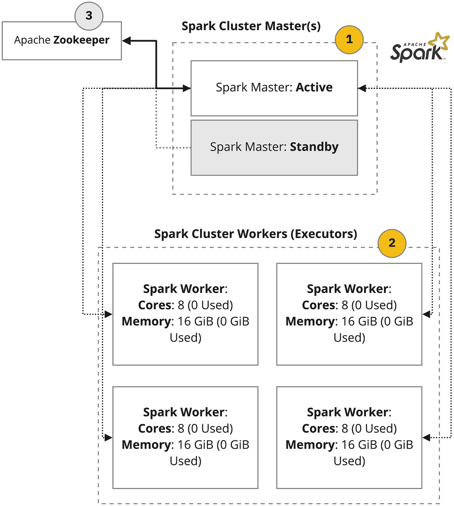

图 14-1 Spark Standalone 集群模式

图 14-1 中的集群图展示了一个六节点集群（不包括 ZooKeeper (`zk`) 集群，由于 Apache ZooKeeper 基于仲裁的架构，该集群需要至少三个节点来实现高可用，因此完全高可用大约需要九台服务器）。从 (1) 开始，两个 Spark 主节点正在监督（监视）集群。一个处于活动状态（视为主节点），而另一个则在备用模式（辅助节点）下等待，准备在当前活动（主）主节点离线时投入行动。 (2) 工作节点（又名执行器）显示在图 14-1 的底部。当工作节点服务上线并向 Spark 主节点注册时，该过程有效地增加了集群的总可用计算资源。集群可以随着工作节点的加入和离开而动态增长和收缩，使 Spark 集群能够处理网络问题，优化性能和成本，并使集群在其他故障中保持连续性。常见的操作，如推送更新、推出新服务或在集群中替换主机（服务器），对任何正在运行的应用程序都影响极小。

#### 故障转移过程

一旦当前活跃的主节点断开与 (3) ZooKeeper 的连接，备用主节点将接过接力棒，从被动状态切换到活动状态，以保持集群存活（故障转移到备用主节点通常需要 1-5 分钟，具体取决于您的网络和集群规模）。

> **警告**
>
> 值得指出的是，只有在故障转移事件发生后，集群才能保持高可用（`HA`），例如，当前活跃的主节点离线，Spark 将被动备用主节点提升为活跃节点。监控节点故障并自动化部署替换节点的过程，对于您所运维的集群的健康至关重要。

如果您确实丢失了集群状态，请不要惊慌。Spark 应用程序将继续运行，无需与集群协调器（主节点）通信，直到某个 Spark 应用程序需要获取新的执行器（在独立模式下，这些执行器运行在工作节点上）为止。这为您恢复集群赢得了时间。因此，如果您自己运行 Spark（并且没有为托管服务付费），请确保您和您的团队针对一个或两个主节点丢失的情况进行实验，并自动化保持集群在故障下持续运行的过程。

默认情况下，在独立集群模式下部署应用程序将允许第一个部署的应用程序消耗集群中的所有资源，除非配置了限制其使用的 CPU 核心和内存。正如您可能想象到的，单个应用程序独占所有集群资源可能会引发问题，但有一些现成的流程可以利用，以确保应用程序之间能够良好协作。这一切都始于应用程序的部署。

应用程序部署从将 Driver 应用程序提交到集群开始，在我们进一步深入之前，理解 Driver 应用程序如何以分布式方式运行非常重要。对于 Driver 应用程序，有两种主要的部署风格，由 `spark.submit.deployMode` 应用程序设置控制。

# 部署模式：客户端模式与集群模式

当部署 Spark Driver 应用时，`spark-submit` 配置提供了两种部署方式供选择。我们首先探讨*客户端*模式，然后再了解*集群*模式。

## 客户端模式

在客户端模式下部署 driver，本质上意味着 Driver 程序将在本地机器上*本地运行*，并向 Spark 主节点发出 `spark-submit` 命令。例如，清单 14-1 中的配置来自第 11 章，如果我们更改配置以指向一个活动的独立集群（`--master "spark://{master-hostname}:7077"`），实际上我们是向集群资源管理器声明：我们只希望分配执行器来分担应用工作负载，而 Driver 程序的资源分配我们已经自行处理好了。

```
docker run \
...
-it `whoami`/spark-kafka-coffee-orders:latest \
/opt/spark/bin/spark-submit \
--master "..." \
--class "com.coffeeco.data.SparkKafkaCoffeeOrdersApp" \
--deploy-mode "client" \
...
/opt/spark/app/spark-kafka-coffee-orders.jar
```

清单 14-1 以客户端模式部署 Spark 应用

图 14-2 展示了在客户端模式下，Driver 程序运行在集群外部，而执行器则被分配给该远程应用。

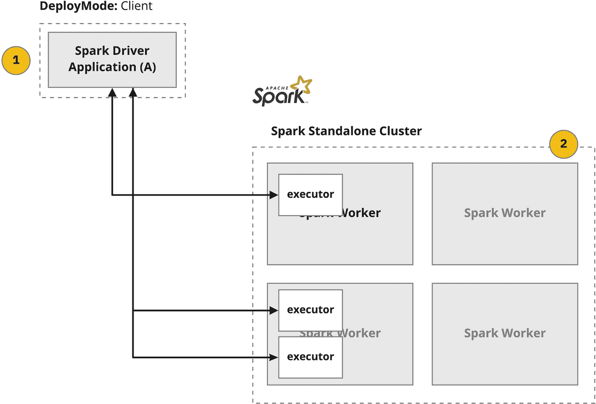

图 14-2 以客户端模式运行的 Spark Driver 应用

将 Driver 运行在 Spark 集群之外有许多原因。其中最主要的三点原因是：

- 保护您的 Spark 应用并将其与集群内“吵闹的邻居”或其他不良行为造成的干扰隔离开来。
- 通过限制对集群外部 driver 的访问，保护机密和凭证不被整个集群访问，这对于运行由众多不同团队生成、具有各种管道需求的工作负载的多租户共享集群至关重要。
- 提供一个已知的主机（端点），用于连接 driver 应用以查看 Spark UI 或生成监控指标。

## 集群模式

在集群模式下部署 Driver 程序，本质上意味着该应用将在 Spark 集群内部远程运行，并接受接收了传入 `spark-submit` 命令的 Spark 主节点的监管。例如，清单 14-2 中的配置是对清单 14-1 的修订。它替换了部署模式的值，同时指定了运行时资源（driver 和执行器）以及特殊的 `supervise` 标志。

```
docker run \
...
-it `whoami`/spark-kafka-coffee-orders:latest \
/opt/spark/bin/spark-submit \
--master "..." \
--class "com.coffeeco.data.SparkKafkaCoffeeOrdersApp" \
--deploy-mode "cluster" \
--driver-memory "2g" \
--executor-memory "4g" \
--total-executor-cores 4 \
--supervise \
...
/opt/spark/app/spark-kafka-coffee-orders.jar
```

清单 14-2 部署由集群管理的 Spark Driver 应用

如前所述，当向集群部署应用时，Driver 程序会*共同部署*在集群内部的某个 worker 上。图 14-3 展示了 Driver 应用如何与集群内其他程序共存，并占用所分配 worker 上可用总资源的一部分。

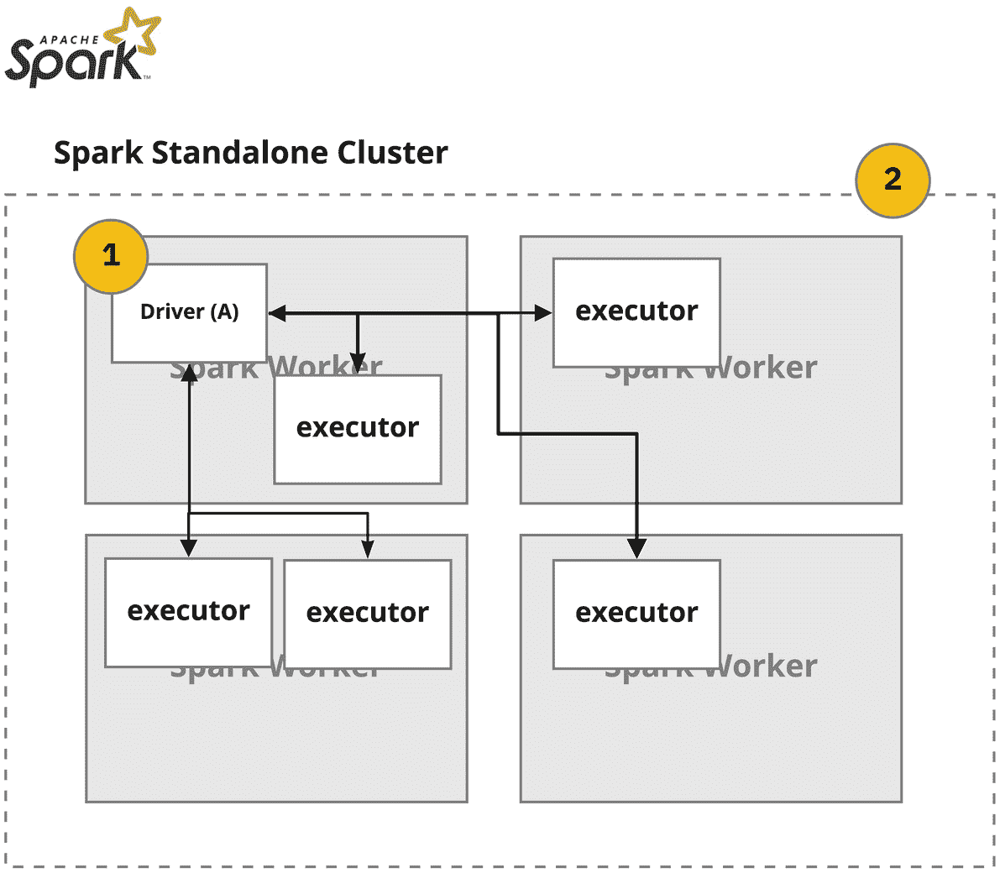

图 14-3 以集群模式运行的 Spark Driver 应用

考虑到在集群内运行的 Driver 应用的服务等级协议，了解每个共存应用在多租户集群中运行的开销是一个需要牢记的重要事实。如果没有资源来运行 Driver 程序（在发生故障后或因首次部署），那么 Driver 将处于 `Queued` 状态。

正如将 driver 程序运行在集群之外有好处一样，将 driver 运行在 Spark 集群内部也有其优势。本质上，通过消除在集群外部运行外部主机或额外进程的需求，您可以减少运营流式应用或管道基础设施所需的资源面积。此外，对于经过测试且成熟的 Spark 应用，使用 `--supervise` 标志的基于集群的监管，使得应用在崩溃后能够重新启动。

另一方面，如果 Spark 独立集群专用于一个共同的总体任务，例如处理 CoffeeCo 客户订单或合并商店交易和客户事件数据以创建窗口化分析流，那么可以启动集群来解决类似问题，复用已批准的访问权限（遵守数据治理规则和法规）、身份验证、授权以及共享数据访问。

两种部署策略（客户端模式和集群模式）各有利弊。它们允许您使用适合相应应用的 SLI、SLO 和 SLA 的策略。因此，理解如何在一个多租户环境中共享资源至关重要。现在，我们将探讨 Spark Driver 应用如何在独立集群中部署和分发。

## 多租户的分布式共享资源与资源调度

请将 Spark 独立集群视作一个分布式操作系统。您拥有总计的*核心数*（CPU）、总计的*内存量*（RAM），以及每个*节点*、worker（执行器）和 driver 上的磁盘空间，这些资源都在 Spark 进程（*pid*）、操作系统进程（也是 pid！）以及分布式集群中每台服务器上运行的任何其他服务之间共享。

> **提示**

> 使用 Linux 的 `top` 命令可以查看每个服务器上正在运行的进程及其消耗的资源。对于 Docker 的资源开销，可以使用 `docker stats` 命令查看运行中容器的 CPU、内存和网络消耗。

为什么这很重要？很高兴您问这个问题。本质上，您不能现实地期望使用集群中任何*节点*（*主节点、worker、driver*）上 100% 的资源，而不落得两手空空或在操作系统层或应用层面临资源受限的困境。*一条经验法则是至少为操作系统保留 1 个 CPU 核心和 1GB 内存*。您还必须权衡在 Apache Spark 范围之外运行的任何其他进程的成本，例如指标收集器、网络分析器等。一旦您了解了非 Spark 进程所需的开销，就可以配置 worker 的行为，使其友好共存，避免对特定服务器的资源过度贪婪。

### 控制资源分配、应用行为与调度

在多租户（共享）Apache Spark 集群中，可以通过表 14-1 中的 Spark 设置在部署时控制分配给每个运行中 Spark 应用的资源数量。

**表 14-1** 控制 Spark 应用的资源分配与调度方式

| 属性名称 | 默认值 | 功能说明 |
| --- | --- | --- |
| `spark.cores.max` | （未设置） | 限制应用在运行时最多可调度的总核数。若不设置，应用将占用所有可用核心。 |
| `spark.task.cpus` | `1` | 告知调度器 Spark 应用的真正需求。如果存在需要线程池或其他 I/O 的额外 CPU 密集型任务，可考虑将此值提升至 `2` 或更高（取决于每个任务的实际 CPU 消耗）。 |
| `spark.driver.cores` | `1` | 定义运行驱动程序所需的核心（物理 CPU）数量。如果应用通过调用 `collect()` 对 DataFrame/Dataset/RDD 进行最终加工，应设置更高的数值。 |
| `spark.executor.memory` | `1g` | 定义运行 Spark Executor 的 JVM 进程所分配内存的软限制。该值为执行器进程的分配量，在 Standalone 模式下并非硬性限制，即 JVM 可以动态分配更多内存。 |
| `spark.executor.cores` | `ALL` | 此设置需要重点关注，除非另行指定，否则 Spark 应用将占用所有可用核心。对于多租户场景，可以通过将该值设为 `1`、`2` 或 `N` 个核心来共享资源。 |

表 14-1 仅列出了在将应用部署到 Standalone 共享（多租户）Spark 集群时，需要仔细关注的部分重要配置项。

请记住，结构化流式应用是 7x24 小时不间断运行的，因此为每个应用设置资源限制变得至关重要，因为每个应用在其驱动程序启动时就会分配并持有所声明的资源。这意味着，如果应用以静态分配模式运行，总核心数（物理 CPU）和内存（JVM 分配的堆空间）将在启动时一次性被占用。

例如，图 14-4 展示了一个新的 Spark 驱动程序向集群请求资源的流程。这里有四个节点，每个节点都运行着一个 Spark Worker 进程。每个 Worker 拥有 8 个核心和 16 GB 内存，这意味着整个集群共有 32 个核心和 64 GB 内存可供一个或多个 Spark 驱动程序分配。假设 Spark 应用 (A) 的配置如下：

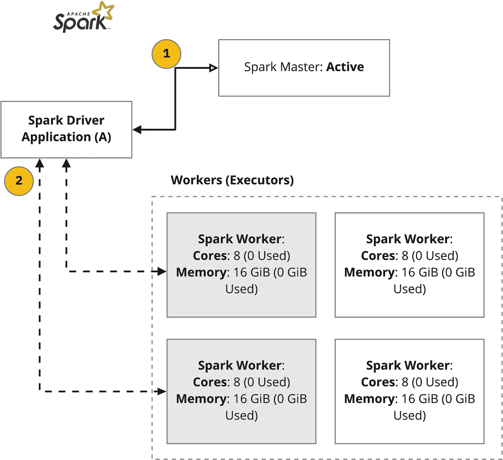

**图 14-4** 新 Spark 应用部署到集群时的协商流程图

# Spark 集群配置与弹性伸缩

```
spark.cores.max: 16
spark.executor.cores: 8
spark.executor.memory: 16gb
```

那么驱动程序将被分配两个执行器实例（JVM），这两个实例将完全占用四个可用 Worker 节点中的两个。换言之，该配置的意思是：“我想要占用整整两个 Worker。”

图 14-4 中的事件序列展示了 Spark 应用部署到集群的过程。它首先与 (1) *活动主节点* 协商，根据应用设置（或集群默认设置）中关于运行分布式工作负载所需的总资源（核心/内存）来 (2) *分配执行器*。在此示例中，我们设置了 16 个总核心的限制，指示集群资源管理器（Standalone 模式下的活动主节点）为该应用分配四个 Worker 中的两个。至此，Spark 集群的 50% 被分配出去，另外 50% 为空闲。一旦执行器通过 `SparkContext` 分配给 Spark 驱动程序，驱动程序就不再需要与主节点通信，除非有执行器丢失（服务器宕机或 JVM 因内存不足而退出），或者启用了 `spark.dynamic.allocation` 并且应用向集群请求或归还资源。

这也意味着，当前集群设置可以轻松处理已分配执行器中断（例如两个 Worker 同时离线）的故障场景。驱动程序 (A) 只需向资源管理器（Spark 活动主节点）请求新的执行器即可——鉴于集群中还有两个完全空闲的 Worker，这个请求是可以被处理的。

我们再看图 14-5 中的例子，该图展示了第二个 Spark 应用加入共享集群的过程。为举例说明，第二个应用将采用以下部署设置。

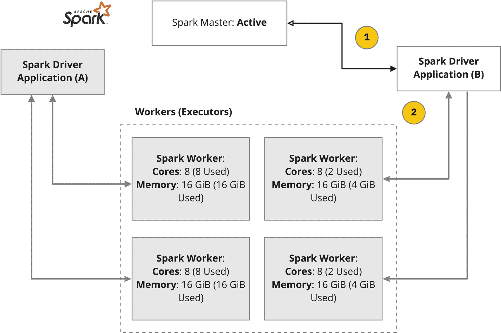

**图 14-5** 共享集群上的 Spark 驱动程序多租户部署

```
spark.cores.max: 4
spark.executor.cores: 2
spark.executor.memory: 4gb
```

第二个驱动程序将向集群中剩余的两个 Worker（它们还有可供调度的资源）请求资源。至此，所有 Worker 都被安排了执行器。好处是资源浪费更少（因为没有核心或内存被闲置），且集群中运行着不止一个应用；但另一方面，如果此时丢失一个 Worker，会发生什么呢？

在图 14-5 的场景中，如果集群丢失一个 Worker，结果取决于丢失的是哪一个。这里有两种情况。第一种，驱动程序 (B) 会完全运行在一个 Worker 上，因为每个执行器配置了 2 个核心和 4GB 内存。为了继续运行，新的分配将被执行，工作负载转移到另一个有空闲资源的 Worker 上，也就是应用 (B) 已有执行器正在运行的那个 Worker。

第二种情况，如果驱动程序 (A) 丢失了一个 Worker，那么其配置文件所需的所有核心或内存（8 核心 x 16GB 内存）就无法在集群中得到满足。这将导致应用 (A) 以降级状态运行，但至少它仍在运行。

谈到计算资源的调度，一个很好的经验法则是为集群预留一些扩展空间。你可以通过以下方式实现：当集群资源调度超过 75% 时添加新节点；采用自动扩缩组或基于云的规则（如 Amazon Elastic Kubernetes Service 中的托管节点组）；或者更改执行器设置，使每个执行器能够适应不同的配置。例如，将配置改为 4 核 x 8GB，同时保持 16 个最大核心数不变，这样驱动程序 (A) 就会分布在更多 JVM 上，从而在丢失一个 Worker 时仍能正常运行，而不会进入降级状态。

只要有足够的资源来应对故障或扩展，动态分配过程就能实现更具弹性的伸缩。接下来，你将学习如何控制这个过程。

### 注意

下一章将介绍 Kubernetes (k8s) 资源管理器，并学习如何以弹性可伸缩的方式启动 Spark 应用，这同样会用到动态分配。动态分配过程为 Spark 应用程序提供了一种协议，用于根据当前处理的数据量的起伏来请求或归还额外的资源。

## 使用动态资源分配弹性伸缩 Spark 应用

Spark 应用的处理需求会动态变化，这些需求由执行器级别的资源（`cores`/`memory`/`GPUs`）组成，并会随应用生命周期而改变。为了管理并行运行的众多应用的不同需求，动态分配允许每个 Spark 应用选择启用该功能，并定义适当的设置来控制如何释放和重新分配额外资源。表 14-2 列出了常见的 Spark 配置。

**表 14-2.** 使用动态分配为 Spark 应用启用弹性伸缩

| 属性名称 | 默认值 | 功能说明 |
| --- | --- | --- |
| `spark.dynamicAllocation.enabled` | `false` | 按条件选择是否启用动态资源分配。 |
| `spark.shuffle.service.enabled` | `false` | 要将执行器释放回 Spark 集群，Spark Worker 必须运行*外部 shuffle 服务*，这是动态分配的前提条件。即使执行器仍持有 Spark 应用所需的部分 shuffle（数据），此服务也允许将其释放。 |
| `spark.dynamicAllocation.minExecutors` | `0` | 建议将此值设置为 `1` 或更高，以确保您的应用在等待可用 Worker 分配资源时不会因资源匮乏而停滞。 |
| `spark.dynamicAllocation.maxExecutors` | `INF` | 设置此值可以阻止应用请求集群中所有（可用的）执行器。 |
| `spark.dynamicAllocation.schedulerBacklogTimeout` | `1s` | 当有任务挂起时，驱动程序将等待此时间长度，之后才向主节点请求新的执行器。 |

动态分配实现了对弹性伸缩工作负载的自动化管理，能够根据需求按需从集群请求和归还资源。根据作业（或应用）的优先级或预期表现，动态分配可以有效地管理跨共享计算集群运行多个共置（多租户）工作负载的成本。然而，在启用动态分配时，需要考虑每个应用的不同（动态）需求以及工作负载的优先级，因为很容易出现许多应用处于空闲等待状态，等待集群资源变得可用的情况。

对于 Spark Structured Streaming 应用，每个微批次往往以更频繁的方式处理更少量的数据，这与典型的基于大批次、一次性读取并处理大量数据的应用行为不同。是的，您也可以运行使用 `Trigger.Once` 的有状态批处理作业，但这需要仔细考虑应用的语义以及与应用性质相关的服务等级协议或优先级。

鉴于 Structured Streaming 应用始终在线的特性，动态分配和外部 shuffle 服务有时会干扰并损害您关键任务型流式应用的性能。有时，唯一阻碍应用以最高速度运行的是内部应用调度器，它控制着 Spark Driver 应用内运行的内部（作业）的并行度和处理模式。

## 调度模式：FIFO 对比 FAIR

默认情况下，Spark 应用以 *FIFO*（先进先出）调度模式运行。由于 Spark Structured Streaming 应用采用分而治之的策略处理一个或多个数据源的连续（无界）流，这些流通过微批处理范式（产生确定性、容错的数据集）被分块和分解，因此 Spark Driver 应用会努力确保每个微批次内的每个转换阶段，即由 `StreamingQuery`（例如 `spark.readStream...writeStream.start()`）定义的阶段，能够基于定义流式应用任务的 `QueryPlan` 获得优先级。

那么，如果一个应用有多个 `StreamingQuery` 呢？在上一章中，您了解了 `SparkStructuedStreamingApplication` trait，它包含了以下两个方法：`awaitTermination` 和 `awaitAnyTermination`。

```scala
def awaitTermination(query: StreamingQuery): Unit = {
  query.awaitTermination()
}
def awaitAnyTermination(): Unit = {
  sparkSession.streams.awaitAnyTermination()
}
```

在一个基本的 Spark Structured Streaming 应用中，通常只有一个上游源和一个下游汇。因此，对主 `StreamingQuery` 调用 `awaitTermination` 将使 Spark Driver 应用保持运行，直到该 `StreamingQuery` 终止。对于 `FIFO` 模式调度器来说，这种单一应用关注点是完全没问题的，因为只有一个主要关注点。

然而，一旦您决定在方程式中引入第二个流式查询，您在每个微批次中就需要排队等待资源，这似乎不太公平，不是吗？

幸运的是，Spark 内置了一个 `FAIR` 调度器。这种执行模式允许并行共享资源。这使得单个 Spark 应用内的总资源分配更加均衡。

### `FAIR` 模式调度器

您可以通过在驱动程序应用配置中设置调度器模式来选择使用 `FAIR` 调度器。

```
spark.scheduler.mode=FAIR
```

除了设置调度器模式之外，Spark 还要求您的应用使用分配文件定义一个或多个调度器池。

```
spark.scheduler.allocation.file="s3a:///path/to/fair-scheduler.xml"
```

调度器分配文件是一个简单的 XML 文件，用于定义一个或多个命名池，并为相应的池定义 `schedulingMode`、`weight` 和 `minShare` 选项。

- **`schedulingMode`**: 此选项默认为 `FIFO`，但也可以设置为 `FAIR`。`FIFO` 会优先处理池中第一个被调度的工作负载，让额外的工作在队列中堆积。`FAIR` 会将工作均匀地分配到池资源中。

- **`weight`**: 池权重声明了在特定池上进行调度的优先级。此优先级默认为 `1`，可以设置得更高以创建用于调度的优先级池（类似于优先级队列）。

- **`minShare`**: 设置给定池的核心分配数量。调度器将首先尝试分配预定义数量的核心，以确保每个池在将任何额外的 CPU 核心资源分配到其余已定义的池之前，都拥有其应有的核心数量。

```xml
<allocations>
  <pool name="FAIR">
    <schedulingMode>FAIR</schedulingMode>
    <weight>2</weight>
    <minShare>2</minShare>
  </pool>
  <pool name="FIFO">
    <schedulingMode>FIFO</schedulingMode>
    <weight>1</weight>
    <minShare>1</minShare>
  </pool>
</allocations>
```

`代码清单 14-3.` `fair-scheduler.xml` 分配文件示例

代码清单 14-3 中的示例配置旨在进一步定义调度模式在各调度器池中的工作方式。由于驱动程序应用使用 `SparkContext` 调度工作，`FAIR` 调度器可用于修改每个 `SparkSession`（重用同一 Spark 上下文）的行为，以管理和共享为 Spark 应用分配的公共集群资源池。

# Spark 调度器池与应用程序监控

默认情况下，当`spark.scheduler.mode`设置为`FAIR`时，Spark会将所有工作分配到default池。通过修改默认池配置，我们可以调整调度权重以优先处理默认（`FAIR`）池，或者划分不同的池用于在`FIFO`或`FAIR`模式下运行低优先级工作负载。利用`fair-scheduler.xml`文件，您可以确保高优先级工作以公平（FAIR）方式进行调度。

如果存在低优先级工作，或者处于共享环境（如Zeppelin）中可能有多个并发会话时，您可以指定一个特定池专门用于低优先级工作。清单14-4中的示例展示了如何从现有的`SparkSession`生成一个临时任务。

```
// spark = SparkSession
new Thread {
val other: SparkSession = spark.newSession()
other.sparkContext.setLocalProperty(
"spark.scheduler.pool", "queued")
other.sparkContext.setJobGroup("batch.job", "runs in thread", true)
other.range(100)
.write
.format("console")
.save()
}
```
**清单 14-4** 为非关键、锦上添花的任务设置低优先级调度器池

您可能会疑惑为什么要在新线程中生成一个新会话。嗯，答案其实很简单。在`SparkContext`上设置本地属性（`setLocalProperty`）的线程将使用分配给它的调度器池。如果我们在主线程（当前线程）上运行一个`StreamingQuery`，那么我们就需要划分出第二个线程来运行非关键工作。

建议在阅读完“Spark监听器”部分后，重新审视此边栏。您可以使用`SparkApplicationListener`或`QueryListener`中提供的`SparkSession`来创建和调度临时查询，如清单14-4所示。鉴于Apache Spark及其众多连接器赋予您的丰富能力，您可以利用临时流程来创建响应式应用程序或控制事件驱动的子程序。

对每个正在运行的Spark应用程序进行某种形式的监控和可观测性至关重要。如果不了解过去的情况，就很难衡量应用程序在构建和发布周期中的变化。希望您能在将应用程序首次发布到生产环境（如果它们是关键任务）之前，就开始捕获其指标。就此而言，有大量可用的（开箱即用的）指标可用于测量、记录和监控Spark应用程序的性能与行为。您将了解两种更常见的Spark监听器接口（`SparkListener`、`QueryListener`）以及`Apache Spark REST端点`提供的指标。结合这些能力，可以监控Spark应用程序的行为，并实现响应式的事件驱动警报。

## Spark 监听器与应用程序监控

关于先有鸡还是先有蛋的争论由来已久。我无法回答这个问题，但监控Spark应用程序以及定义哪些指标对于衡量关键任务Spark应用程序的性能至关重要，这本身就是一门微妙的艺术。为每个应用程序确定关键绩效指标（KPI）会根据Spark应用程序数据合同中定义的`服务水平指标（SLIs）、服务等级目标（SLOs）和服务等级协议（SLAs）`而变化。这些指标有助于定义和塑造每个应用程序的性能特征，并让您了解预期的行为（什么是正常的）。考虑到潜在的大型应用程序表面积以及各个组成部分，包括上游（数据源）和下游（数据接收器），最初可能很难回答关于指标的问题，但将其分解成组、识别所需的数据来源，然后逐步推进会有所帮助。

从广义上讲，监控不仅关乎了解服务的运行方式，同样重要的是能够准确定位系统中出现问题的位置，并在发生故障时缩短平均恢复时间（MTTR），或者仅仅是为了更好地了解应用程序以确保其最佳行为。

监控也有助于指导其他决策。如果这是您的第一次监控尝试，了解我们可以开箱即用地监控哪些内容也会有所帮助，尤其是在Spark方面。这要从监听开始。

### Spark 监听器

`SparkListener`类可以通过`SparkSession`的`SparkContext`对象添加到您的驱动程序应用程序中，或者通过应用程序配置使用`spark.extraListeners`选项进行添加。

```
// spark = SparkSession
spark.sparkContext
.addSparkListener(SparkApplicationListener())
```

`SparkListener`是用于接入运行时应用程序指标和Spark应用程序一般行为的主要候选者。此外，如果您需要对运行中的问题采取更具响应性的方法，监听器可以作为创建临时事件驱动控件的起点。

清单14-5通过一个名为`SparkApplicationListener`的案例类扩展了`SparkListener`类。

```scala
case class SparkApplicationListener()
extends SparkListener {
val logger: Logger = Logger.getLogger(classOf[SparkApplicationListener])
val session: SparkSession = SparkSession.getDefaultSession.getOrElse {
throw new RuntimeException("There is no SparkSession")
}
override def onApplicationStart(applicationStart: SparkListenerApplicationStart): Unit = {
super.onApplicationStart(applicationStart)
logger.info(s"app.start app.name=${applicationStart.appName}")
}
override def onJobStart(jobStart: SparkListenerJobStart): Unit = {
super.onJobStart(jobStart)
logger.info(s"job.start jobId=${jobStart.jobId} jobStart.time=${jobStart.time}")
}
override def onStageSubmitted(stageSubmitted: SparkListenerStageSubmitted): Unit = {
super.onStageSubmitted(stageSubmitted)
val stageInfo: StageInfo = stageSubmitted.stageInfo
logger.info(s"stage.submitted stage.id=${stageInfo.stageId}")
}
override def onStageExecutorMetrics(executorMetrics: SparkListenerStageExecutorMetrics): Unit = {
super.onStageExecutorMetrics(executorMetrics)
val em: SparkListenerStageExecutorMetrics = executorMetrics
logger.info(s"stage.executor.metrics stageId=${em.stageId} stage.attempt.id=${em.stageAttemptId} exec.id=${em.execId}")
}
override def onTaskStart(taskStart: SparkListenerTaskStart): Unit = {
super.onTaskStart(taskStart)
val ts = taskStart
val taskInfo: TaskInfo = ts.taskInfo
// taskInfo 包含丰富的状态和时序信息
logger.info(s"task.start " +
s"task.id=${taskInfo.taskId} task.status=${taskInfo.status} task.attempt.number=${taskInfo.attemptNumber} " +
s"stage.id=${ts.stageId} stage.attempt.id=${ts.stageAttemptId}"
)
}
override def onTaskGettingResult(taskGettingResult: SparkListenerTaskGettingResult): Unit = {
super.onTaskGettingResult(taskGettingResult)
logger.info(s"task.getting.result ${taskGettingResult.taskInfo.taskId}")
}
override def onTaskEnd(taskEnd: SparkListenerTaskEnd): Unit = {
super.onTaskEnd(taskEnd)
val te = taskEnd
val taskInfo: TaskInfo = te.taskInfo
val taskEndReason: TaskEndReason = te.reason
val taskMetrics: TaskMetrics = te.taskMetrics
logger.info(s"task.end task.type=${taskEnd.taskType} end.reason=${taskEndReason.toString} task.id=${taskInfo.taskId}" +
s"executor.cpu.time=${taskMetrics.executorCpuTime}")
}
override def onStageCompleted(stageCompleted: SparkListenerStageCompleted): Unit = {
super.onStageCompleted(stageCompleted)
val stc = stageCompleted
val stageInfo: StageInfo = stc.stageInfo
//val stm: TaskMetrics = stageInfo.taskMetrics
logger.info(s"stage.completed stage.id=${stageInfo.stageId} stage.completion.time=${stageInfo.completionTime.getOrElse(0)}")
}
override def onJobEnd(jobEnd: SparkListenerJobEnd): Unit = {
super.onJobEnd(jobEnd)
logger.info(s"job.end job.id=${jobEnd.jobId} end.time=${jobEnd.time}")
}
override def onExecutorAdded(executorAdded: SparkListenerExecutorAdded): Unit = {
super.onExecutorAdded(executorAdded)
}
override def onExecutorMetricsUpdate(executorMetricsUpdate: SparkListenerExecutorMetricsUpdate): Unit = {
super.onExecutorMetricsUpdate(executorMetricsUpdate)
}
override def onExecutorRemoved(executorRemoved: SparkListenerExecutorRemoved): Unit = {
super.onExecutorRemoved(executorRemoved)
}
override def onEnvironmentUpdate(environmentUpdate: SparkListenerEnvironmentUpdate): Unit = {
super.onEnvironmentUpdate(environmentUpdate)
}
override def onOtherEvent(event: SparkListenerEvent): Unit = {
super.onOtherEvent(event)
}
override def onApplicationEnd(applicationEnd: SparkListenerApplicationEnd): Unit = {
super.onApplicationEnd(applicationEnd)
logger.info(s"application.ended end.time=${applicationEnd.time}")
}
}
```

## 列表 14-5 `SparkApplicationListener` 案例类

列表 14-5 中的案例类继承了 `SparkListener`，为进一步探索指标提供了一个简单的切入点。事件的顺序很重要。每个作业启动并产生一个或多个阶段，这些阶段将任务分发给分配给应用程序的执行器。能够跟踪失败任务或失败阶段的比率，可以使你从高层次上深入了解应用程序的运行时行为。

举个具体的例子，你可以直接在 Spark 单元测试中观察 `SparkApplicationListener`，以查看应用程序运行时生成的事件。尝试启用位于 `TypedRevenueAggregatesSpec`（来自第 13 章）中的监听器。只需取消注释该行并运行应用程序单元测试，即可观察实际效果。

# Spark监听器使用说明

```scala
val testSession = SparkTypedStatefulAggregationsApp
.sparkSession
.newSession()
testSession.sparkContext
.addSparkListener(SparkApplicationListener())
```

`SparkListener` 可用于通过 [`stats.d`](https://github.com/statsd/statsd) 发布指标。结合你内部的指标系统，或使用 [DataDog](https://www.datadoghq.com/) 等付费服务，你可以存储与应用程序运行时相关的重要指标。

**提示**：应用程序指标可通过 Spark 应用程序驱动程序上的 metrics REST API 从 `Driver` 应用程序 UI（默认端口 4040）获取。请使用官方“Spark 监控”文档，查看可用于通过驱动程序和独立主进程消费指标的各种 API。

除了主要的 `SparkListener` 之外，还有一个有用的类可用于向应用程序添加控制流，称为 `StreamingQueryListener`。

### 使用 `StreamingQueryListener` 观察结构化流行为

`StreamingQueryListener` 用于观察 `SparkSession.streams` 对象，可以接入驱动程序管理的所有 `StreamingQuery` 实例。该监听器追踪的三种可观察状态分别对应所有流查询的 `started`（启动）、`progress`（微批次完成）和 `termination`（终止）事件。

代码清单 14-6 继承了 `StreamingQueryListener`，并提供了示例方法实现、监听器接口方法名称以及事件对象。为帮助您入门，它演示了如何接入部分事件元数据以增强日志记录。

```scala
case class QueryListener() extends StreamingQueryListener {
  val logger: Logger = Logger.getLogger(classOf[QueryListener])
  val session: SparkSession = SparkSession.getDefaultSession.getOrElse {
    throw new RuntimeException("没有可用的 SparkSession")
  }
  override def onQueryStarted(event: StreamingQueryListener.QueryStartedEvent): Unit = {
    logger.info(s"query.started stream.id=${event.id} stream.name=${event.name} " +
      s"stream.run.id=${event.runId} stream.start.time=${event.timestamp}")
  }
  override def onQueryProgress(event: StreamingQueryListener.QueryProgressEvent): Unit = {
    val queryProgress: StreamingQueryProgress = event.progress
    val batchId = queryProgress.batchId
    val batchDuration = queryProgress.batchDuration
    val inputRowsRate = queryProgress.inputRowsPerSecond
    val processedRowsRate = queryProgress.processedRowsPerSecond
    val outputRowsPerBatch = queryProgress.sink.numOutputRows
    val progressSummary = queryProgress.prettyJson
    logger.info(s"query.progress stream.id=${queryProgress.id} stream.name=${queryProgress.name} " +
      s" batch.id=$batchId batch.duration=$batchDuration" +
      s" rate: input.rows.per.second=$inputRowsRate processed.rows.per.second=$processedRowsRate " +
      s" sink.output.rows.per.batch=$outputRowsPerBatch " +
      s"\n progressSummary=$progressSummary")
  }
  override def onQueryTerminated(event: StreamingQueryListener.QueryTerminatedEvent): Unit = {
    if (event.exception.nonEmpty) {
      logger.error(s"query.terminated.with.exception exception=${event.exception.get}")
      // 决定后续操作
    } else {
      logger.info(s"query.terminated stream.id=${event.id} stream.run.id=${event.runId}")
    }
  }
}
```

代码清单 14-6
`StreamingQueryListener` 使您能够观察结构化流应用程序的运行时行为

`QueryListener` 类可用于监控任何结构化流应用程序。与 `SparkApplicationListener` 类似，您可以使用第 13 章的 `TypedRevenueAggregatesSpec` 来测试 `QueryListener`。

```scala
testSession.streams.addListener(QueryListener())
```

现在您有了直接设置断点并插入创造性控制流的方法，以应对各种进度或终止事件。通过采用测试驱动的方法来理解 `QueryListener` 的能力，您可以在 IDE 中轻松创建更好的测试来驱动意外行为。

最终，查询观察是一项有助于确保应用程序持续按预期运行的功能。通过扩展监听器，您可以收集重要的流式指标（输入和处理速率），从而了解应用程序的运行状况。

最后请注意，代码清单 14-5 中的 `SparkApplicationListener` 和代码清单 14-6 中的 `QueryListener` 都直接运行在 Spark Driver 上。了解这一点后，您可以在应用程序出现异常时，编写连接到 Slack 或 [PagerDuty](https://www.pagerduty.com/) 的钩子，或者利用 `SparkSession` 句柄（两个示例监听器类中都可用）来触发基于事件的子程序。例如，使用 `QueryListener`，您可以根据活动查询进程的原因（异常）主动停止所有正在运行的查询并优雅地关闭故障驱动程序。代码清单 14-7 展示了 `QueryListener` 的钩子，让您了解如何接入事件来控制应用程序。终止 `StreamingQuery` 的异常可能是可恢复的。否则，您可能需要关闭应用程序。

```scala
// QueryListener
def resetTerminated(): Unit = {
  session.streams.resetTerminated()
}
def haltAllStreams(): Unit = {
  session.streams.active.foreach { query =>
    logger.info(s"stream.stop name=${query.name} stream.id=${query.id}")
    query.stop()
  }
}
def shutdown(): Unit = {
  haltAllStreams()
  session.sparkContext.cancelAllJobs()
  session.stop()
}
override def onQueryTerminated(event: StreamingQueryListener.QueryTerminatedEvent): Unit = {
  if (event.exception.nonEmpty) {
    logger.error(s"query.terminated.with.exception exception=${event.exception.get}")
    if (exception.is.recoverable) {
      resetTerminated()
    } else {
      shutdown()
    }
  }
}
```

代码清单 14-7
使用 `QueryListener` 响应 `StreamingQuery` 中接收到的异常

## 代码清单 14-7 接入 `StreamingQueryManager` 和 `SparkContext`，以重置任何已终止的流或停止任何额外的流查询。然后显式调用取消所有活动作业（给打开的和活动的作业时间优雅地停止和清理）。代码最后要求驱动程序应用优雅关闭。选择何时停止应用程序，对于保护下游应用程序免受损坏数据或其他未知因素的影响至关重要。当遇到不可恢复的异常时，通常更好的做法是让应用程序失败并通知应用程序所有者，因为知道这（可能并且很可能会）在短期内导致流量阻塞，但这可以保护任何下游系统免受运行中数据问题的影响。

有许多策略可以确保应用程序无论环境如何变化都能持续运行。了解让应用程序保持稳定的正确模式需要耐心和实践，但有了合适的工具，就可以更容易地实现自动化恢复，并直接在应用程序中广播需要知晓的事件（在它们崩溃之前）。

### 监控模式

连接到指标聚合器（如 [Prometheus](https://prometheus.io/) 或 [DataDog](https://www.datadoghq.com/)）的连接器可以整合到您的 Spark 监听器中，从而创建由驱动程序发出的可观测性中心点。这比监控和观察所有执行器更好，因为异常信息和执行器指标最终会传回驱动程序，然后可以通过 `SparkApplicationListener` 接入。

您的应用程序发出的指标——通过 Spark 监听器接口或 Spark 内部收集并通过 JMX 或 REST 接口提供的指标——可用于驱动仪表盘和其他警报系统。此外，一旦操作指标开始流动，您就可以使用应用程序的历史指标来确保它们在新版本发布到生产环境后仍能保持同样好或更好的性能。这些先前的观察（历史指标）有助于确保对每个应用程序的更新和升级（例如错误修复或性能调优的结果）可以被监控和衡量，从而保持您的 SLA、SLO 和 SLI 处于受控状态。

### Spark 独立集群与应用迁移策略

互联网上充满了最佳实践和建议。在 Spark 独立集群上运行多租户应用程序时，最好制定一个迁移应用程序和集群组件的策略，以最大程度地减少停机时间。

### 反模式：心存侥幸

部署和滚动（按比例替换）服务器集群的工具已经存在一段时间了。其中一种很快失效的模式是针对 Spark Worker 的“滚动并祈祷”方法。如果您正在运行结构化流式处理应用程序，您将不断中断正在运行的驱动器应用程序，而应用程序可以处理间歇性暂停、请求新的执行器、分配以及重建任何丢失的应用程序状态。持续中断的过程，例如每五分钟滚动 5% 的 Worker，可能会侵蚀服务等级协议（SLA）。当机器上线或下线时，应用程序中断可以自然处理，但通常更好的方法是启动一个替代的 Spark Standalone 集群并迁移应用程序（具体取决于延迟和您的工具）。

### 最佳实践

1.  创建一个新集群。

2.  将现有应用程序迁移到新集群（根据 SLA 从优先级最低的应用程序开始反向启动）。

3.  关闭之前的集群（如果您不再需要计算资源：走向绿色）。

这是一份最佳实践清单，因为 Spark 应用程序及其运行的集群会进行更新，以处理新版本的 Apache Spark、Java、Scala 以及其他 Python 或系统依赖项，同时修补应用程序配置或 Master、Worker 和 Driver 上的全局设置。最好了解这些更改如何影响性能，因此，在您对此过程感到得心应手之前，请使用“矿井中的金丝雀”技巧，优先迁移最低公共分母（风险最低）的应用程序。

接下来，您将了解可用于监控 Spark 应用程序性能和行为的事件监听器。

### 关于容器和 Spark Standalone

Spark Standalone 可以使用容器运行，但这超出了本书的涵盖范围。本质上，您可以使用来自第 11 章中运行 Kafka 集群的 Zookeeper 容器（应已缓存）。然后，您必须修改 Spark Master 和 Worker 的环境变量（`spark-env.sh`），为每个组件分配一个唯一的主机名（例如 `spark-master1`、`spark-master2`、`spark-worker1`、`spark-worker2`、`spark-worker3`），或者重用 Docker 网络（`mde`），或者创建一个名为 `spark` 的新网络。这将实现 Spark 集群组件与 Spark Driver 应用程序之间的跨集群通信。

Apache Spark 官方文档涵盖了“为网络安全配置端口”，可用于查看端口需求以配置防火墙规则。例如，Spark Driver 应用程序需要对 7077 端口的 Spark Master 进行入站访问，以提交（部署）应用程序。Spark Master 还暴露了一个可选的基于 REST 的服务，该服务在端口 6066 上运行，可用于接受在集群中运行的远程作业。对于 Spark Master，其用户界面（UI）默认在端口 8080 上运行；Spark Worker 在端口 8081 上公开 UI；每个 Driver 应用程序在端口 4040 上运行一个 UI。Driver 端口可以通过设置 `spark.ui.enabled: false` 来关闭，以节省 Driver 的处理开销，或限制用户访问应用程序日志的方式。

## 托管 Spark

本章讨论了用于构建 Spark 集群以及接入 Apache Spark 应用程序操作指标的架构组件和 Spark 类。您可能想知道为什么没有讨论使用 [Apache Spark on Amazon EMR](https://aws.amazon.com/emr/features/spark/) 或 [Databricks](https://databricks.com/) 来简化运行 Spark 应用程序的过程，从而避免所有麻烦。使用任一平台都可以大大减少启动和运行所需的工作量，应在您的短期和长期业务规划中予以考虑。本书采用开源方法（从各方面来看）作为揭开其神秘面纱的一种方式。目标是让任何人都能免费了解 Spark 并学习现代数据平台的支柱（不包括笔记本电脑和书籍）。

## 总结

Spark Standalone 集群更常见的是使用传统的 Linux 部署和 DevOps 模式来运行，包括用于创建和布局文件系统的引导脚本，以及使用 Yum 和 Apt-Get 等 Linux 包管理器来搭建运行时环境。在没有明确划分应用程序进程、CPU 分配和内存限制（又名 cgroups）的情况下运行多租户服务器环境各有利弊——主要是您可以绕过容器，依靠传统的 RPM 包来管理运行时安装的内容。

根据您平台支持的应用程序的要求，通常存在一些叠加挑战，与运行多个版本的 Java（支持 Java 8 和 Java 11）、多个版本的 Scala（2.12、2.13）、处理 PySpark 的原生需求，或者在无容器环境下调试性能下降时哪个进程是罪魁祸首有关。

最后一点，虽然在同一台机器上支持多个版本的 Spark 也是可能的，但这可能是一场管理噩梦。更简单的做法是使用将在集群中运行的工作负载的共同依赖项运行一个 Standalone 集群，并根据性能特征和可伸缩性（扇出、扇入）需求，为将在集群中运行的工作负载划分出隔离的集群。如果这听起来需要很多工作，确实可能如此，但您也可以使用 [Chef](https://chef.io/) 或 [Terraform](https://www.terraform.io/) 等框架自动化许多细微差别。

考虑到本书主要采用容器驱动的方法编写，并且考虑到容器从操作角度提供了延续到 Spark 运行时的一致性和可靠性，我们旅程的终点最有可能是将 Spark 应用程序部署到 Kubernetes 上。（实际上，您从第 7 章开始构建的应用程序都可以使用 Spark on Kubernetes 运行。）我们将在剩下的时间里学习如何在 Kubernetes 上运行关键任务应用程序。

# 15. 在 Kubernetes 上部署关键任务型 Spark 应用

在深入探讨什么是 `Kubernetes` (K8s) 以及 `Apache Spark` 如何融入分布式 K8s 生态系统之前，有必要先简单明确一点：`Kubernetes` 使得 `Apache Spark` 应用能够在隔离环境中运行，它将弹性可扩展性与容器的运行时一致性相结合，共同部署在称为 `pods`（你很快就会了解）的独立微环境中。最终，你可以依赖一致的运行时环境，而无需处理在共享一切生态系统中多租户带来的烦恼和诸多困难。相反，可以想象每个应用程序都在自己独立的世界中运行，从高层次上看，这类似于你使用 `docker-compose` 在本书一直在构建的本地数据平台上运行 Spark 应用所使用的本地环境。

细节中常常隐藏着魔鬼，但许多源于在生产集群中运行 `Apache Spark` 应用的常见痛点（我们在上一章中看到过），例如集群范围内资源竞争的问题、大型多租户集群的（向上或向下）扩展问题，或者从更高层面看，甚至运行一个或多个物理 Spark 集群的问题，都简单消失了。取而代之的是，每个 Spark 应用都被部署并自动连接，即搭建（并运行）其完全独立的 Spark 集群（按需），这些集群由编排在支撑你 `Kubernetes` 集群的物理节点之上的 `pods` 组成。通过移除运行独立集群和管理其中运行的应用所需的众多活动部件，你可以转而关注每个应用的独立需求，并将其余部分通用化。

`Kubernetes`，在 `Apache Spark Kubernetes 资源管理器` 的支持下，为你的关键任务型 Spark 应用提供动力。

在本章中，你将学习如何在 Kubernetes 上部署 Spark 应用。此外，你还将看到如何利用 K8s 部署提供的固有幂等性，并结合资源请求与限制（例如 CPU 和内存分配）。你还将学习 Spark 的动态分配如何发挥作用，为你自组装的 `Apache Spark` 应用增添超能力。到本章结束时，你将亲眼目睹 `Apache Spark` on Kubernetes 如何协同工作以满足任何数据平台的各种需求，以及 Kubernetes 如何融入现代数据生态系统。让我们开始吧。

## Kubernetes 入门

用他们自己的话说，“Kubernetes 是一个用于自动化部署、扩展和管理生产级容器化应用的开源系统。”简而言之，Kubernetes 是一个可靠的编排框架，它提供分布式计算和资源调度即服务，建立在隔离性、一致性和可靠性这些首要原则之上。它还恰好拥有丰富的 API，在规模化运营应用和服务时，可以利用这些 API 实现更智能的决策和灵活性。

本书在教你架构和构建使用 `Apache Spark` 的容器化应用时，已逐渐将你引入容器的世界。你学会了如何使用 Docker、Docker Compose 和 Docker 网络来运行应用并编排本地工作流。每个工作流都需要设置和引导定制的、特定于应用的环境，以支持书中处理的众多数据工程用例。这些用例范围从常见的数据处理工作流（如 ETL/ELT），到作业调度和编排，再到架构和构建可插拔（可组合）、配置驱动的 Spark 流水线应用。

此前的每一章都像是这段旅程中的向导，深入探讨数据工程生态系统的特定方面，引导你沿着一条精选路径，了解最重要的（需要掌握的）工具和技术、思维模型以及架构，为你提供优雅且巧妙地解决流式处理问题所需的技能。所有前面的章节都在为这里做准备，作为通往 K8s 革命旅程中的进化步骤，以及我们一起度过的最后一章。

这最后一章分为两个主要部分。在第一部分中，你将在本地开始 [Kubernetes](https://kubernetes.io/) 入门。你将在构建环境的同时，动手学习常用的组件和资源 API。之后，在第二部分中，你将学习如何在 K8s 上部署你的 `Apache Spark` 结构化流式处理应用。本章以后续步骤和建议作为总结，让你能够将本地学到的所有内容应用到云端，并从此继续前进。

练习材料

第 15 章的练习材料位于：

```
https://github.com/newfront/spark-moderndataengineering/tree/main/ch-15
```

## 第一部分：在 Kubernetes 上启动并运行

你可以在不到一小时内开始在本地使用 Kubernetes。要全面拥抱整个生态系统并学习众多的 API 和最佳实践可能需要更长的时间，但有许多书籍（以及在线教程和视频）可以在更低的层次上引导你了解核心 API。我们将转而介绍入门所需的基本知识，涉及绝对需要了解的结构、概念和范式。让我们开始并运行起来。

# 使用 Minikube 驱动本地 Kubernetes

Minikube 是一个易于使用的环境（及 Shell），能在虚拟机（Mac/Windows/Linux）中本地运行一个小型专用 Kubernetes 集群。安装说明可在线查阅[`https://minikube.sigs.k8s.io/docs/start/`](https://minikube.sigs.k8s.io/docs/start/)，若使用 macOS 系统，亦可运行`brew install minikube`进行安装。以下侧边栏提供了 minikube 基础命令的补充概览。若想深入了解，可稍后返回本节内容；否则，直接运行`minikube start`即可启动运行。

## Minikube 基础

安装完成后，仅需少量命令即可高效操作 minikube。以下命令可在您选择的终端中运行。

### `minikube start`

该命令会启动一个本地单节点 Kubernetes 集群，并自动下载安装所有额外依赖项。

```
minikube start
```

默认情况下，minikube 虚拟机配备两个（CPU）核心和 2GB（RAM）内存。您可通过多种选项自定义安装并指定 K8s 集群的运行方式。例如，可选择 K8s 版本、分配给虚拟机的总内存以及 CPU 核心数。

```
minikube start \
--kubernetes-version v1.21.2 \
--memory 16g \
--cpus 4 \
--disk-size 80g
```

准备停止工作时，您可以选择保持虚拟机运行，仅暂停 k8s 集群中的进程；也可以选择完全停止集群并回收系统资源。

### `minikube pause`

暂停（Pause）是 minikube 的一项创新功能。您不必完全关闭集群，而是可以选择暂停（冻结）特定资源（由命名空间管理）或暂停所有运行中的内容。暂停特定资源（如本地 Kafka 或 Redis）有助于观察应用程序在服务丢失时的行为表现。

```
minikube pause -A
minikube pause -n kafka,redis
```

### `minikube unpause`

此前暂停的所有容器均可取消暂停。

```
minikube unpause -n kafka, redis
```

若本地系统资源有限，使用`pause`和`unpause`可以成为救命稻草；此外，它们还提供了一种简单机制，可让您恢复至特定的环境配置。这与使用`docker compose`确保 Spark 应用运行所需系统服务可用的方式类似。

### `minikube stop`

当您决定完全停止所有内容并关闭物理虚拟机时，只需使用`stop`命令。

```
minikube stop
```

### `minikube status`

您将不时需要检查 minikube 虚拟机的状态。只需运行`status`命令即可查看环境状态。

```
minikube status
```

至此，minikube 基础速览结束。如需回顾任何基本命令，可返回本节查看。

拥有了本地（单节点）Kubernetes 集群，您即可开始搭建运行 Spark 应用所需的基础框架。

## Kubernetes API 实践之旅

使用任何新工具时，首要目标是理解或至少熟悉其核心运行部件。就 Kubernetes 而言，这意味着理解核心服务、概念和组件。在本节中，您将使用 minikube 安装的`kubectl`直接与 Kubernetes API 交互。

> **提示**

>

> 若需在笔记本电脑上支持多个版本的`kubectl`（用于测试或其他目的），可使用`minikube kubectl --`将命令转发至 minikube 虚拟机内部的`kubectl`。

让我们从核心概念——*节点*开始。

## 节点

[节点](https://kubernetes.io/docs/concepts/architecture/nodes/)是 Kubernetes 集群中可扩展性的核心单元。节点通过集群管理器（K8s 主节点）独立注册并加入集群。新加入的节点通过扩展总可调度资源（CPU 核心和内存）来提升集群的水平扩展能力。同样，退出集群的节点（关闭或故障）会减少集群的总资源，从而实现松耦合的弹性扩展。

## 常见节点服务与职责

集群中的每个节点至少包含三个组件：*kubelet*、*kube-proxy*和*容器运行时*。

### `kubelet`

`kubelet`是一个代理程序（运行在每个节点本地），负责确保节点能够执行其主要目标——保证所有容器在其各自的 Pod 中持续运行。

### `kube-proxy`

`kube-proxy`是一个代理进程，运行在集群的每个节点上。它负责维护网络规则，用于转发进出由`kubelet`管理的 Pod 的数据包。这一关键服务实现了节点级别应用程序与服务之间的集群范围通信，并参与服务层，使外部请求能够被转发至 Pod 中运行的容器。

### 容器运行时

*容器运行时*是一个可插拔接口，扩展了*Kubernetes 容器运行时接口*（CRI）。它支持 Docker 及其他流行的容器运行时。这三个组件——`kubelet`、`kube-proxy`和*容器运行时*——协同工作，支撑集群中的工作负载。它们通过确保每个节点与集群保持松耦合，并主要关注本地的隔离问题（而非集群范围的问题）来实现这一点。

## 查看所有集群节点

要列出集群中的所有可用节点（使用 minikube 时默认有一个节点），可通过`kubectl`对*节点资源*使用`get`动词。

```
% kubectl get nodes
NAME       STATUS   ROLES                  AGE   VERSION
minikube   Ready    control-plane,master   64m   v1.21.2
```

获取到指定节点的唯一节点*名称*后，使用`describe`*动词*查看该节点的元数据。

```
% kubectl describe node minikube
```

`describe node`命令的结果会提供该节点的所有可用信息，包括节点 IP 地址（主机名）、标签（可视为标签）、注解，以及可用和已使用的节点资源（核心/内存等）。我建议当集群中运行更多服务时，再次使用此命令。毕竟，集群中只有一个本地节点时，所有 Pod 和进程都将被调度到该节点上。接下来是*命名空间*。

## 命名空间

命名空间发挥着至关重要的作用：它能够保护并隔离服务组，防止用户误操作；在多团队（多人）于单个联邦 Kubernetes 集群中运行多种工作负载时，实现关注点分离；并可控制对受保护资源（如命名空间范围内的密钥、计算和存储分配）的访问，防止资源枯竭。

根据团队或公司的需求，您可以决定如何管理生产集群。不过，在运行本地开发集群时，我发现按上下文和所有权分离服务非常有用。例如，数据库和其他数据服务位于`data-services`命名空间，而 Spark 应用程序则位于另一个命名空间。通过这种方式，您可以有效隔离运行 Spark 应用程序所需的依赖服务，使其与 Spark 应用运行的命名空间分开。

> **提示**

>

> 在 minikube 中，命名空间还可用于暂停或取消暂停该命名空间中的所有 Pod：`minikube pause -n data-services`。使用此技术可观察 Spark 应用程序的容错能力。

接下来，您将创建`data-services`命名空间。

### 创建命名空间

在创建命名空间（以及 Kubernetes 中的大多数资源和服务）时，你有两种选择。你可以直接使用`kubectl`，也可以提供一个可应用的外部资源配置文件。

使用命令行，执行以下`create`命令。

```
% kubectl create namespace data-services
```

成功执行。你应该会看到`data-services`命名空间已被创建。你可以通过对`namespaces (ns)`资源使用`get`动词来检查可用的命名空间，以确认这一假设。

```
% kubectl get namespaces
```

结果将返回所有活跃命名空间的有序列表。现在，让我们删除刚刚创建的命名空间，以便稍后使用资源文件重新创建它。

### 删除命名空间

通过 Kubernetes API 创建的资源，可以使用相应资源上的`delete`动词来销毁。

```
% kubectl delete namespace data-services
```

接下来你将重新创建`data-services`命名空间，但这是一个重要的步骤，能让你学会以一种无压力的方式管理资源，因为一切都可以重新构建。

### 使用 Apply 创建 Kubernetes 资源

打开你喜欢的文本编辑器（或 IDE），创建一个名为`namespace.yaml`的文件，如列表 15-1 所示。

```
# 使用 kubectl apply 和 delete 管理资源

现在，可以一致地使用 `kubectl` 的 `apply` 动词来创建该命名空间。

```
% kubectl apply -f namespace.yaml
```

## 删除基于文件的资源

任何使用 `apply -f {file}` 创建的资源，都可以使用同一个文件来删除。

```
kubectl delete -f namespace.yaml
```

现在你已经看到了使用 `kubectl` 创建和删除资源的两种不同方式。

> **注意**
>
> 你可能会想，既然命令行更快（也更简单），为什么有人会选择使用文件呢？这个决定可以归结为一致性。如果你希望在实现系统和服务的良好可移植性的同时，维护一个既能在本地轻松运行，也能在云端运行的生态系统，那么你需要一种`简单`的方法来重建（搭建）一个完整的工作环境，而这个过程始于一个持久的蓝图。

接下来，你将学习如何使用新创建的 `data-services` 命名空间，将 Redis 部署到你的 `minikube` 集群中。

## Pod、容器和部署

我们将从一个关于 Pod 的快速介绍开始，然后进行练习。你将亲身体验 Pod 部署是如何工作的，并且作为副产品，你将了解什么是 Pod，以及容器是如何融入其中的。在此过程中，你将学会在容器级别管理集群资源。更棒的是，你还将了解如何使用持久卷来实现有状态（持久）存储。

在你着手将第一个 `Spark Structured Streaming` 应用部署到 `Kubernetes` 的过程中，所有这些步骤都是必要的。正如你将在本章第 2 部分中发现的，Spark 为你做了很多神奇的事情，但如果不了解其组成部分，这种简单性可能会反过来困扰你。

## 什么是 Pod？

Pod 的名称源于自然。比如豆荚中的一颗豌豆，或者一群鲸鱼。在 `Kubernetes` 中，`Pod` 是最小的可部署计算单元。将 Pod 视为一个结构，它为一组一个或多个容器封装了一个隔离的环境，这组容器为底层组的共享资源提供运行时保护（可以想象成保护豌豆的豆荚壳）。这些共享资源包括本地网络（Pod 内部网络，即 `localhost/127.0.0.1`）的共享，以及对共享存储（卷/磁盘空间）的本地访问。所有这些都有一个运行时保证：只有当所有资源请求（CPU/内存/存储）和其他特殊需求在所有容器上都完全满足时，Pod 才会被成功调度。这是 Pod 被认为处于健康状态的必要条件。Pod 与节点的关系如图 15-1 所示。通用组件（本章前面已介绍）包括节点、`kubelet`、容器运行时和 `kube-proxy`，它们协同工作，运行 Pod，并将流量路由到 Pod 内的容器以及从这些容器路由出来。

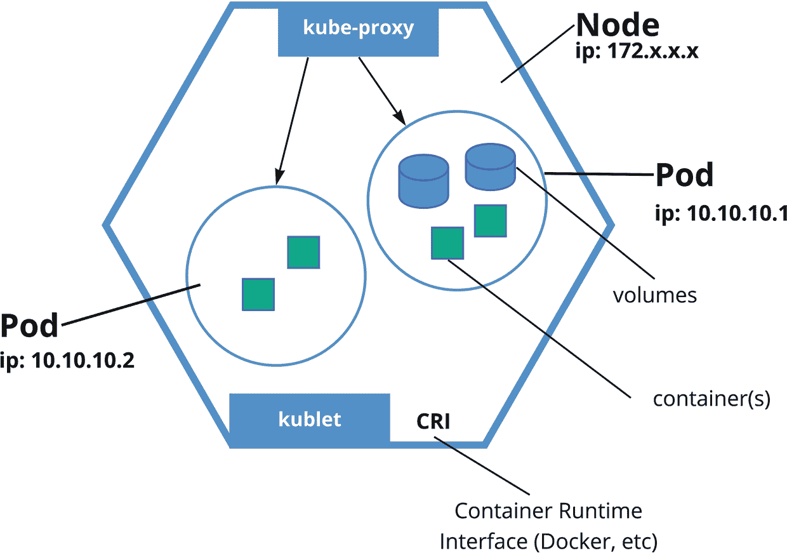

**图 15-1** Pod 被调度到一个或多个节点上运行，并在物理节点上分配资源，由 `kubelet` 进程控制。

由于每个 Pod 都有自己的本地范围，因此许多 Pod 可以被调度到同一个底层节点上运行，而无需担心在可寻址网络空间内发生冲突。此外，对全局用户空间中共享密钥或受限文件的节点级访问问题，可以在 Pod 级别进行管理，从而使安全性和关注点分离变得更加容易。Pod 通过分离跨共享集群以及同一物理节点上运行的工作负载，引入了一种很好的范式。

根据设计，在 Pod 中运行的容器不能打破隔离，也不能触及在同一节点上运行的其他 Pod。这从安全角度来看会引发担忧，而且也会破坏松耦合的概念，因为 Pod 首先需要知道其他 Pod 的存在。好的，这听起来很棒，但为了真正理解 Pod，我们将创建一个 Pod 规范来运行 Redis。

## 创建 Redis Pod 规范

在第 10 章中，你了解了通过 `docker compose` 运行 Redis。让我们重新回顾一下该章练习中 `docker-compose.yaml` 文件的 Redis 服务，然后将该配置转换为 Kubernetes Pod 规范。列表 15-2 提供了第 10 章中的 Redis 服务。

```
services:
  redis:
    image: redis:6.2
    container_name: redis
    hostname: redis
    ports:
      - 6379:6379
    healthcheck:
      test: ["CMD", "redis-cli", "ping"]
      interval: 5s
      timeout: 30s
      retries: 50
    restart: always
```

**Listing 15-2** 基于 Docker Compose 的 Redis 服务

以 `docker compose` 服务配置为思维模型，让我们创建一个简单的 Redis `PodSpec`，然后启动该 Redis Pod。列表 15-3 提供了所需的配置。打开你喜欢的编辑器，创建一个名为 `redis-pod-basic.yaml` 的新文件，并添加列表 15-3 中的内容。

```
apiVersion: v1
kind: Pod
metadata:
  name: redis-basic
  namespace: data-services
  labels:
    app: redis
    type: basic
spec:
  restartPolicy: OnFailure
  containers:
    - name: redis
      image: redis:6.2
      imagePullPolicy: Always
      ports:
        - containerPort: 6379
          protocol: TCP
      resources:
        limits:
          memory: "1G"
          cpu: "2000m"
        requests:
          memory: "500Mi"
          cpu: "1000m"
```

**Listing 15-3** 用于配置和启动 Redis 的基本 `PodSpec` (`redis-pod-basic.yaml`)

列表 15-3 中的 Redis `PodSpec` 创建了一个具有唯一名称的 Pod 模板。我们之所以称之为 `PodTemplate`，是因为它可以用来启动一个或多个 Pod。从顶部开始，我们首先为我们的 *Pod 资源*（`kind: Pod`）指定 `K8s apiVersion`。通过声明 API，`Kubernetes` 可以自由地支持或弃用旧版 API，而无需强制收敛。

### 元数据

接下来，使用 `metadata` 属性为我们的 Pod 分配一个唯一名称（`redis-basic`），并添加可用于调度和定位我们 Pod 的配置。在本例中，我们分配了 `data-services` 命名空间，并添加了一些标签，我们以后可以使用这些标签来定位特定的 Pod 子集，或者在命名空间内隔离单个 Pod。
```

# spec

接下来讨论最重要的配置：Pod 规范（`spec`）块本身。如前所述，Pod 为一个或多个容器封装了隔离环境，因此 `PodSpec` 被拆分为多个部分，以便对共享资源进行通用配置，同时包含容器特定的配置。你会在清单 15-2 的 `docker-compose.yaml` 和清单 15-3 的 Redis Pod 规范中看到容器规范中的一些重叠之处。最大的区别在于资源请求和限制的精细控制，以及端口配置。

现在让这个 Pod 投入使用吧。

## 调度 Redis Pod

使用 `kubectl` 我们可以应用 `redis-pod-basic.yaml`，让 Kubernetes 调度我们的 Pod。然后我们最终能够达到与理想世界状态的一致。

```bash
% kubectl apply -f redis-pod-basic.yaml
```

如果一切顺利，你会看到 `kubectl` 输出 `pod/redis-basic` 已创建的消息。接下来让我们找到我们的 Pod。

## 列出、描述和定位 Pod

在命令行中，对 `pods` 资源调用 `get` 命令。

```bash
% kubectl get pods
```

此时你可能感到困惑，为什么没有显示任何结果（在默认命名空间中未找到任何资源）。这是因为 Kubernetes（默认情况下）只会列出来自单个命名空间的资源，而这个命名空间恰好是默认命名空间。通过添加 `explicit` 命名空间或包含 `--all-namespaces` 标志，你可以获得期望的结果。

```bash
% kubectl get pods -n data-services
NAME           READY   STATUS    RESTARTS   AGE
redis-basic    1/1     Running   0          44m
```

现在你可以找到你的 Pod，还可以通过对 Pod 资源使用 Pod 名称并调用 `describe` 动词来获取有关 Pod 本身的更多信息。

```bash
% kubectl describe pod/redis-basic
```

调用 `describe` 的结果可用于获取有关 Pod 本身的详细信息，包括启动日期、容器、节点、IP 地址、当前观测到的 Pod 状态等。

最后，在未来你可能运行了许多 Pod 的情况下，并且想要找到一个特定的 Pod（或一组 Pod），你可以依靠 Pod 资源的元数据标签来找到你要找的内容（跨一个或多个命名空间）。清单 15-4 在所有命名空间中执行通用搜索，以找到任何具有匹配标签（`app=redis`）且类型不是 `pv`（`type!=pv`）的 Pod。

```bash
% kubectl get pods \
--all-namespaces \
-l app=redis,type!=pv
清单 15-4
使用标签选择器跨所有命名空间定位 Pod
```

清单 15-4 中的查询将返回所有匹配的 Pod。在我们的案例中，目前只有一个。

```bash
NAMESPACE      NAME          READY   STATUS    RESTARTS   AGE
data-services  redis-basic   1/1     Running   0          78s
```

我们的下一个任务就是简单地进入新的 Redis Pod，并使用 `redis-cli` 执行几个命令。

## 在 Redis Pod 上执行命令

就像你已经习惯于使用 `docker exec` 命令一样，你可以直接将你的技能迁移到 Kubernetes 和 `kubectl` 上。清单 15-5 中的命令将连接到 `redis-basic` Pod 并启动 `redis-cli`。

```bash
% kubectl exec \
-n data-services \
-it redis-basic \
-- redis-cli
清单 15-5
使用 kubectl exec 连接到正在运行的 Pod
```

设置并获取一个键，以确保 Redis 按预期工作。

```bash
127.0.0.1:6379> set app redis-basic
OK
127.0.0.1:6379> get app
"redis-basic"
```

退出进程（Command+C），这样我们就可以删除 Pod。

## 删除 Redis Pod

你可能已经知道需要什么命令。就像命名空间一样，你可以简单地对 Pod 资源使用 `delete` 动词，通过名称删除 Pod。

```bash
% kubectl delete -n data-services pod/redis-basic
```

那么为什么要费劲做所有这些工作，最后却要删除呢？答案在于我们对特定服务的期望。在现实世界中，考虑到 Pod 几乎可能随时被杀死（由于任何云原生基础设施的正常生命周期），你最终需要一个可靠的机制来确保你的所有服务（包括 Spark 应用程序）能够以一致的方式部署、监控和恢复，且只需有限或无需人工干预。

接下来我们将研究 Kubernetes 的部署资源，学习如何创建一致且可靠的部署。

## 部署与处理故障时自动恢复

在上一节中，你学会了如何配置 Pod 规范。使用简单的 Pod 模板，你可以在 `data-services` 命名空间中调度和运行 Pod。通过这个过程，你学习了如何使用 Pod 的元数据装饰 Pod（使用标签进行标签选择），以及如何配置一个简单的单容器规范。利用你运行 `redis-basic` Pod 所学到的技能，接下来你将学习如何使用 Kubernetes 的部署资源创建受管部署。

### 创建 Kubernetes 部署

*部署*是一种特殊的 K8s 资源，它引入了针对给定 Pod 规范管理和运行可靠部署的扩展能力。作为一项服务管理可靠性，Kubernetes 集群将监督部署中配置和包含的资源，确保诸如节点故障等常见问题不会导致你的服务停滞不前。

创建一个名为 `deploy-redis-memory.yaml` 的新文件，并将清单 15-6 中的部署配置内容添加到文件中。然后保存它。

```yaml
apiVersion: apps/v1
kind: Deployment
metadata:
name: redis-memory
namespace: data-services
labels:
app: redis-memory
type: canary
spec:
replicas: 1
strategy:
rollingUpdate:
maxUnavailable: 100%
type: RollingUpdate
selector:
matchLabels:
app: redis
type: memory
template:
metadata:
labels:
app: redis
type: memory
spec:
containers:
- name: redis
image: redis:6.2
volumeMounts:
- name: redis-storage
mountPath: /data
imagePullPolicy: Always
ports:
- containerPort: 6379
protocol: TCP
resources:
limits:
memory: "1G"
cpu: "2000m"
requests:
memory: "500Mi"
cpu: "1000m"
volumes:
- name: redis-storage
emptyDir:
medium: Memory
清单 15-6
部署为基于 Pod 的服务提供运行时一致的行为，包括故障时自动恢复，以及处理复制服务滚动更新的开箱即用能力
```

你会注意到，清单 15-6 中的初始部署配置包装了清单 15-3 中引入的 Pod 规范，并做了两个小改动以引入基于 Pod 的本地 `卷` 存储。`卷` 是 Pod 中的共享资源，但不是立即可用于所有容器，每个容器必须使用 `volumeMounts` 声明式地添加卷。将卷挂载（或附加）到容器还带来了额外的好处，即允许每个容器创建自定义挂载路径。

```yaml
volumeMounts:
- name: redis-storage
mountPath: /data
```

稍后我们将介绍 `volumes` 和 `volumeMounts`，但现在请注意，`volumes` 规范是在与 `containers` 规范同级的级别上配置的，而 `volumeMounts` 是在每个容器的基础上配置的。现在让我们创建部署。

### 部署与资源管理

使用清单 15-6 中的部署配置，通过应用配置来创建并启动您的部署。

```bash
% kubectl apply -f deploy-redis-memory.yaml
```

现在部署已经创建成功，让我们来点有趣的尝试。与其详细解析所有部署细节，不如通过以下四个步骤来探究部署：定位、连接、观察和删除。

#### 定位新部署的 Pod

使用本章学到的任意技术，找到您新部署的 `redis-memory` pod。定位后，您会注意到该 pod 的名称比之前更长。例如，我创建的 pod 名称为 `redis-memory-78d89d7c87-zchc2`。如果您想了解原因，可以查看部署元数据。

```
% kubectl get deployment/redis-memory -n data-services
```

现在，连接到被管理的 pod。

### 连接到被管理的 Pod

连接到被管理的 Redis pod，并重复清单 15-5 中的步骤。在断开与 pod 的连接前，请记得检查键是否已保存。

### 观察 Pod 状态与行为

在第二个终端窗口（最好与当前终端会话并排显示）中，运行以下命令。

```
% kubectl get pods -n data-services --watch
```

通过观察 pod，您将能够实时查看目标命名空间中所有 pod 的状态变化。

### 删除被管理的 Pod

回到第一个终端窗口，删除 Redis pod。

```
% kubectl delete -n data-services pod/redis-memory-78d89d7c87-zchc2
```

会发生什么？

您会观察到，在删除被管理 pod 的瞬间，几乎实时就会有一个新 pod 被调度来替换已删除的 pod。

清单 15-7 中的输出显示了我集群上观察到的状态变化消息。输出显示了我的初始 pod（`redis-memory-78d89d7c87-zchc2`）从 `Running` 状态变为 `Terminating` 状态。同时，一个新 pod 被创建，以确保我们始终至少有一个副本，因为我们的部署声明了期望副本数：1。替换的 pod 最初处于 `Pending` 状态，然后变为 `ContainerCreating`，最后变为 `Running`。所有这些过程在本地环境下不到五秒内完成。除非删除部署，否则 Kubernetes 将确保您的 pod 永远运行。

```
NAME                            READY   STATUS              RESTARTS   AGE
redis-memory-78d89d7c87-zchc2   1/1     Running             0          35m
redis-memory-78d89d7c87-zchc2   1/1     Terminating         0          36m
redis-memory-78d89d7c87-p4hzl   0/1     Pending             0          0s
redis-memory-78d89d7c87-p4hzl   0/1     Pending             0          0s
redis-memory-78d89d7c87-p4hzl   0/1     ContainerCreating   0          0s
redis-memory-78d89d7c87-zchc2   0/1     Terminating         0          36m
redis-memory-78d89d7c87-p4hzl   1/1     Running             0          4s
redis-memory-78d89d7c87-zchc2   0/1     Terminating         0          36m
redis-memory-78d89d7c87-zchc2   0/1     Terminating         0          36m
```

清单 15-7 当被管理的 Pod（位于有状态副本集之后）终止时观察到的状态变化

现在来说说坏消息。虽然部署控制器能够恢复已删除的 pod，但您会发现 Redis 数据库中没有任何键。您可以使用 `redis-cli` 自行验证。这是为什么呢？Pod 不应该是一致的和可靠的吗？

事实上，这完全是设计使然。为了声明每个部署是幂等的，并一致地支持运行时容错，pod 及其底层容器必须使用不可变约定。否则，当 pod 终止或遭遇不可恢复故障时，对任何 pod 本地资源（例如向 Redis 数据库添加新键）的运行时更改（变更）将会丢失。鉴于按照约定，pod 需要能够在集群中快速移动，因此最佳实践是由 Kubernetes 管理外部配置、密钥以及存储，以确保一致性。

让我们通过学习如何在部署之间持久化数据，来完成 Kubernetes 的实践之旅。然后，我们将动手实践 Apache Spark 的 Kubernetes 资源管理器。

## 在部署之间持久化数据

Kubernetes 基于 `volumes` 和 `volumeMounts` 的概念，为文件系统（和内存）存储提供了丰富的抽象层。在上一节（清单 15-6）中您已经了解了这两个概念，现在您将学习如何启用能够抵御 pod 故障的持久化存储。

首先，我们将使用节点级存储，它在 Kubernetes 节点上持久存在，并在 pod 终止时防止数据丢失。值得注意的是，如果您删除 minikube 虚拟机，节点级数据也会随之丢失。在命令行中，通过 `ssh` 登录到 minikube，然后创建一个位于 `/mnt/data` 的空目录。

```
% minikube ssh
$ sudo mkdir -p /mnt/data
```

完成此步骤后，我们可以继续创建持久卷资源。

> **警告**
> 在托管的生成环境 Kubernetes 集群（如 EKS/AKS/GKE）中，通常不需要 `ssh` 访问。请考虑限制 `ssh` 访问或完全关闭它，以防止恶意行为者干扰您的 Kubernetes 集群。

### 持久卷（PV）

容器在运行时进行的本地更改，会在 pod 因正常生命周期事件（如全新部署）而终止、失败或以其他方式被替换（重新调度）时消失。正如您所见，这还包括添加到本地 pod 环境中的任何数据库记录。

幸运的是，可以使用底层 Kubernetes 节点的本地文件系统存储，或采用更松耦合的实践，即附加托管的云网络文件系统存储，来为 Kubernetes 集群配置可靠的存储。以主流云厂商的产品为例：亚马逊的[弹性块存储](https://aws.amazon.com/ebs/)、微软的[AzureFile](https://docs.microsoft.com/en-us/azure/storage/files/)/[AzureDisk](https://azure.microsoft.com/en-us/services/storage/disks/)以及谷歌的[持久磁盘](https://cloud.google.com/persistent-disk)。持久卷将存储提供者与实际消费者隔离开来，使得应用能够请求存储，并由 Kubernetes 负责查找并声明与存储请求匹配的资源。

#### 配置持久卷（PV）

创建一个名为 `persistent-volume.yaml` 的文件，并添加清单 15-8 所示的 `PersistentVolume` 资源配置。随后，可将此模板应用于 Kubernetes 集群，以在 minikube 集群的单个节点上物理创建一个持久卷。

```yaml
apiVersion: v1
kind: PersistentVolume
metadata:
  name: general-pv-volume
  namespace: data-services
  labels:
    type: local
spec:
  storageClassName: manual
  capacity:
    storage: 2Gi
  accessModes:
    - ReadWriteOnce
  hostPath:
    path: "/mnt/data"
```

清单 15-8 为 Redis 创建 PersistentVolume (`persistent-volume.yaml`)

清单 15-8 中的资源配置会在 minikube 节点的 `/mnt/data` 目录下创建一个容量为 2GB 的卷（并将其隔离）。应用此配置以创建新资源，然后使用 `persistentvolume`（`pv`）资源类型的 `get` 和 `describe` 命令查看已创建的资源，深入了解这一新的资源类型。

##### 创建持久卷

```
% kubectl apply -f persistent-volume.yaml
```

##### 查看持久卷

```
% kubectl get pv general-pv-volume
NAME               CAPACITY   ACCESS MODES   RECLAIM POLICY
general-pv-volume  2Gi        RWO            Retain
```

##### 描述持久卷的详细信息

```
% kubectl describe pv general-pv-volume
```

有了 `general-pv-volume` 后，下一步是创建一个声明策略，通过 `PersistentVolumeClaims` 资源来管理对卷的读写访问。

## 持久卷声明（PVC）

PV 是集群中特定于存储的资源。PVC 作为一种资源，用于声明 PV 的一部分（或全部）。正如一个节点可以被分割以运行不同规模的工作负载（由 Pod 规范控制），涉及 CPU 核心和内存一样，PVC 代表了一种对特定存储空间的请求，并带有特定的访问模式，以管理对底层存储资源的独占或共享读写访问。

### 配置持久卷声明（PVC）

使用清单 15-9 中的配置，创建一个名为 `persistent-volume-claim.yaml` 的新文件。

```
apiVersion: v1
kind: PersistentVolumeClaim
metadata:
  name: redis-pv-claim
  namespace: data-services
spec:
  storageClassName: manual
  accessModes:
    - ReadWriteOnce
  resources:
    requests:
      storage: 500Mi
清单 15-9
创建 PersistentVolumeClaim (persistent-volume-claim.yaml)
```

清单 15-9 中的 PVC 配置了一个名为 `redis-pv-claim` 的声明，请求至少 500 Mi（兆字节）的存储空间，并采用 `ReadWriteOnce` 访问模式。此访问模式允许一个 Pod 声明对绑定的 PV 进行独占访问，这符合 Redis 服务所需的正确访问模式。你可能也注意到，PVC 完全未提及实际的 PV（这是因为存储供应和存储消费是松耦合的；具体细节被抽象化了）。接下来，创建 PVC 资源，然后使用 `persistentvolumeclaim (pvc)` 资源类型的 `get` 和 `describe` 命令进一步了解你所创建的内容。

#### 创建持久卷声明（PVC）

```
% kubectl apply -f persistent-volume-claim.yaml
```

#### 使用 Get 查看 PVC

检查 PVC 的状态，可以查看声明是否已绑定到某个 PV，包括绑定卷的名称。

```
% kubectl get pvc -n data-services
NAME             STATUS   VOLUME              CAPACITY
redis-pv-claim   Bound    general-pv-volume   2Gi
```

#### 查看 PV

由于 PV 与 PVC 的关系是双向的，你也可以通过 PV 来发现 PVC 声明及其状态（引用）。

```
% kubectl get pv redis-pv-volume
NAME              RECLAIM STATUS CLAIM
general-pv-volume Retain  Bound  data-services/redis-pv-claim
```

**提示：** Kubernetes 会使用 PVC 中的 `resources:requests:storage` 值来尝试找到匹配的 PV。在我们的例子中，尽管我们只请求了 500Mi，但实际上声明了 2Gi。如果你感兴趣，我建议你进一步了解 PV 的动态供应。

### 使用数据持久化增强 Redis 部署

现在，让我们将 PV 和 PVC 付诸实践，并修改之前清单 15-6 中的 Redis 部署。结果发现，我们只需要修改 Pod 规范中的卷配置即可。打开你之前的部署配置文件，将卷类型从 `emptyDir` 修改为 `persistentVolumeClaim`（如清单 15-10 所示）。

```
apiVersion: apps/v1
kind: Deployment
...
spec:
  template:
    spec:
      volumes:
        - name: redis-storage
          persistentVolumeClaim:
            claimName: redis-pv-claim
清单 15-10
使用持久卷声明来持久化数据
```

保存部署的更改并应用更新后的部署。你的 Redis 数据库中保存的任何数据（流对象、键等）都将以有状态且一致的方式在多次部署之间持久保留。按照清单 15-6 的流程执行一遍，然后删除你的 Pod。观察你的 Redis 服务是否在你离开时的状态下重新启动。

## Kubernetes 服务与 DNS

作为最后一步，让我们为 Redis Pod 部署添加一个 Service 定义。Kubernetes 中的服务支持在单个命名空间范围内（默认情况下）进行服务发现，例如，允许你在 `data-services` 命名空间内使用 Redis，该命名空间可用来支持 Airflow 或作为 MySQL 的缓存层。

### 创建服务

创建一个名为 `redis-service.yaml` 的文件，并添加清单 15-11 中的以下 Service 配置。然后使用 `kubectl apply -f` 应用该配置。

```
apiVersion: v1
kind: Service
metadata:
  name: redis-service
  namespace: data-services
spec:
  selector:
    app: redis
    type: memory
  type: ClusterIP
  ports:
    - name: tcp-port
      port: 6379
      targetPort: 6379
      protocol: TCP
清单 15-11
为 Redis 定义 Kubernetes Service 资源
```

清单 15-11 中的 Redis 服务定义创建了一个动态服务，指向与 `Service` 选择器（`app=redis,type=memory`）匹配的零个或多个 Pod 组上的端口 6379。这种抽象使你能够定义一个松耦合的服务，该服务依靠 Kubernetes 使用选择器动态填充端点。绑定的端点是与选择条件匹配的 Pod 子集的 Pod IP 地址。

### 查看服务（SVC）

```
kubectl get services -n data-services
NAME            TYPE        CLUSTER-IP     PORT(S)    AGE
redis-service   ClusterIP   10.106.24.62   6379/TCP   8d
```

我们将在第 2 部分中再次讨论服务。现在，让我们先回顾一下我们所学的内容。

### 第一部分：总结

本章上半部分向你介绍了在 Kubernetes 上运行云原生应用所需的许多核心组件、概念和 API。如前所述，在 Kubernetes 上运行 Apache Spark（使用官方的 [Spark Kubernetes 资源管理器](http://spark.apache.org/docs/latest/running-on-kubernetes.html)）能够抽象化（并保护你免受）启动 K8s 所需的大量运行时细节和复杂性的影响。然而，当从概念验证转向生产环境时，始终有必要不仅为工具，而且为其运行的环境建立坚实的基础。这就是我们逐步讲解如何设置和配置持久化 Redis 部署的原因。

作为后续练习，请将 MySQL 和 MinIO 引入你的本地 Kubernetes 集群，以测试你在本章前半部分学到的内容。你可以参考本书前面的课程，查阅你所需的一切，包括使用 `docker-compose` 文件和初始化步骤。发挥你的创造力来解决这些问题，并在构建心智模型的过程中，通过这个过程更仔细地审视哪些方法有效，哪些无效。

现在，我们期待已久的时刻到了——是时候学习如何在 Kubernetes 上部署你的 Apache Spark 应用了。

## 第二部分：在 Kubernetes 上部署 Spark Structured Streaming 应用

在你的 Kubernetes 集群启动并运行，并且你已划分出 `data-services` 命名空间后，我们将深入探讨为我们的 Apache Spark 环境提供支持所需的额外 Kubernetes 资源。

**动手实践内容**

本章第二部分的章节材料位于 `ch-15/spark-on-kubernetes` 目录下。完整的操作指南可在 `README` 文件中找到。在 `data-services` 命名空间中运行 MinIO 和 MySQL 的完整解决方案可以为你接下来的探索做好准备。

### Spark 命名空间、应用环境和基于角色的访问控制

要使你的 Apache Spark 应用能够运行，需要一些基础资源。在本节中，我们将定义`spark-apps`命名空间，然后向你介绍角色、角色绑定和服务账户。

## 定义 Spark 应用命名空间

清单 15-12 中的命令为我们的 Spark 应用创建了一个名为`spark-apps`的新命名空间。创建此命名空间。

```sh
cat <<EOF | kubectl apply -f -
apiVersion: v1
kind: Namespace
metadata:
labels:
kubernetes.io/metadata.name: spark-apps
name: spark-apps
EOF
```

*清单 15-12：定义 Spark 应用命名空间*

定义了`spark-apps`命名空间后，下一步是建立一些规则来管理我们 Spark 应用的运行时能力。就像在现实世界中，你不会把你家的钥匙随便给一个陌生人一样，这在 Kubernetes 世界中也是如此。`Pod`具有已知的身份，这些身份由不可伪造的、基于`Pod`与 Kubernetes API 之间令牌/证书交换来控制认证和授权的双向 TLS 管理。`Pod`可以承担特定的身份，并获得由服务账户、角色和角色绑定资源管理的特殊资源和访问权限。

## 基于角色的访问控制 (RBAC)

就像在 SQL 系统中使用`GRANT`和`REVOKE`来建立权限一样，基于角色的访问控制 (RBAC) 用于为你的`Pod`以及访问你 K8s 集群的真实用户定义通用能力和权限。

### 角色

Kubernetes 中的角色用于在 API 级别定义通用权限（例如创建、修改或销毁资源）。

```sh
% kubectl get roles -n {namespace}
```

角色定义了一系列规则，这些规则在特定命名空间内对资源进行管理，并且是动词级别的。

**注意：** 你也可以定义管理集群级别（而不仅仅是特定命名空间）访问权限的规则。这些被称为`clusterroles`：`% kubectl get clusterroles`

### 服务账户

服务账户在 Kubernetes API 中提供了一种身份机制。这相当于在 Amazon Web Services 上使用 IAM 权限。服务账户为特定资源提供基于令牌的授权访问。默认情况下，每个命名空间都会生成一个名为`default`的通用服务账户。除非指定了不同的服务账户，否则此默认身份将自动与在每个命名空间中创建的任何`Pod`关联。

```sh
% kubectl get sa -n {namespace}
```

### 角色绑定

角色绑定将用户、组或服务账户连接到一个特定的角色。

```sh
% kubectl get rolebindings -n {namespace}
```

现在，我们来设置`spark-controller`服务账户，以及相关联的角色和角色绑定。

## 创建 Spark Controller 服务账户、角色和角色绑定

考虑到`Pod`在命名空间内运行，并且我们希望我们的 Spark Structured Streaming 应用能够自我管理——在必要时添加和移除执行器`Pod`——我们需要创建一个特殊的服务账户（`spark-controller`），该账户可以绑定到我们的 Spark 应用的`Pod`上。这将授予`Pod`自我创建和销毁以及管理命名空间内其他资源的能力（这样我们就不必操心了）。

清单 15-13 中的多部分资源定义在`spark-apps`命名空间内生成三个新资源。角色（`spark-app-controller`）、服务账户（`spark-controller`）和角色绑定（`spark-app-controller-binding`）。

```yaml
cat <<EOF | kubectl apply -f -
apiVersion: rbac.authorization.k8s.io/v1
kind: Role
metadata:
namespace: spark-apps
name: spark-app-controller
rules:
- apiGroups:
- ""
resources:
- pods
- services
- configmaps
verbs:
- list
- create
- delete
- get
- list
- patch
- update
- watch

apiVersion: v1
kind: ServiceAccount
metadata:
name: spark-controller
namespace: spark-apps

apiVersion: rbac.authorization.k8s.io/v1
kind: RoleBinding
metadata:
name: spark-app-controller-binding
namespace: spark-apps
subjects:
- apiGroup: ""
kind: ServiceAccount
name: spark-controller
roleRef:
apiGroup: rbac.authorization.k8s.io
kind: Role
name: spark-app-controller
EOF
```

*清单 15-13：使用多部分 `---` 分隔符可以创建多个 K8s 资源*

清单 15-13 中的技术使你能够提供一个声明了一组资源的单一文件。依赖多部分资源定义模式可确保每个隔离部署的不同需求都能以一致的方式得到满足。

**提示：** 对于复杂部署，或用于引导整个环境，你可以依赖多资源配置，如 Spark 引导配置（清单 15-13）。这样做，你可以确保所有部署依赖项（资源）在部署之前都可用，并以正确的顺序应用到 K8s 集群中。关键在于一致性。K8s 社区已经采用了两种流行的解决方案——[helm](https://helm.sh/) 和 [kustomize](https://kustomize.io/)——来简化部署复杂性的管理。Helm 就像 K8s 的包管理器，使得复杂部署可以通过命令行轻松安装和更新。而 Kustomize 则是一个无模板的配置管理器，可以轻松地将特定环境的配置合并（覆盖）到通用部署资源之上。该解决方案使你能够为开发、预发布和生产环境配置部署，同时重用通用配置以防止配置漂移的问题。

现在，你已经应用了环境脚手架，是时候重新审视第 13 章中的通用 Structured Streaming 应用，并为其在 K8s 集群中的部署做准备。

## Redis Streams Kubernetes 应用

在第十章 10 中，你了解了如何将 Redis Streams 与 Structured Streaming 结合使用，将其作为一种轻量级（低开销）的流式数据源。最初构建该应用是为了向你展示如何可靠地读取无界的`CoffeeOrder`事件流，控制应用触发过程（作为有状态批处理或流式微批处理），并使用检查点维护应用状态。最终成果是一个简单但一致的流式应用，它能够将`CoffeeOrder`对象读取并写入数据仓库（MinIO）的分布式表中。

在第十三章 13 中，我们利用 Spark Structured Streaming 生成基于时间（窗口化）的聚合，从而简化了创建可靠流式分析数据的复杂流程。我们将基于第十三章中的通用聚合应用进行构建，并创建一个可在`minikube`集群内部署和管理的新容器。

首先，在你喜欢的 IDE 中打开`ch-15/applications/redis-streams-k8s`应用，或者直接打开源代码以便跟随学习。

### 构建 Redis Streams 应用

我们不会修改应用的源代码；它已经准备好进行构建。从容器化的角度来看，只有少数几个小的调整值得指出。

首先，`Dockerfile`已被调整，用于将`user_jars`目录的内容复制到最终容器中，如清单 15-14 所示。这样做是为了保持一致性，确保没有意外缺失的依赖项或运行时问题。

```dockerfile
FROM newfrontdocker/${spark_base_version}
ARG app_jar
USER 1000
# 复制并重命名
COPY --chown=1000 ${app_jar} /opt/spark/app/jars/redis-streams-k8s.jar
# 复制应用配置
COPY --chown=1000 conf /opt/spark/app/conf
COPY --chown=1000 user_jars /opt/spark/app/user_jars
```

*清单 15-14：修改 Dockerfile 以打包任何额外的运行时 JAR 和基础应用配置*

如前所述，修改 `Dockerfile` 是为了生成一个一致的容器，其中包含所有必需的运行时 JAR 和通用的基线配置。容器中附带的基线配置包括来自第十三章 13 的 `TypeSafe` 配置、`fairscheduler.xml` 文件（在上一章中介绍）以及两个可执行文件（`spark-submit.sh` 和 `spark-submit-lite.sh`），用于在 Kubernetes 集群内部提交应用。

> **提示：** 如果你需要类似的通用依赖项，可以将它们打包到你的基础 Spark 容器镜像中。这样，每个应用就不必重复执行自备 JAR 的过程。只需确保添加通用场景所需的依赖，以便镜像体积尽可能小。

### 构建应用容器

第二个更改是针对容器构建过程。你需要使用 `minikube` Docker 环境构建本地应用镜像。如清单 15-15 所示，这里增加了一个小步骤，本质上就是一个单行的 `eval` 语句。

```bash
1.   sbt clean assembly
2.   eval $(minikube docker-env)
3.   docker build . -t mde/redis-streams-k8s:1.0.0
```

*清单 15-15：构建容器以在 minikube 环境中使用*

现在你已经构建好了容器，下一步就是部署它。

> **提示：** 在本地测试时，使用清单 15-15 中的技巧可以更快地迭代你的应用。另一种方式是将镜像构建并推送到 DockerHub 或亚马逊 ECR 等其他容器注册服务。

### 在 Kubernetes 上部署 Redis Streams 应用

回顾整本书中运行各种 Spark 应用的过程，我们经常通过 `docker-compose` 使用挂载的配置和运行时资源（JAR、`hive-site.xml` 中的密钥以及配置）来增强运行时环境。为了实现特定容器间的通信，我们还使用了内部 Docker 网络（`mde`）。将类似的策略应用于 Kubernetes 上的 Spark 应用是完全合理的。

在本章前面，你了解了*服务*和*卷*（持久卷和临时卷）。为准备部署，你将添加一种新的服务类型，以简化与 `data-services` 命名空间中运行服务的跨命名空间 DNS 解析。你还将学习如何外部化环境变量、部署特定配置以及密钥，例如 `hive-site.xml` 和 MinIO 的访问/密钥。我们将把注意力转向使用超越传统文件存储（目录和单个文件）的卷。

**运行代码**

在终端中，将你的工作目录切换到 `ch-15/spark-on-kubernetes`。

#### 外部化依赖管理

有两种重要的资源类型，它们的作用类似于卷（并且可以挂载到 Pod 上），但提供了额外的专门功能。它们分别称为 `ConfigMap` 和 `Secret`，你将在部署中依赖它们。

#### 使用 ConfigMap 进行外部配置

`ConfigMap` 资源提供了一种解决方案，用于存储在命名空间范围内、具有唯一标识的数据集合（文件、二进制数据等）。`ConfigMap` 对象通常用于提供共享的环境变量（例如，用于 `dev`、`stage` 和 `production` 环境），以及提供隔离的（特定于部署）的应用资源。

让我们创建一个 `ConfigMap`，它可以用作我们的默认 Spark 应用配置（`spark-defaults.conf`）。在你的终端中（在 `spark-on-kubernetes` 目录内），运行以下命令：

```bash
kubectl create configmap spark-redis-streams-conf \
--from-file=spark-redis-streams/config \
-n spark-apps
```

神奇的是，`config/spark-defaults.conf` 文件的内容会被编码到你的 `spark-redis-streams-conf` 资源中。要查看内容，你可以运行以下命令：

```bash
kubectl get configmap spark-redis-streams-conf \
-n spark-apps \
-o yaml
```

输出结果实质上只是向你展示了 `spark-defaults.conf` 的内容。

#### Secrets

众所周知，你不应该将用户名、密码或敏感数据提交到 Git（或你正在使用的任何版本控制系统）中，否则你可能会无意中泄露敏感数据。`Secret` 资源类型允许你（在你的命名空间内）存储敏感数据，这些数据保证通过加密（HTTPS）通道传输，并在内部存储为 base-64 编码的字符串。

### 安全存储 Hive Metastore 配置

清单 15-16 中的命令对我们一直用于访问基于 MySQL 的 Hive Metastore 的 `hive-site.xml` 文件进行了编码，并将其封装到一个名为 `hivesite-admin` 的密钥资源中，该资源可以在运行时安全地挂载到我们的 Spark 应用 Pod 上。

```
cat 

javax.jdo.option.ConnectionURL
jdbc:mysql://mysql-service.spark-apps.svc.cluster.local:3306/metastore

javax.jdo.option.ConnectionDriverName
org.mariadb.jdbc.Driver

javax.jdo.option.ConnectionUserName
dataeng

javax.jdo.option.ConnectionPassword
dataengineering_user

EOF
清单 15-16
将 hive-site.xml 封装为密钥，用于应用部署
```

你会注意到 `hive-site.xml` 存储在 `stringData` 块中。对于像 `hive-site.xml` 和 `spark-defaults.conf` 这样的二进制文件，你不能使用简单的键/值对，这使得资源定义的长度更长。

在此处，也值得指出的是，`hive-site.xml` 中的 `ConnectionURL` 指向的服务域名目前并不存在于 `spark-apps` 命名空间中。

```
jdbc:mysql://mysql-service.spark-apps.svc.cluster.local:3306/metastore
```

我们稍后将添加一个 `ExternalService` 资源，为 `data-services` MySQL 服务提供别名。

**提示：** 如果你尚未尝试过在 K8s 上设置 MySQL 并希望获得解决方案，请使用 `ch-15/spark-on-kubernetes/data-services/README.md` 进行设置。

现在我们已经将 `hive-site.xml` 编码为密钥，我们一直在处理的另一个敏感信息是 MinIO 的访问密钥和秘密密钥。幸运的是，这是一个更简单的定义，使用了键/值对。

### 安全存储 MinIO 访问参数

清单 15-17 中的资源定义对管理用户名和密码信息进行了编码。创建 `minio-access` 资源。请记住，密钥是在你的应用程序源代码之外管理的，因此你不必担心意外将密钥提交到 GitHub。只需引用已知的密钥并将其挂载到你的 Pod 上，以便在容器中使用即可。

```
cat <<EOF | kubectl apply -f -
apiVersion: v1
kind: Secret
metadata:
name: minio-access
namespace: spark-apps
type: Opaque
stringData:
access: minio
secret: minio_admin
EOF
清单 15-17
创建 minio-access 键/值对密钥，用于 Spark 应用部署
```

创建好这两个密钥后，你现在可以使用 `volumes` 和 `volumeMounts` 将它们用于你的部署规范中。

### 查看命名空间中的密钥

如果你想查看已编码的密钥，可以使用以下命令：

```bash
% kubectl get secrets -n {namespace}
% kubectl get secret/{name} -n {namespace} -o yaml
```

接下来要做的事情是添加运行 Spark Structured Streaming 应用所需的 `ExternalService` 配置。

### 跨命名空间 DNS 和网络策略

有趣的事实：命名空间为跨命名空间通信提供了天然的保护屏障。要实现命名空间之间的交互，例如在实际的生产 Kubernetes 集群中，你需要使用一种名为 `ExternalName` 的特殊服务配置以及 `NetworkPolicy` 来创建策略。这两者结合使用，可以使在隔离命名空间中运行的应用能够向另一个命名空间中运行的服务发出请求。例如，使你的 Spark 应用能够与 `data-services` 命名空间通信。

当在 `minikube` 上运行时，我们在这里走个流程，因为网络在我们的单节点上是共享的。让我们定义指向 `data-services` `MySQL` 服务的服务指针（如清单 15-18 所示）。

```
cat <<EOF | kubectl apply -f -
kind: Service
apiVersion: v1
metadata:
name: mysql-service
namespace: spark-apps
spec:
type: ExternalName
externalName: mysql-service.data-services.svc.cluster.local
ports:
- port: 3306
name: tcp-port
EOF
```

清单 15-18 ExternalName 服务为你的命名空间内部提供了一个本地完全限定域名（FQDN），该域名解析到另一个命名空间中的外部服务。

为什么要使用这个呢？随着时间的推移，内部管理的服务经常会跨团队转移所有权。如果新团队接手某些服务的所有权并切换命名空间，你可以更新单个资源并迁移你的应用，或者在不同命名空间之间链接 `ExternalName` 资源。

最终，随着规模的扩大，你会发现自己最终会迁移到像 `Istio` 这样的服务网格，但由于你刚开始接触，请记住保持简单（已经有太多新组件和服务需要理清了）。

作为后续练习，请遵循清单 15-18 的模式，为 `Redis` 和 `MinIO` 创建额外的策略。准备好后，就可以进行部署了。

# 使用跳板 Pod 控制部署

首先，您将通过一个简单的"跳板"（jump）Pod 中的 `mde/redis-streams-k8s:1.0.0` 容器来部署 Spark 应用程序。如果一开始就全速推进，很容易遗漏某些内容并陷入所谓的"崩溃循环"（crash loop）。您可能会发现，在首次采用任何新的部署模式后，对后续几个应用重复这种缓慢、受控的部署流程是必要的。此过程在调试应用时也很有帮助，因为在将所有内容自动化到正式的有状态部署之前，您可以先检查常见的故障点，例如缺失的配置。

从 `ch-15/spark-on-kubernetes/spark-redis-streams` 目录下，打开 `deployment-manual.yaml`（如列表 15-19 所示）查看 Pod 规范。请特别关注 `volumes` 和 `volumeMounts` 环境变量，以了解 `Secrets` 和 `ConfigMap` 是如何注入到 Pod 中的，以及外部 DNS 值是如何注入到规范中的。

```yaml
apiVersion: v1
kind: Pod
metadata:
name: spark-redis-streams-app
namespace: spark-apps
labels:
app: spark-redis-streams
type: canary
version: "1.0.0"
spec:
restartPolicy: OnFailure
# 跳板 Pod 以 root 身份运行
securityContext:
runAsUser: 0
runAsGroup: 0
serviceAccountName: spark-controller
volumes:
- name: spark-submit-conf
configMap:
name: spark-redis-streams-conf
- name: hive
secret:
secretName: hivesite-admin
containers:
- name: redis-streams-app
env:
- name: SPARK_CONTAINER_IMAGE
value: mde/redis-streams-k8s:1.0.0
- name: REDIS_SERVICE_HOST
value: redis-service.spark-apps.svc.cluster.local
- name: REDIS_SERVICE_PORT
value: "6379"
- name: MINIO_SERVICE_HOST
value: minio-service.spark-apps.svc.cluster.local
- name: MINIO_SERVICE_PORT
value: "9000"
- name: MINIO_ACCESS_KEY
valueFrom:
secretKeyRef:
name: minio-access
key: access
- name: MINIO_SECRET_KEY
valueFrom:
secretKeyRef:
name: minio-access
key: secret
volumeMounts:
- mountPath: /opt/spark/conf/spark-defaults.conf
name: spark-submit-conf
subPath: spark-defaults.conf
readOnly: false
- mountPath: /opt/spark/conf/hive-site.xml
name: hive
subPath: hive-site.xml
readOnly: true
image: mde/redis-streams-k8s:1.0.0
imagePullPolicy: Never
command: ["tail", "-f", "/dev/null"]
resources:
limits:
memory: "2000Mi"
cpu: "500m"
requests:
memory: "1000Mi"
cpu: "250m"
```
列表 15-19：Spark 跳板 Pod（`spark-redis-streams-app`）规范

列表 15-20 中的 Pod 规范安全地挂载了您应用到 `spark-apps` 命名空间的密钥和配置。我们使用挂起的 `tail` 命令来保持 Pod 运行（例如在本章第一部分与 Redis 服务交互时）。这允许您 `exec` 进入 `redis-streams-app` 容器进程并运行应用程序。

通过执行以下命令创建（并调度）Pod：

```bash
% kubectl apply -f deployment-manual.yaml
```

一个 `pod/spark-redis-streams-app` 即被创建。现在，我们可以 `exec` 进入 Pod 并触发应用程序。

## 从跳板 Pod 触发 Spark Submit

使用 `exec` 命令跳转到跳板 Pod，以启动实际的 Spark 应用程序。为了便于理解，可以将跳板 Pod 视为驻留在 K8s 集群中的一个经过身份验证的进程，从而允许用户（使用 `spark-controller` 服务账户）部署应用程序。

```bash
% kubectl exec --stdin --tty pod/spark-redis-streams-app \
-n spark-apps \
-- bash
```

从 `exec` 进程中，您可以使用我们预先打包在容器内的 `spark-submit.sh` 可执行文件，将应用程序提交到 Kubernetes 集群。它位于以下路径：`/opt/spark/app/conf/spark-submit.sh`。

**提示**
在您首次启动应用程序之前，我始终建议您打开第二个终端窗口，以观察 `spark-submit` 进程如何生成 Pod。您也可以使用 `spark-submit` 进程生成的日志来观察 Spark Kubernetes 资源管理器的操作。
```bash
kubectl get pods -n spark-apps --watch
```

在 `spark-redis-streams-app` Pod 的 `exec` 进程中，运行以下命令。

```bash
% /opt/spark/app/conf/spark-submit.sh
```

当应用程序启动并切换到 `Running` 状态时，您刚刚触发的 `spark-submit` 进程将定期调用 K8s API 来检查驱动状态（本质上与您通过 `kubectl` 进程观察命名空间内 Pod 的行为相同）。

有趣的是：这是您第一次使用您的服务账户，它使您能够即时创建新资源。这允许您将控制权委托给驱动程序应用程序进程。要查看您创建的资源，请调用 `kubectl get pods -n spark-apps`。

```
NAME                                                 READY  STATUS    RESTARTS  AGE
spark-redis-stream-aggs-app-cf14ec7d5490f37d-exec-1  1/1    Running   0         29m
spark-redis-stream-aggs-app-cf14ec7d5490f37d-exec-2  1/1    Running   0         29m
spark-redis-streams-app                              1/1    Running   0         33m
spark-redis-streams-app-driver                       1/1    Running   0         29m
```

您随时可以退出该进程。由于 `spark-submit.sh` 创建的是基于集群的部署，您将返回到 `exec` 进程。（我们在第 14 章中讨论过集群部署，但作为复习，这意味着驱动程序应用程序进程与执行器一起在集群中运行，而不是作为外部资源进行控制。）

**注意**
在 `spark-redis-streams-app` Pod 上运行 `ls -l /opt/spark/app/conf`，您会注意到存在第二个 `spark-submit*` 文件，名为 `spark-submit-lite.sh`。这第二个配置文件提供了运行聚合应用程序所需的最简配置示例。由于第二个示例不可执行（缺少 `-x` 权限），您可以使用 `bash /opt/spark/app/conf/spark-submit-lite.sh` 来运行该应用程序。

## 连接部署的各个点

由环境变量控制的 `spark-submit.sh` 可执行文件如列表 15-20 所示。您会看到重要的配置设置（仅基于 Pod 规范的覆盖项），这些设置通常用于修改应用程序在不同 K8s 集群（非生产环境与生产环境）中运行时的配置。您使用新的 `checkpointLocation` 和输出路径来运行应用程序，这样在部署替换应用程序（或金丝雀版本）时，就不会破坏应用程序的状态。

# Kubernetes 上的 Spark Structured Streaming 应用程序

```bash
#!/usr/bin/env bash
K8S_MASTER=${K8S_MASTER:-k8s://https://${KUBERNETES_SERVICE_HOST}:${KUBERNETES_SERVICE_PORT_HTTPS}}
...
$SPARK_HOME/bin/spark-submit \
--master ${K8S_MASTER} \
--deploy-mode cluster \
--class "com.coffeeco.data.SparkStatefulAggregationsApp" \
--conf "spark.kubernetes.driver.pod.name=${SPARK_APP_NAME}-driver" \
--conf "spark.kubernetes.authenticate.driver.serviceAccountName=${K8S_SERVICE_ACCOUNT_NAME}" \
--conf "spark.redis.host=${REDIS_SERVICE_HOST}" \
--conf "spark.redis.port=${REDIS_SERVICE_PORT}" \
--conf "spark.hadoop.fs.s3a.endpoint=${MINIO_SERVICE_HOST}:${MINIO_SERVICE_PORT}" \
--conf "spark.hadoop.fs.s3a.access.key=${MINIO_ACCESS_KEY}" \
--conf "spark.hadoop.fs.s3a.secret.key=${MINIO_SECRET_KEY}" \
--conf "spark.kubernetes.container.image=${SPARK_CONTAINER_IMAGE}" \
--conf "spark.kubernetes.container.image.pullPolicy=${SPARK_CONTAINER_PULL_POLICY}" \
--conf "spark.sql.warehouse.dir=${S3_BASE_PATH}/warehouse" \
--conf "spark.app.sink.options.checkpointLocation=${S3_BASE_PATH}/apps/spark-redis-streams-app/1.0.0" \
--conf "spark.app.sink.options.path=${S3_BASE_PATH}/warehouse/silver/coffee_order_aggs" \
local:///opt/spark/app/jars/redis-streams-k8s.jar
```

列表 15-20 `spark-submit.sh` 可执行文件

现在，让我们换个话题，学习如何查看与 `Spark` 驱动程序应用程序日志和 `Spark Driver UI` 相关的运行时信息。

### 查看驱动程序日志

通过调用 `spark-submit` 生成的驱动程序 `Pod`（而非启动 `Pod` 本身）上，可以获取应用程序日志。这种间接性是因为我们使用集群部署模式来部署应用程序。

```bash
% kubectl logs spark-redis-streams-app-driver -f \
-n spark-apps
```

现在，您可以通过 `-f` 参数实时跟踪驱动程序日志的更新。如果您想转储日志，请省略 `-f` 参数，这样您将看到存储在 `kubelet` 中驱动程序 `Pod` 的所有可用日志。（`Pod` 中容器的日志存在内存限制，因此 `-f` 选项允许您在处理流式应用程序时读取所有日志。）

### 查看驱动程序 UI

与查看驱动程序日志的过程类似，您可以连接到远程驱动程序 `Pod`，并使用一个名为 `port-forward` 的简单 `kubectl` 命令来转发 `Spark UI`。

```bash
% kubectl port-forward {spark-driver-pod} 4040:4040 \
-n spark-apps
```

其精妙之处在于，只有您组织中能够访问您命名空间的成员才能使用 `Spark UI`。在此示例中，只有您可以访问自己的 `minikube` 集群。

### 发送 CoffeeOrder 事件

打开一个新的终端窗口，并通过 `exec` 命令连接到本章第一部分中的 `Redis` 服务 `Pod`。

```bash
% kubectl exec -it redis-deployment-pv-{hash} \
-n data-services \
-- redis-cli
```

然后，向 `CoffeeOrder` 的流中添加一些记录。

```bash
% xadd com:coffeeco:coffee:v1:orders  * timestamp 1637548381179 orderId ord123 storeId st1 customerId ca100 numItems 6 price 48.00
% xadd com:coffeeco:coffee:v1:orders  * timestamp 1637548458800 orderId ord124 storeId st1 customerId ca101 numItems 3 price 36.00
% xadd com:coffeeco:coffee:v1:orders  * timestamp 1637720977241 orderId ord125 storeId st2 customerId ca102 numItems 1 price 4.99
% xadd com:coffeeco:coffee:v1:orders  * timestamp 1637783601557 orderId ord126 storeId st1 customerId ca103 numItems 2 price 10.99
```

您应该会在驱动程序日志中看到一些活动（打开一个窗口并跟踪日志），或者前往驱动程序 `UI` 查看 `Spark Structured Streaming UI` 或 `Spark SQL` 微批次。当您准备好并确认应用程序正在运行（并处理数据）后，即可删除驱动程序和跳板 `Pod`。

### 删除驱动程序和跳板 Pod

当您删除 `Spark Structured Streaming` 驱动程序时，与该驱动程序关联的所有资源也会被删除。这些资源会通过 `ownerReferences` 自动为您管理。当您完成应用程序运行，或者需要在事故期间关闭系统时，`Kubernetes` 将负责删除由 `spark-submit` 进程生成的任何资源，包括自动生成的 `configMaps`、驱动程序 `Pod` 服务以及执行器 `Pod`。

```bash
% kubectl delete pod/redis-streams-app-driver -n spark-apps
pod "redis-streams-app-driver" deleted
```

虽然驱动程序 `Pod` 及其所有资源现在都已移除，但您的跳板 `Pod` 仍然保留。这是因为您启动了跳板 `Pod`，而您触发的 `spark-submit` 进程生成了驱动程序及相关配置和密钥。当您准备好关闭跳板 `Pod` 时，只需同样将其删除即可。

### 自动化部署与自动恢复

当您对应用程序的稳定性感到满意（一切按预期运行）时，可以应用简单的 `deployment-redis-streams.yaml` 文件来部署上一节中涵盖的所有内容。

```bash
% kubectl apply -f ch-15/spark-on-kubernetes/spark-redis-streams/deployment-redis-streams.yaml
service/redis-service unchanged
configmap/spark-redis-streams-conf unchanged
secret/hivesite-admin configured
secret/minio-access configured
deployment.apps/spark-redis-streams-app created
```

恭喜！您刚刚在 `Kubernetes` 上部署了一个幂等的 `Spark Structured Streaming` 应用程序。

### 第 2 部分：总结

本章的后半部分让您付诸实践，并让您掌控在 `Kubernetes` 上运行 `Spark Structured Streaming` 应用程序。您学习了如何创建可靠的有状态部署，以及如何使用服务别名（外部网络服务类型）在命名空间之间进行通信。本章是一个开端，教您如何充分利用完全容器化的 `Apache Spark` 应用程序。既然您已读完本书，还有许多方向可以探索。在结论之后，我还提供了一些额外的思考内容。敬请继续阅读！

## 结论

首先，感谢您达到这个重要的里程碑，并将本书坚持读完。我希望本书中传授的经验能帮助您以不同的视角思考您的工作、与您共事的工程师、您所效力（或拥有）的公司、您所影响的系统，以及如何优化您作为数据工程师的每日时间投入产出。本书基于我在 Twilio 公司任职时的真实经历、众多研讨会（内部和外部举办）、在 Spark 办公时间（同样在 Twilio）提供指导和调试应用程序的无数时光，以及过去六年与 Apache Spark 打交道并使其与不同数据系统和服务协同工作的无数其他经验教训。我认识到，通往流式处理卓越之路并非总是一帆风顺。但是，只要有时间、耐心，并能够使用本地数据平台或直接在基于 Spark 的单元测试中本地验证假设，您就能以更少的时间和麻烦解决最复杂的问题。

请记住，几乎所有数据问题，无论大小，都可以分解成更小、更易于处理的问题，然后再重新组合起来。花时间去理解手头的问题，制定一个行动计划，并朝着最优解决方案努力。如果问题需要一个更通用的解决方案以实现广泛复用，那就大胆去做。最后，请记住在其中寻找乐趣，并享受您所做的工作。

# 结语与展望

Docker、容器和 Kubernetes 已经改变了组织以一致且隔离的方式处理数据的方式。将 Apache Spark 纳入考量，便打开了通往全新表达复杂数据管道与转换的大门，这些管道与转换通过它们与数据所涵盖的更大规模数据网络之间的多重关系得以实现。

本书只是现代数据工程这座冰山的尖顶，提供了我发现在处理任何规模的数据问题时都极具价值的基础知识。关于下一步该往何处去，我有一些想法供你参考。

## JVM 调优
Apache Spark 使用 `JVM` 垃圾回收机制。对于流式作业，默认的 `G1GC` 设置可能会由于小对象随时间堆积而导致较长的 `GC` 暂停。这是基于 `IO` 密集型作业处理大量记录（每个微批次）的结果。请使用阶段和任务级别的 `GC` 指标来跟踪 `GC` 暂停、`GC` 线程数量和对象数量。如果你的内存不足且包含大量字符串对象，还可以在驱动器和执行器中添加 `-XX:+UseStringDeduplication` 以及其他额外的 `Java` 选项来减少内存占用。

## Amazon EKS 和托管节点组
Amazon 为其弹性 Kubernetes 服务提供了一个名为*托管节点组*的功能（底层使用自动扩缩组）。此功能使你能够创建按需或竞价实例的隔离组，这些组可以（使用选择器）被显式调度，以运行你的 `Spark` 驱动器或应用程序执行器。每个托管节点组根据热节点总数，使用最小值、期望值和最大值这三个概念进行扩缩容。你可以将最小值设置为 `0`，这意味着当应用程序启动时，节点将按需获取（这对于昂贵的实例类型非常有利，例如 `GPU` 实例，或偶尔用于一次性任务的巨型实例）。`Amazon` 会尽力维持你的期望节点数量，并在达到分配节点的最大数量后停止分配。如果你需要运行一个基于 `Amazon EKS` 的平台，此选项有助于在命名空间级别划定资源限制。

## 托管 Kafka、RDBMS 和 Redis
随着公司的发展，大规模管理 `Kafka` 需要一个专门的团队。如果你刚开始着手，采用完全托管的 `Kafka`（使用 `Confluent` 或 `Amazon`）并花时间使用它而不是运维它会很有帮助。你的数据库需求（无论是 `OLTP`/`OLAP`/`NoSQL` 等）也是如此。通过付费方式使用服务是快速前进的途径，可以避免同时还要扩展规模并提供全天候运维支持的头痛问题。记住要举办游戏日场景演练，因为正常运行时间 `SLA` 通常提供 `99.999%` 级别的保障，这意味着服务仍可能偶尔不可用或需要一些手动干预。

## 湖仓一体
我们在本书中介绍了数据湖和数据仓库。当前市场上有几种常见的开源平台，它们将数据湖的可扩展性与强模式以及事务性插入、合并和删除操作结合在一起。[`DeltaLake`](https://delta.io/)、[`Hudi`](https://hudi.apache.org/) 和 [`Iceberg`](https://iceberg.apache.org/) 是三种相互竞争的技术，它们均开箱即用地支持 `Apache Spark`。我倾向于偏向由 `Spark` 社区构建的技术，因此如果 `Apache Spark` 支持对你的湖仓一体需求至关重要，请尝试使用 `DeltaLake`。你只需放入一个额外的 `JAR` 包，就可以开始了。

# 索引 A

访问控制列表（ACL）

亚马逊简单存储服务（S3）

亚马逊云服务（AWS）

# 分析处理与洞察
- 列式聚合
- 数组展开
- `coffee_orders` 复杂汇总统计
- 分层聚合
- 从单个 `OrderItems` 生成多行
- 订单总额
- 数据透视
- 简单汇总统计
- Spark DSL

## 创建笔记
### 数据聚合环境
- 添加文件系统构建命令
- 容器依赖
- 多阶段 Docker
- 启动 Zeppelin 容器
- Zeppelin-Spark 目录结构

## 分组数据集
Spark 函数（参见 Spark 函数）

### 分析窗口函数 vs. 聚合
- 创建规格
- 有序索引
- `row_number` / `sum`
- 事务差异

## 分析学
Apache Airflow
`API`
批处理作业
代码驱动方法
组件
运算符
调度器/执行器
任务
创建用户数据管道
定义
健壮的工作流
运行集群命令 DAG
分离模式
目录
Docker 组件
初始化 Airflow 安装
本地数据工程环境
健康检查
调度 Spark 批处理作业
组件提供商/运行

## Apache Hive Metastore
- 引导选项
- 配置
- 数据访问
- 元数据属性
- Spark SQL

## Apache Spark
- 引导
- 配置考量
- 数据库 `hive-site.xml` 文件
- 模式强制
- 表
- `$SPARK_HOME` 文件

## Apache Kafka
- 架构
- 异步通信
- 二进制序列化结构化数据（参见 二进制序列化结构化数据）
- 代理
- 一致性
- 数据管道
- 生态系统定义
- 灾备环境
- 事件流
- 高服务可用性
- 水平可扩展性
- 材料
- 记录
- 流
- 处理主题

## ACL
- 行为
- 配置
- 创建
- 删除
- 描述
- 端到端加密
- 防火墙规则
- 列出
- 修改
- 复制
- 截断

## Apache Spark 商业智能用例
- 日活跃用户
- 日均数量问题
- 用户购物车

## 集群管理器
- 集群
- 组件
- 数据集定义
- 分布式应用
- 分布式数据集
- 驱动程序
- 编码数据类型
- 执行器
- 安装
- MapReduce
- 模块化 Spark 生态系统
- RDD
- 试运行

## Apache Spark 生态系统
### Apache Zeppelin DataFrames / 半结构化数据
- 数据定义
- 声明式模式
- 推断模式
- 模式推断
- 模式模式
- `StructType`
- 结构化模式

### Apache Zeppelin 定义主页
- `Docker Compose`
- Docker 网络
- 环境变量
- 主页
- 解释器
- 笔记本
- 纯文本文件 / 转换 DataFrames
- 运行
- 卷

## 应用程序编程接口（API）

## 任意有状态计算
- `flatMapGroupsWithState` 函数
- 迭代计算
- `KeyValueGroupedDataset`
- `mapGroupsWithState`

## 认证

## 授权

# B

## 批处理应用

- 有状态  
- 有状态到流式  
- 无状态  

## 基于批处理的应用

## 大数据

## 二进制序列化结构化数据

- `CoffeeOrder` 事件格式  
- 材料  
- Protobuf 消息  
- `CoffeeOrderGenerator`（参见 `CoffeeOrderGenerator`）  
- 编译生成器、运行  
- JAR 地狱  
- Kafka Spark 依赖  

## 商业智能（BI）

# C
## 缓存表
- `clearCache` 目录方法
- 复杂查询
- `dropTempView`
- 强制 Spark 刷新
- Spark 内存
- Spark UI
- 取消缓存表
## 变更数据捕获（CDC）
## 云计算
## 集群计算
## 集群资源管理器
## CockroachDB 和 Google Spanner
## CoffeeCo
- 故事分解
- 客户数据
- 提取数据模型
- 位置
- 产品 / 商品 / 项目
- 评分商店
- 故事叙述/建模
- 供应商
## `CoffeeOrderGenerator`
- 数据集
- `generateCoffeeOrder` 方法
- 接口
- `KafkaRecord`
- `orderEvents`
- 需求
- `run` 方法
- `Seq(CoffeeOrder)`
- 单例类
- `SparkSession`
- `stepSize`
- `totalRecords`
## 计算资源（CPU）
## 容器构建流程
## 持续探索
## 客户记录
- 客户表查询
- 表截断选项
- `customers` 表
- `dropDuplicates` 函数
- `ORDER BY` 子句
- 模式
- 暂存与替换
- 截断用例
## 崩溃循环
## 跨命名空间通信
## 客户评分事件

# D

# 数据聚合

# 数据库管理员（DBA）

# 数据控制语言（DCL）

# 数据发现 / 数据目录

- API 文档
- 数据库设计模式
- 客流量
- 一厢情愿

# 数据工程

- DataFrames
- `DataFrameTransformer`
- 数据生成
- 数据湖
- 数据操作语言（DML）
- 数据建模

# 数据管道 API

- 异步
- 数据目录
- 数据血缘
- 定义
- ETL
- 基础
- 混合
- 同步接收器源
- 工作流编排

# 数据集

- 别名
- Catalyst / Scala 功能
- 转换
- DataFrames 定义
- 类型化 *vs.* 非类型化

# 数据流

# 数据转换

- 咖啡数据集
- 选择 / 投影
- 数据生成
- 过滤
- 投影
- 选择

# 数据仓库

# 部署

- 客户端模式
- 集群模式
- 控制资源分配
- 分布式操作系统
- 动态资源分配

# 部署模式

- 集群资源管理器
- 一致性 / 可靠性 / 依赖性
- 运行

# 有向无环图（DAG）

# 离散化流（DStreams）

# Docker 容器

- CPU 核心与内存
- 桌面 Docker Docker MySQL
- 引导 SQL 文件
- 配置容器
- 客户记录
- `customers` 表
- 数据库
- 环境 Shell
- 表
- 驱动程序 Pod

# E

## 环境变量
- `exec` 命令  
- 执行器  

## 探索性数据分析（EDA）

## 表达式
- 列条件  
- 选择表达式  
- 内部查询  

## 提取-加载-转换（ELT）

## 提取-转换-加载（ETL）

# F

## 固定窗口

## `flatMapGroupsWithState` 函数

## G

### 生成器

### gRPC 服务

# H
## Hadoop
### Hadoop 分布式文件系统（HDFS）
## 硬盘驱动器（HDD）

# I
## 想法
## 不可变约定
## 洞察
## 同步副本（ISR）
## 交互式应用
- 笔记本环境
- Spark Shell
## 接口定义语言（IDL）
## 物联网（IOT）
## 迭代计算

# J
## Java 开发工具包（JDK）
## Java 虚拟机（JVM）

# 连接

- 定义
- 扩展数据
- 反连接
- 全连接
- 内连接
- `IN` 运算符
- 左连接
- 否定 `IN` 运算符
- 占位视图
- 右连接
- 半连接

## 跳板 Pod

# K, L

## 关键性能指标（KPM）

## `kubectl` 命令

## Kubernetes（K8s）

- 连接到托管 Pod
- 创建资源
- 删除托管 Pod
- 部署
- 创建 Pod 资源管理
- DNS
- 创建 SVC
- 实践指南、API
- Minikube
- 命名空间
- 创建
- 删除
- 节点
- CRI
- `kubelet`
- `kube-proxy`
- 查看 Pod / 容器 / 部署
- Pod 状态与行为
- 运行

## Kubernetes 容器运行时接口（CRI）

# M

## 机器学习

## MapReduce 编程模型

### 定义

### 分布式工作流

### 持久 / 安全

### 无环执行

### 映射器

### 归约器

## 平均恢复时间（`MTTR`）

## 内存流

## `Mesos`

## `Minikube`

## `MinIO` 分布式文件系统

## 现代数据工程

- 分析查询
- 自动化
- `Catalyst`
- 云
- 云时代
- 机器学习
- `NoSQL` 数据库
- `OLTP`
- 公有云
- 软件
- `SQL`

## 多部分资源

# N

## 命名空间

## Netflix

## NewSQL 数据库

## 节点

## 概括

# O

## 在线分析处理器（OLAP）

## 在线事务处理器（OLTP）

## 开放容器倡议（OCI）

## 操作系统（OS）

## 优化问题

## `OutputStream` 方法

# P, Q

## `percentile_approx` 函数

## 百分位数

## 持久卷声明（PVC）

- 配置
- 创建视图

## 持久卷（PV）

- 配置
- 创建
- 描述视图

## 个人身份信息（PII）

## 数据透视

## Pod

## Redis

## `PodSpec`

## `process` 方法

### 处理模式

- 批处理
- 近实时系统
- 按需
- 实时系统

# R

## 读取-求值-打印-循环（REPL）

## Redis 部署

- Redis 服务
- 自动恢复
- 删除
- 执行命令
- 列出 / 描述 / 定位 Pod
- 元数据
- Redis Pod 规格

## Redis Streams

- 应用状态
- 批量创建
- 连接健康检查
- 阻塞监控进程
- `redis-cli`
- 消费者组创建
- 仅追加保证
- 内存数据库环境
- 事件发布
- 偏移量
- 运行应用
- `SparkRedisStreamsApp`
- 编译
- Docker 容器
- `XGROUP` 命令

## Redis Streams 应用构建

- `ConfigMap`
- 外部化依赖管理
- `Hive Metastore`
- `Kubernetes`
- `MinIO` 访问参数
- `Secret` 资源
- 查看 `Secret`

## 关系数据库管理系统（RDBMS）、`Spark SQL` / `JDBC`

- `DataFrameWriter`
- 命令行 SQL 应用
- 命令行工具
- `customers` 视图错误
- 实例 / `customers` 表查询
- 行
- `SaveMode` 选项

## `Spark` 部分应用

### `spark-shell` 驱动开发

- 访问模式
- 客户数据框
- 依赖管理
- 迭代
- 包管理
- 计划
- 运行时配置
- 运行时变更
- `SparkConf`
- `spark-shell` 流程
- 表视图
- 动态类编译 / 加载

### 基础应用

- `connect-jdbc.scala`
- `DataFrameReader` 选项参数
- Scala REPL
- `spark-shell` 启动脚本 JAR
- 管理依赖

## 相对窗口

## 远程过程调用（RPC）

## 弹性分布式数据集（RDD）

## 基于角色的访问控制（RBAC）

## 角色绑定

## `runBatch` 方法

## 运行时配置

# S

## 服务账户

## 服务级别协议（SLA）

## 服务级别指标（SLI）

## 服务级别目标（SLO）

## `SharedSparkSql` 特质

## 软件开发周期

## 软件开发工具包（SDK）

## 软件驱动汽车

## 固态硬盘（SSD）

## Spark 应用

- 添加测试依赖
- 批处理蓝图
- 应用配置
- `build.sbt`
- 公共组件
- `conf`
- 配置覆盖
- 连接各个点
- 默认
- 可靠批处理
- 目标
- 初始化布局
- 项目
- `README.md`
- `src` `conf` 方法
- 端到端设计
- 交互式
- 流式
- 故障测试
- 成功测试
- 测试套件

## Spark Apps 命名空间

## Spark Catalyst 优化器

- 执行计划
- `explain` 方法
- Java 字节码
- 逻辑计划分析
- 逻辑计划优化
- 逻辑计划解析
- 阶段
- 物理计划

## `SparkContext`

## Spark 委派模式

## Spark ETL

- `coffeeSchema`
- Parquet 数据
- 结构化数据
- `spark-event-extractor`
- `SparkEventExtractor`
- `transform` 方法
- `SparkEventExtractorApp`
- DAG 定义
- ETL DAG
- 混合架构
- 应用存储桶前缀权限
- 引导 MySQL
- 组件 MinIO MySQL
- 设置扩展环境
- 作业配置
- Spark 配置
- Spark 提交属性

## Spark 函数

- CASE 语句
- 案例数据集
- Spark SQL 表数据
- 数据集洞察
- 空值分析
- DataFrame `na.fill` 操作
- `order_nonnull`
- 替换未知季节性

### 时间戳 / 日期

- 日历函数
- 常用函数
- 日期加减
- 高阶函数

### 时区 / Spark SQL 会话配置修改

- `SET TIME ZONE`

## `SparkListener` 类

- 监控模式
- `StreamingQueryListener`

## Spark 编程模型

## Spark Shell

## SparkSQL

- 计算平均值
- DDL
- SQL 视图
- Zeppelin 解释器

## Spark SQL Catalog

- 数据库创建
- 外部表、JDBC
- 查找 Hive Metastore
- 列出数据发现
- 列描述 Hive Metastore
- 列出列
- 列出表
- 表级描述
- 定义
- Hive Metastore 数据库参数
- 步骤
- 表
- 持久表
- `SparkSession` 表访问

## 缓存表（参见 缓存表）

- 存在性
- 授权
- Hive Metastore
- 列出
- 移除
- `saveAsTable` 表方法
- 测试

## Spark SQL 微批次

- `sparksql-scalapb` 库

## Spark Standalone

- 反模式容器
- Spark Standalone 集群
- 可用性模式
- 集群模式
- 故障转移过程

## `SparkStatefulAggregationsApp`

## Spark Structured Streaming 编程模型

- 应用入口点
- 挑战
- `DataStreamReader` 块
- DDL 字符串
- 订单事件格式模式
- `SparkSession`
- `DataStreamWriter`
- 依赖注入
- 惰性调用
- `run` 方法
- `StreamingQuery`
- `writeStream` 方法
- 确定性循环
- `OrderEvent` 格式范式

### 处理模式

- 连续处理
- 微批次处理
- Redis Streams（参见 Redis Streams）

## `StructType`

### 触发器

- 连续处理模式
- 目录

### `OutputMode.Append()` outputStream 方法

- Parquet
- 周期性处理结果
- `run` 方法
- 有状态应用
- 有状态批处理作业
- 流式表写入器更新
- 无界表

## `spark-submit` 命令

## `SparkSubmitOperator`

## `SparkTypedStatefulAggregationsApp`

## 有状态流处理

- 应用运行行为
- 检查点
- 删除
- 启用过程
- 可靠检查点

## 无状态基于批处理的 Spark 应用

## 流式应用

- 连续处理
- 微批次

## 流处理

- Avro
- Avro 二进制格式
- 向后兼容性
- 构建可靠数据系统
- 代码生成
- 数据问责
- 数据网关
- 数据协议定义
- 进程间通信
- 网络队列传输中问题
- Protobuf
- Protobuf 二进制格式
- 实时 RPC
- gRPC
- HTTP/2
- SDK
- 序列化框架
- 时间序列
- 客户满意度延迟事件数据
- 时间问题

## `streamReader` 方法

## 可序列化结构化数据流

- 二进制数据
- `DataStreamReader`
- 故障
- `inputStream`
- Kafka 集群分区
- `sparkConf.getAllWithPrefix` 方法
- 限制 Kafka 主题分配
- 主题订阅
- 消费者应用 Kafka
- 行到数据集
- `DataFrameTransformer`
- `KafkaOrderTransformer` 类
- `outputStream` 方法
- `run` 方法
- 材料
- 微批次流程
- 分区
- Spark 应用

## `StructField`

## Structured Streaming

- 输入数据格式
- 内存
- 输出模式
- 追加
- 完整
- 更新
- 水印
- 输出
- 窗口化商店收入聚合
- 测试

## 特质聚合

- 应用条件对象装饰
- `outputStream` 方法
- `process` 方法
- `streamReader` 方法
- `transform` 方法

## 窗口函数

- 控制输出
- 延迟滑动 `vs.` 窗口化
- 窗口化

## Tableau / Apache Superset

- 时间序列直方图分析

## 生存时间（TTL）

## `transform` 方法

## 类型化收入聚合

- 平均值的平均值
- `coffeeOrderForAnalysis`
- `GroupedState` 状态函数

# U

## 无界表

## 用户自定义函数（UDF）

### 可用性

### 黑盒创建

### 函数字面量

### 内联函数

### 内省原生函数

### 注册

### Scala 函数

### Spark DSL

### Spark SQL

### 可见性

### 工作方式

# V

## 验证

## 验证逻辑

## 有效性

## 虚拟私有云（VPC）

# W, X, Y, Z

## 水印处理过程

## 网站 / Web 应用

## 全阶段代码生成过程

## 窗口表达式

## 窗口化

## 工作流编排

## 预写日志（WAL）