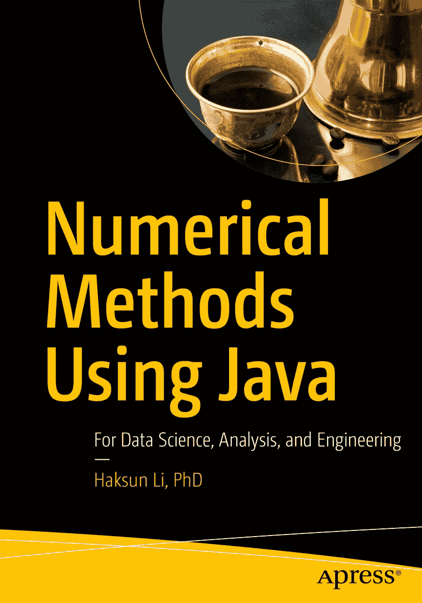

ISBN 978-1-4842-6796-7（纸质版） e-ISBN 978-1-4842-6797-4（电子版） [`doi.org/10.1007/978-1-4842-6797-4`](https://doi.org/10.1007/978-1-4842-6797-4)

© Haksun Li, 博士 2022

本作品受版权保护。出版者保留所有权利，无论涉及材料的全部或部分，具体包括翻译权、重印权、插图复用权、朗诵权、广播权、微缩胶片复制权或其他任何物理形式的复制权，以及信息存储与检索、电子改编、计算机软件，或目前已知或未来开发的任何类似或不同方法的传输权。本出版物中通用描述性名称、注册商标、商标、服务标记等的使用，即使无明确声明，也不意味着此类名称可免于相关保护性法律和法规的约束，因此可供一般性使用。出版者、作者和编辑默认本书中的建议和信息在出版时是真实和准确的。出版者、作者和编辑均不对书中材料或可能存在的任何错误或遗漏提供明示或暗示的担保。出版者对于已出版地图中的管辖权主张和机构归属保持中立。

本 Apress 印记由注册公司 APress Media, LLC（Springer Nature 的一部分）出版。

注册公司地址为：1 New York Plaza, New York, NY 10004, U.S.A.

*谨以此书献给我挚爱的儿子们，Tintin 和 Yiyi，希望有一天你们能在本书中找到那句关于如何解决任何问题的真言。*

