# 2. 线性代数

线性代数算法是数值计算中最重要的算法。它们是所有数值算法的基础。许多数值算法，无论多么复杂，都涉及一些线性代数计算。例如，一个非线性问题通常很难（甚至不可能）直接求解。一种常用的技术是将非线性问题近似为多个较小的线性（子）问题（如微积分中那样）。由于多变量，线性问题通常涉及一些向量和矩阵。向量和矩阵运算在数值计算中无处不在。不同库的理论算法可能相同，但实现方式可能大相径庭，从而导致性能和精度差异巨大。因此，线性代数算法（例如矩阵分解）的实现，对许多数值算法乃至整个数值计算的精度和性能都至关重要。

构建一个高质量、专业的线性代数计算库至少面临两个挑战：精度和高性能（快速计算）。一台计算机只能表示有限数量的数字（一台 64 位计算机大约只能表示 1.8e19 个数字）；换言之，有无数个数字是计算机无法表示的。计算的（浮点）值通常只是真实理论结果的近似值。当计算涉及一个非常大的数和一个非常小的数时，情况会变得更糟。结果往往会偏向大数，从而忽略小数的精度。在迭代计算（如优化计算）中，每一轮产生的微小误差会不断累积。一个理论上可处理的问题，有时会变得实际上不可行。

因此，仅仅正确实现理论算法是不够的。一个专业的数值库还需要处理实际的数值问题，例如，当处理元素数量级相差巨大的矩阵时。涉及一系列连续的行和/或列操作（混合了非常小和非常大的元素）的基本矩阵运算，将导致相当大的舍入误差。处理此问题的一种实现方式是，尽可能预先对矩阵进行置换，使得元素按单调顺序重新排列。我们可以应用置换矩阵将较小的元素推到左上角。然后我们从右下角开始进行操作。有时，选择更好的算法也会有所帮助。例如，在计算特征值时，`QL` 算法通常比 `QR` 算法具有更小的舍入误差。

在 NM Dev 中，我们严肃对待数值稳定性这一问题。我们在大量基准问题实例上测试了我们的库，并收集了病态和退化的情况。然后，我们应用各种数值技术逐一处理这些情况。我们仔细地将我们的结果与其他开源和商业软件进行比较，以确保我们的结果良好。这个过程使我们的库更加健壮，能够处理各种不同的问题结构。

加速向量和矩阵计算自然也会普遍加速任何数值计算。使用现代计算技术实现这一目标有很多方法（因此也有很多考虑因素）：并行计算（多线程、多核、多机、CUDA）、更快的算法、更高效的数据结构、原地操作与复制对象、内联操作与虚函数调用等。其中一些技术（例如内联操作）可以加速代码执行，但它们可能会使代码变得难以被他人（有时甚至是原作者）理解，从而无法维护。NM Dev 试图在可读性（对人类而言）和速度之间取得平衡。我们已将 NM Dev 的性能与所有其他公开可用的主要 Java 数学库进行了比较。比较是在一台配备双 Intel Xeon X5650 2.66GHz（总共 12 核）、24 GB 内存、运行 Windows 7 Ultimate 64 位的机器上进行的。使用的 JVM 是 Oracle Java HotSpot 64 位 Server 1.8.0_25。根据我们的基准测试，NM Dev 可能是迄今为止最快的（Java）数学库。以下是几个基准测试对比。完整测试套件的源代码和结果可从此处下载：

```
http://www.numericalmethod.com/benchmark/benchmark_chart.html?category=linearalgebra&recordId=latest
```

NM Dev 或 SuanShu 的矩阵乘法比 Apache Commons Math 快 180 倍，比 R 语言快 14 倍。参见图 2-1。


图 2-1

NM Dev 矩阵乘法速度是 Apache 的 182 倍

这是因为 NM Dev 矩阵实现使用了自适应 Strassen 算法的并行版本来实现快速矩阵乘法，其复杂度为 *O*(*n*^(2.8074))。Apache Commons Math 以及我所知的大多数其他 Java 库都实现了标准的 *O*(*n*³) 算法。对于较大的矩阵，尤其是处理大数据时，NM Dev 的性能优势非常显著。

NM Dev 的矩阵行列式计算速度是 Apache Commons Math 的 31 倍。参见图 2-2。


图 2-2

NM Dev 矩阵行列式计算速度是 Apache 的 31 倍

NM Dev 的 LU 分解速度是 Apache Commons Math 的 32 倍。参见图 2-3。


图 2-3

NM Dev LU 分解速度是 Apache 的 32 倍

NM Dev 的 QR 分解速度是 R 语言的两倍。参见图 2-4。


图 2-4

NM Dev QR 分解速度是 R 语言的两倍

NM Dev 的 SVD 分解速度是 R 语言的两倍。参见图 2-5。


图 2-5

NM Dev SVD 分解速度是 R 语言的两倍

在求解（该）线性方程组时，NM Dev 比 R 语言快六倍。参见图 2-6。


图 2-6

求解线性方程组时，NM Dev 的速度是 R 语言的六倍

## 2.1 `Vector`

在数学中，欧几里得向量是一个具有大小（或长度）和方向的几何对象。一个 *n* 维向量可以表示为一个由 *n* 个标量元素组成的数组，其中每个元素是向量在对应维度上投影的长度。例如，在二维欧几里得空间（用`ℝ`²表示）中，从点 *A* = (0, 0) 指向点 *B* = (1, 2) 的向量 *a* 可以用下式表示：

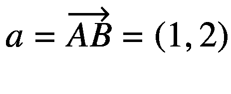

在 NM Dev 中，向量由接口`Vector`表示。有多种方式可以构造这样一个对象。最常见的方式是使用双精度浮点数数组初始化一个`DenseVector`，指定每一个元素。见图 2-7。


图 2-7

向量 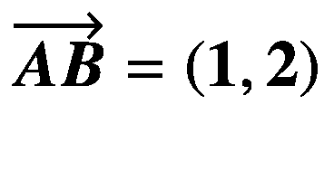

```java
Vector v1 = new DenseVector(new double[]{1.0, 2.0}); // 定义一个向量
System.out.println(v1); // 打印 v1
```

输出如下：

```
v1 = [1.000000, 2.000000]
```

### 2.1.1 逐元素操作

这些函数用于访问和修改`Vector`：

```java
/**
* 获取此向量的长度。
*
* @return 向量长度
*/
public int size();
/**
* 获取位置 i 上的值。
*
* @param i 向量条目的位置
* @return v[i]
*/
public double get(int i);
/**
* 更改此向量中某个条目的值。
* 这是唯一可能更改向量条目的方法。
*
* @param i     要更改的条目的索引。索引从 1 开始计数，而不是从 0 开始。
* @param value 要更改成的值
*/
public void set(int i, double value);
```

计算机科学家从 0 开始计数，而数学家从 1 开始计数。NM Dev 遵循数学家的惯例，从 1 而不是 0 开始对（向量和矩阵）索引进行计数。

继续前面的例子，以下代码片段将向量更改为 (1, -2)：

## 向量的算术运算

```
double v1_1 = v1.get(1); // 1.0
System.out.println(v1_1);
v1.set(2, -2.0); // v1 变为 (1.0, -2.0)
System.out.println(v1);
int size = v1.size(); // 2
System.out.println(size);
```

输出如下：

```
v1 size = 2
v1_1 = 1.000000
v1 = [1.000000, -2.000000]
```

在 NM Dev 中，向量的算术运算——加法、减法、乘法、除法、缩放以及幂运算——都是逐元素操作。

```
/**
* \(this + that\)
*
* @param that 一个向量
* @return \(this + that\)
*/
@Override
public Vector add(Vector that);
/**
* \(this - that\)
*
* @param that 一个向量
* @return \(this - that\)
*/
@Override
public Vector minus(Vector that);
/**
* 将 `this` 与 `that` 逐元素相乘。
*
* @param that 一个向量
* @return \(this \cdot that\)
*/
public Vector multiply(Vector that);
/**
* 将 `this` 除以 `that`，逐元素相除。
*
* @param that 一个向量
* @return \(this / that\)
*/
public Vector divide(Vector that);
/**
* 向此向量的所有元素加上一个常数。
*
* @param c 一个常数
* @return \(v + c\)
*/
public Vector add(double c);
/**
* 从此向量的所有元素中减去一个常数。
*
* @param c 一个常数
* @return \(v - c\)
*/
public Vector minus(double c);
/**
* 对此向量的所有元素进行幂运算，逐元素运算。
*
* @param c 一个常数
* @return \(v ^ c\)
*/
public Vector pow(double c);
/**
* 用一个常数缩放此向量，逐元素缩放。以下是获取向量单位版本的一种方法：
*
* vector.scaled(1\. / vector.norm())
*
*
* @param c 一个常数
* @return \(c \times this\)
*/
public Vector scaled(double c);
```

以下代码片段演示了向量的算术运算：

```
Vector v2 = new DenseVector(new double[]{-2.0, 1.0}); // 定义另一个向量
// 加法
Vector a1 = v1.add(0.1); // 所有元素加 0.1
System.out.println(String.format("a1 = %s", a1)); // 打印 a1
Vector a2 = v1.add(v2); // a2 = v1 + v2，逐元素相加
System.out.println(String.format("a2 = %s", a2)); // 打印 a2
// 减法
Vector m1 = v1.minus(0.1); // 所有元素减 0.1
System.out.println(String.format("m1 = %s", m1)); // 打印 m1
Vector m2 = v1.minus(v2); // v1 – v2，逐元素相减
System.out.println(String.format("m2 = %s", m2)); // 打印 m2
// 缩放、乘法、除法
Vector s1 = v1.scaled(0.5); // 所有元素乘以 0.5
System.out.println(String.format("s1 = %s", s1)); // 打印 s1
// 乘法
Vector t1 = v1.multiply(v2); // v1 乘以 v2，逐元素相乘
System.out.println(String.format("t1 = %s", t1)); // 打印 t1
// 除法
Vector d1 = v1.divide(v2); // v1 除以 v2，逐元素相除
System.out.println(String.format("d1 = %s", d1)); // 打印 d1
// 幂运算
Vector p1 = v1.pow(2.0); // 逐元素求平方
System.out.println(String.format("p1 = %s", p1)); // 打印 p1
```

输出如下：

```
v1 = [1.000000, -2.000000]
a1 = [1.100000, -1.900000]
a2 = [-1.000000, -1.000000]
m1 = [0.900000, -2.100000]
m2 = [3.000000, -3.000000]
s1 = [0.500000, -1.000000]
t1 = [-2.000000, -2.000000]
d1 = [-0.500000, -2.000000]
p1 = [1.000000, 4.000000]
```

### 2.1.2 范数

向量 `x` = (`x[1]`, `x[2]`, …, `x[n]`) 的 `ℓ[p]`-范数定义如下：

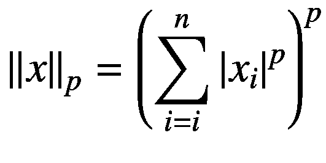

范数是一个函数，它将向量映射到一个非负实数，其行为在某些方面类似于到原点的距离。它与缩放运算可交换，服从某种形式的三角不等式，并且仅在原点处为零。在 NM Dev 中，向量范数通过成员方法 `norm(double p)` 计算。特别地，当不提供参数时，`norm()` 计算 `ℓ[2]`-范数。`ℓ[2]`-范数或欧几里得范数，通常记为 ‖`x`‖[2] 或简写为 ‖`x`‖，是向量到原点的欧几里得距离。它也是向量与其自身内积的平方根。下面的代码片段计算了一个边长分别为 3 和 4 的直角三角形的 `ℓ[1]`-范数和 `ℓ[2]`-范数。见图 2-8。

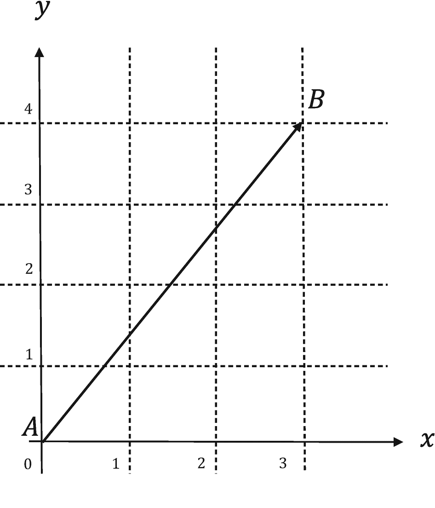

图 2-8

一个 3-4-5 三角形

```
// norm
Vector v3 = new DenseVector(new double[]{3., 4.});
double norm1 = v3.norm(1); // l1 范数 = (3\. + 4.) = 7.
System.out.println(String.format("L1 norm = %f", norm1));
double norm2 = v3.norm(); // l2 范数 = sqrt(3² + 4²) = 5, 勾股定理
System.out.println(String.format("L2 norm = %f", norm2));
```

输出如下：

```
L1 norm = 7.000000
L2 norm = 5.000000
```

### 2.1.3 内积与角度

在实 `n` 维空间 `ℝ`^(`n`) 中，向量 `x` = (`x[1]`, `x[2]`, …, `x[n]`) 和 `y` = (`y[1]`, `y[2]`, …, `y[n]`) 的内积定义如下：

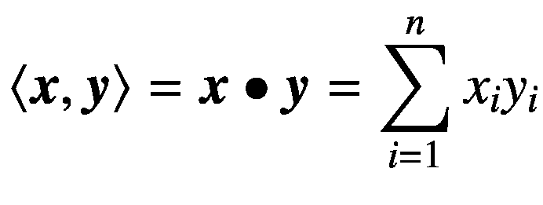

`x` 和 `y` 之间的夹角 `θ` 如下：

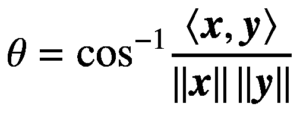

请参阅图 2-9。

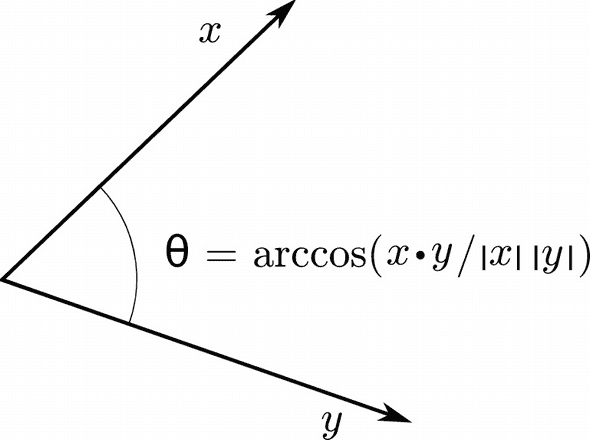

# 图 2-9 点积与角度

具体来说，如果向量 `x` 和 `y` 正交或垂直（其夹角为 90°），则 `x ⋅ y = 0`。在另一种极端情况下，如果它们指向同一方向（其夹角为 0°），则 `x ⋅ y = ‖x‖‖y‖`。这意味着向量 `x` 与自身的点积为 `x ⋅ x = ‖x‖²`。在 NM Dev 中，内积和角度的签名如下：

```java
/**
 * Inner product in the Euclidean space is the dot product.
 *
 * @param that a vector
 * @return \(this \cdot that\)
 * @see  Wikipedia: Dot product
 */
@Override
public double innerProduct(Vector that);

/**
 * Measures the angle, \(\theta\), between {@code this} and {@code that}.
 * That is,
 * \[
 * this \cdot that = \|this\| \times \|that\| \times \cos \theta
 * \]
 *
 * @param that a vector
 * @return the angle, \(\theta\), between {@code this} and {@code that}
 */
@Override
public double angle(Vector that);
```

示例如下：

```java
// inner product and angle
Vector v4 = new DenseVector(new double[]{1., 2.});
Vector v5 = new DenseVector(new double[]{3., 4.});
double dot = v4.innerProduct(v5); // (1.*3 + 2.*4) = 11.
System.out.println(String.format(" = %f", v4, v5, dot));
double angle = v4.angle(v5);
System.out.println(String.format("angle between %s and %s = %f", v4, v5, angle));
```

输出结果如下：

```
 = 11.000000
angle between [1.000000, 2.000000]  and [3.000000, 4.000000]  = 0.179853
```

## 2.2 矩阵

矩阵是排列成矩形阵列（即行和列）的一组元素或条目。一个 *m* × *n* 矩阵是一个具有 *m* 行和 *n* 列的矩形数组。矩阵的元素可以是数字、符号或数学表达式。以下是一个由九个元素组成的三行三列矩阵：

![$$ \left[\begin{array}{ccc}1& 2& 3\\ {}4& 5& 6\\ {}7& 8& 9\end{array}\right] $$](images/500382_1_En_2_Chapter/500382_1_En_2_Chapter_TeX_Eque.png)

在一个 *m* × *n* 矩阵 `A` 中，单个元素通常用 `a[ij]` 表示，其中 `i`（行索引）和 `j`（列索引）的取值范围通常分别为 1 到 *m* 和 1 到 *n*。为了方便表示矩阵运算结果的某个元素，该元素的索引常附加到带括号的矩阵表达式之后（例如，`(AB)[ij]` 表示矩阵乘积的一个元素）。如果 *m* > *n*，则矩阵为高矩阵；如果 *m* < *n*，则为胖矩阵；如果 *m* = *n*，则为方矩阵。请参阅图 2-10。

在 NM Dev 中，矩阵由接口 `Matrix` 表示。构建 `Matrix` 对象有多种方式。最常见的方法是使用 `DenseMatrix` 实现，并通过一个 `double` 数组指定所有元素（包括非零元素和零元素）。以下代码片段构建了上面所示的 3×3 矩阵：

![图 2-10 `a[ij]` 表示第 i 行第 j 列的元素](img/500382_1_En_2_Fig10_HTML.png)

```java
// matrix construction
Matrix m1 = new DenseMatrix( // define a matrix
    new double[][]{
        {1, 2, 3},
        {4, 5, 6},
        {7, 8, 9}
    });
Matrix m2 = new DenseMatrix(m1); // copy the matrix m1
System.out.println(String.format("m1 = %s", m1)); // print out the matrix m1
System.out.println(String.format("m2 = %s", m2)); // print out the matrix m2
```

输出结果如下：

```
m1 = 3x3
[,1] [,2] [,3]
[1,] 1.000000, 2.000000, 3.000000,
[2,] 4.000000, 5.000000, 6.000000,
[3,] 7.000000, 8.000000, 9.000000,
m2 = 3x3
[,1] [,2] [,3]
[1,] 1.000000, 2.000000, 3.000000,
[2,] 4.000000, 5.000000, 6.000000,
[3,] 7.000000, 8.000000, 9.000000,
```

构建 `DenseMatrix` 有多种方式。其签名如下：

# 矩阵构造

`DenseMatrix` 类提供了多种构造函数来创建矩阵。

```java
/**
 * Constructs a 0 matrix of dimension nRows * nCols.
 *
 * @param nRows the number of rows
 * @param nCols the number of columns
 */
public DenseMatrix(int nRows, int nCols)
```

```java
/**
 * Constructs a matrix from a 2D {@code double[][]} array.
 *
 * @param data a 2D array input
 * @throws IllegalArgumentException when {@code data} is a jagged array
 */
public DenseMatrix(double[][] data)
```

```java
/**
 * Constructs a matrix from a 1D {@code double[]}. The array is a
 * concatenation of the matrix rows. A sample usage is to convert a vector
 * to a matrix. For example, to construct a column vector, we do
 * {@code
 * DenseMatrix V = new DenseMatrix(v.toArray(), v.length, 1);
 * } To construct a row vector, we do
 * {@code
 * DenseMatrix V = new DenseMatrix(v.toArray(), 1, v.length);
 * }
 *
 * @param data  the 1D array input
 * @param nRows the number or rows
 * @param nCols the number of columns
 * @throws IllegalArgumentException when the length of {@code data} does not
 *                                  equal to nRows * nCols
 */
public DenseMatrix(double[] data, int nRows, int nCols)
```

```java
/**
 * Constructs a column matrix from a vector.
 *
 * @param v a vector
 */
public DenseMatrix(Vector v)
```

```java
/**
 * Converts any matrix to the standard matrix representation. This method is
 * the same as {@link #toDense} if {@code A} is {@link Densifiable}.
 *
 * @param A a matrix
 */
public DenseMatrix(Matrix A)
```

```java
/**
 * Copy constructor performing a deep copy.
 *
 * @param A a {@code DenseMatrix}
 */
public DenseMatrix(DenseMatrix A)
```

例如，以下代码片段从一个向量创建了一个列矩阵：

```java
// create a vector
Vector v = new DenseVector(new double[]{1, 2, 3});
// create a column matrix from a vector
Matrix m3 = new DenseMatrix(v);
System.out.println(String.format("m3 = %s", m3)); // print out the matrix m3
```

输出结果如下：

```
m3 = 3x1
[,1]
[1,] 1.000000,
[2,] 2.000000,
[3,] 3.000000,
```

## 2.2.1 矩阵运算

在设计 NM Dev 库时，我们决定让类库尽可能精简，以避免方法污染。这一设计理念源自 jMatrices 白皮书。其挑战在于如何将方法按最小且正确的包进行组织。`Matrix` 类仅有 26 个方法，其中 9 个是构造函数及相关方法，3 个是对 `AbstractMatrix` 接口的重写，8 个是对 `MatrixSpace` 接口的重写。只有六种方法是该类特有的，这使得用户调用这些方法时非常便捷。其他数十种矩阵运算，例如多种分解、秩等属性以及求逆等变换，被分组到多个类和包中。在大多数情况下，这些运算中的每一个本身就是一个类。例如，求逆运算本身就是一个继承自 `Matrix` 的类。其构造函数接收一个 `Matrix` 作为输入，对其进行求逆。例如，求如下矩阵的逆：

![$$ \boldsymbol{A}=\left[\begin{array}{ccc}1&amp; 2&amp; 3\\ {}6&amp; 5&amp; 4\\ {}8&amp; 7&amp; 9\end{array}\right] $$](images/500382_1_En_2_Chapter/500382_1_En_2_Chapter_TeX_Equf.png)

我们编写如下代码：

```java
Matrix A = new DenseMatrix(
new double[][]{
{1, 2, 3},
{6, 5, 4},
{8, 7, 9}
});
Matrix Ainv = new Inverse(A);
Matrix I = A.multiply(Ainv);
System.out.println(String.format("%s * \n%s = \n%s", A, Ainv, I));
```

输出结果如下：

```
3x3
[,1] [,2] [,3]
[1,] 1.000000, 2.000000, 3.000000,
[2,] 6.000000, 5.000000, 4.000000,
[3,] 8.000000, 7.000000, 9.000000,  *
3x3
[,1] [,2] [,3]
[1,] -0.809524, -0.142857, 0.333333,
[2,] 1.047619, 0.714286, -0.666667,
[3,] -0.095238, -0.428571, 0.333333,  =
3x3
[,1] [,2] [,3]
[1,] 1.000000, 0.000000, 0.000000,
[2,] -0.000000, 1.000000, 0.000000,
[3,] -0.000000, -0.000000, 1.000000,
```

NM Dev 计算出的 A 的逆矩阵如下：

![$$ A=\left[\begin{array}{ccc}-0.809524&amp; -0.142857&amp; 0.333333\\ {}1.047619&amp; 0.714286&amp; -0.666667\\ {}-0.095238&amp; -0.428571&amp; 0.333333\end{array}\right] $$](images/500382_1_En_2_Chapter/500382_1_En_2_Chapter_TeX_Equg.png)

需要特别注意的是，A 的逆矩阵 `Ainv` 也是一个 `Matrix`，它通过关键字 `new` 创建，而非通过方法调用。总之，我们选择拥有许多类，而不是让一个类拥有许多方法。每个类都被刻意保持简短。这种类精简原则是指引整个库开发的关键设计决策。

## 2.2.2 逐元素运算

这些函数用于访问和修改一个 `Matrix`：

```java
/**
 * 将矩阵在 [i,j] 位置的元素设置为指定值。
 * 这是唯一可能改变矩阵的方法。
 *
 * @param i     行索引
 * @param j     列索引
 * @param value 要设置给 A[i,j] 的值
 * @throws MatrixAccessException 如果 i 或 j 超出范围
 */
public void set(int i, int j, double value) throws MatrixAccessException;
/**
 * 获取矩阵在 [i,j] 位置的元素。
 *
 * @param i 行索引
 * @param j 列索引
 * @return A[i,j]
 * @throws MatrixAccessException 如果 i 或 j 超出范围
 */
public double get(int i, int j) throws MatrixAccessException;
```

NM Dev 中（向量和矩阵的）索引从 1 开始计数，而不是从 0 开始。左上角的元素是第 (1, 1) 个元素。

以下代码片段将对角线元素修改为 0：

### 矩阵运算基础

```java
Matrix m1 = new DenseMatrix( // 定义一个矩阵
    new double[][]{
        {1, 2, 3},
        {4, 5, 6},
        {7, 8, 9}
    });
// getter 和 setter 方法
double m1_11 = m1.get(1, 1);
double m1_22 = m1.get(2, 2);
double m1_33 = m1.get(3, 3);
System.out.println(String.format("对角线元素为: %f, %f, %f", m1_11, m1_22, m1_33));
// 将对角线元素修改为 0
m1.set(1, 1, 0.);
m1.set(2, 2, 0.);
m1.set(3, 3, 0.);
System.out.println(String.format("m1 = %s", m1)); // 打印矩阵 m1
```

输出结果如下：

```
对角线元素为: 1.000000, 5.000000, 9.000000
将对角线元素修改为 0
m1 = 3x3
[,1] [,2] [,3]
[1,] 0.000000, 2.000000, 3.000000,
[2,] 4.000000, 0.000000, 6.000000,
[3,] 7.000000, 8.000000, 0.000000,
```

在 NM Dev 中，矩阵的算术运算——加法、减法和缩放——都是逐元素运算。其签名如下：

```java
/**
* this + that
*
* @param that 一个矩阵
* @return {@code this} 和 {@code that} 的和
*/
@Override
public Matrix add(Matrix that);

/**
* this - that
*
* @param that 一个矩阵
* @return {@code this} 和 {@code that} 的差
*/
@Override
public Matrix minus(Matrix that);

/**
* 将矩阵 this（A）乘以一个常数进行缩放。
*
* @param c 一个双精度浮点数
* @return cA
*/
public Matrix scaled(double c);
```

示例如下：

```java
Matrix m1 = new DenseMatrix(
    new double[][]{
        {1, 2, 3},
        {4, 5, 6},
        {7, 8, 9}
    });
// m2 = -m1
Matrix m2 = m1.scaled(-1);
// m3 = m1 + m2 = m1 - m1 = 0
Matrix m3 = m1.add(m2);
// 不推荐的使用方式
boolean isEqual1 = m3.equals(m3.ZERO());
System.out.println(isEqual1);
// 推荐的使用方式
boolean isEqual2 = MatrixPropertyUtils.areEqual(m3, m3.ZERO(), 1e-16);
System.out.println(isEqual2);
```

输出结果如下：

```
true
true
```

`ZERO()` 方法生成一个与调用实例维度相同的零矩阵。`equals()` 函数用于比较两个矩阵，检查它们在数值上是否相等。但是，不推荐使用此函数，因为理论上相同的两个矩阵在计算机中可能有不同的表示形式。元素的值可能存在微小差异。`equals()` 函数会错误地将它们视为不同。检查两个矩阵数值是否相等的正确方法是逐元素检查它们在给定的阈值内是否相同。工具函数 `MatrixPropertyUtils.areEqual` 就是为了达到这个目的。与 `equals()` 方法相比，该工具函数的优势在于我们可以为浮点数比较输入一个容差阈值。其签名如下：

```java
/**
* 检查两个矩阵是否在指定精度内相等。
* 如果满足以下条件，则两个矩阵相等：
* 
* 维度相同；
* 所有元素都相等
* 
*
* @param A1      一个矩阵
* @param A2      一个矩阵
* @param epsilon 精度参数：当一个数 |x| ≤ ε 时，它被视为 0
* @return {@code true} 如果所有元素逐项都相等
*/
public static boolean areEqual(Matrix A1, Matrix A2, double epsilon)
```

### 矩阵转置

矩阵 `A` 的转置 `A^T = A'` 定义如下：

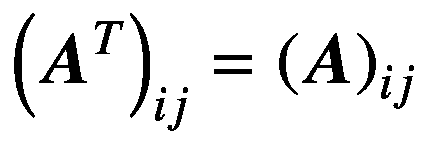

也就是说，它交换了行和列。列变为行，行变为列。例如，对于以下矩阵：

![$$ \boldsymbol{A}=\left[\begin{array}{ccc}1&amp; 2&amp; 3\\ {}4&amp; 5&amp; 6\\ {}7&amp; 8&amp; 9\end{array}\right] $$](images/500382_1_En_2_Chapter/500382_1_En_2_Chapter_TeX_Equi.png)

其转置如下：

![$$ {\boldsymbol{A}}^T=\left[\begin{array}{ccc}1&amp; 4&amp; 7\\ {}2&amp; 5&amp; 8\\ {}3&amp; 6&amp; 9\end{array}\right] $$](images/500382_1_En_2_Chapter/500382_1_En_2_Chapter_TeX_Equj.png)

以下代码实现了这个示例：

```java
Matrix m1 = new DenseMatrix(
    new double[][]{
        {1, 2, 3},
        {4, 5, 6},
        {7, 8, 9}
    });
System.out.println(String.format("m1 = %s", m1)); // 打印矩阵 m1
Matrix m1t = m1.t(); // 执行转置
System.out.println(String.format("m1t = %s", m1t)); // 打印转置矩阵
```

输出结果如下：

```
m1 = 3x3
[,1] [,2] [,3]
[1,] 1.000000, 2.000000, 3.000000,
[2,] 4.000000, 5.000000, 6.000000,
[3,] 7.000000, 8.000000, 9.000000,
m1t = 3x3
[,1] [,2] [,3]
[1,] 1.000000, 4.000000, 7.000000,
[2,] 2.000000, 5.000000, 8.000000,
[3,] 3.000000, 6.000000, 9.000000,
```

### 矩阵乘法

矩阵乘法是一种二元运算，用于从两个矩阵得到第三个矩阵。这第三个矩阵是前两个矩阵的乘积，称为*矩阵乘积*。如果 **A** 是一个 *m* × *n* 矩阵，**B** 是一个 *n* × *p* 矩阵，那么它们的矩阵乘积 **C** = **AB** 是一个 *m* × *p* 矩阵。**A** 中每一行的 *m* 个元素与 **B** 中对应列的 *m* 个元素相乘，这些乘积之和就是矩阵 **C** = **AB** 的一个元素。参见图 2-11。数学表达式如下：

``

``

**图 2-11** 矩阵乘法

例如，对于这样一个矩阵：

`![$$ \boldsymbol{A}=\left[\begin{array}{ccc}1&amp; 2&amp; 3\\ {}4&amp; 5&amp; 6\\ {}7&amp; 8&amp; 9\end{array}\right] $$](images/500382_1_En_2_Chapter/500382_1_En_2_Chapter_TeX_Equl.png)`

我们得到：

注意，矩阵乘法不满足交换律，这意味着 `AB` 不一定等于 `BA`。

以下代码实现了这个示例：

```
Matrix m1 = new DenseMatrix(
new double[][]{
{1, 2, 3},
{4, 5, 6},
{7, 8, 9}
});
Matrix m1t = m1.t();
Matrix m1tm1 = m1t.multiply(m1);
System.out.println(String.format("%s * \n%s = \n%s", m1t, m1, m1tm1));
```

输出如下：

```
3x3
[,1] [,2] [,3]
[1,] 1.000000, 4.000000, 7.000000,
[2,] 2.000000, 5.000000, 8.000000,
[3,] 3.000000, 6.000000, 9.000000,  *
3x3
[,1] [,2] [,3]
[1,] 1.000000, 2.000000, 3.000000,
[2,] 4.000000, 5.000000, 6.000000,
[3,] 7.000000, 8.000000, 9.000000,  =
3x3
[,1] [,2] [,3]
[1,] 66.000000, 78.000000, 90.000000,
[2,] 78.000000, 93.000000, 108.000000,
[3,] 90.000000, 108.000000, 126.000000,
```

矩阵乘法在科学计算中占据核心地位，应用极其广泛。线性代数中的许多数值过程（例如，求解线性方程组、矩阵求逆、矩阵分解、行列式计算）本质上都可以简化为矩阵乘法。因此，研究快速矩阵乘法算法以加速矩阵乘法（以及由此加速的其他数值过程）具有重要意义。根据我们的基准测试，NM Dev 在矩阵乘法以及后续的线性代数计算中已经是速度最快的。参见图 2-12。

``

**图 2-12** NM Dev 快速矩阵乘法

NM Dev 实现了用于快速矩阵乘法的高级算法。我们将简要描述我们所实现的矩阵乘法算法，该算法相比经典的 IJK 算法，显著加速了稠密矩阵-矩阵的乘法。

我们首先描述用于对比我们快速算法的基准方法——IJK 算法。经典的 IJK 算法通过三层循环实现矩阵乘法，因此时间复杂度为 *O*(*n*³)。假设 **A** 是 *m* × *n* 矩阵，**B** 是 *n* × *p* 矩阵，**C** 是 *m* × *p* 矩阵，IJK 算法如下所示：

```
for (i = 1; i <= m; i ++){
for (j = 1; j <= p; j ++){
for (k = 1; k <= n; k ++){
C[i,k] += A[i,j] * B[j,k];
}
}
}
```

在 NM Dev 中，这是并行实现的；最外层的循环被传递给一个 `ParallelExecutor`。由于行数通常多于可用的线程数，对于 *m* = *n* = *p* 的情况，这种并行化后的 IJK 算法的复杂度仍然与经典版本大致相同，即 *O*(*mnp*) 或三次时间 *O*(*n*³)。这是大多数其他 Java 库中采用的实现方式，而我们希望做得比这好得多。

我们快速乘法算法的核心——Strassen 算法，将时间复杂度降低到了 ``。Strassen 算法（Strassen, 1969）基于以下分块矩阵乘法：

`![$$ \left(\begin{array}{cc}{\boldsymbol{A}}_{\mathbf{11}}& {\boldsymbol{A}}_{\mathbf{12}}\\ {}{\boldsymbol{A}}_{\mathbf{21}}& {\boldsymbol{A}}_{\mathbf{22}}\end{array}\right)\left(\begin{array}{cc}{\boldsymbol{B}}_{\mathbf{11}}& {\boldsymbol{B}}_{\mathbf{12}}\\ {}{\boldsymbol{B}}_{\mathbf{21}}& {\boldsymbol{B}}_{\mathbf{22}}\end{array}\right)=\left(\begin{array}{cc}{\boldsymbol{A}}_{\mathbf{11}}{\boldsymbol{B}}_{\mathbf{11}}+{\boldsymbol{A}}_{\mathbf{12}}{\boldsymbol{B}}_{\mathbf{21}}& {\boldsymbol{A}}_{\mathbf{11}}{\boldsymbol{B}}_{\mathbf{12}}+{\boldsymbol{A}}_{\mathbf{12}}{\boldsymbol{B}}_{\mathbf{22}}\\ {}{\boldsymbol{A}}_{\mathbf{21}}{\boldsymbol{B}}_{\mathbf{11}}+{\boldsymbol{A}}_{\mathbf{22}}{\boldsymbol{B}}_{\mathbf{21}}& {\boldsymbol{A}}_{\mathbf{21}}{\boldsymbol{B}}_{\mathbf{12}}+{\boldsymbol{A}}_{\mathbf{22}}{\boldsymbol{B}}_{\mathbf{22}}\end{array}\right) $$](img/500382_1_En_2_Chapter_TeX_Equn.png)`

这种朴素的计算方法涉及八次子矩阵乘法和四次加法。我们使用的 Strassen 算法的 Winograd 变体则减少了一次子矩阵乘法，但增加了 11 次加法/减法运算；当子矩阵足够大时，这种方法更快（Winograd, 1971）。

``

**图 2-13** Strassen 算法（Winograd 变体）示意图

该算法的运行步骤如下（参见图 2-13）：

| `M[1] = A[11]` | `N[1] = B[11]` |
| --- | --- |
| `M[2] = A[12]` | `N[2] = B[21]` |
| `M[3] = A[21] + A[22]` | `N[3] = B[12] - B[11]` |
| `M[4] = M[3] - A[11]` | `N[4] = B[22] - N[3]` |
| `M[5] = A[11] - A[21]` | `N[5] = B[22] - B[12]` |
| `M[6] = A[12] - M[4]` | `N[6] = B[22]` |
| `M[7] = A[22]` | `N[7] = B[21] - N[4]` |

1. 将 `A` 分割成四个大小相等的象限 `A[11]`、`A[12]`、`A[21]`、`A[22]`。对 `B` 执行相同的操作。（这里假设所有维度都是偶数。）

2. 得到以下因子矩阵：

| `C[11] = P[1] + P[2]` | `C[22] = T[2] + P[3]` |
| --- | --- |
| `T[1] = P[1] + P[4]` | `T[3] = T[1] + P[3]` |
| `T[2] = T[1] + P[5]` | `C[12] = T[3] + P[6]` |
| `C[21] = T[2] + P[7]` | |

### 2.2.5 秩

矩阵 `A` 的列秩是 `A` 中最大线性无关列的数量。类似地，行秩是 `A` 中最大线性无关行的数量。矩阵的列秩和行秩总是相等，因此它们可以简称为矩阵的秩 `rank(A)`。如果方阵的秩与其列数（或行数）相同，则称为*满秩矩阵*。

以下是一个示例：

`$$ \boldsymbol{A}=\left[\begin{array}{ccc}1&amp; 0&amp; 1\\ {}-2&amp; -3&amp; 1\\ {}3&amp; 3&amp; 0\end{array}\right] $$`

`A` 的秩为 2，因为前两列是线性无关的。然而，第三列是前两列的线性组合。具体来说，第三列等于第一列减去第二列。这不是一个满秩矩阵。

以下是另一个示例：

`$$ \boldsymbol{A}=\left[\begin{array}{cccc}1&amp; 1&amp; 0&amp; 2\\ {}-1&amp; -1&amp; 0&amp; -2\end{array}\right] $$`

`A` 的秩为 1，因为每一列都是第一列乘以一个标量得到。

在 NM Dev 中，实用函数 `MatrixMeasure.rank` 用于计算矩阵的秩。以下代码计算了上述两个矩阵的秩：

```java
final double PRECISION = 1e-15;
Matrix M1 = new DenseMatrix(new double[][]{
{1, 0, 1},
{-2, -3, 1},
{3, 3, 0}
});
// 计算 M1 的秩，将绝对值小于 PRECISION 的数字视为 0
int rank1 = MatrixMeasure.rank(M1, PRECISION);
System.out.println(rank1);
Matrix M2 = new DenseMatrix(new double[][]{
{1, 1, 0, 2},
{-1, -1, 0, -2}
});
// 计算 M2 的秩，将绝对值小于 PRECISION 的数字视为 0
int rank2 = MatrixMeasure.rank(M2, PRECISION);
System.out.println(rank2);
```

输出结果如下：

```

```

## 行列式

`Determinant`（行列式）是一个将 *n* × *n* 方阵 `A` 映射为标量的函数。它通常表示为 |`A`|。将矩阵 `A` 的元素记为 `a[ij]`，并将 `N[ij]` 定义为从矩阵 `A` 中移除第 *i* 行和第 *j* 列后得到的子矩阵的行列式。那么，矩阵 `A` 的行列式的一个递归定义如下：

## 矩阵行列式

$$ \left|\boldsymbol{A}\right|=\sum \limits_{j=1}^n{\left(-1\right)}^{i+j}{m}_{ij}{N}_{ij} $$

例如，当`n` = 2 时，我们有：

$$ \left|\begin{array}{cc}a&amp; b\\ {}c&amp; d\end{array}\right|= ad- bc $$

类似地，当`n` = 3 时，我们有：

$$ \left|\begin{array}{ccc}a&amp; b&amp; c\\ {}d&amp; e&amp; f\\ {}g&amp; h&amp; i\end{array}\right|=a\left|\begin{array}{cc}e&amp; f\\ {}h&amp; i\end{array}\right|-b\left|\begin{array}{cc}d&amp; f\\ {}g&amp; i\end{array}\right|+c\left|\begin{array}{cc}d&amp; e\\ {}g&amp; h\end{array}\right| $$

$$ = aei+ bfg+ cdh- ceg- bdi- afh $$

这里有一个示例：

$$ \left|\begin{array}{ccc}2&amp; 1&amp; 2\\ {}3&amp; 2&amp; 2\\ {}1&amp; 2&amp; 3\end{array}\right|=5 $$

在 NM Dev 中，工具函数`MatrixMeasure.det`用于计算矩阵的行列式。以下代码计算了上述矩阵的行列式：

```
Matrix M1 = new DenseMatrix(new double[][]{
{2, 1, 2},
{3, 2, 2},
{1, 2, 3}
});
// 计算矩阵 M1 的行列式
double det = MatrixMeasure.det(M1);
System.out.println(det);
```

输出如下：

```
5.0
```

### 逆矩阵与伪逆矩阵

对于一个`n`阶方阵`A`，如果存在一个`n`阶方阵`B`使得

$$ \boldsymbol{AB}=\boldsymbol{BA}={\boldsymbol{I}}_n $$

其中`I_n`是`n`阶单位矩阵，那么矩阵`A`被称为*可逆的*，而矩阵`B`被称为矩阵`A`的逆矩阵。我们通常将`A`的逆矩阵记为`A^{-1}`。也就是说，`A * A^{-1} = A^{-1} * A = I_n`。只有方阵才可能有逆矩阵。一个矩阵可逆当且仅当其满秩。并非所有方阵都是可逆的。不可逆的矩阵被称为奇异矩阵或退化矩阵。一个矩阵是奇异的当且仅当其行列式为 0。

例如，考虑这个矩阵：

$$ \boldsymbol{A}=\left[\begin{array}{cc}-1&amp; \frac{3}{2}\\ {}1&amp; -1\end{array}\right] $$

`A`是可逆的。我们可以通过计算行列式`|A| = -0.5`来验证。具体地，我们有：

$$ \left[\begin{array}{cc}-1&amp; \frac{3}{2}\\ {}1&amp; -1\end{array}\right]\left[\begin{array}{cc}2&amp; 3\\ {}2&amp; 2\end{array}\right]=\left[\begin{array}{cc}1&amp; 0\\ {}0&amp; 1\end{array}\right] $$

在 NM Dev 中，类`Inverse`构造了一个新矩阵，它是可逆矩阵的逆矩阵。以下代码计算了上述矩阵的逆矩阵：

```
Matrix A1 = new DenseMatrix(
new double[][]{
{-1, 3. / 2},
{1, -1}
});
double det1 = MatrixMeasure.det(A1);
System.out.println("det of A1 = " + det1);
Matrix Ainv1 = new Inverse(A1);
Matrix I1 = A1.multiply(Ainv1);
System.out.println(String.format("%s * \n%s = \n%s", A1, Ainv1, I1));
```

输出如下：

```
det of A1 = -0.5
2x2
[,1] [,2]
[1,] -1.000000, 1.500000,
[2,] 1.000000, -1.000000,  *
2x2
[,1] [,2]
[1,] 2.000000, 3.000000,
[2,] 2.000000, 2.000000,  =
2x2
[,1] [,2]
[1,] 1.000000, 0.000000,
[2,] 0.000000, 1.000000,
```

考虑另一个矩阵，如下所示：

$$ \boldsymbol{A}=\left[\begin{array}{cc}2&amp; 4\\ {}5&amp; 10\end{array}\right] $$

很容易验证该矩阵是奇异的，因为`|A| = 0`。因此，它的逆矩阵不存在。摩尔和彭罗斯定义了一个广义的逆概念，称为摩尔-彭罗斯逆矩阵，或简称为伪逆矩阵，记作`A^{+}`。伪逆矩阵具有以下四个定义性性质：

1. `A * A^{+} * A = A`
2. `A^{+} * A * A^{+} = A^{+}`
3. `(A * A^{+})^H = A * A^{+}`
4. `(A^{+} * A)^H = A^{+} * A`

`A^H`运算符表示矩阵的埃尔米特转置（也称为*共轭转置*）。我们首先取矩阵的转置，然后将矩阵元素替换为其复共轭，将`a + bi`替换为`a - bi`。具体地，一个`m` × `n`矩阵`A`的埃尔米特转置定义如下：

$$ {\left({\boldsymbol{A}}^H\right)}_{ij}=\overline{{\boldsymbol{A}}_{ij}} $$

上划线表示标量的复共轭。如果`A`中的所有元素都是实数，那么埃尔米特转置就等于转置。第三个和第四个性质简单地意味着`A * A^{+}`和`A^{+} * A`是对称的。矩阵的伪逆是唯一确定的。它总是存在，即使对于非方阵也是如此。如果一个矩阵是可逆的，那么伪逆就等于逆矩阵。

在 NM Dev 中，类`PseudoInverse`构造了一个新矩阵，它是矩阵（包括奇异矩阵和可逆矩阵）的伪逆矩阵。以下代码计算了上述矩阵的伪逆矩阵：

## 考虑另一个非方阵的例子

考虑另一个非方阵的例子，如下所示：

![$$ \boldsymbol{A}=\left[\begin{array}{cc}1&amp; 0\\ {}0&amp; 1\\ {}0&amp; 1\end{array}\right] $$](images/500382_1_En_2_Chapter/500382_1_En_2_Chapter_TeX_Equaa.png)

其伪逆如下：

![$$ {\boldsymbol{A}}^{+}=\left[\begin{array}{ccc}1&amp; 0&amp; 0\\ {}0&amp; 0.5&amp; 0.5\end{array}\right] $$](images/500382_1_En_2_Chapter/500382_1_En_2_Chapter_TeX_Equab.png)

以下代码计算上述矩阵的伪逆：

```java
Matrix A3 = new DenseMatrix(new double[][]{
{1, 0},
{0, 1},
{0, 1}
});
PseudoInverse A3p = new PseudoInverse(A3);
System.out.println("the pseudo inverse is");
System.out.println(A3p);
// the first property of pseudo-inverse
System.out.println("should be the same as the matrix");
Matrix A3_copy = A3.multiply(A3p).multiply(A3);
System.out.println(A3_copy);
// the second property of pseudo-inverse
System.out.println("should be the same as the pseudo inverse");
Matrix A3p_copy = A3p.multiply(A3).multiply(A3p);
System.out.println(A3p_copy);
```

输出如下：

```
the pseudo inverse is
2x3
[,1] [,2] [,3]
[1,] 1.000000, 0.000000, 0.000000,
[2,] 0.000000, 0.500000, 0.500000,
should be the same as the matrix
3x2
[,1] [,2]
[1,] 1.000000, 0.000000,
[2,] 0.000000, 1.000000,
[3,] 0.000000, 1.000000,
should be the same as the pseudo inverse
2x3
[,1] [,2] [,3]
[1,] 1.000000, 0.000000, 0.000000,
[2,] 0.000000, 0.500000, 0.500000,
```

## 2.2.8 克罗内克积

克罗内克积（Kronecker product），也称为外积或矩阵直积，用符号 ⨂ 表示，是对两个任意大小的矩阵进行运算，得到分块矩阵。具体来说，如果 `A` 是一个 `m` × `n` 矩阵，`B` 是一个 `p` × `q` 矩阵，那么克罗内克积 `A` ⨂ `B` 就是一个 `pm` × `qn` 的分块矩阵，如下所示：

![$$ \boldsymbol{A}\bigotimes \boldsymbol{B}=\left[\begin{array}{ccc}{a}_{11}\boldsymbol{B}&amp; \cdots &amp; {a}_{1n}\boldsymbol{B}\\ {}\vdots &amp; \ddots &amp; \vdots \\ {}{a}_{m1}\boldsymbol{B}&amp; \cdots &amp; {a}_{mn}\boldsymbol{B}\end{array}\right] $$](images/500382_1_En_2_Chapter/500382_1_En_2_Chapter_TeX_Equac.png)

或者更明确地表示为：

![$$ \boldsymbol{A}\bigotimes \boldsymbol{B}=\left[\begin{array}{ccc}{a}_{11}\boldsymbol{B}&amp; \cdots &amp; {a}_{1n}\boldsymbol{B}\\ {}\vdots &amp; \ddots &amp; \vdots \\ {}{a}_{m1}\boldsymbol{B}&amp; \cdots &amp; {a}_{mn}\boldsymbol{B}\end{array}\right] $$](images/500382_1_En_2_Chapter/500382_1_En_2_Chapter_TeX_Equad.png)

下面是一个示例：

![$$ \left[\begin{array}{cc}1&amp; 2\\ {}3&amp; 4\end{array}\right]\bigotimes \left[\begin{array}{cc}0&amp; 5\\ {}6&amp; 7\end{array}\right]=\left[\begin{array}{cc}1\left[\begin{array}{cc}0&amp; 5\\ {}6&amp; 7\end{array}\right]&amp; 2\left[\begin{array}{cc}0&amp; 5\\ {}6&amp; 7\end{array}\right]\\ {}3\left[\begin{array}{cc}0&amp; 5\\ {}6&amp; 7\end{array}\right]&amp; 4\left[\begin{array}{cc}0&amp; 5\\ {}6&amp; 7\end{array}\right]\end{array}\right]=\left[\begin{array}{cccc}1\times 0&amp; 1\times 5&amp; 2\times 0&amp; 2\times 5\\ {}1\times 6&amp; 1\times 7&amp; 2\times 6&amp; 2\times 7\\ {}3\times 0&amp; 3\times 5&amp; 4\times 0&amp; 4\times 5\\ {}3\times 6&amp; 3\times 7&amp; 4\times 6&amp; 4\times 7\end{array}\right]=\left[\begin{array}{cccc}0&amp; 5&amp; 0&amp; 10\\ {}6&amp; 7&amp; 12&amp; 14\\ {}0&amp; 15&amp; 0&amp; 20\\ {}18&amp; 21&amp; 24&amp; 28\end{array}\right] $$](images/500382_1_En_2_Chapter/500382_1_En_2_Chapter_TeX_Equae.png)

另一个示例如下：

![$$ \left[\begin{array}{cc}1&amp; 2\\ {}3&amp; 4\end{array}\right]\bigotimes \left[\begin{array}{cc}0&amp; 5\\ {}6&amp; 7\end{array}\right]=\left[\begin{array}{cc}1\left[\begin{array}{cc}0&amp; 5\\ {}6&amp; 7\end{array}\right]&amp; 2\left[\begin{array}{cc}0&amp; 5\\ {}6&amp; 7\end{array}\right]\\ {}3\left[\begin{array}{cc}0&amp; 5\\ {}6&amp; 7\end{array}\right]&amp; 4\left[\begin{array}{cc}0&amp; 5\\ {}6&amp; 7\end{array}\right]\end{array}\right]=\left[\begin{array}{cccc}1\times 0&amp; 1\times 5&amp; 2\times 0&amp; 2\times 5\\ {}1\times 6&amp; 1\times 7&amp; 2\times 6&amp; 2\times 7\\ {}3\times 0&amp; 3\times 5&amp; 4\times 0&amp; 4\times 5\\ {}3\times 6&amp; 3\times 7&amp; 4\times 6&amp; 4\times 7\end{array}\right]=\left[\begin{array}{cccc}0&amp; 5&amp; 0&amp; 10\\ {}6&amp; 7&amp; 12&amp; 14\\ {}0&amp; 15&amp; 0&amp; 20\\ {}18&amp; 21&amp; 24&amp; 28\end{array}\right] $$](images/500382_1_En_2_Chapter/500382_1_En_2_Chapter_TeX_Equaf.png)

在 NM Dev 中，类 `KroneckerProduct` 构造一个新矩阵，即两个矩阵的克罗内克积。以下代码计算前述示例的克罗内克积：

```java
Matrix A1 = new DenseMatrix(new double[][]{
{1, 2},
{3, 4}
});
Matrix B1 = new DenseMatrix(new double[][]{
{0, 5},
{6, 7}
});
Matrix C1 = new KroneckerProduct(A1, B1);
System.out.println(String.format("%s ⨂ \n%s = \n%s", A1, B1, C1));
Matrix A2 = new DenseMatrix(new double[][]{
{1, -4, 7},
{-2, 3, 3}
});
Matrix B2 = new DenseMatrix(new double[][]{
{8, -9, -6, 5},
{1, -3, -4, 7},
{2, 8, -8, -3},
{1, 2, -5, -1}
});
Matrix C2 = new KroneckerProduct(A2, B2);
System.out.println(String.format("%s ⨂ \n%s = \n%s", A2, B2, C2));
```

输出如下：

```text
2x2
[,1] [,2]
[1,] 1.000000, 2.000000,
[2,] 3.000000, 4.000000,  ⊗
2x2
[,1] [,2]
[1,] 0.000000, 5.000000,
[2,] 6.000000, 7.000000,  =
4x4
[,1] [,2] [,3] [,4]
[1,] 0.000000, 5.000000, 0.000000, 10.000000,
[2,] 6.000000, 7.000000, 12.000000, 14.000000,
[3,] 0.000000, 15.000000, 0.000000, 20.000000,
[4,] 18.000000, 21.000000, 24.000000, 28.000000,
2x3
[,1] [,2] [,3]
[1,] 1.000000, -4.000000, 7.000000,
[2,] -2.000000, 3.000000, 3.000000,  ⊗
4x4
[,1] [,2] [,3] [,4]
[1,] 8.000000, -9.000000, -6.000000, 5.000000,
[2,] 1.000000, -3.000000, -4.000000, 7.000000,
[3,] 2.000000, 8.000000, -8.000000, -3.000000,
[4,] 1.000000, 2.000000, -5.000000, -1.000000,  =
8x12
[,1] [,2] [,3] [,4] [,5] [,6] [,7] [,8] [,9] [,10] [,11] [,12]
[1,] 8.000000, -9.000000, -6.000000, 5.000000, -32.000000, 36.000000, 24.000000, -20.000000, 56.000000, -63.000000, -42.000000, 35.000000,
[2,] 1.000000, -3.000000, -4.000000, 7.000000, -4.000000, 12.000000, 16.000000, -28.000000, 7.000000, -21.000000, -28.000000, 49.000000,
[3,] 2.000000, 8.000000, -8.000000, -3.000000, -8.000000, -32.000000, 32.000000, 12.000000, 14.000000, 56.000000, -56.000000, -21.000000,
[4,] 1.000000, 2.000000, -5.000000, -1.000000, -4.000000, -8.000000, 20.000000, 4.000000, 7.000000, 14.000000, -35.000000, -7.000000,
[5,] -16.000000, 18.000000, 12.000000, -10.000000, 24.000000, -27.000000, -18.000000, 15.000000, 24.000000, -27.000000, -18.000000, 15.000000,
[6,] -2.000000, 6.000000, 8.000000, -14.000000, 3.000000, -9.000000, -12.000000, 21.000000, 3.000000, -9.000000, -12.000000, 21.000000,
[7,] -4.000000, -16.000000, 16.000000, 6.000000, 6.000000, 24.000000, -24.000000, -9.000000, 6.000000, 24.000000, -24.000000, -9.000000,
[8,] -2.000000, -4.000000, 10.000000, 2.000000, 3.000000, 6.000000, -15.000000, -3.000000, 3.000000, 6.000000, -15.000000, -3.000000,
```

## 2.3 矩阵分解

矩阵分解是将一个矩阵分解为多个（更简单的）矩阵的乘积。针对不同应用（如求解线性方程组和求特征值），存在多种矩阵分解方法。它们在数值特性（如精度和稳定性）上各有不同。

### 2.3.1 LU 分解

上下三角（LU）分解，也称 LU 因式分解，是将一个矩阵分解为一个下三角矩阵和一个上三角矩阵的乘积。计算机通常使用 LU 分解来求解方阵线性方程组（变量数与方程数相同）。它也是求矩阵逆或计算矩阵行列式时的关键步骤。具体来说，对于方阵 `A`，LU 分解会找到一个下三角矩阵 `L`（对角线上方元素均为零）和一个上三角矩阵 `U`（对角线下方元素均为零），使得：

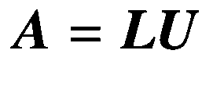

例如，对于一个 3×3 矩阵 `A`，其 LU 分解如下所示：

![$$ \left[\begin{array}{ccc}{a}_{11}&amp; {a}_{12}&amp; {a}_{13}\\ {}{a}_{21}&amp; {a}_{22}&amp; {a}_{23}\\ {}{a}_{31}&amp; {a}_{32}&amp; {a}_{33}\end{array}\right]=\left[\begin{array}{ccc}{l}_{11}&amp; 0&amp; 0\\ {}{l}_{21}&amp; {l}_{22}&amp; 0\\ {}{l}_{31}&amp; {l}_{32}&amp; {l}_{33}\end{array}\right]\left[\begin{array}{ccc}{u}_{11}&amp; {u}_{12}&amp; {u}_{13}\\ {}0&amp; {u}_{22}&amp; {u}_{23}\\ {}0&amp; 0&amp; {u}_{33}\end{array}\right] $$](images/500382_1_En_2_Chapter/500382_1_En_2_Chapter_TeX_Equah.png)

这种形式有时可能无法实现。例如，如果 `a[11] = 0`，那么 `l[11] = 0` 或 `u[11] = 0`。通过简单地重新排列 `A` 的行，使得置换后矩阵的第一个元素非零，即可解决此问题。后续分解步骤中的相同问题也可用同样的方式解决。因此，乘积有时会包含一个置换矩阵 `P`。具体来说，

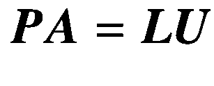

`P` 是一个行置换矩阵，当左乘 `A` 时，会重新排列 `A` 的行。事实证明，所有方阵都可以分解为这种形式，并且这种分解在实践中是数值稳定的。这使得 LUP 分解成为一种实用的技术。

例如，我们有如下分解：

![$$ \left[\begin{array}{ccc}0&amp; 0&amp; 1\\ {}1&amp; 0&amp; 0\\ {}0&amp; 0&amp; 0\end{array}\right]\left[\begin{array}{ccc}1&amp; 2&amp; 3\\ {}4&amp; 5&amp; 6\\ {}7&amp; 8&amp; 9\end{array}\right]=\left[\begin{array}{ccc}1&amp; 0&amp; 0\\ {}0.142857&amp; 1&amp; 0\\ {}0.571429&amp; 0.5&amp; 1\end{array}\right]\left[\begin{array}{ccc}7&amp; 8&amp; 9\\ {}0&amp; 0.857143&amp; 1.714286\\ {}0&amp; 0&amp; 0\end{array}\right] $$](images/500382_1_En_2_Chapter/500382_1_En_2_Chapter_TeX_Equaj.png)

在 NM Dev 中，类 `LU` 用于对方阵进行 LU 分解。它会计算出矩阵 `L`、`U` 和 `P`。以下代码实现了上一个示例：

### LU 分解示例

```java
Matrix A = new DenseMatrix(new double[][]{
{1, 2, 3},
{4, 5, 6},
{7, 8, 9}
});
// 执行 LU 分解
LU lu = new LU(A);
LowerTriangularMatrix L = lu.L();
UpperTriangularMatrix U = lu.U();
PermutationMatrix P = lu.P();
System.out.println(String.format("P = %s", P));
System.out.println(String.format("L = %s", L));
System.out.println(String.format("U = %s", U));
Matrix PA = P.multiply(A);
Matrix LU = L.multiply(U);
// 验证 PA = LU
System.out.println(String.format("%s = \n%s is %b",
PA,
LU,
MatrixPropertyUtils.areEqual(PA, LU, 1e-14)));
```

输出如下：

```
P = 3x3
[,1] [,2] [,3]
[1,] 0.000000, 0.000000, 1.000000,
[2,] 1.000000, 0.000000, 0.000000,
[3,] 0.000000, 1.000000, 0.000000,
L = 3x3
[,1] [,2] [,3]
[1,] 1.000000, 0.000000, 0.000000,
[2,] 0.142857, 1.000000, 0.000000,
[3,] 0.571429, 0.500000, 1.000000,
U = 3x3
[,1] [,2] [,3]
[1,] 7.000000, 8.000000, 9.000000,
[2,] 0.000000, 0.857143, 1.714286,
[3,] 0.000000, 0.000000, 0.000000,
3x3
[,1] [,2] [,3]
[1,] 7.000000, 8.000000, 9.000000,
[2,] 1.000000, 2.000000, 3.000000,
[3,] 4.000000, 5.000000, 6.000000,  =
3x3
[,1] [,2] [,3]
[1,] 7.000000, 8.000000, 9.000000,
[2,] 1.000000, 2.000000, 3.000000,
[3,] 4.000000, 5.000000, 6.000000,  is true
```

### 2.3.2 乔列斯基分解

如果`A`是对称（如果`A`是复数则为埃尔米特）正定矩阵，我们可以使得`U`是`L`的共轭转置。也就是说，我们可以将`A`写成如下形式：

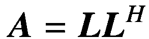

这种分解称为乔列斯基分解。乔列斯基分解是埃尔米特正定矩阵`A`分解为一个下三角矩阵`L`与其共轭转置`L`^(*H*)（若矩阵是实数，则仅为转置`L`^(*T*)）的乘积。`L`^(*H*)是一个上三角矩阵。对于正定矩阵，乔列斯基分解总是存在且唯一。此外，计算乔列斯基分解比计算 LU 分解更高效且数值更稳定。在适用的情况下，乔列斯基分解解线性方程组的效率大约是 LU 分解的两倍。

经典乔列斯基分解的一个变体是 LDL 分解。即：

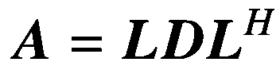

`L`是单位下三角矩阵（对角线上元素为 1），`D`是对角矩阵（仅在对角线上有非零元素，其余位置为零）。也就是说，`L`的对角线元素要求为 1（单位三角），代价是在分解中引入了一个额外的对角矩阵`D`。主要优势在于，LDL 分解可以使用基本相同的算法进行计算和使用，并且避免了平方根运算。LDL 分解与经典乔列斯基分解的关系如下：


例如，我们有以下例子：

![$$ \left[\begin{array}{ccc}4& 12& -16\\ {}12& 37& -43\\ {}-16& -43& 98\end{array}\right]=\left[\begin{array}{ccc}2& 0& 0\\ {}6& 1& 0\\ {}-8& 5& 3\end{array}\right]\left[\begin{array}{ccc}2& 6& -8\\ {}0& 1& 5\\ {}0& 0& 3\end{array}\right] $$](images/500382_1_En_2_Chapter/500382_1_En_2_Chapter_TeX_Equan.png)

实现乔列斯基分解的方法有很多种。在 NM Dev 中，接口`Cholesky`代表了库中的多种算法。类`Chol`封装了多种实现，并根据输入矩阵选择使用。默认选择是`Cholesky-Banachiewicz`类。Cholesky-Banachiewicz 算法从矩阵`L`的左上角开始，逐行计算矩阵。NM Dev 的`Chol`实现针对性能进行了高度优化，因为乔列斯基分解是基础运算，出现在许多线性代数计算中。对于大型矩阵，`Chol`会并行运行 Cholesky-Banachiewicz 算法。对于稀疏矩阵（绝大多数元素为零的矩阵），它会运行稀疏版本。`Cholesky`计算矩阵`L`。以下代码实现了前面的例子：

```java
Matrix A = new DenseMatrix(new double[][]{
{4, 12, -6},
{12, 37, -43},
{-16, -43, 98}
});
Cholesky chol = new Chol(A);
LowerTriangularMatrix L = chol.L();
UpperTriangularMatrix Lt = chol.L().t();
System.out.println(String.format("L = %s", L));
System.out.println(String.format("Lt = %s", Lt));
Matrix LLt = L.multiply(Lt);
// verify that A = LLt
System.out.println(String.format("%s = \n%s is %b",
A,
LLt,
MatrixPropertyUtils.areEqual(A, LLt, 1e-15)));
```

输出如下：

```
L = 3x3
[,1] [,2] [,3]
[1,] 2.000000, 0.000000, 0.000000,
[2,] 6.000000, 1.000000, 0.000000,
[3,] -8.000000, 5.000000, 3.000000,
Lt = 3x3
[,1] [,2] [,3]
[1,] 2.000000, 6.000000, -8.000000,
[2,] 0.000000, 1.000000, 5.000000,
[3,] 0.000000, 0.000000, 3.000000,
3x3
[,1] [,2] [,3]
[1,] 4.000000, 12.000000, -16.000000,
[2,] 12.000000, 37.000000, -43.000000,
[3,] -16.000000, -43.000000, 98.000000,  =
3x3
[,1] [,2] [,3]
[1,] 4.000000, 12.000000, -16.000000,
[2,] 12.000000, 37.000000, -43.000000,
[3,] -16.000000, -43.000000, 98.000000,  is true
```

### 2.3.3 海森伯格分解与三对角化

在二维空间 ℝ² 中，我们通常使用 x 轴和 y 轴作为坐标或基。然而，这两条轴除了相互垂直（即正交）之外，并无特别之处。如果更方便的话，我们完全可以另选一组正交轴来标记坐标。见图 2-19。

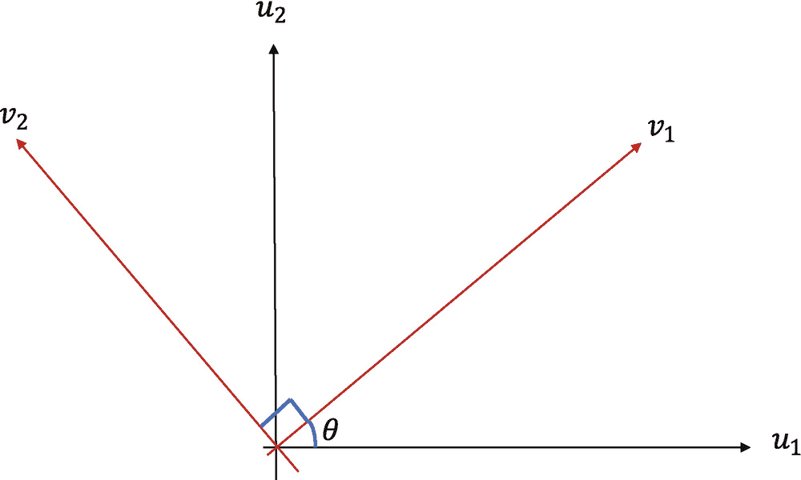

**图 2-19** 坐标变换或基变换

以图 2-19 中的例子为例，假设 `{u₁ = (1, 0)ᵀ, u₂ = (0, 1)ᵀ}` 是我们通常的 x-y 轴。`{v₁, v₂}` 是新的坐标系或基，它是 `{u₁, u₂}` 旋转 `θ` 角度后得到的。我们可以用 `{u₁, u₂}` 来表示 `{v₁, v₂}`。

`{ v₁ = u₁ cosθ + u₂ sinθ, v₂ = u₁ (-sinθ) + u₂ cosθ }`

或者，等价地用矩阵形式表示：

`[v₁; v₂] = [[cosθ, sinθ], [-sinθ, cosθ]] [u₁; u₂]`

通过左乘基变换矩阵 `P = [[cosθ, sinθ], [-sinθ, cosθ]]`，我们可以用原始坐标来表示新坐标。同样的基变换概念也适用于更高维度。

我们称两个 `n × n` 方阵 `A` 和 `B` 相似，如果存在一个可逆矩阵 `P`，使得

`B = P⁻¹ A P`

`A` 和 `B` 表示同一个线性变换，只是处于两个基不同的坐标系中。矩阵 `P` 是基变换矩阵。基变换后，在新坐标系中 `x` 的坐标如下：

`x' = P x`

在新坐标系中，该变换可以写成：

`y' = A x'`

在原始基的坐标系中，该变换则为：

`y = B x = P⁻¹ A P x`

从几何角度看，相似变换分三步进行：变换到新基（`Px`），执行简单变换（`APx`），再变换回原基（`P⁻¹ A P x`）。基变换，例如将旋转轴与 z 轴正方向对齐，可以使同一变换或矩阵呈现更简单的形式，比如在 `A` 中产生更多的零元素。相似矩阵具有相同的特征值、重数和行列式。

（上）海森伯格矩阵是指主对角线以下第一条次对角线以下元素全为零的矩阵。主对角线以下第一条次对角线恰好在主对角线下方。换句话说，海森伯格矩阵的非零元素只出现在主对角线以下第一条次对角线、主对角线和矩阵的上三角部分。也就是说，当 `i > j + 1` 时，`a[ij] = 0`。例如，以下矩阵就是一个海森伯格矩阵：

`[[1, 4, 2, 3], [3, 4, 1, 7], [0, 2, 3, 4], [0, 0, 1, 3]]`

海森伯格分解是指，对于方阵 `A`，找到一个矩阵 `Q`，使得

`Q' A Q = H`

`H` 是一个海森伯格矩阵。`Q` 是一个正交矩阵，意味着其任意两行（或两列）正交，即它们的点积为 0。等价地，`Q⁻¹ = Q'`。因此，`A` 和 `H` 是相似的。

在 NM Dev 中，`HessenbergDecomposition` 类对方阵执行海森伯格分解。它计算矩阵 `Q` 和 `H`。以下代码实现了这个例子：

```
Matrix A = new DenseMatrix(new double[][]{
{1, 5, 7, 9},
{3, 0, 6, 3},
{4, 3, 1, 0},
{7, 13, 2, 10}
});
HessenbergDecomposition hessenberg
= new HessenbergDecomposition(A);
Matrix H = hessenberg.H();
System.out.println(String.format(
"H = \n%s is Hessenberg, %b",
H,
Hessenberg.isHessenberg(H, 0)));
Matrix Q = hessenberg.Q();
System.out.println(String.format(
"Q = \n%s is orthogonal, %b",
Q,
MatrixPropertyUtils.isOrthogonal(Q, 1e-14)));
// verify that Qt * A * Q = H
Matrix QtAQ = Q.t().multiply(A).multiply(Q);
System.out.println(String.format("%s = \n%s is %b",
H,
QtAQ,
MatrixPropertyUtils.isOrthogonal(Q, 1e-14)));
```

输出结果如下：

```
H =
4x4
[,1] [,2] [,3] [,4]
[1,] 1.000000, -12.322250, -1.533240, -0.900742,
[2,] -8.602325, 13.594595, -1.657558, 7.593136,
[3,] 0.000000, -5.460964, 2.073954, -1.404349,
[4,] 0.000000, 0.000000, 4.989271, -4.668549,   is Hessenberg, true
Q =
4x4
[,1] [,2] [,3] [,4]
[1,] 1.000000, 0.000000, 0.000000, 0.000000,
[2,] 0.000000, -0.348743, 0.089751, -0.932911,
[3,] 0.000000, -0.464991, -0.880822, 0.089084,
[4,] 0.000000, -0.813733, 0.464862, 0.348914,   is orthogonal, true
4x4
[,1] [,2] [,3] [,4]
[1,] 1.000000, -12.322250, -1.533240, -0.900742,
[2,] -8.602325, 13.594595, -1.657558, 7.593136,
[3,] 0.000000, -5.460964, 2.073954, -1.404349,
[4,] 0.000000, 0.000000, 4.989271, -4.668549,   =
4x4
[,1] [,2] [,3] [,4]
[1,] 1.000000, -12.322250, -1.533240, -0.900742,
[2,] -8.602325, 13.594595, -1.657558, 7.593136,
[3,] 0.000000, -5.460964, 2.073954, -1.404349,
[4,] -0.000000, 0.000000, 4.989271, -4.668549,   is true
```

如果 `A` 是埃尔米特矩阵，那么这个变换会将其简化为三对角形式。即：

`Q' A Q = T`

`A` 和 `T` 是相似的。`T` 是一个三对角矩阵。三对角矩阵的非零元素仅出现在主对角线、主对角线正下方第一子对角线以及主对角线正上方第一超对角线上。即，当 `i` > `j` + 1 或 `i` < `j` − 1 时，`a[ij]` = 0。其形式如下：

![$$ T=\left[\begin{array}{ccccc}{a}_1&amp; {b}_1&amp; &amp; &amp; \\ {}{c}_1&amp; {a}_2&amp; {b}_2&amp; &amp; \\ {}&amp; {c}_2&amp; \ddots &amp; \ddots &amp; \\ {}&amp; &amp; \ddots &amp; \ddots &amp; {b}_{n-1}\\ {}&amp; &amp; &amp; {c}_{n-1}&amp; {a}_n\end{array}\right] $$](images/500382_1_En_2_Chapter/500382_1_En_2_Chapter_TeX_Equay.png)

在 NM Dev 中，类 `TriDiagonalization` 用于执行对称方阵的三对角化。它计算矩阵 `Q` 和 `T`。以下代码实现了该示例：

![$$ \left\lceil \begin{array}{cccc}1&amp; 0&amp; 0&amp; 0\\ {}0&amp; -0.40161&amp; 0.601902&amp; -0.690235\\ {}0&amp; -0.562254&amp; -0.756975&amp; -0.332956\\ {}0&amp; -0.722897&amp; 0.254368&amp; 0.64243\end{array}\right\rceil \times \left\lceil \begin{array}{cccc}1&amp; 5&amp; 7&amp; 9\\ {}5&amp; 0&amp; 3&amp; 13\\ {}7&amp; 3&amp; 1&amp; 2\\ {}9&amp; 13&amp; 2&amp; 10\end{array}\right\rceil \times \left\lceil \begin{array}{cccc}1&amp; 0&amp; 0&amp; 0\\ {}0&amp; -0.40161&amp; -0.562254&amp; -0.722897\\ {}0&amp; 0.601902&amp; -0.756975&amp; 0.254368\\ {}0&amp; -0.690235&amp; -0.332956&amp; 0.64243\end{array}\right\rceil =\left\lceil \begin{array}{cccc}1&amp; -12.4499&amp; 0&amp; 0\\ {}-12.4499&amp; 16.070968&amp; -7.692568&amp; 0\\ {}0&amp; -7.692568&amp; 1.696818&amp; 4.45481\\ {}0&amp; 0&amp; 4.45481&amp; -6.767786\end{array}\right\rceil $$](img/500382_1_En_2_Chapter_TeX_Equaz.png)

```java
// define a symmetric matrix
Matrix S = new SymmetricMatrix(new double[][]{
{1},
{5, 0},
{7, 3, 1},
{9, 13, 2, 10}});
//        Matrix S = new DenseMatrix(new double[][]{
//            {1, 5, 7, 9},
//            {5, 0, 3, 13},
//            {7, 3, 1, 2},
//            {9, 13, 2, 10}
//        });
TriDiagonalization triDiagonalization
= new TriDiagonalization(S);
Matrix T = triDiagonalization.T();
System.out.println(String.format(
"T = \n%s is tri-diagonal, %b",
T,
MatrixPropertyUtils.isTridiagonal(T, 1e-14)));
Matrix Q = triDiagonalization.Q();
System.out.println(String.format(
"Q = \n%s is tri-diagonal, %b",
Q,
MatrixPropertyUtils.isOrthogonal(Q, 1e-14)));
// verify that Qt * A * Q = T
Matrix QtSQ = Q.t().multiply(S).multiply(Q);
System.out.println(String.format("%s = \n%s is %b",
T,
QtSQ,
MatrixPropertyUtils.areEqual(QtSQ, T, 1e-13)));
```

```
T = 4x4
[,1] [,2] [,3] [,4]
[1,] 1.000000, -12.449900, 0.000000, 0.000000,
[2,] -12.449900, 16.070968, -7.692568, 0.000000,
[3,] 0.000000, -7.692568, 1.696818, 4.454810,
[4,] 0.000000, 0.000000, 4.454810, -6.767786,  is tri-diagonal, true
Q = 4x4
[,1] [,2] [,3] [,4]
[1,] 1.000000, 0.000000, 0.000000, 0.000000,
[2,] 0.000000, -0.401610, 0.601902, -0.690235,
[3,] 0.000000, -0.562254, -0.756975, -0.332956,
[4,] 0.000000, -0.722897, 0.254368, 0.642430,  is tri-diagonal, true
4x4
[,1] [,2] [,3] [,4]
[1,] 1.000000, -12.449900, 0.000000, 0.000000,
[2,] -12.449900, 16.070968, -7.692568, 0.000000,
[3,] 0.000000, -7.692568, 1.696818, 4.454810,
[4,] 0.000000, 0.000000, 4.454810, -6.767786,  =
4x4
[,1] [,2] [,3] [,4]
[1,] 1.000000, -12.449900, -0.000000, 0.000000,
[2,] -12.449900, 16.070968, -7.692568, 0.000000,
[3,] -0.000000, -7.692568, 1.696818, 4.454810,
[4,] 0.000000, 0.000000, 4.454810, -6.767786,  is true
```

类 `SymmetricMatrix` 根据矩阵下三角部分的数据构造对称矩阵。其签名如下：

```java
/**
* 根据二维 `double[][]` 数组构造一个对称矩阵。
* 该数组仅指定整个矩阵的下三角部分（包含主对角线）。
* 例如，
* 
*         new double[][]{
*                  {1},
*                  {2, 3},
*                  {4, 5, 6},
*                  {7, 8, 9, 10},
*                  {11, 12, 13, 14, 15}});
* 
* 得到
* \[
* \begin{bmatrix}
* 1 & 2 & 4 & 7 & 11\\
* 2 & 3 & 5 & 8 & 12\\
* 4 & 5 & 6 & 9 & 13\\
* 7 & 8 & 9 & 10 & 14\\
* 11 & 12 & 13 & 14 & 15
* \end{bmatrix}
* \]
* 由于视觉原因，该构造函数使用下三角表示而非上三角表示。
*
* @param data 下三角矩阵的规范说明
*/
public SymmetricMatrix(double[][] data)
```

如果线性代数问题的约束条件不允许将一般矩阵便捷地约化为三角矩阵，那么将其约化为海森伯格形式通常是次优选择。实际上，任何矩阵都可以在有限步内约化为海森伯格形式。随后通过迭代过程（例如移位 QR 分解）可将海森伯格矩阵进一步约化为三角矩阵。在特征值算法中，海森伯格矩阵可以通过结合移位 QR 分解与收缩步骤进一步约化为三角矩阵。将一般矩阵先约化为海森伯格矩阵，再进一步约化为三角矩阵，相比于直接将一般矩阵约化为三角矩阵，通常可以简化 `QR` 算法在特征值问题中的算术运算。

### 2.3.4 `QR` 分解

`QR` 分解（`QR decomposition`）或`QR` 因式分解是将矩阵 `A` 分解为如下乘积的一种分解：

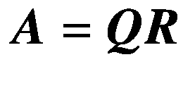

其中 `Q` 是正交矩阵（其列向量是单位向量，且 `Q`^(-1) = `Q`^'），`R` 是上三角矩阵。如果 `A` 可逆，那么当要求 `R` 的对角线元素为正时，该分解是唯一的。如果 `A` 有 *n* 个线性无关的列，那么 `Q` 的前 *n* 列构成 `A` 列空间的一组标准正交基。更一般地，对于任意 1 ≤ *k* ≤ *n*，`Q` 的前 *k* 列构成 `A` 的前 *k* 列张成空间的一组标准正交基。`A` 的任何第 *k* 列仅依赖于 `Q` 的前 *k* 列这一事实，导致了 `R` 的三角形式。

# QR分解

执行`QR分解`有多种方法，例如通过Gram-Schmidt过程（类`GramSchmidt`）、Householder变换（类`Householder`）或Givens旋转（类`GivensMatrix`）。在NM Dev中，接口`QRDecomposition`代表了不同`QR`算法的实现。其签名如下：

```java
public interface QRDecomposition {
    /**
     * 获取 P，即 QR 分解中的置换矩阵。
     *
     * @return P
     */
    public PermutationMatrix P();

    /**
     * 获取 QR 分解中的正交矩阵 Q，满足 A = QR。
     * Q 的维度为 m x n，与待正交化的矩阵 A 相同。
     *
     * @return Q
     */
    public Matrix Q();

    /**
     * 获取 QR 分解中的上三角矩阵 R，满足 A = QR。
     * R 的维度为 n x n，是一个方阵。
     *
     * @return R
     */
    public UpperTriangularMatrix R();

    /**
     * 获取 QR 分解计算出的 A 的数值秩。
     * 数值秩的确定需要判断何时应将某个值视为零的标准，
     * 因此需要一个精度参数。这是一个实际选择，
     * 取决于矩阵和应用场景。例如，对于具有较大第一特征向量的矩阵，
     * 我们应该相应地降低精度来计算秩。
     *
     * @return A 的秩
     */
    public int rank();

    /**
     * 获取方阵 Q。它是 QR 分解中 Q 矩阵的任意正交补全。
     * 维度为 m x m（方阵）。我们有 A = sqQ * tallR。
     *
     * @return 方阵 Q
     */
    public Matrix squareQ();

    /**
     * 获取瘦高矩阵 R。它通过在 QR 分解中方阵上三角矩阵 R
     * 下方拼接零行得到。维度为 m x n，可能不是方阵。
     * 我们有 A = sqQ * tallR。
     *
     * @return 瘦高矩阵 R
     */
    public Matrix tallR();
}
```

到目前为止我们讨论的分解仅适用于方阵。`QR分解`既适用于方阵，也通过一种变通方式适用于瘦高矩阵。具体地，对于一个 *m* × *n* 的矩阵`A`，其中 *m* ≥ *n*，我们可以进行如下操作：

![\boldsymbol{A}=\boldsymbol{Q}\boldsymbol{R}=\boldsymbol{Q}\left[\begin{array}{c}{\boldsymbol{R}}_{\mathbf{1}}\\ {}\mathbf{0}\end{array}\right]=\left[{\boldsymbol{Q}}_{\mathbf{1}}\kern0.5em {\boldsymbol{Q}}_{\mathbf{2}}\right]\left[\begin{array}{c}{\boldsymbol{R}}_{\mathbf{1}}\\ {}\mathbf{0}\end{array}\right]={\boldsymbol{Q}}_{\mathbf{1}}{\boldsymbol{R}}_{\mathbf{1}}](images/500382_1_En_2_Chapter/500382_1_En_2_Chapter_TeX_Equbb.png)

`Q`是一个 *m* × *m* 的矩阵。`R`是一个 *m* × *n* 的上三角矩阵。`R`的底部 (*m* - *n*) 行均为零。`Q[1]`是一个 *m* × *n* 矩阵，`Q[2]`是一个 *m* × (*m* - *n*) 矩阵。`Q[1]`和`Q[2]`都具有正交列。`R[1]`是一个 *n* × *n* 矩阵。函数`Q()`计算 *m* × *n* 的`Q[1]`矩阵。函数`R()`计算 *n* × *n* 的`R[1]`矩阵。函数`squareQ()`计算 *m* × *m* 的`Q`矩阵。函数`tallR()`计算瘦高的 *m* × *n* 的`R`矩阵。

NM Dev的`QR`类是一个执行`QR分解`的包装类。默认情况下，它使用Householder`QR`算法。Householder反射比Gram-Schmidt过程具有更好的数值稳定性。以下代码实现了这个示例：

![\left[\begin{array}{cc}3& 2\\ {}1& 2\end{array}\right]=\left[\begin{array}{cc}0.948683& -0.316228\\ {}0.316228& 0.948683\end{array}\right]\left[\begin{array}{cc}3.162278& 2.529822\\ {}0& 1.264911\end{array}\right]](images/500382_1_En_2_Chapter/500382_1_En_2_Chapter_TeX_Equbc.png)

```java
Matrix A = new DenseMatrix(new double[][]{
    {3, 2},
    {1, 2}
});
// 使用 Householder QR 算法
QRDecomposition qr1 = new HouseholderQR(A, 0);
System.out.println("秩 = " + qr1.rank());
Matrix Q1 = qr1.Q();
System.out.println(String.format(
    "Q = \n%s 是正交矩阵, %b",
    Q1,
    MatrixPropertyUtils.isOrthogonal(Q1, 1e-15)));
UpperTriangularMatrix R1 = qr1.R();
System.out.println("R = \n" + R1);
// 验证 Q1R1 = A
Matrix Q1R1 = Q1.multiply(R1);
System.out.println(String.format("%s = \n%s 是 %b",
    A,
    Q1R1,
    MatrixPropertyUtils.areEqual(Q1R1, A, 1e-13)));

// 使用 Gram-Schmidt QR 算法
QRDecomposition qr2 = new GramSchmidt(A);
System.out.println("秩 = " + qr2.rank());
Matrix Q2 = qr2.Q();
System.out.println(String.format(
    "Q = \n%s 是正交矩阵, %b",
    Q2,
    MatrixPropertyUtils.isOrthogonal(Q2, 1e-15)));
UpperTriangularMatrix R2 = qr2.R();
System.out.println("R = \n" + R2);
// 验证 Q2R2 = A
Matrix Q2R2 = Q2.multiply(R2);
System.out.println(String.format("%s = \n%s 是 %b",
    A,
    Q2R2,
    MatrixPropertyUtils.areEqual(Q2R2, A, 1e-13)));
```

输出结果如下：

```
秩 = 2
Q =
2x2
[,1] [,2]
[1,] -0.948683, -0.316228,
[2,] -0.316228, 0.948683,  是正交矩阵, true
R =
2x2
[,1] [,2]
[1,] -3.162278, -2.529822,
[2,] 0.000000, 1.264911,
2x2
[,1] [,2]
[1,] 3.000000, 2.000000,
[2,] 1.000000, 2.000000,  =
2x2
[,1] [,2]
[1,] 3.000000, 2.000000,
[2,] 1.000000, 2.000000,  是 true
秩 = 2
Q =
2x2
[,1] [,2]
[1,] 0.948683, -0.316228,
[2,] 0.316228, 0.948683,  是正交矩阵, true
R =
2x2
[,1] [,2]
[1,] 3.162278, 2.529822,
[2,] 0.000000, 1.264911,
2x2
[,1] [,2]
[1,] 3.000000, 2.000000,
[2,] 1.000000, 2.000000,  =
2x2
[,1] [,2]
[1,] 3.000000, 2.000000,
[2,] 1.000000, 2.000000,  是 true
```

这是一个瘦高矩阵的示例：

### 2.3.5 特征值分解

![$$ \left[\begin{array}{ccc}1&amp; 2&amp; 3\\ {}6&amp; 7&amp; 8\\ {}11&amp; 12&amp; 13\\ {}16&amp; 17&amp; 18\\ {}21&amp; 22&amp; 23\end{array}\right]=\left[\begin{array}{ccc}-0.034199&amp; -0.773841&amp; -0.359539\\ {}-0.205196&amp; -0.507833&amp; -0.031675\\ {}-0.376192&amp; -0.241825&amp; 0.868055\\ {}-0.547188&amp; 0.024183&amp; -0.202929\\ {}-0.718185&amp; 0.290191&amp; -0.273913\end{array}\right]\left[\begin{array}{ccc}-29.240383&amp; -31.121343&amp; -33.002304\\ {}0&amp; -1.209127&amp; -2.418254\\ {}0&amp; 0&amp; 0\end{array}\right] $$](images/500382_1_En_2_Chapter/500382_1_En_2_Chapter_TeX_Equbd.png)

给定一个线性变换或其矩阵 `A`，`A` 的特征向量 `v` 满足以下关系：


`λ` 称为 `A` 的一个特征值，对应于特征向量 `v`。

从几何上看，这意味着当对向量 `v` 应用线性变换 `A` 时，变换只会拉伸（`λ > 1`）或收缩（`λ < 1`）该向量，而不会改变其方向（`λ > 0`），除非将其翻转至相反方向（`λ < 0`）。`Av` 与 `v` 平行。参见图 2-20。

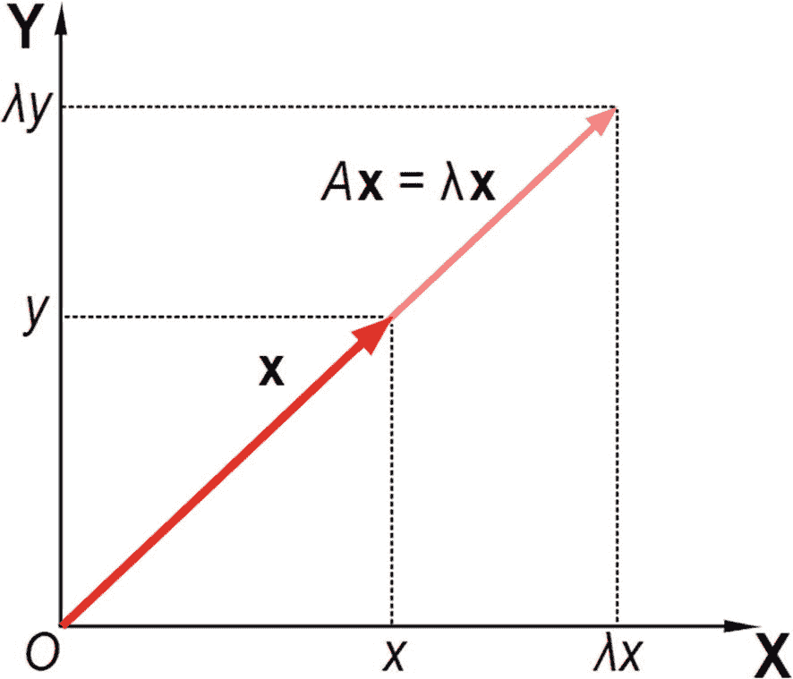

**图 2-20** 特征向量与特征值

为了理解其重要性，我们来看一个启发性示例。考虑 `ℝ²` 中的这个对角矩阵：

![A = [ a11, 0; 0, a22 ]](images/500382_1_En_2_Chapter/500382_1_En_2_Chapter_TeX_Equbg.png)

如果将 `A` 乘以 x 轴向量 `u₁ = [1; 0]`，我们得到：

![A u₁ = [ a11, 0; 0, a22 ] [1; 0] = [ a11; 0 ] = a11 [1; 0]](images/500382_1_En_2_Chapter/500382_1_En_2_Chapter_TeX_Equbh.png)

`Au₁` 与 `u₁` 平行，因此 x 轴是一个特征向量，对应的特征值为 `a11`。

类似地，如果将 `A` 乘以 y 轴向量 `u₂ = [0; 1]`，我们得到：

![A u₂ = [ a11, 0; 0, a22 ] [0; 1] = [0; a22] = a22 [0; 1]](images/500382_1_En_2_Chapter/500382_1_En_2_Chapter_TeX_Equbi.png)

`Au₂` 与 `u₂` 平行，因此 y 轴是一个特征向量，对应的特征值为 `a22`。事实上，在所有（无限多个）可能的向量中，只有这两个向量满足条件。也就是说，对于对角矩阵而言，特征向量就是它的基。反之亦然：对于任意可对角化矩阵，若我们用其特征向量构成的新基来表示该矩阵，则在新坐标系下的矩阵就是一个对角矩阵。

数学上，一个 `n × n` 方阵 `A` 是可对角化的，当且仅当存在一个 `n × n` 方阵 `Q`，使得：

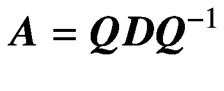

或者等价地：

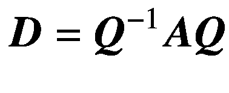

`Q` 是正交矩阵，因此构成一组基。它的列向量是 `A` 的特征向量，且这些列向量线性无关。`D` 是一个对角矩阵，其对角线元素是对应的特征值。这被称为矩阵 `A` 的特征值分解。该分解可由特征向量的基本性质推导得出：

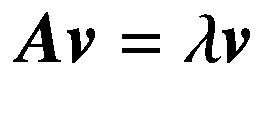

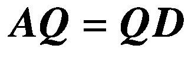

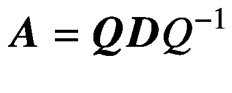

#### 特征值与特征向量

求解特征值与特征向量非常重要，因为它们有着广泛的应用，例如在稳定性分析、振动分析、原子轨道以及人脸识别中。

在机器学习或更广义的数据分析中，一个重要应用是降维或主成分分析（PCA）。PCA 是计算主成分并利用它们对数据进行基变换的过程，有时仅使用前几个主成分而忽略其余部分。直观上，PCA 可以理解为拟合一个 p 维椭球体或数据，通过旋转坐标轴使得数据的大部分方差落在少数几个轴上。如果椭球体的一个（旋转后的）坐标轴很小，那么沿该轴的方差也很小。我们可以移除该维度，从而有效地将数据从高维空间投影到低维空间。

要找到椭球体的新坐标轴，我们需要计算数据的协方差矩阵，然后求解该协方差矩阵的特征值和对应的特征向量。接着，我们必须对每个正交的特征向量进行归一化，将其转换为单位向量。完成这一步后，每个相互正交的单位特征向量都可以被解释为拟合数据椭球体的一个坐标轴。这种基的选择会将我们的协方差矩阵转换为对角化形式，其中对角线元素代表每个坐标轴的方差。每个特征向量所代表的方差比例，可以通过将该特征向量对应的特征值除以所有特征值的总和来计算。详见图 2-21。

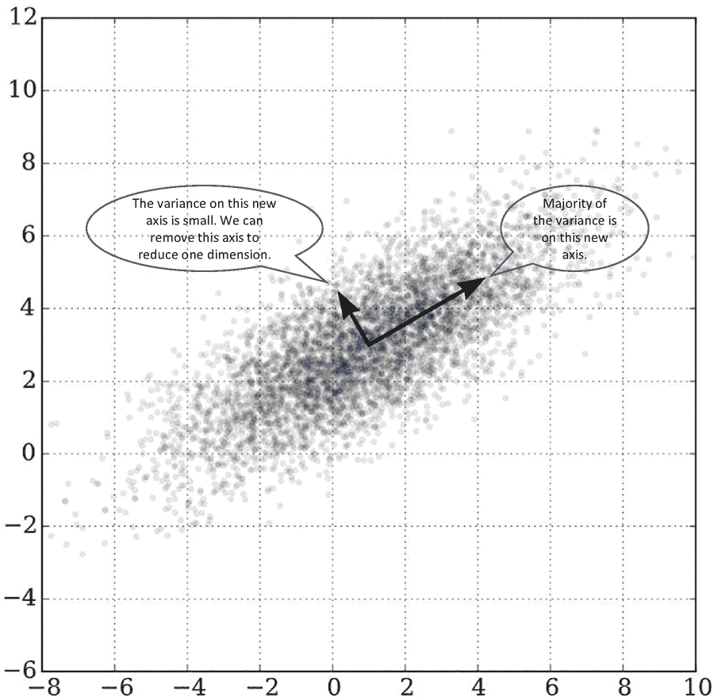

**图 2-21**

PCA 与降维

进行特征分解有若干种方法，例如通过特征多项式（适用于小矩阵）、`DQDS` 算法（适用于三对角矩阵）、`MR3` 算法（适用于对称矩阵）和 `QR` 算法（适用于一般矩阵）。所有这些算法和变换的实现都相当复杂。NM Dev 类 `EigenDecomposition` 封装了所有这些算法，并根据输入的矩阵自动应用最合适的算法。其签名如下：

```java
/**
* 对方形矩阵运行特征分解。
*
* @param A       一个可对角化的方形矩阵
* @param epsilon 精度参数：当一个数 |x| ≤ ε 时，视其为 0
*/
public EigenDecomposition(Matrix A, double epsilon)
/**
* 对方形矩阵运行特征分解。
*
* @param A 一个可对角化的方形矩阵
*/
public EigenDecomposition(Matrix A)
/**
* 获取如 Q * D * Q' = A 中的对角矩阵 D。
*
* 注意：目前我们仅支持实特征值。
*
* @return D
*/
public DiagonalMatrix D()
/**
* 获取如 Q * D * Q' = A 中的 Q。
*
* 注意：目前我们仅支持实特征值。
*
* @return Q
*/
public Matrix Q()
/**
* 获取如 Q * D * Q' = A 中的 Q'。
*
* 注意：目前我们仅支持实特征值。
*
* @return  {@code Q.t()}
*/
public Matrix Qt()
```

以下代码实现了这个示例：

![$$ \left[\begin{array}{cc}5&amp; 2\\ {}2&amp; 5\end{array}\right]=\left[\begin{array}{cc}0.707107&amp; -0.707107\\ {}0.707107&amp; 0.707107\end{array}\right]\left[\begin{array}{cc}7&amp; 0\\ {}0&amp; 3\end{array}\right]\left[\begin{array}{cc}0.707107&amp; 0.707107\\ {}-0.707107&amp; 0.707107\end{array}\right] $$](images/500382_1_En_2_Chapter/500382_1_En_2_Chapter_TeX_Equbo.png)

虽然类`EigenDecomposition`提供了分解功能，但要提取特征向量和对应的特征值并不方便。为了操作特征向量和特征值，我们使用类`Eigen`和`EigenProperty`。

`Eigen`的签名如下：
```java
/**
* 计算方形矩阵的特征值和特征向量。
* 对于每个特征值，存在无限多个相关的特征向量，
* 这些特征向量构成一个向量空间。本实现计算一组
* 线性无关的基，这些基的任意线性组合均可作为特征向量。
*
* 
* 待办事项：目前，我们同时计算实特征值和复特征值，
* 但尚未计算复特征值对应的特征向量。
* 
*
* @param A       一个方形矩阵
* @param method  特征分解算法，参见 {@link Method}
* @param epsilon 精度参数：当一个数 |x| ≤ ε 时，视其为 0
* @throws IllegalArgumentException 如果 A 不是方形矩阵
*/
public Eigen(Matrix A, Method method, final double epsilon)
/**
* 默认使用 {@link Method#QR} 方法。
*
* @param A       一个方形矩阵
* @param epsilon 精度参数：当一个数 |x| ≤ ε 时，视其为 0
* @see #Eigen(dev.nm.algebra.linear.matrix.doubles.Matrix, double)
*/
public Eigen(Matrix A, double epsilon)
/**
* 计算方形矩阵的特征值和特征向量。
*
* @param A      一个方形矩阵
* @param method 特征分解算法，参见 {@link Method}
*/
public Eigen(Matrix A, Method method)
/**
* 计算方形矩阵的特征值和特征向量。
*
* @param A 一个方形矩阵
* @see Wikipedia: QR
* algorithm
*/
public Eigen(Matrix A)
/**
* 获取所有特征值，包括实特征值和复特征值。
*
* @return 特征值列表
*/
List getEigenvalues();
/**
* 获取所有实特征值。
* 特征值按降序排序。
*
* @return 所有实特征值
*/
public double[] getRealEigenvalues()
/**
* 按特征值获取 {@link EigenProperty}。注意：传入的数字
* 必须在二进制表示上与特征值完全一致。传入一个近似值（精度范围内）
* 很可能导致匹配失败，即返回 {@code null}。
*
* @param eigenvalue 一个特征值
* @return 该特征值的 {@code EigenProperty}
*/
public EigenProperty getProperty(Number eigenvalue)
```

`EigenProperty`的签名如下：
```java
/**
* {@code EigenProperty} 是一个只读结构，包含关于特定特征值的信息，
* 例如其重数和特征向量。
*
* @author Haksun Li
*/
public class EigenProperty {
/**
* 获取特征值。
*
* @return 特征值
*/
public Number eigenvalue()
/**
* 获取特征值（特征多项式的根）的重数。
*
* @return 代数重数
*/
public int algebraicMultiplicity()
/**
* 获取由特征向量张成的向量空间的维数。
*
* @return 几何重数
*/
public int geometricMultiplicity()
/**
* 获取特征向量。
*
* @return 特征向量列表
*/
public List eigenbasis()
/**
* 获取一个特征向量。
* 注意，特征向量不是唯一的。
* 此实现始终返回基中的第一个向量。
* 要获取特征向量空间的完整基集，请使用
* {@link #eigenbasis()}。
*
* @return 一个特征向量
*/
public Vector eigenVector()
```

注意，一个矩阵可能存在重复的特征值。一个特征值的重复次数称为该特征值的**代数重数**。一个特征值的几何重数是指与其相关的线性无关特征向量的数量。也就是说，它是由与该特征值相关的特征向量所张成的零空间的维数。几何重数总是小于或等于该特征值的代数重数。

以下 NM Dev 代码针对一个矩阵计算其特征值、相关的特征向量以及每组特征向量所张成的线性空间。如果一个向量可以写成基向量的线性组合，则该向量属于这个线性空间。

以下矩阵：

![$$ \boldsymbol{A}=\left[\begin{array}{ccc}1&amp; -3&amp; 3\\ {}3&amp; -5&amp; 3\\ {}6&amp; -6&amp; 4\end{array}\right] $$](images/500382_1_En_2_Chapter/500382_1_En_2_Chapter_TeX_Equbp.png)

有两个特征值：4 和 -2。

对于特征值 4，有一个特征向量 ![$$ \left[\begin{array}{c}0.5\\ {}0.5\\ {}1\end{array}\right] $$](images/500382_1_En_2_Chapter/500382_1_En_2_Chapter_TeX_IEq8.png)。由它张成的零空间是一个一维线性空间（一条直线）。

对于特征值 -2，有两个特征向量，分别是 ![$$ \left[\begin{array}{c}1\\ {}1\\ {}0\end{array}\right] $$](images/500382_1_En_2_Chapter/500382_1_En_2_Chapter_TeX_IEq9.png) 和 ![$$ \left[\begin{array}{c}-1\\ {}0\\ {}1\end{array}\right] $$](images/500382_1_En_2_Chapter/500382_1_En_2_Chapter_TeX_IEq10.png)。由它们张成的零空间是一个二维线性空间（一个平面）。

### 2.3.5 特征值分解示例

```java
Matrix A = new DenseMatrix(new double[][]{
    {1, -3, 3},
    {3, -5, 3},
    {6, -6, 4}
});
// 执行特征分解
Eigen eigen = new Eigen(A);
eigen.getEigenvalues().forEach(eigenvalue -> {
    System.out.println("eigen value = " + eigenvalue);
});
// 第一个特征值
Number eigenvalue0 = eigen.getEigenvalue(0); // 从 0 开始计数
System.out.println("eigenvalue0 = " + eigenvalue0);
// 获取与该特征值相关的属性
EigenProperty prop0 = eigen.getProperty(eigenvalue0);
System.out.println("algebraic multiplicity = " + prop0.algebraicMultiplicity());
System.out.println("geometric multiplicity = " + prop0.geometricMultiplicity());
List basis0 = prop0.eigenbasis();
basis0.forEach(v -> {
    System.out.println("basis vector = " + v);
});
RealVectorSpace vs0 = new RealVectorSpace(basis0, 1e-15);
// 检查该向量是否属于该向量空间，即是否为基向量的线性组合
boolean in0 = vs0.isSpanned(
    new DenseVector(new double[]{-0.4, -0.4, -0.8}));
System.out.println("is in the vector space = " + in0);
// 第二个特征值
Number eigenvalue1 = eigen.getEigenvalue(1);
System.out.println("eigenvalue1 = " + eigenvalue1.doubleValue());
EigenProperty prop1 = eigen.getProperty(eigenvalue1);
System.out.println("algebraic multiplicity = " + prop1.algebraicMultiplicity());
System.out.println("geometric multiplicity = " + prop1.geometricMultiplicity());
List basis1 = prop1.eigenbasis();
basis1.forEach(v -> {
    System.out.println("basis vector = " + v);
});
RealVectorSpace vs1 = new RealVectorSpace(basis1, 1e-15);
boolean in1 = vs1.isSpanned(
    new DenseVector(new double[]{-0.4, 0.4, 0.8}));
System.out.println("is in the vector space = " + in1);
boolean in2 = vs1.isSpanned(
    new DenseVector(new double[]{-0.5, 0.5, 1.0}));
System.out.println("is in the vector space = " + in2);
```

程序输出如下：

```
eigen value = 4.0
eigen value = -2.0
eigenvalue0 = 4.0
algebraic multiplicity = 1
geometric multiplicity = 1
basis vector = [0.500000, 0.500000, 1.000000]
is in the vector space = true
eigenvalue1 = -2.0
algebraic multiplicity = 2
geometric multiplicity = 2
basis vector = [1.000000, 1.000000, 0.000000]
basis vector = [-1.000000, 0.000000, 1.000000]
is in the vector space = true
is in the vector space = true
```

### 2.3.6 奇异值分解

到目前为止，我们讨论的所有分解都适用于方阵。奇异值分解（SVD）可以看作是特征分解的扩展，但 SVD 适用于任何矩阵，无论是方阵、高矩阵还是宽矩阵。也就是说，SVD 适用于任何线性变换。具体来说，一个 *m* × *n* 矩阵 `A` 的 SVD 是三个矩阵的乘积。

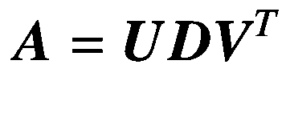

`U` 是一个 *m* × *m* 的正交矩阵。`D` 是一个 *m* × *n* 的对角矩阵。`V` 是一个 *n* × *n* 的正交矩阵。对角线上的元素 *σ*[*i*] = `D`[*ii*] 被称为 `A` 的*奇异值*。非零奇异值的数量等于 `A` 的秩。`U` 的列和 `V` 的列分别称为 `A` 的左奇异向量和右奇异向量。我们通常选择一种分解，使得奇异值 `D`[*ii*] 按降序排列。在这种情况下，`D`（但并非总是 `U` 和 `V`）由 `A` 唯一确定。SVD 的数学应用包括计算伪逆、矩阵逼近以及确定矩阵的秩、值域和零空间。SVD 在科学、工程和统计学的各个领域也广泛有用，例如信号处理、数据的最小二乘拟合以及过程控制。

从几何角度讲，SVD 表明任何线性变换都可以分解为三个步骤，即，先旋转（`V`^(*T*)），再拉伸/缩放（`D`）（不一定是所有方向都拉伸相同的幅度；你可以将 x 轴的拉伸程度设定为 y 轴的两倍），然后再次旋转（`U`）。

例如，要将一个正方形变换成一个平行四边形，你可以顺时针旋转 *θ*（只要选择一个合理的数值，这个值不太重要，因为旋转矩阵不是唯一的），将各轴按不同因子缩放，然后再逆时针旋转 *θ*。在降维方面，我们首先通过旋转“选择合适的轴”。然后，我们通过忽略（或替换为 0）最小的奇异值来投影掉次要的维度。见图 2-22。

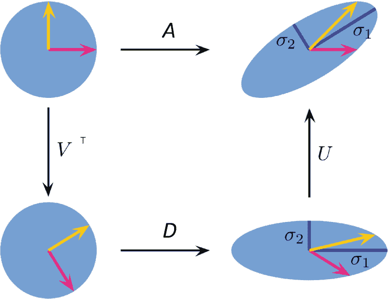

图 2-22 SVD 几何解释

有多种进行 SVD 的方法，例如针对高矩阵的 Golub-Kahan 算法、针对对称矩阵的 QR 算法，以及针对双对角矩阵的多重相对鲁棒表示（MRRR）算法。所有这些算法和变换的实现都非常复杂。NM Dev 接口 `SVDDecomposition` 代表了不同的实现。其签名如下：

```java
public interface SVDDecomposition {
    /**
     * 获取归一化（因此为正）的奇异值。如果本次计算关闭了归一化，
     * 则这些值可能与 D 中的值不同。
     *
     * @return 奇异值
     */
    public double[] getSingularValues();
    /**
     * 获取 SVD 分解中的 D 矩阵。
     *
     * @return D
     */
    public DiagonalMatrix D();
    /**
     * 获取 SVD 分解中的 U 矩阵。
     *
     * @return U
     */
    public Matrix U();
    /**
     * 获取 U 的转置，即 {@code U().t()}。
     *
     * @return {@code U().t()}
     */
    public Matrix Ut();
    /**
     * 获取 SVD 分解中的 V 矩阵。
     *
     * @return V
     */
    public Matrix V();
}
```

类 `SVD` 封装了所有这些算法，并根据输入矩阵应用合适的算法。由于 `SVD` 继承自 `SVDDecomposition`，因此它具有相同的签名。以下 NM Dev 代码计算了此示例：

![$$ \left[\begin{array}{ccccc}1&amp; 0&amp; 0&amp; 0&amp; 2\\ {}0&amp; 0&amp; 3&amp; 0&amp; 0\\ {}0&amp; 0&amp; 0&amp; 0&amp; 0\\ {}0&amp; 2&amp; 0&amp; 0&amp; 0\end{array}\right]=\left[\begin{array}{cccc}0&amp; -1&amp; 0&amp; 0\\ {}-1&amp; 0&amp; 0&amp; 0\\ {}0&amp; 0&amp; 0&amp; -1\\ {}0&amp; 0&amp; -1&amp; 0\end{array}\right]\left[\begin{array}{ccccc}3&amp; 0&amp; 0&amp; 0&amp; 0\\ {}0&amp; \sqrt{5}&amp; 0&amp; 0&amp; 0\\ {}0&amp; 0&amp; 2&amp; 0&amp; 0\\ {}0&amp; 0&amp; 0&amp; 0&amp; 0\end{array}\right]\left[\begin{array}{ccccc}0&amp; 0&amp; 1&amp; 0&amp; 0\\ {}\sqrt{0.2}&amp; 0&amp; 0&amp; 0&amp; \sqrt{0.8}\\ {}0&amp; 1&amp; 0&amp; 0&amp; 0\\ {}0&amp; 0&amp; 0&amp; 1&amp; 0\end{array}\right] $$](images/500382_1_En_2_Chapter/500382_1_En_2_Chapter_TeX_Equbr.png)

```
Matrix A = new DenseMatrix(new double[][]{
{1, 0, 0, 0, 2},
{0, 0, 3, 0, 0,},
{0, 0, 0, 0, 0,},
{0, 2, 0, 0, 0,}
});
// 执行 SVD
SVD svd = new SVD(A, true, 1e-15);
Matrix U = svd.U();
System.out.println("U = \n" + U);
DiagonalMatrix D = svd.D();
System.out.println("D = \n" + D);
Matrix V = svd.V();
System.out.println("Vt = \n" + V.t());
Matrix Ut = svd.Ut();
System.out.println("Ut = \n" + Ut);
// 验证 UDVt = A
Matrix UDVt = U.multiply(D).multiply(V.t());
System.out.println(String.format("%s = \n%s is %b",
A,
UDVt,
MatrixPropertyUtils.areEqual(UDVt, A, 1e-14)));
// 验证 UtAV = D
Matrix UtAV = Ut.multiply(A).multiply(V);
System.out.println(String.format("%s = \n%s is %b",
A,
UtAV,
MatrixPropertyUtils.areEqual(UtAV, D, 1e-14)));
```

输出如下：

```
U =
4x4
[,1] [,2] [,3] [,4]
[1,] 0.000000, 1.000000, 0.000000, 0.000000,
[2,] 1.000000, 0.000000, 0.000000, 0.000000,
[3,] 0.000000, 0.000000, 0.000000, 1.000000,
[4,] 0.000000, 0.000000, 1.000000, 0.000000,
D =
4x4
[,1] [,2] [,3] [,4]
[1,] 3.000000, 0.000000, 0.000000, 0.000000,
[2,] 0.000000, 2.236068, 0.000000, 0.000000,
[3,] 0.000000, 0.000000, 2.000000, 0.000000,
[4,] 0.000000, 0.000000, 0.000000, 0.000000,
Vt =
4x5
[,1] [,2] [,3] [,4] [,5]
[1,] 0.000000, 0.000000, 1.000000, 0.000000, 0.000000,
[2,] 0.447214, 0.000000, 0.000000, 0.000000, 0.894427,
[3,] 0.000000, 1.000000, 0.000000, 0.000000, 0.000000,
[4,] 0.000000, 0.000000, 0.000000, 1.000000, 0.000000,
Ut =
4x4
[,1] [,2] [,3] [,4]
[1,] 0.000000, 1.000000, 0.000000, 0.000000,
[2,] 1.000000, 0.000000, 0.000000, 0.000000,
[3,] 0.000000, 0.000000, 0.000000, 1.000000,
[4,] 0.000000, 0.000000, 1.000000, 0.000000,
4x5
[,1] [,2] [,3] [,4] [,5]
[1,] 1.000000, 0.000000, 0.000000, 0.000000, 2.000000,
[2,] 0.000000, 0.000000, 3.000000, 0.000000, 0.000000,
[3,] 0.000000, 0.000000, 0.000000, 0.000000, 0.000000,
[4,] 0.000000, 2.000000, 0.000000, 0.000000, 0.000000,  =
4x5
[,1] [,2] [,3] [,4] [,5]
[1,] 1.000000, 0.000000, 0.000000, 0.000000, 2.000000,
[2,] 0.000000, 0.000000, 3.000000, 0.000000, 0.000000,
[3,] 0.000000, 0.000000, 0.000000, 0.000000, 0.000000,
[4,] 0.000000, 2.000000, 0.000000, 0.000000, 0.000000,  为真
4x5
[,1] [,2] [,3] [,4] [,5]
[1,] 1.000000, 0.000000, 0.000000, 0.000000, 2.000000,
[2,] 0.000000, 0.000000, 3.000000, 0.000000, 0.000000,
[3,] 0.000000, 0.000000, 0.000000, 0.000000, 0.000000,
[4,] 0.000000, 2.000000, 0.000000, 0.000000, 0.000000,  =
4x4
[,1] [,2] [,3] [,4]
[1,] 3.000000, 0.000000, 0.000000, 0.000000,
[2,] 0.000000, 2.236068, 0.000000, 0.000000,
[3,] 0.000000, 0.000000, 2.000000, 0.000000,
[4,] 0.000000, 0.000000, 0.000000, 0.000000,  为真
```

## 2.4 线性方程组

线性方程组（或线性系统）是包含同一组变量的一个或多个线性方程的集合。以下是一个示例：

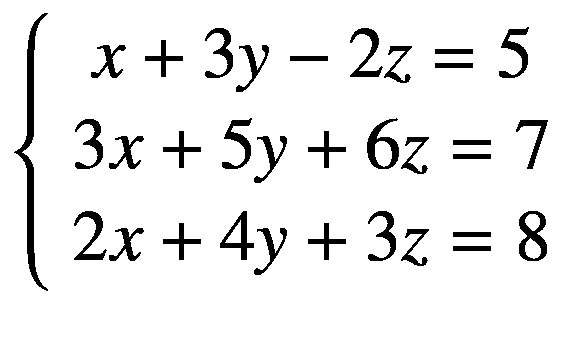

这是一个包含三个变量`x`、`y`和`z`的方程组。线性方程组的解是赋予变量一组值，使得所有方程同时成立。上述方程组的一个解如下：

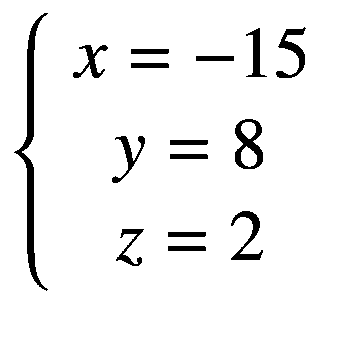

因为它使所有三个方程都成立。术语“系统”表示这些方程是作为一个整体来考虑的，而不是单独考虑。

线性系统理论是线性代数的基石和基本组成部分，而线性代数是现代数学大多数领域都会使用的学科。非线性方程组通常可以用线性系统来近似，这在建立相对复杂系统的数学模型或进行计算机模拟时是一种有用的技术。寻找解的数值算法是数值线性代数的重要组成部分，并在工程、物理、化学、计算机科学和经济学中发挥着重要作用。

一个包含`m`个方程和`n`个未知数的一般线性系统可以写成如下形式：

# 线性方程组

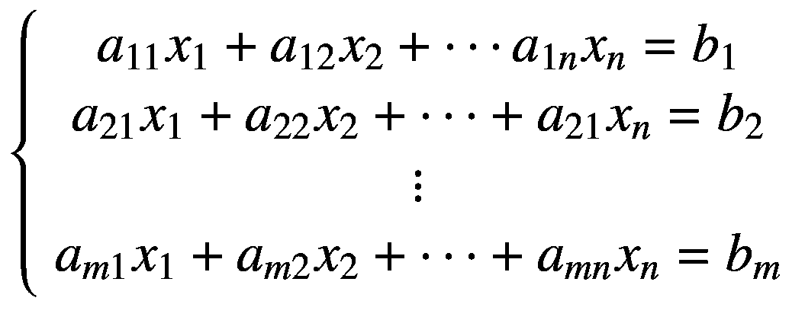

`x[1]`, `x[2]`, …, `x[n]` 是 `n` 个未知数；`a[11]`, `a[12]`, …, `a[mn]` 是系统的 `m×n` 个系数；`b[1]`, `b[2]`, …, `b[m]` 是 `m` 个常数项。

将每个未知数视为线性组合中一个列向量的权重是很有帮助的。这使我们能够从向量空间或线性空间的角度来考虑问题。例如，左侧向量所有可能的线性组合的集合称为它们的*张成空间*，当右侧向量位于该张成空间内或存在于其张成的向量空间中时，方程组才有解。如果该张成空间内的每个向量都恰好能表示为给定左侧向量的一个线性组合，那么任何解都是唯一的。

等价地，我们可以将向量方程写成矩阵形式。

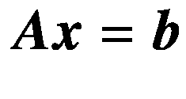

其中

, , 

张成空间的一个基中向量的数量现在表示为矩阵的秩，它小于 `m` 和 `n`。

## 解集

线性方程组的解是赋予变量 `x[1]`, `x[2]`, …, `x[n]` 一组值，使得每个方程都成立。所有可能解的集合称为*解集*。一个线性系统可能出现以下三种情况之一。

*   系统有无穷多个解。

*   系统有唯一解。

*   系统无解。

## 几何意义

从几何角度来看，对于包含两个变量（`x` 和 `y`）的系统，每个线性方程在 `xy` 平面上确定一条直线。由于线性方程组的解必须满足所有方程，因此解集是这些直线的交点，因此要么是一条直线，要么是一个点，要么是空集。请参见图 2-23。

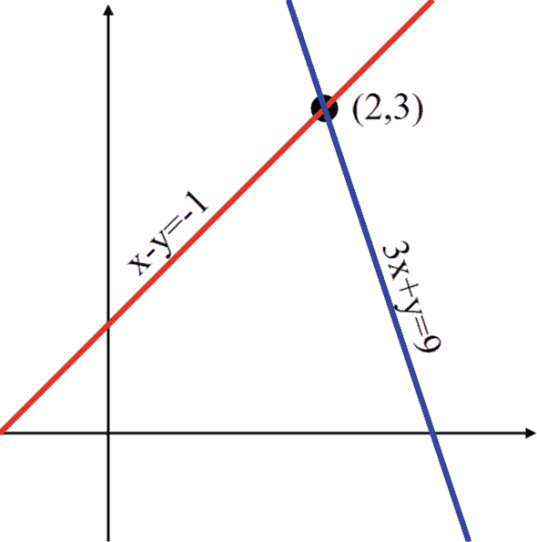

图 2-23：两个线性方程组的解

对于三个变量，每个线性方程在三维空间中确定一个平面，解集是这些平面的交集。因此，解集可能是一个平面、一条直线、一个点或空集。例如，由于三个平行平面没有公共点，它们的方程的解集是空集。如果三个平面相交于一点，则解集是一个点。如果三个平面经过两个点，则它们的方程至少有两个公共解；事实上，解集是无限的，并且包含通过这两点的直线上的所有点。对于 `n` 个变量，每个线性方程在 `n` 维空间中确定一个超平面。解集是这些超平面的交集，它是一个维度低于 `n` 的平坦集（或欧几里得子空间）。

## 系统行为与方程数量的关系

一般来说，线性系统的行为由方程数量 `m` 和未知数数量 `n` 之间的关系决定。具体来说：

1.  如果 `m` = `n`，系统有唯一解。

2.  如果 `m` > `n`，系统无解。这样的系统也称为*超定*系统。

3.  如果 `m` < `n`，系统有无穷多个解，但也可能无解。这样的系统称为*欠定*系统。解集的维度等于 `n` − `m`。

图 2-24 以两个变量为例说明了这三种情况。第一个系统有无穷多个解，即蓝线上的所有点。第二个系统有唯一解，即两条直线的交点。第三个系统无解，因为三条直线没有公共点。请参见图 2-24。

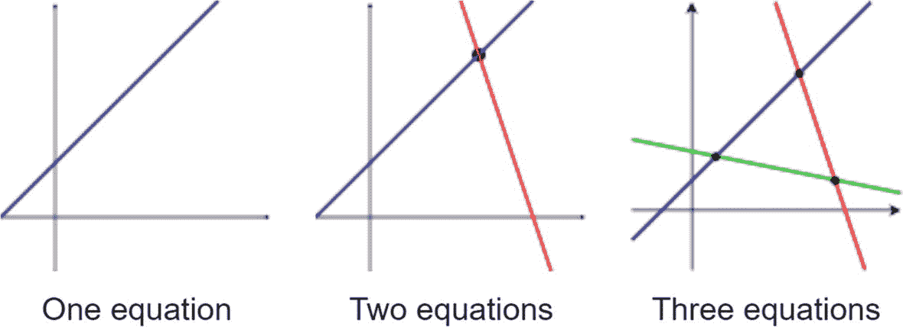

图 2-24：两个线性方程组的可能解

需要注意的是，图 2-24 中的图示只展示了最常见的情况（一般情况）。如果方程是线性相关的（平行线/平面）或者是不一致的（无解），线性方程组的行为会与一般情况不同。例如，两个方程两个未知数的系统可能无解（如果两条直线平行），或者三个方程两个未知数的系统可能有解（如果三条直线相交于一点）。请参见图 2-25。

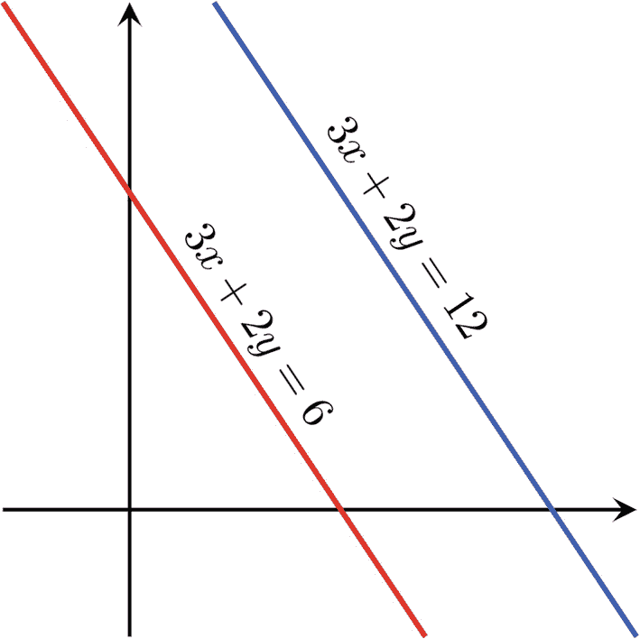

图 2-25：两条平行线的系统不一致，因此无解

## 求解工具

`NM Dev` 提供了一套工具来解决各种类型的线性方程组。我们可以求解方阵系统、欠定系统和超定系统。针对每种类型的系统，有多种算法（以及同一算法的多种实现）可供求解。