# 行阶梯形矩阵与简化行阶梯形矩阵

让我们来看一个求解之前方程组的实际例子。

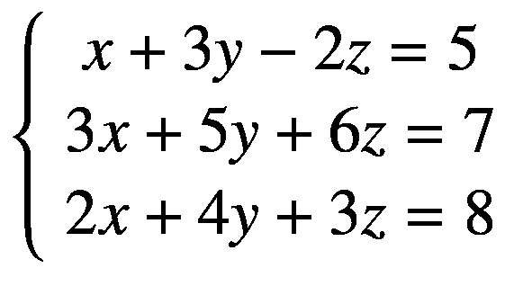

我们可以用另外两个变量来表示 `x`，然后将其代入第二和第三个方程。即：

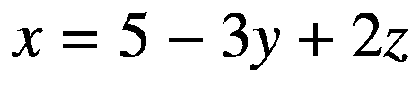

然后：

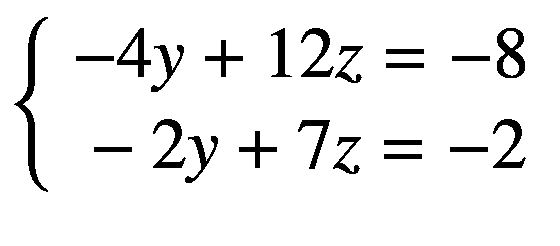

我们重复这个过程，解出 `y`，然后将其代入第二个方程。即：

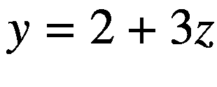

然后：

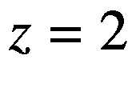

知道 `z` 后，我们可以将其回代到 `y` 的方程中得到 `y`。知道 `y` 后，再将其回代到 `x` 的方程中得到 `x`。这样我们就得到了一个解。

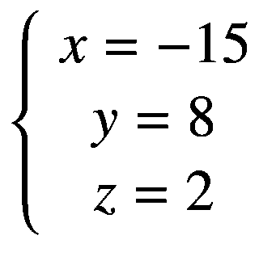

我们可以将这个步骤一般化，并设计出一个通用的算法来求解方程组。首先，我们需要了解几个概念。

一个矩阵如果满足以下两个条件，则称其为行阶梯形矩阵：

- 所有元素全为零的行位于矩阵的底部。
- 非零行的首项系数（也称为*主元*）总是严格位于其上一行首项系数的右侧。

这两个条件意味着，在首项系数所在列的下方，所有元素都为零。下面是一个 3×5 的行阶梯形矩阵（但非简化行阶梯形）的例子：

![$$ \left[\begin{array}{ccccc}1&amp; {a}_0&amp; {a}_1&amp; {a}_2&amp; {a}_3\\ {}0&amp; 0&amp; 2&amp; {a}_4&amp; {a}_5\\ {}0&amp; 0&amp; 0&amp; 1&amp; {a}_6\end{array}\right] $$](images/500382_1_En_2_Chapter/500382_1_En_2_Chapter_TeX_Equcc.png)

一个矩阵如果满足以下条件，则称其为简化行阶梯形矩阵（也称为*行标准型*）：

- 它是行阶梯形矩阵。
- 每个非零行的首项元素是 1（称为首 1）。
- 每个包含首 1 的列，该列中的其他所有元素均为零。

这是一个简化行阶梯形矩阵的例子：

![$$ \left[\begin{array}{cccc}1&amp; 0&amp; {a}_1&amp; {b}_1\\ {}0&amp; 1&amp; {a}_2&amp; {b}_2\\ {}0&amp; 0&amp; 1&amp; {b}_3\end{array}\right] $$](images/500382_1_En_2_Chapter/500382_1_En_2_Chapter_TeX_Equcd.png)

一旦我们将方程组化为简化行阶梯形矩阵，就很容易计算或直接读出解。上述矩阵实际上表示如下方程组：

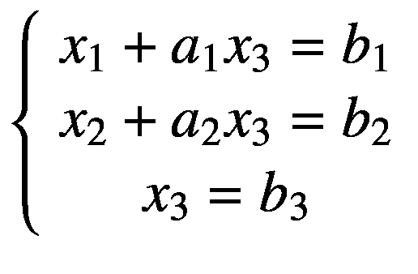

我们可以从第三个方程直接读出 `x[3]` 的解。一旦知道 `x[3]`，我们只需将其回代到另外两个方程中，就能得到 `x[1]` 和 `x[2]`。

## 回代

回代是通过迭代过程求解形如 `Ux = b` 的矩阵方程的方法，其中 `U` 是一个上三角矩阵。之所以称为“回代”，是因为对于上三角矩阵，我们首先计算 `x[n]`，然后将其回代到下一个方程中解出 `x[n-1]`，并最终重复此过程直到解出 `x[1]`。请注意，只要方程组是相容的，`U` 中的某些对角线元素可以为 0。下面是一个例子：

![$$ \left[\begin{array}{ccc}1&amp; 2&amp; 3\\ {}0&amp; 0&amp; 5\\ {}0&amp; 0&amp; 0\end{array}\right]\times \left[\begin{array}{c}10\\ {}0\\ {}0\end{array}\right]=\left[\begin{array}{c}10\\ {}0\\ {}0\end{array}\right] $$](images/500382_1_En_2_Chapter/500382_1_En_2_Chapter_TeX_Equcf.png)

NM Dev 库中的 `BackwardSubstitution` 类实现了一个回代算法。以下代码求解了该例子：

```java
UpperTriangularMatrix U = new UpperTriangularMatrix(new double[][]{
{1, 2, 3},
{0, 5},
{0}
});
Vector b = new DenseVector(new double[]{10, 0, 0});
BackwardSubstitution solver = new BackwardSubstitution();
Vector x = solver.solve(U, b);
System.out.println("x = " + x);
// 验证 Ux = b
Vector Ux = U.multiply(x);
System.out.println(String.format("%s = \n%s is %b",
Ux,
b,
MatrixPropertyUtils.areEqual(Ux, b, 1e-14))); // MatrixPropertyUtils.areEqual 同样适用于向量
```

输出结果如下：

```
x = [10.000000, 0.000000, 0.000000]
[10.000000, 0.000000, 0.000000]  =
[10.000000, 0.000000, 0.000000]  is true
```

## 前代

类似地，我们也有前代法，它通过迭代过程求解形如 `Lx = b` 的矩阵方程，其中 `L` 是一个下三角矩阵。之所以称为“前代”，是因为对于下三角矩阵，我们首先计算 `x[1]`，然后将其前代入下一个方程中解出 `x[2]`，并最终重复此过程直到解出 `x[n]`。请注意，只要方程组是相容的，`L` 中的某些对角线元素可以为 0。下面是一个例子：

![$$ \left[\begin{array}{ccc}0&amp; 0&amp; 0\\ {}2&amp; 0&amp; 0\\ {}4&amp; 5&amp; 6\end{array}\right]\times \left[\begin{array}{c}0\\ {}0\\ {}30\end{array}\right]=\left[\begin{array}{c}0\\ {}0\\ {}30\end{array}\right] $$](images/500382_1_En_2_Chapter/500382_1_En_2_Chapter_TeX_Equcg.png)

NM Dev 库中的 `ForwardSubstitution` 类实现了一个前代算法。以下代码求解了该例子：

```java
LowerTriangularMatrix L = new LowerTriangularMatrix(new double[][]{
{1},
{2, 3},
{4, 5, 6}
});
Vector b = new DenseVector(new double[]{10, 20, 30});
ForwardSubstitution solver = new ForwardSubstitution();
Vector x = solver.solve(L, b);
System.out.println("x = " + x);
// 验证 Ux = b
Vector Lx = L.multiply(x);
System.out.println(String.format("%s = \n%s is %b",
Lx,
b,
MatrixPropertyUtils.areEqual(Lx, b, 1e-14))); // MatrixPropertyUtils.areEqual 同样适用于向量
```

输出结果如下：

```
x = [10.000000, 0.000000, -1.666667]
[10.000000, 20.000000, 30.000000]  =
[10.000000, 20.000000, 30.000000]  is true
```

一般情况下，NM Dev 库的 `LUSolver` 类可以同时处理上三角矩阵和下三角矩阵。以下代码重现了前述两个问题：

```java
// 一个 LSProblem 实例
LowerTriangularMatrix L = new LowerTriangularMatrix(new double[][]{
{1},
{2, 3},
{4, 5, 6}
});
Vector b1 = new DenseVector(new double[]{10, 20, 30});
LUSolver solver1 = new LUSolver();
Vector x1 = solver1.solve(
// 构造一个线性系统问题：Lx = b1
new LSProblem(L, b1)
);
System.out.println("x1 = " + x1);
// 验证 Ux = b
Vector Lx = L.multiply(x1);
System.out.println(String.format("%s = \n%s is %b",
Lx,
b1,
MatrixPropertyUtils.areEqual(Lx, b1, 1e-14))); // MatrixPropertyUtils.areEqual 同样适用于向量

// 另一个 LSProblem 实例
UpperTriangularMatrix U = new UpperTriangularMatrix(new double[][]{
{1, 2, 3},
{0, 5},
{0}
});
Vector b2 = new DenseVector(new double[]{10, 0, 0});
LUSolver solver2 = new LUSolver();
Vector x2 = solver2.solve(
// 构造一个线性系统问题：Ux = b2
new LSProblem(U, b2)
);
System.out.println("x2 = " + x2);
// 验证 Ux = b
Vector Ux = U.multiply(x2);
System.out.println(String.format("%s = \n%s is %b",
Ux,
b2,
MatrixPropertyUtils.areEqual(Ux, b2, 1e-14))); // MatrixPropertyUtils.areEqual 同样适用于向量
```

输出结果如下：

```
x1 = [10.000000, 0.000000, -1.666667]
[10.000000, 20.000000, 30.000000]  =
[10.000000, 20.000000, 30.000000]  is true
x2 = [10.000000, 0.000000, -0.000000]
[10.000000, 0.000000, 0.000000]  =
[10.000000, 0.000000, 0.000000]  is true
```


### 2.4.4 初等变换

我们可以通过一系列初等变换将任意矩阵化为（简化）行阶梯形。初等变换共有三种类型。

*   **行交换**：交换第 *i* 行与第 *j* 行。
*   **行乘法（或缩放）**：将第 *i* 行乘以一个非零常数。
*   **行加法**：用第 *i* 行加上第 *j* 行的倍数之和替换第 *i* 行。

#### 2.4.4.1 行交换变换

我们可以通过在单位矩阵上执行该变换，来创建对应于此变换的初等矩阵。初等矩阵是指与单位矩阵仅差一次初等行变换的矩阵。

例如，要交换一个 3×3 矩阵的第二行和第三行，其对应的初等矩阵就是交换 3×3 单位矩阵的第二行和第三行。即：

![$$ \boldsymbol{P}=\left[\begin{array}{ccc}1&amp; 0&amp; 0\\ {}0&amp; 0&amp; 1\\ {}0&amp; 1&amp; 0\end{array}\right] $$](images/500382_1_En_2_Chapter/500382_1_En_2_Chapter_TeX_Equch.png)

如果我们用矩阵 `P` 左乘（或右乘）任意一个 3×3 矩阵，那么该矩阵的第二和第三行（或列）将被交换。示例如下：

![$$ \left[\begin{array}{ccc}1&amp; 0&amp; 0\\ {}0&amp; 0&amp; 1\\ {}0&amp; 1&amp; 0\end{array}\right]\times \left[\begin{array}{ccc}{a}_{11}&amp; {a}_{12}&amp; {a}_{13}\\ {}{a}_{21}&amp; {a}_{22}&amp; {a}_{23}\\ {}{a}_{31}&amp; {a}_{32}&amp; {a}_{33}\end{array}\right]=\left[\begin{array}{ccc}{a}_{11}&amp; {a}_{12}&amp; {a}_{13}\\ {}{a}_{31}&amp; {a}_{32}&amp; {a}_{33}\\ {}{a}_{21}&amp; {a}_{22}&amp; {a}_{23}\end{array}\right] $$](images/500382_1_En_2_Chapter/500382_1_En_2_Chapter_TeX_Equci.png)

#### 2.4.4.2 行乘法变换

类似地，将第 *i* 行缩放一个非零常数 *m*，其对应的初等矩阵是一个对角矩阵，除第 *i* 个位置为 *m* 外，其余对角元素均为 1。例如，将 3×3 矩阵的第二行缩放 2 倍，其对应的初等矩阵就是将 3×3 单位矩阵的第二行缩放 2 倍。即：

![$$ \boldsymbol{D}=\left[\begin{array}{ccc}1&amp; 0&amp; 0\\ {}0&amp; 2&amp; 0\\ {}0&amp; 0&amp; 1\end{array}\right] $$](images/500382_1_En_2_Chapter/500382_1_En_2_Chapter_TeX_Equcj.png)

示例如下：

![$$ \left[\begin{array}{ccc}1&amp; 0&amp; 0\\ {}0&amp; 2&amp; 0\\ {}0&amp; 0&amp; 1\end{array}\right]\times \left[\begin{array}{ccc}{a}_{11}&amp; {a}_{12}&amp; {a}_{13}\\ {}{a}_{21}&amp; {a}_{22}&amp; {a}_{23}\\ {}{a}_{31}&amp; {a}_{32}&amp; {a}_{33}\end{array}\right]=\left[\begin{array}{ccc}{a}_{11}&amp; {a}_{12}&amp; {a}_{13}\\ {}2{a}_{21}&amp; 2{a}_{22}&amp; 2{a}_{23}\\ {}{a}_{31}&amp; {a}_{32}&amp; {a}_{33}\end{array}\right] $$](images/500382_1_En_2_Chapter/500382_1_En_2_Chapter_TeX_Equck.png)

#### 2.4.4.3 行加法变换

要将第 *j* 行乘以标量 *m* 后加到第 *i* 行，其对应的初等矩阵是单位矩阵，但设置 `a[ij] = m`。例如，将 3×3 矩阵的第二行乘以 2 后加到第一行，其对应的初等矩阵如下：

![$$ \boldsymbol{L}=\left[\begin{array}{ccc}1&amp; 2&amp; 0\\ {}0&amp; 1&amp; 0\\ {}0&amp; 0&amp; 1\end{array}\right] $$](images/500382_1_En_2_Chapter/500382_1_En_2_Chapter_TeX_Equcl.png)

示例如下：

![$$ \left[\begin{array}{ccc}1&amp; 2&amp; 0\\ {}0&amp; 1&amp; 0\\ {}0&amp; 0&amp; 1\end{array}\right]\times \left[\begin{array}{ccc}{a}_{11}&amp; {a}_{12}&amp; {a}_{13}\\ {}{a}_{21}&amp; {a}_{22}&amp; {a}_{23}\\ {}{a}_{31}&amp; {a}_{32}&amp; {a}_{33}\end{array}\right]=\left[\begin{array}{ccc}{a}_{11}+2{a}_{21}&amp; {a}_{12}+2{a}_{22}&amp; {a}_{13}+2{a}_{23}\\ {}{a}_{21}&amp; {a}_{22}&amp; {a}_{23}\\ {}{a}_{31}&amp; {a}_{32}&amp; {a}_{33}\end{array}\right] $$](images/500382_1_En_2_Chapter/500382_1_En_2_Chapter_TeX_Equcm.png)

### 2.4.5 高斯消元法与高斯-若尔当消元法

高斯-若尔当消元法是求解线性方程组的一种算法。它也可用于计算矩阵的秩、方阵的行列式以及可逆矩阵的逆矩阵。要对矩阵进行行化简，我们使用一系列初等行运算来修改矩阵，直到矩阵左下角尽可能地被零填充。

通过这些变换，矩阵总可以被转化为上三角矩阵，实际上也就是行阶梯形矩阵。一旦所有主元系数（每行最左边的非零项）都为 1，且每个包含主元系数的列在其他位置都为零，这个矩阵就被称为简化行阶梯形矩阵。这个最终形式是唯一的；换句话说，它与所执行的行变换顺序无关。

术语*高斯消元法*指的是直到矩阵变为上三角矩阵或（未简化）行阶梯形矩阵为止的第一步过程。在这种形式下，我们可以判断一个线性方程组是无解、有唯一解还是有无穷多解。高斯-若尔当消元法，作为第二步，继续使用行变换直到找到解。换句话说，它将矩阵化为简化行阶梯形矩阵。

等价地，我们可以将行化简视为对原始矩阵进行矩阵分解。初等行变换可以看作是原始矩阵左侧乘以初等矩阵。或者，一个化简单行的初等变换序列可以看作是与一个弗罗贝尼乌斯矩阵相乘。那么，算法的第一部分计算 LU 分解，而第二部分则将原始矩阵写为一个唯一确定的可逆矩阵与一个唯一确定的简化行阶梯矩阵的乘积。

NM Dev 类 `GaussianElimination` 执行初等行变换将矩阵化为行阶梯形。这等价于从左侧将原始矩阵与可逆矩阵相乘。对于方阵，该算法本质上计算了一个 LU 分解。我们有：


其中 `T` 是变换矩阵，它是一系列初等矩阵（或变换）的乘积。`U` 是行阶梯形。

或者，我们有：

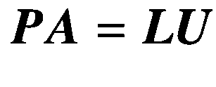

其中 `P` 是置换矩阵，`L` 是下三角矩阵，`U` 是行阶梯形。

其函数签名如下：

```java
/**
* 运行高斯消元算法。
*
* @param A           一个矩阵
* @param usePivoting 如果使用部分主元法则为 {@code true}，例如为了数值稳定性。
*                    通常，不使用主元法意味着没有行交换。这仅当高斯消元过程中不会遇到对角线元素为零的情况时才可行。
*                    由于除以零是致命错误，我们通常避免不使用主元法。
* @param epsilon     精度参数：当数字 |x| &le;
*                    &epsilon; 时，将其视为 0
*/
public GaussianElimination(Matrix A, boolean usePivoting, double epsilon)
/**
* 使用部分主元法运行高斯消元算法。
*
* @param A 一个矩阵
*/
public GaussianElimination(Matrix A)
/**
* 获取变换矩阵 T，使得 T * A = U。
*
* @return T
*/
public Matrix T()
/**
* 获取上三角矩阵 U，使得
* T * A = U 且 P * A = L * U。
*
* @return U
*/
public Matrix U()
/**
* 获取下三角矩阵 L，使得 P * A = L * U。
*
* @return L
*/
public Matrix L()
/**
* 获取置换矩阵 P，使得 P * A = L * U。
*
* @return P
*/
public PermutationMatrix P()
```


例如，以下 NM Dev 代码计算此示例：

![$$ \left[\begin{array}{ccc}0&amp; 0&amp; 1\\ {}0&amp; 1&amp; -0.5\\ {}1&amp; -0.6&amp; -0.2\end{array}\right]\times \left[\begin{array}{ccc}2&amp; 1&amp; 1\\ {}2&amp; 2&amp; -1\\ {}4&amp; -1&amp; 6\end{array}\right]=\left[\begin{array}{ccc}4&amp; -1&amp; 6\\ {}0&amp; 2.5&amp; -4\\ {}0&amp; 0&amp; 0.4\end{array}\right] $$](images/500382_1_En_2_Chapter/500382_1_En_2_Chapter_TeX_Equcp.png)

![$$ \left[\begin{array}{ccc}0&amp; 0&amp; 1\\ {}0&amp; 1&amp; 0\\ {}1&amp; 0&amp; 0\end{array}\right]\times \left[\begin{array}{ccc}2&amp; 1&amp; 1\\ {}2&amp; 2&amp; -1\\ {}4&amp; -1&amp; 6\end{array}\right]=\left[\begin{array}{ccc}1&amp; 0&amp; 0\\ {}0.5&amp; 1&amp; 0\\ {}0.5&amp; 0.6&amp; 1\end{array}\right]\left[\begin{array}{ccc}4&amp; -1&amp; 6\\ {}0&amp; 2.5&amp; -4\\ {}0&amp; 0&amp; 0.4\end{array}\right] $$](images/500382_1_En_2_Chapter/500382_1_En_2_Chapter_TeX_Equcq.png)

```
Matrix A = new DenseMatrix(new double[][]{
{2, 1, 1},
{2, 2, -1},
{4, -1, 6}
});
GaussianElimination ops = new GaussianElimination(A, true, 0);
Matrix T = ops.T();
System.out.println("T = \n" + T);
PermutationMatrix P = ops.P();
System.out.println("P = \n" + P);
Matrix U = ops.U();
System.out.println(
String.format("U = %s is upper triangular, %b",
U,
MatrixPropertyUtils.isUpperTriangular(U, 0)));
Matrix L = ops.L();
System.out.println(
String.format("L = %s is lower triangular, %b",
L,
MatrixPropertyUtils.isLowerTriangular(L, 0)));
// verify that TA = U
Matrix TA = T.multiply(A);
System.out.println(String.format("%s = \n%s is %b",
TA,
U,
MatrixPropertyUtils.areEqual(TA, U, 1e-15)));
// verify that PA = LU
Matrix PA = P.multiply(A);
Matrix LU = L.multiply(U);
System.out.println(String.format("%s = \n%s is %b",
PA,
LU,
MatrixPropertyUtils.areEqual(PA, LU, 0)));
```

输出如下：

```
T =
3x3
[,1] [,2] [,3]
[1,] 0.000000, 0.000000, 1.000000,
[2,] 0.000000, 1.000000, -0.500000,
[3,] 1.000000, -0.600000, -0.200000,
P =
3x3
[,1] [,2] [,3]
[1,] 0.000000, 0.000000, 1.000000,
[2,] 0.000000, 1.000000, 0.000000,
[3,] 1.000000, 0.000000, 0.000000,
U = 3x3
[,1] [,2] [,3]
[1,] 4.000000, -1.000000, 6.000000,
[2,] 0.000000, 2.500000, -4.000000,
[3,] 0.000000, 0.000000, 0.400000,  is upper triangular, true
L = 3x3
[,1] [,2] [,3]
[1,] 1.000000, 0.000000, 0.000000,
[2,] 0.500000, 1.000000, 0.000000,
[3,] 0.500000, 0.600000, 1.000000,  is lower triangular, true
3x3
[,1] [,2] [,3]
[1,] 4.000000, -1.000000, 6.000000,
[2,] 0.000000, 2.500000, -4.000000,
[3,] 0.000000, 0.000000, 0.400000,  =
3x3
[,1] [,2] [,3]
[1,] 4.000000, -1.000000, 6.000000,
[2,] 0.000000, 2.500000, -4.000000,
[3,] 0.000000, 0.000000, 0.400000,  is true
3x3
[,1] [,2] [,3]
[1,] 4.000000, -1.000000, 6.000000,
[2,] 2.000000, 2.000000, -1.000000,
[3,] 2.000000, 1.000000, 1.000000,  =
3x3
[,1] [,2] [,3]
[1,] 4.000000, -1.000000, 6.000000,
[2,] 2.000000, 2.000000, -1.000000,
[3,] 2.000000, 1.000000, 1.000000,  is true
```

NM Dev 类 `GaussianElimination` 执行初等行变换，将矩阵化为行阶梯形。即：

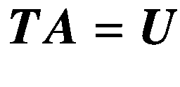

其中 ***T*** 是变换矩阵，它是一系列初等矩阵/运算的乘积。***U*** 是行阶梯形矩阵。此实现确保首项 1 在数值上为 1，以便进行比较。假设存在一个首项 *u*[*ij*] = 1，那么 `U.get(i, j) == 1` 将始终返回 `true`。

例如，以下 NM Dev 代码计算此示例：

![$$ \left[\begin{array}{ccc}-2.75&amp; 1.75&amp; 0.75\\ {}4&amp; -2&amp; -1\\ {}2.5&amp; -1.5&amp; -0.5\end{array}\right]\times \left[\begin{array}{ccc}2&amp; 1&amp; 1\\ {}2&amp; 2&amp; -1\\ {}4&amp; -1&amp; 6\end{array}\right]=\left[\begin{array}{ccc}1&amp; 0&amp; 0\\ {}0&amp; 1&amp; 0\\ {}0&amp; 0&amp; 1\end{array}\right] $$](images/500382_1_En_2_Chapter/500382_1_En_2_Chapter_TeX_Equcs.png)

```
Matrix A = new DenseMatrix(new double[][]{
{2, 1, 1},
{2, 2, -1},
{4, -1, 6}
});
GaussJordanElimination ops = new GaussJordanElimination(A, true, 0);
Matrix U = ops.U();
System.out.println(
String.format("U = %s is in reduced row echelon form, %b",
U,
MatrixPropertyUtils.isReducedRowEchelonForm(U, 0)));
Matrix T = ops.T();
System.out.println("T = \n" + T);
// verify that TA = U
Matrix TA = T.multiply(A);
System.out.println(String.format("%s = \n%s is %b",
TA,
U,
MatrixPropertyUtils.areEqual(TA, U, 1e-15)));
```

输出如下：

```
U = 3x3
[,1] [,2] [,3]
[1,] 1.000000, 0.000000, 0.000000,
[2,] 0.000000, 1.000000, 0.000000,
[3,] 0.000000, 0.000000, 1.000000,  is in reduced row echelon form, true
T =
3x3
[,1] [,2] [,3]
[1,] -2.750000, 1.750000, 0.750000,
[2,] 4.000000, -2.000000, -1.000000,
[3,] 2.500000, -1.500000, -0.500000,
3x3
[,1] [,2] [,3]
[1,] 1.000000, 0.000000, 0.000000,
[2,] 0.000000, 1.000000, 0.000000,
[3,] 0.000000, -0.000000, 1.000000,  =
3x3
[,1] [,2] [,3]
[1,] 1.000000, 0.000000, 0.000000,
[2,] 0.000000, 1.000000, 0.000000,
[3,] 0.000000, 0.000000, 1.000000,  is true
```


### 齐次与非齐次方程组

一般而言，一个相容的线性方程组要求方程数量（*m*）小于或等于变量数量（*n*），即 *m* ≤ *n*。否则，它就属于超定方程组，通常无解。为了理解线性方程组，如下图所示：


我们可以将 `A` 视作一个线性变换或函数，它将一个线性空间 `V` 映射到另一个线性空间 `W`。线性映射的核（亦称*零空间*）`ker(A)`，是其定义域的一个线性子空间，该子空间中的所有元素经该函数映射后都变为 0。

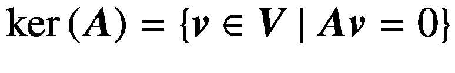

秩-零化度定理指出，核的维度与像的维度之和等于定义域的维度。参见图 2-26。

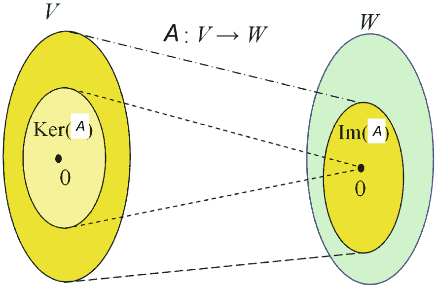

**图 2-26** 线性映射的核与像

对于任何齐次线性方程组，如下图所示：

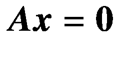

至少存在一个解，即零解（或平凡解），可通过将每个变量赋值为零得到。也就是说，`A * 0 = 0`。如果系统矩阵是非奇异的（`det(A) ≠ 0`），那么这个解也是唯一解。如果系统矩阵是奇异的（`A` 不满秩），那么 `A` 的核的维度或秩不为 0，即 `ker(A) > 0`。此时存在包含无限多个解的解集。核中的每个向量都是非平凡解。该解集具有以下额外性质：

- 如果 `u` 和 `v` 是表示齐次方程组解的两个向量，那么向量和 `u + v` 也是该方程组的解。
- 如果 `u` 是表示齐次方程组解的一个向量，且 `c` 是任意标量，那么 `c * u` 也是该方程组的解。

对于非齐次线性方程组，我们有：


假设 `p` 是该线性方程组的一个特解，即 `Ap = b`；那么整个解集可以描述如下：

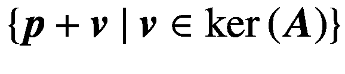

从几何角度来说，这意味着非齐次方程组 `Ax = b` 的解集是齐次方程组 `Ax = 0` 解集的一个平移。具体而言，第一个方程组的仿射空间或欧几里得子空间可以通过向量 `p` 平移齐次方程组的线性子空间得到。这个推论仅当方程组至少有一个解时才成立。当且仅当向量 `b` 位于线性变换 `A` 的像中时，该条件成立。

NM Dev 类 `LinearSystemSolver` 用于求解形如 `Ax = b` 的线性方程组。我们假设，在行化简之后，`A` 的行数不超过列数。也就是说，该方程组不能是超定的。

注意，以下方程组并非超定。其中一行是线性相关的。

![$$ \left[\begin{array}{ccc}1&amp; -1&amp; 0\\ {}0&amp; -2&amp; 0\\ {}0&amp; 0&amp; -1\\ {}0&amp; 0&amp; -2\end{array}\right]\boldsymbol{x}=\left[\begin{array}{c}-0.8\\ {}-1.6\\ {}0.8\\ {}1.6\end{array}\right] $$](images/500382_1_En_2_Chapter/500382_1_En_2_Chapter_TeX_Equcy.png)

线性方程组的求解分为两步。

1. 首先，求解齐次方程组 `Ax = 0`，寻找非平凡解。
2. 然后，求解 `Ax = b` 以得到一个特解。

如果 `A` 是满秩的，该实现会通过 LU 分解来求解方程组。否则，通过 `p = Tb` 寻找一个特解，其中 `T` 是将 `A` 化为简化行阶梯形矩阵的变换矩阵。最终解如下：

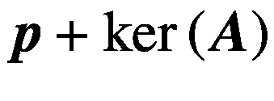

因此，解可以看作是向量 `p` 对 `A` 的零空间所做的平移。

例如，对于以下线性方程组，

![$$ \left[\begin{array}{cccc}0&amp; 1&amp; 2&amp; -1\\ {}1&amp; 0&amp; 1&amp; 1\\ {}-1&amp; 1&amp; 0&amp; -1\\ {}0&amp; 2&amp; 3&amp; -1\end{array}\right]\boldsymbol{x}=\left[\begin{array}{c}1\\ {}4\\ {}2\\ {}7\end{array}\right] $$](images/500382_1_En_2_Chapter/500382_1_En_2_Chapter_TeX_Equda.png)

核的基向量满足：

![$$ \left[\begin{array}{cccc}0&amp; 1&amp; 2&amp; -1\\ {}1&amp; 0&amp; 1&amp; 1\\ {}-1&amp; 1&amp; 0&amp; -1\\ {}0&amp; 2&amp; 3&amp; -1\end{array}\right]\left[\begin{array}{c}-2\\ {}-1\\ {}1\\ {}1\end{array}\right]=\left[\begin{array}{c}0\\ {}0\\ {}0\\ {}0\end{array}\right] $$](images/500382_1_En_2_Chapter/500382_1_En_2_Chapter_TeX_Equdb.png)

一个特解满足：

![$$ \left[\begin{array}{cccc}0&amp; 1&amp; 2&amp; -1\\ {}1&amp; 0&amp; 1&amp; 1\\ {}-1&amp; 1&amp; 0&amp; -1\\ {}0&amp; 2&amp; 3&amp; -1\end{array}\right]\left[\begin{array}{c}9\\ {}11\\ {}-5\\ {}0\end{array}\right]=\left[\begin{array}{c}1\\ {}4\\ {}2\\ {}7\end{array}\right] $$](images/500382_1_En_2_Chapter/500382_1_En_2_Chapter_TeX_Equdc.png)

以下 NM Dev 代码求解此示例：

```
Matrix A = new DenseMatrix(new double[][]{
{0, 1, 2, -1},
{1, 0, 1, 1},
{-1, 1, 0, -1},
{0, 2, 3, -1}
});
Vector b = new DenseVector(new double[]{1, 4, 2, 7});
// 构造一个线性方程组求解器
LinearSystemSolver solver = new LinearSystemSolver(1e-15); // 精度
// 求解齐次线性方程组
LinearSystemSolver.Solution soln = solver.solve(A);
// 获取一个特解
Vector p = soln.getParticularSolution(b);
System.out.println("p = \n" + p);
// 验证 Ap = b
Vector Ap = A.multiply(p);
System.out.println(String.format("%s = \n%s is %b",
Ap,
b,
MatrixPropertyUtils.areEqual(Ap, b, 1e-15)));
// 获取零空间的基
List kernel = soln.getHomogeneousSoln();
System.out.println("kernel size = " + kernel.size());
// 验证 A * kernel = 0
Vector k = kernel.get(0);
System.out.println("kernel basis = " + k);
Vector Ak = A.multiply(k);
System.out.println("Ak = 0, " + Ak);
```

输出结果如下：

```
p =
[9.000000, 11.000000, -5.000000, 0.000000]
[1.000000, 4.000000, 2.000000, 7.000000]  =
[1.000000, 4.000000, 2.000000, 7.000000]  is true
kernel size = 1
kernel basis = [-2.000000, -1.000000, 1.000000, 1.000000]
Ak = 0, [0.000000, 0.000000, 0.000000, 0.000000]
```

`LinearSystemSolver` 的签名如下：

```
/**
 * 构造一个线性方程组的求解器。
 *
 * @param epsilon 精度参数：当数字 |x| &le; &epsilon; 时，视为 0
 */
public LinearSystemSolver(double epsilon)
/**
 * 获取线性方程组 Ax = b 的解。
 *
 * @param A0 表示线性方程组（齐次部分）的矩阵
 * @return 线性方程组的解
 */
public Solution solve(final Matrix A0)
```

请注意，`solve` 函数返回一个 `LinearSystemSolver:: Solution` 类的对象。该对象包含由输入矩阵定义的线性方程组的齐次解和非齐次解。其签名如下：


```java
/**
* 这是线性方程组的解。
*/
public static interface Solution {
/**
* 获取线性方程组的一个特解。
*
* @param b 一个向量
* @return 一个特解
*/
Vector getParticularSolution(Vector b);
/**
* 获取线性方程组 Ax = b 的齐次解基。
* 即 Ax = 0 的解。
*
* @return 齐次解
*/
List getHomogeneousSoln();
}
```

### 2.4.7 超定线性方程组

当方程数量多于未知数数量时，方程组是超定的，即 *m* > *n*，其中 *m* 是方程数量，*n* 是未知数数量。*m* × *n* 矩阵 ***A*** 是一个高矩阵。

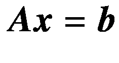

超定方程组通常是不相容的（无解）。唯一的例外情况是某些方程在方程组中多次出现，或者某些方程是其他方程的线性组合。一般来说，每个未知数提供一个自由度。每个引入方程组的方程都限制一个自由度。因此，当方程数量与自由变量数量相等时，就会出现临界情况。每个提供自由度的变量都存在一个对应的约束条件。如果相容，这个方阵方程组可以有唯一解。当方程组被过度约束时，即方程数量多于未知数数量时，就会出现超定情况。

例如，图 2-27 显示了三个线性无关的方程，导致方程组不相容，因此无解。

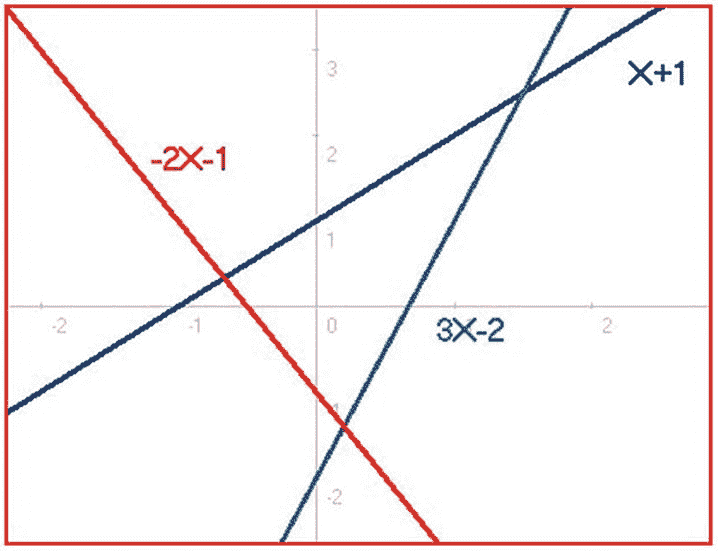

**图 2-27** 超定方程组

在图 2-28 中，一个方程与另一个方程线性相关（实际上是相同的）。该方程组有两个变量和两个（线性无关的）约束条件，因此方程组是相容的并且有一个解。

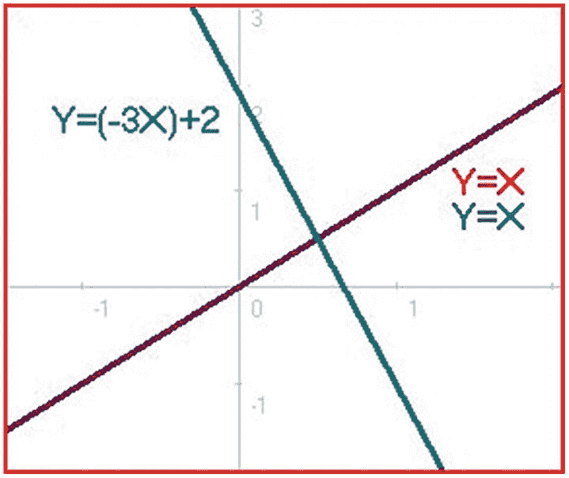

**图 2-28** 一个方程与另一个方程线性相关；一个解

对于无解的超定方程组，我们转而寻找“最佳近似”。定义“最佳近似”的方法有很多。普通最小二乘法（OLS）找到使最小平方和最小的解 ***x***。即：

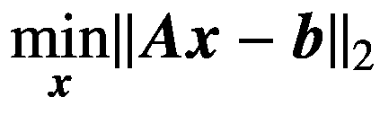

几何上，OLS 穿过数据点 {(***x***, ***b***)} 绘制一条（高维）直线（或超平面），使得平方距离之和最小。见图 2-29。

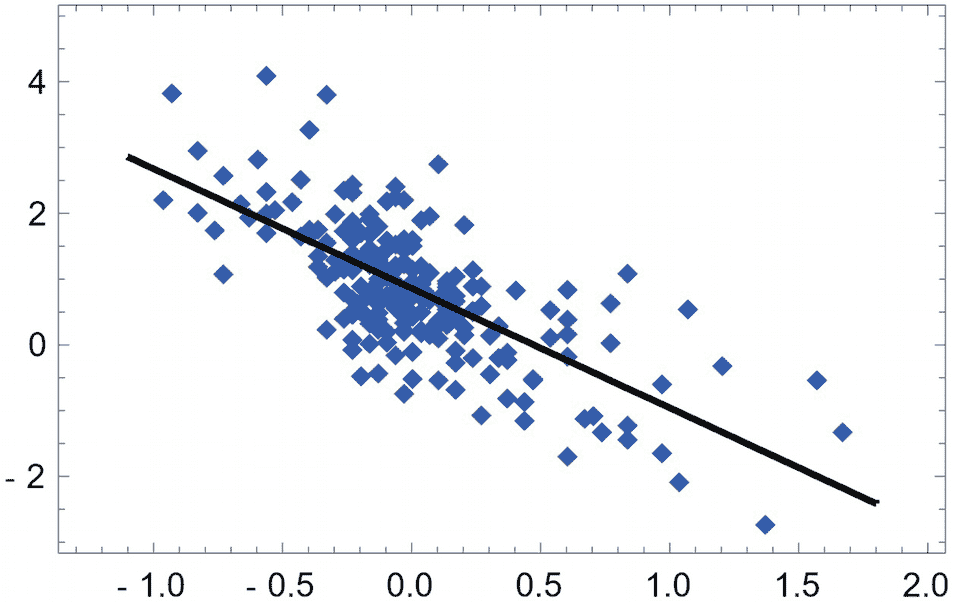

**图 2-29** 超定方程组的 OLS 解

该解由以下公式给出：

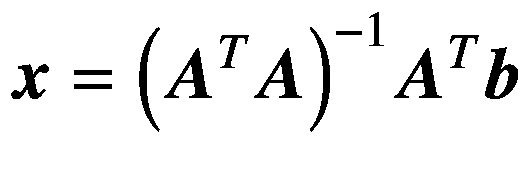

利用这个公式，当不存在精确解时，可以找到一个近似解；当存在精确解时，它会给出精确解，前提是 (***A***^(*T*)***A***)^(−1) 存在（或等价地，***A*** 具有满列秩）。然而，在实际应用中，由于计算 (***A***^(*T*)***A***)^(−1) 时存在数值稳定性问题，我们并不使用这个公式。相反，我们使用正交分解方法。

NM Dev 对正交分解方法有两种实现，一种基于 QR 分解，另一种基于 SVD 分解。

使用 QR 分解，我们可以将 ***A*** 写成如下形式：

![$$ \boldsymbol{A}=\boldsymbol{Q}\boldsymbol{R}=\boldsymbol{Q}\left[\begin{array}{c}{\boldsymbol{R}}_{\mathbf{1}}\\ {}\mathbf{0}\end{array}\right]=\left[{\boldsymbol{Q}}_{\mathbf{1}}\kern0.5em {\boldsymbol{Q}}_{\mathbf{2}}\right]\left[\begin{array}{c}{\boldsymbol{R}}_{\mathbf{1}}\\ {}\mathbf{0}\end{array}\right]={\boldsymbol{Q}}_{\mathbf{1}}{\boldsymbol{R}}_{\mathbf{1}} $$](images/500382_1_En_2_Chapter/500382_1_En_2_Chapter_TeX_Equdg.png)

超定线性方程组 ***Ax = b*** 可以重写为 ***Q***[**1**]***R***[**1**]***x = b***。由于 ***Q***[**1**] 是正交矩阵，我们有：

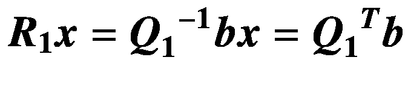

由于 ***R***[**1**] 是一个上三角矩阵，我们可以使用回代法来求解该方程组。

以下 NM Dev 代码使用 QR 方法求解这个超定方程组：

![$$ \left[\begin{array}{cc}1& 1\\ {}1& 2\\ {}1& 3\\ {}1& 4\end{array}\right]\boldsymbol{x}=\left[\begin{array}{c}6\\ {}5\\ {}7\\ {}10\end{array}\right] $$](images/500382_1_En_2_Chapter/500382_1_En_2_Chapter_TeX_Equdi.png)

```java
// 定义一个超定线性方程组
Matrix A = new DenseMatrix(new double[][]{
{1, 1},
{1, 2},
{1, 3},
{1, 4}
});
Vector b = new DenseVector(new double[]{6, 5, 7, 10});
LSProblem problem = new LSProblem(A, b);
// 使用 QR 方法求解方程组
OLSSolverByQR solver1 = new OLSSolverByQR(0); // 精度
// 计算 OLS 解
Vector x1 = solver1.solve(problem);
System.out.println("OLS 解 = " + x1);
```

输出如下：

```
OLS 解 = [3.500000, 1.400000]
```

使用 SVD 分解，我们可以将 ***A*** 写成如下形式：

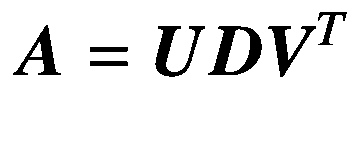

其伪逆矩阵为 ***A***^+ = ***VD***^+***U***^(*T*)，其中 ***D***^+ 是通过取对角线上每个非零元素的倒数并将零元素保留在原位得到的。在数值计算中，只有大于某个小容差值的元素被视为非零，其余元素被替换为零。超定线性方程组 ***Ax = b*** 可以如下求解：

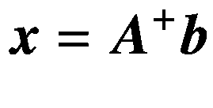

以下 NM Dev 代码求解与前面相同的示例：

```java
// 定义一个超定线性方程组
Matrix A = new DenseMatrix(new double[][]{
{1, 1},
{1, 2},
{1, 3},
{1, 4}
});
Vector b = new DenseVector(new double[]{6, 5, 7, 10});
LSProblem problem = new LSProblem(A, b);
// 使用 SVD 方法求解方程组
OLSSolverBySVD solver2 = new OLSSolverBySVD(0); // 精度
// 计算 OLS 解
Vector x2 = solver2.solve(problem);
System.out.println("OLS 解 = " + x2);
```

输出如下：

```
OLS 解 = [3.500000, 1.400000]
```

输出结果与使用 QR 方法的结果完全相同。

NM Dev 类 `LSProblem` 构造了一个线性方程组问题，该问题可以通过多种求解器求解。该类使用构建器设计模式来构造一个 `LSProblem`，以便自定义求解器的行为，例如迭代次数、精度、初始猜测值以及左右预处理器。预处理器是应用一种变换，将问题转化为更适合数值求解方法的形式。这个过程称为*预处理*。预处理通常用于降低数值问题的条件数。预处理后的问题通常通过迭代方法求解。`LSProblem` 的签名如下：


```java
/**
* 构建线性方程组 Ax = b。
*
* @param A 线性方程组的齐次部分，即系数矩阵
* @param b 线性方程组的非齐次部分，即右侧向量
*/
public LSProblem(Matrix A, Vector b)
/**
* 获取线性方程组的齐次部分，即系数矩阵。
*
* @return 系数矩阵
*/
public ImmutableMatrix A()
/**
* 获取线性方程组的非齐次部分，即右侧向量。
*
* @return 向量
*/
public ImmutableVector b()
/**
* 获取线性方程组中的变量数量。
*
* @return 变量数量
*/
public int size()
/**
* 重写最大迭代次数。
*
* @param maxIteration 最大迭代次数
* @return 重写最大迭代次数后的新问题
*/
public LSProblem withMaxIteration(int maxIteration)
/**
* 获取指定的最大迭代次数。
*
* @return 最大迭代次数
*/
public int getMaxIteration()
/**
* 重写公差实例。
*
* @param tolerance 判断解是否收敛并停止迭代的准则
* @return 重写公差后的新问题
*/
public LSProblem withTolerance(Tolerance tolerance)
/**
* 获取指定的 {@link Tolerance} 实例。
*
* @return {@link Tolerance} 实例
*/
public Tolerance getTolerance()
/**
* 重写解的初始猜测值。
*
* @param initialGuess 解的初始猜测值
* @return 重写初始猜测值后的新问题
*/
public LSProblem withInitialGuess(Vector initialGuess)
/**
* 获取问题的解的初始猜测值。
*
* @return 初始猜测值
*/
public Vector getInitialGuess()
/**
* 重写左预处理条件。若使用右预处理，请保留其默认值 - {@link IdentityPreconditioner}。
*
* @param preconditioner 预处理条件
* @return 重写左预处理条件后的新问题
*/
public LSProblem withLeftPreconditioner(Preconditioner preconditioner)
/**
* 获取左预处理条件。
*
* @return 左预处理条件
*/
public Preconditioner getLeftPreconditioner()
/**
* 重写右预处理条件。若使用左预处理，请保留其默认值 - {@link IdentityPreconditioner}。
*
* @param preconditioner 预处理条件
* @return 重写右预处理条件后的新问题
*/
public LSProblem withRightPreconditioner(Preconditioner preconditioner)
/**
* 获取右预处理条件。
*
* @return 右预处理条件
*/
public Preconditioner getRightPreconditioner()
```

## 2.5 稀疏矩阵

在数值计算中，稀疏矩阵（向量）是指大多数元素为零的矩阵（向量）。对于矩阵中需要有多少个零元素才能被视为稀疏，并没有严格的定义，但一个常见的标准是：非零元素的数量大致等于行数或列数。相比之下，如果大多数元素非零，则该矩阵被视为稠密矩阵。零值元素数量除以总元素数量的结果有时称为矩阵的稀疏度。例如，以下稀疏矩阵仅包含 9 个非零元素和 26 个零元素。其稀疏度为 74%，密度为 26%。

![$$ \left[\begin{array}{ccccccc}11&amp; 22&amp; &amp; &amp; &amp; &amp; \\ {}&amp; 33&amp; 44&amp; &amp; &amp; &amp; \\ {}&amp; &amp; 55&amp; 66&amp; 77&amp; &amp; \\ {}&amp; &amp; &amp; &amp; &amp; 88&amp; \\ {}&amp; &amp; &amp; &amp; &amp; &amp; 99\end{array}\right] $$](images/500382_1_En_2_Chapter/500382_1_En_2_Chapter_TeX_Equdl.png)

从概念上讲，稀疏度对应于具有少量成对相互作用的系统。例如，考虑一排用弹簧依次连接的球：这是一个稀疏系统，因为只有相邻的球相互耦合。相比之下，如果同一排球中每个球都与其他所有球用弹簧连接，则该系统将对应于一个稠密矩阵。稀疏度的概念在组合数学以及诸如网络理论和数值分析等应用领域中非常有用，这些领域通常具有较低密度的显著数据或连接。在求解偏微分方程和优化问题时，大型稀疏矩阵经常出现在科学或工程应用中。

在计算机上存储和操作稀疏矩阵时，使用能够利用矩阵稀疏结构的专门算法和数据结构是有益且常常是必要的。使用标准的稠密矩阵结构和算法处理大型稀疏矩阵时，由于处理器和内存浪费在零元素上，因此速度缓慢且效率低下。稀疏数据本身更容易压缩，因此所需存储空间显著减少。一些非常大的稀疏矩阵实际上无法使用标准的稠密矩阵算法进行操作。

通常，对于一个 *m* × *n* 的矩阵，以稠密格式存储该矩阵所需的内存量与 *m* × *n* 成正比（忽略矩阵维度本身也需要存储的事实）。对于稀疏矩阵，可以通过仅存储非零条目来实现存储需求的显著降低。根据非零条目的数量和分布，可以使用不同的数据结构，与基本方法相比，这些结构可以节省大量内存。其权衡在于访问单个元素会变得更加复杂，并且需要额外的结构才能无歧义地恢复原始矩阵。

`NM Dev` 库支持两种格式组。

*   支持高效修改的格式，例如键字典和列表的列表。这些格式通常用于构建矩阵。

*   支持高效访问和矩阵运算的格式，例如压缩稀疏行。这些格式通常用于支持矩阵运算。


### 2.5.1 键字典

键字典（`DOK`）由一个字典构成，该字典将`(行, 列)`对映射到元素的值。也就是说，非零值经过哈希处理，使得添加、删除和检索值可以在常数时间内完成。字典中缺失的元素被视为零。这种格式适用于按随机顺序增量构建稀疏矩阵，但不适用于按字典序迭代非零值。通常，人们会用这种格式构建矩阵，然后转换为另一种更高效的格式进行处理。

以下 NM Dev 代码以两种不同方式使用`DOK`为该矩阵构建稀疏矩阵。我们可以使用数组或列表来指定非零元素。

![$$ \boldsymbol{A}=\left[\begin{array}{cccc}1&amp; 2&amp; 0&amp; 0\\ {}0&amp; 3&amp; 9&amp; 0\\ {}0&amp; 1&amp; 4&amp; 0\end{array}\right] $$](images/500382_1_En_2_Chapter/500382_1_En_2_Chapter_TeX_Equdm.png)

```
// the target matrix in dense representation
Matrix A = new DenseMatrix(new double[][]{
{1, 2, 0, 0},
{0, 3, 9, 0},
{0, 1, 4, 0}
});
// DOK
SparseMatrix B1 = new DOKSparseMatrix(3, 4, // 3x4 dimension
new int[]{3, 2, 1, 3, 2, 1}, // row indices
new int[]{3, 2, 1, 2, 3, 2}, // column indices
new double[]{4, 3, 1, 1, 9, 2} // matrix entries/values
);
//verify that B1 = A
System.out.println(String.format(
"B1 = A, %b",
MatrixPropertyUtils.areEqual(B1, A, 1e-15)));
SparseMatrix B2 = new DOKSparseMatrix(3, 4, // 3x4 dimension
Arrays.asList( // specify only the non-zero entries
new SparseMatrix.Entry(new MatrixCoordinate(3, 3), 4),
new SparseMatrix.Entry(new MatrixCoordinate(2, 2), 3),
new SparseMatrix.Entry(new MatrixCoordinate(1, 1), 1),
new SparseMatrix.Entry(new MatrixCoordinate(3, 2), 1),
new SparseMatrix.Entry(new MatrixCoordinate(2, 3), 9),
new SparseMatrix.Entry(new MatrixCoordinate(1, 2), 2)));
//verify that B2 = A
System.out.println(String.format(
"B2 = A, %b",
MatrixPropertyUtils.areEqual(B2, A, 1e-15)));
```

输出如下：

```
B1 = A, true
B2 = A, true
```

### 2.5.2 列表的列表

列表的列表（`LIL`）为每一行存储一个列表，每个条目包含列索引和值。通常，这些条目会按列索引排序以加快查找速度。这是另一种适用于增量构建矩阵的格式。

以下 NM Dev 代码以两种不同方式使用`LIL`为之前展示的`A`构建稀疏矩阵。我们可以使用数组或列表来指定非零元素。

```
// the target matrix in dense representation
Matrix A = new DenseMatrix(new double[][]{
{1, 2, 0, 0},
{0, 3, 9, 0},
{0, 1, 4, 0}
});
// LIL
SparseMatrix C1 = new LILSparseMatrix(3, 4, // 3x4 dimension
new int[]{3, 2, 1, 3, 2, 1}, // row indices
new int[]{3, 2, 1, 2, 3, 2}, // column indices
new double[]{4, 3, 1, 1, 9, 2} // matrix entries/values
);
//verify that C1 = A
System.out.println(String.format(
"C1 = A, %b",
MatrixPropertyUtils.areEqual(C1, A, 1e-15)));
SparseMatrix C2 = new LILSparseMatrix(3, 4, // 3x4 dimension
Arrays.asList( // specify only the non-zero entries
new SparseMatrix.Entry(new MatrixCoordinate(3, 3), 4),
new SparseMatrix.Entry(new MatrixCoordinate(2, 2), 3),
new SparseMatrix.Entry(new MatrixCoordinate(1, 1), 1),
new SparseMatrix.Entry(new MatrixCoordinate(3, 2), 1),
new SparseMatrix.Entry(new MatrixCoordinate(2, 3), 9),
new SparseMatrix.Entry(new MatrixCoordinate(1, 2), 2)));
//verify that C2 = A
System.out.println(String.format(
"C2 = A, %b",
MatrixPropertyUtils.areEqual(C2, A, 1e-15)));
```

输出如下：

```
C1 = A, true
C2 = A, true
```

### 2.5.3 压缩稀疏行

压缩稀疏行（`CSR`）或压缩行存储（`CRS`）或耶鲁格式用三个（一维）数组来表示矩阵，这三个数组分别包含非零值、行的范围以及列索引。这种格式允许快速的行访问和矩阵向量乘法`Av`。`CSR`格式使用三个（一维）数组（`V`、`COL_INDEX`、`ROW_INDEX`）以行形式存储一个稀疏的 *m* × *n* 矩阵 `A`。令 `NNZ` 表示 `A` 中非零条目的数量。数组 `V` 和 `COL_INDEX` 的长度为 `NNZ`，并分别包含非零值以及这些值的列索引。

以下 NM Dev 代码以两种不同方式使用`CSR`为之前的`A`构建稀疏矩阵。我们可以使用数组或列表来指定非零元素。

```
// the target matrix in dense representation
Matrix A = new DenseMatrix(new double[][]{
{1, 2, 0, 0},
{0, 3, 9, 0},
{0, 1, 4, 0}
});
// CSR
SparseMatrix D1 = new CSRSparseMatrix(3, 4, // 3x4 dimension
new int[]{3, 2, 1, 3, 2, 1}, // row indices
new int[]{3, 2, 1, 2, 3, 2}, // column indices
new double[]{4, 3, 1, 1, 9, 2} // matrix entries/values
);
//verify that D1 = A
System.out.println(String.format(
"D1 = A, %b",
MatrixPropertyUtils.areEqual(D1, A, 1e-15)));
SparseMatrix D2 = new CSRSparseMatrix(3, 4, // 3x4 dimension
Arrays.asList( // specify only the non-zero entries
new SparseMatrix.Entry(new MatrixCoordinate(3, 3), 4),
new SparseMatrix.Entry(new MatrixCoordinate(2, 2), 3),
new SparseMatrix.Entry(new MatrixCoordinate(1, 1), 1),
new SparseMatrix.Entry(new MatrixCoordinate(3, 2), 1),
new SparseMatrix.Entry(new MatrixCoordinate(2, 3), 9),
new SparseMatrix.Entry(new MatrixCoordinate(1, 2), 2)));
//verify that D2 = A
System.out.println(String.format(
"D2 = A, %b",
MatrixPropertyUtils.areEqual(D2, A, 1e-15)));
```

输出如下：

```
D1 = A, true
D2 = A, true
```

### 2.5.4 稀疏矩阵/向量运算

在 NM Dev 中，我们可以使用`SparseVector`类创建一个稀疏向量。示例如下：

```
// sparse vector construction
SparseVector v1 = new SparseVector(
99, // vector size
new int[]{1, 3, 53, 79, 99}, // indices
new double[]{11, 22, 33, 44, 55} // values
);
System.out.println("v1 = " + v1);
```

输出如下：

```
v1 = size: 99
[1] 11.0000
[3] 22.0000
[53] 33.0000
[79] 44.0000
[99] 55.0000
```

所有这些稀疏矩阵和向量数据结构与其他所有矩阵和向量数据结构完全互操作。稀疏数据结构完全支持所有矩阵和向量运算，例如加法和乘法。示例如下：


```java
// 以稠密形式表示的目标矩阵
Matrix A = new DenseMatrix(new double[][]{
{1, 2, 0, 0},
{0, 3, 9, 0},
{0, 1, 4, 0}
});
// DOK
SparseMatrix B1 = new DOKSparseMatrix(3, 4, // 3x4 维度
new int[]{3, 2, 1, 3, 2, 1}, // 行索引
new int[]{3, 2, 1, 2, 3, 2}, // 列索引
new double[]{4, 3, 1, 1, 9, 2} // 矩阵元素/值
);
// 验证 B1 = A
System.out.println(String.format(
"B1 = A, %b",
MatrixPropertyUtils.areEqual(B1, A, 1e-15)));
SparseMatrix B2 = new DOKSparseMatrix(3, 4, // 3x4 维度
Arrays.asList( // 仅指定非零元素
new SparseMatrix.Entry(new MatrixCoordinate(3, 3), 4),
new SparseMatrix.Entry(new MatrixCoordinate(2, 2), 3),
new SparseMatrix.Entry(new MatrixCoordinate(1, 1), 1),
new SparseMatrix.Entry(new MatrixCoordinate(3, 2), 1),
new SparseMatrix.Entry(new MatrixCoordinate(2, 3), 9),
new SparseMatrix.Entry(new MatrixCoordinate(1, 2), 2)));
// 验证 B2 = A
System.out.println(String.format(
"B2 = A, %b",
MatrixPropertyUtils.areEqual(B2, A, 1e-15)));
// LIL
SparseMatrix C1 = new LILSparseMatrix(3, 4, // 3x4 维度
new int[]{3, 2, 1, 3, 2, 1}, // 行索引
new int[]{3, 2, 1, 2, 3, 2}, // 列索引
new double[]{4, 3, 1, 1, 9, 2} // 矩阵元素/值
);
// 验证 C1 = A
System.out.println(String.format(
"C1 = A, %b",
MatrixPropertyUtils.areEqual(C1, A, 1e-15)));
SparseMatrix C2 = new LILSparseMatrix(3, 4, // 3x4 维度
Arrays.asList( // 仅指定非零元素
new SparseMatrix.Entry(new MatrixCoordinate(3, 3), 4),
new SparseMatrix.Entry(new MatrixCoordinate(2, 2), 3),
new SparseMatrix.Entry(new MatrixCoordinate(1, 1), 1),
new SparseMatrix.Entry(new MatrixCoordinate(3, 2), 1),
new SparseMatrix.Entry(new MatrixCoordinate(2, 3), 9),
new SparseMatrix.Entry(new MatrixCoordinate(1, 2), 2)));
// 验证 C2 = A
System.out.println(String.format(
"C2 = A, %b",
MatrixPropertyUtils.areEqual(C2, A, 1e-15)));
// CSR
SparseMatrix D1 = new CSRSparseMatrix(3, 4, // 3x4 维度
new int[]{3, 2, 1, 3, 2, 1}, // 行索引
new int[]{3, 2, 1, 2, 3, 2}, // 列索引
new double[]{4, 3, 1, 1, 9, 2} // 矩阵元素/值
);
// 验证 D1 = A
System.out.println(String.format(
"D1 = A, %b",
MatrixPropertyUtils.areEqual(D1, A, 1e-15)));
SparseMatrix D2 = new CSRSparseMatrix(3, 4, // 3x4 维度
Arrays.asList( // 仅指定非零元素
new SparseMatrix.Entry(new MatrixCoordinate(3, 3), 4),
new SparseMatrix.Entry(new MatrixCoordinate(2, 2), 3),
new SparseMatrix.Entry(new MatrixCoordinate(1, 1), 1),
new SparseMatrix.Entry(new MatrixCoordinate(3, 2), 1),
new SparseMatrix.Entry(new MatrixCoordinate(2, 3), 9),
new SparseMatrix.Entry(new MatrixCoordinate(1, 2), 2)));
// 验证 D2 = A
System.out.println(String.format(
"D2 = A, %b",
MatrixPropertyUtils.areEqual(D2, A, 1e-15)));
// 稀疏向量构造
SparseVector v1 = new SparseVector(
99, // 向量大小
new int[]{1, 3, 53, 79, 99}, // 索引
new double[]{11, 22, 33, 44, 55} // 值
);
System.out.println("v = " + v1);
// 加法
Matrix M1 = B1.add(A);
System.out.println("M1 = " + M1);
DOKSparseMatrix M2 = (DOKSparseMatrix) B1.add(B2);
System.out.println("M2 = " + M2);
LILSparseMatrix M3 = (LILSparseMatrix) C1.minus(C2);
System.out.println("M3 = " + M3);
CSRSparseMatrix M4 = (CSRSparseMatrix) D1.multiply(D2.t());
System.out.println("M4 = " + M4);
SparseVector v2 = new SparseVector(
4, // 向量大小
new int[]{1}, // 索引
new double[]{11} // 值
);
System.out.println("v2 = " + v2);
Vector v3 = B1.multiply(v2);
System.out.println("ve = " + v3);
```

输出如下：

```
B1 = A, true
B2 = A, true
C1 = A, true
C2 = A, true
D1 = A, true
D2 = A, true
v = size: 99
[1] 11.0000
[3] 22.0000
[53] 33.0000
[79] 44.0000
[99] 55.0000
M1 = 3x4
[,1] [,2] [,3] [,4]
[1,] 2.000000, 4.000000, 0.000000, 0.000000,
[2,] 0.000000, 6.000000, 18.000000, 0.000000,
[3,] 0.000000, 2.000000, 8.000000, 0.000000,
M2 = 3x4 nnz = 6
(1, 1): 2.0
(1, 2): 4.0
(2, 2): 6.0
(2, 3): 18.0
(3, 2): 2.0
(3, 3): 8.0
M3 = 3x4 nnz = 0
M4 = 3x3 nnz = 9
(1, 1): 5.0
(1, 2): 6.0
(1, 3): 2.0
(2, 1): 6.0
(2, 2): 90.0
(2, 3): 39.0
(3, 1): 2.0
(3, 2): 39.0
(3, 3): 17.0
v2 = size: 4
[1] 11.0000
ve = size: 3
[1] 11.0000
```

NM Dev 还支持多种其他用于特殊结构的矩阵，如下所示：

*   `DiagonalMatrix`
*   `BidiagonalMatrix`
*   `TridiagonalMatrix`
*   `LowerTriangularMatrix`
*   `UpperTriangularMatrix`
*   `SymmetricMatrix`
*   `PermutationMatrix`

这些数据结构拥有其特有的运算，但它们也能与所有其他矩阵和向量数据结构完全互操作。它们还完全支持所有矩阵和向量运算，例如加法和乘法。


### 2.5.5 求解稀疏矩阵方程

求解线性方程组是数值计算的基础。我们可以利用问题的稀疏性来处理原本无法处理的更大规模的问题。例如，我们在前几章讨论的求解器，如`LU`、`QR`和`SVD`分解，都是处理稠密矩阵的。它们会将整个矩阵（想象一下，可能是数百万乘数百万的规模）填充零元素，并且需要反复填充大量零。这些庞大的稠密矩阵可能无法装入计算机内存。对这些满矩阵进行运算不仅效率低下，还会浪费资源在零元素上。用于求解线性方程组的算法（通常是迭代法）能够利用稀疏矩阵，并且由于它们只涉及矩阵-向量乘积且不会产生填充，因此不会改变矩阵的稀疏模式。

解一个 *n* × *n*（或非方阵）线性系统 ***A*** *x* = ***b*** 的迭代方法涉及一系列矩阵-向量乘法。从一个初始猜测解开始，每次迭代都会返回一个新的解估计值。我们希望经过 *k* 次迭代后，这些估计值能收敛到一个满意的解（在容差范围内）。对于一个稠密矩阵 ***A***，每次迭代需要 *O*(*n*²) 次运算。一个迭代方法需要 *O*(*kn*²) 次运算才能收敛。对于一个稀疏系统，矩阵-向量乘法只需 *O*(#非零元素) 次运算，其中 #非零元素是稀疏矩阵中非零元素的个数。因此，迭代法可能比传统的直接法（如求逆）求解线性系统快得多。使用稀疏矩阵的迭代法比使用稠密矩阵的迭代法快得多。

`NM Dev` 支持大量的稀疏矩阵线性系统求解器，具体如下：

*   双共轭梯度求解器 (`BiCG`)
*   双共轭梯度稳定求解器 (`BiCGSTAB`)
*   共轭梯度求解器 (`CG`)
*   共轭梯度标准误差求解器 (`CGNE`)
*   共轭梯度标准残差求解器 (`CGNR`)
*   共轭梯度平方求解器 (`CGS`)
*   高斯-赛德尔求解器
*   广义共轭残差求解器 (`GRES`)
*   广义最小残差求解器 (`GMRES`)
*   雅可比求解器
*   最小残差求解器 (`MINRES`)
*   拟最小残差求解器 (`QMR`)
*   最速下降求解器
*   逐次超松弛求解器 (`SOR`)
*   对称逐次超松弛求解器 (`SSOR`)

以下是一些选择稀疏系统迭代求解器的指南。对于厄米问题，如果系统是正定的，请使用`CG`或`MINRES`；否则，使用`MINRES`。为了避免在`CG`或`MINRES`中进行内积运算，我们可以选择定常方法，如`Jacobi`、`Gauss-Seidel`、`SOR`或`SSOR`。这些方法节省了每次迭代的计算成本，但除非有良好的预处理器，否则迭代次数可能会增加。对于非厄米问题，选择则不那么容易。如果矩阵-向量乘法非常昂贵，`GMRES`可能是最佳选择，因为它执行的乘法次数最少。其次是`QMR`或`BiCG`。`QMR`在数值上比`BiCG`更稳定。当无法获取矩阵的转置时，可以使用无转置方法，如`CGS`或`BiCGSTAB`。对于非方阵系统，有用于求解超定系统的`CG`方法（如`CGNR`）和用于求解欠定系统的`CG`方法（如`CGNE`）。

使用预处理器可以显著提高迭代法的收敛速度。预处理器将线性系统转换为一个在解的意义上等价的系统。转换后的系统具有更有利于收敛速度的谱特性。具体来说，预处理器***M***近似于系数矩阵***A***，使得转换后的系统更容易求解。下面是一个示例：

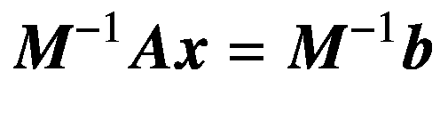

这与原始系统有相同的解。其系数矩阵***M***^(-1)***A***的谱特性可能更有利。另一种预处理系统的方式如下：

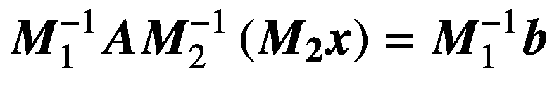

矩阵***M***[**1**]和***M***[**2**]分别称为左预处理器和右预处理器。预处理有三种类型：左预处理、右预处理或分裂预处理。左预处理将***M***[**2**]保留为`IdentityPreconditioner`。（当不应用任何预处理时，使用此单位预处理器。）类似地，右预处理将***M***[**1**]保留为`IdentityPreconditioner`。

在 `NM Dev` 中，所有稀疏矩阵线性系统求解器都继承自接口 `IterativeLinearSystemSolver`。其签名如下：

```
public interface IterativeLinearSystemSolver {
    /**
     * 这是使用迭代求解器求解线性方程组的解。
     */
    public static interface Solution extends IterativeMethod {
        @Override
        public IterationMonitor step() throws ConvergenceFailure; //覆盖返回类型和异常类型
        
        @Override
        public Vector search(Vector... initials) throws ConvergenceFailure; //覆盖异常类型
    }

    /**
     * 迭代求解
     * 
     * Ax = b
     * 
     * 直到解收敛，即残差 (b - Ax) 的范数小于或等于阈值。
     *
     * @param problem 一个线性方程组
     * @param monitor 一个迭代监视器
     * @return 线性问题的一个（近似）解
     * @throws ConvergenceFailure 若算法未能收敛则抛出
     */
    public Solution solve(LSProblem problem, IterationMonitor monitor) throws ConvergenceFailure;
}
```

下面这段 `NM Dev` 代码使用多个非定常稀疏线性系统求解器求解了一个稀疏线性系统。通用流程是首先使用 `LSProblem` 定义一个线性系统问题。然后为这个问题构建一个求解器。这里有很多选择。求解问题会得到一个 `IterativeLinearSystemSolver.Solution` 对象。使用该解对象，我们可以从一个初始猜测（在我们的示例中为 0）开始迭代搜索。搜索算法会返回一个向量 *x* 作为解。我们通过使用 *ℓ*[2]-范数比较 `A*x` 与 *x* 之间的差异来验证结果的有效性。示例如下。


```java
/* 对称矩阵：
 * 8x8
 * [,1] [,2] [,3] [,4] [,5] [,6] [,7] [,8]
 * [1,] 7.000000, 0.000000, 1.000000, 0.000000, 0.000000, 2.000000, 7.000000, 0.000000,
 * [2,] 0.000000, -4.000000, 8.000000, 0.000000, 2.000000, 0.000000, 0.000000, 0.000000,
 * [3,] 1.000000, 8.000000, 1.000000, 0.000000, 0.000000, 0.000000, 0.000000, 5.000000,
 * [4,] 0.000000, 0.000000, 0.000000, 7.000000, 0.000000, 0.000000, 9.000000, 0.000000,
 * [5,] 0.000000, 2.000000, 0.000000, 0.000000, 5.000000, 1.000000, 5.000000, 0.000000,
 * [6,] 2.000000, 0.000000, 0.000000, 0.000000, 1.000000, -1.000000, 0.000000, 5.000000,
 * [7,] 7.000000, 0.000000, 0.000000, 9.000000, 5.000000, 0.000000, 11.000000, 0.000000,
 * [8,] 0.000000, 0.000000, 5.000000, 0.000000, 0.000000, 5.000000, 0.000000, 5.000000,
 */
Matrix A = new CSRSparseMatrix(8, 8, // 矩阵维度
    new int[]{1, 1, 1, 1, 2, 2, 2, 3, 3, 3, 3, 4, 4, 5, 5, 5, 5, 6, 6, 6, 6, 7, 7, 7, 7, 8, 8, 8}, // 行索引
    new int[]{1, 3, 6, 7, 2, 3, 5, 1, 2, 3, 8, 4, 7, 2, 5, 6, 7, 1, 5, 6, 8, 1, 4, 5, 7, 3, 6, 8}, // 列索引
    new double[]{7, 1, 2, 7, -4, 8, 2, 1, 8, 1, 5, 7, 9, 2, 5, 1, 5, 2, 1, -1, 5, 7, 9, 5, 11, 5, 5, 5} // 条目/值
);
Vector b = new DenseVector( // 注意我们仍然可以使用稠密数据结构
    new double[]{
        1, 1, 1, 1, 1, 1, 1, 1
    });

// 构建一个待求解的线性系统问题
LSProblem problem = new LSProblem(A, b);

// 构造一个稀疏矩阵线性系统求解器
BiconjugateGradientSolver BiCG
    = new BiconjugateGradientSolver(
        10, // 最大迭代次数
        new AbsoluteTolerance(1e-8) // 精度
    );
IterativeLinearSystemSolver.Solution soln1 = BiCG.solve(problem);
Vector x1 = soln1.search(new SparseVector(A.nCols())); // 使用 0 作为初始猜测
System.out.println("x = " + x1);
Vector Ax1_b = A.multiply(x1).minus(b); // 验证 Ax = b
System.out.println("||Ax - b|| = " + Ax1_b.norm()); // 应接近 0

// 构造一个稀疏矩阵线性系统求解器
BiconjugateGradientStabilizedSolver BiCGSTAB
    = new BiconjugateGradientStabilizedSolver(
        10, // 最大迭代次数
        new AbsoluteTolerance(1e-7) // 较低精度
    );
IterativeLinearSystemSolver.Solution soln2 = BiCGSTAB.solve(problem);
Vector x2 = soln2.search(new SparseVector(A.nCols())); // 使用 0 作为初始猜测
System.out.println("x = " + x2);
Vector Ax2_b = A.multiply(x2).minus(b); // 验证 Ax = b
System.out.println("||Ax - b|| = " + Ax2_b.norm()); // 应接近 0

ConjugateGradientNormalErrorSolver CGNE
    = new ConjugateGradientNormalErrorSolver(
        10, // 最大迭代次数
        new AbsoluteTolerance(1e-8) // 精度
    );
IterativeLinearSystemSolver.Solution soln3 = CGNE.solve(problem);
Vector x3 = soln3.search(new SparseVector(A.nCols())); // 使用 0 作为初始猜测
System.out.println("x = " + x3);
Vector Ax3_b = A.multiply(x3).minus(b); // 验证 Ax = b
System.out.println("||Ax - b|| = " + Ax3_b.norm()); // 应接近 0

ConjugateGradientNormalResidualSolver CGNR
    = new ConjugateGradientNormalResidualSolver(
        10, // 最大迭代次数
        new AbsoluteTolerance(1e-8) // 精度
    );
IterativeLinearSystemSolver.Solution soln4 = CGNR.solve(problem);
Vector x4 = soln4.search(new SparseVector(A.nCols())); // 使用 0 作为初始猜测
System.out.println("x = " + x4);
Vector Ax4_b = A.multiply(x4).minus(b); // 验证 Ax = b
System.out.println("||Ax - b|| = " + Ax4_b.norm()); // 应接近 0

ConjugateGradientSolver CG
    = new ConjugateGradientSolver(
        10, // 最大迭代次数
        new AbsoluteTolerance(1e-8) // 精度
    );
IterativeLinearSystemSolver.Solution soln5 = CG.solve(problem);
Vector x5 = soln5.search(new SparseVector(A.nCols())); // 使用 0 作为初始猜测
System.out.println("x = " + x5);
Vector Ax5_b = A.multiply(x5).minus(b); // 验证 Ax = b
System.out.println("||Ax - b|| = " + Ax5_b.norm()); // 应接近 0

ConjugateGradientNormalResidualSolver CGS
    = new ConjugateGradientNormalResidualSolver(
        10, // 最大迭代次数
        new AbsoluteTolerance(1e-8) // 精度
    );
IterativeLinearSystemSolver.Solution soln6 = CGS.solve(problem);
Vector x6 = soln6.search(new SparseVector(A.nCols())); // 使用 0 作为初始猜测
System.out.println("x = " + x6);
Vector Ax6_b = A.multiply(x6).minus(b); // 验证 Ax = b
System.out.println("||Ax - b|| = " + Ax6_b.norm()); // 应接近 0

GeneralizedConjugateResidualSolver GRES
    = new GeneralizedConjugateResidualSolver(
        10, // 最大迭代次数
        new AbsoluteTolerance(1e-8) // 精度
    );
IterativeLinearSystemSolver.Solution soln7 = GRES.solve(problem);
Vector x7 = soln7.search(new SparseVector(A.nCols())); // 使用 0 作为初始猜测
System.out.println("x = " + x7);
Vector Ax7_b = A.multiply(x7).minus(b); // 验证 Ax = b
System.out.println("||Ax - b|| = " + Ax7_b.norm()); // 应接近 0

GeneralizedMinimalResidualSolver GMRES
    = new GeneralizedMinimalResidualSolver(
        10, // 最大迭代次数
        new AbsoluteTolerance(1e-8) // 精度
    );
IterativeLinearSystemSolver.Solution soln8 = GMRES.solve(problem);
Vector x8 = soln8.search(new SparseVector(A.nCols())); // 使用 0 作为初始猜测
System.out.println("x = " + x8);
Vector Ax8_b = A.multiply(x8).minus(b); // 验证 Ax = b
System.out.println("||Ax - b|| = " + Ax8_b.norm()); // 应接近 0

MinimalResidualSolver MINRES = new MinimalResidualSolver(
    10, // 最大迭代次数
    new AbsoluteTolerance(1e-8) // 精度
);
CountMonitor monitor = new CountMonitor();
IterativeLinearSystemSolver.Solution soln9 = MINRES.solve(problem, monitor);
Vector x9 = soln9.search(new SparseVector(A.nCols())); // 使用 0 作为初始猜测
System.out.println("x = " + x9);
Vector Ax9_b = A.multiply(x9).minus(b); // 验证 Ax = b
System.out.println("||Ax - b|| = " + Ax9_b.norm()); // 应接近 0

QuasiMinimalResidualSolver QMR
    = new QuasiMinimalResidualSolver(
        10, // 最大迭代次数
        new AbsoluteTolerance(1e-8) // 精度
    );
IterativeLinearSystemSolver.Solution soln10 = QMR.solve(problem);
Vector x10 = soln10.search(new SparseVector(A.nCols())); // 使用 0 作为初始猜测
System.out.println("x = " + x10);
Vector Ax10_b = A.multiply(x10).minus(b); // 验证 Ax = b
System.out.println("||Ax - b|| = " + Ax10_b.norm()); // 应接近 0
```


输出如下：

```
x = [-0.041860, -0.003413, 0.117250, -0.112640, 0.024172, -0.107633, 0.198720, 0.190383]
||Ax - b|| = 3.4321107842718707E-13
x = [-0.041860, -0.003413, 0.117250, -0.112640, 0.024172, -0.107633, 0.198720, 0.190383]
||Ax - b|| = 6.001732649867594E-8
x = [-0.041860, -0.003413, 0.117250, -0.112640, 0.024172, -0.107633, 0.198720, 0.190383]
||Ax - b|| = 1.6870268466872934E-9
x = [-0.041860, -0.003413, 0.117250, -0.112640, 0.024172, -0.107633, 0.198720, 0.190383]
||Ax - b|| = 6.817480703009663E-10
x = [-0.041860, -0.003413, 0.117250, -0.112640, 0.024172, -0.107633, 0.198720, 0.190383]
||Ax - b|| = 3.4321107842718707E-13
x = [-0.041860, -0.003413, 0.117250, -0.112640, 0.024172, -0.107633, 0.198720, 0.190383]
||Ax - b|| = 6.817480703009663E-10
x = [-0.041860, -0.003413, 0.117250, -0.112640, 0.024172, -0.107633, 0.198720, 0.190383]
||Ax - b|| = 1.0175362097255202E-15
x = [-0.041860, -0.003413, 0.117250, -0.112640, 0.024172, -0.107633, 0.198720, 0.190383]
||Ax - b|| = 1.0053497077208614E-15
x = [-0.041860, -0.003413, 0.117250, -0.112640, 0.024172, -0.107633, 0.198720, 0.190383]
||Ax - b|| = 2.392209894095706E-13
x = [-0.041860, -0.003413, 0.117250, -0.112640, 0.024172, -0.107633, 0.198720, 0.190383]
||Ax - b|| = 5.933770145831627E-13
```

以下 NM Dev 代码使用多个*平稳稀疏线性系统求解器*来解一个稀疏线性系统：

```
Matrix A = new SymmetricMatrix(
new double[][]{
{4},
{1, 3}
});
Vector b = new DenseVector(
new double[]{
1, 2
});
// 构造一个待解的线性系统问题
LSProblem problem = new LSProblem(A, b);
// 构造一个稀疏矩阵线性系统求解器
GaussSeidelSolver gauss_seidel
= new GaussSeidelSolver(
10,
new AbsoluteTolerance(1e-4));
IterativeLinearSystemSolver.Solution soln1 = gauss_seidel.solve(problem);
Vector x1 = soln1.search(new SparseVector(A.nCols())); // 使用 0 作为初始猜测值
System.out.println("x = " + x1);
Vector Ax1_b = A.multiply(x1).minus(b); // 验证 Ax = b
System.out.println("||Ax - b|| = " + Ax1_b.norm()); // 应接近 0
// 构造一个稀疏矩阵线性系统求解器
JacobiSolver jacobi
= new JacobiSolver(
10,
new AbsoluteTolerance(1e-4));
IterativeLinearSystemSolver.Solution soln2 = jacobi.solve(problem);
Vector x2 = soln2.search(new SparseVector(A.nCols()));
System.out.println("x = " + x2);
Vector Ax2_b = A.multiply(x1).minus(b); // 验证 Ax = b
System.out.println("||Ax - b|| = " + Ax2_b.norm()); // 应接近 0
SuccessiveOverrelaxationSolver SOR
= new SuccessiveOverrelaxationSolver(
1.5,
20, // 需要更多迭代次数
new AbsoluteTolerance(1e-4));
IterativeLinearSystemSolver.Solution soln3 = SOR.solve(problem);
Vector x3 = soln3.search(new SparseVector(A.nCols())); // 使用 0 作为初始猜测值
System.out.println("x = " + x3);
Vector Ax3_b = A.multiply(x3).minus(b); // 验证 Ax = b
System.out.println("||Ax - b|| = " + Ax3_b.norm()); // 应接近 0
SymmetricSuccessiveOverrelaxationSolver SSOR
= new SymmetricSuccessiveOverrelaxationSolver(
1.5,
20, // 需要更多迭代次数
new AbsoluteTolerance(1e-4));
IterativeLinearSystemSolver.Solution soln4 = SSOR.solve(problem);
Vector x4 = soln4.search(new SparseVector(A.nCols())); // 使用 0 作为初始猜测值
System.out.println("x = " + x4);
Vector Ax4_b = A.multiply(x4).minus(b); // 验证 Ax = b
System.out.println("||Ax - b|| = " + Ax4_b.norm()); // 应接近 0
```

输出如下：

```
x = [0.090917, 0.636361]
||Ax - b|| = 2.8131430040989613E-5
x = [0.090917, 0.636365]
||Ax - b|| = 2.8131430040989613E-5
x = [0.090909, 0.636344]
||Ax - b|| = 6.462981890138403E-5
x = [0.090904, 0.636348]
||Ax - b|| = 6.213495416129946E-5
```

