# 5. 曲线拟合与插值

我们通常观测到的数据来自于（通常是不可观测的）总体的样本，而我们往往没有全部输入变量对应的值。通常情况下，我们想要获取那些无法直接观测到或样本中无法获取的值。曲线拟合和插值等技术可以帮助我们对缺失值进行有根据的猜测，从而绘制出一条线（即一个函数），使其穿过这些数据点。通过在任何输入值处评估该函数，就可以估计出已知数据点之间的值。见图 5-1。

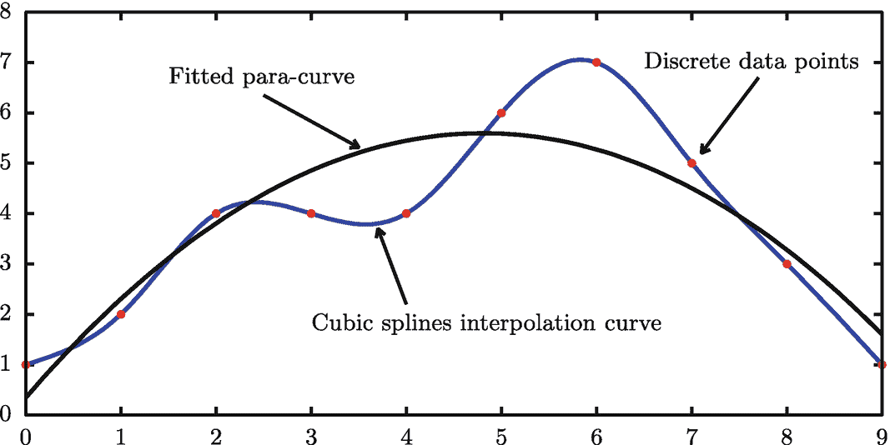

**图 5-1** 曲线拟合与插值

曲线拟合与插值的主要区别在于拟合的曲线是否穿过所有观测到的数据点。就曲线拟合而言，其策略是推导出一条能代表数据总体趋势的曲线。拟合出的曲线穿过整个数据集，但并非精确地经过每一个数据点。此曲线旨在以最佳方式拟合来描述整个数据集。由于它不穿过所有点，因此通常用于数据存在较大固有误差的情况，例如从实验测量中收集的数据。对于这类数据，如果强行精确穿过每一个点，那么同样也必然会捕获所有不希望存在的噪声。一个例子是广泛应用于统计分析中的线性回归，其收集的数据可能包含显著的误差，包括系统误差和样本误差。曲线拟合可用于辅助数据可视化，基于样本数据进行预测，并对两个或多个变量之间的关系进行推断。

相比之下，插值则用于拟合一条或一系列精确穿过所有数据点的曲线。当已知数据是精确的（即没有噪声）时使用。一个例子是根据不同期限的贴现率数据拟合一条零息票曲线。我们经常需要插值得到市场上无法直接观测到的某些期限的未知贴现率。通过评估拟合函数，我们可以对两个已知输入之间的未知输入进行插值或求值。另一个重要的应用场景是，当我们需要用一个相对简单的函数（通常是多项式）来表示一个复杂函数时，例如，为了避免巨大的计算成本。我们可以利用插值法，根据从原始复杂函数生成的数据点，来拟合一个更简单函数的曲线。


### 5.1 最小二乘法曲线拟合

曲线拟合的方法有很多种。最基本且最常用的是最小二乘法。假设我们有一组如下所示的数据点：

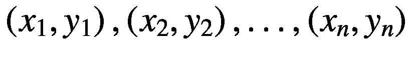

曲线拟合的第一步是选择一个有前景或符合预期的函数形式，即*f*(*x*)，本质上是一个参数化函数，来拟合这些数据点。NM Dev 实现了最广泛使用的形式，即多项式函数形式，如下所示：

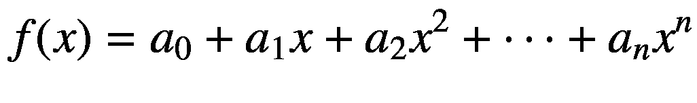

公式中的系数 *a*[0], *a*[1], *a*[2], …, *a*[*n*] 是需要确定的。我们在曲线拟合中所做的，本质上就是找到一组这样的系数，使得该函数能最佳地拟合给定的数据。而要定义何为“最佳”，也存在许多可能的标准。最小二乘法最小化了均方根误差。

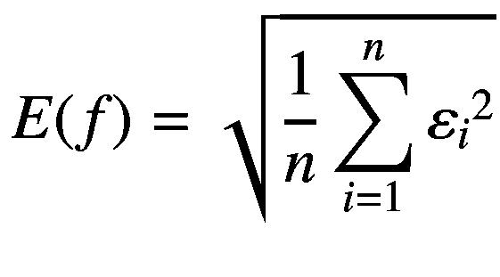

*ε*[*i*] 是第 *i* 个点处的误差，即数据值 *y*[*i*] 与曲线上拟合值 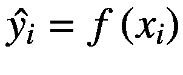 之间的距离。见图 5-2。

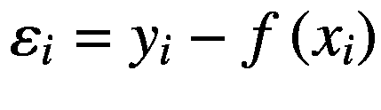

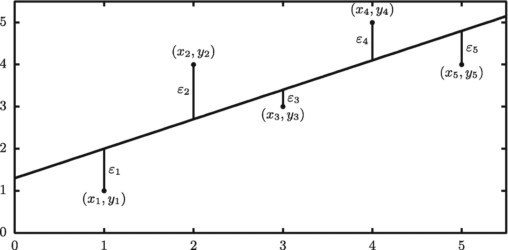

**图 5-2** 曲线拟合误差

最小二乘法找到一组系数 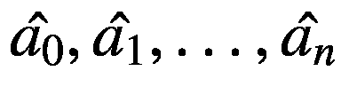，使得均方根误差最小化。最终，拟合后的曲线如下所示：

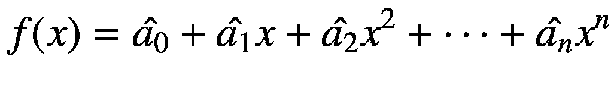

例如，我们希望根据以下数据集拟合一条曲线：

| ***x*** | ***y*** |
| --- | --- |
| 0 | 0.0 |
| 1 | 1.0 |
| 2 | 1.414 |
| 3 | 1.732 |
| 4 | 2.0 |
| 5 | 2.236 |

首先，我们需要决定用来拟合数据的函数形式。数据分析（可能也是解决任何问题）的第一步是绘制图表。将数据点在图表中绘制出来，能让我们直观地看到 *x* 和 *y* 之间的关系。见图 5-3。

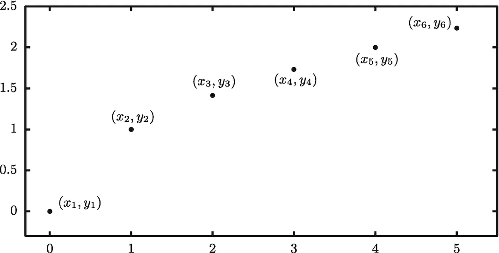

**图 5-3** 数据点可视化

从图中我们可以看到，这些数据显然呈现非线性关系。因此，我们可以使用阶数大于 1 的多项式，比如 2 阶。值得指出的是，阶数的选择非常重要。一般来说，我们希望拟合的函数尽可能简单，以避免从数据中拾取噪声。换句话说，我们希望避免过拟合。

过拟合是一种建模错误，当函数过度紧密地拟合一组数据点时就会发生。由于错误（记录、测量等）或随机性，数据集通常包含噪声。试图让曲线过于吻合数据，会因“拟合噪声”而给曲线模型带来显著误差，从而降低其预测能力。

思考图 5-4 中的比较。一个五次多项式 *f*1 和一个线性多项式 *f*2 被拟合到同一组数据。因为有六个数据点，五次多项式 *f*1 可以精确地穿过所有点。（一般来说，对于 *n* 个数据点，一个 (*n* − 1) 次多项式可以完美拟合所有数据点。）因此，*f*1 完美地拟合了数据。但是，这个完美的曲线是否比更简单的曲线 *f*2 更好呢？答案是否定的。显然，*f*2 更好地表示了 *x* 和 *y* 之间的正向关系。也就是说，当 *x* 增加时，*y* 也增加。此外，当 *x* 低于 0 或高于 5 时，五次多项式 *f*1 完全失去了预测能力。两端的尾部是人为造成的，仅仅是由于所选函数形式的人为产物，而与数据本身无关。见图 5-4。

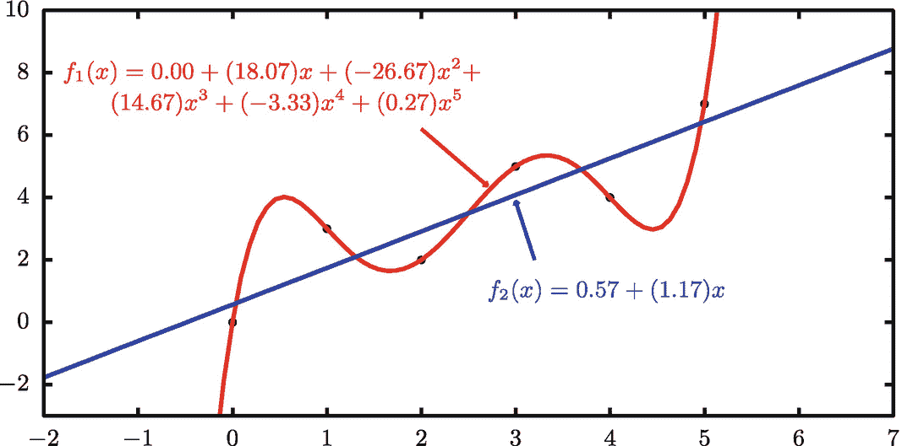

**图 5-4** 曲线拟合中线性多项式与高阶多项式对比

现在回到我们的例子。这些数据点呈现凸函数关系。我们可以使用抛物线来拟合它，如图 5-5 所示。拟合后的曲线是 *f* (*x*) = 0.1 + 0.81*x* − 0.08*x*²。

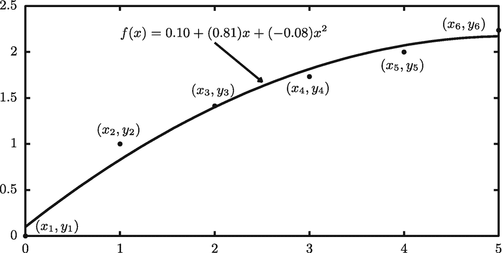

**图 5-5** 抛物线曲线拟合

拟合值 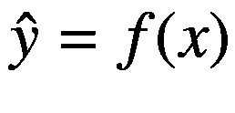 和误差 *ε* 如下所示：

| ***x*** | ***y*** | ***f*** (***x***) | ***ε*** |
| --- | --- | --- | --- |
| 0 | 0.0 | 0.1 | -0.1 |
| 1 | 1.0 | 0.83 | 0.17 |
| 2 | 1.414 | 1.4 | 0.014 |
| 3 | 1.732 | 1.81 | -0.078 |
| 4 | 2.0 | 2.07 | -0.07 |
| 5 | 2.236 | 2.17 | 0.066 |

NM Dev 代码如下。我们首先构造一个 `LeastSquares` 对象，将多项式函数所需的阶数 *m* 作为参数传入。在此例中，*m* = 2。然后，我们在一个数据集上调用该对象的 `fit` 方法，获取一个 `UnivariateRealFunction` 对象，该对象代表拟合后的函数曲线。这个函数可以用于在任何输入值处求值。

```
// 数据集
OrderedPairs data = new SortedOrderedPairs(
    new double[]{0., 1., 2., 3., 4., 5.},
    new double[]{0., 1., 1.414, 1.732, 2., 2.236}
);
LeastSquares ls = new LeastSquares(2);
UnivariateRealFunction f = ls.fit(data);
System.out.println(String.format("f(%.0f)=%f", 0., f.evaluate(0.))); // f(0) = 0.09
System.out.println(String.format("f(%.0f)=%f", 1., f.evaluate(1.))); // f(1) = 0.82
System.out.println(String.format("f(%.0f)=%f", 2., f.evaluate(2.))); // f(2) = 1.39
System.out.println(String.format("f(%.0f)=%f", 3., f.evaluate(3.))); // f(3) = 1.81
System.out.println(String.format("f(%.0f)=%f", 4., f.evaluate(4.))); // f(4) = 2.07
System.out.println(String.format("f(%.0f)=%f", 5., f.evaluate(5.))); // f(5) = 2.17
```

输出结果如下：

```
f(0)=0.099286
f(1)=0.828086
f(2)=1.399600
f(3)=1.813829
f(4)=2.070771
f(5)=2.170429
```

构造方法和 `fit` 方法的签名如下所示。请注意，该库允许你为每个数据点赋予权重。如果不指定权重，则所有数据点的权重相同。

```
/**
 * 构建算法 4.5.1（来自 Schilling & Harris）的一个新实例，
 * 该算法将使用阶数最高为 n（点的数量）的正交多项式的加权和。
 *
 * @param m         正交多项式的最大阶数 (m &le; n)
 * @param weighting 用于确定每个观测值权重的函数
 */
public LeastSquares(int m, Weighting weighting)
// 来自 Schilling & Harris 的算法 4.5.1
@Override
public UnivariateRealFunction fit(OrderedPairs f)
```


### 5.2 插值

插值是一种基于已知离散数据点范围来构造（查找）新数据点的方法。在工程和科学领域，我们经常通过采样或实验获得一系列数据点，这些数据点代表了函数在有限个自变量值下的取值。此时通常需要进行插值，即估算该函数在某个未知中间自变量值处的函数值。

另一个重要应用是用简单函数逼近复杂函数。假设某个给定函数的公式已知，但过于复杂而无法高效计算。通过对原始函数中的少量数据点进行插值，可以生成一个与原始函数仍然相当接近的简单函数。由此带来的简化优势可能超过插值误差造成的损失，并在计算过程中获得更优的性能表现。

#### 5.2.1 线性插值

线性插值是最简单的方法之一。其插值函数是一个分段函数，在每两个相邻数据点之间呈线性关系。给定一组数据点 (*x*[1], *y*[1])、(*x*[2], *y*[2])、…、(*x*[*n*], *y*[*n*])，插值函数如下所示：


图 5-6 中的曲线图展示了基于函数 *f* (*x*) = sin (*x*) 在区间 *x* ∈ [0, 6.3] 内生成的一组数据点所得到的线性插值曲线。

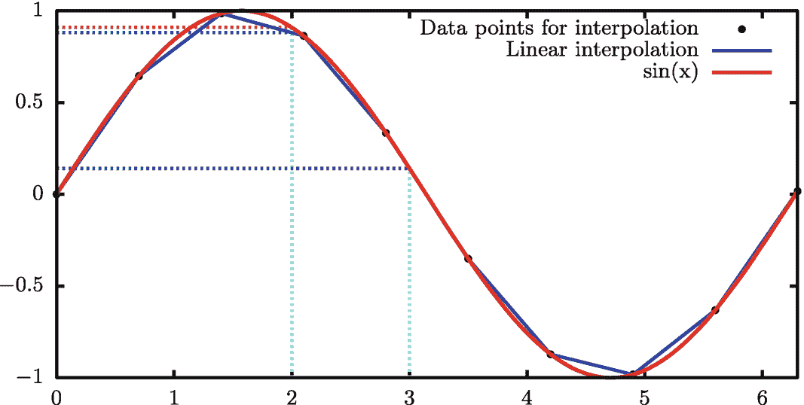

图 5-6

线性插值

如图所示，线性插值易于计算。它只是用直线段连接每两个相邻的点。其主要缺点是在原始数据远离线性关系时，预测效果可能不佳。例如，在 *x* = 2 处，sin(2) = 0.909297，而插值得到的值为 0.880672，误差超过 3%。相比之下，在 *x* = 3 处，原始数据接近线性（*f* (*x*) = sin (*x*) 的曲率或二阶导数为 *f* ′′(*x*) = − sin (*x*)，该值在 *x* = 3 附近约等于 0），sin(3) = 0.141120，而插值得到的值为 0.139053，误差仅为 1.5%。

重现上述示例的代码如下所示。我们首先构造一个 `LinearInterpolation` 对象；然后调用成员方法 `fit` 来拟合数据。该方法返回一个表示插值曲线的 `UnivariateRealFunction` 对象。

```
// 数据集
OrderedPairs data = new SortedOrderedPairs(
new double[]{0., 0.7, 1.4, 2.1, 2.8, 3.5, 4.2, 4.9, 5.6, 6.3},
new double[]{0., 0.644218, 0.98545, 0.863209, 0.334988, -0.350783, -0.871576, -0.982453, -0.631267, 0.0168139}
);
LinearInterpolation li = new LinearInterpolation();
UnivariateRealFunction f = li.fit(data);
System.out.println(f.evaluate(2)); // f(2) = 0.880672
System.out.println(f.evaluate(3)); // f(3) = 0.139053
```

输出结果如下：

```
0.880672
0.13905342857142847
```

该类只有一个不接受参数的默认构造函数。`fit` 函数的签名如下：

```
@Override
public UnivariateRealFunction fit(OrderedPairs f)
```

线性插值的另一个主要缺点是插值函数在数据点处不光滑，因此会出现拐点。由于相邻线性函数的一阶导数在其交汇点处不一致，斜率会发生突变。相比之下，使用更高阶的多项式样条可以避免这个问题。二次样条可以保证在节点处一阶导数连续，但无法保证二阶导数连续。三次样条则可以保证在节点处一阶和二阶导数均连续，因此在实际中使用最为广泛。


### 5.2.2 三次埃尔米特样条插值

`三次埃尔米特`是一种分段样条插值，其中每一段都是一个三次多项式，采用埃尔米特形式，即由该区间两个端点处的函数值和一阶导数值共同确定。

在单个区间 [*x*[1], *x*[2]] 上，给定 *x* = *x*[1] 处的函数值 *y*[1]、 *x* = *x*[2] 处的函数值 *y*[2]，以及 *x* = *x*[1] 处的切线 *y*[1]′ 和 *x* = *x*[2] 处的切线 *y*[2]′，该段曲线可以定义如下：

![$$ f(x)=a{x}³+b{x}²+ cx+d,\kern0.5em x\in \left[{x}_1,{x}_2\right] $$](images/500382_1_En_5_Chapter/500382_1_En_5_Chapter_TeX_Equg.png)

将端点处的函数值及一阶导数值代入，可得：

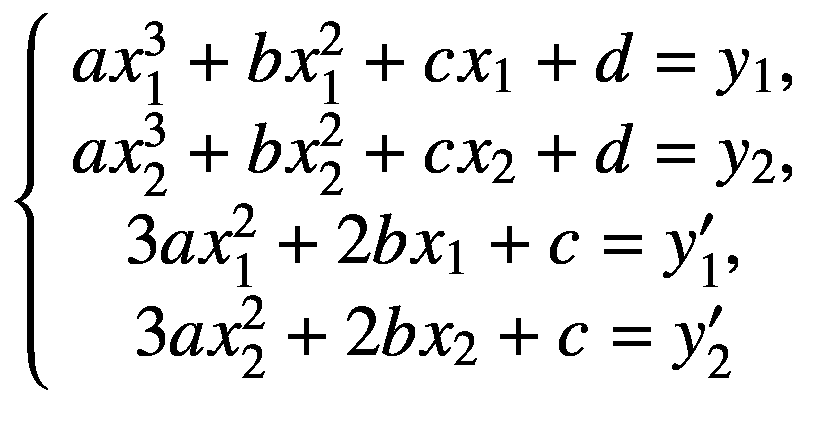

解出 *a*、*b*、*c*、*d*，即可得到在 [*x*[1], *x*[2]] 上的插值曲线。

举一个简单的例子。假设 *x*[1] = 0， *x*[2] = 1。我们得到：

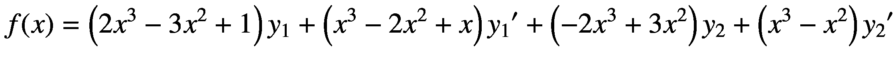

其中，*x* ∈ [0, 1]。要验证它，我们可以检查以下几点：

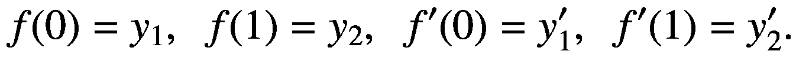

对数据集中每一对相邻的点重复上述过程，就会得到一个在每个区间上都是三次的分段插值。请注意，三次埃尔米特样条只以函数值和切线作为输入，没有更多条件。因此，它能保证一阶导数的连续性，但不能保证二阶导数连续。

当只有数据点 (*x*[1], *y*[1])、(*x*[2], *y*[2])、…、(*x*[*n*], *y*[*n*]) 时，需要从这些数据点估计切线。计算切线的方法有多种。在 NM Dev 中，有两种方法：Catmull-Rom 样条和有限差分法。

1.  Catmull-Rom 样条通过以下公式估计切线

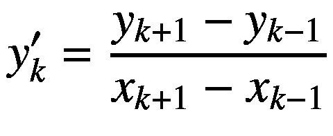

用于内部点 *k* = 2, …, *n* − 1，以及

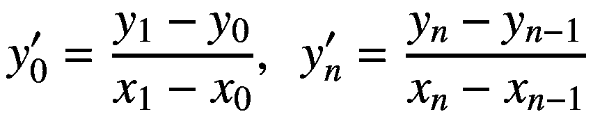

用于端点。

该方法广泛应用于计算机图形学中，用于在离散关键帧之间获得平滑、连续的运动。它之所以流行，是因为计算相对简单。它还能确保精确到达每个关键帧位置，并且所生成曲线的切线在多个分段上是连续的。

2.  有限差分法通过以下公式估计切线

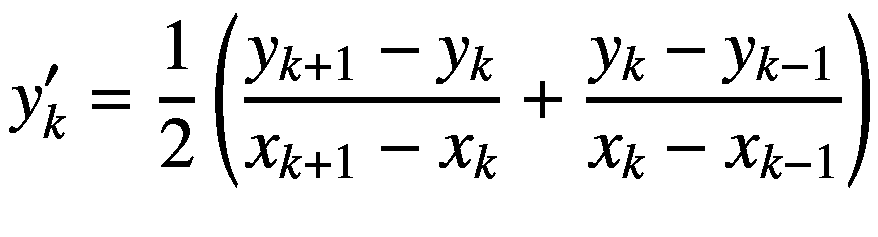

用于内部点 *k* = 2, …, *n* − 1，以及此单侧差分


用于端点。

让我们考虑与第 5.2.1 节相同的示例，即对由 *f*(*x*) = sin(*x*) 生成的数据进行插值。图 5-7 显示了应用带有 Catmull-Rom 切线的三次埃尔米特样条的结果。显然，与线性插值相比，曲线看起来平滑得多。

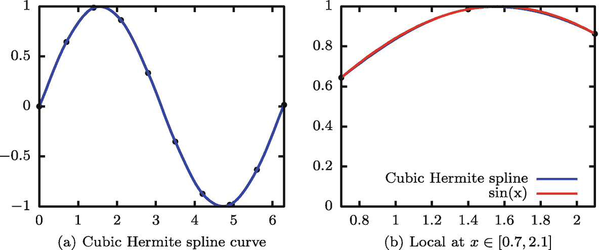

**图 5-7** 对 sin(x) 数据进行的三次埃尔米特样条插值

以下代码演示了如何对前面的示例使用 Catmull-Rom 切线进行三次埃尔米特样条插值。要改用有限差分切线，请切换到注释掉的那一行。在此特定示例中，切线方法的选择影响不大。

```java
// the data set
OrderedPairs data = new SortedOrderedPairs(
    new double[]{0., 0.7, 1.4, 2.1, 2.8, 3.5, 4.2, 4.9, 5.6, 6.3},
    new double[]{0., 0.644218, 0.98545, 0.863209, 0.334988, -0.350783, -0.871576, -0.982453, -0.631267, 0.0168139}
);
CubicHermite spline = new CubicHermite(CubicHermite.Tangents.CATMULL_ROM);
// CubicHermite spline = new CubicHermite(CubicHermite.Tangents.FINITE_DIFFERENCE);
UnivariateRealFunction f = spline.fit(data);
System.out.println(f.evaluate(2)); // f(2) = 0.906030
System.out.println(f.evaluate(3)); // f(3) = 0.145727
```

输出如下：

```
0.9060307725947522
0.14572681049562664
```

该类及 `fit` 方法的签名如下：

```java
/**
 * 使用给定的切线计算方法构造一个实例。
 *
 * @param tangent 计算插值所用的控制切线
 */
public CubicHermite(Tangent tangent)

/**
 * 插值函数必须通过所有给定的点。
 *
 * @param f {@inheritDoc }
 * @return 插值函数
 */
@Override
UnivariateRealFunction fit(OrderedPairs f);
```


好的，作为高级文档工程师和翻译员，我将严格遵循注意事项和示例格式，将给定的英文文本翻译成中文。


### 5.2.3 三次样条插值

三次样条是由分段三次多项式构成的样条，其曲线在**一阶导数**和**二阶导数**上都是连续的。三次样条与三次埃尔米特样条的区别在第 5.2.2 节中讨论过：三次埃尔米特样条保证一阶导数的连续性，而三次样条保证一阶和二阶导数都连续。

考虑由 *n* + 1 个点 (*x*[0], *y*[0]), (*x*[1], *y*[1]), …, (*x*[*n*], *y*[*n*]) 构成的样条。令样条的第 *i* 段由下式表示：

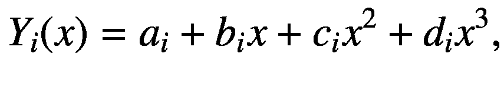

其中 *x* ∈ [*x*[*i*], *x*[*i* + 1]], *i* = 0, …, *n* − 1，如图 5-8 所示。

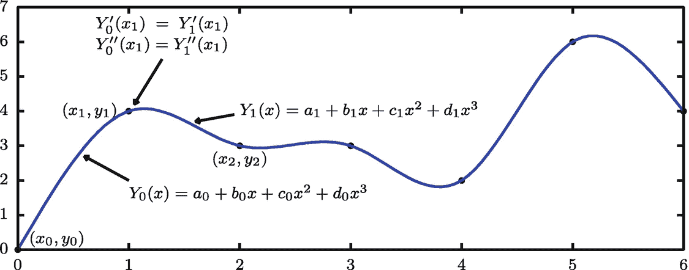

图 5-8  
三次样条插值

需要求解的是 `4*n` 个变量（`a`[0]，`b`[0]，`c`[0]，`d`[0]，…，`a`[*n* − 1]，`b`[*n* − 1]，`c`[*n* − 1]，`d`[*n* − 1]）。因此，需要 `4*n` 个方程。

首先，也是最显然的，样条必须满足这些数据点的值：

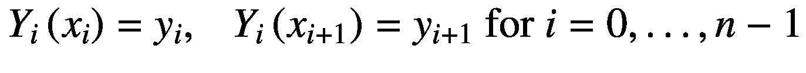

这给出了 `2*n` 个方程。

其次，为了确保曲线在一阶和二阶导数上连续，还需要满足另外 `2*(n − 1)` 个方程。

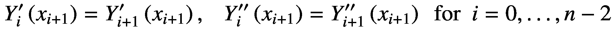

现在有 `4*n − 2` 个方程。边界条件给出了另外两个方程。常见的选择有自然样条、固支样条和非扭结样条。

-   **自然样条**：曲线在端点处的二阶导数设为 0；即 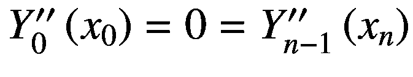。
-   **固支样条**：规定了曲线在端点处的一阶导数；即 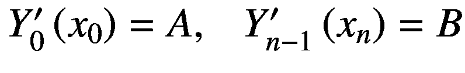。
-   **非扭结样条**：样条的三阶导数在 `x`[1] 和 `x`[*n* − 1] 处连续；即 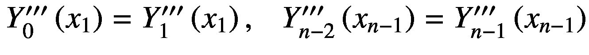。

加上边界条件，总共有 `4*n` 个方程。然后，我们可以求解这 `4*n` 个变量（`a`[0]，`b`[0]，`c`[0]，`d`[0]，…，`a`[*n* − 1]，`b`[*n* − 1]，`c`[*n* − 1]，`d`[*n* − 1]），并得到函数 `Y`0，`Y`1，…，`Y`*n* − 1。见图 5-9。

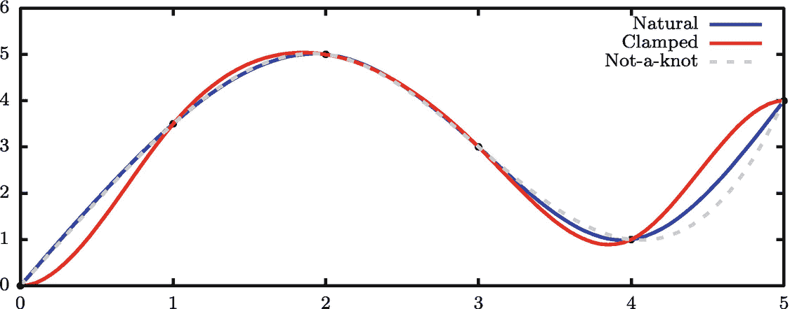

图 5-9  
三次样条中不同边界条件的比较

以下代码演示了一个三次样条。对象 `f1`、`f2` 和 `f3` 是分别使用自然、固支和非扭结边界条件的三次样条插值函数。

```
// the data set
OrderedPairs data = new SortedOrderedPairs(
new double[]{0., 1., 2., 3., 4., 5.},
new double[]{0., 3.5, 5., 3., 1., 4.}
);
CubicSpline cs1 = CubicSpline.natural();
UnivariateRealFunction f1 = cs1.fit(data);
CubicSpline cs2 = CubicSpline.clamped();
UnivariateRealFunction f2 = cs2.fit(data);
CubicSpline cs3 = CubicSpline.notAKnot();
UnivariateRealFunction f3 = cs3.fit(data);
```

方法签名如下：

```
/**
* Constructs an instance with end conditions which fits natural
* splines, meaning that the second derivative at both ends are zero.
*
* @return the instance
*/
public static CubicSpline natural()
/**
* Constructs an instance with end conditions which fits clamped
* splines, and the first derivative at both ends are zero.
*
* @return the instance
*/
public static CubicSpline clamped()
/**
* Constructs an instance with end conditions which fits clamped
* splines, meaning that the first derivative at both ends equal to the
* given values.
*
* @param df1 the first derivative at the first point
* @param dfn the first derivative at the last point
* @return the instance
*/
public static CubicSpline clamped(double df1, double dfn)
/**
* The interpolated function must pass through all the given points.
*
* @param f {@inheritDoc }
* @return the interpolated function
*/
@Override
UnivariateRealFunction fit(OrderedPairs f);
```

### 5.2.4 牛顿多项式插值

牛顿多项式是一种用于插值数据集的多项式。它有时被称为*牛顿均差插值多项式*，因为其系数是通过牛顿均差法计算的。与样条插值不同，牛顿多项式不是分段插值。相反，它构造一个 *n* 次多项式来插值包含 *n* + 1 个点的数据集。给定一组 *n* + 1 个点 (*x*[0]，*y*[0])，(*x*[1]，*y*[1])，…，(*x*[*n*]，*y*[*n*])，牛顿插值多项式是牛顿基多项式的线性组合。

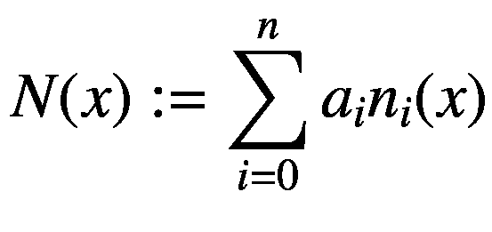

牛顿基多项式定义如下：

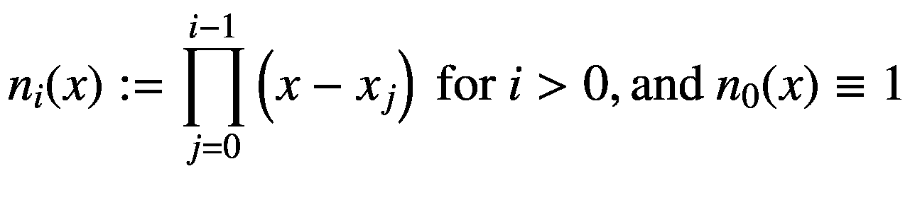

系数 `a`[*i*] 定义如下：

![$$ {a}_i:=\left[{y}_0,\dots, {y}_i\right] $$](images/500382_1_En_5_Chapter/500382_1_En_5_Chapter_TeX_Equt.png)

`[y`[0]，…，`y`[*i*]] 是均差的记号，其定义如下：

![$$ \left[{y}_0\right]={y}_0 $$](images/500382_1_En_5_Chapter/500382_1_En_5_Chapter_TeX_Equu.png)

![$$ \left[{y}_0,{y}_1\right]=\frac{\left[{y}_1\right]-\left[{y}_0\right]}{x_1-{x}_0}=\frac{y_1-{y}_0}{x_1-{x}_0} $$](images/500382_1_En_5_Chapter/500382_1_En_5_Chapter_TeX_Equv.png)


![$$ \left[{y}_0,\dots {y}_i\right]=\frac{\left[{y}_1,\dots, {y}_i\right]-\left[{y}_0,\dots, {y}_{i-1}\right]}{x_i-{x}_0} $$](images/500382_1_En_5_Chapter/500382_1_En_5_Chapter_TeX_Equx.png)

#### 5.2.4.1 线性形式

图 5-10 展示了一个牛顿线性多项式。

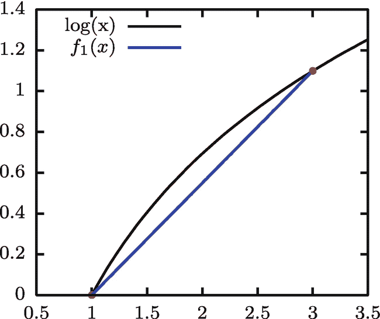

图 5-10  
牛顿线性多项式

我们从最简单的情况开始，即线性情况。给定两个点 (`x`[1]，`y`[1]) 和 (`x`[2]，`y`[2])，牛顿多项式呈现线性形式，如下所示：

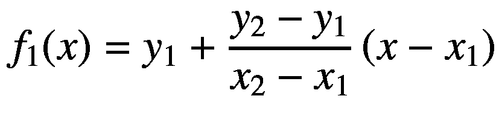

由于只有两个点，没有曲率信息。该数据集仅由一条直线进行插值。注意，系数 `y`[1] 和 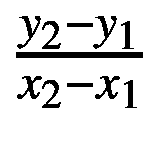 分别是牛顿均差 [`y`[1]] 和 [`y`[1]，`y`[2]]，而常数 1（在第一项中）和 (`x` − `x`[1]) 是牛顿基多项式。


#### 5.2.4.2 二次型

二次插值需要三个数据点，能为函数引入曲率，从而改进估计结果。利用前面给出的牛顿多项式定义，可将其定义为如下形式的二阶多项式：

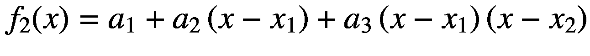

其中的系数 `a1`、`a2`、`a3` 可以轻松确定。

代入 `x = x1`，得到：

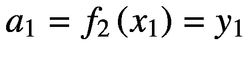

代入 `x = x2`，得到：

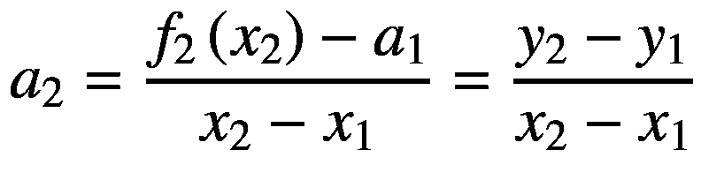

见图 5-11。

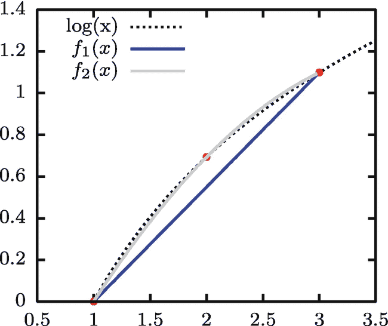

**图 5-11** 牛顿二次多项式

代入 `x = x3`，得到：

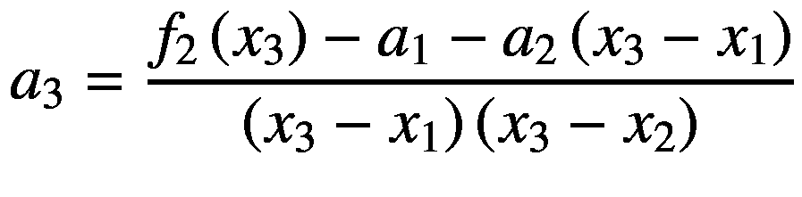

![$$ =\frac{y_3-\left[{y}_2-{a}_2\left({x}_2-{x}_1\right)\right]-{a}_2\left({x}_3-{x}_1\right)}{\left({x}_3-{x}_1\right)\left({x}_3-{x}_2\right)} $$](images/500382_1_En_5_Chapter/500382_1_En_5_Chapter_TeX_Equad.png)

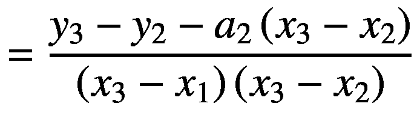

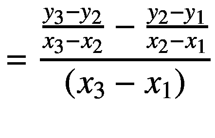

`f2(x)` 包含 `f1(x)` 所没有的二次项，这为其带来了曲率。二次项中系数 `a3` 的表达式实际上是牛顿差商 `[y1, y2, y3]`，可以通过 `[y3, y2]` 和 `[y2, y1]` 计算得出。

![$$ \left[{y}_1,{y}_2,{y}_3\right]=\frac{\left[{y}_3,{y}_2\right]-\left[{y}_2,{y}_1\right]}{x_3-{x}_1} $$](images/500382_1_En_5_Chapter/500382_1_En_5_Chapter_TeX_Equag.png)

#### 5.2.4.3 通用形式

前面展示的线性和二次型插值可以推广到拟合包含 `n + 1` 个点的数据集，此时多项式阶数为 `n`。因此，牛顿差商插值公式如下：

![$$ {f}_n(x)={y}_0+\left[{y}_0,{y}_1\right]\left(x-{x}_0\right)+\dots +\left[{y}_0,\dots, {y}_n\right]\left(x-{x}_0\right)\left(x-{x}_1\right)\dots \left(x-{x}_{n-1}\right) $$](images/500382_1_En_5_Chapter/500382_1_En_5_Chapter_TeX_Equah.png)

差商通过以下公式以递归方式计算：

![$$ \left[{y}_0,\dots {y}_i\right]=\frac{\left[{y}_1,\dots, {y}_i\right]-\left[{y}_0,\dots, {y}_{i-1}\right]}{x_i-{x}_0} $$](images/500382_1_En_5_Chapter/500382_1_En_5_Chapter_TeX_Equai.png)

为了更直观地展现递归过程，我们将计算 `[y0, y1, y2, y3]` 的示例以表格形式呈现：

![$$ {\displaystyle \begin{array}{ccccc}\left({x}_0,{y}_0\right)&amp; \left[{y}_0\right]&amp; &amp; &amp; \\ {}&amp; &amp; \left[{y}_0,{y}_1\right]&amp; &amp; \\ {}\left({x}_1,{y}_1\right)&amp; \left[{y}_1\right]&amp; &amp; \left[{y}_0,{y}_1,{y}_2\right]&amp; \\ {}&amp; &amp; \left[{y}_1,{y}_2\right]&amp; &amp; \left[{y}_0,{y}_1,{y}_2,{y}_3\right]\\ {}\left({x}_2,{y}_2\right)&amp; \left[{y}_2\right]&amp; &amp; \left[{y}_1,{y}_2,{y}_3\right]&amp; \\ {}&amp; &amp; \left[{y}_2,{y}_3\right]&amp; &amp; \\ {}\left({x}_3,{y}_3\right)&amp; \left[{y}_3\right]&amp; &amp; &amp; \end{array}} $$](images/500382_1_En_5_Chapter/500382_1_En_5_Chapter_TeX_Equaj.png)

该表格展示了各差商之间的关系。例如，`[y0, y1]` 由 `[y0]` 和 `[y1]` 计算得出；`[y0, y1, y2, y3]` 由 `[y0, y1, y2]` 和 `[y1, y2, y3]` 计算得出。

图 5-12 针对一个大小为 7 的随机数据集，比较了牛顿多项式插值与自然三次样条插值。由于有 7 个数据点，牛顿插值多项式为 6 次，这会导致曲线出现高次多项式所特有的波峰与波谷，进而可能产生较大误差。随着数据点数量增加，插值多项式的阶数也随之提高，波峰与波谷的幅度和数量都会迅速增加。相比之下，由多个低次多项式拼接而成的三次样条在此情况下表现更为稳定和令人满意。

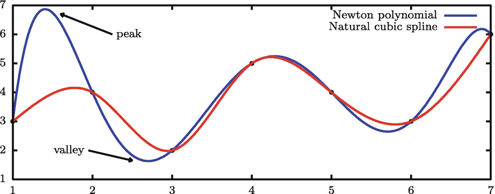

**图 5-12** 牛顿多项式与三次样条的对比

以下代码片段演示了如何使用牛顿多项式插值：

```java
// 2 个数据点，线性形式
OrderedPairs data1 = new SortedOrderedPairs(
new double[]{1., 3.},
new double[]{log(1.), log(3.)}
);
Interpolation np1 = new NewtonPolynomial();
UnivariateRealFunction f1 = np1.fit(data1);
// 3 个数据点，二次形式
OrderedPairs data2 = new SortedOrderedPairs(
new double[]{1., 2., 3.},
new double[]{log(1.), log(2.), log(3.)}
);
Interpolation np2 = new NewtonPolynomial();
UnivariateRealFunction f2 = np2.fit(data2);
// 牛顿多项式与三次样条的对比
OrderedPairs data3 = new SortedOrderedPairs(
new double[]{1., 2., 3., 4., 5., 6., 7.},
new double[]{3., 4., 2., 5., 4., 3., 6.}
);
Interpolation np3 = new NewtonPolynomial();
UnivariateRealFunction f3_1 = np3.fit(data3);
Interpolation cs = CubicSpline.natural();
UnivariateRealFunction f3_2 = cs.fit(data3);
```

### 5.3 多元插值

多元插值是对具有多个变量的函数进行插值，是单变量插值情况的扩展。


### 5.3.1 双变量插值

我们先从双变量情况开始。假设我们有一组 *n* × *n* 个数据点：(x[1]、y[1]、`z[11]`)、(x[1]、y[2]、`z[12]`)、…、(x[n]、y[n]、`z[nn]`)。请注意，(x[1]、y[1]、`z[11]`) 表示数据值 `z[11]` 位于位置 (x[1]、y[1]) 处。即：

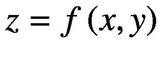

双变量函数的通用插值步骤如下：

1.  固定一个维度，例如将 `y = y[1]` 视为常数。对于该特定的数据切片（现在是一维的），对另一个维度 `x` 进行插值。
2.  对于另一个维度 `x` 中的值，对步骤 1 得到的结果进行插值。

例如，我们首先固定维度 `y`，并对 `x` 进行插值。在 `y = y[1]` 处，我们有 (x[1]、`z[11]`)、(x[2]、`z[12]`)、…、(x[n]、`z[1n]`)。应用任何单变量插值算法（例如第 5.2 节中讨论的算法），我们得到 `fy1`，它是位置 `y = y[1]` 处 `x` 的插值函数。对维度 `y` 中的每个位置重复此过程，我们得到 `fy1`、`fy2`、…、`fyn`，这是一组平行于 x 轴的曲线。

第二步是在数据集 (y[1]、`fy1`)、(y[2]、`fy2`)、…、(y[n]、`fyn`) 上对 `x` 值进行插值。这也可以通过应用任何单变量插值算法来完成。然后我们得到 `f(x, y)`。

因此，双变量插值函数的属性和结果由其内部应用的（两个）单变量插值函数决定。例如，双线性插值使用线性插值对单个维度进行两次插值。双三次样条和双三次插值分别使用三次样条和三次埃尔米特插值。

插值函数 `f(x, y)` 是一个曲面，如图 5-13 所示，其中对大小为 3 × 3 的数据集应用了双三次插值。黑点是数据点；蓝色线条网格是插值曲面。

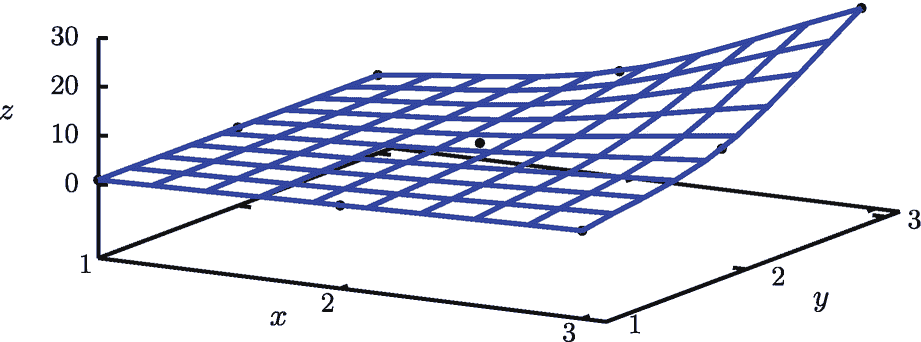

**图 5-13** 双三次插值

NM Dev 实现了双线性插值、双三次样条和双三次插值。以下代码片段展示了所有三种方法：

```java
BivariateGrid grids = new BivariateArrayGrid(
    new double[][]{
        {1, 1, 1}, // z(1, 1) = 1, z(1, 2) = 1, z(1, 3) = 1
        {2, 4, 8}, // z(2, 1) = 2, z(2, 2) = 4, z(2, 3) = 8
        {3, 9, 27} // z(3, 1) = 3, z(3, 2) = 9, z(3, 3) = 27
    },
    new double[]{1, 2, 3}, // x
    new double[]{1, 2, 3} // y
);
BivariateGridInterpolation bl = new BilinearInterpolation();
RealScalarFunction f1 = bl.interpolate(grids); // f3(1.5, 1.5) = 2.0
System.out.println(f1.evaluate(new DenseVector(new double[]{1.5, 1.5})));
BivariateGridInterpolation bs = new BicubicSpline();
RealScalarFunction f2 = bs.interpolate(grids); // f2(1.5, 1.5) = 1.8828125
System.out.println(f2.evaluate(new DenseVector(new double[]{1.5, 1.5})));
BivariateGridInterpolation bi = new BicubicInterpolation();
RealScalarFunction f3 = bi.interpolate(grids); // f1(1.5, 1.5) = 1.90625
System.out.println(f3.evaluate(new DenseVector(new double[]{1.5, 1.5})));
```

输出如下：

```
2.0
1.8828125
1.90625
```

类 `BivariateGrid` 定义了一个三维空间中的网格，即 `z = f(x, y)`。第一个输入 `z` 是一个二维数组。它是 `x` 和 `y`（第二个和第三个数组输入）值的笛卡尔积或叉积。`z` 的 `[1, 1]` 索引项是位置 `x[1]` 和 `y[1]` 处的 `z` 值。在此例中，`x[1] = 1` 且 `y[1] = 1`，因此 `z(1, 1) = 1`。

类 `BivariateArrayGrid` 可以定义一个直线网格，这意味着网格线不一定是等距的。类 `BivariateRegularGrid` 仅定义一个具有等距网格线的规则网格。它们的签名如下：

```java
/**
 * 使用给定的网格值二维数组以及沿 x 轴和 y 轴的网格线位置值构造一个新网格。
 *
 * @param z 网格值
 * @param x 沿 x 轴的网格线位置
 * @param y 沿 y 轴的网格线位置
 */
public BivariateArrayGrid(double[][] z, double[] x, double[] y)

/**
 * 构造一个新网格，其中因变量的值取自给定的二维数组，
 * 自变量的值由其第一个值和连续值之间的差值指定。
 *
 * 输入数组的第一个索引对应于 x，第二个索引对应于 y，
 * 大小将根据数组的大小推断。
 *
 * @param z      包含因变量值的二维数组
 * @param x0     自变量 x 的第一个值
 * @param y0     自变量 y 的第一个值
 * @param deltaX 沿 x 轴的相邻点之间的距离
 * @param deltaY 沿 y 轴的相邻点之间的距离
 */
public BivariateRegularGrid(
    double[][] z,
    double x0,
    double y0,
    double deltaX,
    double deltaY
)
```

类 `BicubicInterpolation` 的构造函数如下：

```java
/**
 * 构造一个新实例，该实例使用给定的导数进行插值。
 * 请注意，导数不必完全正确，但它们将成为插值曲面中存在的导数。
 *
 * @param derivatives 用于插值的导数
 */
public BicubicInterpolation(PartialDerivatives derivatives)
```

请注意，它可以接收网格点处函数的偏导数作为输入。接口 `BicubicInterpolation.PartialDerivatives` 如下：

```java
/**
 * 指定在 {@link BivariateGrid} 点上定义的偏导数。
 */
public interface PartialDerivatives {
    /**
     * 获取在网格中给定位置处的偏导数 \(\frac{\partial z}{\partial x}\)。
     *
     * @param grid 要获取偏导数的网格
     * @param i    沿 x 轴的索引
     * @param j    沿 y 轴的索引
     * @return 给定点处的 \(\frac{\partial z}{\partial x}\)
     */
    double dx(BivariateGrid grid, int i, int j);

    /**
     * 获取在网格中给定位置处的偏导数 \(\frac{\partial z}{\partial y}\)。
     *
     * @param grid 要获取偏导数的网格
     * @param i    沿 x 轴的索引
     * @param j    沿 y 轴的索引
     * @return 给定点处的 \(\frac{\partial z}{\partial y}\)
     */
    double dy(BivariateGrid grid, int i, int j);

    /**
     * 获取在网格中给定位置处的混合偏导数 \(\frac{\partial² z}{\partial x \partial y}\)。
     *
     * @param grid 要获取偏导数的网格
     * @param i    沿 x 轴的索引
     * @param j    沿 y 轴的索引
     * @return 给定点处的 \(\frac{\partial² z}{\partial x \partial y}\)
     */
    double dxdy(BivariateGrid grid, int i, int j);
}
```

下面是一个将双变量数据集与补充的雅可比矩阵进行拟合的示例：


```
// derivatives and answers from Michael Flanagan's library
double[][] z = new double[][]{
{1.0, 3.0, 5.0},
{2.0, 4.0, 8.0},
{9.0, 10.0, 11.0}
};
final double[][] dx = new double[][]{
{6.0, 2.0, 2.0},
{6.0, 7.0, 8.0},
{6.0, 12.0, 14.0}
};
final double[][] dy = new double[][]{
{8.0, 8.0, 8.0},
{16.0, 12.0, 8.0},
{4.0, 4.0, 4.0}
};
final double[][] dxdy = new double[][]{
{16.0, 8.0, 0.0},
{-4.0, -4.0, -4.0},
{-24.0, -16.0, -8.0}
};
BicubicInterpolation.PartialDerivatives deriv
= new BicubicInterpolation.PartialDerivatives() {
@Override
public double dx(BivariateGrid grid, int i, int j) {
return getDeriv(dx, i, j); // 由于某些原因，y 轴是反向写入的...
}
@Override
public double dy(BivariateGrid grid, int i, int j) {
return getDeriv(dy, i, j);
}
@Override
public double dxdy(BivariateGrid grid, int i, int j) {
return getDeriv(dxdy, i, j);
}
private double getDeriv(double[][] dx, int i, int j) {
return dx[i][2 - j];
}
};
BivariateGridInterpolation interpolation = new BicubicInterpolation(deriv);
BivariateGrid grid = new BivariateRegularGrid(z, 0.0, 0.0, 0.5, 0.25);
RealScalarFunction f = interpolation.interpolate(grid);
System.out.println(f.evaluate(new DenseVector(0.0, 0.0))); // 1.0
System.out.println(f.evaluate(new DenseVector(0.0, 0.125))); // 2.0
System.out.println(f.evaluate(new DenseVector(0.0, 0.25))); // 3.0
System.out.println(f.evaluate(new DenseVector(0.0, 0.375))); // 4.0
System.out.println(f.evaluate(new DenseVector(0.0, 0.5))); // 5.0
System.out.println(f.evaluate(new DenseVector(0.25, 0.0))); // 1.125
System.out.println(f.evaluate(new DenseVector(0.25, 0.125))); // 2.078125
System.out.println(f.evaluate(new DenseVector(0.25, 0.25))); // 3.1875
System.out.println(f.evaluate(new DenseVector(0.25, 0.375))); // 4.765625
System.out.println(f.evaluate(new DenseVector(0.25, 0.5))); // 6.5
System.out.println(f.evaluate(new DenseVector(0.5, 0.0))); // 2.0
System.out.println(f.evaluate(new DenseVector(0.5, 0.125))); // 2.875
System.out.println(f.evaluate(new DenseVector(0.5, 0.25))); // 4.0
System.out.println(f.evaluate(new DenseVector(0.5, 0.375))); // 5.875
System.out.println(f.evaluate(new DenseVector(0.5, 0.5))); // 8.0
System.out.println(f.evaluate(new DenseVector(0.75, 0.0))); // 5.125
System.out.println(f.evaluate(new DenseVector(0.75, 0.125))); // 5.828125
System.out.println(f.evaluate(new DenseVector(0.75, 0.25))); // 6.6875
System.out.println(f.evaluate(new DenseVector(0.75, 0.375))); // 8.015625
System.out.println(f.evaluate(new DenseVector(0.75, 0.5))); // 9.5
System.out.println(f.evaluate(new DenseVector(1.0, 0.0))); // 9.0
System.out.println(f.evaluate(new DenseVector(1.0, 0.125))); // 9.5
System.out.println(f.evaluate(new DenseVector(1.0, 0.25))); // 10.0
System.out.println(f.evaluate(new DenseVector(1.0, 0.375))); // 10.5
System.out.println(f.evaluate(new DenseVector(1.0, 0.5))); // 11.0
```

输出结果如下：

```
1.0
2.0
3.0
4.0
5.0
1.125
2.078125
3.1875
4.765625
6.5
2.0
2.875
4.0
5.875
8.0
5.125
5.828125
6.6875
8.015625
9.5
9.0
9.5
10.0
10.5
11.0
```

### 5.3.2 多维插值

上一节中针对双变量情况描述的过程，经过一些修改后也可应用于更高维度的情况。我们以递归方式应用该过程。下面以三维情况为例。

假设我们有这样一个 `n × n × n` 的数据集：(`x[1]`, `y[1]`, `z[1]`, `w[111]`), (`x[1]`, `y[1]`, `z[2]`, `w[112]`)，…，(`x[n]`, `y[n]`, `z[n]`, `w[nnn]`)。首先，我们将 `x` 维度固定为常量。在位置 `x = x[1]` 处，有 (`y[1]`, `z[1]`, `w[111]`), (`y[1]`, `z[2]`, `w[112]`)，…，(`y[n]`, `z[n]`, `w[1nn]`) 需要插值。此时，这个切片数据集是双变量的。我们再固定另一个维度，例如 `y`。然后在位置 `y = y[1]` 处，有 (`z[1]`, `w[111]`), (`z[2]`, `w[112]`)，…，(`z[n]`, `w[11n]`) 需要插值。现在，这个切片数据集是单变量的。我们可以应用任何单变量插值算法来得到插值器 `fx1y1`。对所有 `y` 值重复此过程，我们将得到 `fx1y1`, `fx1y2`，…，`fx1yn`。接下来，如同在双变量情况下所做的那样，我们对 (`y[1]`, `fx1y1`), (`y[2]`, `fx1y2`)，…，(`y[n]`, `fx1yn`) 进行插值，得到插值器 `fx1`。对所有 `x` 值重复此过程，我们将得到 `fx1`, `fx2`，…，`fxn`。最后，对 (`x[1]`, `fx1`), (`x[2]`, `fx2`)，…，(`x[n]`, `fxn`) 进行插值，得到最终的插值器 `f(x, y, z)`。

NM Dev 实现了这个算法，以递归方式进行低阶插值，直至可以在一个一维切片数据集上应用单变量算法。然而，随着维度的增加，计算成本呈指数级增长。对于高维数据来说，这并不实用。

以下代码示例展示了如何应用该算法进行多元线性插值：

```
// the data set
MultiDimensionalArray mda
= new MultiDimensionalArray(2, 2, 2);
mda.set(1., 0, 0, 0); // mda[0][0][0] = 1.
mda.set(2., 1, 0, 0);
mda.set(3., 0, 1, 0);
mda.set(4., 0, 0, 1);
mda.set(5., 1, 1, 0);
mda.set(6., 1, 0, 1);
mda.set(7., 0, 1, 1);
mda.set(8., 1, 1, 1);
MultivariateArrayGrid mvGrid = new MultivariateArrayGrid(
mda,
new double[]{1, 2},
new double[]{1, 2},
new double[]{1, 2}
);
RecursiveGridInterpolation rgi
= new RecursiveGridInterpolation(new LinearInterpolation());
RealScalarFunction f = rgi.interpolate(mvGrid);
System.out.println(f.evaluate(new DenseVector(new double[]{1.5, 1.5, 1.5}))); // f(1.5, 1.5, 1.5) = 4.5
```

输出结果如下：

```
4.5
```

`RecursiveGridInterpolation` 类的签名如下：

```
/**
* 使用给定的单变量插值算法构建 n 维插值。
*
* @param univariate 一个单变量插值算法
*/
public RecursiveGridInterpolation(Interpolation univariate)
```

它接收一个 `Interpolation` 对象作为输入。在前面的代码示例中，我们提供了一个 `LinearInterpolation` 对象。因此，当将数据集降维到一维切片数据时，代码将应用线性插值。


