# 3. 求方程的根

*求根算法*是一种数值算法，用于寻找一个值 `x`，使得给定的函数 `f` 满足 `f(x) = 0`。这个过程也称为*求零点*。结果可能是无解、一个解或多个解。NM Dev 提供了几种求根方法。它们是：Jenkins-Traub 算法、二分法、Brent 法、Newton-Raphson 法和 Halley 法。对于多项式，我们使用 Jenkins-Traub 算法来计算多项式的所有根。一般来说，函数的零点无法精确计算，或者不存在闭式解。大多数算法即使根确实存在，也不能保证找到根。求根算法是一种迭代算法，它依次逼近根，利用前一个根（第一个根需要用户提供初始猜测值）来寻找新根，直到函数值在某个预设的容差范围内接近零。算法的效率在很大程度上取决于函数本身（连续性、光滑性即可微性、根的个数）、初始猜测值、迭代次数，以及一点点运气。在实践中，对同一个问题尝试几种算法，比较其结果，然后采用最佳方案，可能是一个好主意。

## 3.1 单变量方程

求根的第一步是构造待求解的方程。一个方程可以用多项式或（通用）函数来表示。见图 3-1。

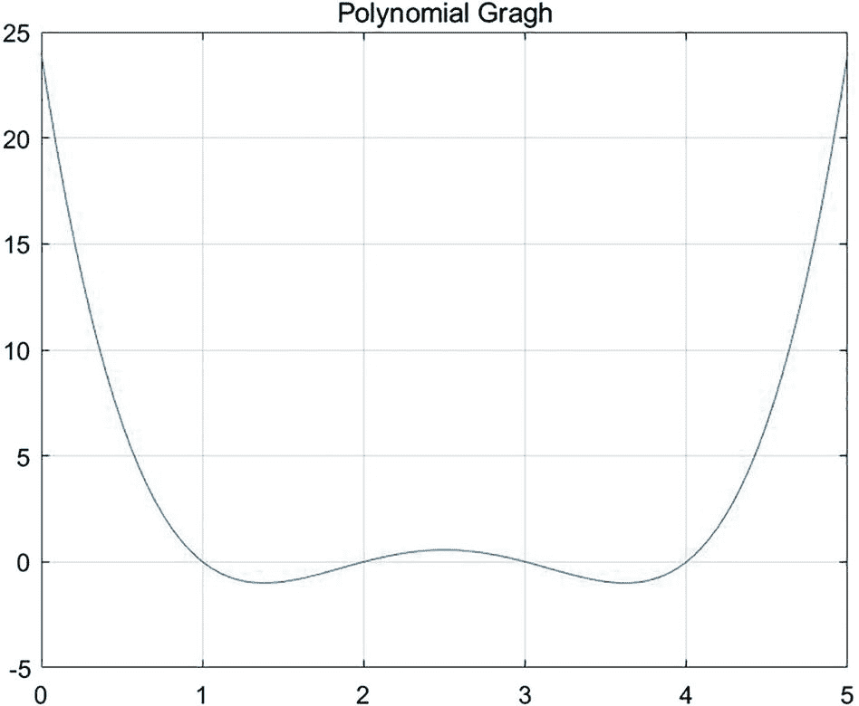

图 3-1

x⁴ − 10x³ + 35x² − 50x + 24 = 0

在 NM Dev 中，多项式由 `Polynomial` 类表示。例如，要表示多项式 `p(x) = x⁴ − 10x³ + 35x² − 50x + 24`，我们构造一个 `Polynomial` 实例，向构造函数提供从最高阶项开始的系数。

```java
Polynomial p = new Polynomial(1, -10, 35, -50, 24);
System.out.println("p(1) = " + p.evaluate(1.));
```

输出如下：

```
p(1) = 0.0
```

在 NM Dev 中，函数由接口 `UnivariateRealFunction` 表示。通常，我们使用类 `AbstractUnivariateRealFunction` 来简化实现。例如，要表示函数 `f(x) = x sin x − 3`，我们构造一个 `AbstractUnivariateRealFunction` 的实例。

```java
UnivariateRealFunction f = new AbstractUnivariateRealFunction() {
@Override
public double evaluate(double x) {
return Math.sin(x) * x - 3;
}};
System.out.println("f(1) = " + f.evaluate(1.));
```

输出如下：

```
f(1) = -2.1585290151921033
```

见图 3-2。

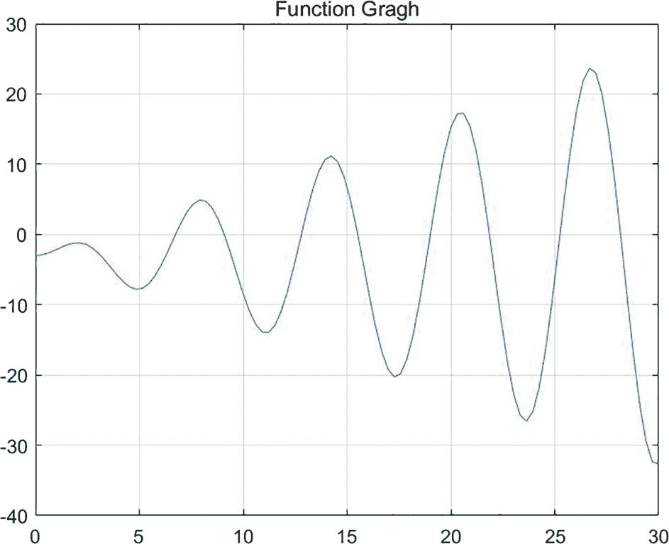

图 3-2

x sin x − 3 = 0

一个实现了 `UnivariateRealFunction` 的函数几乎可以与 NM Dev 中的所有类、函数和工具配合使用。它是 NM 数值库中最基本的构建模块。

### 3.2 Jenkins-Traub 算法

用于求解多项式零点的 Jenkins-Traub 算法是一种快速、全局收敛的迭代方法，由 Michael A. Jenkins 和 Joseph F. Traub 于 1970 年发表。该算法每次求出一个根。找到一个根 `r` 后，我们将多项式除以 `r` 的线性因子 (`x` − `r`)。降阶后的多项式阶数恰好减少 1 度。我们重复此过程 `n` 次，其中 `n` 是多项式的次数。根据代数基本定理，这保证了所有 `n` 个根都会被找到，并且每个根只被计算一次。

`PolyRoot` 是我们对 Jenkins-Traub 算法的实现。由于我们当前对 `Polynomial` 类的实现仅支持实数系数，因此它仅适用于具有实数系数的多项式，但可以求解实根和复根。

例如，图 3-1 中多项式的根为 1、2、3 和 4（从图中可以明显看出）。为了找到它的所有零点，我们编写以下代码：

```java
Polynomial p = new Polynomial(1, -10, 35, -50, 24);
PolyRoot solver = new PolyRoot();
List roots = solver.solve(p);
System.out.println(Arrays.toString(roots.toArray()));
```

输出如下：

```
[3.000000-0.000000i, 4.000000+0.000000i, 1.000000-0.000000i, 2.000000+0.000000i]
```

以下是一个求解具有复根的多项式 `p(x) = x² + 1` 的示例。根是 `i` 和 `-i`。

```java
Polynomial p = new Polynomial(1, 0, 1); // x² + 1 = 0
PolyRoot solver = new PolyRoot();
List roots0 = solver.solve(p);
System.out.println(Arrays.toString(roots0.toArray()));
List roots1 = PolyRoot.getComplexRoots(roots0);
System.out.println(Arrays.toString(roots1.toArray()));
```

输出如下：

```
[0.000000+1.000000i, 0.000000-1.000000i]
[0.000000+1.000000i, 0.000000-1.000000i]
```

### 3.3 二分法

最简单的寻根算法是二分法。设 `f` 是一个连续函数，我们知道区间 `[a, b]` 内包含一个根。也就是说，在 `a` 和 `b` 之间的某处 `f = 0`。因此，我们知道 `f(a)` 和 `f(b)` 符号相反，从而形成了一个区间。设 `c` 为区间的中点，即 $c=\frac{\left(a+b\right)}{2}$。那么 `f(a)` 和 `f(c)` 或者 `f(c)` 和 `f(b)` 的符号相反。根将位于这两个子区间之一。尽管二分法很稳健，但每次迭代只能获得一比特的精度。其他方法在适当条件下可能效率更高。

具体来说，对于方程 `f(x) = 0`，我们需要给出一个区间 `[a, b]`，使得 `f(a)` 和 `f(b)` 符号相反。可以通过以下算法找到区间内的根：

1.  为上下界选择数值，`l = a`，`u = b`。
2.  计算中点 $p=\frac{l+u}{2}$。
3.  如果 `f(p) = 0`，则找到根，`x = p`。停止。
4.  否则 `f(p) ≠ 0`。
    1.  如果 `f(p) × f(l) > 0`，则 `l = p`，`u = u`。
    2.  如果 `f(p) × f(u) > 0`，则 `l = l`，`u = p`。
5.  重复步骤 2 到 4，直到满足预设的容差或达到最大迭代次数。

`BisectionRoot` 类是我们对二分法的实现。使用该类有两个步骤。首先，我们需要构造一个 `BisectionRoot` 求解器，可用于指定其属性：精度容差（或收敛阈值）和最大迭代次数。求解器属性与其求解的问题无关。求解器实例可以重复使用来求解许多问题实例。

在获得 `BisectionRoot` 实例后，我们调用 `solve` 方法求解特定方程。我们还需要提供一个上界、一个下界，以及可选的根初始猜测值。函数签名如下：

```
/**
 * 使用收敛容差和最大迭代次数构造一个实例。
 *
 * @param tol           容差
 * @param maxIterations 最大迭代次数
 */
public BisectionRoot(double tol, int maxIterations);

/**
 * 在区间 `[lower, upper]` 内搜索根 `x`，使得 `f(x) = 0`。
 *
 * @param f     单变量函数
 * @param lower 区间的下界
 * @param upper 区间的上界
 * @param guess 区间 `[lower, upper]` 内根的初始猜测值。
 *              注意 `guess` 是一个 `double[]` 类型。
 *              此签名允许为某些类型的单根算法（例如 Brent 算法）提供多个初始猜测值。
 * @return 近似的根
 * @throws NoRootFoundException 当搜索失败未找到根时
 */
public double solve(
    UnivariateRealFunction f,
    double lower,
    double upper,
    double... guess
) throws NoRootFoundException;
```

以下代码演示了如何使用 `BisectionRoot` 求解图 3-2 中的函数 `x sin x − 3 = 0`：

```java
UnivariateRealFunction f = new AbstractUnivariateRealFunction() {
    @Override
    public double evaluate(double x) {
        return x * Math.sin(x) - 3; // x * six(x) - 3 = 0
    }
};
BisectionRoot solver = new BisectionRoot(1e-8, 30);
double root = solver.solve(f, 12., 14.);
double fx = f.evaluate(root);
System.out.println(String.format("f(%f) = %f", root, fx));
```

输出如下：

```
f(12.802892) = -0.000000
```

如果我们打印出每次迭代中的区间和近似根，就可以看到二分法的实际运行过程。我们从初始区间 `[12, 14]` 开始，根位于该区间内的某处，如图 3-3 所示。

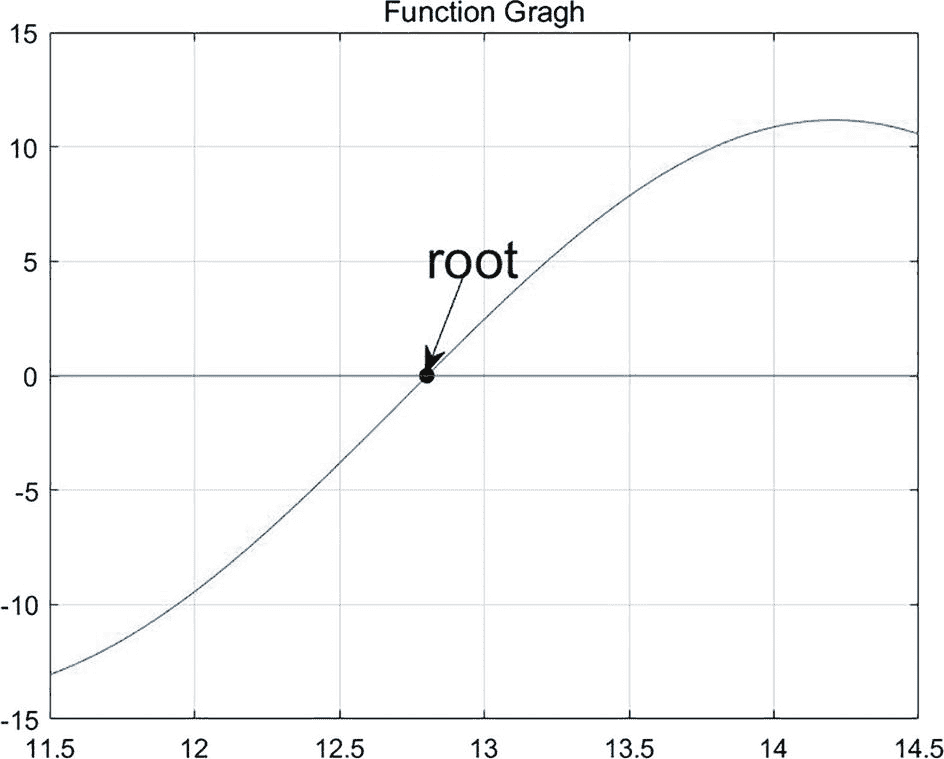

图 3-3 根在`[12,14]`中的位置

中点是 13。我们知道根在左子区间内。因此，我们将下一个区间更新为`[12, 13]`，如图 3-4 所示。

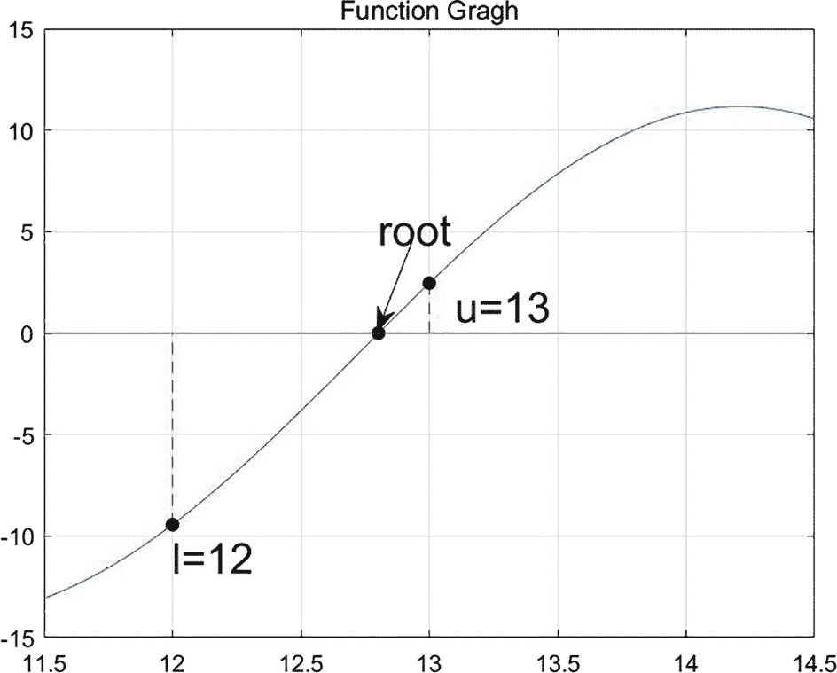

图 3-4 根在`[12,13]`中的位置

中点是 12.5。我们知道根在右子区间内。因此，我们将下一个区间更新为`[12.5, 13]`，如图 3-5 所示。

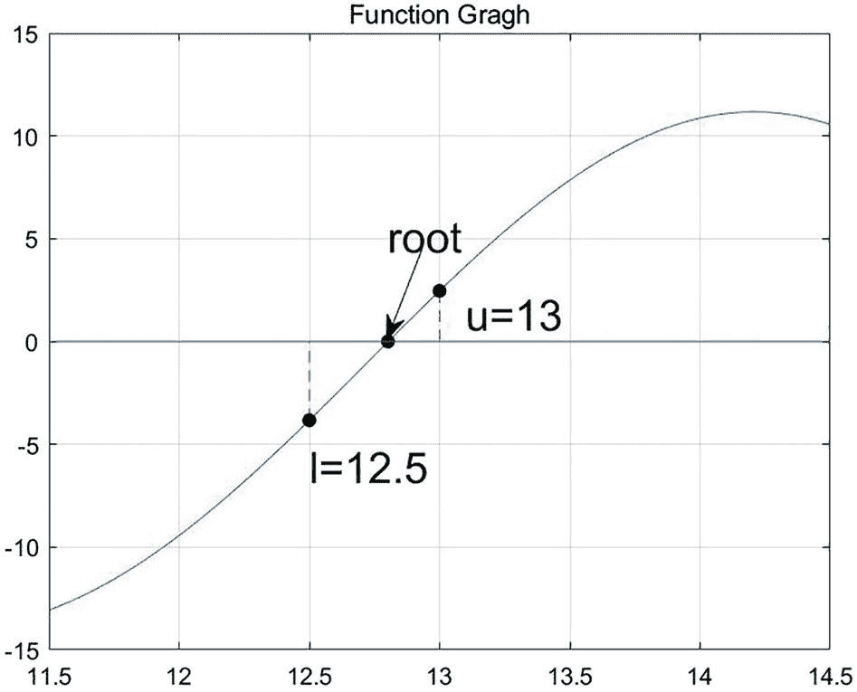

图 3-5 根在`[12.5,13]`中的位置

中点是 12.75。我们知道根在右子区间内。因此，我们将下一个区间更新为`[12.75, 13]`，如图 3-6 所示。

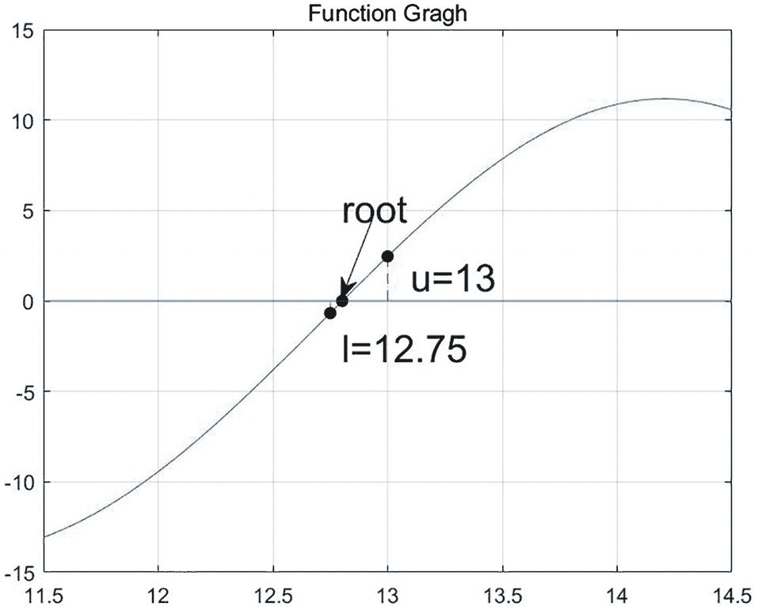

图 3-6 根在`[12.75,13]`中的位置

前 10 次迭代如下：

| 迭代次数 | l | u | p |
| --- | --- | --- | --- |
| 1 | 12 | 14 | 13 |
| 2 | 12 | 13 | 12.5 |
| 3 | 12.5 | 13 | 12.75 |
| 4 | 12.75 | 13 | 12.875 |
| 5 | 12.75 | 12.875 | 12.8125 |
| 6 | 12.75 | 12.8125 | 12.78125 |
| 7 | 12.78125 | 12.8125 | 12.796875 |
| 8 | 12.79688 | 12.8125 | 12.8046875 |
| 9 | 12.79688 | 12.80469 | 12.80078125 |
| 10 | 12.80078 | 12.80469 | 12.802734375 |

经过 10 次迭代后，根的近似值为 12.802734375。值得一提的是，要达到 8 位小数的精度，即 12.802892，大约需要 30 次迭代。二分法通过对区间反复对分，然后选择根必然存在的子区间进行进一步搜索。它是一种简单且稳健的方法，但与其他更高效的方法（如牛顿-拉夫森法）相比，速度相对较慢。每一步绝对误差都会减半，因此该方法是线性收敛的。

## 3.4 布伦特方法

布伦特方法是一种结合了二分法、割线法和逆二次插值法的求根方法。它尽可能使用割线法或逆二次插值法，因为这两种方法收敛更快，但在必要时会退回到更稳健的二分法。因此，它具备了二分法的可靠性，同时又可以像一些不那么可靠的方法一样快速。

### 3.4.1 线性插值法、试位法、割线法

线性插值法使用一条连接两个已知量的直线来确定这两个已知量之间的未知量的值。用于求根的线性插值法与二分法类似。它不是对区间进行对分，而是一种通过用割线逼近曲线来求解方程根的迭代方法。曲线的割线是一条与该曲线至少相交于两个不同点的直线。其直觉原理如下：我们不是直接求解函数的零点（这可能很复杂），而是求解逼近直线的零点（这很容易）。我们希望直线的零点靠近函数的零点。

如图 3-7 所示，我们用一条直线来逼近曲线的一段。两个端点是`(u, f(u))`和`(l, f(l))`。然后，我们通过计算割线与水平轴`(p, f(p))`的交点来求解割线的零点。

```
p = u - f(u) * (l - u) / (f(l) - f(u))
```

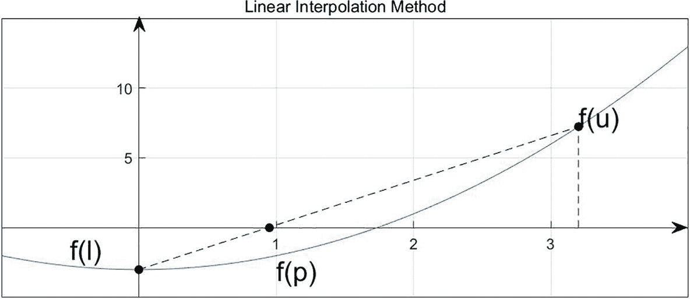

图 3-7 函数 `f(x) = x² - 3` 的一条割线

其思路是`p`应接近函数的根。与二分法类似，我们根据`f(p)`的值来选择有根子区间。

1. 如果 `f(p) = 0`，则根为 `p`。

2. 如果 `f(p) × f(l) > 0`，则 `l = p`，`u = u`。

3. 如果 `f(p) × f(u) > 0`，则 `l = l`，`u = p`。

我们重复这个过程，直到满足精度阈值或达到最大迭代次数。参见图 3-8 和图 3-9。

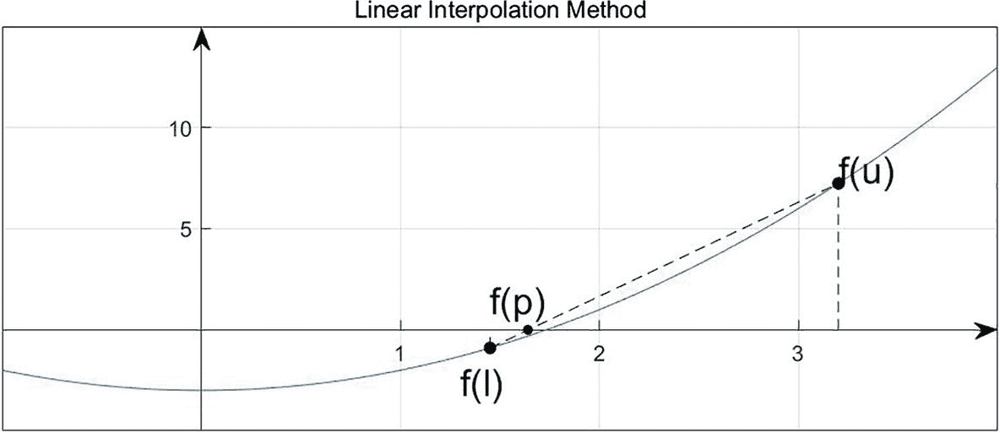

图 3-9 设置 `l = p` 后的第三次迭代

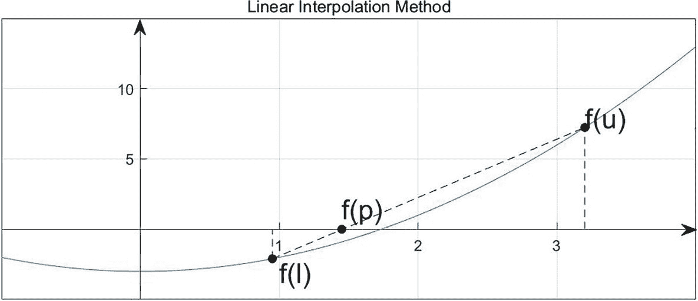

图 3-8 设置 `l = p` 后的第二次迭代

### 3.4.2 反二次插值法

反二次插值法是割线法的增强版本。它不使用直线来逼近曲线，而是使用二次函数进行逼近。然后，再次利用闭式解轻松求解该二次函数的根，以此逼近原函数的根。当二次函数与 x 轴不相交（无根）时，会进行微小的调整。

确定一个二次函数需要三个点，`y`：(`x[i-2]`, `f(x[i-2])`) (`x[i-1]`, `f(x[i-1])`) (`x[i]`, `f(x[i])`)。然后我们计算其反函数：`x = y^(-1)(y)`。为了在迭代中求解（近似）根，我们将其设为 `0`，即 `y = 0`。

具体而言，反函数，也称为拉格朗日多项式，如下所示：

![$$ x=\frac{\left(y-f\left({x}_{i-1}\right)\right)\left(y-f\left({x}_i\right)\right)}{\left(f\left({x}_{i-2}\right)-f\left({x}_{i-1}\right)\right)\left(f\left({x}_{i-2}\right)-f\left({x}_i\right)\right)}\bullet {x}_{i-2}+\frac{\left(y-f\left({x}_{i-2}\right)\right)\left(y-f\left({x}_{i-1}\right)\right)}{\left(f\left({x}_i\right)-f\left({x}_{i-2}\right)\right)\left(f\left({x}_i\right)-f\left({x}_{i-1}\right)\right)}\bullet {x}_i+\frac{\left(y-f\left({x}_{i-2}\right)\right)\left(y-f\left({x}_i\right)\right)}{\left(f\left({x}_{i-1}\right)-f\left({x}_{i-2}\right)\right)\left(f\left({x}_{i-1}\right)-f\left({x}_i\right)\right)}\bullet {x}_{i-1} $$](img/500382_1_En_3_Chapter_TeX_Equb.png)

设置 `y = 0`，我们得到下一次迭代的根，如下所示：

![$$ {x}_{i+1}=\frac{f\left({x}_{i-1}\right)f\left({x}_i\right)}{\left(f\left({x}_{i-2}\right)-f\left({x}_{i-1}\right)\right)\left(f\left({x}_{i-2}\right)-f\left({x}_i\right)\right)}\bullet {x}_{i-2}+\frac{f\left({x}_{i-2}\right)f\left({x}_{i-1}\right)}{\left(f\left({x}_i\right)-f\left({x}_{i-2}\right)\right)\left(f\left({x}_i\right)-f\left({x}_{i-1}\right)\right)}\bullet {x}_i+\frac{f\left({x}_{i-2}\right)f\left({x}_i\right)}{\left(f\left({x}_{i-1}\right)-f\left({x}_{i-2}\right)\right)\left(f\left({x}_{i-1}\right)-f\left({x}_i\right)\right)}\bullet {x}_{i-1} $$](img/500382_1_En_3_Chapter_TeX_Equc.png)

我们重复此过程，直到满足精度阈值或达到最大迭代次数。参见图 3-10。

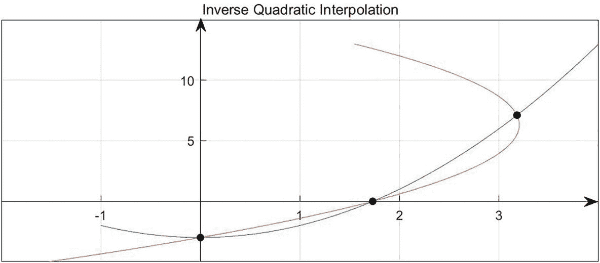

**图 3-10** 对 `f(x) = x² - 3` 的反二次插值

其渐近行为通常非常好。迭代序列 `x[i]` 一旦接近根，就能快速收敛。然而，如果初始值不接近实际根，性能通常会相当差。例如，如果函数值 `f(x[i])`、`f(x[i-1])` 和 `f(x[i-2])` 中有两个相等，则算法会失败。因此，反二次插值法不单独用作算法，而是作为布伦特方法的一部分。

## 3.4.3 布伦特方法的实现

布伦特方法是一种混合方法，它结合了括号法的可靠性和插值法（如割线法或反二次插值法）的速度。

同样，我们需要从一个包含根的括号区间开始（`a[0]`，`b[0]`），使得 `f(a[0]) * f(b[0]) < 0`。我们假设 `|f(a[0])| < |f(b[0])|`；否则，交换标记。

每次迭代需要四个点：

- `a[k]`：对齐点，即满足 `|f(a[k])| < |f(b[k])|` 且 `f(a[k]) * f(b[k]) < 0`。
- `b[k]`：当前迭代中的根估计值。
- `b[k-1]`：上一次迭代中的根估计值；第一次迭代设置 `b[k-1] = a[0]`。
- `b[k-2]`：上上次迭代中的根估计值（无需初始化）。
- `s`：本次迭代中的一个中间值；它被取为区间的一个端点，`a[k]` 或 `b[k]`，两者都被取为 `a[k+1]` 和 `b[k+1]`，并满足 `|f(a[k+1])| < |f(b[k+1])|` 且 `f(a[k+1]) * f(b[k+1]) < 0`。
- `ε`：预先指定的收敛精度容差。

我们需要检查四个不等式条件：

1. `|ε| < |b[k] - b[k-1]|`
2. `|ε| < |b[k] - b[k-1]|`
3. 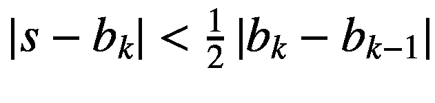
4. 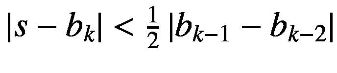

如果满足以下五个条件中的任意一个，则本次迭代使用二分法求根：

- 上一次迭代使用二分法，且不等式 1 不成立。
- 上一次迭代使用插值法，且不等式 2 不成立。
- 上一次迭代使用二分法，且不等式 3 不成立。
- 上一次迭代使用插值法，且不等式 4 不成立。
- 通过插值计算的临时值 `s` 不在区间 ![$$ \left[\frac{3{a}_k+{b}_k}{4},{b}_k\right] $$](images/500382_1_En_3_Chapter/500382_1_En_3_Chapter_TeX_IEq5.png) 内。

否则，本次迭代使用插值法。选择何种插值法的过程如下：如果三个点互不相同，则使用反二次插值；否则，使用线性插值。

在 NM Dev 中，`BrentRoot` 类实现了布伦特方法。这是一个两步过程：构造求解器，然后调用 `solve` 函数。函数的签名如下：

```java
/**
 * 构造一个布伦特求根算法的实例。
 *
 * @param tol           收敛容差
 * @param maxIterations 最大迭代次数
 */
public BrentRoot(double tol, int maxIterations)
/**
 * 在区间 [lower, upper] 内搜索根 x，使得 f(x) = 0。
 *
 * @param f     一个单变量函数
 * @param lower 括号区间的下界
 * @param upper 括号区间的上界
 * @param guess 在 [lower, upper] 内根的初始估计值。
 *              注意 {@code guess} 是一个 {@code double[]}。
 *              这种签名允许为某些类型的单根算法提供多个初始猜测，例如布伦特算法。
 * @return 近似根
 * @throws NoRootFoundException 当搜索未能找到根时抛出
 */
public double solve(
    UnivariateRealFunction f,
    double lower,
    double upper,
    double... guess
) throws NoRootFoundException;
```

以下是一个调用 `BrentRoot` 求解图 3-10 中函数 `f(x) = x² - 3` 的示例：

```java
UnivariateRealFunction f = new AbstractUnivariateRealFunction() {
    @Override
    public double evaluate(double x) {
        return x * x - 3; // x² - 3 = 0
    }
};
BrentRoot solver = new BrentRoot(1e-8, 10);
double root = solver.solve(f, 0., 4.);
double fx = f.evaluate(root);
System.out.println(String.format("f(%f) = %f", root, fx));
```

输出如下：

```
f(1.732051) = 0.000000
```

## 3.5 牛顿-拉夫森法

# 3.5 牛顿-拉夫森法

牛顿-拉夫森法如下：首先给出一个接近真实根的初始猜测，然后通过函数的切线（可利用微积分工具计算）来近似该函数，接着计算该切线的 x 截距（即根，通过初等代数容易求得）。这个 x 截距通常比初始猜测更接近函数的根，并且该过程可以迭代。它具有以下性质。

对于方程 `f(x) = 0`，我们选取 `x[i]` 作为根的初始近似值或上一次迭代的结果。然后经过点 `(x[i], f(x[i]))` 作曲线切线 `L`。

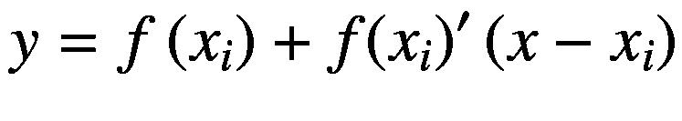

(L)

我们计算直线 `L` 与 x 轴交点的横坐标。

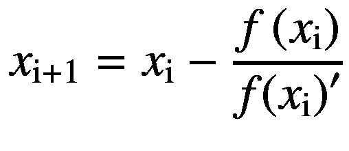

`x[i + 1]` 是比 `x[i]` 更好的根近似值。

牛顿-拉夫森法是一种通过线性化来高效求解非线性方程零点的方法。可以证明，如果函数连续且零点孤立，那么在零点周围存在一个区域，只要初始值位于该区域内，算法就保证收敛。牛顿-拉夫森法具有平方收敛的性能。粗略地说，这意味着每次迭代后结果的精度将翻倍。

在 NM Dev 库中，`NewtonRoot` 类实现了牛顿-拉夫森寻根算法，并包含一个 `solve` 函数。其签名如下：

```java
/**
 * 构造一个牛顿寻根算法的实例。
 *
 * @param tol           收敛公差
 * @param maxIterations 最大迭代次数
 */
public NewtonRoot(double tol, int maxIterations)
/**
 * 在区间 [lower, upper] 内搜索根 x，使得 f(x) = 0。
 *
 * @param f     单变量函数
 * @param lower 包围区间下界
 * @param upper 包围区间上界
 * @param guess [lower, upper] 范围内的初始根猜测。
 *              注意 {@code guess} 是一个 {@code double[]} 类型。
 *              该签名允许为某些类型的单根算法（如 Brent 算法）提供多个初始猜测。
 * @return 一个近似根
 * @throws NoRootFoundException 当搜索未能找到根时抛出
 */
public double solve(
    UnivariateRealFunction f,
    double lower,
    double upper,
    double... guess
) throws NoRootFoundException;
/**
 * 在区间 [lower, upper] 内搜索根 x，使得 f(x) = 0。
 *
 * @param f     单变量函数
 * @param df_   一阶导数
 * @param guess [lower, upper] 范围内的初始根猜测
 * @return 一个近似根
 * @throws NoRootFoundException 当搜索未能找到根时抛出
 */
public double solve(
    UnivariateRealFunction f,
    UnivariateRealFunction df_,
    double guess
) throws NoRootFoundException
```

注意，第二个 `solve` 函数允许你提供 `f` 的导数函数 `f'`。否则，代码会自动使用有限差分法生成导数函数（但速度较慢）。

下面是一个使用牛顿-拉夫森法求 `x² + 4x - 5 = 0` 根的例子。首先，我们选取初始猜测 `x[0] = 5`。该点的切线为 `y = 14x - 30`。计算其与 x 轴的交点得到根的近似值 `x[1]`。重复此过程，直到满足精度阈值或达到最大迭代次数。参见图 3-11。

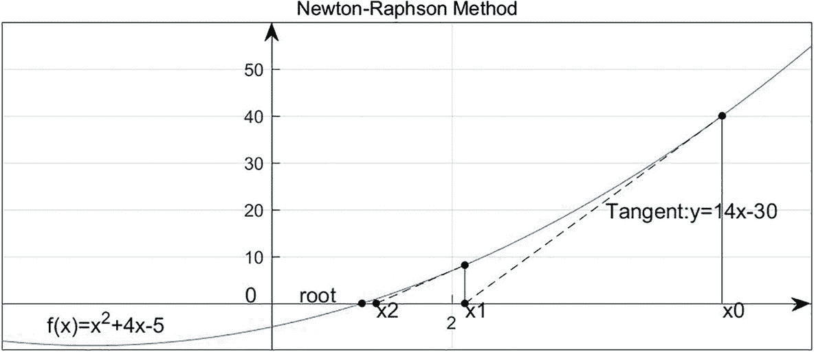

图 3-11 牛顿-拉夫森法求解 `f(x) = x² + 4x - 5`

```java
UnivariateRealFunction f = new AbstractUnivariateRealFunction() {
    @Override
    public double evaluate(double x) {
        return x * x + 4 * x - 5; // x² +4x - 5 = 0
    }
};
UnivariateRealFunction df = new AbstractUnivariateRealFunction() {
    @Override
    public double evaluate(double x) {
        return 2 * x + 4; // 2x + 4
    }
};
NewtonRoot solver = new NewtonRoot(1e-8, 5);
double root = solver.solve(f, df, 5.);
double fx = f.evaluate(root);
System.out.println(String.format("f(%f) = %f", root, fx));
```

输出如下：

```
f(1.000000) = 0.000000
```

从以下迭代结果可以看出，该算法在第四次迭代时已经获得了良好的结果，因此具有较高的效率。

| 迭代次数 i | x[i] | ε |
| --- | --- | --- |
| 0 | 5 | |
| 1 | 2.142857143 | 1.33E+00 |
| 2 | 1.157635468 | 8.51E-01 |
| 3 | 1.003934739 | 1.53E-01 |
| 4 | 1.000002577 | 3.93E-03 |
| 5 | 1.000000000001107 | 2.58E-06 |
| 6 | 0.9999999999999999 | 1.11E-12 |

### 3.5.1 哈雷方法

哈雷方法可以以类似于牛顿-拉夫森方法的方式推导出来，适用于任何 `C²` 函数。也就是说，它求解具有连续二阶导数的单变量函数的零点。研究表明，哈雷方法收敛于函数的正则零点，其收敛阶数等于或超过 3。

在 NM Dev 中，类 `HalleyRoot` 实现了哈雷方法。其签名如下：

# HalleyRoot 算法

## 构造函数

构造一个哈雷根查找算法的实例。

```java
/**
 * 构造一个哈雷根查找算法的实例。
 *
 * @param tol            收敛容差
 * @param maxIterations  最大迭代次数
 */
public HalleyRoot(double tol, int maxIterations)
```

## 求解方法

### 方法一：指定区间与初始猜测值

在区间 `[lower, upper]` 内搜索根 `x`，使得 `f(x) = 0`。

```java
/**
 * 在区间 [lower, upper] 内搜索根 x，使得 f(x) = 0。
 *
 * @param f     一个单变量函数
 * @param lower 包围区间的下界
 * @param upper 包围区间的上界
 * @param guess 在 [lower, upper] 区间内的根初始猜测值。
 *              注意 {@code guess} 是一个 {@code double[]} 类型。
 *              此签名允许某些类型的单根算法（例如 Brent 算法）使用多个初始猜测值。
 * @return 近似根
 * @throws NoRootFoundException 当搜索未能找到根时抛出
 */
public double solve(
    UnivariateRealFunction f,
    double lower,
    double upper,
    double... guess
) throws NoRootFoundException;
```

### 方法二：单初始猜测值

在区间 `[lower, upper]` 内搜索根 `x`，使得 `f(x) = 0`。

```java
/**
 * 在区间 [lower, upper] 内搜索根 x，使得 f(x) = 0。
 *
 * @param f     一个单变量函数
 * @param guess 在 [lower, upper] 区间内的根初始猜测值
 * @return 近似根
 * @throws NoRootFoundException 当搜索未能找到根时抛出
 */
public double solve(
    UnivariateRealFunction f,
    double guess
) throws NoRootFoundException
```

### 方法三：提供导数函数

在区间 `[lower, upper]` 内搜索根 `x`，使得 `f(x) = 0`。

```java
/**
 * 在区间 [lower, upper] 内搜索根 x，使得 f(x) = 0。
 *
 * @param f     一个单变量函数
 * @param df    一阶导数
 * @param d2f   二阶导数
 * @param guess 在 [lower, upper] 区间内的根初始猜测值
 * @return 近似根
 * @throws NoRootFoundException 当搜索未能找到根时抛出
 */
public double solve(
    UnivariateRealFunction f,
    UnivariateRealFunction df,
    UnivariateRealFunction d2f,
    double guess
) throws NoRootFoundException
```

注意，第三个`solve`函数同时接收一阶和二阶导数函数。如果未提供这些导数，库将使用有限差分法自动生成。

## 使用示例

以下是使用`HalleyRoot`求解 `f(x) = x² + 4x − 5` 的示例：

```java
UnivariateRealFunction f = new AbstractUnivariateRealFunction() {
    @Override
    public double evaluate(double x) {
        return x * x + 4 * x - 5; // x² +4x - 5 = 0
    }
};
UnivariateRealFunction df = new AbstractUnivariateRealFunction() {
    @Override
    public double evaluate(double x) {
        return 2 * x + 4; // 2x + 4
    }
};
UnivariateRealFunction d2f = new AbstractUnivariateRealFunction() {
    @Override
    public double evaluate(double x) {
        return 2; // 2
    }
};
HalleyRoot solver = new HalleyRoot(1e-8, 3);
double root = solver.solve(f, df, d2f, 5.);
double fx = f.evaluate(root);
System.out.println(String.format("f(%f) = %f", root, fx));
```

## 输出结果

输出如下。它仅在三步迭代后就收敛了。

```
f(1.000000) = 0.000000
```


