# 4. 求解方程组的根

用于多变量方程组求根的算法，可以找到 (`x[1]`, `x[2]`, …, `x[n]`) 的值，使得系统中 `n` 个方程的值都等于 0。


方程组可能无解、有唯一解或多个解。非线性方程组可以通过牛顿法进行数值求解，该方法使用一阶导数或雅可比矩阵，是单变量方程的牛顿-拉夫森方法的扩展。其基本思想也是在每次迭代中，增加一个与一阶导数负逆成比例的增量，但这是在多变量情况下的推广。

## 4.1 方程组

多变量方程是包含多个变量的方程。例如， 是一个包含变量 (`x[1]`, `x[2]`, `x[3]`) 的多变量方程。在 NM Dev 中，多变量函数通过实现接口 `RealScalarFunction` 来构造。我们需要在 `RealScalarFunction` 中指定定义域 `dimensionOfDomain`。为了简化实现，我们可以使用 `AbstractRealScalarFunction`、`AbstractBiRealFunction` 和 `AbstractTrivariateRealFunction`。对于后两者，维度已为您配置好。

例如，以下实现均表示相同的函数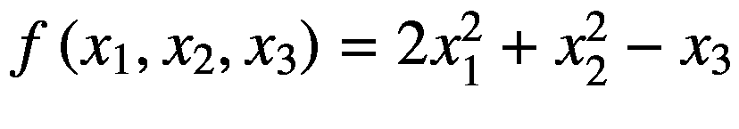，这是一个 3 次多项式：

```java
RealScalarFunction f1 = new AbstractRealScalarFunction(3) {
    @Override
    public Double evaluate(Vector x) {
        double x1 = x.get(1);
        double x2 = x.get(2);
        double x3 = x.get(3);
        return 2 * x1 * x1 + x2 * x2 - x3;
    }
};
TrivariateRealFunction f2 = new AbstractTrivariateRealFunction() {
    @Override
    public double evaluate(double x1, double x2, double x3) {
        return 2 * x1 * x1 + x2 * x2 - x3;
    }
};
```

输出如下：

```
f1(1,2,3) = 3.0
f2(1,2,3) = 3.0
```

一个包含 `n` 个未知数 `x[1]`, `x[2]`, …, `x[n]` 的 `n` 个方程组成的方程组具有以下形式：

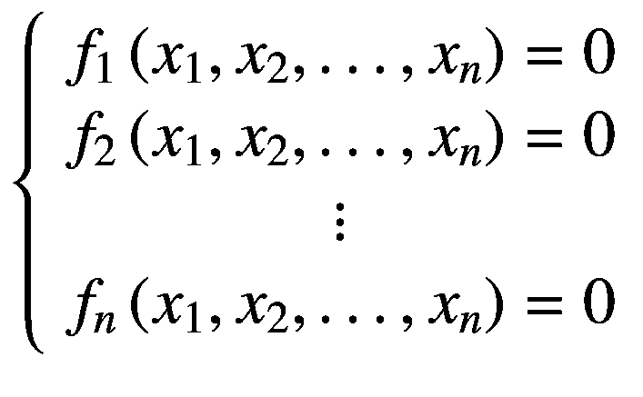

其中 `f(x[1], x[2], …, x[n])` 是关于 `x[1]`, `x[2]`, …, `x[n]` 的函数。方程组可以简单地表示为一个数组 `RealScalarFunction[]`。或者，我们可以将其实现为一个从 R^n 到 R^m 的向量函数，即实现接口 `RealVectorFunction`。以下两个实现 `F` 和 `G` 是等价的。对于 `G`，我们需要指定定义域 `dimensionOfDomain` 和值域 `dimensionOfRange`，在此示例中两者均为 3。

```java
TrivariateRealFunction f1 = new AbstractTrivariateRealFunction() {
    @Override
    public double evaluate(double x, double y, double z) {
        return Math.pow(x, 2) + Math.pow(y, 3) - z - 6;
    }
};
TrivariateRealFunction f2 = new AbstractTrivariateRealFunction() {
    @Override
    public double evaluate(double x, double y, double z) {
        return 2 * x + 9 * y - z - 17;
    }
};
TrivariateRealFunction f3 = new AbstractTrivariateRealFunction() {
    @Override
    public double evaluate(double x, double y, double z) {
        return Math.pow(x, 4) + 5 * y + 6 * z - 29;
    }
};
RealScalarFunction[] F = new TrivariateRealFunction[]{f1, f2, f3};
Vector x = new DenseVector(1.5, 2.5, 3.5);
double f1_x = F[0].evaluate(x);
double f2_x = F[1].evaluate(x);
double f3_x = F[2].evaluate(x);
double[] F_x = new double[]{f1_x, f2_x, f3_x};
System.out.println("F(x) = " + Arrays.toString(F_x));
RealVectorFunction G = new AbstractRealVectorFunction(3, 3) {
    @Override
    public Vector evaluate(Vector v) {
        double x = v.get(1);
        double y = v.get(2);
        double z = v.get(3);
        double g1 = Math.pow(x, 2) + Math.pow(y, 3) - z - 6;
        double g2 = 2 * x + 9 * y - z - 17;
        double g3 = Math.pow(x, 4) + 5 * y + 6 * z - 29;
        Vector g = new DenseVector(g1, g2, g3);
        return g;
    }
};
Vector Gx = G.evaluate(x);
System.out.println("G(x) = " + Gx);
```

输出如下：

```
F(x) = [8.375, 5.0, 9.5625]
G(x) = [8.375000, 5.000000, 9.562500]
```

## 4.2 求解两个非线性方程组成的方程组

两个未知数、两个方程组成的方程组通常可以表示为：

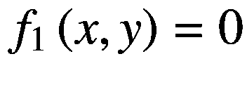

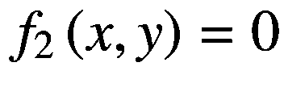

我们首先在 `f[1]` 和 `f[2]` 的交点附近选择一个初始猜测值 (`x[1]`, `y[1]`)。假设 `x[2]` 和 `y[2]` 是实际解，使得 `f[1]` 和 `f[2]` 等于零。如果 `x[1]` 足够接近 `x[2]`，且 `y[1]` 足够接近 `y[2]`，则 `x[2] − x[1]` 和 `y[2] − y[1]` 的值很小。通过泰勒级数展开，我们得到：

其中，涉及小量 `x[2] - x[1]` 和 `y[2] - y[1]` 的高次幂项被忽略。令 `∆x = x[2] - x[1]` 且 `∆y = y[2] - y[1]`，并注意到 `f1 = 0` 且 `f2 = 0`，我们将前面的方程重写如下：

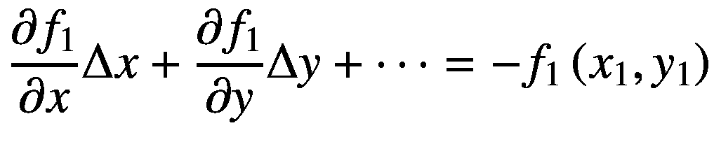


这可以表示为：

![$$ {\left[\begin{array}{cc}\frac{\partial {f}_1}{\partial x}&amp; \frac{\partial {f}_1}{\partial y}\\ {}\frac{\partial {f}_2}{\partial x}&amp; \frac{\partial {f}_2}{\partial y}\end{array}\right]}_{\Big({x}_1,{y}_{1\Big)}}\left(\genfrac{}{}{0pt}{}{\Delta x}{\Delta y}\right)={\left(\genfrac{}{}{0pt}{}{-{f}_1}{-{f}_2}\right)}_{\left({x}_1,{y}_1\right)} $$](images/500382_1_En_4_Chapter/500382_1_En_4_Chapter_TeX_Equi.png)

这个矩阵：

![$$ J\left({f}_1,{f}_2\right)=\left[\begin{array}{cc}\frac{\partial {f}_1}{\partial x}&amp; \frac{\partial {f}_1}{\partial y}\\ {}\frac{\partial {f}_2}{\partial x}&amp; \frac{\partial {f}_2}{\partial y}\end{array}\right] $$](images/500382_1_En_4_Chapter/500382_1_En_4_Chapter_TeX_Equj.png)

被称为 `f1` 和 `f2` 的雅可比矩阵。

这是一个线性系统，只要系数矩阵非奇异，就可以求解 `∆x` 和 `∆y`。因此，必须满足以下条件：

![$$ \det \left\{{\left[J\left({f}_1,{f}_2\right)\right]}_{\left({x}_1,{y}_1\right)}\right\}\ne 0 $$](images/500382_1_En_4_Chapter/500382_1_En_4_Chapter_TeX_Equk.png)

由于雅可比矩阵和 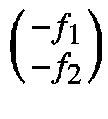 是已知的，我们可以求解 `∆x` 和 `∆y`，从而得到 `x[2] = x[1] + ∆x` 和 `y[2] = y[1] + ∆y`。`(x[2], y[2])` 比 `(x[1], y[1])` 更接近实际解。我们将 `(x[2], y[2])` 作为新的解的估计值。重复此过程，直到满足精度阈值或达到最大迭代次数。注意，在每一步迭代中，雅可比矩阵必须是非奇异的。

一个合理的终止条件是：

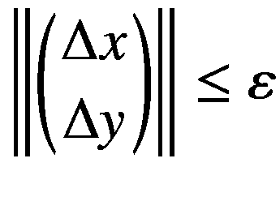

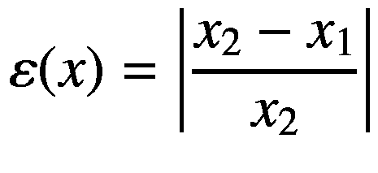

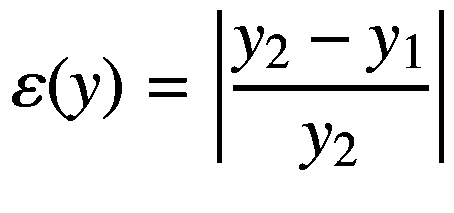

其中，`ε` 是容差，`ε(x)` 用于 `x`，`ε(y)` 用于 `y`。

在 NM Dev 中，`NewtonSystemRoot` 类实现了牛顿法来求解方程组。如果未找到解，它会抛出 `NoRootFoundException`。其签名如下：

```java
/**
 * 构造一个用于求解非线性方程组系统的牛顿根查找算法的实例。
 *
 * @param accuracy 收敛容差
 * @param maxIter  最大迭代次数
 */
public NewtonSystemRoot(double accuracy, int maxIter) {
    this.tol = accuracy;
    this.maxIterations = maxIter;
}

/**
 * 搜索根 x，使得 f(x) = 0。
 *
 * @param f     一个多变量函数
 * @param guess 根的初始猜测值
 * @return 近似根
 * @throws NoRootFoundException 当搜索未能找到根时抛出
 */
public Vector solve(
        RealVectorFunction f,
        Vector guess
) throws NoRootFoundException

/**
 * 搜索根 x，使得 f(x) = 0。
 *
 * @param f     一个方程组
 * @param guess 根的初始猜测值
 * @return 近似根
 * @throws NoRootFoundException 当搜索未能找到根时抛出
 */
public Vector solve(
        final RealScalarFunction[] f,
        Vector guess
) throws NoRootFoundException
```

参见图 4-1。

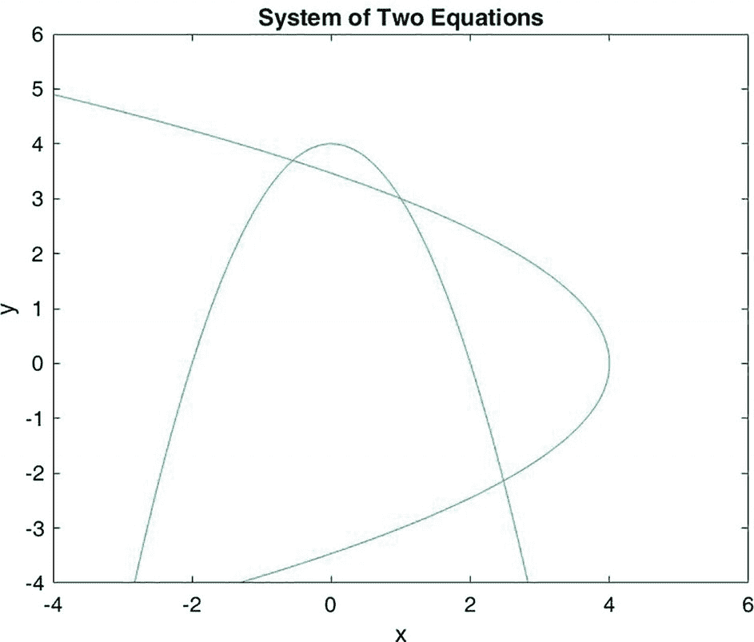

图 4-1 包含两个方程和两个未知数的方程组

此示例求解以下方程组的根 `(x, y)`：

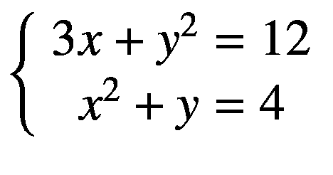

或者等价地，求解：

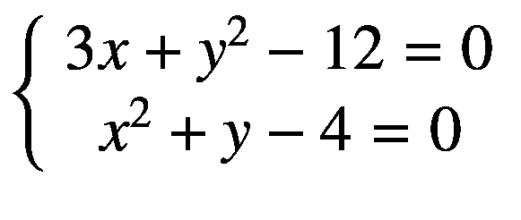

通过观察图 4-1 中的曲线图，我们将初始猜测值 `(x[1], y[1])` 设为 `(0, 0)`。我们还将精度设置为 `1 × 10^(−8)`，最大迭代次数设置为 `10`（即在运行 `10` 次后停止循环）。

```java
BivariateRealFunction f1 = new AbstractBivariateRealFunction() {
    @Override
    public double evaluate(double x, double y) {
        return 3 * x + y * y - 12;
    }
};

BivariateRealFunction f2 = new AbstractBivariateRealFunction() {
    @Override
    public double evaluate(double x, double y) {
        return x * x + y - 4;
    }
};

BivariateRealFunction[] F = new BivariateRealFunction[]{f1, f2};

NewtonSystemRoot solver = new NewtonSystemRoot(1e-8, 10);
Vector initial = new DenseVector(new double[]{0, 0}); // (0, 0)
Vector root = solver.solve(F, initial);

System.out.println(String.format("f(%s) = (%f, %f)", root.toString(), f1.evaluate(root), f2.evaluate(root)));
```

我们使用 `solve` 方法来求解方程组的根。根如下：

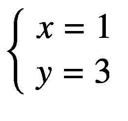

输出如下：

```
f([1.000000, 3.000000] ) = (0.000000, 0.000000)
```

### 4.3 求解包含三个及以上方程的方程组根

我们可以将用于两个方程组的数学方法扩展，以求解包含`n`个方程的方程组。一个包含`n`个未知数的`n`元方程组通常可以写成如下形式：

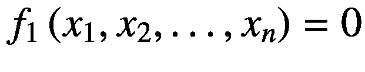

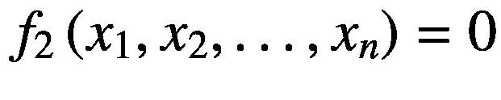


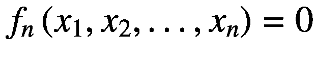

设初始猜测值为 (*x*[11], *x*[21], …, *x*[*n*1])。

![$$ {\left[\begin{array}{ccc}\frac{\partial {f}_1}{\partial {x}_1}&amp; \cdots &amp; \frac{\partial {f}_1}{\partial {x}_n}\\ {}\vdots &amp; \ddots &amp; \vdots \\ {}\frac{\partial {f}_n}{\partial {x}_1}&amp; \cdots &amp; \frac{\partial {f}_n}{\partial {x}_n}\end{array}\right]}_{\left({x}_{11},{x}_{21},\dots, {x}_{n1}\right)}\left(\genfrac{}{}{0pt}{}{\Delta {x}_1}{\begin{array}{c}\vdots \\ {}\Delta {x}_n\end{array}}\right)={\left(\genfrac{}{}{0pt}{}{-{f}_1}{\begin{array}{c}\vdots \\ {}-{f}_n\end{array}}\right)}_{\left({x}_{11},{x}_{21},\dots, {x}_{n1}\right)} $$](images/500382_1_En_4_Chapter/500382_1_En_4_Chapter_TeX_Equv.png)

这个矩阵就是雅可比矩阵`J(f[1], f[2], …, f[n])`，如下所示：

![$$ J\left({f}_1,{f}_2,\dots, {f}_n\right)=\left[\begin{array}{ccc}\frac{\partial {f}_1}{\partial {x}_1}&amp; \cdots &amp; \frac{\partial {f}_1}{\partial {x}_n}\\ {}\vdots &amp; \ddots &amp; \vdots \\ {}\frac{\partial {f}_n}{\partial {x}_1}&amp; \cdots &amp; \frac{\partial {f}_n}{\partial {x}_n}\end{array}\right] $$](images/500382_1_En_4_Chapter/500382_1_En_4_Chapter_TeX_Equw.png)

求解 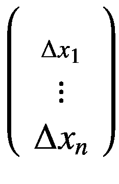，我们可以通过加上增量得到下一次估计值，如下所示：


牛顿法的步骤总结如下：

1.  为包含`n`个方程和`n`个未知数的方程组的根选择一个初始猜测值。

2.  在当前最优解`X[1]`处评估雅可比矩阵，其中`X[1]`是一个`n`维向量，且 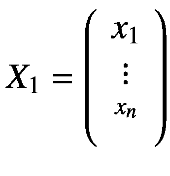。

3.  求解线性系统`J(X[1])`∆`X` = − `f(X[1])`，其中 ∆`X` = `X[2]` − `X[1]`。

4.  通过加上增量得到`X[2]`，即`X[2]` = `X[1]` + ∆`X`。

5.  重复直到满足精度阈值或达到最大迭代次数。

6.  返回最优解。

以下代码用于求解这个包含三个非线性方程的方程组（见图 4-2）：

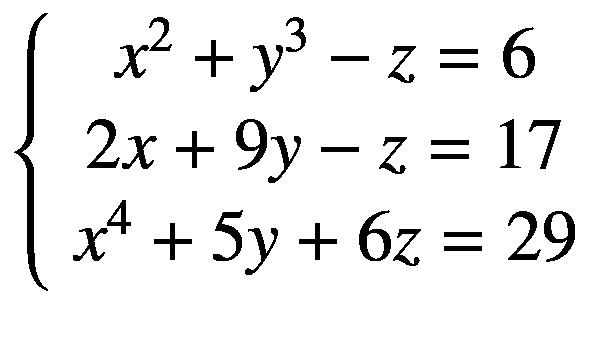

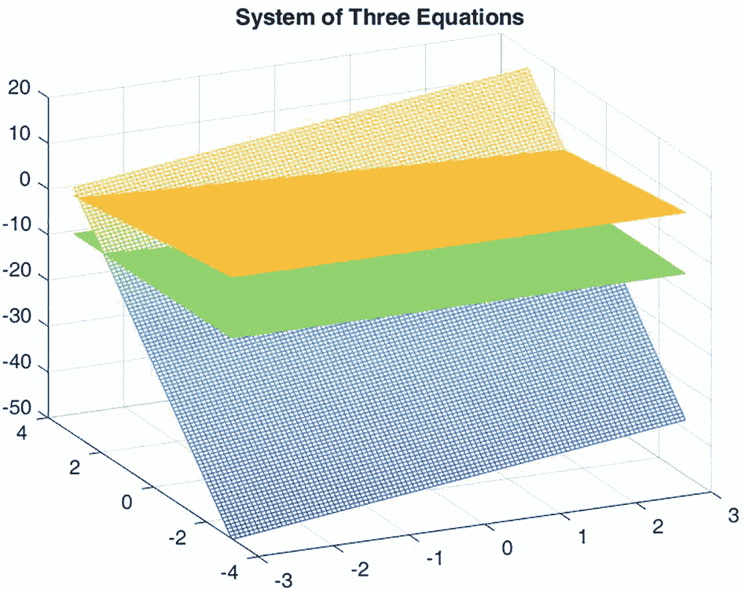

**图 4-2** 包含三个方程和三个未知数的方程组

```
RealVectorFunction G = new AbstractRealVectorFunction(3, 3) {
@Override
public Vector evaluate(Vector v) {
double x = v.get(1);
double y = v.get(2);
double z = v.get(3);
double g1 = Math.pow(x, 2) + Math.pow(y, 3) - z - 6;
double g2 = 2 * x + 9 * y - z - 17;
double g3 = Math.pow(x, 4) + 5 * y + 6 * z - 29;
Vector g = new DenseVector(g1, g2, g3);
return g;
}
};
NewtonSystemRoot solver = new NewtonSystemRoot(1e-8, 15);
Vector initial = new DenseVector(new double[]{0, 0, 0}); // (0, 0, 0)
Vector root = solver.solve(G, initial);
System.out.println(String.format("f(%s) = %s", root.toString(), G.evaluate(root).toString()));
```

输出结果如下：

```
f([-4.580190, -4.307120, -64.924460] ) = [0.000000, -0.000000, 0.000000]
```


