# 7. 常微分方程

常微分方程（`ODE`）是涉及一个自变量导数的方程。“常”这一术语是相对于涉及多个自变量的偏微分方程（`PDE`）而言的。微分方程在数学和科学的许多背景下都有出现。通常情况下，描述一个系统的变化、动态或变化率比描述系统本身更容易。系统本身可能很复杂，但其动态可能简单（或更简单）。例如，一开始就计算出物体的轨迹并不总是容易（甚至可行）。相比之下，牛顿著名的第二运动定律可以用一个简单的`ODE`表达式描述从足球到行星的任何物体的轨迹。

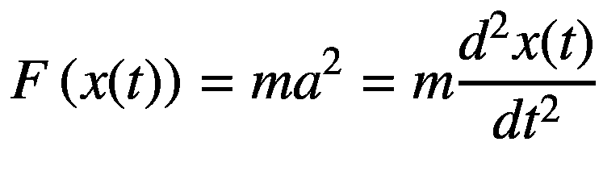

此外，许多现象从根本上将不同的微分量联系起来，例如变化率、梯度或曲率。例如，前述`ODE`将这些量联系起来：随时间变化的位置（或位移）`x(t)`、力`F`、时间`t`和质量`m`。位置函数对时间的一阶导数是速度；二阶导数是加速度`a`。常微分方程几乎在所有科学领域都无处不在，例如物理学和天文学（天体力学）、气象学（天气建模）、化学（反应速率）、生物学（传染病、遗传变异）、生态学和种群建模（种群竞争），以及经济学（股票趋势、利率和市场均衡价格变化）。

常微分方程的数值解是计算数学的一个分支，用于求解常微分方程问题。也就是说，我们寻找一个满足`ODE`的函数。数值解之所以重要，是因为许多`ODE`无法解析求解。即使可以求解，其解也可能无法用初等函数表示。在这些情况下，我们只能求助于数值求解。数值解是在某些离散点上对`ODE`真实解的近似。我们需要研究这种数值解的存在性、唯一性和稳定性。

## 7.1 单步法

初值问题是`ODE`问题的一类。初值问题（`IVP`）是一个常微分方程以及一个初始条件，该条件指定了解函数在定义域中某一点的值。在物理学或其他科学中对系统进行建模通常等同于求解一个`IVP`。在那种背景下，微分方程是一个方程，它指定了在给定初始条件（时间为零时系统的状态）下系统如何随时间演化。从数学上讲，初值问题是一个微分方程，如下所示：

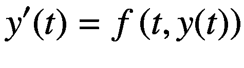

以及初始条件，如下所示：

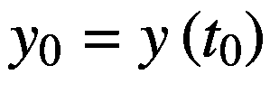

`IVP`的解是一个函数`y`，它既是微分方程的解，又满足初始条件。这个概念可以通过将导数视为独立函数扩展到更高阶。对于二阶`ODE`，我们有：

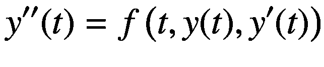

通常，我们假设函数`f(x, y)`满足 Lipschitz 条件，如下所示：

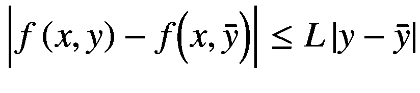

`L`是一个常数。该条件基本上是说函数`f`不能变化太快。这个条件保证了`ODE`有且仅有一个解。

例如，我们可以求解以下`ODE`：

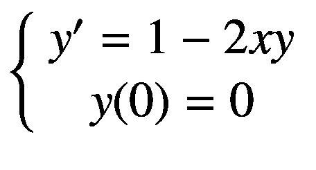

数值解在一组离散点上给出`y(x)`的近似值`y[1]`、`y[2]`、…、`y[n]`、`y[n+1]`，如下所示：

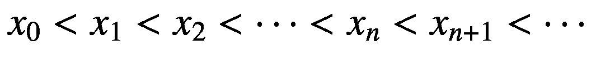

`h[i] = x[i+1] - x[i]`称为*步长*。除非另有说明，我们假设步长相等且等间距。

从概念上讲，我们可以按以下方式求解`ODE`。我们已经从初始条件中知道了值`y(x[0]) = y[0]`。为了找到`y(x[1]) = y(x[0] + h)`，我们可以使用近似值：`Δy(x) ≈ y'(x) * h`。因此，我们有：

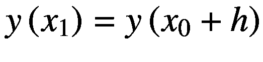

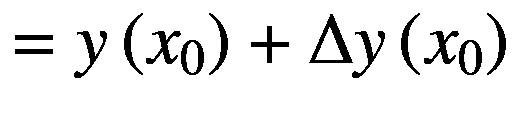

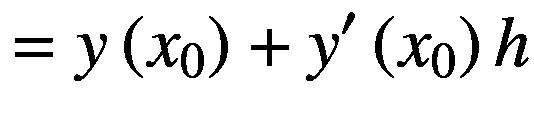

我们可以重复此步骤来迭代计算`y(x[2]) = y(x[1]) + y'(x[1]) * h`和`y(x[3]) = y(x[2]) + y'(x[2]) * h`，依此类推，逐步进行。这是数值求解`ODE`的一般思路。这一系列方法被称为逐步法。图 7-1 展示了该问题的数值解。

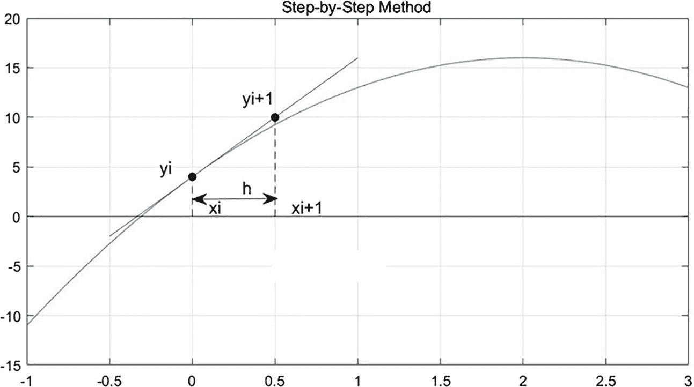

`图 7-1` 使用逐步法求解`IVP`的数值解

### 7.1.1 欧拉法（多边形法）

欧拉法是一种一阶数值方法，用于求解具有给定初始值的常微分方程。它是常微分方程数值积分中最基本的显式方法，也是最简单的龙格-库塔方法（参见第 7.1.2 节）。作为一阶方法，其局部误差（每步误差）与步长的平方成正比，全局误差（给定时间或值处的误差）与步长成正比。精度不高。它还面临稳定性问题。由于这些原因，欧拉法在实践中并不常用。然而，它说明了数值积分中的一些基本思想。欧拉法是构建更复杂方法的基础。

#### 7.1.1.1 欧拉公式

我们可以利用泰勒展开来推导欧拉公式。

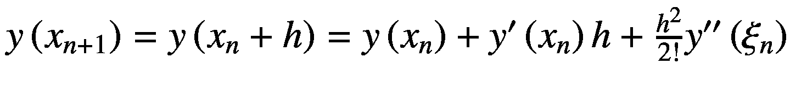，其中 `ξ[n] ∈ (x[n], x[n + 1])`

![$$ y\left({x}_{n+1}\right)=y\left({x}_n\right)+ hf\left[{x}_n,y\left({x}_n\right)\right]+\frac{h²}{2!}{y}^{{\prime\prime}}\left({\xi}_n\right) $$](images/500382_1_En_7_Chapter/500382_1_En_7_Chapter_TeX_IEq2.png)，`n = 0, 1, 2, ⋯`

当 `h` 足够小时，我们可以忽略高阶项 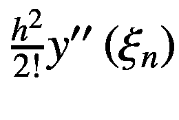，并得到如下近似：

![$$ y\left({x}_{n+1}\right)\approx y\left({x}_n\right)+ hf\left[{x}_n,y\left({x}_n\right)\right] $$](images/500382_1_En_7_Chapter/500382_1_En_7_Chapter_TeX_Equk.png)

使用记号 `y[n + 1] ≈ y(x[n + 1])`，欧拉公式如下：

`y[n + 1] = y[n] + hf (x[n], y[n])，n = 0, 1, 2, ⋯`

该公式的局部截断误差是第 `n` 步的误差，由  给出，其大小与步长 `h²` 的平方成正比。另一方面，全局误差是从初始步骤累积到当前步骤的总误差。请参见图 7-2。

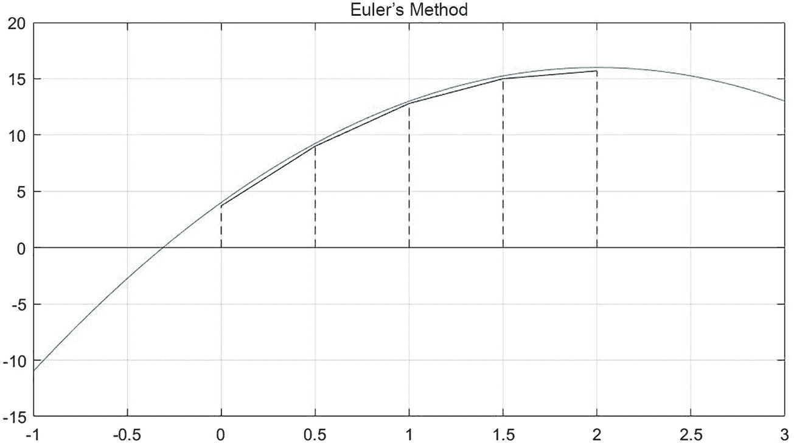

# 图 7-2  
## 欧拉方法及近似误差

欧拉方法是一种折线法，而非切线法。除了第一个点是曲线上的切线外，该函数通过分段折线进行近似。

#### 7.1.1.2 隐式欧拉公式

我们可以推导出欧拉方法的隐式公式或后向公式。差商如下：

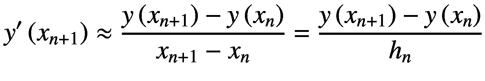

假设 `y[n]` = `y(x[n])` 并且已知 `y′(x[n+1])` = `f(x[n+1], y(x[n+1]))`，则隐式（后向）欧拉公式如下：

`y[n+1]` = `y[n]` + `hf(x[n+1], y[n+1])`，`n` = 0, 1, 2, ⋯

该公式之所以称为隐式公式，是因为 `y[n+1]` 同时出现在等式的左右两侧。与显式公式（只需代入数值即可计算出 `y[n+1]`）不同，使用隐式公式计算需要求解关于 `y[n+1]` 的方程。

求解该方程的一种方法是使用迭代法。我们从一个对 `y[n+1]` 可能值的初始猜测 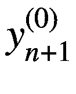 开始，然后将其代入右侧计算出下一个更优的估计值 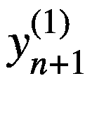。重复此过程直至收敛。具体迭代公式如下：

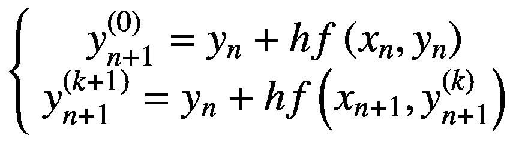，`k` = 0, 1, ⋯

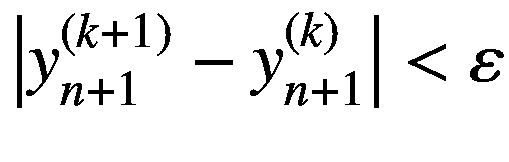

我们来研究隐式公式的局部截断误差。给定：

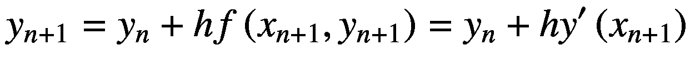

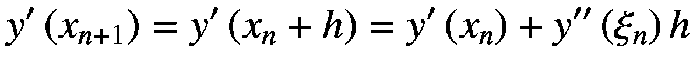

将第二个方程代入第一个方程，得到：

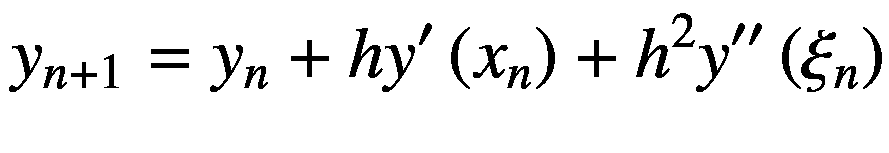

同时，我们知道：

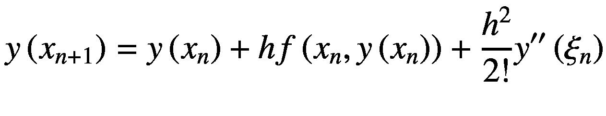

假设 `y[n]` = `y(x[n])`，将第二个方程减去第一个方程，得到局部截断误差如下：

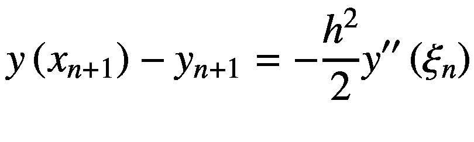

或者，隐式欧拉公式的局部截断误差近似为：

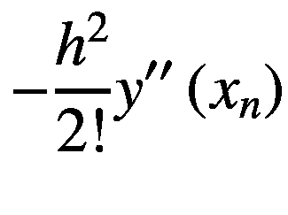

#### 7.1.1.3 梯形公式

注意，显式方法和隐式方法的局部截断误差仅相差一个负号。即：

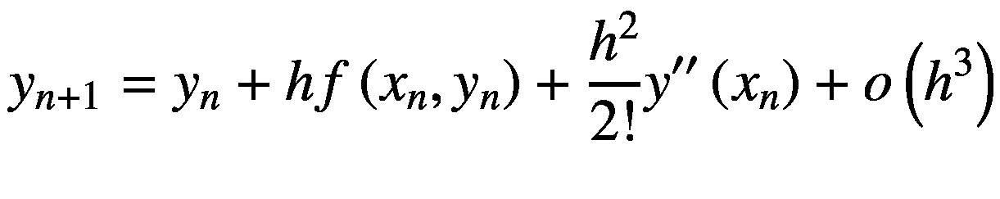

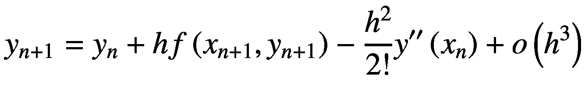

将这两个方程相加并除以 2，我们消去 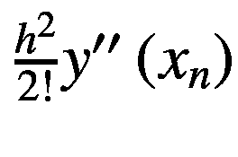 得到：

![$$ {y}_{n+1}={y}_n+\frac{h}{2}\left[f\left({x}_n,{y}_n\right)+f\left({x}_{n+1},{y}_{n+1}\right)\right]+o\left({h}³\right) $$](images/500382_1_En_7_Chapter/500382_1_En_7_Chapter_TeX_Equu.png)

梯形公式如下（忽略 `o(h³)`）：

![$$ {y}_{n+1}={y}_n+\frac{h}{2}\left[f\left({x}_n,{y}_n\right)+f\left({x}_{n+1},{y}_{n+1}\right)\right] $$](images/500382_1_En_7_Chapter/500382_1_En_7_Chapter_TeX_Equv.png)

梯形公式也是一个隐式公式。可以通过如下迭代方法求解：

![$$ \left\{\begin{array}{c}{y}_{n+1}^{(0)}={y}_n+ hf\left({x}_n,{y}_n\right)\\ {}{y}_{n+1}^{\left(k+1\right)}={y}_n+\frac{h}{2}\left[f\left({x}_n,{y}_n\right)+f\left({x}_{n+1},{y}_{n+1}^{(k)}\right)\right]\end{array}\right. $$](images/500382_1_En_7_Chapter/500382_1_En_7_Chapter_TeX_IEq9.png)，`k = 0, 1, ...`

该迭代方法将会收敛，因为：

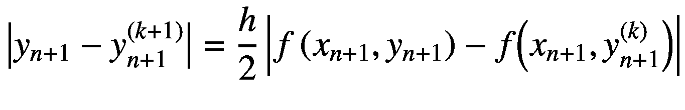

假设 `f(x, y)` 满足 `利普希茨条件`：


即：

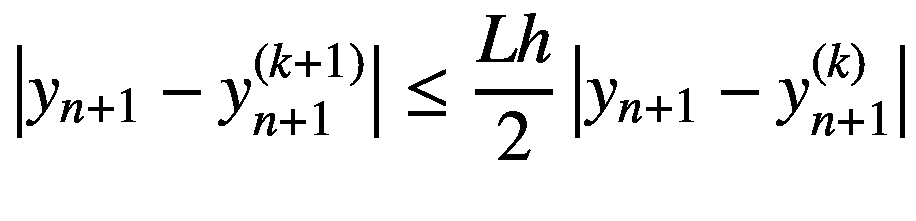

取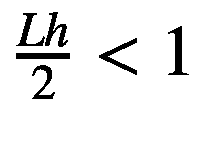，则有：

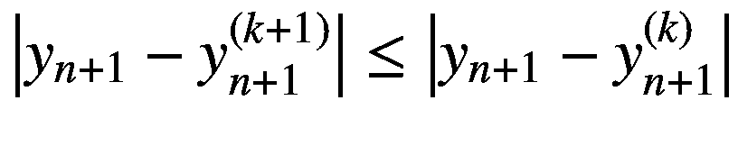

因此，我们获得了（条件）收敛。梯形公式比显式和隐式公式（一阶精度`o(h²)`）更精确，它具有二阶精度`o(h³)`。

## 7.1.1.4 预测-校正方法

虽然梯形公式具有良好的精度`o(h³)`，但工作量太大。预测-校正方法对欧拉公式进行了改进，它使用梯形公式但只进行一轮迭代。具体来说：

### 预测

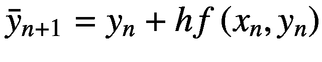

### 校正

![$$ {y}_{n+1}={y}_n+\frac{h}{2}\left[f\left({x}_n,{y}_n\right)+f\left({x}_{n+1},{\bar{y}}_{n+1}\right)\right] $$](images/500382_1_En_7_Chapter/500382_1_En_7_Chapter_TeX_IEq12.png)

该公式也称为改进的欧拉公式。

通常，预测-校正系统使用显式公式进行预测，并结合显式和隐式公式的结果以获得更好的结果：

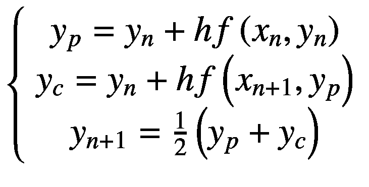

这是另一个使用预测-校正系统的例子。让我们使用中心差商重新推导隐式欧拉公式：

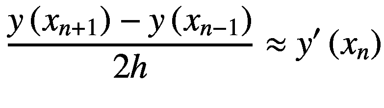

提取近似值并重新排列项：

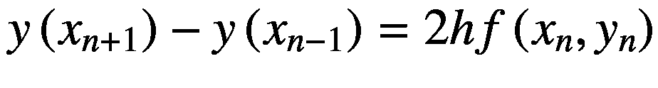

因此，我们得到：

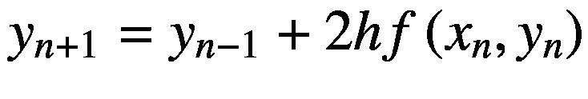

这个显式公式给出了预测值。将其与隐式梯形公式结合，我们得到以下预测-校正系统：

### 预测

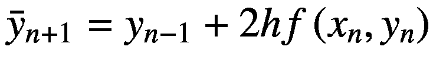

### 校正

![$$ {y}_{n+1}={y}_n+\frac{h}{2}\left[f\left({x}_n,{y}_n\right)+f\left({x}_{n+1},{\bar{y}}_{n+1}\right)\right] $$](images/500382_1_En_7_Chapter/500382_1_En_7_Chapter_TeX_IEq14.png)

这是一个涉及`y[n-1]`和`y[n]`的两步公式的例子。（前面所有的公式都是单步公式。）两步公式，或更一般的多步公式，需要一个单步公式才能从起点开始对`n = 1`进行计算。

NM Dev 库支持多种常微分方程求解器。可以通过实现接口`DerivativeFunction`来构造一个ODE。其签名如下：

```java
public interface DerivativeFunction {
    /**
     * 计算给定点 x 处的导数。
     *
     * @param x 自变量 x
     * @param y 因变量 y
     * @return 导数 F(x, y)
     */
    Vector evaluate(double x, Vector y);

    /**
     * 获取 y 的维度。
     *
     * @return y 的维度
     */
    int dimension();
}
```

有了ODE定义以及初始条件和积分区间，我们可以构造一个**初值问题**（IVP）。类`ODE1stOrder`用于构造一个初值问题：

```java
/**
 * 用给定的向量值函数及其初值构造一个一阶 ODE。求解
 * \[
 * y' = F(x, y) \\
 * y(x_0) = y_0
 * \]
 *
 * @param dy 一阶导数函数 y' = F(x, y)
 * @param y0 y0
 * @param x0 积分区间 [x0, x1] 的起始点
 * @param x1 积分区间 [x0, x1] 的终点
 */
public ODE1stOrder(DerivativeFunction dy, Vector y0, double x0, double x1)
```

以下示例代码使用欧拉方法求解此初值问题：

，`x ∈ [0, 1]`

```java
// 定义要求解的常微分方程
DerivativeFunction dy = new DerivativeFunction() {
    @Override
    public Vector evaluate(double x, Vector y) {
        Vector dy = y.scaled(-2\. * x);
        return dy.add(1); // y' = 1 - 2xy
    }

    @Override
    public int dimension() {
        return 1;
    }
};
// 初始条件，y0=0
Vector y0 = new DenseVector(0.);
double x0 = 0, x1 = 1.; // 求解域
double h = 0.1; // 步长
// 定义一个初值问题
ODE1stOrder ivp = new ODE1stOrder(dy, y0, x0, x1);
// 使用欧拉法构造一个常微分方程求解器
ODESolver solver = new EulerMethod(h);
// 求解常微分方程
ODESolution soln = solver.solve(ivp);
// 在离散点上输出解函数 y
double[] x = soln.x();
Vector[] y = soln.y();
for (int i = 0; i < x.length; ++i) {
    System.out.println(String.format("y(%f) = %s", x[i], y[i]));
}
```

输出结果如下（见图 7-3）：

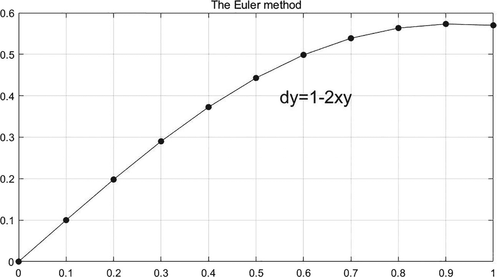

**图 7-3** 使用欧拉法求解初值问题的结果

```
y(0.000000) = [0.000000]
y(0.100000) = [0.100000]
y(0.200000) = [0.198000]
y(0.300000) = [0.290080]
y(0.400000) = [0.372675]
y(0.500000) = [0.442861]
y(0.600000) = [0.498575]
y(0.700000) = [0.538746]
y(0.800000) = [0.563322]
y(0.900000) = [0.573190]
y(1.000000) = [0.570016]
```

`ODESolver`类用于求解一阶初值问题。其接口定义如下：

```
public interface ODESolver {
/**
* 求解一个初值问题。
*
* @param ivp 一个初值问题
* @return 一个解
*/
ODESolution solve(ODE1stOrder ivp);
}
```

### 7.1.2 龙格-库塔族

在推导欧拉公式时，我们忽略了泰勒展开中的 `o(h²)` 项。一般而言，积分公式中包含的（高阶）项越多，公式的精度就越高。假设我们利用前 `p` 阶导数构造一个显式公式：

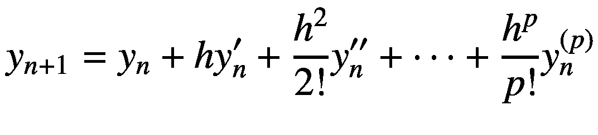

阶数为 `o(h^(p + 1))` 的局部截断误差如下：

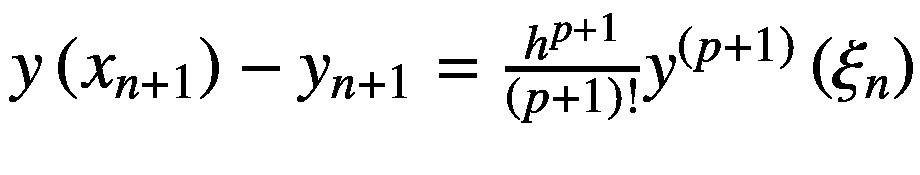, `ξ[n] ∈ (x[n], x[n + 1])`

我们称该积分公式具有 `p` 阶精度。显式欧拉公式具有 1 阶精度；隐式欧拉公式同样为 1 阶精度。梯形公式具有 2 阶精度。然而在实际应用中，这种构造方法很少使用，因为求 `y` 的高阶导数并不总是容易的。

龙格-库塔方法采用了不同的思路。根据中值定理，存在 0 < `θ` < 1 使得下式成立：

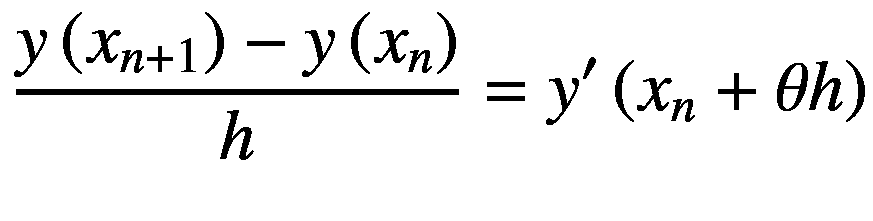

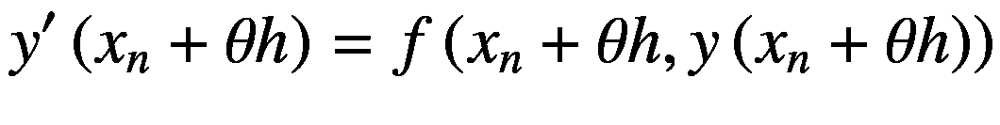

因此，我们有：

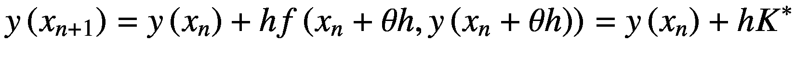

令 `K* = f (x[n] + θh, y(x[n] + θh))` 称为区间 [`x[n]`, `x[n+1]`] 上的平均斜率。通过使用 `K*` 的不同定义，我们可以构造不同的积分公式。如果 `θ = 0`，则取点 (`x[n]`, `y[n]`) 处的斜率作为整个区间 [`x[n]`, `x[n+1]`] 的平均斜率。此时 `K* = f (x[n], y[n])`，积分公式为 `y[n+1] = y[n] + hf (x[n], y[n])`。这就是欧拉公式。如果 `θ = 1`，则取点 (`x[n+1]`, `y[n+1]`) 处的斜率作为整个区间 [`x[n]`, `x[n+1]`] 的平均斜率。此时 `K* = f (x[n+1], y[n+1])`，积分公式为 `y[n+1] = y[n] + hf (x[n+1], y[n+1])`。这就是隐式/后向欧拉公式。令 `K[1] = f (x[n], y[n])` 和 `K[2] = f (x[n+1], y[n] + hf (x[n], y[n]))`。定义 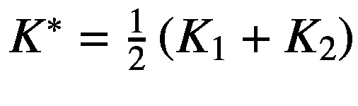。`K*` 是点 (`x[n]`, `y[n]`) 和 (`x[n+1]`, `y[n+1]`) 处斜率的算术平均值。将其作为整个区间 [`x[n]`, `x[n+1]`] 的平均斜率，则积分公式即为梯形公式：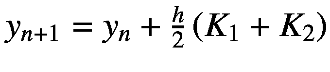。我们知道梯形公式具有 2 阶精度，而显式和隐式欧拉公式只有 1 阶精度。由此可见，使用两点斜率的算术平均值作为积分区间的平均斜率，比使用任一端点的斜率更为精确。因此可以推断，如果在 [`x[n]`, `x[n+1]`] 上使用多个点斜率的加权平均值作为平均斜率 `K*`，则有可能构造出具有更高精度的积分公式。这就是龙格-库塔法的基本思想。

#### 7.1.2.1 二阶龙格-库塔法

梯形公式是二阶龙格-库塔法的一个特例。它利用两个端点 `x[n]` 和 `x[n + 1]` 处的斜率值，并将区间 `K*` 的平均斜率设为它们的线性组合。我们不必使用端点 `x[n + 1]`。假设 `0 < p ≤ 1`，`K[1] = f(x[n], y[n])`，且 `K[2] = f(x[n + p], y[n + p])`，其中 `x[n + p] ∈ (x[n], x[n + 1]]`，并且 `y[n + p] = y[n] + phf(x[n], y[n])`。积分公式如下：

```
{
K1 = f(x_n, y_n) = f_n
K2 = f(x_{n+p}, y_n + phK1)
y_{n+1} = y_n + h(λ1K1 + λ2K2)
}
```

该系统有三个待定参数：`λ[1]`、`λ[2]`、`p`。我们希望找到一组参数，使积分公式达到二阶精度。我们首先使用泰勒展开，将 `K[2]` 作为二元函数在 `(x[n], y[n])` 处展开。

```
K2 = f(x_n, y_n) + ph(f_x + f_y) + ...
```

将 `K[1]` 和 `K[2]` 代入积分公式，得到：

```
y_{n+1} = y_n + h(λ1K1 + λ2K2)
```

```
= y_n + h[λ1f_n + λ2f_n + λ2ph(f_x + f_y) + ...]
```

```
= y_n + (λ1 + λ2)hf_n + λ2ph²(f_x + f_y) + ...
```

与二阶泰勒展开的系数进行比较，得到：

```
y_{n+1} = y_n + hy_n' + (h²/2!)y_n''
```

我们发现三个待定参数 `λ[1]`、`λ[2]` 和 `p` 必须满足以下条件：

```
{
λ1 + λ2 = 1
λ2p = 1/2
}
```

任何满足上述条件的积分公式都称为*二阶*龙格-库塔公式。梯形公式是当 `λ1 = λ2 = 1/2` 且 `p = 1` 时的一个特例。

#### 7.1.2.2 三阶龙格-库塔法

我们可以通过使用三个点而不是两个点来进一步提高精度。设这三个点为 `[x[n], x[n + 1]]` 区间内的 `x[n]`、`x[n + p]` 和 `x[n + q]`，其中 `0 < p < q ≤ 1`。设这三个点处的斜率分别为 `K[1]`、`K[2]` 和 `K[3]`。平均斜率 `K*` 是它们的线性组合。我们定义如下：

```
{
K1 = f(x_n, y_n)
K2 = f(x_{n+p}, y_n + phK1)
K3 = f(x_{n+q}, y_{n+q}) = f(x_n + qh, y_n + qh(rK1 + sK2))
}
```

注意，对于 `K[3]`，`y[n + q]` 是根据 `K[1]` 和 `K[2]` 的平均斜率定义的。三阶积分公式如下：

```
y_{n+1} = y_n + h(λ1K1 + λ2K2 + λ3K3)
```

待定参数为 `λ[1]`、`λ[2]`、`λ[3]`、`p`、`q`、`r` 和 `s`。我们可以重复用于推导二阶公式的类似过程来推导三阶公式。我们首先对 `K[1]`、`K[2]` 和 `K[3]` 进行泰勒展开，并将它们代入 `y[n + 1]`。通过与 `y[n + 1]` 的三阶泰勒展开的系数进行比较，可以推导出参数必须满足的方程组。

```
{
r + s = 1
λ1 + λ2 + λ3 = 1
λ2p + λ3q = 1/2
λ2p² + λ3q² = 1/3
λ3pqs = 1/6
}
```

任何满足这些条件的积分公式都称为*三阶龙格-库塔公式*。

#### 高阶龙格-库塔方法

一般情况下，任意阶的龙格-库塔积分公式都表示为多个选定点处斜率的线性组合。

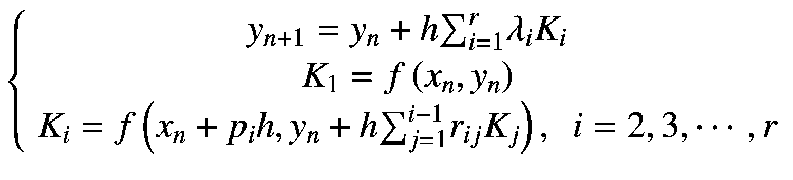

例如，当`r = 4`时，四阶龙格-库塔公式如下：


可以证明其截断误差为`o(h⁵)`。

需要重点注意的是，由于龙格-库塔公式是通过泰勒展开推导得出的，因此它假设解函数`y(x)`足够光滑，并且高阶导数存在。否则，使用高阶龙格-库塔公式可能不如使用低阶龙格-库塔公式有效。

`NM Dev` 支持一套用于求解常微分方程的龙格-库塔公式。类 `RungeKutta` 接收一个实现了龙格-库塔公式的 `RungeKuttaStepper` 对象。例如，`RungeKutta2` 实现了二阶龙格-库塔积分公式。`RungeKutta` 的签名如下：

```
/**
* Constructs a Runge-Kutta algorithm with the given integrator and the
* constant step size.
*
* @param stepper 积分器算法
* @param h       恒定步长
*/
public RungeKutta(RungeKuttaStepper stepper, final double h)
```

以下代码使用多种龙格-库塔公式，对`x ∈ [0, 1]`上的初值问题进行数值求解：

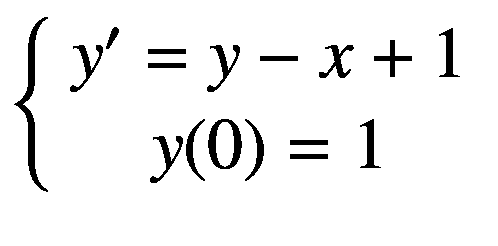

其解析解如下：

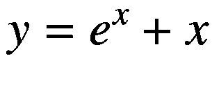

```
// 定义待求解的常微分方程
DerivativeFunction dy = new DerivativeFunction() {
@Override
public Vector evaluate(double x, Vector v) {
double y = v.get(1);
double dy = y - x + 1;
return new DenseVector(dy);
}
@Override
public int dimension() {
return 1;
}
};
// 初始条件, y0=1
Vector y0 = new DenseVector(1.);
double x0 = 0, x1 = 1.; // 求解域
double h = 0.1; // 步长
// 解析解
UnivariateRealFunction y = new AbstractUnivariateRealFunction() {
@Override
public double evaluate(double x) {
double y = exp(x) + x;
return y;
}
};
// 定义一个初值问题
ODE1stOrder ivp = new ODE1stOrder(dy, y0, x0, x1);
// 使用一阶龙格-库塔公式
RungeKuttaStepper stepper1 = new RungeKutta1();
ODESolver solver1 = new RungeKutta(stepper1, h);
ODESolution soln1 = solver1.solve(ivp);
// 使用二阶龙格-库塔公式
RungeKuttaStepper stepper2 = new RungeKutta2();
ODESolver solver2 = new RungeKutta(stepper2, h);
ODESolution soln2 = solver2.solve(ivp);
// 使用三阶龙格-库塔公式
RungeKuttaStepper stepper3 = new RungeKutta3();
ODESolver solver3 = new RungeKutta(stepper3, h);
ODESolution soln3 = solver3.solve(ivp);
double[] x = soln1.x();
Vector[] y1 = soln1.y();
Vector[] y2 = soln2.y();
Vector[] y3 = soln3.y();
for (int i = 0; i < x.length; ++i) {
double yx = y.evaluate(x[i]); // 解析解
double diff1 = yx - y1[i].get(1); // 一阶误差
double diff2 = yx - y2[i].get(1); // 二阶误差
double diff3 = yx - y3[i].get(1); // 三阶误差
System.out.println(
String.format("y(%f) = %s (%.16f); = %s (%.16f); = %s (%.16f)",
x[i], y1[i], diff1,
y2[i], diff2,
y3[i], diff3
));
}
```

输出如下：

输出显示了一阶、二阶和三阶龙格-库塔公式计算的近似值。近似值显示在方括号内，误差显示在圆括号内。我们确实看到，高阶公式能给出更精确的结果（误差更小）。

图 7-4 比较了解析解与一阶龙格-库塔近似的结果。

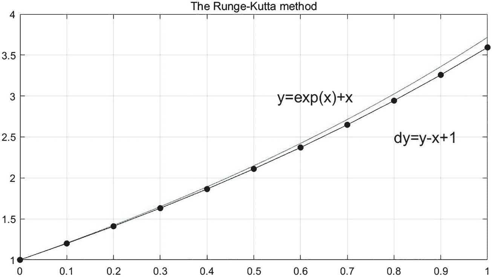

`图 7-4` 解析解与一阶龙格-库塔近似对比

图 7-5 比较了解析解（蓝色）与一阶（黑色）、二阶（红色）、三阶（绿色）龙格-库塔近似的结果。二阶和三阶的结果非常好。几乎看不出线条，因为它们与精确解（蓝色线）几乎重合。


`图 7-5` 解析解与龙格-库塔近似对比

### 7.1.3 收敛性

对于单步法，如果一个积分公式 `y[n+1] = y[n] + hϕ(x[n], y[n], h)` 是收敛的，那么对于固定的 `x[n] = x[0] + nh`，下式成立：


例如，考虑以下公式：


该常微分方程的欧拉公式如下：

`y[n+1] = y[n] + hλy[n] = (1 + λh)y[n]`

因此，我们有：


令 `x[0] = 0` 且 `x[n] = nh`，如下所示：

![$$ {y}_n={\left[{\left(1+\lambda h\right)}^{\frac{1}{\lambda h}}\right]}^{\lambda h n}{y}_0={\left[{\left(1+\lambda h\right)}^{\frac{1}{\lambda h}}\right]}^{\lambda {x}_n}{y}_0 $$](images/500382_1_En_7_Chapter/500382_1_En_7_Chapter_TeX_Equaz.png)


因此，欧拉公式对于此常微分方程是收敛的。

假设一个单步法具有 `p` 阶精度。再假设增量函数 `ϕ(x, y, h)` 关于 `y` 满足利普希茨条件。也就是说，对于任意 `y` 和 `ȳ`，存在常数 `L > 0` 使得下式成立：


可以证明此单步法是收敛的，且整体截断误差如下：


我们可以应用此定理来证明梯形公式的收敛性。梯形公式的增量函数如下：

![$$ \phi \left(x,y,h\right)=\frac{1}{2}\left[f\left(x,y\right)+f\left(x+h,y+ hf\left(x,y\right)\right)\right] $$](images/500382_1_En_7_Chapter/500382_1_En_7_Chapter_TeX_Equbd.png)

并且如下所示：

![$$ \phi \left(x,\bar{y},h\right)=\frac{1}{2}\left[f\left(x,\bar{y}\right)+f\left(x+h,\bar{y}+ hf\left(x,\bar{y}\right)\right)\right] $$](images/500382_1_En_7_Chapter/500382_1_En_7_Chapter_TeX_Eqube.png)

将两个方程相减，我们得到：


因为函数 `f(x, y)` 关于 `y` 满足利普希茨条件，所以不等式变为：


整理项得到：


因此，梯形公式的增量函数关于 `y` 满足利普希茨条件，从而具有收敛性。

### 7.1.4 稳定性

如果误差（真实解与近似解之间的差值）不会增加，则称常微分方程的解是稳定的。

例如，考虑这个简单的常微分方程：

`y' = λy`，其中 `λ < 0`

解析解如下：


使用欧拉公式，数值解如下：


定义误差如下：


误差的递推关系如下：


确保稳定性的条件如下：


即，


因此，（显式）欧拉公式的稳定区域如下：


我们可以对隐式欧拉公式进行类似的分析。

解析解如下：


使用隐式欧拉公式，数值解如下：


稳定性方程（通过两式相减得到）如下：


整理项，我们得到：


因为 `λ < 0`，对于任意步长 `h > 0`，有 `1/(1-λh) ≤ 1`。也就是说，稳定区域是 `-∞ < λh ≤ 0` 或 `h > 0`。我们称隐式欧拉公式是无条件稳定的。显式和隐式欧拉公式都具有一阶精度。后者更受青睐，因为它是无条件稳定的，与步长无关，而前者仅在 `h` 的某些特定值下稳定。事实上，在（常微分和偏微分）方程的数值解中，许多隐式方法都是无条件稳定的。例如，用于求解偏微分方程的克朗克-尼科尔森方法就是一种隐式方法，并且是无条件稳定的。因此，隐式方法通常比显式方法更受青睐。

## 7.2 线性多步法

像欧拉法这样的单步法的局限性在于，它只使用上一个节点的信息（值和导数）来计算当前节点。尽管龙格-库塔公式等方法会使用多个点，但这些点仅作为中间值使用，并在进入下一个节点前被丢弃。相比之下，多步法通过保留并利用先前节点计算的信息（值和导数）来提高精度。在线性多步法中，采用多个先前节点的值及其导数的线性组合来确定当前节点的值。通用线性多步法的积分公式如下：


如果 `β[-1] = 0`，则该积分公式为显式公式（`y[n + 1]` 不出现在等式右侧）；如果 `β[-1] ≠ 0`，则该公式为隐式公式。通过恰当选择待定参数，可以构建一族线性多步公式。与推导龙格-库塔族公式类似，我们可以通过将参数与泰勒展开式的系数进行比较来确定这些参数。令


在 `x[n]` 点对 `y[n - k]` 和 `y[n - k]'` 进行泰勒展开。


将它们代入积分公式并重新整理项，如下所示：

![$$ {y}_{n+1}=\left({\sum}_{k=0}^r{\alpha}_k\right){y}_n+{\sum}_{j=1}^p\frac{h^j}{j!}\left[{\sum}_{k=1}^r{\left(-k\right)}^j{\alpha}_k+j{\sum}_{k=-1}^r{\left(-k\right)}^{j-1}{\beta}_k\right]{y}_n^{(j)}+\frac{h^{p+1}}{\left(p+1\right)!}\left[{\sum}_{k=1}^r{\left(-k\right)}^{p+1}{\alpha}_k+\left(p+1\right){\sum}_{k=-1}^r{\left(-k\right)}^p{\beta}_k\right]{y}_n^{\left(p+1\right)}+\cdots $$](images/500382_1_En_7_Chapter/500382_1_En_7_Chapter_TeX_Equca.png)

同时，我们在 `x[n]` 点对 `y(x[n + 1])` 进行泰勒展开，得到如下结果：

# 7 数值方法

## 7.2 线性多步法

$$ y\left({x}_{n+1}\right)={\sum}_{j=0}^p\frac{h^j}{j!}{y}_n^{(j)}+\frac{h^{p+1}}{\left(p+1\right)!}{y}_n^{\left(p+1\right)}+\cdots $$

为了使积分公式具有 `p` 阶精度，即局部截断误差为 `O(h^(p + 1))`，我们需要匹配 `y[n + 1]` 与 `y(x[n + 1])` 展开式中直至 `h^p` 项的系数。因此，以下参数方程组必须成立：

$$ \left\{\begin{array}{c}{\sum}_{k=0}^r{\alpha}_k=1\\ {}{\sum}_{k=1}^r{\left(-k\right)}^j{\alpha}_k+j{\sum}_{k=-1}^r{\left(-k\right)}^{j-1}{\beta}_k=1\end{array}\right. $$

局部截断误差如下：

$$ y\left({x}_{n+1}\right)-{y}_{n+1}=\frac{h^{p+1}}{\left(p+1\right)!}\left[1-{\sum}_{k=1}^r{\left(-k\right)}^{p+1}{\alpha}_k-\left(p+1\right){\sum}_{k=-1}^r{\left(-k\right)}^p{\beta}_k\right]{y}_n^{\left(p+1\right)}+\cdots $$

### 7.2.1 亚当斯-巴什福思法

亚当斯-巴什福思法是一类线性多步法。我们考虑一种使用四个步骤（即使用最后四个节点）的显式公式（即公式右侧不包含 `y[n + 1]`）。其积分公式（参数尚未确定）如下：

$$ {y}_{n+1}={\alpha}_0{y}_n+{\alpha}_1{y}_{n-1}+{\alpha}_2{y}_{n-2}+h\left({\beta}_0{y}_n^{\prime }+{\beta}_1{y}_{n-1}^{\prime }+{\beta}_2{y}_{n-2}^{\prime }+{\beta}_3{y}_{n-3}^{\prime}\right) $$

为了使该公式具有四阶精度（在线性多步框架中设 `r = 3`），系数必须满足以下条件：

$$ \left\{\begin{array}{c}{\alpha}_0+{\alpha}_1+{\alpha}_2=1\\ {}-{\alpha}_1-2{\alpha}_2+{\beta}_0+{\beta}_1+{\beta}_2+{\beta}_3=1\\ {}{\alpha}_1+4{\alpha}_2-2{\beta}_1-4{\beta}_2-6{\beta}_3=1\\ {}-{\alpha}_1-8{\alpha}_2+3{\beta}_1+12{\beta}_2+27{\beta}_3=1\\ {}{\alpha}_1+16{\alpha}_2-4{\beta}_1-32{\beta}_2-108{\beta}_3=1\end{array}\right. $$

由于有七个未知数却只有五个方程，该方程组的解不唯一。常规做法是设定 `α[1] = α[2] = 0`。由此得到：

$$ {\alpha}_0=1,{\beta}_0=\frac{55}{24},{\beta}_1=-\frac{59}{24},{\beta}_2=\frac{37}{24},{\beta}_3=-\frac{9}{24} $$

积分公式变为：

$$ {y}_{n+1}={y}_n+\frac{h}{24}\left(55{f}_n-59{f}_{n-1}+37{f}_{n-2}-9{f}_{n-3}\right) $$

$$ {f}_{n-k}=f\left({x}_{n-k},{y}_{n-k}\right) $$

这就是四阶的四步亚当斯-巴什福思显式公式。

一阶公式与欧拉公式相同。

$$ {y}_{k+1}={y}_k+h{f}_k $$

二阶公式如下：

$$ {y}_{k+1}={y}_k+\frac{h}{2}\left[3{f}_k-{f}_{k-1}\right] $$

三阶公式如下：

$$ {y}_{k+1}={y}_k+\frac{h}{12}\left[23{f}_k-16{f}_{k-1}+5{f}_{k-2}\right] $$

尽管这些公式是显式且易于计算，但它们稳定性较差。

### 7.2.2 亚当斯-巴什福思隐式公式

考虑以下四步隐式公式（本质上是用 `${y}_{n+1}^{\prime }` 替换 `${y}_{n-3}^{\prime }` ）：

```
${y}_{n+1}={\alpha}_0{y}_n+{\alpha}_1{y}_{n-1}+{\alpha}_2{y}_{n-2}+h\left({\beta}_{-1}{y}_{n+1}^{\prime }+{\beta}_0{y}_n^{\prime }+{\beta}_1{y}_{n-1}^{\prime }+{\beta}_2{y}_{n-2}^{\prime}\right)$
```

为了使该积分公式具有四阶精度，系数需满足以下条件：

```
$\left\{\begin{array}{c}{\alpha}_0+{\alpha}_1+{\alpha}_2=1\\ {}-{\alpha}_1-2{\alpha}_2+{\beta}_{-1}+{\beta}_0+{\beta}_1+{\beta}_2=1\\ {}{\alpha}_1+4{\alpha}_2+2{\beta}_{-1}-2{\beta}_1-4{\beta}_2=1\\ {}-{\alpha}_1-8{\alpha}_2++3{\beta}_{-1}+3{\beta}_1+12{\beta}_2=1\\ {}{\alpha}_1+16{\alpha}_2+4{\beta}_{-1}-4{\beta}_1-32{\beta}_2=1\end{array}\right.$
```

这里有七个未知数但仅有五个方程，因此解不唯一。一个典型的约定是设 `α[1] = α[2] = 0`。于是我们得到：

```
${\alpha}_0=1,{\beta}_{-1}=\frac{9}{24},{\beta}_0=\frac{19}{24},{\beta}_1=-\frac{5}{24},{\beta}_2=\frac{1}{24}$
```

积分公式变为：

```
${y}_{n+1}={y}_n+\frac{h}{24}\left(9{f}_{n+1}+19{f}_n-5{f}_{n-1}+{f}_{n-2}\right)$
```

```
${f}_{n-k}=f\left({x}_{n-k},{y}_{n-k}\right)$
```

一阶 Adams-Bashforth 隐式公式与隐式欧拉公式相同。

```
${y}_{k+1}={y}_k+h{f}_{k+1}$
```

二阶公式与梯形公式相同。

```
${y}_{k+1}={y}_k+\frac{h}{2}\left[{f}_{k+1}+{f}_k\right]$
```

三阶公式如下：

```
${y}_{k+1}={y}_k+\frac{h}{12}\left[5{f}_{k+1}+8{f}_k-{f}_{k-1}\right]$
```

请注意，Adams-Bashforth 公式无法自启动。需要使用单步法（例如 Runge-Kutta 公式）来计算前几个点。

NM Dev 支持前五阶的 Adams-Bashforth 公式。以下代码求解了第 7.1.2.3 节中给出的相同初值问题：

```
// define the ODE to solve
`DerivativeFunction` `dy` = new `DerivativeFunction`() {
    @Override
    public `Vector` `evaluate`(double `x`, `Vector` `v`) {
        double `y` = `v`.`get`(1);
        double `dy` = `y` - `x` + 1;
        return new `DenseVector`(`dy`);
    }
    @Override
    public int `dimension`() {
        return 1;
    }
};
// initial condition, y0=1
`Vector` `y0` = new `DenseVector`(1.);
double `x0` = 0, `x1` = 1.; // solution domain
double `h` = 0.1; // step size
// the analytical solution
`UnivariateRealFunction` `y` = new `AbstractUnivariateRealFunction`() {
    @Override
    public double `evaluate`(double `x`) {
        double `y` = `exp`(`x`) + `x`;
        return `y`;
    }
};
// define an IVP
`ODE1stOrder` `ivp` = new `ODE1stOrder`(`dy`, `y0`, `x0`, `x1`);
// using first order Adams-Bashforth formula
`ODESolver` `solver1` = new `AdamsBashforthMoulton`(new `ABMPredictorCorrector1`(), `h`);
`ODESolution` `soln1` = `solver1`.`solve`(`ivp`);
// using second order Adams-Bashforth formula
`ODESolver` `solver2` = new `AdamsBashforthMoulton`(new `ABMPredictorCorrector2`(), `h`);
`ODESolution` `soln2` = `solver2`.`solve`(`ivp`);
// using third order Adams-Bashforth formula
`ODESolver` `solver3` = new `AdamsBashforthMoulton`(new `ABMPredictorCorrector3`(), `h`);
`ODESolution` `soln3` = `solver3`.`solve`(`ivp`);
// using forth order Adams-Bashforth formula
`ODESolver` `solver4` = new `AdamsBashforthMoulton`(new `ABMPredictorCorrector4`(), `h`);
`ODESolution` `soln4` = `solver4`.`solve`(`ivp`);
// using fifth order Adams-Bashforth formula
`ODESolver` `solver5` = new `AdamsBashforthMoulton`(new `ABMPredictorCorrector5`(), `h`);
`ODESolution` `soln5` = `solver5`.`solve`(`ivp`);
double[] `x` = `soln1`.`x`();
`Vector`[] `y1` = `soln1`.`y`();
`Vector`[] `y2` = `soln2`.`y`();
`Vector`[] `y3` = `soln3`.`y`();
`Vector`[] `y4` = `soln4`.`y`();
`Vector`[] `y5` = `soln5`.`y`();
for (int `i` = 0; `i` < `x`.length; ++`i`) {
    double `yx` = `y`.`evaluate`(`x`[`i`]); // the analytical solution
    double `diff1` = `yx` - `y1`[`i`].`get`(1); // the first order error
    double `diff2` = `yx` - `y2`[`i`].`get`(1); // the second order error
    double `diff3` = `yx` - `y3`[`i`].`get`(1); // the third order error
    double `diff4` = `yx` - `y4`[`i`].`get`(1); // the forth order error
    double `diff5` = `yx` - `y5`[`i`].`get`(1); // the fifth order error
    `System.out.println`(
        `String.format`("y(%f) = %s (%.16f); = %s (%.16f); = %s (%.16f); = %s (%.16f); = %s (%.16f)",
            `x`[`i`], `y1`[`i`], `diff1`,
            `y2`[`i`], `diff2`,
            `y3`[`i`], `diff3`,
            `y4`[`i`], `diff4`,
            `y5`[`i`], `diff5`
        ));
}
```

输出结果如下：

```
y(0.000000) = [1.000000]  (0.0000000000000000); = [1.000000]  (0.0000000000000000); = [1.000000]  (0.0000000000000000); = [1.000000]  (0.0000000000000000); = [1.000000]  (0.0000000000000000)
y(0.100000) = [1.210000]  (-0.0048290819243522); = [1.205000]  (0.0001709180756477); = [1.205000]  (0.0001709180756477); = [1.205000]  (0.0001709180756477); = [1.205000]  (0.0001709180756477)
y(0.200000) = [1.432100]  (-0.0106972418398301); = [1.421288]  (0.0001152581601698); = [1.421025]  (0.0003777581601696); = [1.421025]  (0.0003777581601696); = [1.421025]  (0.0003777581601696)
y(0.300000) = [1.667631]  (-0.0177721924239969); = [1.649813]  (0.0000454013260032); = [1.649443]  (0.0004159690343364); = [1.649443]  (0.0004159690343364); = [1.649443]  (0.0004159690343364)
y(0.400000) = [1.918070]  (-0.0262457123587299); = [1.891865]  (-0.0000404310306048); = [1.891369]  (0.0004556955886803); = [1.891369]  (0.0004556955886803); = [1.891369]  (0.0004556955886803)
y(0.500000) = [2.185058]  (-0.0363368843998719); = [2.148866]  (-0.0001448257883485); = [2.148222]  (0.0004994814440833); = [2.148222]  (0.0004994814440833); = [2.148222]  (0.0004994814440833)
y(0.600000) = [2.470415]  (-0.0482957517704916); = [2.422390]  (-0.0002707386487995); = [2.421571]  (0.0005474439430126); = [2.421571]  (0.0005474439430126); = [2.421571]  (0.0005474439430126)
y(0.700000) = [2.776160]  (-0.0624074454282342); = [2.714174]  (-0.0004215417743363); = [2.713153]  (0.0005999698250871); = [2.713153]  (0.0005999698250871); = [2.713153]  (0.0005999698250871)
y(0.800000) = [3.104538]  (-0.0789968412251016); = [3.026142]  (-0.0006010786985646); = [3.024883]  (0.0006574888333333); = [3.024883]  (0.0006574888333333); = [3.024883]  (0.0006574888333333)
y(0.900000) = [3.458037]  (-0.0984338132295521); = [3.360417]  (-0.0008137261840067); = [3.358883]  (0.0007204702609296); = [3.358883]  (0.0007204702609296); = [3.358883]  (0.0007204702609296)
y(1.000000) = [3.839421]  (-0.1211391576099716); = [3.719346]  (-0.0010644638780861); = [3.717492]  (0.0007894268678772); = [3.717492]  (0.0007894268678772); = [3.717492]  (0.0007894268678772)
```

该输出展示了使用一阶、二阶、三阶、四阶和五阶 Adams-Bashforth 公式得到的近似值。近似值显示在方括号中，误差显示在圆括号中。我们确实可以看到，高阶公式能给出更精确的结果（误差更小）。对于此例，三阶、四阶和五阶公式产生了相同的结果。

### 7.3 不同方法的比较

我们总结了使用本章涵盖的不同方法求解以下初值问题的结果。该初值问题如下：


解析解如下：


我们使用步长 `h` = 0.1，因此 `x[k]` = `kh`（`k` = 0, 1, …, 6）。各方法的计算结果和绝对误差如下表所示。

**四步 Adams-Bashforth 公式**

| `n` | `x[n]` | **显式公式** | **隐式公式** |
| :--- | :--- | :--- | :--- |
|  |  | `y[n]` | `ε` | `y[n]` | `ε` |
| 4 | 0.4 | 1.070323 | 2.90e-06 | 1.07032 | 3.90e-07 |
| 5 | 0.5 | 1.106535 | 4.80e-06 | 1.10653 | 5.20e-07 |
| 6 | 0.6 | 1.148815 | 6.80e-06 | 1.148811 | 6.50e-07 |

**欧拉法、梯形公式和四阶 Runge-Kutta 公式的比较**

| `x[n]` | `欧拉法` |  | `梯形公式` |  | `四阶 Runge-Kutta 公式` |  |
| :--- | :--- | :--- | :--- | :--- | :--- | :--- |
|  | `y[n]` | `ε` | `y[n]` | `ε` | `y[n]` | `ε` |
| 0 | 1 | 0 | 1 | 0 | 1 | 0 |
| 0.1 | 1 | 4.80e-03 | 1.005 | 1.60e-04 | 1.0048375 | 8.00e-08 |
| 0.2 | 1.01 | 8.70e-03 | 1.019025 | 2.90e-04 | 1.0187309 | 1.50e-07 |
| 0.3 | 1.029 | 1.20e-03 | 1.041218 | 4.00e-04 | 1.04081842 | 2.00e-07 |
| 0.4 | 1.0561 | 1.40e-03 | 1.070802 | 4.80e-04 | 1.07032029 | 2.40e-07 |
| 0.5 | 1.09049 | 1.60e-03 | 1.107076 | 5.50e-04 | 1.10653093 | 2.70e-07 |
| 0.6 | 1.131441 | 1.80e-03 | 1.149404 | 5.90e-04 | 1.14881193 | 2.90e-07 |

一般来说，方法的阶数越高，解的精度越高。一阶欧拉公式精度最低，而四阶 Runge-Kutta 公式精度最高，实际上要好得多（1e-7 对比 1e-3）。对于四阶 Adams-Bashforth 方法，隐式公式的精度略高于显式公式。

在计算工作量方面，四阶 Runge-Kutta 方法的计算量最大。每一步需要计算函数 `f` 四次。相比之下，精度相似的 Adams-Bashforth 方法只需计算两次函数。因此，后者更受欢迎。但是，它是一种四步法，因此起始值必须由另一种方法提供。计算过程稍显复杂。

考虑使用欧拉公式求解以下初值问题：


注意，精确解表明 `y(1)` = 1。

## 步长选择与稳定性

取以下步长：`h` = 10^(−1)，`h` = 10^(−2)，`h` = 10^(−3)，和 `h` = 10^(−4)。结果如下表所示。首先，对于`h` = 10^(−1) 和 `h` = 10^(−2)，结果完全失真。其次，从 `h` = 10^(−3) 到 `h` = 10^(−4)，计算工作量增加了十倍，但精度并未提高。`h` = 10^(−4) 及更小的步长是计算上的浪费。

| `h` | `y` |
| --- | --- |
| 10^(−1) | 0.904382 × 10¹⁶ |
| 10^(−2) | >10³⁸ |
| 10^(−3) | 0.999999000001 |
| 10^(−4) | 0.999999000000 |

`h` = 10^(−1) 和 `h` = 10^(−2) 产生垃圾结果的原因是稳定性区域。如第 7.1.4 节所述，`h` 需要满足以下条件：


或者等价地，


前两个步长落在了稳定性区域之外。

这些例子表明，在选择合适的方法和参数来求解微分方程时需要考虑诸多因素。这些选择会影响精度、计算工作量和稳定性。当步长过大时，解可能会失真；当步长过小时，会不必要地增加计算量。好的选择不仅取决于所使用的数值方法，还取决于待求解微分方程的特性。

### 7.4 常微分方程组与高阶常微分方程

考虑一个包含 `N` 个一阶常微分方程及其初值条件的系统，如下所示：


为了求解这个常微分方程组，我们写成如下形式：


然后，这个常微分方程组可以写成向量形式：


请注意，这个初值问题与我们在本章中讨论的其他常微分方程具有相同的形式，不同的是变量和函数现在是向量。NM Dev 类 `DerivativeFunction` 和 `ODE1stOrder` 已经支持向量形式。因此，我们可以应用所有方法来求解常微分方程组。例如，向量形式的欧拉公式如下：


其分量形式如下：


例如，以下代码求解了此常微分方程组：


解析解如下：


```
// 定义待求解的常微分方程组
DerivativeFunction dY = new DerivativeFunction() {
@Override
public Vector evaluate(double t, Vector v) {
double x = v.get(1);
double y = v.get(2);
double dx = 3\. * x - 4\. * y;
double dy = 4\. * x - 7\. * y;
return new DenseVector(new double[]{dx, dy});
}
@Override
public int dimension() {
return 2;
}
};
// 初始条件，x0=y0=1
Vector Y0 = new DenseVector(1., 1.);
double x0 = 0, x1 = 1.; // 解的定义域
double h = 0.1; // 步长
// 解析解
RealVectorFunction F
= new AbstractRealVectorFunction(1, 2) {
@Override
public Vector evaluate(Vector v) {
double t = v.get(1);
double x = 2\. / 3 * exp(t) + 1\. / 3 * exp(-5\. * t);
double y = 1\. / 3 * exp(t) + 2\. / 3 * exp(-5\. * t);
return new DenseVector(x, y);
}
};
// 定义初值问题
ODE1stOrder ivp = new ODE1stOrder(dY, Y0, x0, x1);
// 使用欧拉法构建 ODE 求解器
ODESolver solver = new EulerMethod(h);
// 求解 ODE
ODESolution soln = solver.solve(ivp);
// 在离散点上打印解函数 y
double[] t = soln.x();
Vector[] v = soln.y();
for (int i = 0; i < t.length; ++i) {
System.out.println(String.format(
"y(%f) = %s vs %s",
t[i],
v[i],
F.evaluate(new DenseVector(t[i]))
));
}
```

输出结果如下：

## 数值解与解析解的比较

```
y(0.000000) = [1.000000, 1.000000]  vs [1.000000, 1.000000]
y(0.100000) = [0.900000, 0.700000]  vs [0.938957, 0.772744]
y(0.200000) = [0.890000, 0.570000]  vs [0.936895, 0.652387]
y(0.300000) = [0.929000, 0.527000]  vs [0.974283, 0.598706]
y(0.400000) = [0.996900, 0.529700]  vs [1.039662, 0.587498]
y(0.500000) = [1.084090, 0.557670]  vs [1.126509, 0.604297]
y(0.600000) = [1.186249, 0.600937]  vs [1.231342, 0.640564]
y(0.700000) = [1.301749, 0.654781]  vs [1.352568, 0.691382]
y(0.800000) = [1.430361, 0.717134]  vs [1.489799, 0.754057]
y(0.900000) = [1.572616, 0.787285]  vs [1.643438, 0.827274]
y(1.000000) = [1.729487, 0.865232]  vs [1.814434, 0.910586]
```

第一列向量是数值解，第二列是解析解。我们可以通过其他更高级的方法来提升精度。

### 高阶ODE转化为一阶ODE

考虑一个包含高阶导数的常微分方程，如下所示：


我们可以通过设置 `y[1] = y`、`y[2] = y'`……`y[m] = y^((m-1))` 的方式，将这个 `m` 阶 ODE 转换为一阶 ODE 方程组。具体示例如下：


我们已经可以使用 `DerivativeFunction` 和 `ODE1stOrder`，配合任意 NM Dev ODE 求解器，来求解一阶 ODE 方程组。

## 具体示例：二阶ODE的求解

例如，以下代码求解了这个二阶 ODE：


解析解如下：


我们首先将初值问题改写为一阶 ODE 方程组的形式。

令 `y[1] = y` 且 `y[2] = y'`，得到以下结果：


我们首先使用欧拉法求解这个方程组。

```
// 定义待求解的等效 ODE 方程组
DerivativeFunction dY = new DerivativeFunction() {
@Override
public Vector evaluate(double t, Vector v) {
double y_1 = v.get(1);
double y_2 = v.get(2);
double dy_1 = y_2;
double dy_2 = y_2 + 6\. * y_1;
return new DenseVector(new double[]{dy_1, dy_2});
}
@Override
public int dimension() {
return 2;
}
};
// 初始条件，y1(0) = 1，y2(0) = 2
Vector Y0 = new DenseVector(1., 2.);
double t0 = 0, t1 = 1.; // 解的定义域
double h = 0.1; // 步长
// 解析解
UnivariateRealFunction f
= new AbstractUnivariateRealFunction() {
@Override
public double evaluate(double t) {
double f = 0.8 * exp(3\. * t);
f += 0.2 * exp(-2\. * t);
return f;
}
};
// 定义初值问题
ODE1stOrder ivp = new ODE1stOrder(dY, Y0, t0, t1);
// 使用欧拉法构建 ODE 求解器
ODESolver solver = new EulerMethod(h);
// 使用三阶龙格-库塔公式构建 ODE 求解器
//        RungeKuttaStepper stepper3 = new RungeKutta3();
//        ODESolver solver = new RungeKutta(stepper3, h);
// 求解 ODE
ODESolution soln = solver.solve(ivp);
// 在离散点上打印解函数 y
double[] t = soln.x();
Vector[] v = soln.y();
for (int i = 0; i < t.length; ++i) {
double y1 = v[i].get(1); // 数值解
System.out.println(String.format(
"y(%f) = %f vs %f",
t[i],
y1,
f.evaluate(t[i])
));
}
```

输出结果如下：

```
y(0.000000) = 1.000000 vs 1.000000
y(0.100000) = 1.200000 vs 1.243633
y(0.200000) = 1.480000 vs 1.591759
y(0.300000) = 1.860000 vs 2.077445
y(0.400000) = 2.366800 vs 2.745959
y(0.500000) = 3.035880 vs 3.658927
y(0.600000) = 3.913876 vs 4.899957
y(0.700000) = 5.061824 vs 6.582255
y(0.800000) = 6.559400 vs 8.858920
y(0.900000) = 8.510443 vs 11.936845
y(1.000000) = 11.050154 vs 16.095497
```

我们注意到使用欧拉公式的精度非常差。（我还以为是代码出现了 bug，但在代码中找不到任何问题。）

现在我们改用 `RungeKutta3` 公式，通过 `RungeKutta` 类再次尝试。

```java
// 定义待求解的等效 ODE 方程组
DerivativeFunction dY = new DerivativeFunction() {
@Override
public Vector evaluate(double t, Vector v) {
double y_1 = v.get(1);
double y_2 = v.get(2);
double dy_1 = y_2;
double dy_2 = y_2 + 6\. * y_1;
return new DenseVector(new double[]{dy_1, dy_2});
}
@Override
public int dimension() {
return 2;
}
};
// 初始条件，y1(0) = 1，y2(0) = 2
Vector Y0 = new DenseVector(1., 2.);
double t0 = 0, t1 = 1.; // 解的定义域
double h = 0.1; // 步长
// 解析解
UnivariateRealFunction f
= new AbstractUnivariateRealFunction() {
@Override
public double evaluate(double t) {
double f = 0.8 * exp(3\. * t);
f += 0.2 * exp(-2\. * t);
return f;
}
};
// 定义初值问题
ODE1stOrder ivp = new ODE1stOrder(dY, Y0, t0, t1);
// 使用欧拉法构建 ODE 求解器
//        ODESolver solver = new EulerMethod(h);
// 使用三阶龙格-库塔公式构建 ODE 求解器
RungeKuttaStepper stepper3 = new RungeKutta3();
ODESolver solver = new RungeKutta(stepper3, h);
// 求解 ODE
ODESolution soln = solver.solve(ivp);
// 在离散点上打印解函数 y
double[] t = soln.x();
Vector[] v = soln.y();
for (int i = 0; i < t.length; ++i) {
double y1 = v[i].get(1); // 数值解
System.out.println(String.format(
"y(%f) = %f vs %f",
t[i],
y1,
f.evaluate(t[i])
));
}
```

输出结果如下：

```text
y(0.000000) = 1.000000 vs 1.000000
y(0.100000) = 1.243333 vs 1.243633
y(0.200000) = 1.590963 vs 1.591759
y(0.300000) = 2.075850 vs 2.077445
y(0.400000) = 2.743108 vs 2.745959
y(0.500000) = 3.654136 vs 3.658927
y(0.600000) = 4.892215 vs 4.899957
y(0.700000) = 6.570082 vs 6.582255
y(0.800000) = 8.840160 vs 8.858920
y(0.900000) = 11.908375 vs 11.936845
y(1.000000) = 16.052815 vs 16.095497
```

使用龙格-库塔法得到的结果是令人满意的。