# 8. 偏微分方程

偏微分方程（PDE）是在一个方程中联系多元函数及其各个偏导数之间关系的方程。上一章讨论的常微分方程是偏微分方程的一个子类，因为常微分方程处理的是单变量函数。偏微分方程比常微分方程难解得多，因为一个简单的偏微分方程就可以拥有大量解。例如，对于这个简单的偏微分方程：

```
∂²v / ∂x∂y = 0
```

对于任意单变量函数 `f` 和 `g`，任何形如 `v(x, y) = f(x) + g(y)` 的函数都满足该方程。这远远超出了常微分方程解公式中可选的范围，后者通常允许自由选择一些数字或系数。而在偏微分方程的研究中，通常可以自由选择函数。

一般来说，除了少数几类问题外，偏微分方程很少能解析求解。大多数偏微分方程没有通用公式。因此，现代数学和科学研究中有大量关于数值逼近特定偏微分方程解的方法的研究。偏微分方程在数学、科学和工程学中无处不在。例如，它们在现代科学对声、热、扩散、静电学、电动力学、流体动力学、弹性力学、广义相对论和量子力学的理解中都是基础。它们也源于许多纯数学的考量，比如微分几何和变分法。千禧年难题之一就是证明纳维-斯托克斯方程的存在性和唯一性，这是一个著名的偏微分方程。偏微分方程构成了一个非常庞大的主题。我们在本章中甚至无法触及皮毛。我们将简要讨论偏微分方程的一个小子类（即二阶线性偏微分方程），以及如何使用一种特定的数值方法（即有限差分法）来求解它们。

## 8.1 二阶线性偏微分方程

二阶偏微分方程具有以下形式：

```
a(∗) ∂²u/∂x² + b(∗) ∂²u/∂x∂y + c(∗) ∂²u/∂y² + d(∗) ∂u/∂x + e(∗) ∂u/∂y + f(∗)u + g(∗) = 0
```

根据系数 `a(∗)`、`b(∗)`、`c(∗)`、`d(∗)`、`e(∗)`、`f(∗)` 和 `g(∗)` 的函数形式，我们将其分为三种不同的类型。

如果系数仅依赖于变量而不依赖于导数，我们称此方程为线性偏微分方程。即：

```
∗ = x, y
```

如果系数依赖于变量和低阶导数，我们称此方程为拟线性偏微分方程。即：

```
∗ = x, y, ∂uⁿ⁻¹/∂x, ∂uⁿ⁻¹/∂y, ...
```

如果系数依赖于最高阶导数，我们称此方程为非线性偏微分方程。即：

```
∗ = x, y, ∂uⁿ/∂x, ∂uⁿ/∂y, ...
```

### 8.1.1 抛物型方程

如果满足以下条件，则二阶偏微分方程属于抛物型：

```
b²(∗) - a(∗)c(∗) = 0
```

一个最简单但最著名的抛物型偏微分方程例子是一维热方程，如下所示：

```
u_t = ∂u/∂t = α ∂²u/∂x² = α u_xx
```

`u(t, x)` 是时间 `t` 时沿细棒位置 `x` 处的温度。`α` 是热扩散率，一个正常数。热方程大致表述了热力学第二定律：热量会从较热的物体流向相邻较冷的物体，其速率与温差以及两者之间材料的热导率成正比。当热量流入（流出）某个材料时，其温度升高（降低）的速率与热量除以材料质量（质量）成正比，比例因子称为该材料的比热扩散率。简单来说，在给定时间和点的温度，其升高或降低的速率与该点的温度和该点附近平均温度之差成正比。这个概念可以推广到三维热方程，如下所示：

```
u_t = ∂u/∂t = α(∂²u/∂x² + ∂²u/∂y² + ∂²u/∂z²) = Δu
```

`Δ` 是拉普拉斯算子。它给出了函数在一点邻域内的平均值与该点值之间的差异。在我们的例子中，它衡量了温度在多大程度上偏离了调和函数的均值性质。

一个偏微分方程可以代表一大类方程或现象。热方程具有非常广泛的应用性。金融数学中价值万亿美元的布莱克-斯科尔斯方程就是热方程的一个变体。量子力学中的薛定谔方程可以被视为虚时间里的热方程。在图像分析中，热方程用于解决像素化问题和识别边缘。热方程的解在流体动力学激波的数学建模中很有用。

如同解常微分方程一样，我们需要某些初始条件、边界条件或约束来缩小范围，以求解偏微分方程。有三种典型的边界条件类型，对应着三种边值问题。

第一类边值问题的边界条件规定了函数本身在函数域边界上的值。这也被称为狄利克雷边界条件。例如，如果一根铁棒的一端保持恒温，那么问题（计算区域内的热量或温度）在该空间点上的值是已知的。

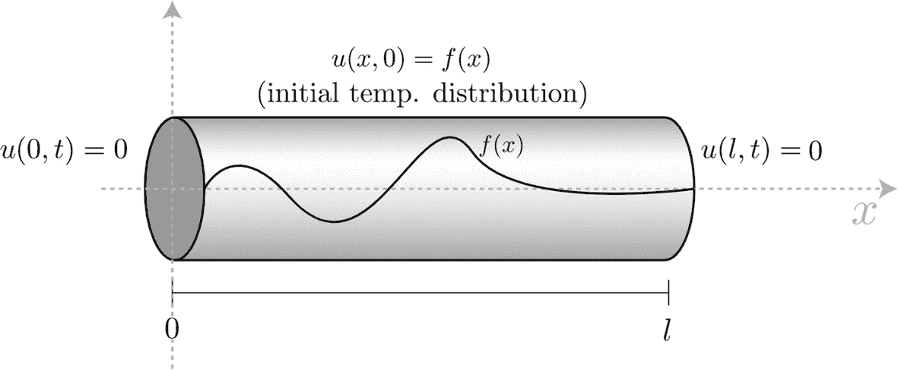

在数学上，我们这样写：

```
{
    ∂u/∂t - a ∂²u/∂x² = 0, 0 < t < T, 0 < x < l
    u(x, 0) = φ(x), 0 ≤ x ≤ l
    u(0, t) = g₁(t), u(l, t) = g₂(t), 0 ≤ t ≤ T
}
```


#### 偏微分方程中的边界条件类型

第一个（微分）方程描述了热系统的动力学。第二个方程是初始条件，描述了杆内任意位置的初始温度。第三个方程是边界条件，指定了杆两端在任意时刻的温度。边界条件`u(0, t) = g1(t)`, `u(l, t) = g2(t)`称为第一类边界条件。`ϕ(x)`, `g1(t)`和`g2(t)`是已知函数，它们还需要满足连接条件。

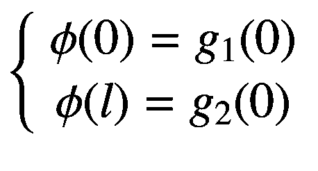

第二类边界条件称为诺伊曼边界条件。它指定了函数在边界上的法向导数值。法向导数是沿空间某表面法线（即正交）方向的方向导数。如果法线方向，即边界`Γ`的外法线方向，用`n`表示，则函数`f`的方向导数有时表示如下：

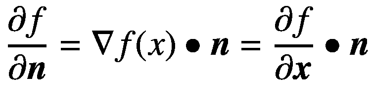

一个例子是，如果铁棒的一端有一个加热器，那么能量将以恒定速率加入，但实际温度是未知的。

第三类边界条件也称为柯西边界条件。它同时指定了域边界上的函数值和法向导数。这相当于同时施加狄利克雷和诺伊曼边界条件。

形式上，第二类和第三类边界条件可以表示如下：

![$$ \left\{\begin{array}{c}{\left[\frac{\partial u}{\partial x}-{\lambda}_1(t)u\right]}_{x=0}={g}_1(t)\\ {}{\left[\frac{\partial u}{\partial x}-{\lambda}_2(t)u\right]}_{x=l}={g}_1(t)\end{array}\right. $$](images/500382_1_En_8_Chapter/500382_1_En_8_Chapter_TeX_Equl.png)

当`λ1(t) = λ2(t) = 0`时，是第二类边界条件。当`λ1(t) ≥ 0`且`λ2(t) ≥ 0`时，是第三类边界条件。

### 8.1.2 双曲型方程

如果满足以下条件，则二阶偏微分方程为双曲型：

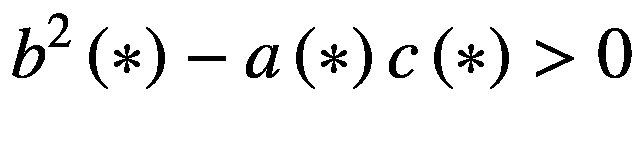

双曲型偏微分方程最简单但最常见的例子是一维波动方程。

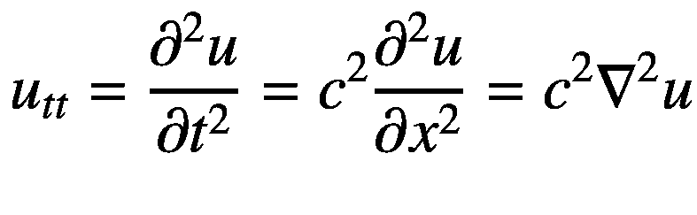

双曲型方程的解是“类波”的。如果在双曲型微分方程的初始数据中产生扰动，并非空间中的每一个点都会立即感受到扰动。相对于固定的时间坐标，扰动具有有限的传播速度。它们沿着方程的特征线传播。这一特征定性地区分了双曲型方程与抛物型和椭圆型偏微分方程。椭圆型或抛物型方程的初始（或边界）数据的扰动会立即被域中几乎所有的点感受到。参见图 8-2。


图 8-2

行波脉冲可以用波动方程建模

波动方程本身并不指定物理解；一个唯一的解通常是通过设置带有进一步条件的问题来获得的，例如规定波的振幅和相位的初始条件。另一类重要问题发生在由边界条件限定的封闭空间中，其解代表驻波或谐波，类似于乐器的谐波。

双曲型方程的初值问题如下：

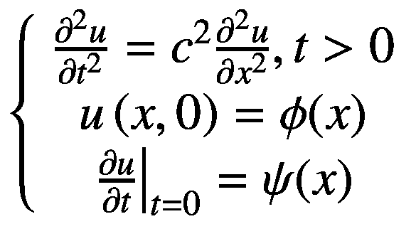

可以证明，该方程具有以下性质：如果`u`及其一阶时间导数在直线`t = 0`上被任意指定为初始数据（具有足够的光滑性），那么对于所有时间`t`都存在一个解。

边值问题如下：


最后一组边界条件是第一类边界条件。

### 8.1.3 椭圆型方程

如果满足以下条件，则二阶偏微分方程为椭圆型：

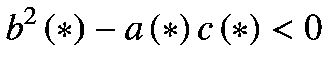

最简单的形式是泊松方程。

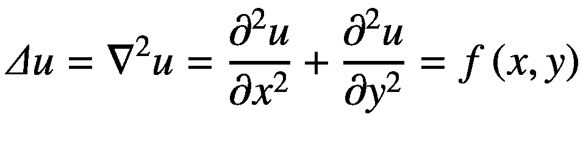

特别地，当`f(x, y) = 0`时，它是拉普拉斯方程，也称为调和方程。

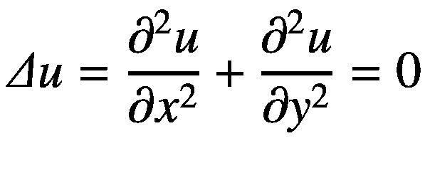

例如，将标量势`ϕ`与吸引质量`ρ`联系起来的重力泊松方程如下：

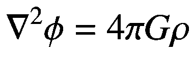

泊松方程的第一类边值问题如下：


`Ω`是解域或区域；`Γ`是`Ω`的边界（或边缘）。`f(x, y)`和`ϕ(x, y)`是`Ω ∪ Γ`上的已知连续函数。`u(x, y)`是我们要求解的函数。

第二类和第三类边界条件可以表示如下：

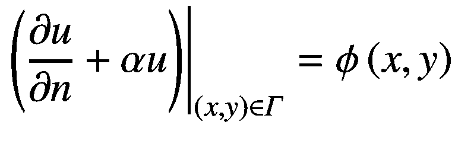

当`α = 0`时，是第二类边界条件。当`α ≠ 0`时，是第三类边界条件。


## 8.2 有限差分法

计算偏微分方程数值解主要有三种数值方法，即有限元法、有限体积法和有限差分法。截至目前，NM Dev 仅支持有限差分法（也称网格法）。

我们在第 6 章和第 7 章中已经介绍了有限差分法的基本概念。其核心思想是相同的，只是在此将其扩展到多变量偏微分方程的更高维度。步骤如下：

1.  在求解域上施加网格。
2.  将独立变量的连续变量域替换为一组有限的离散节点（网格节点）。
3.  定义网格节点处的函数值。
4.  用差商替换网格节点处的导数值。
5.  现在偏微分方程被简化为一个代数方程组（即差分方程组），其中包含有限数量的未知数。
6.  分析收敛性并估计误差。
7.  如果差分方程组有解，并且当网格无限小时，该解收敛于原微分方程的解，那么差分方程组的解就是原问题的近似解（或数值解）。

### 8.2.1 双曲型方程的数值解

考虑以下一维波动方程：

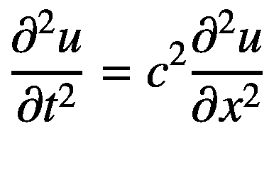

两端边界均固定为 0。即：

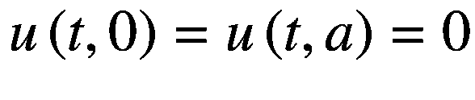

两个初始条件，即*t* = 0 时的*u*及其一阶时间导数*ut*，如下所示：

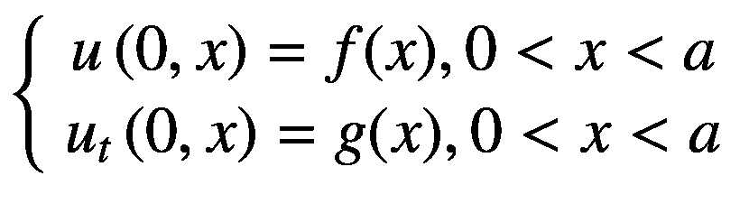

在 NM Dev 中，可以使用 `WaveEquation1D` 类来构造这样的一维波动方程。其签名如下：

```
/**
 * 构造一个一维波动方程。
 *
 * @param c2 方程中的波动系数 c²
 * @param T  关注的时间区间 (0, T)
 * @param a  关注的区域 (0, a)
 * @param f  u 的初始条件，即 u(0, x)
 * @param g  u 的时间导数的初始条件，即 ut(0, x)
 */
public WaveEquation1D(
    double c2,
    double T,
    double a,
    UnivariateRealFunction f,
    UnivariateRealFunction g)
```

由于时间和空间导数都是二阶的，我们使用中心差分来近似它们。设时间步长为 ∆*t*，空间步长为 ∆*x*。记 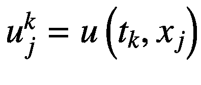 为网格中位置 (*k*, *j*) 处的近似值。差分公式如下：

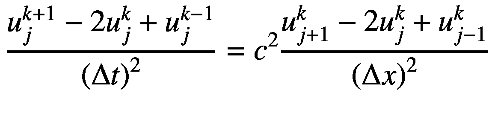

令：

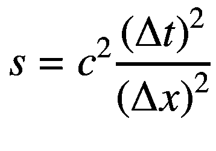

求解  可得到：

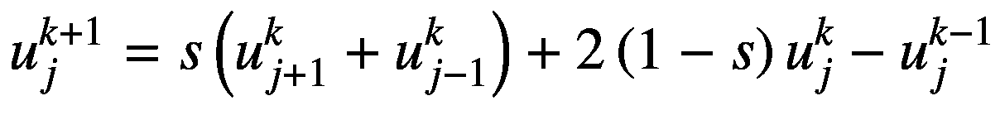

请注意，为了计算每个 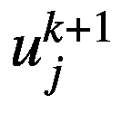，我们使用了前两个时间步的四个节点。因此，这是寻找  数值解的显式格式。

作为一种显式格式，它并非无条件稳定。可以证明，该格式仅在满足以下条件时才稳定：

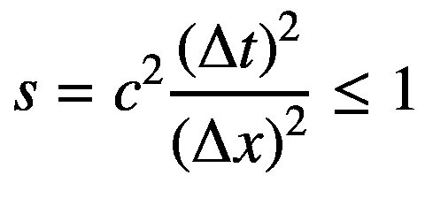

如果我们将 ∆*t*/∆*x* 定义为该格式的传播速度，那么稳定性条件意味着该格式的传播速度必须至少等于*c*，即波的传播速度（精确解）。

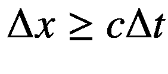

该方法称为中心差分法，是一种二阶方法，截断误差阶数为 *O*((∆*t*)² + (∆*x*)²)。见图 8-3。

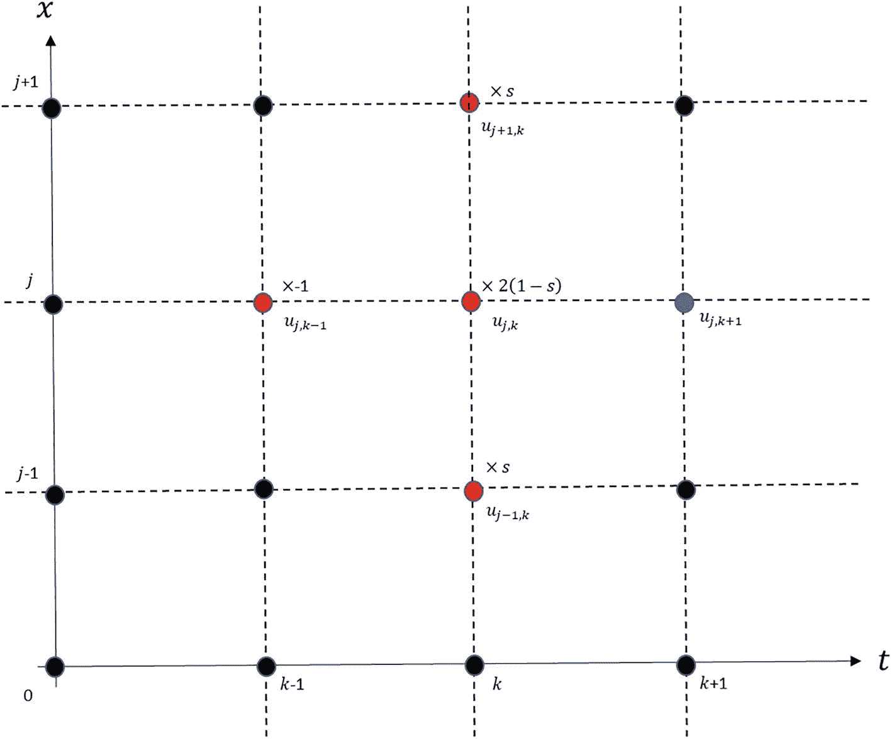

**图 8-3**

求解一维波动方程的显式格式

以下 NM Dev 代码在区域 [0, 1] × [0, 2] 内，且 *c*² = 4 以及给定初始条件的情况下求解了波动方程：

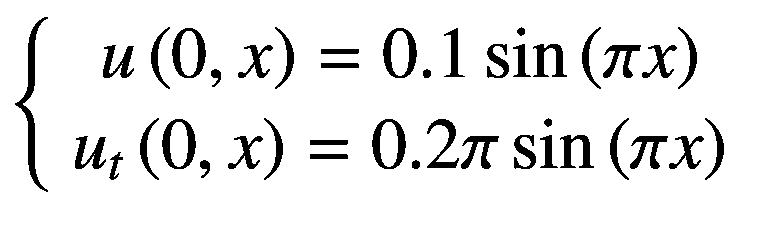


```java
final double c2 = 4.0; // c²
final double T = 1.0; // 时间上限
final double a = 2.0; // x 轴上限
WaveEquation1D pde
= new WaveEquation1D(
c2,
T,
a,
new AbstractUnivariateRealFunction() {
@Override
public double evaluate(double x) {
return 0.1 * sin(PI * x); // 0.1 * sin(π x)
}
},
new AbstractUnivariateRealFunction() {
@Override
public double evaluate(double x) {
return 0.2 * PI * sin(PI * x); // 0.2π * sin(π x)
}
});
int m = 80; // dt = T/m
int n = 39; // dx = a/n
PDESolutionTimeSpaceGrid1D soln = new ExplicitCentralDifference1D().solve(pde, m, n);
int t = 0; // 时间索引
int x = 1; // x 索引
System.out.println(String.format("u(%d,%d) = %f", t, x, soln.u(t, x)));
t = 0;
x = 16;
System.out.println(String.format("u(%d,%d) = %f", t, x, soln.u(t, x)));
t = 0;
x = 31;
System.out.println(String.format("u(%d,%d) = %f", t, x, soln.u(t, x)));
t = 20;
x = 1;
System.out.println(String.format("u(%d,%d) = %f", t, x, soln.u(t, x)));
t = 20;
x = 16;
System.out.println(String.format("u(%d,%d) = %f", t, x, soln.u(t, x)));
t = 20;
x = 31;
System.out.println(String.format("u(%d,%d) = %f", t, x, soln.u(t, x)));
t = 40;
x = 1;
System.out.println(String.format("u(%d,%d) = %f", t, x, soln.u(t, x)));
t = 40;
x = 16;
System.out.println(String.format("u(%d,%d) = %f", t, x, soln.u(t, x)));
t = 40;
x = 31;
System.out.println(String.format("u(%d,%d) = %f", t, x, soln.u(t, x)));
t = 60;
x = 1;
System.out.println(String.format("u(%d,%d) = %f", t, x, soln.u(t, x)));
t = 60;
x = 16;
System.out.println(String.format("u(%d,%d) = %f", t, x, soln.u(t, x)));
t = 60;
x = 31;
System.out.println(String.format("u(%d,%d) = %f", t, x, soln.u(t, x)));
```

输出如下：

```
u(0,1) = 0.015643
u(0,16) = 0.058779
u(0,31) = -0.098769
u(20,1) = 0.015691
u(20,16) = 0.058956
u(20,31) = -0.099066
u(40,1) = -0.015605
u(40,16) = -0.058636
u(40,31) = 0.098529
u(60,1) = -0.015728
u(60,16) = -0.059098
u(60,31) = 0.099305
```

类 `WaveEquation1D` 用于构建一维波动方程的偏微分方程。我们需要指定求解域和初始边界条件。其签名如下：

```java
/**
* 构建一维波动方程。
*
* @param beta 方程中的波动系数 &beta;
* @param T    感兴趣的时间周期 (0, T)
* @param a    感兴趣的区域 (0, a)
* @param f    u 的初始条件，即 u(0, x)
* @param g    u 的时间导数的初始条件，即
*             ut(0,x)
*/
public WaveEquation1D(
double beta,
double T,
double a,
UnivariateRealFunction f,
UnivariateRealFunction g)
```

`ExplicitCentralDifference1D` 是一个偏微分方程求解器，使用中心差分法求解一维波动方程。其签名如下：

```java
/**
* 求解一维波动方程，并指定求解网格的分辨率参数。
*
* @param pde 波动方程问题
* @param m   时间轴上的网格点数量
* @param n   空间轴上的网格点数量
* @return 求解结果网格
*/
public PDESolutionTimeSpaceGrid1D solve(
WaveEquation1D pde,
final int m,
final int n
)
```

求解结果由 `PDESolutionTimeSpaceGrid1D` 对象表示。它适用于将求解结果表示为时间和空间网格的方法。其签名如下：

```java
public interface PDESolutionTimeSpaceGrid1D {
/**
* 获取网格点 (tm, xn) 处的值。
*
* @param m 时间轴上的索引
* @param n 空间轴上的索引
* @return 该点的值
*/
double u(int m, int n);
/**
* 获取索引 {@code k} 处的时间轴值。
*
* @param m 网格点的索引
* @return tm
*/
double t(int m);
/**
* 获取索引 {@code j} 处的空间轴值。
*
* @param n 网格点的索引
* @return xn
*/
double x(int n);
/**
* 获取求解结果中内部时间轴网格点的数量。
*
* @return 沿时间轴的求解网格点数量
*/
int M();
/**
* 获取求解结果中内部空间轴网格点的数量。
*
* @return 沿空间轴的求解网格点数量
*/
int N();
}
```

NM Dev 支持求解最高二维的波动方程。二维波动方程问题定义如下：

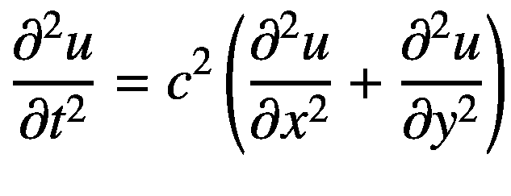

两个边界端点固定为 0，即：

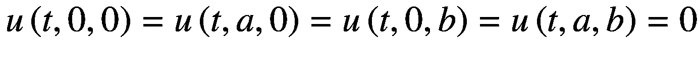

两个初始条件，即 *u* 及其在 *t* = 0 时的一阶时间导数 *u*[*t*] 如下：

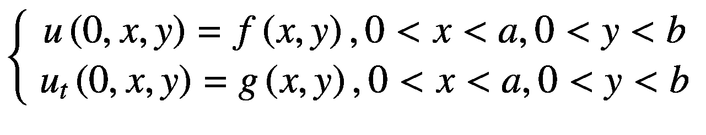

在 NM Dev 中，类 `WaveEquation2D` 可用于构建这样的二维波动方程。其签名如下：

```java
/**
* 构建二维波动方程。
*
* @param c2 方程中的 c²
* @param T  感兴趣的时间周期 (0, T)
* @param a  沿 x 轴的区域大小，x &isin; (0, a)
* @param b  沿 y 轴的区域大小 y &isin; (0, b)
* @param f  u 的初始条件，即 u(0, x, y)
* @param g  u 的时间导数的初始条件，即
*           ut(0,x,y)
*/
public WaveEquation2D(
double c2,
double T,
double a,
double b,
BivariateRealFunction f,
BivariateRealFunction g
)
```

二维中心差分格式如下：

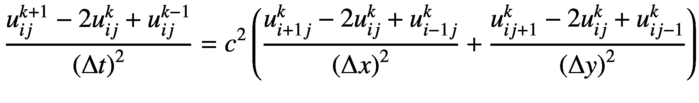

当满足以下条件时，该格式是稳定的：

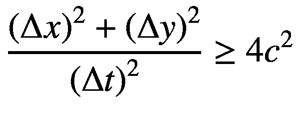

截断误差的阶数为 *O*((Δ*t*)² + (Δ*x*)² + (Δ*y*)²)。

例如，以下 NM Dev 代码在区域 [0, 2] × [0, 2] × [0, 2] 中求解二维波动方程，其中 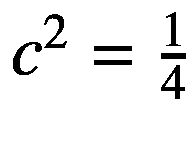 ，并采用以下初始条件：


```
double c2 = 1. / 4; // 波速平方
double T = 2., a = 2., b = 2.; // 解域边界
WaveEquation2D pde = new WaveEquation2D(
c2, T, a, b,
new AbstractBivariateRealFunction() {
@Override
public double evaluate(double x, double y) {
return 0.1 * sin(PI * x) * sin(PI * y / 2.);
}
},
new AbstractBivariateRealFunction() {
@Override
public double evaluate(double x, double y) {
return 0.;
}
});
int m = 40; // dt = T/m
int n = 39; // dx = a/n
int p = 39; // dy = b/p
PDESolutionTimeSpaceGrid2D soln = new ExplicitCentralDifference2D().solve(pde, m, n, p);
int t = 40; // t 索引
int x = 1; // x 索引
int y = 1; // y 索引
System.out.println(String.format("u(%d,%d,%d) = %f", t, x, y, soln.u(t, x, y)));
t = 40; // t 索引
x = 1; // x 索引
y = 16; // y 索引
System.out.println(String.format("u(%d,%d,%d) = %f", t, x, y, soln.u(t, x, y)));
t = 40; // t 索引
x = 1; // x 索引
y = 31; // y 索引
System.out.println(String.format("u(%d,%d,%d) = %f", t, x, y, soln.u(t, x, y)));
t = 40; // t 索引
x = 16; // x 索引
y = 1; // y 索引
System.out.println(String.format("u(%d,%d,%d) = %f", t, x, y, soln.u(t, x, y)));
t = 40; // t 索引
x = 16; // x 索引
y = 16; // y 索引
System.out.println(String.format("u(%d,%d,%d) = %f", t, x, y, soln.u(t, x, y)));
t = 40; // t 索引
x = 16; // x 索引
y = 31; // y 索引
System.out.println(String.format("u(%d,%d,%d) = %f", t, x, y, soln.u(t, x, y)));
t = 40; // t 索引
x = 31; // x 索引
y = 1; // y 索引
System.out.println(String.format("u(%d,%d,%d) = %f", t, x, y, soln.u(t, x, y)));
t = 40; // t 索引
x = 31; // x 索引
y = 16; // y 索引
System.out.println(String.format("u(%d,%d,%d) = %f", t, x, y, soln.u(t, x, y)));
t = 40; // t 索引
x = 31; // x 索引
y = 31; // y 索引
System.out.println(String.format("u(%d,%d,%d) = %f", t, x, y, soln.u(t, x, y)));
```

输出如下：

```
u(40,1,1) = -0.001145
u(40,1,16) = -0.013877
u(40,1,31) = -0.009476
u(40,16,1) = -0.004302
u(40,16,16) = -0.052141
u(40,16,31) = -0.035606
u(40,31,1) = 0.007228
u(40,31,16) = 0.087616
u(40,31,31) = 0.059830
```

`ExplicitCentralDifference2D` 是一个偏微分方程求解器，使用中心差分法求解二维波动方程。其签名如下：

```
/**
* 求解二维波动方程，并指定解网格的分辨率参数。
*
* @param pde 波动方程问题
* @param m   时间轴上的网格点数（不包括初始条件）
* @param n   x 轴上的网格点数（不包括两个边界）
* @param p   y 轴上的网格点数（不包括两个边界）
* @return 解网格
*/
public PDESolutionTimeSpaceGrid2D solve(
WaveEquation2D pde,
final int m,
final int n,
final int p
)
```

解由 `PDESolutionTimeSpaceGrid2D` 对象表示。它适用于产生时间和空间网格解的方法。其签名如下：

```
public interface PDESolutionTimeSpaceGrid2D {
/**
* 获取网格点在 (tk, xi,
* yj) 处的值。
*
* @param k 时间轴索引
* @param i x 轴索引
* @param j y 轴索引
* @return 网格点处的值
*/
double u(int k, int i, int j);
/**
* 获取时间轴索引 {@code k} 处的值。
*
* @param k 网格点索引
* @return tk
*/
double t(int k);
/**
* 获取 x 轴索引 {@code i} 处的值。
*
* @param i 网格点索引
* @return xi
*/
double x(int i);
/**
* 获取 y 轴索引 {@code j} 处的值。
*
* @param j 网格点索引
* @return yj
*/
double y(int j);
/**
* 获取解中时间轴内部网格点的数量。
*
* @return 沿时间轴解网格点的数量
*/
int m();
/**
* 获取解中 x 轴内部网格点的数量。
*
* @return 沿 x 轴解网格点的数量
*/
int n();
/**
* 获取解中 y 轴内部网格点的数量。
*
* @return 沿 y 轴解网格点的数量
*/
int p();
}
```

### 8.2.2 椭圆型方程的数值解

考虑泊松方程第一类边值问题（图 8-4），如下所示：


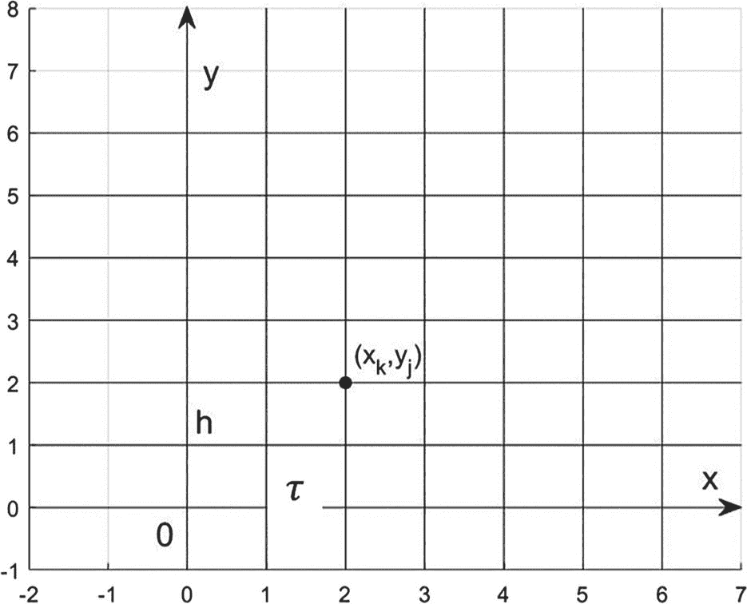

**图 8-4** 二维区域上的网格

以 `h` 和 `τ` 分别表示 `x` 和 `y` 方向的步长。网格内部的节点记为 `{(x[k], y[j]) | x[k] = kh, y[j] = jτ, k, j ∈ Z}`，`(k, j = 0, ±1, ±2, ...)`。解域内部的节点称为内节点，它们属于 `Ω ∪ Γ`。对于每个节点，在 `x` 和 `y` 方向上各有两个仅相距一步的相邻节点，`(k, j = ±1, ±2)`。如果一个节点的四个相邻节点均为内节点，则称该节点为正则内节点。正则内节点的集合记为 `Ω^((1))`。如果有一个相邻节点不是内节点，则称该节点为非正则内节点。非正则内节点的集合记为 `Ω^((2))`。边界 `Γ` 与网格线的交点称为边界节点。偏微分方程的数值解确定了函数 `u` 在所有内节点上的值。

为简化符号，记 `f_j^k = f(x_k, y_j)`。对于正则内节点 `(k, j) ∈ Ω^((1))`，二阶中心差商公式如下：


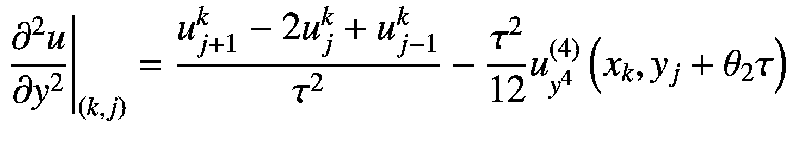

其中 `0 < θ[1], θ[2] < 1`。

泊松方程 `∂²u/∂x² + ∂²u/∂y² = f(x, y)` 在节点 `(k, j)` 处可表示为：

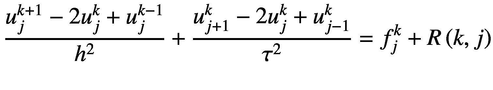

截断误差为：

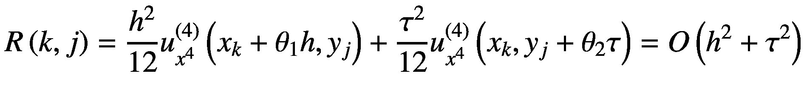

忽略误差项 `R(k, j)` 后，泊松方程的差分方程近似为：

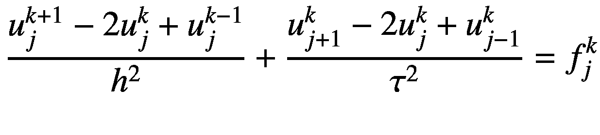


## 8.2.2 边界条件处理

差分方程的数量等于常规内部节点 `u[k, j]` 的数量。每个差分方程不仅包含常规内部节点处解的近似值 `u[k, j]`，还包含非规则内部节点处的近似值。因此，方程的数量少于待求解未知数的数量。非规则内部节点处的近似值由边界条件给出。处理边界条件有多种方案。接下来我们介绍两种较为简单的方法。

### 8.2.2.1 直接转移

将距离非规则内部节点最近的边界节点集合中的 `u` 值作为该节点处 `u[k, j]` 值的近似。我们称之为边界条件的直接转移。

例如，假设节点 `P(k, j)` 是一个非规则内部节点，且最近的边界节点是 `Q` 节点，那么我们有以下公式：


该公式可视为节点的零阶插值。它很简单，截断误差为 `O(h + \tau)`。使用上述替换后，方程的数量等于未知数的数量。现在我们可以求解该线性方程组。

### 8.2.2.2 线性插值

该方案通过线性插值相邻的边界节点 `Q` 和位于同一条网格线上的内部节点 `R`，来逼近非规则内部节点 `P(k, j)` 处的 `u[k, j]` 值。即：


其中 `d = |QR|`，截断误差为 `O(h²)`。使用上述替换后，方程的数量等于未知数的数量。现在我们可以求解该线性方程组。

注意，每个差分方程涉及五个节点：`{u_j^{k+1}, 2u_j^k, u_j^{k-1}, u_{j+1}^k, u_{j-1}^k}`。这被称为网格中节点的五点模板或五点菱形格式。


在实际应用中，我们通常设 `h = \tau`。此时五点菱形格式简化为以下形式：


缩写如下：

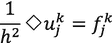

其中 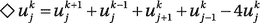。参见图 8-5。

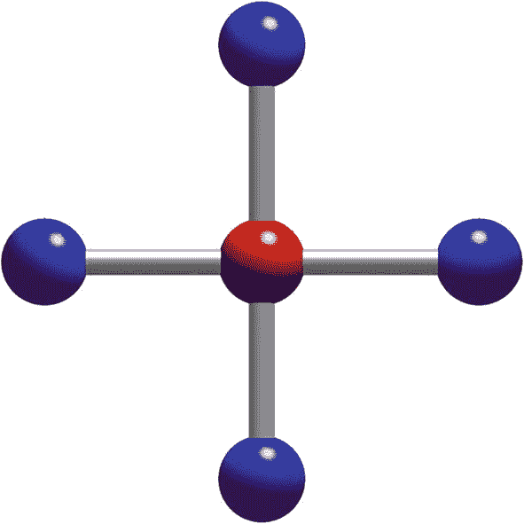

**图 8-5** 网格中节点的五点模板

例如，考虑使用五点菱形格式求解如下拉普拉斯方程的第一类边值问题：

![`\begin{cases} \frac{\partial² u}{\partial x²} + \frac{\partial² u}{\partial y²} = 0 \\ u(x,y)|_{\Gamma} = \log[(1+x)² + y²] \end{cases}`](images/500382_1_En_8_Chapter/500382_1_En_8_Chapter_TeX_Equav.png)


我们取 `h = \tau = \frac{1}{3}`。网格中有四个内部节点（红色），它们都是常规内部节点。根据五点菱形格式，线性方程组如下：


边界值（蓝色）可直接由 `u(x, y)|_{\Gamma}` 计算得出，如下所示：


该线性方程组的解如下（参见图 8-6）：


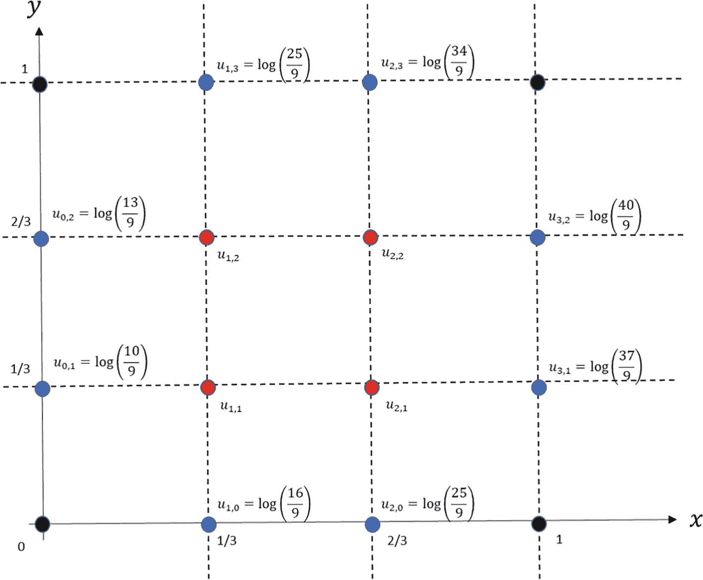

**图 8-6** 拉普拉斯方程的网格与解

以下 NM Dev 代码求解此示例：

```java
BivariateRealFunction ZERO // a constant zero function, f = 0
= new AbstractBivariateRealFunction() {
@Override
public double evaluate(double x, double y) {
return 0;
}
@Override
public Double evaluate(Vector x) {
return 0.;
}
};
// the boundary conditions
BivariateRealFunction g = new AbstractBivariateRealFunction() {
@Override
public double evaluate(double x, double y) {
return log((1\. + x) * (1\. + x) + y * y);
}
};
double a = 1.; // width of the x-dimension
double b = 1.; // height of the y-dimension
PoissonEquation2D pde = new PoissonEquation2D(a, b, ZERO, g);
IterativeCentralDifference solver = new IterativeCentralDifference(
1e-8, // precision
100); // max number of iterations
PDESolutionGrid2D soln = solver.solve(pde, 2, 2);
int k = 1, j = 1; // node indices
double u_11 = soln.u(k, j); // x = 0.3, y = 0.3
System.out.println(String.format("u_%d,%d = u(%f,%f): %f", k, j, soln.x(k), soln.y(j), u_11));
k = 1;
j = 2;
double u_12 = soln.u(k, j); // x = 0.3, y = 0.6
System.out.println(String.format("u_%d,%d = u(%f,%f): %f", k, j, soln.x(k), soln.y(j), u_12));
k = 2;
j = 1;
double u_21 = soln.u(k, j); // x = 0.6, y = 0.3
System.out.println(String.format("u_%d,%d = u(%f,%f): %f", k, j, soln.x(k), soln.y(j), u_21));
k = 2;
j = 2;
double u_22 = soln.u(k, j); // x = 0.6, y = 0.6
System.out.println(String.format("u_%d,%d = u(%f,%f): %f", k, j, soln.x(k), soln.y(j), u_22));
```

输出如下：

```
u_1,1 = u(0.333333,0.333333): 0.634804
u_1,2 = u(0.333333,0.666667): 0.798500
u_2,1 = u(0.666667,0.333333): 1.059992
u_2,2 = u(0.666667,0.666667): 1.169821
```

要建立一个泊松偏微分方程问题，首先需要创建一个 `PoissonEquation2D` 对象。其签名如下：

```java
/**
* 构造一个泊松方程问题。
*
* @param a 感兴趣的区域 [0, a]
* @param b 感兴趣的区域 [0, b]
* @param f 方程中的强制项 f(x, y)
* @param g 狄利克雷边界条件 g(x, y)
*/
public PoissonEquation2D(
double a,
double b,
BivariateRealFunction f,
BivariateRealFunction g)
```

`f` 是泊松方程右侧的项。当 *f* = 0 时，它变为拉普拉斯方程。`g` 指定偏微分方程问题的第一类边界条件。`PoissonEquation2D` 类的求解域为 [0, *a*] × [0, *b*]。若要求解其他域范围，用户需要在编写代码前进行变换。

`IterativeCentralDifference` 是一个偏微分方程求解器，使用中心差分公式来求解泊松方程问题。签名如下：

```java
/**
* 以给定精度作为收敛准则，以及允许的最大迭代次数，构造此方法的一个实例。
* 当连续迭代之间的差异在给定精度范围内时，迭代停止。
*
* @param precision     收敛阈值
* @param maxIterations 允许的最大迭代次数
*/
public IterativeCentralDifference(
double precision,
int maxIterations
) {
/**
* 求解泊松方程问题，并指定网格的给定分辨率参数。
*
* 当迭代无法在最大允许迭代次数内收敛到指定误差界时，会抛出
* {@link UnsatisfiableErrorCriterionException}。
*
* @param pde 泊松方程
* @param m   网格沿 x 轴的内部点数
* @param n   网格沿 y 轴的内部点数
* @return 解网格
*/
public PDESolutionGrid2D solve(
final PoissonEquation2D pde,
final int m,
final int n
)
```

在 NM Dev 中，使用有限差分法求解二维偏微分方程问题会生成一个 `PDESolutionGrid2D` 对象。它包含关于网格、节点以及每个节点处近似值的所有信息。签名如下：

```java
/**
* 双变量偏微分方程的解，适用于将解生成为二维网格的方法。
* 索引范围分别为 0 到 (m+1) 以及 0 到 (n+1)。
*
*/
public interface PDESolutionGrid2D {
/**
* 获取网格点 (xk, yj) 处的值。
*
* @param k 沿 x 轴的索引
* @param j 沿 y 轴的索引
* @return 该点的值
*/
double u(int k, int j);
/**
* 获取索引 {@code k} 处沿 x 轴的值。
*
* @param k 网格点的索引
* @return xk
*/
double x(int k);
/**
* 获取索引 {@code j} 处沿 y 轴的值。
*
* @param j 网格点的索引
* @return yj
*/
double y(int j);
/**
* 获取解中沿 x 轴的内部网格点数。
*
* @return 沿 x 轴的解网格点数
*/
int m();
/**
* 获取解中沿 y 轴的内部网格点数。
*
* @return 沿 y 轴的解网格点数
*/
int n();
}
```

请注意，函数 `double u(int k, int j)` 接收节点索引作为输入，而非域值。`PDESolutionGrid2D` 仅包含网格节点处的信息。如果需要获取非网格节点位置的函数近似值，则需要进行一些插值。

作为另一个示例，以下 NM Dev 代码求解了在 0 ≤ *x* ≤ 0.5、0 ≤ *y* ≤ 0.5 范围内，具有初始边界条件的拉普拉斯方程：

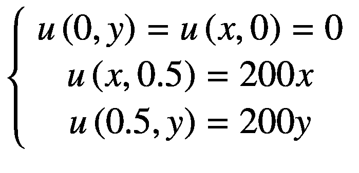

```java
BivariateRealFunction ZERO // a constant zero function, f = 0
= new AbstractBivariateRealFunction() {
@Override
public double evaluate(double x, double y) {
return 0;
}
@Override
public Double evaluate(Vector x) {
return 0.;
}
};
// the boundary conditions
final double EPSION = 1e-8;
BivariateRealFunction g = new AbstractBivariateRealFunction() {
@Override
public double evaluate(double x, double y) {
if (DoubleUtils.isZero(x, EPSION) || DoubleUtils.isZero(y, EPSION)) {
return 0;
} else if (DoubleUtils.equal(x, 0.5, EPSION)) {
return 200\. * y;
} else if (DoubleUtils.equal(y, 0.5, EPSION)) {
return 200\. * x;
}
// not reachable; don't matter
return Double.NaN;
}
};
double a = 0.5; // width of the x-dimension
double b = 0.5; // height of the y-dimension
PoissonEquation2D pde = new PoissonEquation2D(a, b, ZERO, g);
IterativeCentralDifference solver = new IterativeCentralDifference(
EPSION, // precision
40); // max number of iterations
PDESolutionGrid2D soln = solver.solve(pde, 4, 4);
int k = 1, j = 1; // node indices
double u_11 = soln.u(k, j);
System.out.println(String.format("u_%d,%d = u(%f,%f): %f", k, j, soln.x(k), soln.y(j), u_11));
k = 1;
j = 2;
double u_12 = soln.u(k, j);
System.out.println(String.format("u_%d,%d = u(%f,%f): %f", k, j, soln.x(k), soln.y(j), u_12));
k = 2;
j = 1;
double u_21 = soln.u(k, j);
System.out.println(String.format("u_%d,%d = u(%f,%f): %f", k, j, soln.x(k), soln.y(j), u_21));
k = 2;
j = 2;
double u_22 = soln.u(k, j);
System.out.println(String.format("u_%d,%d = u(%f,%f): %f", k, j, soln.x(k), soln.y(j), u_22));
k = 3;
j = 3;
double u_33 = soln.u(k, j);
System.out.println(String.format("u_%d,%d = u(%f,%f): %f", k, j, soln.x(k), soln.y(j), u_33));
k = 4;
j = 4;
double u_44 = soln.u(k, j);
System.out.println(String.format("u_%d,%d = u(%f,%f): %f", k, j, soln.x(k), soln.y(j), u_44));
k = 5;
j = 5;
double u_55 = soln.u(k, j);
System.out.println(String.format("u_%d,%d = u(%f,%f): %f", k, j, soln.x(k), soln.y(j), u_55));
```

输出如下（参见图 8-7）：


