# 6. 数值微分与积分

数值微分与积分是一种技术，适用于以下情况：我们事先不知道函数的具体形式、将函数视为黑箱、或者无法对该函数进行解析（或符号、闭式）的微分与积分。该技术通过许多线性函数来逼近原函数，每个线性函数作用于函数定义域的一个极小区间上。事实上，函数的分段线性逼近正是微积分的基础。当区间足够小，或者当我们对函数进行足够程度的放大时，函数在每个区间内看起来都像是一条直线（这就实现了微分）。当我们将这些“直线”组合起来，并累加其下方的区块面积（通常是矩形或梯形）时，就实现了积分。当我们将区间长度推向无穷小时，这一概念便达到了极限。然而，在计算机上，我们无法让长度任意小。我们满足于足够好的近似或足够小的区间，于是便有了数值微分与积分。

在图 6-1 中，箭头代表了该函数在每个区间内的线性近似。它们看起来足够接近，能够表示函数在这些区间内的斜率或导数。每个箭头下方的区块面积也可以轻松计算（本质上是一个梯形）。我们可以将它们求和，从而得到函数的（定）积分。我们划分的子区间越多，数值导数和数值积分的精度就越高。

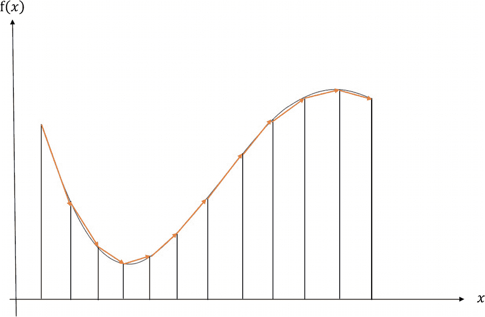

图 6-1 数值微分与积分示例

## 6.1 数值微分

数值微分是一种在数值上估计函数在某点导数的方法。通常，使用差商来近似导数。构造这种差商的方法有很多种。泰勒展开可用于量化每种近似方法的误差项。此外，还可以使用外推法来提高精度，将差商外推至分母无穷小的情形。我们还将介绍一些在优化理论等数学分支中常用的重要导数，即梯度向量、雅可比矩阵和海森矩阵。NM Dev 实现了某些特殊函数的一阶导数。由于精度问题，这些函数的导数无法使用通用方法进行数值计算。它们通常被写成无穷级数或连分数的和。鉴于这些特殊函数的重要性和基础性，我们需要为它们提供专门的实现。

## 6.2 有限差分

有限差分是计算数值导数最流行的方法（可能没有之一）。它是数值求解许多常微分方程和偏微分方程的基础。该方法将连续的函数定义域离散化为有限数量的节点，从而形成一个网格。对于一维问题（即计算单变量函数的导数），它会沿 x 轴选取一组点。对于二维问题（即计算二元函数的偏导数），它会在平面上构建一个节点网格或网格结构。参见图 6-2。

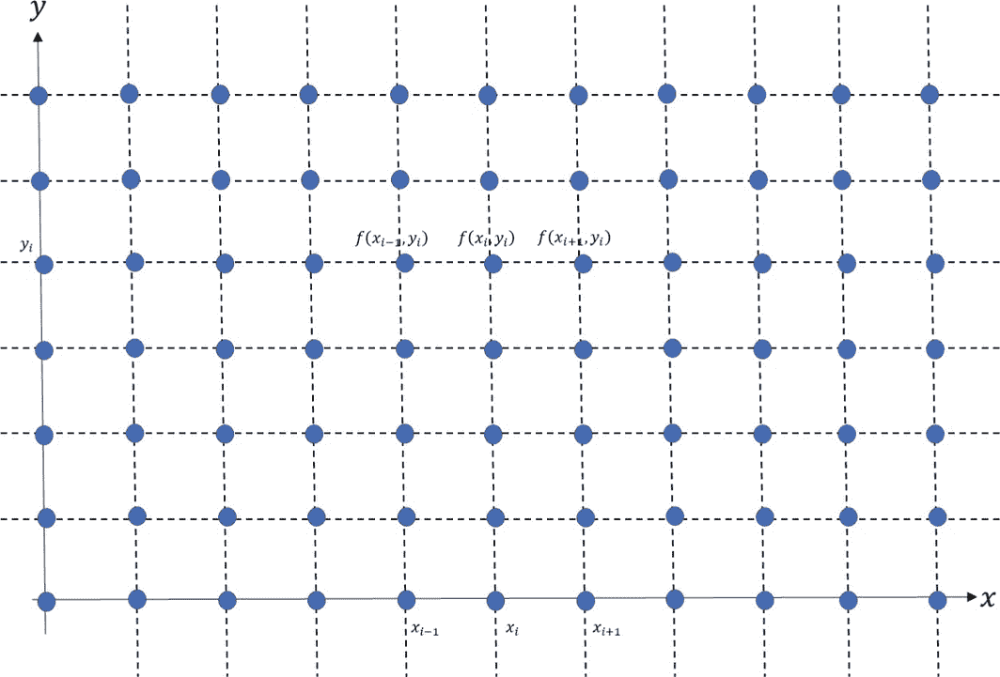

图 6-2 为二维函数定义域选取的等距节点网格

在已知网格点上所有函数值的情况下，泰勒展开可以给出我们想要计算的导数的表达式，该表达式通常形式为一个代数方程（如在显式方法中）或一个代数方程组（如在克兰克-尼科尔森法这类隐式方法中），并附带一个误差项。有限差分是一种近似的数值解法，它将一个微分问题转化为代数问题。其数学概念直观，表达形式简单。

使用泰勒展开构造有限差分的方法有很多种。基础知识包括一阶前向差分、一阶后向差分、一阶中心差分、二阶中心差分等。还有将数字直接代入就能得到结果的显式方法，以及需要求解代数方程组才能得到结果的隐式方法。不同有限差分方法的误差可以是网格规模的一阶、二阶或更高阶。

单变量函数的一阶导数是最简单、最容易解释的。它代表了函数在某一点处的斜率。两点之间的斜率是比值 `(Δf) / (Δx)`，即这两点之间函数值的变化 `Δf` 除以这两点之间的差 `Δx`。连接这两点的直线被称为该函数在这两点之间的割线（图 6-3 中的红线）。当其中一个点向另一点移动时，割线也随之移动。当一个点完全移动到与另一点重合时（即两点变为同一点），割线就变成了函数在该点的切线（图 6-3 中的黑线）。该切线的斜率被定义为函数在切点处的斜率，因此也就是函数在该点的一阶导数。换句话说，当步长 `Δx` 趋向于无穷小时，一阶导数就是这个差商。当 `Δx` 足够小时，该差商就是一阶导数 `(df) / (dx)` 的良好近似。根据我们如何选择这两个点，可以得到不同的有限差分。

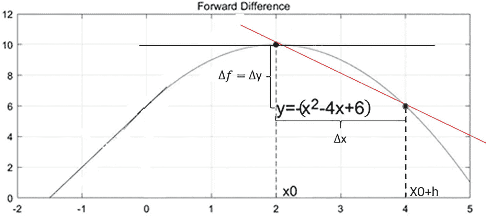

图 6-3 前向差分

### 6.2.1 前向差分

假设我们要计算函数 `f` 在 `x[0]` 处的导数。考虑 (`x[0]`, `f(x[0])`) 与 (`x[0] + h`, `f(x[0] + h)`) 之间的线性插值。这两点间割线的斜率通过前向（两点）差分来逼近导数。

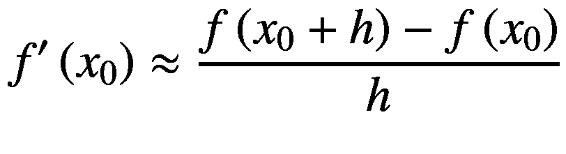

我们可以通过泰勒展开来证明这一点，如下所示：

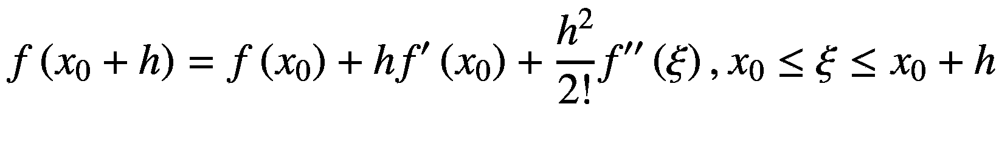

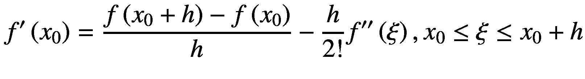

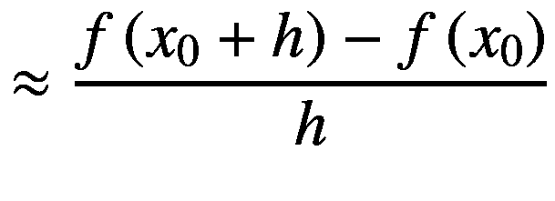

误差项如下：

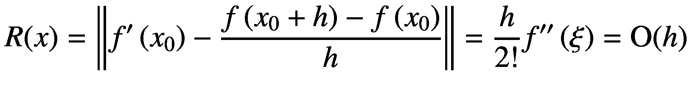

此处的大 O 符号表示误差项始终小于（有界于）一个常数乘以`h`，称为“`h` 的大 O”。换句话说，误差趋于零的速度比常数乘以`h`更快。`h` 越小，误差越小。两者都以线性速率趋于零。该误差项为一阶。在求解常微分方程时，使用单步预测-校正法时，前向差分非常有用。

### 6.2.2 后向差分

考虑 (`x[0] - h`, `f(x[0] - h)`) 与 (`x[0]`, `f(x[0])`) 之间的另一种线性插值。这两点间割线的斜率逼近导数，并由后向（两点）差分给出。见图 6-4。

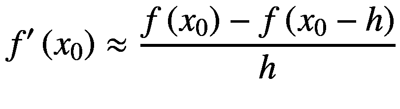

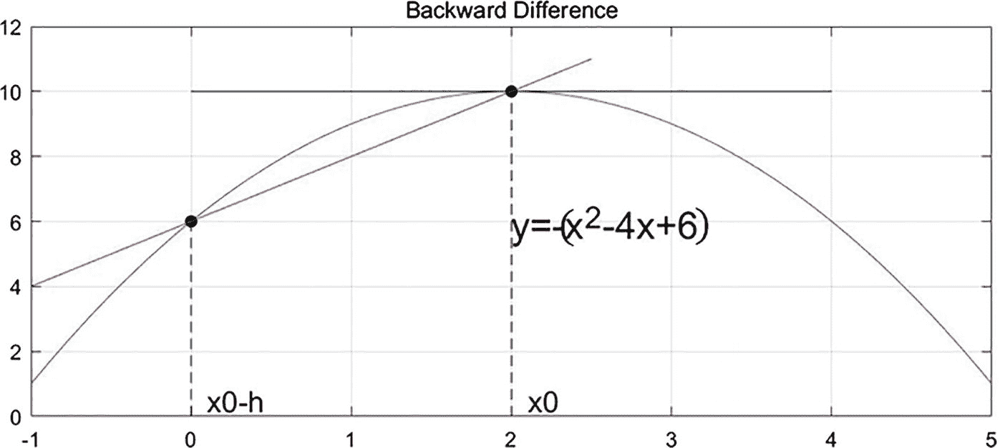

图 6-4 后向差分

根据泰勒展开，我们得到：

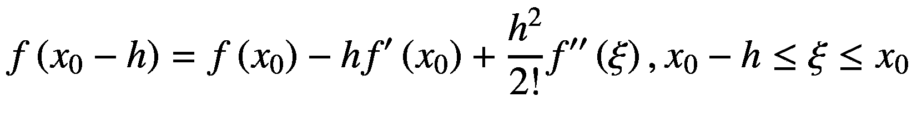

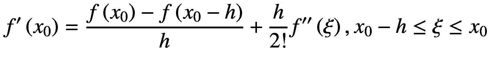

误差项与前向差分的相同。

# 第6章 有限差分法

## 6.2 有限差分

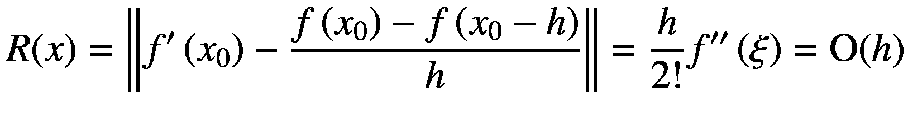

当未来的数据尚不可用时，后向差分非常有用。在某些控制问题中，未来的数据可能取决于根据过去数据估计出的导数。

### 6.2.3 中心差分

考虑 (`x[0] - h`, `f(x[0] - h)`) 与 (`x[0] + h`, `f(x[0] + h)`) 之间的另一种线性插值。这两点间割线的斜率通过中心（三点）差分来逼近导数。

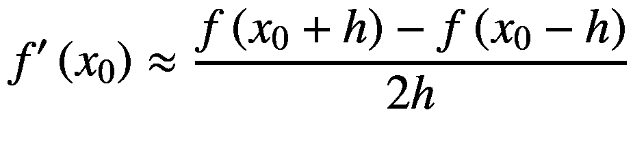

见图 6-5。

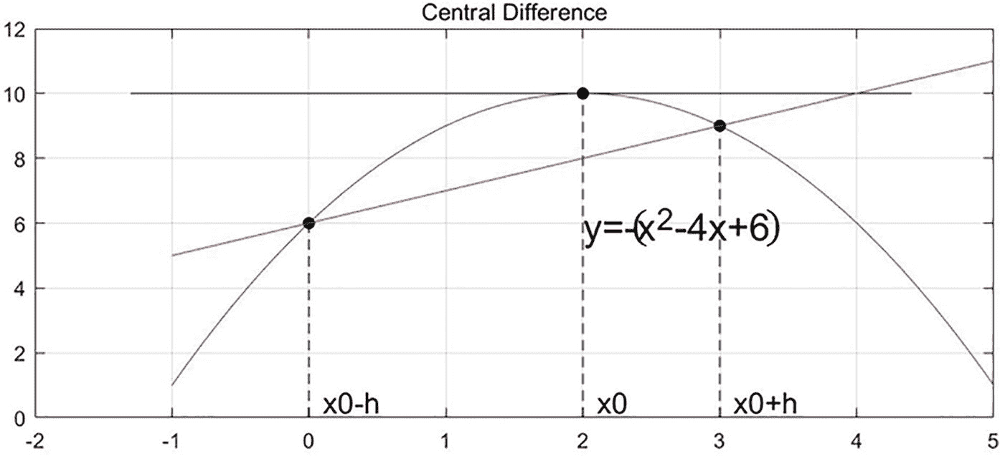

图 6-5 中心差分

根据泰勒展开，我们得到：

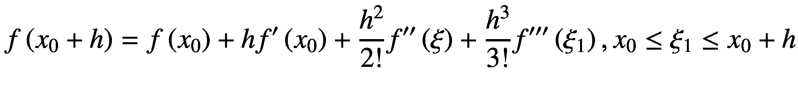

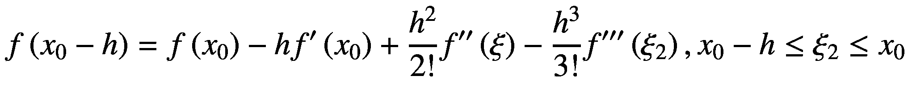

将这两个方程相减，我们得到：

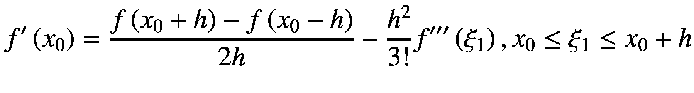

误差项如下：

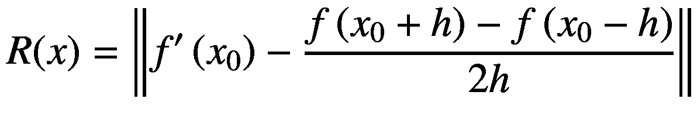

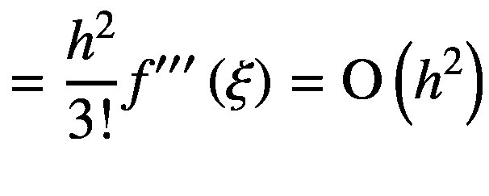

中心差分的误差为`h²`的大 O。这意味着误差以二次方速率趋于零，比线性速率更快。该误差项比前向差分和后向差分都要小。中心差分比前向差分和后向差分更精确，因此，如果过去和未来的数据值都可获取，中心差分是更优的选择。

对于之前的例子，我们想要计算以下函数在 `x = 2` 处的一阶导数：

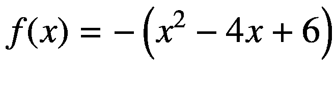

前向差分给出负结果，因为割线向下倾斜；后向差分给出正结果，因为割线向上倾斜；而中心差分给出 `df/dx = 0`，这是正确答案。

如果数据值等间距分布，则中心差分是前向差分和后向差分的平均值。中心差分常用于求解偏微分方程。

### 6.2.4 高阶导数

如果函数 `f(x)` 的一阶导函数 `f'(x)` 也是可微的，那么 `f'(x)` 的导数被称为函数 `f(x)` 的二阶导数。即：

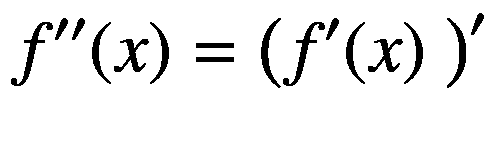

以此类推，如果 `f(x)` 的 (`n-1`) 阶导数存在且可微，则 `n` 阶导数定义如下：

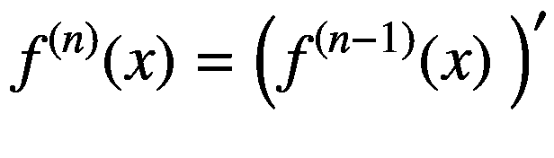

如果一个函数 `f` 是连续的，我们称 `f ∈ C⁰`。如果 `f'` 存在且连续，我们称 `f` 是一个光滑函数，并且 `f ∈ C¹`。如果 `f` 可以无限次微分（因此也必然是连续的），我们称 `f ∈ C^∞`。`f(x) = e^(x)` 属于 `C^∞`。

接下来，我们列举一些用于高阶导数的有限差分公式。

二阶导数前向差分：


二阶导数后向差分：

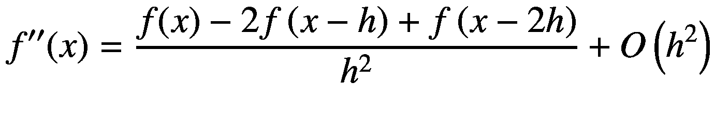

二阶导数中心差分：

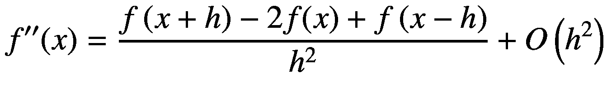

三阶导数前向差分：

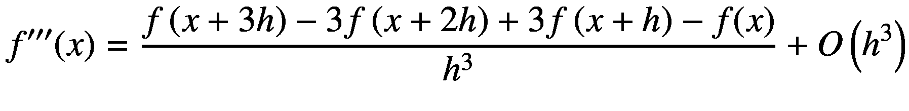

三阶导数后向差分：

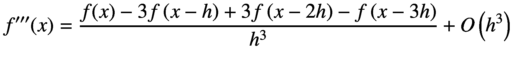

三阶导数中心差分：

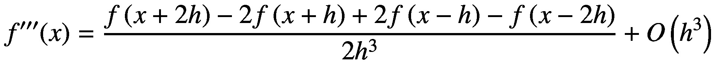

总的来说，我们有如下公式。

`n` 阶导数前向差分：

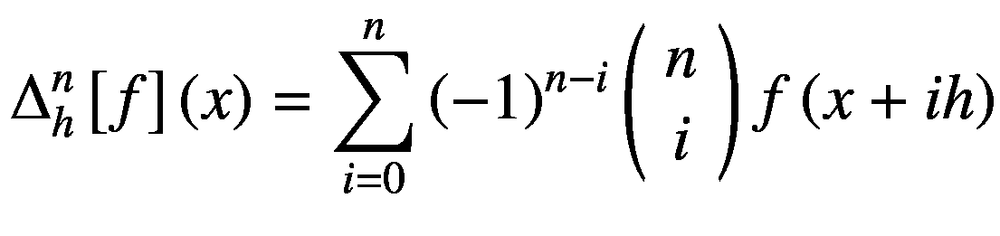

`n` 阶导数后向差分：

有限差分法

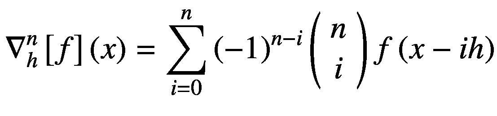

`n`阶导数中心差分：

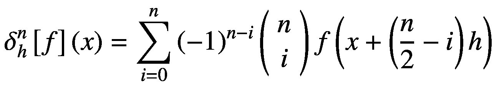

其中 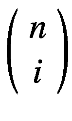 是二项式系数。杨辉三角的每一行提供了每个 `i` 值对应的系数。

到目前为止我们提供的公式，二阶导数使用了两个点，三阶导数使用了三个点。也存在一些公式，二阶导数使用三个点，三阶导数使用四个点。一般来说，利用线性代数，可以针对任意阶导数，构造使用任意数量左侧点和（可能不同数量）右侧点的有限差分近似。这涉及求解一个线性系统，使得这些点在评估点处的泰勒展开式之和，能够最佳逼近所需导数的泰勒展开式。这在网格上对函数求微分时非常有用，因为当接近网格边缘时，只能在一侧采样越来越少的点。

在 NM Dev 中，`FiniteDifference` 类用于计算给定函数指定阶数的导函数。以下使用 NM Dev 的代码片段计算了前述示例的一阶导数：

```
final UnivariateRealFunction f = new AbstractUnivariateRealFunction() {
@Override
public double evaluate(double x) {
return -(x * x - 4 * x + 6); // -(x² - 4x + 6)
}
};
double x = 2.;
System.out.println("differentiate univariate functions");
UnivariateRealFunction df1_forward
= new FiniteDifference(f, 1, FiniteDifference.Type.FORWARD);
double dfdx = df1_forward.evaluate(x); // evaluate at x
System.out.println(String.format("df/dx(x=%f) = %.16f using forward difference", x, dfdx));
UnivariateRealFunction df1_backward
= new FiniteDifference(f, 1, FiniteDifference.Type.BACKWARD);
dfdx = df1_backward.evaluate(x); // evaluate at x
System.out.println(String.format("df/dx(x=%f) = %.16f using backward difference", x, dfdx));
UnivariateRealFunction df1_central
= new FiniteDifference(f, 1, FiniteDifference.Type.CENTRAL);
dfdx = df1_central.evaluate(x); // evaluate at x
System.out.println(String.format("df/dx(x=%f) = %.16f using central difference", x, dfdx));
```

解析地看，一阶导函数如下：

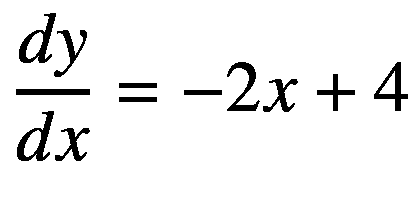

输出结果如下：

```
df/dx(x=2.000000) = -0.0000000298023224 using forward difference
df/dx(x=2.000000) = 0.0000000298023224 using backward difference
df/dx(x=2.000000) = 0.0000000000000000 using central difference
```

注意前向差分结果略微为负，因为割线是向下倾斜的；后向差分结果略微为正，因为割线是向下倾斜的。中心差分给出了正确答案，即 0。

解析地看，二阶导函数如下：

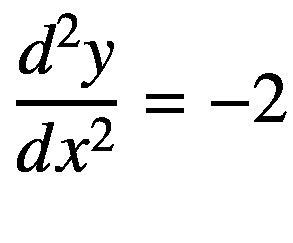

以下代码片段计算了二阶导数：

```
final UnivariateRealFunction f = new AbstractUnivariateRealFunction() {
@Override
public double evaluate(double x) {
return -(x * x - 4 * x + 6); // -(x² - 4x + 6)
}
};
double x = 2.;
System.out.println("differentiate univariate functions");
UnivariateRealFunction df1_forward
= new FiniteDifference(f, 2, FiniteDifference.Type.FORWARD);
double dfdx = df1_forward.evaluate(x); // evaluate at x
System.out.println(String.format("d2f/dx2(x=%f) = %.16f using forward difference", x, dfdx));
UnivariateRealFunction df1_backward
= new FiniteDifference(f, 2, FiniteDifference.Type.BACKWARD);
dfdx = df1_backward.evaluate(x); // evaluate at x
System.out.println(String.format("d2f/dx2(x=%f) = %.16f using backward difference", x, dfdx));
UnivariateRealFunction df1_central
= new FiniteDifference(f, 2, FiniteDifference.Type.CENTRAL);
dfdx = df1_central.evaluate(x); // evaluate at x
System.out.println(String.format("d2f/d2x(x=%f) = %.16f using central difference", x, dfdx));
```

输出结果如下：

```
d2f/dx2(x=2.000000) = -2.0000015520433827 使用前向差分
d2f/dx2(x=2.000000) = -1.9999985243161564 使用后向差分
d2f/d2x(x=2.000000) = -1.9999985243161564 使用中心差分
```

`FiniteDifference` 数值计算给定函数的指定阶导函数。它本身是一个函数，可用于计算任意指定点的导数值。`FiniteDifference` 的签名如下：

```
/**
* 为函数 f 构造一个使用有限差分的近似导函数。
*
* @param f     一个单变量函数
* @param order 导数的阶数
* @param type  所使用的有限差分类型，详见 {@link Type}
*/
public FiniteDifference(UnivariateRealFunction f, int order, Type type)
@Override
public double evaluate(double x)
/**
* 在点 x 处以步长 h 数值计算 f 的导数 f'(x)。
* 自动确定步长 h 可能具有挑战性，特别是在 |x| 接近 0 的情况下。
* 例如，可能需要涉及 f' 和 f'' 的分析。
* 用户可能希望通过调用此函数来尝试不同的 h 值。
*
* @param x 计算 f 导数的点
* @param h 步长
* @return f'(x)，函数 f 在点 x 处、步长为 h 的数值导数
*/
public double evaluate(double x, double h)
```

支持的差分类型如下：

- `FiniteDifference.FORWARD`
- `FiniteDifference.BACKWARD`
- `FiniteDifference.CENTRAL`

在计算机上使用浮点运算计算导函数时，实践中一个重要的考虑因素是步长 `h` 的选择。如果 `h` 过小，减法运算会产生较大的舍入误差。在计算机上，只有有限数量的实数是可以表示的。两个非常接近但不同的实数可能会被表示成相同的有限二进制浮点数。因此，所有有限差分公式都是病态的，如果 `h` 足够小，由于相消，计算结果会为零。另一方面，如果 `h` 过大，割线和切线不匹配，近似结果将出现偏差。对于基本的中心差分，最优步长是机器精度 `ε` 的立方根。对于在 `x` 和 `x + h` 处求值的数值导数公式，一个既能保持较小又不产生大舍入误差的 `h` 选择是 `√(ε)x, x ≠ 0`。双精度下，机器精度 `ε` 通常为 `1e-16` 量级。如果你调用第一个 `evaluate` 函数，NM Dev 会为你自动选择 `h`。或者，如果你调用第二个 `evaluate` 函数，你可以自己实现 `h` 的选择逻辑。

一般来说，对于有限差分，计算导数时使用的点数越多，结果越精确。同时，导数的阶数越高，结果越不精确。例如，从之前的代码示例可以看出，近似二阶导数比近似一阶导数精度要低。

### 6.3 多元有限差分

多元函数的偏导数是指函数对其中一个变量求导，同时保持其他变量为常数。例如，二元函数关于 `x` 的偏导数写作：
`D_x f = f_x(x, y) = ∂f(x,y)/∂x`

与第 6.2 节中处理单变量函数类似，我们可以使用有限差分数值计算偏导数，区别在于我们是在平面或更高维的域上施加网格，而不是在一条轴上。

关于 `x` 的二阶偏导数可以写作：
`D_xx f = f_xx(x, y) = ∂²f(x,y)/∂x²`

二阶混合偏导数是指先对一个变量求导，再对另一个变量求导。例如，先对 `x` 再对 `y` 求二阶混合偏导数可以写作：
`D_xy f = f_xy(x, y) = ∂/∂y(∂f(x,y)/∂x)`

更高阶的偏导数和混合偏导数形式如下：
`∂^(i+j+k)f / (∂x^i ∂y^j ∂z^k) = ∂_x^i ∂_y^j ∂_z^k f`

NM Dev 通过对函数递归应用一阶中心有限差分来数值计算这些导数。该类为 `MultivariateFiniteDifference`，其签名如下：

```java
/**
* 构造一个多变量函数的偏导数。
* 例如，
* varidx = new int[]{1, 2} 表示
* [
* f_{x_1,x_2} = {\partial² \over \partial x_2 \partial x_1} = {\partial
* \over \partial x_2}({\partial \over \partial x_1})
* ]
*
* @param f      要求导的实值多元函数
* @param varidx 求导的变量索引，从 1 开始计数，直至 f 的域维度
*/
public MultivariateFiniteDifference(RealScalarFunction f, int[] varidx)
```

参数 `varidx` 接收变量的索引，该类会按照该顺序对函数关于这些变量进行求导。

以下是一个示例：
`z = f(x, y) = x² + xy + y²`
该函数的图像在欧几里得空间中定义了一个曲面。曲面上每一点都存在无数条切线。偏微分就是选择其中一条切线并找出其斜率的过程。通常，最受关注的切线是那些平行于 `xz` 平面（保持 `y` 为常数）和平行于 `yz` 平面（保持 `x` 为常数）的切线。见图 6-6。

[图 6-6: z = x² + xy + y² 的图像]

为了在点 `(1, 1)` 处找到与函数图像相切且平行于 `xz` 平面的直线的斜率，我们将 `y` 视为常数。在假设 `y` 为常数的情况下，对方程求导，我们发现 `f` 在点 `(x, y)` 处的斜率如下：
`∂z/∂x = 2x + y`

见图 6-7。

[图 6-7]

好的，作为高级文档工程师和翻译员，我已经理解了您的所有要求。以下是精确遵循您规定的格式和注意事项的翻译结果。

上一张图的一个切片，显示了函数在 `y = 1` 时的 `xz` 平面。请注意，此处的两个坐标轴使用了不同的比例尺。切线的斜率为 `3`。

它在点 `(1, 1)` 处的计算结果为 `3`。以下代码片段解决了这个问题：

```java
// f = x² + xy + y²
RealScalarFunction f = new AbstractBivariateRealFunction() {
    @Override
    public double evaluate(double x, double y) {
        return x * x + x * y + y * y;
    }
};
// df/dx = 2x + y
MultivariateFiniteDifference dx
    = new MultivariateFiniteDifference(f, new int[]{1});
System.out.println(String.format("Dxy(1.,1.) %f", dx.evaluate(new DenseVector(1., 1.))));
```

输出结果如下：

```
Dxy(1.,1.) 3.000000
```

对于求多元函数导数的另一个例子，请考虑以下内容：
$$ f\left(x,y,z\right)= xy+2 xyz $$

以下代码片段计算了这两个混合偏导数：
$$ {D}_{xy}f=1+2z $$
$$ {D}_{yx}f=1+2z $$

```java
// f = xy + 2xyz
RealScalarFunction f = new RealScalarFunction() {
    @Override
    public Double evaluate(Vector v) {
        return v.get(1) * v.get(2) + 2 * v.get(1) * v.get(2) * v.get(3);
    }
    @Override
    public int dimensionOfDomain() {
        return 3;
    }
    @Override
    public int dimensionOfRange() {
        return 1;
    }
};
MultivariateFiniteDifference dxy // 1 + 2z
// differentiate the first variable and then the second one
    = new MultivariateFiniteDifference(f, new int[]{1, 2});
System.out.println(String.format("Dxy(1.,1.,1.) %f", dxy.evaluate(new DenseVector(1., 1., 1.))));
System.out.println(String.format("Dxy(-100.,0.,-1.5) %f", dxy.evaluate(new DenseVector(-100., 0., -1.5))));
//continuous function allows switching the order of differentiation by Clairaut's theorem
MultivariateFiniteDifference dyx // 1 + 2z
// differentiate the second variable and then the first one
    = new MultivariateFiniteDifference(f, new int[]{2, 1});
System.out.println(String.format("Dyx(1.,1.,1.) %f", dyx.evaluate(new DenseVector(1., 1., 1.))));
System.out.println(String.format("Dyx(-100.,0.,-1.5) %f", dyx.evaluate(new DenseVector(-100., 0., -1.5))));
```

输出结果如下：

```
Dxy(1.,1.,1.) 3.000001
Dxy(-100.,0.,-1.5) -2.000000
Dyx(1.,1.,1.) 3.000001
Dyx(-100.,0.,-1.5) -2.000000
```

#### 6.3.1 梯度

有几个重要且广泛使用的由混合偏导数构成的向量和矩阵。它们是梯度向量、雅可比矩阵和海森矩阵。

# 梯度

对于一个多元实值函数`f`来说，梯度函数∇`f`是一个向量值函数（或向量场），从 ℝ^n 映射到 ℝ^n。它接收 ℝ^n 中的一个点 `x` = (`x`[1], ⋯, `x`[n])，并输出 ℝ^n 中的一个向量。任意点处的梯度∇`f`(`x`)是一个向量，其分量是`f`在`x`处的偏导数。即，

![$$ \nabla f\left(\boldsymbol{x}\right)=\left[\begin{array}{c}\frac{\partial f}{\partial {x}_1}\left(\boldsymbol{x}\right)\\ {}\vdots \\ \frac{\partial f}{\partial {x}_n}\left(\boldsymbol{x}\right)\end{array}\right] $$](images/500382_1_En_6_Chapter/500382_1_En_6_Chapter_TeX_Equam.png)

每个分量 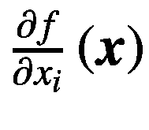 是函数沿某个轴的偏导数，并且是那个方向上的变化率。因此，梯度向量类似于一元函数中的一阶导数或斜率或切线。它可以被解释为函数增长最快的方向和速率。如果函数在点`x`处的梯度非零，那么梯度的方向就是函数从`x`开始增加最快的方向，而梯度的大小就是该方向上的增加速率，也就是最大的绝对方向导数。此外，一个点处的梯度是零向量当且仅当它是一个驻点（导数为零的点）。因此，梯度在最优化理论中扮演着基础性角色。我们将在第 9 章看到，许多优化算法，如梯度下降法，都会使用梯度。

举个例子，考虑一个房间，其温度由一个标量场`T`给出。也就是说，这个多元函数或场接收一个点 (`x`, `y`, `z`)，并返回一个温度值`T`(`x`, `y`, `z`)。在房间的每个点，`T`在该点的梯度指出了从 (`x`, `y`, `z`) 出发，温度上升最快的方向。梯度的大小决定了温度在该方向上升的速度。更一般地说，如果一个多元函数`f`是可微的，那么∇`f`与单位向量`v`的点积就是函数沿`v`方向的斜率或变化率，称为`f`在`v`方向上的方向导数。多元版本的泰勒展开表明，函数的最佳线性近似可以用梯度来表示。

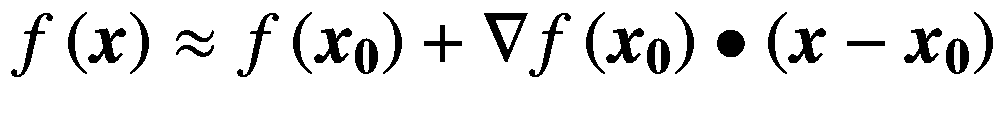

`x`和`x`[0]是 ℝ^n 空间中的点。`f`将 ℝ^n 映射到 ℝ，而∇`f`：ℝ^n → ℝ^n。最后一项中的点积产生一个实数。

## 梯度在NM Dev中的实现

NM Dev 支持计算多元函数的梯度和梯度函数。相关的类是`Gradient`和`GradientFunction`。它们的签名如下：

```java
/**
* 为多元函数 f 在点 x 处构造梯度向量。
*
* @param f 一个多元函数
* @param x 计算 f 的梯度的点
*/
public Gradient(RealScalarFunction f, Vector x)

/**
* 构造实标量函数 f 的梯度函数。
*
* @param f 一个实标量函数
*/
public GradientFunction(RealScalarFunction f)
```

例如，考虑这个函数：

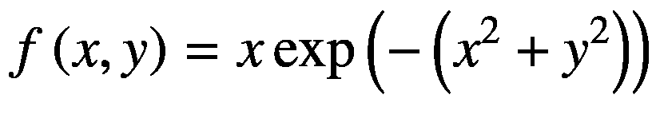

请参见图 6-8。

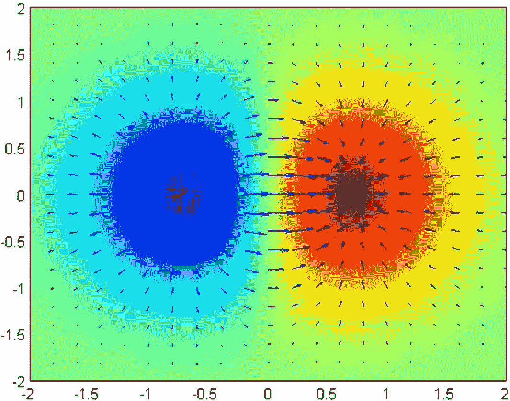

**图 6-8** 二维函数 `f(x, y) = xe^(−(x2 + y2))` 的梯度以蓝色箭头绘制在该函数的伪彩色图上

以下代码计算该函数的梯度及其梯度函数：

```java
// f = x * exp(-(x² + y²))
RealScalarFunction f = new AbstractBivariateRealFunction() {
@Override
public double evaluate(double x, double y) {
return x * exp(-(x * x + y * y));
}
};
Vector x1 = new DenseVector(0., 0.);
Vector g1_0 = new Gradient(f, x1);
System.out.println(String.format("gradient at %s = %s", x1, g1_0));
GradientFunction df = new GradientFunction(f);
Vector g1_1 = df.evaluate(x1);
System.out.println(String.format("gradient at %s = %s", x1, g1_1));
Vector x2 = new DenseVector(-1., 0.);
Vector g2 = df.evaluate(x2);
System.out.println(String.format("gradient at %s = %s", x2, g2));
Vector x3 = new DenseVector(1., 0.);
Vector g3 = df.evaluate(x3);
System.out.println(String.format("gradient at %s = %s", x3, g3));
```

输出如下所示：

```
gradient at [0.000000, 0.000000]  = [1.000000, 0.000000]
gradient at [0.000000, 0.000000]  = [1.000000, 0.000000]
gradient at [-1.000000, 0.000000]  = [-0.367879, 0.000000]
gradient at [1.000000, 0.000000]  = [-0.367879, 0.000000]
```

考虑另一个函数，如下所示：

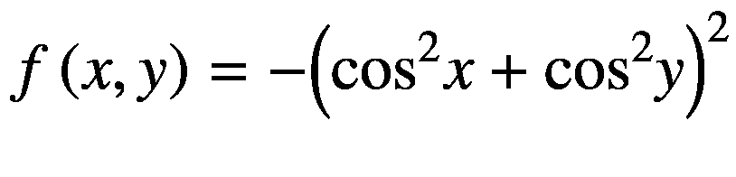

请参见图 6-9。

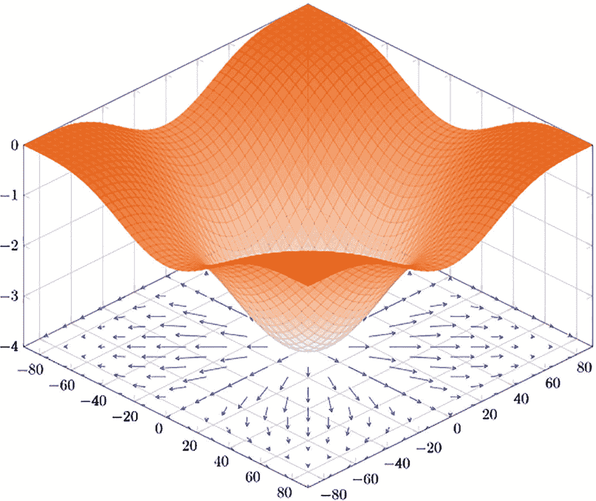

**图 6-9** 函数 `f(x,y) = −(cos²x + cos²y)²` 的梯度（在底平面上投影为矢量场）

以下代码计算该函数的梯度及其梯度函数：

```java
// TODO: 代码片段待补充
```

### 雅可比矩阵

```java
// f = -((cos(x))² + (cos(y))²)²
RealScalarFunction f = new AbstractBivariateRealFunction() {
@Override
public double evaluate(double x, double y) {
double z = cos(x) * cos(x);
z += cos(y) * cos(y);
z = -z * z;
return z;
}
};
Vector x1 = new DenseVector(0., 0.);
Vector g1_0 = new Gradient(f, x1);
System.out.println(String.format("gradient at %s = %s", x1, g1_0));
GradientFunction df = new GradientFunction(f);
Vector g1_1 = df.evaluate(x1);
System.out.println(String.format("gradient at %s = %s", x1, g1_1));
Vector x2 = new DenseVector(-1., 0.);
Vector g2 = df.evaluate(x2);
System.out.println(String.format("gradient at %s = %s", x2, g2));
Vector x3 = new DenseVector(1., 0.);
Vector g3 = df.evaluate(x3);
System.out.println(String.format("gradient at %s = %s", x3, g3));
```

输出如下所示：

```
gradient at [0.000000, 0.000000]  = [0.000000, 0.000000]
gradient at [0.000000, 0.000000]  = [0.000000, 0.000000]
gradient at [-1.000000, 0.000000]  = [-2.349491, 0.000000]
gradient at [1.000000, 0.000000]  = [2.349491, 0.000000]
```

正如我们将单变量标量函数的导数推广到多变量标量函数的梯度，我们可以进一步将这一概念推广到多变量的向量值函数。假设我们有一个向量值函数 `f`: ℝⁿ → ℝᵐ，它将 ℝⁿ 中的点 `x` = (`x`[1], ⋯, `x`[`n`]) 映射到 ℝᵐ 中的向量 `f`(`x`)。`f` 的雅可比矩阵定义为一个 `m` × `n` 的矩阵，记作 `J`，其第 (`i`, `j`) 个条目如下：

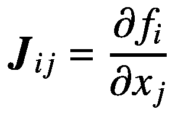

或者显式地表示为：

![$$ \boldsymbol{J}=\left[\frac{\partial \boldsymbol{f}}{\partial {x}_1}\cdots \frac{\partial \boldsymbol{f}}{\partial {x}_n}\right] $$](images/500382_1_En_6_Chapter/500382_1_En_6_Chapter_TeX_Equar.png)

![$$ =\left[\begin{array}{c}{\nabla}^T{f}_1\\ {}\vdots \\ {}{\nabla}^T{f}_m\end{array}\right] $$](images/500382_1_En_6_Chapter/500382_1_En_6_Chapter_TeX_Equas.png)

![$$ =\left[\begin{array}{ccc}\frac{\partial {f}_1}{\partial {x}_1}& \cdots & \frac{\partial {f}_1}{\partial {x}_n}\\ \vdots & \ddots & \vdots \\ \frac{\partial {f}_m}{\partial {x}_1}& \cdots & \frac{\partial {f}_m}{\partial {x}_n}\end{array}\right] $$](images/500382_1_En_6_Chapter/500382_1_En_6_Chapter_TeX_Equat.png)

`∇^T f[i]` 是第 `i` 个分量的梯度（行向量）的转置。

雅可比矩阵是由所有一阶偏导数构成的矩阵。它表示了 `f` 在其可微点处的微分。它是 `f` 在 `x` 邻域内变化的最佳线性近似。也就是说，对于所有接近 `x` 的点 `y`，它是 `f`(`y`) 的最佳线性近似。我们有以下泰勒展开形式：

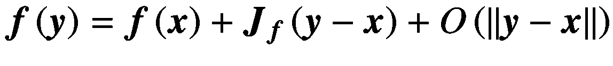

当 `y` 趋近于 `x` 时，误差项趋近于零的速度远快于 `y` 与 `x` 之间距离趋近于零的速度。从这个意义上说，雅可比矩阵可被视为多变量向量值函数的一种“一阶导数”。

如果 `m` = `n`，那么 `f` 是从 ℝⁿ 到自身的函数，此时雅可比矩阵是一个方阵。我们可以计算其行列式，称为雅可比行列式。雅可比行列式有时也简称为“雅可比”。给定点处的雅可比行列式提供了关于 `f` 在该点附近局部行为的重要信息。例如，反函数定理指出：如果连续可微函数 `f` 在点 `x` ∈ ℝⁿ 处的雅可比行列式不为零，那么 `f` 在 `x` 附近是可逆的。此外，如果 `f` 在 `x` 处的雅可比行列式为正，则 `f` 在 `x` 附近保持方向；如果为负，则 `f` 反转方向。`x` 处雅可比行列式的绝对值给出了函数 `f` 在 `x` 附近膨胀或收缩体积的倍数。

### NM Dev 中的雅可比矩阵

NM Dev 支持计算多变量向量值函数的雅可比矩阵及其雅可比函数。相关类为 `Jacobian` 和 `JacobianFunction`。它们的签名如下：

```java
/**
* 为多元函数 f 在点 x 处构造雅可比矩阵。
*
* @param f 一个多元函数
* @param x 需要计算雅可比矩阵的点
*/
public Jacobian(RealVectorFunction f, Vector x)
/**
* 为多元函数 f 在点 x 处构造雅可比矩阵。
*
* @param f 以一元函数数组形式表示的多元函数
* @param x 需要计算雅可比矩阵的点
*/
public Jacobian(final RealScalarFunction[] f, Vector x)
/**
* 为多元函数 f 在点 x 处构造雅可比矩阵。
*
* @param f 以一元函数列表形式表示的多元函数
* @param x 需要计算雅可比矩阵的点
*/
public Jacobian(final List f, Vector x)
/**
* 构造实标量函数 f 的雅可比函数。
*
* @param f 一个实标量函数
*/
public JacobianFunction(RealVectorFunction f
```

在 NM Dev 中，一个多元向量值函数可以通过 `RealVectorFunction`、`RealScalarFunction` 数组或 `RealScalarFunction` 列表来表示。

考虑函数 `F`：ℝ² → ℝ²。

![$$ \boldsymbol{F}\left(\left[\begin{array}{c}x\\ y\end{array}\right]\right)=\left[\begin{array}{c}{f}_1\left(x,y\right)\\ {f}_2\left(x,y\right)\end{array}\right]=\left[\begin{array}{c}{x}^2y\\ 5x+\sin y\end{array}\right] $$](images/500382_1_En_6_Chapter/500382_1_En_6_Chapter_TeX_Equav.png)

其雅可比矩阵如下：

其雅可比矩阵如下：

![$$ {\boldsymbol{J}}_{\boldsymbol{F}}\left(x,y\right)=\left[\begin{array}{cc}\frac{\partial {f}_1}{\partial x}& \frac{\partial {f}_1}{\partial y}\\ {}\frac{\partial {f}_2}{\partial x}& \frac{\partial {f}_2}{\partial y}\end{array}\right]=\left[\begin{array}{cc}2 xy& {x}²\\ {}5& \cos y\end{array}\right] $$](images/500382_1_En_6_Chapter/500382_1_En_6_Chapter_TeX_Equaw.png)

其雅可比行列式如下：

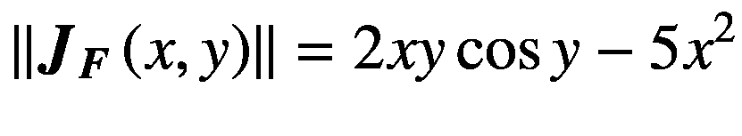

以下代码求解此示例：

```
RealVectorFunction F = new RealVectorFunction() {
@Override
public Vector evaluate(Vector v) {
double x = v.get(1);
double y = v.get(2);
double f1 = x * x * y;
double f2 = 5\. * x + sin(y);
return new DenseVector(f1, f2);
}
@Override
public int dimensionOfDomain() {
return 2;
}
@Override
public int dimensionOfRange() {
return 2;
}
};
Vector x0 = new DenseVector(0., 0.);
Matrix J00 = new Jacobian(F, x0);
System.out.println(String.format(
"在 %s 处的雅可比矩阵 = %s, 行列式 = %f",
x0,
J00,
MatrixMeasure.det(J00)));
RntoMatrix J = new JacobianFunction(F); // [2xy, x²], [5, cosy]
Matrix J01 = J.evaluate(x0);
System.out.println(String.format(
"在 %s 处的雅可比矩阵 = %s, 行列式 = %f",
x0,
J01,
MatrixMeasure.det(J01)));
Vector x1 = new DenseVector(1., PI);
Matrix J1 = J.evaluate(x1);
System.out.println(String.format(
"在 %s 处的雅可比矩阵 = %s, 行列式 = %f",
x1,
J1,
MatrixMeasure.det(J1)));
```

输出如下：

```
在 [0.000000, 0.000000] 处的雅可比矩阵 = 2x2
[,1] [,2]
[1,] 0.000000, 0.000000,
[2,] 5.000000, 1.000000, , 行列式 = 0.000000
在 [0.000000, 0.000000] 处的雅可比矩阵 = 2x2
[,1] [,2]
[1,] 0.000000, 0.000000,
[2,] 5.000000, 1.000000, , 行列式 = 0.000000
在 [1.000000, 3.141593] 处的雅可比矩阵 = 2x2
[,1] [,2]
[1,] 6.283185, 1.000000,
[2,] 5.000000, -1.000000, , 行列式 = -11.283185
```

考虑函数 `F`：`ℝ³` → `ℝ³`：

![$$ \boldsymbol{F}\left(\left[\begin{array}{c}{x}_1\\ {}{x}_2\\ {}{x}_3\end{array}\right]\right)=\left[\begin{array}{c}5{x}_2\\ {}4{x_1}²-2\sin \left({x}_2{x}_3\right)\\ {}{x}_2{x}_3\end{array}\right] $$](images/500382_1_En_6_Chapter/500382_1_En_6_Chapter_TeX_Equay.png)

其雅可比矩阵如下：

![$$ {\boldsymbol{J}}_{\boldsymbol{F}}\left(x,y\right)=\left[\begin{array}{ccc}0& 5& 0\\ {}8{x}_1& -2{x}_3\cos \left({x}_2{x}_3\right)& -2{x}_2\cos \left({x}_2{x}_3\right)\\ {}0& {x}_3& {x}_2\end{array}\right] $$](images/500382_1_En_6_Chapter/500382_1_En_6_Chapter_TeX_Equaz.png)

其雅可比行列式如下：

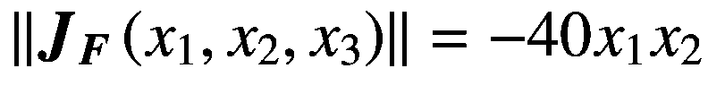

以下代码求解此示例：

```
RealVectorFunction F = new RealVectorFunction() {
@Override
public Vector evaluate(Vector v) {
double x1 = v.get(1);
double x2 = v.get(2);
double x3 = v.get(3);
double f1 = 5\. * x2;
double f2 = 4\. * x1 * x1 - 2\. * sin(x2 * x3);
double f3 = x2 * x3;
return new DenseVector(f1, f2, f3);
}
@Override
public int dimensionOfDomain() {
return 3;
}
@Override
public int dimensionOfRange() {
return 3;
}
};
Vector x0 = new DenseVector(0., 0., 1.);
RntoMatrix J = new JacobianFunction(F);
Matrix J0 = J.evaluate(x0);
System.out.println(String.format(
"在 %s 处的雅可比矩阵 = %s, 行列式 = %f",
x0,
J0,
MatrixMeasure.det(J0)));
Vector x1 = new DenseVector(1., 2., 3.);
Matrix J1 = J.evaluate(x1);
System.out.println(String.format(
"在 %s 处的雅可比矩阵 = %s, 行列式 = %f",
x1,
J1,
MatrixMeasure.det(J1)));
```

输出如下：

```
在 [0.000000, 0.000000, 1.000000] 处的雅可比矩阵 = 3x3
[,1] [,2] [,3]
[1,] 0.000000, 5.000000, 0.000000,
[2,] 0.000000, -2.000000, 0.000000,
[3,] 0.000000, 1.000000, 0.000000, , 行列式 = 0.000000
在 [1.000000, 2.000000, 3.000000] 处的雅可比矩阵 = 3x3
[,1] [,2] [,3]
[1,] 0.000000, 5.000000, 0.000000,
[2,] 8.000000, -5.761022, -3.840681,
[3,] 0.000000, 3.000000, 2.000000, , 行列式 = -80.000000
```

由此可知，在 `x[1]` 和 `x[2]` 同号的那些点附近，`F` 会反转定向。该函数在除了 `x[1] = 0` 或 `x[2] = 0` 附近的点之外的所有点处都是局部可逆的。直观地说，如果从点 `(1, 2, 3)` 附近的一个微小物体开始，并将 `F` 应用于该物体，那么得到的结果物体的体积将约为原始物体体积的 `40 × 1 × 2 = 80` 倍，且定向被反转。

### 6.3.3 黑塞矩阵

# 多变量函数的黑塞矩阵

我们可以将单变量函数二阶导数的概念推广到多变量实值函数。首先计算标量函数的梯度（某种意义上是一阶导数）。然后计算梯度函数的雅可比矩阵（某种意义上就是二阶导数）。这个雅可比矩阵称为黑塞矩阵。黑塞矩阵是一个标量函数或标量场的二阶偏导数构成的方阵。它描述了多变量函数的局部曲率。即：

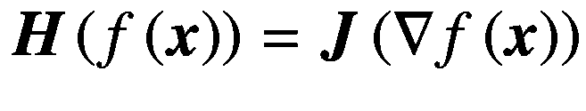

具体来说，假设 `f` : ℝ^`n` → ℝ。如果 `f` 的所有二阶偏导数都存在并且在函数的定义域上连续，那么 `f` 的黑塞矩阵 `H` 是一个 `n` × `n` 的方阵，通常定义和排列如下：

![\boldsymbol{H}_f=\left[\begin{array}{cccc}\frac{\partial²f}{\partial x_1²}&\frac{\partial²f}{\partial x_1\partial x_2}&\cdots&\frac{\partial²f}{\partial x_1\partial x_n}\\\frac{\partial²f}{\partial x_2\partial x_1}&\frac{\partial²f}{\partial x_2²}&\cdots&\frac{\partial²f}{\partial x_2\partial x_n}\\\vdots&\vdots&\ddots&\vdots\\\frac{\partial²f}{\partial x_n\partial x_1}&\frac{\partial²f}{\partial x_n\partial x_2}&\cdots&\frac{\partial²f}{\partial x_n²}\end{array}\right]](images/500382_1_En_6_Chapter/500382_1_En_6_Chapter_TeX_Equbc.png)

简写形式如下：

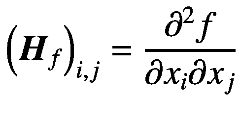

黑塞矩阵是一个对称矩阵。二阶导数连续的假设意味着求导顺序无关紧要（根据克莱罗定理）。黑塞矩阵的行列式称为黑塞行列式。黑塞矩阵用于解决牛顿型方法中的优化问题，因为它们是函数局部泰勒展开中二次项的系数。即：


我们将在第 11 章进一步讨论如何在优化中使用黑塞矩阵。

## NM Dev 中的黑塞矩阵计算

NM Dev 支持计算多变量实值函数的黑塞矩阵和黑塞函数。相关类是 `Hessian` 和 `HessianFunction`。它们的签名如下：

```java
/**
* 构造多变量函数 f 在点 x 处的黑塞矩阵。
*
* @param f 一个多变量函数
* @param x 计算 f 的黑塞矩阵的点
*/
public Hessian(RealScalarFunction f, Vector x)
/**
* 构造实标量函数 f 的黑塞函数。
*
* @param f 一个实标量函数
*/
public HessianFunction(RealScalarFunction f)
```

以下示例代码计算 `f(x, y) = xy` 的黑塞矩阵和黑塞函数：

```java
RealScalarFunction f = new AbstractBivariateRealFunction() {
@Override
public double evaluate(double x, double y) {
return x * y; // f = xy
}
};
Vector x1 = new DenseVector(1., 1.);
Hessian H1 = new Hessian(f, x1);
System.out.println(String.format(
"the Hessian at %s = %s, the det = %f",
x1,
H1,
MatrixMeasure.det(H1)));
Vector x2 = new DenseVector(0., 0.);
Hessian H2 = new Hessian(f, x2);
System.out.println(String.format(
"the Hessian at %s = %s, the det = %f",
x2,
H2,
MatrixMeasure.det(H2)));
RntoMatrix H = new HessianFunction(f);
Matrix Hx1 = H.evaluate(x1);
System.out.println(String.format(
"the Hessian at %s = %s, the det = %f",
x1,
Hx1,
MatrixMeasure.det(Hx1)));
Matrix Hx2 = H.evaluate(x2);
System.out.println(String.format(
"the Hessian at %s = %s, the det = %f",
x2,
Hx2,
MatrixMeasure.det(Hx2)));
```

输出结果如下：

```
the Hessian at [1.000000, 1.000000]  = 2x2
[,1] [,2]
[1,] 0.000000, 1.000000,
[2,] 1.000000, 0.000000, , the det = -0.999999
the Hessian at [0.000000, 0.000000]  = 2x2
[,1] [,2]
[1,] 0.000000, 1.000000,
[2,] 1.000000, 0.000000, , the det = -1.000000
the Hessian at [1.000000, 1.000000]  = 2x2
[,1] [,2]
[1,] 0.000000, 1.000000,
[2,] 1.000000, 0.000000, , the det = -0.999999
the Hessian at [0.000000, 0.000000]  = 2x2
[,1] [,2]
[1,] 0.000000, 1.000000,
[2,] 1.000000, 0.000000, , the det = -1.000000
```

## 6.4 里德方法

里德方法通过外推一系列近似值来提高有限差分的估计精度。为了计算数值导数，我们首先使用一系列递减的步长计算一系列近似值。里德方法随后使用 Neville 算法将步长外推至零。通常，它比简单（一次性）有限差分法具有更高的精度。

初始步长 `h[0]` 的选择至关重要。如果 `h[0]` 太大，计算出的值可能不准确。如果 `h[0]` 太小，由于舍入误差，我们可能会针对不同的步长反复计算出“相同”的值。

以下代码片段比较了使用里德方法和简单有限差分法计算的对数函数在 `x` = 0.5 处的前九阶导数。

```
UnivariateRealFunction f = new AbstractUnivariateRealFunction() {
@Override
public double evaluate(double x) {
return log(x);
}
};
double x = 0.5;
for (int order = 1; order < 10; ++order) {
FiniteDifference fd = new FiniteDifference(f, order, FiniteDifference.Type.CENTRAL);
Ridders ridder = new Ridders(f, order);
System.out.println(String.format(
"%d-nd order derivative by Rideer @ %f = %.16f", order, x, ridder.evaluate(x)));
System.out.println(String.format(
"%d-nd order derivative by FD @ %f = %.16f", order, x, fd.evaluate(x)));
}
```

输出结果如下：

```
1-nd order derivative by Rideer @ 0.500000 = 2.0000000000000000
1-nd order derivative by FD @ 0.500000 = 2.0000000000000000
2-nd order derivative by Rideer @ 0.500000 = -4.0000004374066640
2-nd order derivative by FD @ 0.500000 = -4.0000031040867650
3-nd order derivative by Rideer @ 0.500000 = 16.0000016378464240
3-nd order derivative by FD @ 0.500000 = 16.0002441406250000
4-nd order derivative by Rideer @ 0.500000 = -95.9999555891298100
4-nd order derivative by FD @ 0.500000 = -95.9874881885177200
5-nd order derivative by Rideer @ 0.500000 = 767.9383982440593000
5-nd order derivative by FD @ 0.500000 = 767.5675271157362000
6-nd order derivative by Rideer @ 0.500000 = -7681.9174458835320000
6-nd order derivative by FD @ 0.500000 = -7686.1197112745450000
7-nd order derivative by Rideer @ 0.500000 = 92116.9184885280300000
7-nd order derivative by FD @ 0.500000 = 92428.4022426225400000
8-nd order derivative by Rideer @ 0.500000 = -1290356.2663459945000000
8-nd order derivative by FD @ 0.500000 = -1300812.8634378603000000
9-nd order derivative by Rideer @ 0.500000 = 20941653.5495638000000000
9-nd order derivative by FD @ 0.500000 = 21347177.7802486680000000
```

前四阶的解析结果恰好是 `2`、`-4`、`16` 和 `-96`。我们可以看到，里德方法提供了更好的精度，特别是对于通常难以用有限差分法处理的高阶导数。

里德方法也适用于多变量函数。以下示例将里德方法与第 `6.3` 节中示例的有限差分法进行了比较。

```java
// f = xy + 2xyz
RealScalarFunction f = new RealScalarFunction() {
    @Override
    public Double evaluate(Vector v) {
        return v.get(1) * v.get(2) + 2 * v.get(1) * v.get(2) * v.get(3);
    }

    @Override
    public int dimensionOfDomain() {
        return 3;
    }

    @Override
    public int dimensionOfRange() {
        return 1;
    }
};

Ridders dxy_ridder = new Ridders(f, new int[]{1, 2});
MultivariateFiniteDifference dxy // 1 + 2z
        // 先对第一个变量求导，再对第二个变量求导
        = new MultivariateFiniteDifference(f, new int[]{1, 2});

Vector x0 = new DenseVector(1., 1., 1.);
System.out.println(String.format("Dxy(%s) by Ridder = %.16f", x0, dxy_ridder.evaluate(x0)));
System.out.println(String.format("Dxy(%s) by FD =  %.16f", x0, dxy.evaluate(x0)));

Vector x1 = new DenseVector(-100., 0., -1.5);
System.out.println(String.format("Dxy(%s) by FD = %.16f", x1, dxy_ridder.evaluate(x1)));
System.out.println(String.format("Dxy(%s) by FD = %.16f", x1, dxy.evaluate(x1)));

// 由克莱罗定理，连续函数允许交换求导顺序
Ridders dyx_ridder = new Ridders(f, new int[]{2, 1});
MultivariateFiniteDifference dyx // 1 + 2z
        // 先对第二个变量求导，再对第一个变量求导
        = new MultivariateFiniteDifference(f, new int[]{2, 1});

System.out.println(String.format("Dyx(%s) by Ridder = %.16f", x0, dyx_ridder.evaluate(x0)));
System.out.println(String.format("Dyx(%s) by FD = %.16f", x0, dyx.evaluate(x0)));
System.out.println(String.format("Dyx(%s) by Ridder = %.16f", x1, dyx_ridder.evaluate(x1)));
System.out.println(String.format("Dyx(%s) by FD = %.16f", x1, dyx.evaluate(x1)));
```

输出如下：

```
Dxy([1.000000, 1.000000, 1.000000] ) by Ridder = 2.9999999941935465
Dxy([1.000000, 1.000000, 1.000000] ) by FD =  3.0000013187575885
Dxy([-100.000000, 0.000000, -1.500000] ) by FD = -2.0000000000032907
Dxy([-100.000000, 0.000000, -1.500000] ) by FD = -1.9999999999865270
Dyx([1.000000, 1.000000, 1.000000] ) by Ridder = 2.9999999941935465
Dyx([1.000000, 1.000000, 1.000000] ) by FD = 3.0000013187575885
Dyx([-100.000000, 0.000000, -1.500000] ) by Ridder = -2.0000000000044610
Dyx([-100.000000, 0.000000, -1.500000] ) by FD = -1.9999999999748960
```

解析结果为 3 和 -2。我们可以看到，Ridder 方法比有限差分法具有更高的精度。

## 6.5 特殊函数的导数函数

NM Dev 支持多种特殊函数及其一阶导数函数。特殊函数通常无法通过有限个初等函数（如多项式、有理函数、三角函数、指数函数及其反函数的和、积、复合）计算。它们的导数函数也是如此。由于这些函数在众多应用中的重要性（例如统计学中的高斯函数），我们必须能够精确计算这些函数，而不能采用不精确的有限差分法。针对特殊函数，存在专用计算方法（如连分数）。NM Dev 支持的特殊函数及其一阶导数函数包括：高斯函数、误差函数、Beta 函数、正则化不完全 Beta 函数和 Gamma 函数。

### 6.5.1 高斯导数函数

高斯函数定义如下：

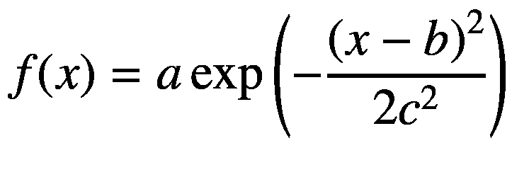

用于计算高斯函数的类是`Gaussian`，其签名如下：

```java
/**
 * 构造一个高斯函数实例。
 *
 * @param a 参数 a
 * @param b 参数 b
 * @param c 参数 c
 */
public Gaussian(double a, double b, double c)
```

用于计算高斯函数导数函数的类是`DGaussian`，其签名如下：

```java
/**
 * 构造高斯函数的导数函数。
 *
 * @param phi 一个 {@link Gaussian} 函数
 */
public DGaussian(Gaussian phi)
```

示例如下：

```java
Gaussian G = new Gaussian(1., 0., 1.); // 标准高斯函数
DGaussian dG = new DGaussian(G);
double x = -0.5;
System.out.println(String.format("dG/dx(%f) = %f", x, dG.evaluate(x)));
x = 0;
System.out.println(String.format("dG/dx(%f) = %f", x, dG.evaluate(x)));
x = 0.5;
System.out.println(String.format("dG/dx(%f) = %f", x, dG.evaluate(x)));
```

输出如下：

```
dG/dx(-0.500000) = 0.176033
dG/dx(0.000000) = -0.000000
dG/dx(0.500000) = -0.176033
```

### 6.5.2 误差导数函数

误差函数定义如下：

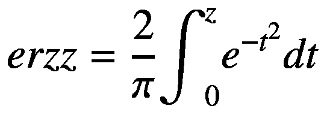

用于计算误差函数的类是`Erf`，用于计算误差函数导数函数的类是`DErf`。这两个类均继承自`AbstractUnivariateRealFunction`并实现了`evaluate(double x)`方法，且它们的构造函数不带参数。

示例如下：

```java
double z = 0.5;
Erf E = new Erf();
DErf dE = new DErf();
System.out.println(String.format("erf(%f) = %f", z, E.evaluate(z)));
System.out.println(String.format("dErf/dz(%f) = %f", z, dE.evaluate(z)));
```

输出如下：

```
erf(0.500000) = 0.520500
dErf/dz(0.500000) = 0.878783
```

### 6.5.3 Beta 导数函数

Beta 函数又称第一类欧拉积分。对于任意实数 x, y > 0，其定义如下：

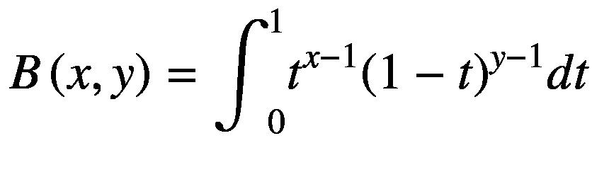

用于计算 Beta 函数的类是`Beta`，用于计算 Beta 函数导数函数的类是`DBeta`。这两个类均继承自`AbstractBivariateRealFunction`并实现了`evaluate(double x, double y)`方法，且它们的构造函数不带参数。

示例如下：

```java
double x = 1.5;
double y = 2.5;
Beta B = new Beta();
DBeta dB = new DBeta();
System.out.println(String.format("Beta(%f) = %f", x, B.evaluate(x, y)));
System.out.println(String.format("dBeta/dz(%f) = %f", x, dB.evaluate(x, y)));
```

输出如下：

```
Beta(1.500000) = 0.196350
dBeta/dz(1.500000) = -0.239473
```

### 6.5.4 正则化不完全贝塔导数函数

不完全贝塔函数是贝塔函数的一种推广，其定义如下：

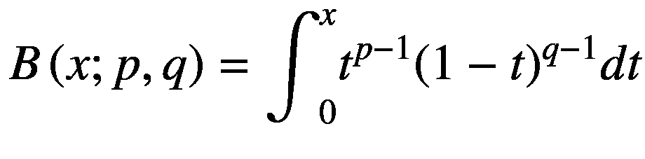

当 `x` = 1 时，不完全贝塔函数与完全贝塔函数重合。

正则化不完全贝塔函数（或简称为正则化贝塔函数）是根据不完全贝塔函数和完全贝塔函数定义的。


正则化不完全贝塔函数是贝塔分布的累积分布函数。

计算正则化不完全贝塔函数的类是`BetaRegularized`，其签名如下：

```java
/**
* 使用参数 p 和 q 构造 Ix(p,q) 的一个实例。
*
* @param p p > 0，形状参数
* @param q q > 0，形状参数
*/
public BetaRegularized(final double p, final double q)
```

计算正则化不完全贝塔函数导数的类是`DBetaRegularized`，其签名如下：

```java
/**
* 构造正则化不完全贝塔函数 {@link BetaRegularized} 的导数函数。
*
* @param p 形状参数
* @param q 形状参数
*/
public DBetaRegularized(double p, double q)
```

示例如下：

```java
double p = 0.5;
double q = 2.5;
BetaRegularized I = new BetaRegularized(p, q);
DBetaRegularized dI = new DBetaRegularized(p, q);
double x = 1.;
System.out.println(String.format("BetaRegularized(%f) = %f", x, I.evaluate(x)));
System.out.println(String.format("dBetaRegularized/dz(%f) = %f", x, dI.evaluate(x)));
```

输出如下：

```
BetaRegularized(1.000000) = 1.000000
dBetaRegularized/dz(1.000000) = 0.000000
```

### 6.5.5 伽马导数函数

伽马函数是将阶乘函数推广到实数和复数，其参数减 1。对于实数，其定义如下：


计算伽马函数的类是`Gamma`。计算伽马函数导数的类是`DGamma`。这两个类都从`AbstractUnivariateRealFunction`继承`evaluate(double x)`方法。它们的构造函数不接受任何参数。NM Dev 提供了多种伽马函数的实现，在精度和性能方面具有不同特性。默认选择是 Lanczos 算法，所有计算均使用`double`完成。

示例如下：

```
double z = 0.5;
// Wikipedia: Lanczos approximation
Gamma G = new GammaLanczosQuick();
DGamma dG = new DGamma();
System.out.println(String.format("Gamma(%f) = %f", z, G.evaluate(z)));
System.out.println(String.format("dGamma/dz(%f) = %f", z, dG.evaluate(z)));
```

输出如下：

```
Gamma(0.500000) = 1.772454
dGamma/dz(0.500000) = -3.480231
```

### 6.5.6 多项式导数函数

多项式严格来说并非特殊函数。我们在此提及它，是因为 NM Dev 不使用有限差分来计算多项式导数函数。对多项式求导存在一个闭式解。


计算多项式的类是`Polynomial`，其签名如下：

```
/**
* 根据系数数组构造一个多项式。
* 第一个/第 0 个条目对应 x^n 项。
* 最后一个/第 n 个条目对应常数项。
* 多项式的次数为 n，即数组长度减 1。
* 
* 例如，
* 
* new Polynomial(1, -2, 3, 2)
* 
* 创建了一个表示 x³ - 2x² + 3x + 2 的 {@code Polynomial} 实例。
*
* @param coefficients 多项式系数
*/
public Polynomial(double... coefficients)
```

计算多项式导数函数的类是`DPolynomial`，其签名如下。多项式的导数函数也是一个多项式。

```
/**
* 构造一个 {@link Polynomial} 的导数函数，该函数本身也是一个多项式。
*
* @param polynomial 一个多项式
*/
public DPolynomial(Polynomial polynomial)
```

示例如下：

```
Polynomial p = new Polynomial(1, 2, 1); // x² + 2x + 1
Polynomial dp = new DPolynomial(p); // 2x + 2
double x = 1.;
System.out.println(String.format("dp/dx(%f) = %f", x, dp.evaluate(x)));
```

输出如下：

```
dp/dx(1.000000) = 4.000000
```

## 6.6 数值积分

定积分是实轴上两点`[a, b]`之间曲线或函数`f(x)`（称为被积函数）下方的（有符号）面积。其定义如下：


符号`dx`称为变量`x`的微分，表示积分变量为`x`。它表示`x`的微小变化，这与微分中的含义相同。积分是计算定积分值的过程。微积分第一基本定理指出，积分的导数就是被积函数。因此，我们有时将积分称为函数的反导数。参见图 6-10。


图 6-10

积分作为曲线下的有符号面积

黎曼给出了积分的首个严格定义。黎曼积分的基本思想是将面积分割成许多小矩形来近似计算面积，然后将它们求和（因此得名积分）。通过越来越好的近似，比如使用无穷多个无穷小的矩形，我们可以说“在极限情况下”我们精确得到了曲线下的面积。图 6-11 展示了一个区间规则划分下的一系列黎曼和。顶部的数字是这些矩形的总面积，该值收敛于函数的积分值。


图 6-11

一系列黎曼和

在数学上，区间`[a, b]`的一个划分是一个有限点序列。


在每个子区间内有一个选定的点`t[i] ∈ [x[i], x[i + 1]]`，用于确定矩形的高度`f(t[i])`。因此，该矩形的面积为`f(t[i]) * (x[i + 1] - x[i])`。函数`f`关于该划分的黎曼和被定义为所有矩形面积的总和。


当取极限`n`趋近于无穷大时，黎曼和就变成了积分值。


数值积分是一种利用类似分割概念来近似定积分的技术：使用被积函数有限采样值的加权平均近似值来代替函数值。数值积分之所以重要，是因为通常无法解析地找到（封闭形式的）反导数。即使反导数存在，也可能因为无法由初等函数构成而难以计算。与用特殊函数或无穷级数表示反导数相比，计算数值近似值要容易得多。此外，被积函数可能仅在某些点（例如通过采样获得）上已知。出于这个原因，一些嵌入式系统和其他计算机应用可能需要数值积分。

传统上，求面积大小的数学方法被称为求积法。现在它已成为积分的同义词，但使用较少。数值积分公式仍然被称为数值求积公式。进行数值积分的方法有很多种。它们的区别在于：将区间分割成多少份；分割点是否等距；如何选择选定点；是开式（不使用端点）还是闭式（使用端点）；以及如何进行（或不进行）外推。本章仅能浅尝辄止地介绍一些最基本的变体。

## 6.7 牛顿-柯特斯族

牛顿-柯特斯公式，也称为牛顿-柯特斯求积法则或简称为牛顿-柯特斯法则，是一组基于在等距点上评估被积函数进行数值积分（也称为求积）的公式。它们以艾萨克·牛顿和罗杰·柯特斯的名字命名。如果被积函数在等距点上的值可用，那么牛顿-柯特斯公式会很有用。如果可以使用一组不同的（可能不等距的）点，那么像高斯求积等其他方法可能更精确。牛顿-柯特斯公式有多种推导方法。其中最著名的两个是梯形求积公式和辛普森求积公式。

### 梯形求积公式

梯形公式通过使用一条直线来替代原函数，本质上是将函数下方的区域近似为一个梯形并计算其面积。见图 6-12。


图 6-12: 梯形公式

通过`a`和`b`两点的直线方程如下：


该直线下方的面积即为梯形面积，可以通过将底边（平行边）之和乘以高（底边之间的垂直距离）然后除以 2 来计算。我们也可以通过正规的积分得到相同的结果。

用`L_1`替换`f(x)`，我们得到：


![$$ ={\int}_a^b\left[\frac{f(b)-f(a)}{b-a}\left(x-a\right)+f(a)\right] dx $$](images/500382_1_En_6_Chapter/500382_1_En_6_Chapter_TeX_Equbu.png)


对于函数`f(x)`和区间`[a, b]`，我们可以将该区间划分为`N`个子区间。然后对每个子区间应用此梯形法则，并将结果求和。

设
```

# 梯形法则与辛普森求积公式


可以证明，假设 `f^(″)(x)` 存在且在 `[a, b]` 上连续，则使用梯形法则的误差如下（对于某个 `ξ ∈ [a, b]`）：


在 NM Dev 中，执行梯形积分的类是 `Trapezoidal`。以下示例解决了图 6-12 中的问题：

```java
final UnivariateRealFunction f = new AbstractUnivariateRealFunction() {
    @Override
    public double evaluate(double x) {
        return -(x * x - 4 * x + 6); // -(x² - 4x + 6)
    }
};
// the limit
double a = 0., b = 4.;
// an integrator using the trapezoidal rule
Integrator integrator = new Trapezoidal(1e-8, 20); // precision, max number of iterations
// the integration
double I = integrator.integrate(f, a, b);
System.out.println(String.format("S_[%.0f,%.0f] f(x) dx = %f", a, b, I));
```

输出如下：

```
S_[0,4] f(x) dx = -13.333333
```

`Trapezoidal` 类的签名如下：

```java
/**
 * Constructs an integrator that implements the Trapezoidal rule.
 *
 * @param precision     the convergence threshold
 * @param maxIterations the maximum number of iterations
 */
public Trapezoidal(double precision, int maxIterations)
```

在 NM Dev 中，所有积分器（算法）的实现都继承自 `Integrator` 类。它们都调用 `integrate` 来执行任务。

```java
/**
 * Integrate function f from a to b,
 * \[
 * \int_a^b\! f(x)\, dx
 * \]
 *
 * @param f a univariate function
 * @param a the lower limit
 * @param b the upper limit
 * @return \(\int_a^b\! f(x)\, dx\)
 */
public double integrate(UnivariateRealFunction f, double a, double b);
```

## 辛普森求积公式

辛普森公式不是用直线替换函数，而是用一个二次函数或抛物线来替换 `f(x)`。区间被分成两个分区，给出三个点：`a`、`b` 和中点 。该二次函数如下：


从几何角度来看，辛普森公式计算的是由抛物线围成的曲边梯形的面积，以此来近似 `f(x)` 所围成的面积。见图 6-13。


图 6-13: 辛普森公式

用 `L2` 替换 `f(x)`，我们得到：


![$$ =\frac{b-a}{6}\left[f(a)+4f\left(\frac{a+b}{2}\right)+f(b)\right] $$](images/500382_1_En_6_Chapter/500382_1_En_6_Chapter_TeX_Equcc.png)

![$$ =\frac{h}{3}\left[f(a)+4f\left(\frac{a+b}{2}\right)+f(b)\right] $$](images/500382_1_En_6_Chapter/500382_1_En_6_Chapter_TeX_Equcd.png)

其中  是每个分区中的步长。由于公式中包含 ，这个辛普森法则通常被称为辛普森 1/3 法则。

对于函数 `f(x)` 和区间 `[a, b]`，我们可以将该区间划分为 `N` 个子区间。然后对每个子区间应用此辛普森法则，并将其求和。我们得到以下结果：

![$$ {\int}_a^bf(x) dx\approx \frac{h}{3}\sum \limits_{j=1}^{N/2}\left[f\left({x}_{2j-2}\right)+4f\left({x}_{2j-1}\right)+f\left({x}_{2j}\right)\right] $$](images/500382_1_En_6_Chapter/500382_1_En_6_Chapter_TeX_Equce.png)

对于二阶连续可微的函数，辛普森法则有望比梯形法则有更好的效果。然而，对于更粗糙的函数，梯形法则可能更受欢迎。可以证明，假设四阶导数 `f^((4))(x)` 存在且在 `[a, b]` 上连续，则使用辛普森 1/3 法则的误差如下（对于某个 `ξ ∈ [a, b]`）：


在 NM Dev 中，执行辛普森 1/3 积分的类是 `Simpson`。以下示例解决了图 6-12 中的问题。


```java
final UnivariateRealFunction f = new AbstractUnivariateRealFunction() {
    @Override
    public double evaluate(double x) {
        return -(x * x - 4 * x + 6); // -(x² - 4x + 6)
    }
};
// the limit
double a = 0., b = 4.;
// an integrator using the Simpson rule
Integrator integrator = new Simpson(1e-8, 20); // precision, max number of iterations
// the integration
double I = integrator.integrate(f, a, b);
System.out.println(String.format("S_[%.0f,%.0f] f(x) dx = %f", a, b, I));
```

输出如下：

```
S_[0,4] f(x) dx = -13.333333
```

`Simpson` 类的签名如下：

```java
/**
 * Constructs an integrator that implements Simpson's rule.
 *
 * @param precision     the convergence threshold
 * @param maxIterations the maximum number of iterations
 */
public Simpson(double precision, int maxIterations)
```

### 6.7.3 牛顿-柯特斯求积公式

可以设想，将区间 `[a, b]` 划分为多于一个子区间（如梯形法则的情况）或多于两个子区间（如辛普森法则的情况）。也可以将其划分为 `n` 个区间。既可以使用包含端点 `a` 和 `b` 的闭型公式，也可以使用不包含端点的开型公式，因为 `f(a)` 和 `f(b)` 可能不存在。牛顿-柯特斯公式就是这种推广。它将区间 `[a, b]` 划分为 `n` 个等长子区间。对于闭型公式，等距节点如下：

`x[i] = a + ih`, `h = (b - a) / n`

对于开型公式，等距节点如下：

`x[i] = a + (i + 1)h`, `h = (b - a) / (n + 2)`

对于闭型公式，可以构造一个 `n` 次差分多项式，如下所示：

`L_n(x) = Σ_{k=0}^n (w(x) / ((x - x_k) w'(x_k))) f(x_k)`

其中 `w(x) = (x - x[0])(x - x[1])…(x - x[n])`。

用 `L_n(x)` 替换 `f(x)`，我们得到：

`∫_a^b f(x) dx ≈ ∫_a^b L_n(x) dx = ∫_a^b ( Σ_{k=0}^n (w(x) / ((x - x_k) w'(x_k))) f(x_k) ) dx`

`= Σ_{i=0}^n ( ∫_a^b (w(x) / ((x - x_k) w'(x_k))) dx ) f(x_k)`

`= Σ_{i=0}^n A_k f(x_k)`

其中系数 `A_k = ∫_a^b (w(x) / ((x - x_k) w'(x_k))) dx`。

这个公式称为牛顿-柯特斯公式。这些系数称为牛顿-柯特斯系数。要使用该公式，需要计算系数 `A[k]`。代入 `x = a + th`，我们得到：

`w(x) = w(a + th) = h^(n+1) t(t-1)…(t-n)`

`w'(x) = h^n (-1)^(n-1) (k!)(n-k)!`

`A_k = ∫_a^b (w(x) / ((x - x_k) w'(x_k))) dx`

`= ∫_0^n ( h^(n+1) t(t-1)…(t-n) ) / ( h^n (-1)^(n-1) (k!)(n-k)! h(t-k) ) * h dt`

令

`C_k^((n)) = ( (-1)^(n-k) ) / ( n (k!)(n-k)! ) * ∫_0^n ( t(t-1)…(t-n) ) / ( t-k ) dt`

于是

`A_k = (b - a) C_k^((n))`

我们看到，`A[k]` 是一个常数，仅依赖于区间 `[a, b]` 和划分数 `n`，而与函数无关。因此，牛顿-柯特斯系数可以预先计算出来。

梯形公式和辛普森公式是牛顿-柯特斯公式的特例。当 `n = 1` 时，牛顿-柯特斯公式为：

`L_1(x) = (b - a)/2 [f(a) + f(b)]`

这就是梯形公式。

当 `n = 2` 时，牛顿-柯特斯公式为：

`L_2(x) = (b - a)/6 [f(a) + 4f((a+b)/2) + f(b)]`

这就是辛普森公式。

当 `n = 4` 时，牛顿-柯特斯公式为：

`C = (b - a)/90 [7f(x_0) + 32f(x_1) + 12f(x_2) + 32f(x_3) + 7f(x_4)]`

并且 `x[i] = a + kh (k = 0, 1, 2, 3, 4)`，`h = (b - a)/4`。见图 6-14。


图 6-14 `n = 2` 和 `n = 4` 时的牛顿-柯特斯公式

代数精度是衡量数值积分公式近似程度的一种方法。注意，牛顿-柯特斯系数 `A[k]` 依赖于 `n`，但不依赖于被积函数本身。对于 `n = 1`，梯形公式是一个 1 次多项式。如果牛顿-柯特斯公式中的 `f(x)` 是次数不超过 `n` 的多项式，则等号成立。

`∫_a^b f(x) dx ≈ Σ_{k=0}^n A_k f(x_k)`

如果 `f(x)` 是 `n + 1` 次多项式，则右侧仅是一个近似值。此时称该求积公式具有 `n` 次代数精度。

对于 `n = 1`，梯形求积规则存在如下误差，并称其具有一次代数精度。

`ε = -( (b-a)³ )/(12N) f''(ξ)`, `a ≤ ξ ≤ b`

对于 `n = 2`，辛普森求积规则存在如下误差，并称其具有三次代数精度。

`ε = -(h⁴)/180 (b-a) f^((4))(ξ)`, `a ≤ ξ ≤ b`

对于一般的 `n`，误差项如下：

`ε = ( f^((n+1))(ξ) )/( (n+1)! ) w(x)`, `a ≤ ξ ≤ b`

如果 `f(x)` 是 `n` 次多项式，那么 `f^((n+1))(x) = 0`。因此，误差 `ε = 0`。牛顿-柯特斯求积公式的代数精度至少为 `n`。有一个定理指出，当 `n` 为奇数时，代数精度为 `n`；当 `n` 为偶数时，代数精度为 `n + 1`。例如，对于 `n = 2`，辛普森公式的代数精度为 3。对于 `n = 4`，代数精度为 5。

假设 `f(x[i])`（`x[i]` 是网格点）的舍入误差为 `ε_i`，`ε_max = max_{0 ≤ i ≤ n} |ε_i|`，则牛顿-柯特斯公式的误差如下：

`ε = |b - a| * | Σ_{i=0}^n C_i^((n)) ε_i | ≤ |(b - a)| * ε_max * | Σ_{i=0}^n C_i^((n)) |`

最后一项 `Σ_{i=0}^n |C_i^((n))|` 随 `n` 增大而增大。这将导致近似误差增大，因此对于大的 `n`，牛顿-柯特斯公式是不稳定的。因此，在实践中，对于 `n ≥ 8` 的情况，很少使用牛顿-柯特斯公式。

考虑以下积分示例：

`I = ∫_0¹ y dx = ∫_0¹ 4/(1 + x²) dx = π`

见图 6-15。


图 6-15

#### π 的定积分

使用梯形公式，我们有：

![$$ {\int}_0¹ ydx\approx \frac{1-0}{2}\left[\frac{4}{1+1}+\frac{4}{1+0}\right]=3 $$](images/500382_1_En_6_Chapter/500382_1_En_6_Chapter_TeX_Equcw.png)

参见图 6-16。


图 6-16

π 的梯形公式

使用辛普森公式，我们有：

![$$ {\int}_0¹ ydx\approx \frac{1-0}{6}\left[\frac{4}{1+1}+4\frac{4}{1+\frac{1}{4}}+\frac{4}{1+0}\right]\approx 3.1333 $$](images/500382_1_En_6_Chapter/500382_1_En_6_Chapter_TeX_Equcx.png)


参见图 6-17 和图 6-18。


图 6-17：π 的辛普森公式


图 6-18：π 的辛普森公式

使用 `n = 4` 的牛顿-柯特斯公式，我们有：


参见图 6-19 和图 6-20。


图 6-19：`n=4` 时 π 的牛顿-柯特斯公式


图 6-20：`n=4` 时 π 的牛顿-柯特斯公式

以下 NM Dev 代码对该示例进行求解：
```java
System.out.println("integrate using the Newton-Cotes formulas");
final UnivariateRealFunction f = new AbstractUnivariateRealFunction() {
@Override
public double evaluate(double x) {
return 4. / (1. + x * x); // 4/(1+x²)
}
};
// the limit
double a = 0., b = 1.;
Integrator integrator1 = new Trapezoidal(1e-8, 20); // using the trapezoidal rule
Integrator integrator2 = new Simpson(1e-8, 20); // using the Simpson rule
Integrator integrator3 = new NewtonCotes(3, Type.CLOSED, 1e-8, 20); // using the Newton-Cotes rule
Integrator integrator4 = new NewtonCotes(3, Type.OPEN, 1e-8, 20); // using the Newton-Cotes rule
// the integrations
double I1 = integrator1.integrate(f, a, b);
System.out.println(String.format("S_[%.0f,%.0f] f(x) dx = %.16f", a, b, I1));
double I2 = integrator2.integrate(f, a, b);
System.out.println(String.format("S_[%.0f,%.0f] f(x) dx = %.16f", a, b, I2));
double I3 = integrator3.integrate(f, a, b);
System.out.println(String.format("S_[%.0f,%.0f] f(x) dx = %.16f", a, b, I3));
double I4 = integrator4.integrate(f, a, b);
System.out.println(String.format("S_[%.0f,%.0f] f(x) dx = %.16f", a, b, I4));
```

输出结果如下：
```
S_[0,1] f(x) dx = 3.1415926436556850, using the trapezoidal rule
S_[0,1] f(x) dx = 3.1415926535528365, using the Simpson rule
S_[0,1] f(x) dx = 3.1415926497180000, using the Newton-Cotes closed rule
S_[0,1] f(x) dx = 3.1415926674370604, using using the Newton-Cotes open rule
```

类`NewtonCotes`的签名如下：
```java
/**
* 构造一个牛顿-柯特斯求积的实例。
*
* @param rate          对积分区间进一步细分的比率。例如，当 {@code rate = 2} 时，
*                      我们将 [xi, xi+1] 分成两个等长区间。这等价于梯形法则。
* @param type          指定使用 CLOSED（闭型）还是 OPEN（开型）公式
* @param precision     所需精度，例如 {@code 1e-8}
* @param maxIterations 最大迭代次数
*/
public NewtonCotes(int rate, Type type, double precision, int maxIterations)
```

积分的精度和性能不仅取决于使用哪种求积公式，还取决于被积函数本身。通常，梯形公式的精度不如辛普森公式。低阶的牛顿-柯特斯公式计算简单、使用方便，且具有较高的精度。另一方面，高阶的牛顿-柯特斯公式不仅计算复杂，而且稳定性差。因此，它们很少被使用。在实践中，我们通常更倾向于使用像辛普森法则这样的低阶公式。

## 6.8 龙贝格积分法

龙贝格求积公式也称为逐次半加速法。它基于梯形公式、辛普森公式和高阶牛顿-柯特斯公式之间的关系，构造了一种加速计算积分的方法。龙贝格算法是一种外推方法，在将积分区间逐次二等分的过程中，结合之前的近似值以生成更精确的近似值。它在不增加计算量的情况下提高了积分的精度。

根据梯形法则的误差估计可以看出，积分（近似）值`T[n]`的截断误差大致与`h²`成正比。因此，当步长减半（即子区间数量加倍）时，截断误差`I − T[n]`将减小到原来误差的 。即：


我们可以重新整理各项得到下式：


可以看出，只要进一步划分区间前后的两个连续积分值`T[n]`和`T[2n]`足够接近，那么`T[2n]`计算结果中的误差就会很小。`T[2n]`的误差大致等于 。我们可以利用这个误差来补偿`T[2n]`，以获得更好的估计。也就是说，一个更精确的近似值如下：


也就是说，我们将使用梯形法则计算出的两个积分值`T[n]`和`T[2n]`进行线性组合，以得到一个更精确的近似值。我们可以更进一步。

# 龙贝格方法

## 推导

通过线性组合梯形序列  中的值，我们可以生成一个辛普森序列 。辛普森序列的收敛速度比梯形序列更快。


通过类似的计算，可以证明：


我们可以通过线性组合辛普森序列中的值来生成收敛速度更快的柯特斯序列 。可以证明：


通过类似的计算，可以证明：


我们可以更进一步，通过线性组合柯特斯序列中的值来生成收敛速度更快的龙贝格序列 。


通过在变步长过程中使用加速公式，我们逐步将粗糙的梯形值`T[n]`处理成精细的辛普森值`S[n]`，再处理成更精细的柯特斯值`C[n]`，最后处理成精度最高的龙贝格值`R[n]`。图 6-21 展示了这个推进序列。


图 6-21

## 积分示例

让我们重复第 6.7.3 节中使用积分计算 `π` 的例子。以下是生成的梯形值、辛普森值、柯特斯值和龙贝格值的序列。见图 6-22。


![$$ {T}_1=\frac{1}{2}\left[f(0)+f(1)\right]=3 $$](images/500382_1_En_6_Chapter/500382_1_En_6_Chapter_TeX_Equdm.png)


![$$ {T}_4=\frac{1}{2}{T}_2+\frac{1}{4}\left[f\left(\frac{1}{4}\right)+f\left(\frac{3}{4}\right)\right]=3.131177 $$](images/500382_1_En_6_Chapter/500382_1_En_6_Chapter_TeX_Equdp.png)


![$$ {T}_8=\frac{1}{2}{T}_4+\frac{1}{8}\left[f\left(\frac{1}{8}\right)+f\left(\frac{3}{8}\right)+f\left(\frac{5}{8}\right)+f\left(\frac{7}{8}\right)\right]=3.138989 $$](images/500382_1_En_6_Chapter/500382_1_En_6_Chapter_TeX_Equdr.png)


图 6-22


图 6-23

在 NM Dev 中，执行龙贝格积分的类是 `Romberg`。以下代码使用龙贝格积分计算该积分值。

## 6.9 高斯求积

上一节介绍的牛顿-柯特斯系列求积公式的特点是 *n* + 1 个节点（*x*[0], *x*[1], ⋯, *x*[*n*]）是等距的。因此，它们的求积公式易于构造。但另一方面，这也限制了这些公式的精度。当 *n* 为奇数时，代数精度为 *n*。当 *n* 为偶数时，代数精度为 *n* + 1。如果恰当地选择这 *n* + 1 个节点（即不一定要等距），代数精度能否更高？可以证明，如果我们选对节点，代数精度最高可达 2*n* + 1。

从图 6-24 中，我们看到使用梯形法则的积分误差相对较大。如果我们可以像图 6-25 那样明智地定位节点，就可以使用另一种直线逼近，来平衡正负误差。


图 6-25 高斯求积与梯形法则对比


图 6-24 高斯求积与梯形法则对比

考虑一个对以下多项式进行积分的例子：


积分值如下：


见图 6-26。


图 6-26 高斯求积与梯形法则对比

使用梯形法则，橙色线逼近多项式并得到以下结果：


两点高斯求积法则使用黑色虚线来逼近多项式。它给出了精确结果。绿色区域的面积等于红色区域面积之和。


一般而言，对于以下形式的积分，高斯求积公式（注意，我们将符号从 `A[k]` 改为 `w[k]`，因为系数或权重的计算方式不同了）


如果我们能够选择正确的节点集，它可以达到至少 `n` 且最高可达 `2n + 1` 的代数精度。这些节点 `{x[k]}` 被称为高斯点，系数 `{w[k]}` 被称为高斯系数。节点和系数都与被积函数无关。节点 `{x[k]}` 根据被积函数的形式（即 `ρ(x)`）由一个多项式的根计算得出。

### 6.9.1 高斯-勒让德求积公式

高斯-勒让德求积公式用于求解当 `ρ(x)=1` 时，以下形式的积分：


高斯节点是勒让德多项式 `P_n(x)` 的根。 `P_n(x)` 是一个 `n` 次的多项式，且这些多项式之间彼此正交。两个多项式或函数正交的充要条件是它们满足：

，如果 `n ≠ m`

图 6-27 展示了前 11 个勒让德多项式（`n = 0, ..., 10`）。


**图 6-27** 前 11 个勒让德多项式

我们在图 6-28 中绘制了前六个多项式。


**图 6-28** 前六个勒让德多项式

权重 `{w_k}` 公式如下：

![$$ {w}_k=\frac{2}{\left(1-{x}_k²\right){\left[{P}_n^{\prime}\left({x}_k\right)\right]}²} $$](images/500382_1_En_6_Chapter/500382_1_En_6_Chapter_TeX_Equec.png)

图 6-29 列出了区间 [−1, 1] 上的一些低阶求积规则。


**图 6-29** 低阶高斯-勒让德求积规则

利用高斯节点和高斯权重，高斯-勒让德求积公式如下：


实际上，对于最高次数为 `2n + 1` 的多项式函数，该公式是精确的。

在 NM Dev 中，用于进行高斯-勒让德求积的类是 `GaussLegendreQuadrature`。以下代码计算该积分：


```
UnivariateRealFunction f = new AbstractUnivariateRealFunction() {
@Override
public double evaluate(double x) {
return 4 * x * x * x + 2 * x + 1; // x⁴ + x² + x
}
};
// the integrators
Integrator integrator1 = new Trapezoidal(1e-8, 20); // using the trapezoidal rule
Integrator integrator2 = new Simpson(1e-8, 20); // using the Simpson rule
Integrator integrator3 = new GaussLegendreQuadrature(2);
// the limits
double a = -1., b = 1.;
// the integrations
double I1 = integrator1.integrate(f, a, b);
System.out.println(String.format("S_[%.0f,%.0f] f(x) dx = %.16f, using the trapezoidal rule", a, b, I1));
double I2 = integrator2.integrate(f, a, b);
System.out.println(String.format("S_[%.0f,%.0f] f(x) dx = %.16f, using the Simpson rule", a, b, I2));
double I3 = integrator3.integrate(f, a, b);
System.out.println(String.format("S_[%.0f,%.0f] f(x) dx = %.16f, using the Gauss Legendre quadrature", a, b, I3));
```

输出结果如下：

```
S_[-1,1] f(x) dx = 2.0000000000000000, using the trapezoidal rule
S_[-1,1] f(x) dx = 2.0000000000000000, using the Simpson rule
S_[-1,1] f(x) dx = 2.0000000000000000, using the Gauss Legendre quadrature
```

`GaussLegendreQuadrature` 的类签名如下：

```
/**
* Constructs an integrator of order n.
*
* @param n the number of points in the quadrature rule
*/
public GaussLegendreQuadrature(final int n)
```

### 6.9.2 高斯-拉盖尔求积公式

高斯-拉盖尔求积公式用于数值计算以下形式的积分。


高斯节点 `{x_k}` 是拉盖尔多项式 `L_n(x)` 的根。

图 6-30 展示了前几个拉盖尔多项式。


**图 6-30** 拉盖尔多项式

高斯系数 `{w_k}` 公式如下：

![$$ {w}_k=\frac{x_k}{{\left(n+1\right)}²{\left[{L}_{n+1}\left({x}_k\right)\right]}²} $$](images/500382_1_En_6_Chapter/500382_1_En_6_Chapter_TeX_Equeg.png)

在 NM Dev 中，用于进行高斯-拉盖尔求积的类是 `GaussLaguerreQuadrature`。以下代码计算该积分：


```
final Polynomial poly = new Polynomial(1, 2, 1); // x² + 2x + 1
UnivariateRealFunction f = new AbstractUnivariateRealFunction() {
@Override
public double evaluate(double x) {
return exp(-x) * poly.evaluate(x); // e^-x * (x² + 2x + 1)
}
};
// the integrators
Integrator integrator1 = new Trapezoidal(1e-8, 20); // using the trapezoidal rule
Integrator integrator2 = new Simpson(1e-8, 20); // using the Simpson rule
Integrator integrator3 = new GaussLaguerreQuadrature(2, 1e-8);
// the limits
double a = 0., b = Double.POSITIVE_INFINITY;
// the integrations
double I1 = integrator1.integrate(f, a, b);
System.out.println(String.format("S_[%.0f,%.0f] f(x) dx = %.16f, using the trapezoidal rule", a, b, I1));
double I2 = integrator2.integrate(f, a, b);
System.out.println(String.format("S_[%.0f,%.0f] f(x) dx = %.16f, using the Simpson rule", a, b, I2));
double I3 = integrator3.integrate(f, a, b);
System.out.println(String.format("S_[%.0f,%.0f] f(x) dx = %.16f, using the Gauss Laguerre quadrature", a, b, I3));
```

输出结果如下：

```
S_[0,Infinity] f(x) dx = NaN, using the trapezoidal rule
S_[0,Infinity] f(x) dx = NaN, using the Simpson rule
S_[0,Infinity] f(x) dx = 5.0000000000000000, using the Gauss Laguerre quadrature
```

有趣的是，梯形法则和辛普森法则都无法计算这个（广义）积分，因为它的一个积分限是正无穷大。我们无法将半实轴 `[0, ∞]` 进行分割。

`GaussLaguerreQuadrature` 的类签名如下：

```
/**
* Constructs an integrator of order n.
*
* @param n         the number of points in the quadrature rule
* @param precision the precision of the estimates of the coefficients
*/
public GaussLaguerreQuadrature(final int n, final double precision)
```

### 6.9.3 高斯-埃尔米特求积公式

高斯-埃尔米特求积公式用于数值计算以下形式的积分：


其中，高斯节点 {*x*[*k*]} 是物理学中埃尔米特多项式 *H**n* 的根。

图 6-31 和图 6-32 展示了前几个埃尔米特多项式。


**图 6-32** 前六个埃尔米特多项式


**图 6-31** 前十个埃尔米特多项式

高斯系数 `{*w*[*k*]}` 如下：

![$$ {w}_k=\frac{2^{n-1}n!\sqrt{\pi }}{n²{\left[{H}_{n-1}\left({x}_k\right)\right]}²} $$](images/500382_1_En_6_Chapter/500382_1_En_6_Chapter_TeX_Equej.png)

在 NM Dev 中，执行高斯-埃尔米特求积的类是 `GaussHermiteQuadrature`。以下代码计算了这个积分：


```java
final Polynomial poly = new Polynomial(1, 2, 1); // x² + 2x + 1
UnivariateRealFunction f = new AbstractUnivariateRealFunction() {
@Override
public double evaluate(double x) {
return exp(-(x * x)) * poly.evaluate(x); // e^(-x²) * (x² + 2x + 1)
}
};
// the integrators
Integrator integrator1 = new Trapezoidal(1e-8, 20); // using the trapezoidal rule
Integrator integrator2 = new Simpson(1e-8, 20); // using the Simpson rule
Integrator integrator3 = new GaussHermiteQuadrature(2);
// the limits
double a = Double.NEGATIVE_INFINITY, b = Double.POSITIVE_INFINITY;
// the integrations
double I1 = integrator1.integrate(f, a, b);
System.out.println(String.format("S_[%.0f,%.0f] f(x) dx = %.16f, using the trapezoidal rule", a, b, I1));
double I2 = integrator2.integrate(f, a, b);
System.out.println(String.format("S_[%.0f,%.0f] f(x) dx = %.16f, using the Simpson rule", a, b, I2));
double I3 = integrator3.integrate(f, a, b);
System.out.println(String.format("S_[%.0f,%.0f] f(x) dx = %.16f, using the Gauss Hermite quadrature", a, b, I3));
```

输出结果如下：

```
S_[-Infinity,Infinity] f(x) dx = NaN, using the trapezoidal rule
S_[-Infinity,Infinity] f(x) dx = NaN, using the Simpson rule
S_[-Infinity,Infinity] f(x) dx = 2.6586807763582730, using the Gauss Hermite quadrature
```

请注意，梯形法则和辛普森法则都无法计算这个（广义）积分，因为其上下限均为无穷大。我们无法将实线区间 [−∞, ∞] 进行分割。

`GaussHermiteQuadrature` 类的签名如下：

```java
/**
* 构造一个 n 阶的求积器。
*
* @param n 求积规则中点的数量
*/
public GaussHermiteQuadrature(final int n)
```

### 6.9.4 高斯-切比雪夫求积公式

高斯-切比雪夫求积公式用于数值计算以下形式的积分：


高斯节点 `{*x*[*k*]}` 如下：


高斯系数 `{*w*[*k*]}` 如下：


在 NM Dev 中，执行高斯-切比雪夫求积的类是 `GaussChebyshevQuadrature`。以下代码计算了这个积分：


```java
final Polynomial poly = new Polynomial(1, 2, 1); // x² + 2x + 1
UnivariateRealFunction f = new AbstractUnivariateRealFunction() {
@Override
public double evaluate(double x) {
// second order polynomial divided by weighting can be reproduced exactly
return poly.evaluate(x) / sqrt(1 - x * x);
}
};
// the integrators
Integrator integrator1 = new Trapezoidal(1e-8, 20); // using the trapezoidal rule
Integrator integrator2 = new Simpson(1e-8, 20); // using the Simpson rule
Integrator integrator3 = new GaussChebyshevQuadrature(2);
// the limits
double a = -1., b = 1.;
// the integrations
double I1 = integrator1.integrate(f, a, b);
System.out.println(String.format("S_[%.0f,%.0f] f(x) dx = %.16f, using the trapezoidal rule", a, b, I1));
double I2 = integrator2.integrate(f, a, b);
System.out.println(String.format("S_[%.0f,%.0f] f(x) dx = %.16f, using the Simpson rule", a, b, I2));
double I3 = integrator3.integrate(f, a, b);
System.out.println(String.format("S_[%.0f,%.0f] f(x) dx = %.16f, using the Gauss Hermite quadrature", a, b, I3));
```

输出结果如下：

```
S_[-1,1] f(x) dx = NaN, using the trapezoidal rule
S_[-1,1] f(x) dx = NaN, using the Simpson rule
S_[-1,1] f(x) dx = 4.7123889803846900, using the Gauss Hermite quadrature
```

请注意，梯形法则和辛普森法则都无法计算这个积分。

## 6.10 换元积分法

# 第 6.9 节中的函数形式具有局限性

例如，应用高斯-勒让德公式的区间是[-1, 1]。通常，我们希望在区间上有更大的灵活性。其他形式的积分是从无限远处或到无限远处，这使得应用像梯形法则或辛普森法则这样更简单的求积规则变得不可行。许多被积函数因为复杂而难以计算。还有些函数由于奇异性无法在某些点上求值。

换元积分法将积分写成更简单的形式，从而更容易计算，例如通过避免奇异性。它可以将区间变换到期望的范围，并避免无穷大。此外，它通过减少收敛所需的迭代次数来加速计算。换元法则指出，我们找到一个变量变换，如下所示：


使得


然后我们可以用关于 `x` 的积分代替关于 `t` 的积分。


举个例子有助于理解。假设我们要计算以下积分：


我们注意到，如果我们设：


那么我们有：


或者：


将这些代入原积分并消去 `t`，我们得到：


关于 `x` 的新积分显得简单了许多。


要在 NM Dev 中进行换元积分法，我们需要通过继承 `SubstitutionRule` 接口来指定变量变换。

```java
public interface SubstitutionRule {
/**
* 变换：x(t)
*
* @return x(t)
*/
public UnivariateRealFunction x();
/**
* 变换的一阶导数：x'(t) = dx(t)/dt
*
* @return x'(t) = dx(t)/dt
*/
public UnivariateRealFunction dx();
/**
* 积分的下限。
*
* @return 下限
*/
public double ta();
/**
* 积分的上限。
*
* @return 上限
*/
public double tb();
}
```

变量变换在 `x()` 中指定。我们还需要在 `dx()` 中指定变换的微分，以及上下限 `ta()` 和 `tb()`。

NM Dev 预置了一套现成的换元规则，可直接使用。

### 6.10.1 标准区间

此变换将积分区间从 `a`, `b` 映射到 [-1, 1]。换元规则如下：


示例如下：

```java
double a = 0., b = 10.; // 上下限
Integrator integrator1
= new NewtonCotes(3, NewtonCotes.Type.OPEN, 1e-8, 10);
Integrator integrator2
= new ChangeOfVariable(new StandardInterval(a, b), integrator1);
double I = integrator2.integrate(
new AbstractUnivariateRealFunction() {
@Override
public double evaluate(double t) {
return t; // 原被积函数
}
},
a, b // 原上下限
);
System.out.println(String.format("S_[%.0f,%.0f] f(x) dx = %f", a, b, I));
```

输出如下：

```
S_[0,10] f(x) dx = 50.000000
```

### 6.10.2 变量倒置

当出现以下情况时，此变换很有用：

1.  `b` → ∞, `a` > 0

2.  `a` → −∞, `b` < 0

3.  任何趋向无穷大时下降速度比  更快的函数

此换元的积分器应使用开型公式，以避免计算 `t` = 0 的端点。变换如下：


示例如下：

```java
double a = 1., b = Double.POSITIVE_INFINITY; // 上下限
NewtonCotes integrator1
= new NewtonCotes(3, NewtonCotes.Type.OPEN, 1e-15, 10);
ChangeOfVariable integrator2
= new ChangeOfVariable(new InvertingVariable(a, b), integrator1);
double I = integrator2.integrate( // I = 1
new AbstractUnivariateRealFunction() {
@Override
public double evaluate(double x) {
return 1 / x / x; // 原被积函数
}
},
a, b // 原上下限
);
System.out.println(String.format("S_[%.0f,%.0f] f(x) dx = %f", a, b, I));
```

输出如下：

```
S_[1,Infinity] f(x) dx = 1.000000
```

### 6.10.3 指数变换

当下限有限、上限无穷且被积函数呈指数衰减时，此变换很适用。此换元的积分器应使用开型公式，以避免计算 `t` = 0 的端点。变换如下：


示例如下：

# 数值积分：变量变换法

## 6.10.4 混合规则

混合规则适用于在无穷远处快速衰减的函数，例如 `e^x` 或 $$ {e}^{x²} $$。积分区间为 [0, ∞)。使用此变换的难点在于找出 `t` 的合适范围。如果已知被积函数的相关信息，则应重写 `SubstitutionRule.ta()` 和 `SubstitutionRule.tb()`。变换公式如下：

$$ x(t)={e}^{t-{e}^{-t}} $$

示例如下：

```java
double a = 0., b = Double.POSITIVE_INFINITY; // 上下限
NewtonCotes integrator1
= new NewtonCotes(3, NewtonCotes.Type.OPEN, 1e-15, 15);
ChangeOfVariable integrator2
= new ChangeOfVariable(new Exponential(a), integrator1);
double I = integrator2.integrate( // I = sqrt(PI)/2
new AbstractUnivariateRealFunction() {
@Override
public double evaluate(double x) {
return sqrt(x) * exp(-x); // 原被积函数
}
},
a, b // 原上下限
);
System.out.println(String.format("S_[%.0f,%.0f] f(x) dx = %f", a, b, I));
```

输出如下：

```
S_[0,Infinity] f(x) dx = 0.886227
```

## 6.10.5 双指数变换

此变换能指数级加速梯形规则的收敛速度。它适用于有限积分区间 [a, b]。使用此变换的难点在于找出 `t` 的合适范围。如果已知被积函数的相关信息，则应重写 `SubstitutionRule.ta()` 和 `SubstitutionRule.tb()`。变换公式如下：

$$ x(t)=\frac{b+a}{2}+\frac{b-a}{2}\tanh \left(c\sinh t\right) $$

示例如下：

```java
UnivariateRealFunction f = new AbstractUnivariateRealFunction() {
@Override
public double evaluate(double x) {
return exp(-x) * pow(x, -1.5) * sin(x / 2);
}
};
double a = 0., b = Double.POSITIVE_INFINITY; // 积分限
NewtonCotes integrator1
= new NewtonCotes(2, NewtonCotes.Type.CLOSED, 1e-15, 7); // 仅需 7 次迭代！
ChangeOfVariable integrator2
= new ChangeOfVariable(new MixedRule(f, a, b, 1), integrator1);
double I = integrator2.integrate(f, a, b); // I = sqrt(PI * (sqrt(5) - 2))
System.out.println(String.format("S_[%.0f,%.0f] f(x) dx = %f", a, b, I));
```

输出如下：

```
S_[0,Infinity] f(x) dx = 0.861179
```

## 6.10.6 适用于实直线的双指数变换

此变换适用于区间 (-∞, ∞)。使用此变换的难点在于找出 `t` 的合适范围。如果已知被积函数的相关信息，则应重写 `SubstitutionRule.ta()` 和 `SubstitutionRule.tb()`。变换公式如下：

$$ x(t)=\sinh \left(c\sinh t\right) $$

示例如下：

```java
UnivariateRealFunction f = new AbstractUnivariateRealFunction() {
@Override
public double evaluate(double x) {
return exp(-x * x);
}
};
double a = Double.NEGATIVE_INFINITY, b = Double.POSITIVE_INFINITY; // 积分限
NewtonCotes integrator1
= new NewtonCotes(3, NewtonCotes.Type.CLOSED, 1e-15, 6); // 仅需 6 次迭代！
ChangeOfVariable integrator2
= new ChangeOfVariable(new DoubleExponential4RealLine(f, a, b, 1), integrator1);
double I = integrator2.integrate(f, a, b); // sqrt(PI)
System.out.println(String.format("S_[%.0f,%.0f] f(x) dx = %f", a, b, I));
```

输出如下：

```
S_[-Infinity,Infinity] f(x) dx = 1.772454
```

## 6.10.7 适用于半实直线的双指数变换

此变换适用于区间 (0, ∞)。使用此变换的难点在于找出 `t` 的合适范围。如果已知被积函数的相关信息，则应重写 `SubstitutionRule.ta()` 和 `SubstitutionRule.tb()`。变换公式如下：

$$ x(t)=\exp \left(2c\sinh t\right) $$

示例如下：

```java
UnivariateRealFunction f = new AbstractUnivariateRealFunction() {
@Override
public double evaluate(double x) {
return x / (exp(x) - 1);
}
};
double a = Double.NEGATIVE_INFINITY, b = Double.POSITIVE_INFINITY; // 积分限
NewtonCotes integrator
= new NewtonCotes(3, NewtonCotes.Type.OPEN, 1e-15, 15);
ChangeOfVariable instance
= new ChangeOfVariable(new DoubleExponential4HalfRealLine(f, a, b, 1), integrator);
double I = instance.integrate(f, a, b); // PI * PI / 6
System.out.println(String.format("S_[%.0f,%.0f] f(x) dx = %f", a, b, I));
```

输出如下：

```
S_[-Infinity,Infinity] f(x) dx = 1.772454
```

## 6.10.8 幂律奇异性

此变换适用于在一个端点处发散的积分。

对于下限处的奇异性，`x` = `a` 附近存在 (`x` − `a`)^(−`γ`) 发散，其中 0 ≤ `γ` ≤ 1。替换规则如下：


对于上限处的奇异性，`x` = `b` 附近存在 (`x` − `b`)^(−`γ`) 发散，其中 0 ≤ `γ` ≤ 1。替换规则如下：


常见情况是 `γ` = 0.5。

示例如下：

```java
double a = 1, b = 2; // 积分限
NewtonCotes integrator1
= new NewtonCotes(3, NewtonCotes.Type.OPEN, 1e-15, 15);
ChangeOfVariable integrator2
= new ChangeOfVariable(
new PowerLawSingularity(
PowerLawSingularity.PowerLawSingularityType.LOWER,
0.5, // gamma = 0.5
a, b),
integrator1);
double I = integrator2.integrate( // I = 2
new AbstractUnivariateRealFunction() {
@Override
public double evaluate(double x) {
return 1 / sqrt(x - 1);
}
},
a, b
);
System.out.println(String.format("S_[%.0f,%.0f] f(x) dx = %f", a, b, I));
```

输出如下：

```
S_[1,2] f(x) dx = 2.000000
```

