# 9. 无约束优化

无约束优化是指在不限制变量取值的情况下，寻找使目标函数最小化或最大化的一个变量（或一组变量）。数学上可表述为：找到 `x`^∗ 使得函数 `f(x`^∗`)` 取最小值。

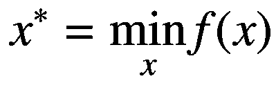

`x` 可以是标量（在 `ℝ`¹ 中）或向量（在 `ℝ`^`n` 中）。`f(x)` 始终为标量（在 `ℝ`¹ 中）。无约束优化在众多科学分支中都有应用。在金融领域，构建收益率曲线需要找到一组参数，以最小化债券理论价格与市场价格之间的差异。有约束优化问题也可以通过将其约束条件转换为等效无约束优化问题目标函数中的惩罚项，从而转化为无约束优化问题。此外，许多有约束优化求解器或算法都将求解无约束优化问题作为子问题。NM Dev 提供了一套优化器或最小化器，用于求解无约束优化问题，涵盖单变量和多变量问题，并且支持有无导数信息的情况。我们的实现及相应讨论主要基于 Antoniou & Lu (2007)。

## 9.1 暴力搜索

最简单且可能最容易理解的求解器是暴力搜索。即，我们只需遍历函数定义域内所有可能的 `x` 值，枚举所有可能的 `f(x)` 值。然后选择对应于最小 `f(x)` 的那个 `x` 值。可能存在多个解。然而，这种方法很少使用，因为它不切实际。一个要求是定义域必须是可枚举的。大多数实际优化问题都是在连续定义域（如实数域）上求解的。我们无法枚举无穷多个数。解决此问题的一种方法是离散化。我们从无限定义域中选取有限个点。例如，我们可以将单位区间 [0, 1] 离散化为 11 个离散值：0, 0.1, 0.2, …, 1.0。离散化最明显的缺点是，当所选点不包含最优答案时，我们很可能会得到一个次优解。事实上，如果定义域无界（如 (−∞, +∞)），如何选取包含解的点集并不明确。此外，除了极小规模的问题，其性能非常缓慢。假设我们要求解 10 个变量，那么问题的维度是 `n`¹⁰，其中 `n` 是为每个维度选择的离散点数量。问题的复杂度呈指数级增长。尽管如此，暴力搜索易于理解。因此我们首先从它开始。

以下 NM Dev 代码展示了一般情况下如何使用该库求解优化问题。假设我们要最小化函数 `f(x) = x`² − 4。

```
// 使用目标函数定义优化问题
OptimProblem problem = new OptimProblem() {
@Override
public int dimension() {
return 1;
}
@Override
public RealScalarFunction f() {
return new RealScalarFunction() {
// 目标函数
@Override
public Double evaluate(Vector v) {
double x = v.get(1);
Polynomial polynomial = new Polynomial(1, 0, -4); // f(x) = x² - 4
double fx = polynomial.evaluate(x);
return fx;
}
@Override
public int dimensionOfDomain() {
return 1;
}
@Override
public int dimensionOfRange() {
return 1;
}
};
}
};
// 设置要使用的求解器和解对象
DoubleBruteForceMinimizer solver = new DoubleBruteForceMinimizer(true);
BruteForceMinimizer.Solution soln = solver.solve(problem);
// 对于暴力搜索，我们需要显式枚举定义域中的值
List domain = new ArrayList();
domain.add(new DenseVector(-2.));
domain.add(new DenseVector(-1.));
domain.add(new DenseVector(0.)); // 最小值点
domain.add(new DenseVector(1.));
domain.add(new DenseVector(2.));
soln.setDomain(domain);
System.out.println(String.format("f(%s) = %f", soln.minimizer(), soln.min()));
```

输出结果如下：

```
f([0.000000] ) = -4.000000
```

在 NM Dev 中使用求解器解决优化问题需要以下几个步骤。

1. 通过实现 `OptimProblem` 接口来定义优化问题。我们在实现中给出目标函数。
2. 构造一个求解器，例如 `DoubleBruteForceMinimizer`。
3. 调用 `solve` 函数，使用优化问题从求解器构建一个 `Solution` 对象。换句话说，求解器对象是一个工厂，它为优化问题 `OptimProblem` 创建解 `Solution`。虽然求解器可以复用于其他问题，但一个解只对应一个问题。
4. 向 `Solution` 对象提供任何与问题相关的信息。在此处的暴力搜索案例中，我们需要提供一个待搜索的候选值列表。
5. 调用 `minimizer` 函数运行算法，计算最小值点 `x`^∗，或调用 `min` 函数返回函数 `f(x`^∗`)` 的最小值。

上述流程适用于 NM Dev 库中的所有求解器。所有 NM 求解器都执行最小化。要进行最大化，我们只需将目标函数乘以 -1 来取反。一般来说，`OptimProblem`、求解器和 `Solution` 的签名如下：

```java
public interface OptimProblem {
 /**
 * 获取变量的数量。
 *
 * @return 变量的数量。
 */
 public int dimension();
 /**
 * 获取目标函数。
 *
 * @return 目标函数
 */
 public RealScalarFunction f();
}
public interface MultivariateMinimizer> extends Minimizer {
 /**
 * 求解一个优化问题，例如 {@link OptimProblem}。
 *
 * @param problem 一个优化问题
 * @return 优化问题的解
 * @throws Exception 求解问题时出错
 */
 public S solve(P problem) throws Exception;
}
public interface MinimizationSolution {
 /**
 * 获取找到的（近似）最小值。
 *
 * @return 找到的（近似）最小值
 */
 public double minimum();
 /**
 * 获取最小化问题的最优解（解向量）。
 *
 * @return 最优解
 */
 public T minimizer();
}
```

`DoubleBruteForceMinimizer` 的签名如下：

```java
public DoubleBruteForceMinimizer(boolean isParallel);
@Override
public BruteForceMinimizer.Solution solve(OptimProblem problem) throws Exception
```

当 `isParallel` 标志设置为 `true` 时，代码将使用多线程并行执行搜索，在所有可用线程上搜索所有提供的域值。

暴力搜索可用于求解单变量优化问题（如前面的示例），也可用于求解多变量优化问题。以下是求解 *f*(*x*, *y*) = *x*² + *y*² 的示例。

```markdown
## 9.2 `C2OptimProblem`

对于大多数情况，`OptimProblem` 类设置起来有些困难，使用也不方便。C⁰ 函数是连续函数。C¹ 函数是光滑函数。C² 函数是连续、光滑且具有二阶导数的函数。它也被称为二阶可微函数。如果我们要优化这样的函数，`C2OptimProblemImpl` 提供了一个便捷的包装器来创建 `OptimProblem` 对象。其签名如下：

```java
/**
 * 构造一个具有目标函数的优化问题。
 * 如果需要，会使用数值梯度和数值海森矩阵。
 *
 * @param f 要最小化的目标函数
 */
public C2OptimProblemImpl(RealScalarFunction f)
```

我们可以使用大大简化的代码重写前面的示例。

对于单变量函数 `f(x) = x² - 4`，代码是这样的：

```java
// 设置要使用的求解器和解
DoubleBruteForceMinimizer solver = new DoubleBruteForceMinimizer(false);
BruteForceMinimizer.Solution soln
 = solver.solve(new C2OptimProblemImpl(new Polynomial(1, 0, -4))); // f(x) = x² - 4
// 对于暴力搜索，我们需要显式枚举域中的值
List domain = new ArrayList();
domain.add(new DenseVector(-2.));
domain.add(new DenseVector(-1.));
domain.add(new DenseVector(0.)); // 最优解
domain.add(new DenseVector(1.));
domain.add(new DenseVector(2.));
soln.setDomain(domain);
System.out.println(String.format("f(%s) = %f", soln.minimizer(), soln.min()));
```

输出如下：

```
f([0.000000] ) = -4.000000
```

对于多变量函数 `f(x, y) = x² + y²`，代码是这样的：

```java
DoubleBruteForceMinimizer bf = new DoubleBruteForceMinimizer(true);
BruteForceMinimizer.Solution soln = bf.solve(
 new C2OptimProblemImpl(
 new AbstractBivariateRealFunction() {
 @Override
 public double evaluate(double x, double y) {
 double fx = x * x + y * y;
 return fx;
 }
 }));
List domain = new ArrayList();
domain.add(new DenseVector(-2., -2.));
domain.add(new DenseVector(-1., -1.));
domain.add(new DenseVector(0., 0.)); // 最优解
domain.add(new DenseVector(1., 1.));
domain.add(new DenseVector(2., 2.));
soln.setDomain(domain);
System.out.println(String.format("f(%s) = %f", soln.minimizer(), soln.min()));
```

输出如下：

```
f([0.000000, 0.000000] ) = 0.000000
```

## 9.3 括号法

单变量方法用于求解单变量无约束优化问题。一个快速的单变量方法在优化中至关重要。多变量约束优化问题通常可以转化为等价的多变量无约束优化问题。求解多变量无约束优化问题通常涉及求解多个单变量无约束优化问题，例如线搜索。后续章节中讨论的许多多变量无约束优化算法都使用了线搜索。

一种最简单的单变量算法是括号搜索法。假设我们有一个包含极小值点的三点括号区间 `x[L] < x[a] < x[U]`，并且假设区间 `[x[L], x[U]]` 包含一个极小值点。我们根据某种区间划分方案计算第四个点 `x[b]`，从而形成两个重叠的子区间：`[x[L], x[a]]` 和 `[x[b], x[U]]`。选择包含新极小值点的那个更小子区间。重复此划分过程，直到收敛，即当所选子区间足够小时停止。该算法对于区间 `[x[L], x[U]]` 上的单峰函数最为有效。单峰函数是指从 `x[L]` 开始递增（或递减）直到某一点，然后向 `x[U]` 方向递减（递增）的函数。该函数在区间内恰好包含一个极小值点（或极大值点）。

考虑一个在区间 `[x[L], x[U]]` 内存在极小值点的单峰函数。该区间称为不确定区间。利用四个点 `f(x[L])`、`f(x[a])`、`f(x[b])` 和 `f(x[U])` 的函数值，我们能够确定这个极小值点的位置。二分法搜索指出：如果 `f(x[a]) < f(x[b])`，则 `x*` 位于区间 `x[L] < x* < x[b]` 内。这里存在两种可能性：要么 `x[L] < x* < x[b]`（如蓝色曲线所示），要么 `x[a] < x* < x[b]`（如橙色曲线所示）。综合这两种情况可得 `x[L] < x* < x[b]`。见图 9-1。

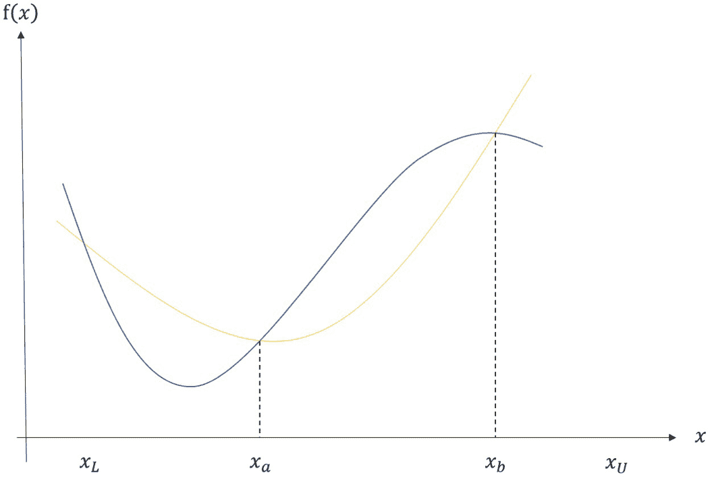

图 9-1

`x*` 在左侧区间

类似地，如果 `f(x[a]) > f(x[b])`，则我们有 `x[a] < x* < x[U]`，如图 9-2 所示。

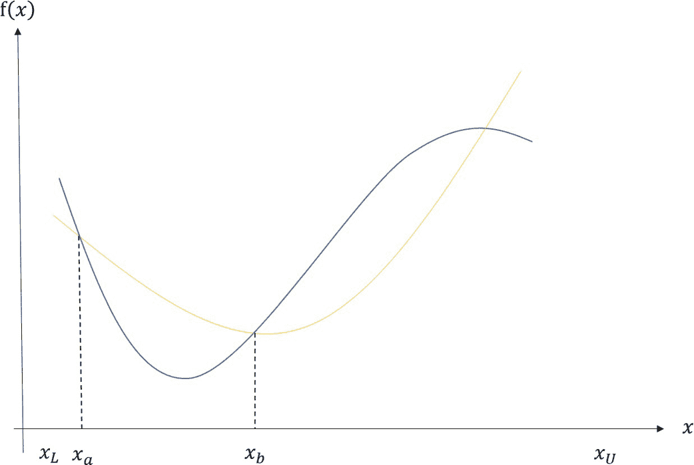

图 9-2

`x*` 在右侧区间

如果 `f(x[a]) = f(x[b])`，则我们有 `x[a] < x* < x[b]`。见图 9-3。

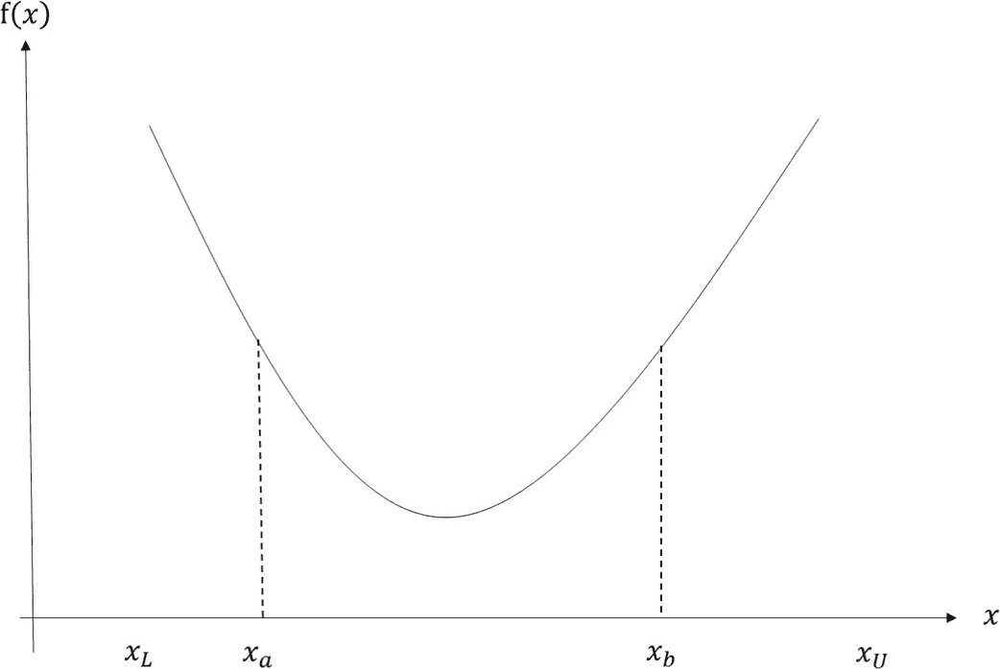

图 9-3

`x[a] < x* < x[b]`
```

一种简单的二分法搜索可以每次将区间大致二等分。这些（子）区间的大小呈指数级减小（每次迭代减半）。大约经过七次迭代后，区间大小将缩小到初始区间的 1% 以下。每次迭代需要计算两次函数值 `f(x[a])` 和 `f(x[b])`，因此总共需要进行 14 次函数评估。`NM Dev` 实现了两种更复杂的区间划分方案。

### 9.3.1 斐波那契搜索法

我们先对区间大小进行分析。为简单起见，假设左右子区间的长度相等。见图 9-4。

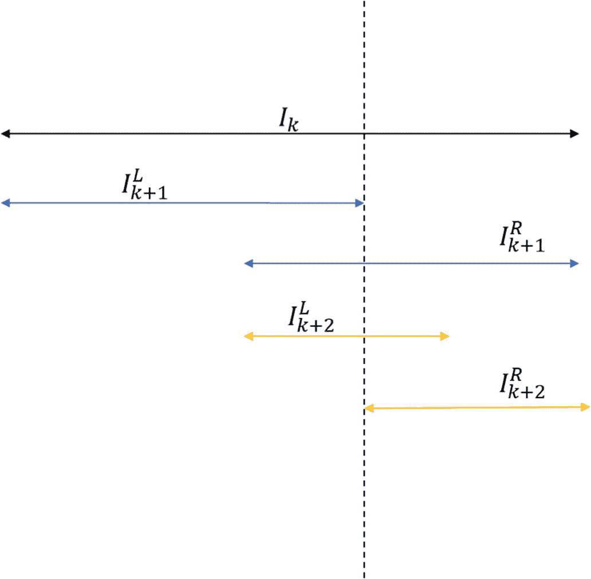

图 9-4

第 k、k+1、k+2 次迭代中的子区间

我们有以下关系：

```
I_{k+1} = I_{k+1}^L = I_{k+1}^R
```

```
I_k = I_{k+1}^L + I_{k+2}^R = I_{k+1} + I_{k+2}
```

对于 `n` 次迭代，我们有如下的递推关系：

```
I_1 = I_2 + I_3
```

```
I_2 = I_3 + I_4
```

```
...
```

```
I_n = I_{n+1} + I_{n+2}
```

这里有 `n` 个方程，假设 `I[1]` 已知。未知变量共有 `n + 2` 个。我们可以施加一个额外的条件来生成一系列区间。

特别地，如果我们假设最后一次迭代中的区间消失（即 `I[n + 2] = 0`），则会生成斐波那契数列。

求解上述方程组可得：

```
I_{n+1} = F_0 I_n
```

```
I_n = F_0 I_n
```

```
I_k = F_{n-k+1} I_n
```

```
I_1 = F_n I_n
```

其中

```
F_k = F_{k-1} + F_{k-2}, k >= 2
```

`F[k]` 是斐波那契数列的定义，即 {1, 1, 2, 3, 5, 8, 13, ...}。

例如，如果 `n = 11`，则 `F[n] = 144`。`I[n] = I[1] / F[n]`。`I[n]` 减小到 `I[1]` 的 0.69%。此外，通过选择左侧或右侧子区间，我们已有两个端点和一个位于其间的点，即 `{x[L], x[a], x[b]}` 或 `{x[a], x[b], x[U]}`。因此我们只需要再增加一个点，从而只需计算一次函数值。对于 11 次迭代，总共需要进行 14 次计算，而相比之下，简单的二分法搜索需要 22 次计算。

使用斐波那契数列的一个主要缺点是它需要预先知道 `n` 的值。如果希望 `x*` 达到某个预设精度，这是可行的。我们利用 `I[n] = I[1] / F[n]` 来确定 `n`。然而，如果希望 `f(x*)` 达到某个精度，我们事先无法知道 `n` 应该是多少。

### 9.3.2 黄金分割搜索

与斐波那契分割法不同，黄金分割搜索会持续迭代直至达到函数精度。其递推关系与斐波那契方法相同：`I[k] = I[k - 1] + I[k - 2]`。附加条件是保持两个相邻区间的比率恒定。

`I_k / I_{k+1} = K, ∀k`

利用这两个方程，我们可以解出`K`，如下所示：

`K² = K + 1`

`K = (1 + √5) / 2 ≈ 1.618034`

这个数被称为黄金比例。区间序列如下所示：

`{I_1, I_1/K, I_1/K², ..., I_1/K^(n-1)}`

这里给出一个例子：`{100, 61.8, 38.2, 23.6, 14.6, 9, …}`。这个过程可以继续进行，无需预先设定`n`。

我们可以比较黄金分割搜索与斐波那契搜索的效率。`F[n]`和`K`之间的关系是`F_n ≈ K^(n+1) / √5`。斐波那契搜索的不确定区间如下：

`Λ_F = I_n = I_1 / F_n ≈ (√5 / K^(n+1)) * I_1`

对于黄金分割搜索，其不确定区间如下：

`Λ_G = I_n = I_1 / K^(n+1)`

因此，我们得到以下关系：

`Λ_G / Λ_F = K² / √5 = 1.17`

所以，要达到与斐波那契搜索相同的精度，黄金分割搜索需要更多的迭代次数。斐波那契搜索效率更高，但黄金分割搜索无需预先知道`n`的值。

### 9.3.3 Brent 搜索

黄金分割搜索具有线性收敛速度。我们接下来要讨论的抛物线搜索的收敛速度为 1.325，因此效率更高。在每个包围区间内，我们再次选择三个点：`x[L] < x[m] < x[U]`。我们用一个二次多项式（即抛物线）来近似该区间内的函数。

`p(x) = a_0 + a_1*x + a_2*x²`

利用这三个点，我们可以通过求解一个包含三个线性方程的方程组来确定多项式的系数。`p(x)`的最小值点`x̄`可以通过求解其一阶导数为零轻松得到。

`x̄ = -a_1 / (2*a_2)`

根据泰勒展开式，`x̄`将足够接近`x∗`；事实上，如果函数是二次的，它将是精确的。通过检查`x̄`，我们可以拒绝`x[L]`或`x[U]`并保留`x̄`，从而选择一个新的区间。重复此过程，直到所有三个点都足够接近（`x∗`）。参见图 9-5。

图 9-5：曲线段的抛物线近似

虽然抛物线搜索具有超线性收敛速度，但它并不总是收敛（即使是对局部最小值也是如此）。例如，如果三个点共线，得到的抛物线是退化的，因此无法提供新的候选点。因此，这种方法很少单独使用。

`Brent` 方法结合了抛物线搜索和黄金分割搜索。`Brent` 方法在适用时（例如，没有两个点相同）使用抛物线搜索。当条件不满足时，它会切换回使用黄金分割搜索。换句话说，`Brent` 方法结合了两者的优点：超线性收敛速度和保证找到最小值。因此，在实践中，我们几乎总是默认使用 `Brent` 搜索来进行单变量优化。参见图 9-6。

图 9-6：对数伽马函数

以下 `NM Dev` 代码使用斐波那契搜索、黄金分割搜索和 `Brent` 搜索来求解对数伽马函数：

```
LogGamma logGamma = new LogGamma(); // 对数伽马函数
BracketSearchMinimizer solver1 = new FibonaccMinimizer(1e-8, 15);
UnivariateMinimizer.Solution soln1 = solver1.solve(logGamma);
double x_min_1 = soln1.search(0, 5);
System.out.println(String.format("f(%f) = %f", x_min_1, logGamma.evaluate(x_min_1)));
BracketSearchMinimizer solver2 = new GoldenMinimizer(1e-8, 15);
UnivariateMinimizer.Solution soln2 = solver2.solve(logGamma);
double x_min_2 = soln2.search(0, 5);
System.out.println(String.format("f(%f) = %f", x_min_2, logGamma.evaluate(x_min_2)));
BracketSearchMinimizer solver3 = new BrentMinimizer(1e-8, 10);
UnivariateMinimizer.Solution soln3 = solver3.solve(logGamma);
double x_min_3 = soln3.search(0, 5);
System.out.println(String.format("f(%f) = %f", x_min_3, logGamma.evaluate(x_min_3)));
```

输出如下：

```
f(1.463682) = -0.121484
f(1.460813) = -0.121486
f(1.461632) = -0.121486
```

它们的构造函数签名如下：

```markdown
/**
 * 使用斐波那契方法构造一个单变量极小化器。
 *
 * @param epsilon 精度参数：当一个数 |x| ≤ ε 时，视为 0
 * @param maxIterations 最大迭代次数
 */
public FibonaccMinimizer(double epsilon, int maxIterations)

/**
 * 使用黄金分割方法构造一个单变量极小化器。
 *
 * @param epsilon 精度参数：当一个数 |x| ≤ ε 时，视为 0
 * @param maxIterations 最大迭代次数
 */
public GoldenMinimizer(double epsilon, int maxIterations)

/**
 * 使用 Brent 算法构造一个单变量极小化器。
 *
 * @param epsilon 精度参数：当一个数 |x| ≤ ε 时，视为 0
 * @param maxIterations 最大迭代次数
 */
public BrentMinimizer(double epsilon, int maxIterations)

/**
 * 单变量极小化问题的解。
 */
public static interface Solution extends MinimizationSolution {
    /**
     * 在区间 [lower, upper] 内搜索最小值。
     *
     * @param lower 包含最小值的包围区间的下界
     * @param initial 初始猜测值
     * @param upper 包含最小值的包围区间的上界
     * @return 近似的极小点
     */
    public double search(double lower, double initial, double upper);

    /**
     * 在区间 [lower, upper] 内搜索最小值。
     *
     * @param lower 包含最小值的包围区间的下界
     * @param upper 包含最小值的包围区间的上界
     * @return 近似的极小点
     */
    public double search(double lower, double upper);
}

我们调用 `search` 方法来寻找单变量函数极小化问题的一个极小点。

## 9.4 最速下降法

寻找最小值的通用思路通常从一个初始点开始，然后调整某些参数来找到下一个（希望是）函数值更小的点。如果没有信息，盲目搜索的效率会很低。有两类信息非常有用：梯度 `g` 和海森矩阵 `H`。

最速下降算法是一类利用梯度和海森矩阵信息，沿着能使函数值下降最快的方向进行搜索的算法。我们首先讨论仅使用梯度信息的一阶方法。考虑以下优化问题：

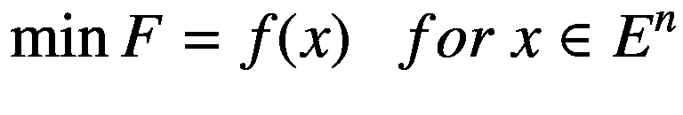

泰勒展开给出以下结果：

当 ∥`δ`∥ → 0 时，`F` + `ΔF` = `f(x + δ)` ≈ `f(x)` + `g^T δ` + `O(δ^T δ)`， `ΔF` ≈ `g^T δ`

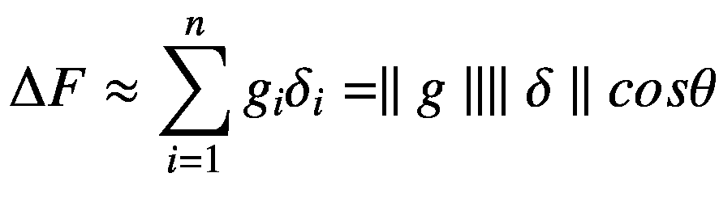

对于任意向量 `δ`，当 `θ = 0` 时 `ΔF` 最大，这意味着 `δ` 与 `g` 方向相同。当 `θ = π` 时 `ΔF` 最小，这意味着 `δ` 与 `g` 方向相反，或沿着 `-g` 方向。它们分别被称为最速上升方向和最速下降方向，如图 9-7 所示。

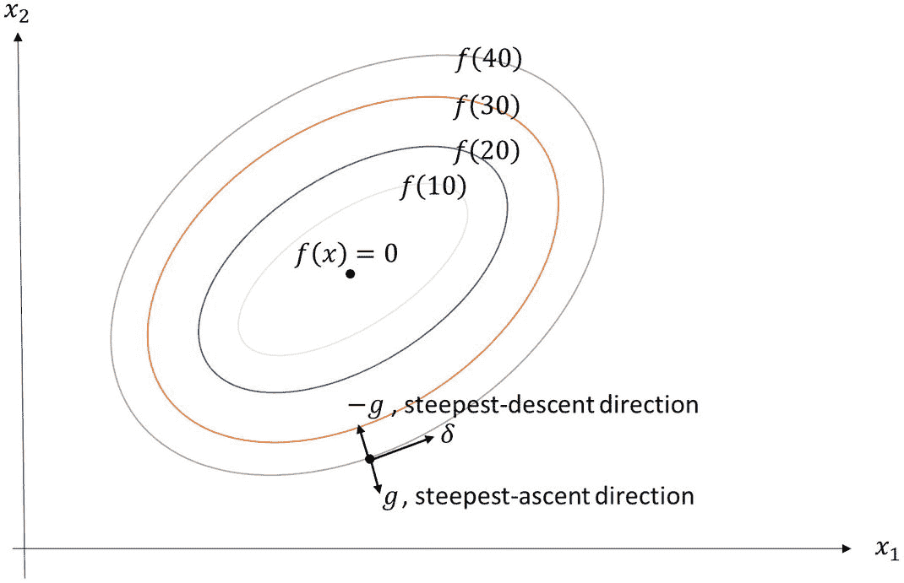
**图 9-7** 最速下降方向与最速上升方向

最速下降算法的一般框架如下：

1.  指定一个初始点 `x[0]` 和容差 `ε`。
2.  计算梯度 `g[k]`，并设置牛顿方向向量 `d[k] = -g[k]`。
3.  关于 `α` 最小化 `f(x[k] + α d[k])`，以计算增量 `α[k]`。
4.  设置下一个点 `x[k+1] = x[k] + α[k] d[k]`，并计算下一个函数值 `f[k+1] = f(x[k+1])`。
5.  如果 ∥`α[k] d[k]`∥ < `ε`，则：
    1.  完成。`x(*) = x[k+1]` 且 `f(x(*)) = f[k+1]`。
    2.  否则，重复步骤 2。

在步骤 3 中，可以使用单变量优化算法中的线搜索来计算 `α[k]`。在我们的实现中，我们使用了 `Fletcher` 的非精确线搜索方法。许多优化算法对线搜索的不精确性表现出相当高的容忍度。或者，`α[k]` 也可以通过解析方式计算。

以下 NM Dev 代码使用一阶最速下降法最小化该函数：

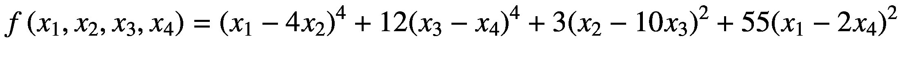
```

```
// 目标函数
// 全局最小值点位于 x = [0,0,0,0]
`RealScalarFunction` f = new `RealScalarFunction`() {
    @Override
    public Double evaluate(Vector x) {
        double x1 = x.get(1);
        double x2 = x.get(2);
        double x3 = x.get(3);
        double x4 = x.get(4);
        double result = pow(x1 - 4 * x2, 4);
        result += 12 * pow(x3 - x4, 4);
        result += 3 * pow(x2 - 10 * x3, 2);
        result += 55 * pow(x1 - 2 * x4, 2);
        return result;
    }
    @Override
    public int dimensionOfDomain() {
        return 4;
    }
    @Override
    public int dimensionOfRange() {
        return 1;
    }
};
// 梯度函数
`RealVectorFunction` g = new `RealVectorFunction`() {
    @Override
    public Vector evaluate(Vector x) {
        double x1 = x.get(1);
        double x2 = x.get(2);
        double x3 = x.get(3);
        double x4 = x.get(4);
        double[] result = new double[4];
        result[0] = 4 * pow(x1 - 4 * x2, 3) + 110 * (x1 - 2 * x4);
        result[1] = -16 * pow(x1 - 4 * x2, 3) + 6 * (x2 - 10 * x3);
        result[2] = 48 * pow(x3 - x4, 3) - 60 * (x2 - 10 * x3);
        result[3] = -48 * pow(x3 - x4, 3) - 220 * (x1 - 2 * x4);
        return new `DenseVector`(result);
    }
    @Override
    public int dimensionOfDomain() {
        return 4;
    }
    @Override
    public int dimensionOfRange() {
        return 4;
    }
};
`C2OptimProblem` problem = new `C2OptimProblemImpl`(f, g); // 仅使用梯度信息
`SteepestDescentMinimizer` firstOrderMinimizer
    = new `FirstOrderMinimizer`(
        `FirstOrderMinimizer.Method.IN_EXACT_LINE_SEARCH`, // `FirstOrderMinimizer.Method.ANALYTIC`
        1e-8,
    );
`IterativeSolution` soln = firstOrderMinimizer.solve(problem);
`Vector` xmin = soln.search(new `DenseVector`(new double[]{1, -1, -1, 1}));
double f_xmin = f.evaluate(xmin);
System.out.println(String.format("f(%s) = %f", xmin.toString(), f_xmin));
```

输出结果如下：

```
f([0.046380, 0.016330, 0.001634, 0.023189] ) = 0.000003
```

这大约需要 40,000 次迭代，速度非常慢。

`FirstOrderMinimizer` 的签名如下：

```
/**
 * 使用一阶方法构造一个多变量最小化器。
 *
 * @param method        执行线搜索的方法
 * @param epsilon       精度参数：当数值 |x| &le;
 *                      &epsilon; 时，视为 0
 * @param maxIterations 最大迭代次数
 */
public FirstOrderMinimizer(Method method, double epsilon, int maxIterations)
```

`Method` 指定是使用线搜索还是解析表达式来计算 `α[k]`。

### 9.4.1 牛顿-拉夫森方法

二阶方法除了使用梯度外，还利用（非奇异的）海森矩阵来确定最速下降框架中的方向向量 `d[k]` 和增量 `α[k]`，以加速收敛。牛顿-拉夫森方法将泰勒级数展开到二阶。设 `δ` 为 `x` 的变化量，我们有如下公式：

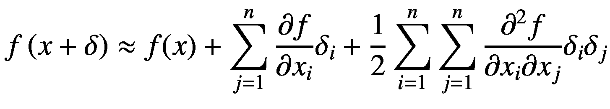

对 `f(x + δ)` 关于 `δ[k]` 求导以最小化 `f(x + δ)`，可得：

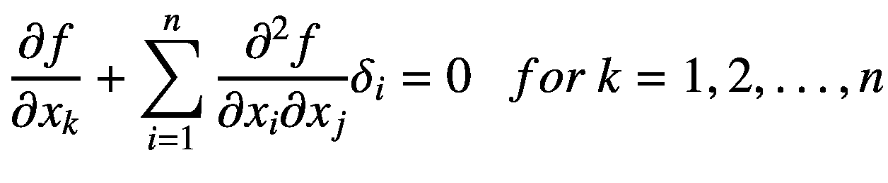

将其改写为矩阵形式如下：

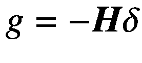

`x` 的最优变化量为：

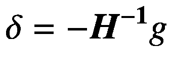

通过线搜索来计算沿该方向 `f(x)` 的最大减少量。下一个点 `x[k+1]` 为：

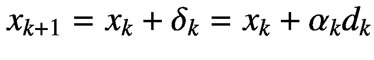

其中满足：

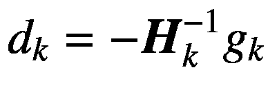

`α[k]` 是使 `f(x[k] + α * d[k])` 最小化的 `α`。

与一阶方法相比，牛顿-拉夫森方法利用海森矩阵信息来加速收敛，尤其是在接近最优解时。下面这段 NM Dev 代码使用牛顿-拉夫森方法最小化同一个函数：

## 牛顿-拉夫森方法

```java
// 目标函数
// 全局最小值点位于 x = [0,0,0,0]
RealScalarFunction f = new RealScalarFunction() {
@Override
public Double evaluate(Vector x) {
double x1 = x.get(1);
double x2 = x.get(2);
double x3 = x.get(3);
double x4 = x.get(4);
double result = pow(x1 - 4 * x2, 4);
result += 12 * pow(x3 - x4, 4);
result += 3 * pow(x2 - 10 * x3, 2);
result += 55 * pow(x1 - 2 * x4, 2);
return result;
}
@Override
public int dimensionOfDomain() {
return 4;
}
@Override
public int dimensionOfRange() {
return 1;
}
};
// 梯度函数
RealVectorFunction g = new RealVectorFunction() {
@Override
public Vector evaluate(Vector x) {
double x1 = x.get(1);
double x2 = x.get(2);
double x3 = x.get(3);
double x4 = x.get(4);
double[] result = new double[4];
result[0] = 4 * pow(x1 - 4 * x2, 3) + 110 * (x1 - 2 * x4);
result[1] = -16 * pow(x1 - 4 * x2, 3) + 6 * (x2 - 10 * x3);
result[2] = 48 * pow(x3 - x4, 3) - 60 * (x2 - 10 * x3);
result[3] = -48 * pow(x3 - x4, 3) - 220 * (x1 - 2 * x4);
return new DenseVector(result);
}
@Override
public int dimensionOfDomain() {
return 4;
}
@Override
public int dimensionOfRange() {
return 4;
}
};
C2OptimProblem problem = new C2OptimProblemImpl(f, g); // 使用数值海森矩阵
SteepestDescentMinimizer newtonRaphsonMinimizer
= new NewtonRaphsonMinimizer(
1e-8,

);
IterativeSolution soln = newtonRaphsonMinimizer.solve(problem);
Vector xmin = soln.search(new DenseVector(new double[]{1, -1, -1, 1}));
double f_xmin = f.evaluate(xmin);
System.out.println(String.format("f(%s) = %f", xmin.toString(), f_xmin));
```

输出结果如下：

```
f([0.000134, -0.000009, -0.000001, 0.000067] ) = 0.000000
```

值得指出的是，牛顿-拉夫森方法的收敛速度远快于一阶方法。它仅用 20 次迭代就能达到比 40,000 次迭代更好的精度。

`NewtonRaphsonMinimizer` 的签名如下：

```java
/**
* 使用牛顿-拉夫森方法构造一个多变量最小化器。
*
* @param epsilon       精度参数：当数值 |x| &le; &epsilon; 时，视为 0
* @param maxIterations 最大迭代次数
*/
public NewtonRaphsonMinimizer(double epsilon, int maxIterations)
```

### 9.4.2 高斯-牛顿法

高斯-牛顿法用于最小化如下形式的目标函数：

![$$ \boldsymbol{f}={\left[{f}_1(x)\kern0.5em {f}_2(x)\dots \dots \kern0.5em {f}_m(x)\right]}^T $$](images/500382_1_En_9_Chapter/500382_1_En_9_Chapter_TeX_Equae.png)

其解为一个点 `x`，使得所有 `fp` 同时归零。

我们可以构造一个实值函数 `F`，使得若 `F` 被最小化，则函数 `fp` 在最小二乘意义上也被最小化。

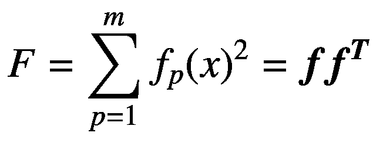

梯度的雅可比矩阵如下：

![$$ \mathbf{J}=\left[\begin{array}{ccc}\frac{\partial {f}_1}{\partial {x}_1}&amp; \cdots &amp; \frac{\partial {f}_m}{\partial {x}_1}\\ {}\vdots &amp; \ddots &amp; \vdots \\ {}\frac{\partial {f}_1}{\partial {x}_n}&amp; \cdots &amp; \frac{\partial {f}_m}{\partial {x}_n}\end{array}\right] $$](images/500382_1_En_9_Chapter/500382_1_En_9_Chapter_TeX_Equag.png)

对 `F` 关于 `x[i]` 求导，可得：

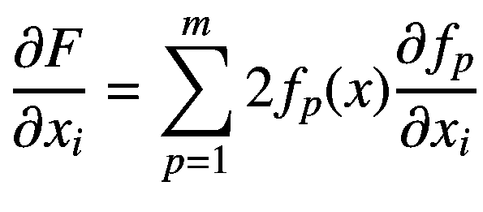

或者，以矩阵形式表示如下：

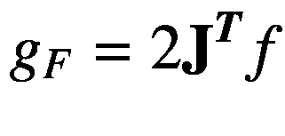

再次求导，可得：

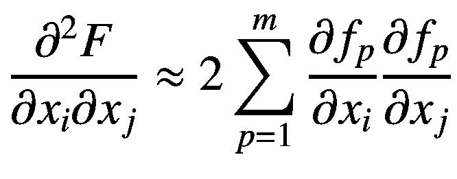

海森矩阵 `H[F]` 如下所示。它必须是非奇异且正定的。

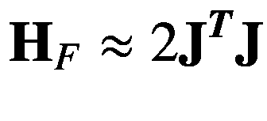

下一个点由以下递归关系给出：

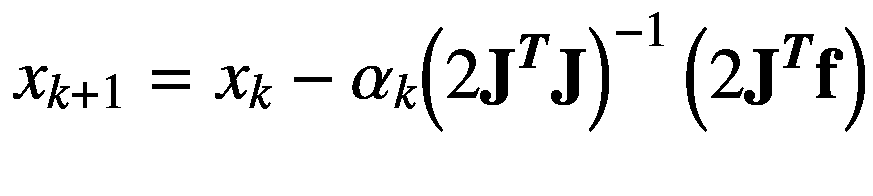

以下代码使用高斯-牛顿法求解相同的最小化问题：

# 目标函数与雅可比矩阵的定义

```
// 目标函数
// 全局最小值位于 x = [0,0,0,0]
RealVectorFunction f = new RealVectorFunction() {
@Override
public Vector evaluate(Vector x) {


double x1 = x.get(1);
double x2 = x.get(2);
double x3 = x.get(3);
double x4 = x.get(4);
double[] fx = new double[4];
fx[0] = pow(x1 - 4 * x2, 2);
fx[1] = sqrt(12) * pow(x3 - x4, 2);
fx[2] = sqrt(3) * (x2 - 10 * x3);
fx[3] = sqrt(55) * (x1 - 2 * x4);
return new DenseVector(fx);
}
@Override
public int dimensionOfDomain() {
return 4;
}
@Override
public int dimensionOfRange() {
return 4;
}
};
// 雅可比矩阵
RntoMatrix J = new RntoMatrix() {
@Override
public Matrix evaluate(Vector x) {
double x1 = x.get(1);
double x2 = x.get(2);
double x3 = x.get(3);
double x4 = x.get(4);
Matrix Jx = new DenseMatrix(4, 4);
double value = 2 * (x1 - 4 * x2);
Jx.set(1, 1, value);
value = -8 * (x1 - 4 * x2);
Jx.set(1, 2, value);
value = 2 * sqrt(12) * (x3 - x4);
Jx.set(2, 3, value);
Jx.set(2, 4, -value);
Jx.set(3, 2, sqrt(3));
Jx.set(3, 3, -10 * sqrt(3));
Jx.set(4, 1, sqrt(55));
Jx.set(4, 4, -2 * sqrt(55));
return Jx;
}
@Override
public int dimensionOfDomain() {
return 4;
}
@Override
public int dimensionOfRange() {
return 1;
}
};
```

`GaussNewtonMinimizer` `optim1 = new GaussNewtonMinimizer(1e-8, 10);`
`IterativeSolution` `soln = optim1.solve(f, J);// 解析梯度`
`Vector` `xmin = soln.search(new DenseVector(new double[]{1, -1, -1, 1}));`
`System.out.println(String.format("f(%s) = %s", xmin.toString(), f.evaluate(xmin).toString()));`

输出如下：

```
f([0.000007, -0.000000, -0.000000, 0.000003] ) = [0.000000, 0.000000, -0.000000, -0.000000]
```

高斯-牛顿法比牛顿-拉夫森法更高效。针对上述问题，前者大约需要 10 次迭代，而后者需要 20 次。

`GaussNewtonMinimizer` 的函数签名如下：

```
/**
* 使用高斯-牛顿法构造一个多变量最小化器。
*
* @param epsilon       一个精度参数：当数 |x| &le;
*                      &epsilon; 时，视为 0
* @param maxIterations 最大迭代次数
*/
public GaussNewtonMinimizer(double epsilon, int maxIterations)
```

## 9.5 共轭方向法

在最速下降法中，连续的搜索方向之间可能相关，也可能不相关。此外，它们完全由目标函数的局部性质（即梯度和海森矩阵）决定 (Hestenes & Stiefel, 1952)。另一方面，在共轭方向法中，连续的搜索方向之间存在严格的数学关系。共轭法最初是为求解具有以下目标函数的二次优化问题而开发的：

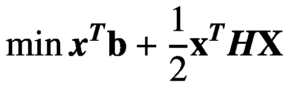

其中，对于一个 `n` 变量函数，`H` 是一个 `n` * `n` 的对称正定矩阵。

对于二次问题，搜索将在有限次迭代内收敛到最小值。此后，共轭法已被推广用于求解更一般的优化问题。

### 9.5.1 共轭方向

对于对称矩阵 `H`，一个有限的向量集合 `{d[0], d[1], ..., d[k]}` 被称为关于 `H` 共轭或 `H`-正交，如果对于所有 `i ≠ j` 均有 `d[i]^T Q d[j] = 0`。如果 `H` 是正定的，那么这些向量是线性无关的。如果 `H = I`，这些向量是正交的。

对于先前展示的二次型最小化问题，且当 `H` 是正定时，简单的微积分计算表明解是唯一的，并且可以通过求解一个线性方程组来解析计算。

```
H x* = b
```

由于共轭向量集合是线性无关的，因此它们张成了 *n* 维空间 *E*^*n*，`x*` 可以写成这些向量的线性组合形式。

```
x* = α0 d[0] + ... + αn-1 d[n-1]
```

两边同时乘以 `H`，再与 `d[i]` 取数量积得到下式：

```
αi = - (d[i]^T H x*) / (d[i]^T H d[i]) = - (d[i]^T b) / (d[i]^T H d[i])
```

或者等价地：

```
x* = Σ (i=0 to n-1) (d[i]^T b) / (d[i]^T H d[i]) * d[i]
```

`x*` 的这个展开式可以看作是逐步加上 `α[i] d[i]` 的一个求和过程或一个 *n* 步迭代过程。

**共轭方向定理**

设 `{d[i]}_ (i=0 to n-1)` 是一组非零的 `H`-正交向量。对于任意 `x[0] ∈ E^n`，根据下式生成的序列 `{x[i]}`：

```
x[k+1] = x[k] + αk d[k], k ≥ 0
```

结合下式：

```
αk = - (g[k]^T d[k]) / (d[k]^T H d[k])
```

以及下式：

```
g[k] = b + H x[k]
```

该序列在 *n* 步后收敛到 `Hx = b` 的唯一解 `x*`，即 `x[n] = x*`。

利用这个定理以及多种生成共轭向量的方法，可以设计出多种共轭方向方法。我们还需要将该定理推广以解决非二次型问题。共轭方向方法很好地契合了最速下降法的框架。它们的区别仅在于方向向量 `d[k]` 以及随之计算的步幅 `α[k]` 的方式不同。我们在这里使用共轭方向而不是最速下降方向。迭代地向 `x[k]` 添加增量 `α[k] d[k]` 以生成 `x[k+1]` 的思路是相同的。

### 9.5.2 共轭梯度法

Hestenes 和 Stiefel（1952）提出了共轭梯度法。在这种方法中，新方向是上一个方向与负梯度的加权和。

```
d[0] = -g[0] = -(b + H x[0])
```

```
d[k] = -g[k] + βk d[k-1]
```

```
g[k] = b + H x[k]
```

```
βk = (g[k]^T H d[k]) / (d[k]^T H d[k])
```

```
αk = - (g[k]^T d[k]) / (d[k]^T H d[k])
```

这种方法具有以下优点：

-  梯度是有限的，并且与所有之前的方向向量线性无关，除非找到了解。

-  计算新方向向量相对容易。

-  无需线搜索。

-  对于二次型问题，它在 *n* 步内收敛。

-  第一个方向与最速下降法相同，即 `d[0] = -g[0]`，并且它能带来首次较好的优化效果。

-  无需对 Hessian 矩阵求逆。

以下是其缺点：

-  必须提供、存储和操纵 Hessian 矩阵。

-  对于非二次型问题，收敛性无法保证。实际上，如果初始点远离最优解，搜索可能会游荡在某个次优区域，因为不可靠的方向会随着迭代次数增加而累积。正如我们稍后从代码示例中看到的，对于 Himmelblau 函数，共轭梯度法需要最多的迭代次数才能收敛。

### 9.5.3 Fletcher-Reeves 方法

Fletcher-Reeves 方法是共轭梯度法的一个变体。主要区别在于，`α[k]` 是通过最小化 `f(X + α[k] d[k])` 进行线搜索来计算的，并且 `d[k]` 是关于 `{d[0], d[1], ..., d[k]}` 的共轭方向，而不是最速下降方向或牛顿方向。因此，该算法与共轭梯度法的算法类似，但由于线搜索需要更多的计算量，这是一个缺点。然而，它有两个优点。

- 对于非二次型函数的最小化，这种修改效果更好，因为在远离解邻域的点上，沿着 `d[k]` 可以使 `f(x)` 获得更大的降低。
- 该算法不需要 Hessian 矩阵。

### 9.5.4 鲍威尔法

鲍威尔算法通过线性搜索生成一系列共轭方向。

设 `x_a*` 和 `x_b*` 是当以下凸二次函数：
```
f(x) = x^T b + 1/2 x^T H x
```
在方向 `d[a]` 和 `d[b]` 上关于 `α` 进行最小化时得到的极小点：
```
x = x_a + α d_a
```
以及如下形式：
```
x = x_b + α d_b
```
如果 `d[a] = d[b]`，则向量 `x_b* - x_a*` 与 `d[a]` 共轭。见图 9-8。

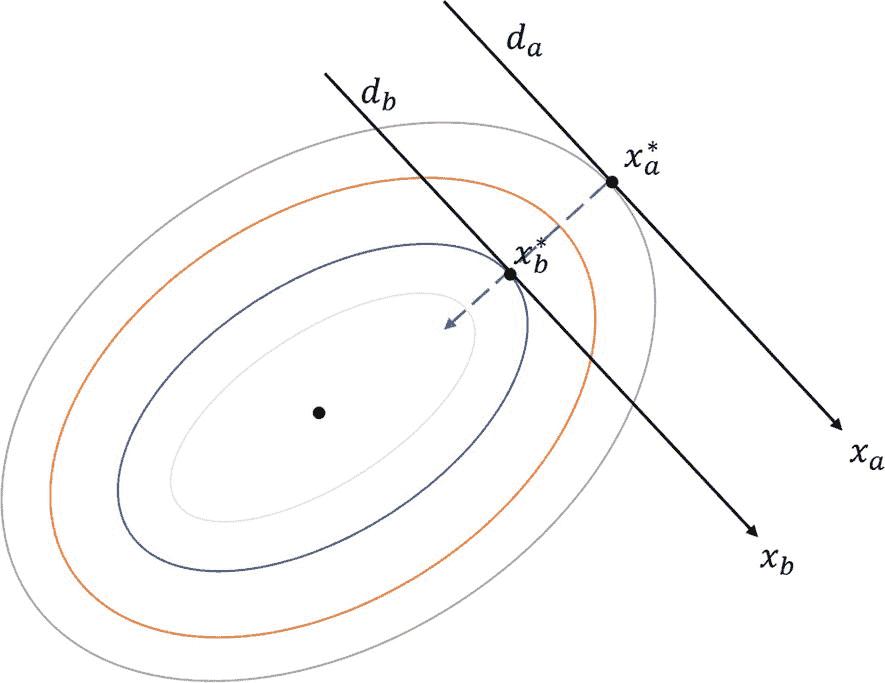

在该算法中，假设初始点 `x[00]` 和 `n` 个线性无关的方向 `{d[0], d[1], …, d[n]}`（通常取坐标方向），并在每次迭代中执行一系列线性搜索。在第一次迭代中，从点 `x[00]` 开始，依次沿方向 `{d[0], d[1], …, d[n]}` 对 `f(x)` 进行最小化，得到点 `x[01], x[02], …, x[0n]`。然后生成一个新方向 `d[0(n+1)]` 如下：
```
d[0(n+1)] = x[0n] - x[00]
```
并沿该方向对 `f(x)` 进行最小化，得到新点 `x[0(n+1)]`。方向更新如下（见图 9-9）：
```
d[11] = d[02]
d[12] = d[03]
…
d[1(n-1)] = d[0n]
d[1n] = d[0(n+1)]
```
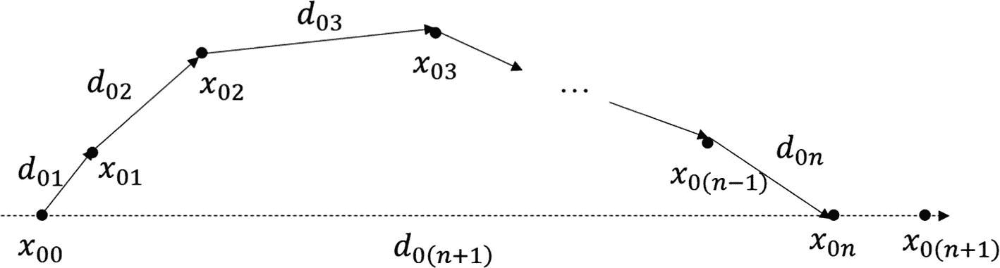

以点 `x[10] = x[0(n+1)]` 开始的第二次迭代重复相同过程。依次沿方向 `{d[11], d[12], …, d[1n]}` 对 `f(x)` 进行最小化，得到点 `x[11], x[12], …, x[1n]`。然后生成一个新方向 `d[1(n+1)]` 如下（见图 9-10）：
```
d[1(n+1)] = x[1n] - x[10]
```
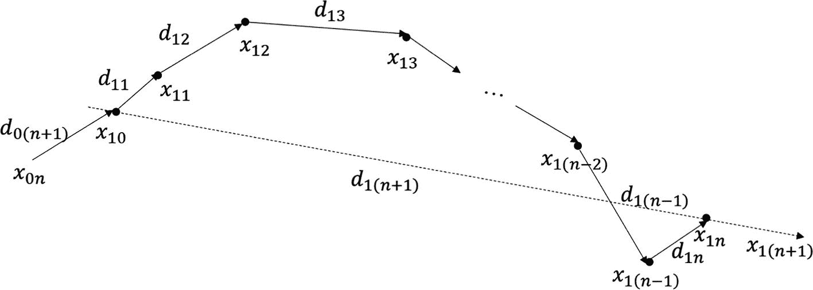

依此类推，每次新迭代会增加一个共轭方向并移除另一个方向，从而完成一次替换。由于每次迭代需要 `(n + 1)` 次线性搜索，鲍威尔法在 `n` 次迭代中共执行 `n(n + 1)` 次线性搜索。

鲍威尔法的优点在于无需提供、存储或操作 Hessian 矩阵，甚至不需要梯度。然而，该方法可能无法生成一组跨越 `E^n` 的线性无关方向，且算法可能不收敛到解。

### Zangwill 方法

Zangwill 算法是 Powell 算法的改进版本。其改进之处在于生成一组始终线性无关的共轭方向。因此，它消除了 Powell 算法中的缺点。

改进措施如下：首先，选择坐标方向集，使其行列式为 1。其次，将新方向归一化为单位长度。第三，方向替换必须确保方向向量矩阵的行列式为正且仍小于或等于 1。最后一项保证了方向向量始终线性无关。

以下代码用于最小化 Himmelblau 函数（见图 9-11）：
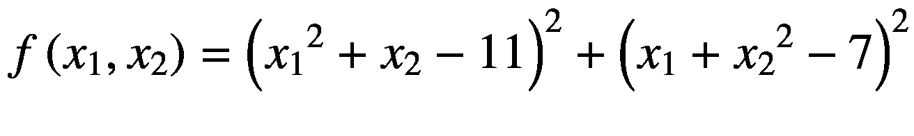
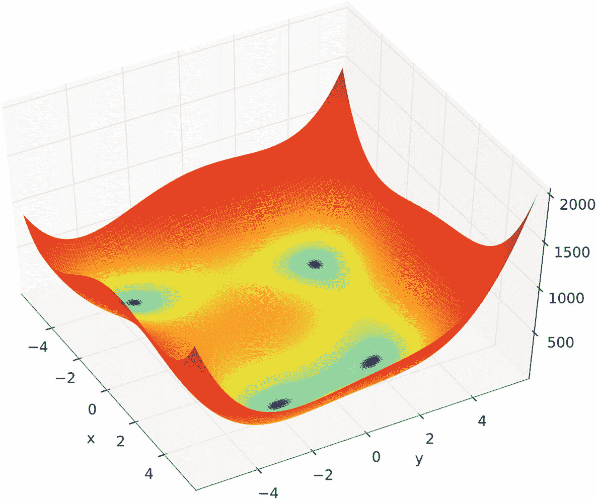
图 9-11 具有四个极小点的 Himmelblau 函数

### Himmelblau 函数

```java
/**
 * Himmelblau 函数：
 * f(x) = (x1² + x2 - 11)² + (x1 + x2² - 7)²
 */
RealScalarFunction f = new RealScalarFunction() {
    @Override
    public Double evaluate(Vector x) {
        double x1 = x.get(1);
        double x2 = x.get(2);
        double result = pow(x1 * x1 + x2 - 11, 2);
        result += pow(x1 + x2 * x2 - 7, 2);
        return result;
    }

    @Override
    public int dimensionOfDomain() {
        return 2;
    }

    @Override
    public int dimensionOfRange() {
        return 1;
    }
};

RealVectorFunction g = new RealVectorFunction() {
    @Override
    public Vector evaluate(Vector x) {
        double x1 = x.get(1);
        double x2 = x.get(2);
        double w1 = x1 * x1 + x2 - 11;
        double w2 = x1 + x2 * x2 - 7;
        double[] result = new double[2];
        result[0] = 4 * w1 * x1 + 2 * w2;
        result[1] = 2 * w1 + 4 * w2 * x2;
        return new DenseVector(result);
    }

    @Override
    public int dimensionOfDomain() {
        return 2;
    }

    @Override
    public int dimensionOfRange() {
        return 2;
    }
};

RntoMatrix H = new RntoMatrix() {
    @Override
    public Matrix evaluate(Vector x) {
        double x1 = x.get(1);
        double x2 = x.get(2);
        Matrix result = new DenseMatrix(2, 2);
        result.set(1, 1, 12 * x1 * x1 + 4 * x2 - 42);
        result.set(1, 2, 4 * (x1 + x2));
        result.set(2, 1, result.get(1, 2));
        result.set(2, 2, 4 * x1 + 12 * x2 * x2 - 26);
        return result;
    }

    @Override
    public int dimensionOfDomain() {
        return 2;
    }

    @Override
    public int dimensionOfRange() {
        return 1;
    }
};

C2OptimProblemImpl problem = new C2OptimProblemImpl(f, g, H);

ConjugateGradientMinimizer ConjugateGradientMinimizer
    = new ConjugateGradientMinimizer(1e-16, 40);
IterativeSolution soln1 = ConjugateGradientMinimizer.solve(problem);
Vector xmin1 = soln1.search(new DenseVector(new double[]{6, 6}));
double f_xmin1 = f.evaluate(xmin1);
System.out.println(String.format("f(%s) = %.16f", xmin1.toString(), f_xmin1));

ConjugateGradientMinimizer fletcherReevesMinimizer
    = new FletcherReevesMinimizer(1e-16, 20);
IterativeSolution soln2 = fletcherReevesMinimizer.solve(problem);
Vector xmin2 = soln2.search(new DenseVector(new double[]{6, 6}));
double f_xmin2 = f.evaluate(xmin2);
System.out.println(String.format("f(%s) = %.16f", xmin2.toString(), f_xmin2));

SteepestDescentMinimizer powellMinimizer
    = new PowellMinimizer(1e-16, 20);
IterativeSolution soln3 = powellMinimizer.solve(problem);
Vector xmin3 = soln3.search(new DenseVector(new double[]{6, 6}));
double f_xmin3 = f.evaluate(xmin3);
System.out.println(String.format("f(%s) = %.16f", xmin3.toString(), f_xmin3));

SteepestDescentMinimizer zangwillMinimizer
    = new ZangwillMinimizer(1e-16, 1e-16, 20);
IterativeSolution soln4 = zangwillMinimizer.solve(problem);
Vector xmin4 = soln4.search(new DenseVector(new double[]{6, 6}));
double f_xmin4 = f.evaluate(xmin4);
System.out.println(String.format("f(%s) = %.16f", xmin4.toString(), f_xmin4));
```

输出结果如下：
```
f([3.000000, 2.000000] ) = 0.0000000000013999
f([3.000002, 1.999998] ) = 0.0000000001278725
f([-2.805114, 3.131310] ) = 0.0000000007791914
f([-2.805117, 3.131311] ) = 0.0000000001359077
```

找到的两个极小点为 `(3, 2)` 和 `(−2.805118, 3.131312)`。

这些极小化器的签名如下：

```java
/**
 * 使用共轭梯度法构造一个多变量极小化器。
 *
 * @param epsilon       精度参数：当数 |x| &le;
 *                      &epsilon; 时，视其为 0
 * @param maxIterations 最大迭代次数
 */
public ConjugateGradientMinimizer(double epsilon, int maxIterations)

/**
 * 使用 Fletcher-Reeves 方法构造一个多变量极小化器。
 *
 * @param epsilon       精度参数：当数 |x| &le;
 *                      &epsilon; 时，视其为 0
 * @param maxIterations 最大迭代次数
 */
public FletcherReevesMinimizer(double epsilon, int maxIterations)

/**
 * 使用 Powell 方法构造一个多变量极小化器。
 *
 * @param epsilon       精度参数：当数 |x| &le;
 *                      &epsilon; 时，视其为 0
 * @param maxIterations 最大迭代次数
 */
public PowellMinimizer(double epsilon, int maxIterations)

/**
 * 使用 Zangwill 方法构造一个多变量极小化器。
 *
 * @param epsilon       精度参数：当数 |x| &le;
 *                      &epsilon; 时，视其为 0
 * @param epsilon2      精度参数，用于判断共轭方向之间是否存在线性相关
 * @param maxIterations 最大迭代次数
 */
public ZangwillMinimizer(double epsilon, double epsilon2, int maxIterations)
```

## 9.6 拟牛顿法

拟牛顿法是另一类不需要显式计算海森矩阵的算法框架。它建立在第 9.4.1 节中的牛顿法基础之上，不同之处在于其搜索方向基于一个 `n` × `n` 矩阵 `S`，该矩阵的作用与牛顿法中的海森矩阵逆矩阵相同。即：

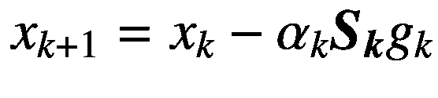

当 `S[k] = I` 时，该算法即为最速下降法。当 `S[k] = H^(-1)` 时，该算法即为牛顿法。当海森矩阵不可用时，`S` 根据现有数据推导得出，旨在近似 `H^(-1)`。事实上，可以证明，当 `S[k] = H^(-1)` 时，上述更新 `x[k+1]` 的算法收敛最快。拟牛顿法结合了最速下降法和共轭方向法的优点，并采用了有效的方向更新规则。它是本章讨论的所有方法中最高效的，并被广泛应用于众多实际应用中。

假设连续的 `x[k]` 之差如下：

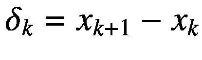

连续的梯度 `g[k]` 之差如下：

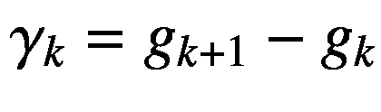

于是我们得到：

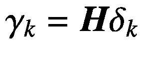

牛顿法按如下方式确定方向向量：

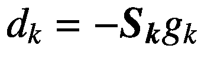

步长 `α[k]` 可以通过最小化以下函数的一维搜索来确定：

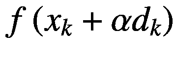

我们希望避免在每次迭代中计算诸如 `S[k] = H^(-1)` 这样的矩阵求逆，并检查 `S[k]` 是否正定。我们希望有一个简单的 `S[k+1]` 更新规则。

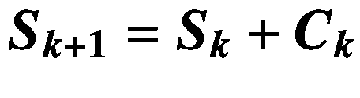

`C[k]` 是一个 `n` × `n` 的校正矩阵，可由现有数据计算得出。在任何 `C[k]` 的定义中，`S[k+1]` 必须满足以下三个性质：

- `S[k+1]γ[k] = δ[k]`。
- 向量序列 `{δ[0], δ[1], ⋯, δ[n-1]}` 必须是共轭方向。
- 一个正定的 `S[k]` 必须能产生一个正定的 `S[k+1]`。

第二个性质确保了共轭方向搜索的优良特性同样适用于拟牛顿搜索。第三个性质保证了每次迭代中方向向量的有效性。定义 `C[k]` 的方式有很多种，由此衍生出拟牛顿法的不同变体。在本节中，我们将根据它们计算 `C[k]` 或更新 `S[k]` 的方式，介绍几种变体。

### 9.6.1 秩一方法

秩一方法的特点在于校正矩阵 `C[k]` 的秩为 1。

假设：

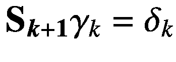

令：

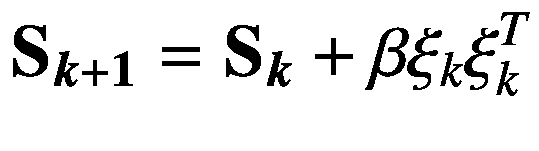

`ξ[k]` 是一个列向量，`β[k]` 是一个常数。校正矩阵 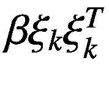 是对称的，并且秩为 1。将上述两个方程结合起来，我们得到：

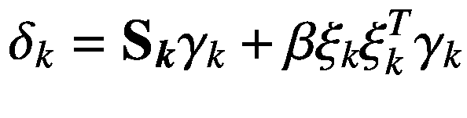

并且有：

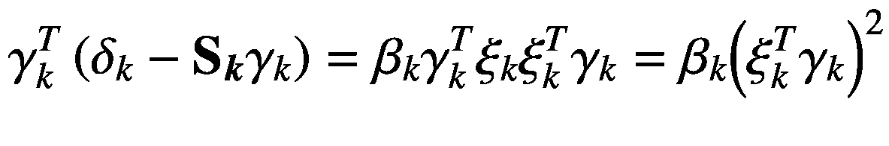

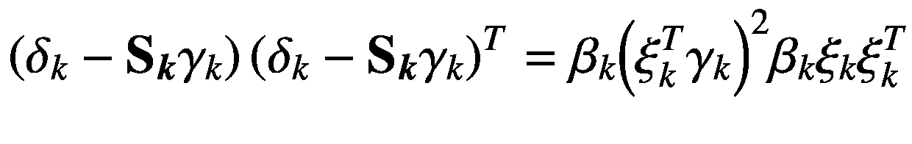

于是我们得到：

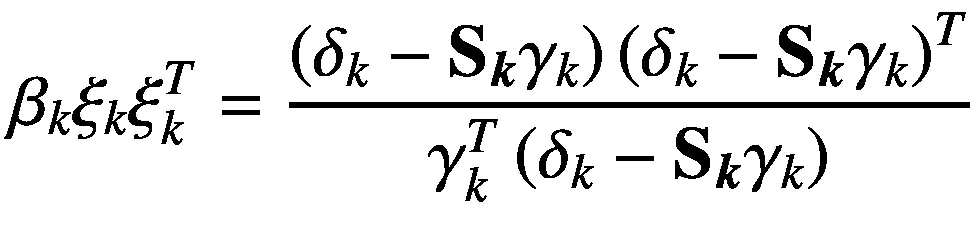

因此，我们有：


这种方法存在两个严重问题。首先，一个正定的 `S[k]` 可能无法产生正定的 `S[k+1]`。如果发生这种情况，下一个方向就不是一个好的方向。其次，校正公式中的分母可能趋近于零或等于零。如果发生这种情况，该方法会因 `S[k+1]` 未定义而失效。

### 9.6.2 戴维登-弗莱彻-鲍威尔方法

戴维登-弗莱彻-鲍威尔（DFP）方法与秩一方法类似，但它有一个重要优势：如果初始矩阵 `S[0]` 是正定的，那么后续的矩阵总是正定的。与秩一方法不同，该方法中每个新方向都是下降方向。

DFP 更新公式如下：


该校正项是一个秩为 2 的 `n` × `n` 对称矩阵。

### 9.6.3 布罗伊登-弗莱彻-戈德法布-香农方法

BFGS 更新公式如下：


BFGS 方法具有以下性质：
1. 当`k = n-1`时，`S[k+1]`与`H^(-1)`相等。
2. 方向`${δ[i]}_{i=1,2,...,n-1}`构成一个共轭集合。
3. 如果`S[k]`是正定的，则`S[k+1]`是正定的。
4. 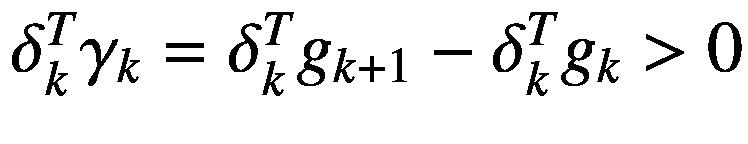。

BFGS 求解器是所有求解器中最好的。在许多数值方法无约束优化应用中，它被默认使用。

### 9.6.4 Huang 族方法（秩一法、DFP、BFGS、Pearson、McCormick）

Huang 更新公式是一个通用公式，涵盖了秩一法、DFP、BFGS、Pearson 和 McCormick 方法。其形式如下：


`θ`、`ϕ`、`φ`和`ω`是独立参数。

令`θ = 1`、`ϕ = -1`、`ψ = 1`、`ω = -1`，则得到秩一法公式。
令`θ = 1`、`ϕ = 0`、`ψ = 0`、`ω = 1`，则得到 DFP 公式。
令`ϕ/θ = (-γ_k δ_k^T) / (γ_k δ_k^T + γ_k^T S_k γ_k)`、`ψ = 1`、`ω = 0`，则得到 BFGS 公式。
令`θ = 1`、`ϕ = 0`、`ψ = 1`、`ω = 0`，则得到 McCormick 公式。

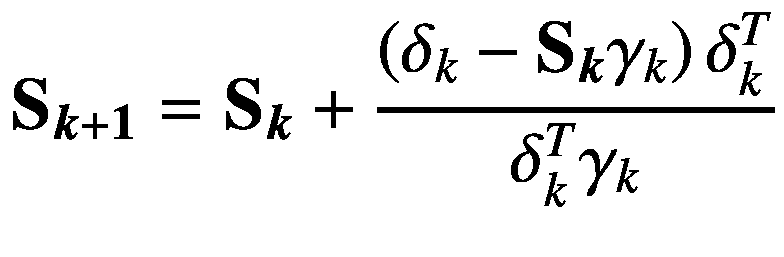

令`θ = 0`、`ϕ = 1`、`ψ = 0`、`ω = 1`，则得到 Pearson 公式。

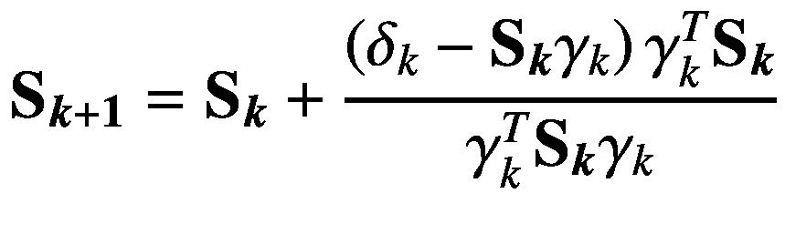

NM Dev 提供了一套拟牛顿方法。以下代码使用不同的拟牛顿方法求解图 9-11 中的 Himmelblau 函数：

```java
/**
* The Himmelblau function:
* f(x) = (x1² + x2 - 11)² + (x1 + x2² - 7)²
*/
RealScalarFunction f = new RealScalarFunction() {
@Override
public Double evaluate(Vector x) {
double x1 = x.get(1);
double x2 = x.get(2);
double result = pow(x1 * x1 + x2 - 11, 2);
result += pow(x1 + x2 * x2 - 7, 2);
return result;
}
@Override
public int dimensionOfDomain() {
return 2;
}
@Override
public int dimensionOfRange() {
return 1;
}
};
RealVectorFunction g = new RealVectorFunction() {
@Override
public Vector evaluate(Vector x) {
double x1 = x.get(1);
double x2 = x.get(2);
double w1 = x1 * x1 + x2 - 11;
double w2 = x1 + x2 * x2 - 7;
double[] result = new double[2];
result[0] = 4 * w1 * x1 + 2 * w2;
result[1] = 2 * w1 + 4 * w2 * x2;
return new DenseVector(result);
}
@Override
public int dimensionOfDomain() {
return 2;
}
@Override
public int dimensionOfRange() {
return 2;
}
};
C2OptimProblemImpl problem = new C2OptimProblemImpl(f, g);
QuasiNewtonMinimizer rankOneMinimizer = new RankOneMinimizer(1e-16, 15);
IterativeSolution soln1 = rankOneMinimizer.solve(problem);
Vector xmin = soln1.search(new DenseVector(new double[]{6, 6}));
double f_xmin = f.evaluate(xmin);
System.out.println(String.format("f(%s) = %.16f", xmin.toString(), f_xmin));
QuasiNewtonMinimizer dfpMinimizer = new DFPMinimizer(1e-16, 15);
IterativeSolution soln2 = dfpMinimizer.solve(problem);
xmin = soln2.search(new DenseVector(new double[]{6, 6}));
f_xmin = f.evaluate(xmin);
System.out.println(String.format("f(%s) = %.16f", xmin.toString(), f_xmin));
QuasiNewtonMinimizer bfgsMinimizer = new BFGSMinimizer(false, 1e-16, 15);
IterativeSolution soln3 = bfgsMinimizer.solve(problem);
xmin = soln3.search(new DenseVector(new double[]{6, 6}));
f_xmin = f.evaluate(xmin);
System.out.println(String.format("f(%s) = %.16f", xmin.toString(), f_xmin));
QuasiNewtonMinimizer huangMinimizer = new HuangMinimizer(0, 1, 0, 1, 1e-16, 15);
IterativeSolution soln4 = huangMinimizer.solve(problem);
xmin = soln4.search(new DenseVector(new double[]{6, 6}));
f_xmin = f.evaluate(xmin);
System.out.println(String.format("f(%s) = %.16f", xmin.toString(), f_xmin));
QuasiNewtonMinimizer pearsonMinimizer = new PearsonMinimizer(1e-16, 15);
IterativeSolution soln5 = pearsonMinimizer.solve(problem);
xmin = soln5.search(new DenseVector(new double[]{6, 6}));
f_xmin = f.evaluate(xmin);
System.out.println(String.format("f(%s) = %.16f", xmin.toString(), f_xmin));
```

输出结果如下：

```
f([3.000000, 2.000000] ) = 0.0000000000000000
f([3.000000, 2.000000] ) = 0.0000000000000000
f([3.000000, 2.000000] ) = 0.0000000000000000
f([3.000000, 2.000000] ) = 0.0000000000000000
f([3.000000, 2.000000] ) = 0.0000000000000000
```

拟牛顿方法看起来比任何一种共轭方向法都高效得多。它们的迭代次数少得多（15 次对 20 次），并且精度更高。

这些求解器的签名如下：

